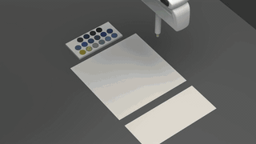
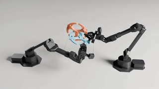
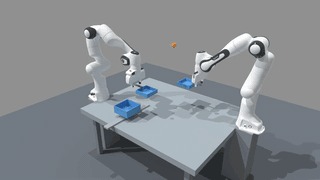
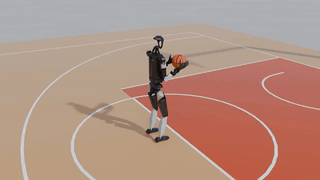
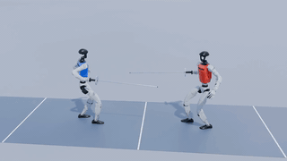
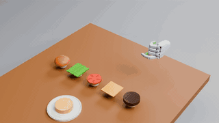
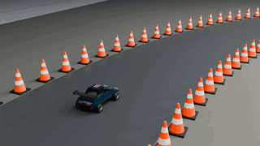
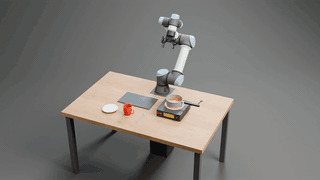
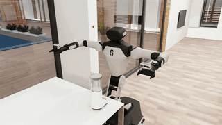
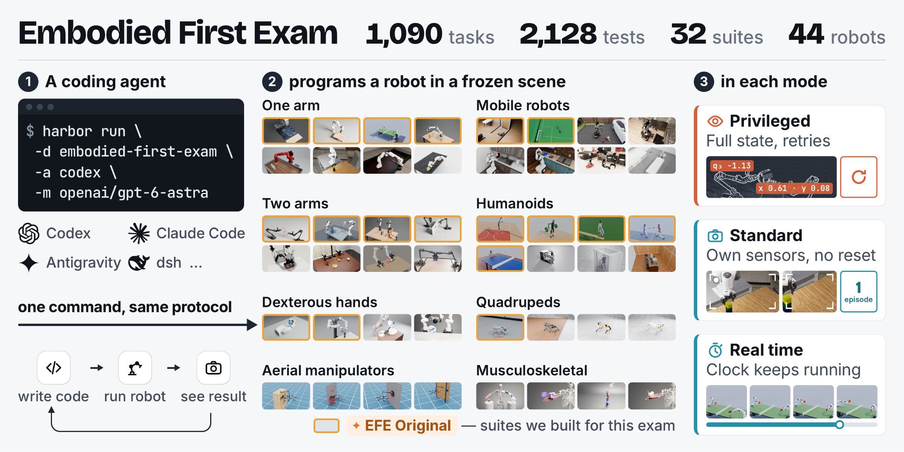

<h1 align="center"><a href="https://www.embodied-first-exam.ai"></a>&nbsp;Embodied First Exam</h1>

<p align="center">
  <a href="https://www.embodied-first-exam.ai"></a>
  <a href="https://discord.gg/AhC6utNyfk"></a>
  <a href="LICENSE"></a>
  <a href="docs/assets/wechat.jpg"></a>
</p>

<p align="center">Code agents have passed many exams in the digital world.<br>
<b>What is their first exam to enter the physical world?</b></p>

<p align="center">
  <a href="https://www.embodied-first-exam.ai/suite/?id=robopaint"></a>
  <a href="https://www.embodied-first-exam.ai/suite/?id=roboarc"></a>
  <a href="https://www.embodied-first-exam.ai/suite/?id=pandadyn"></a>
</p>
<p align="center">
  <a href="https://www.embodied-first-exam.ai/suite/?id=embodied-olympics-fun"></a>
  <a href="https://www.embodied-first-exam.ai/suite/?id=embodied-olympics-match"></a>
  <a href="https://www.embodied-first-exam.ai/suite/?id=dexhand"></a>
</p>
<p align="center">
  <a href="https://www.embodied-first-exam.ai/suite/?id=roboengineer"></a>
  <a href="https://www.embodied-first-exam.ai/suite/?id=embodied-safety-exam"></a>
  <a href="https://www.embodied-first-exam.ai/suite/?id=ispatialgym"></a>
</p>

<p align="center"><b>Our nine original suites:</b> <b>RoboPaint</b> · <b>RoboARC</b> · <b>RoboDynamicExam</b> · <b>Embodied Olympics - Fun</b> · <b>Embodied Olympics - Match</b> · <b>DexHandExam</b> · <b>RoboEngineer</b> · <b>Embodied Safety Exam</b> · <b>iSpatialGym</b><br><a href="https://huggingface.co/datasets/MLL-Lab/embodied-exam-media/resolve/main/site/blog/efe-intro.mp4"><b>▶ Watch the intro video</b></a></p>

## News

- 🔥 **2026-10-19**: Embodied First Exam is released!

## Framework

In every task, a coding agent writes code, runs it on a robot in a frozen scene from one of the suites, and sees what happens.

<p align="center"></p>

## Original suites

Nine of the suites were written for this exam:

<table>
<tr><th>Suite</th><th>Description</th></tr>
<tr>
<td><b><a href="https://www.embodied-first-exam.ai/suite/?id=robopaint">RoboPaint</a></b></td>
<td><b>Tests fine tool control.</b> A robot arm reproduces a given picture with a brush or pen, from Chinese calligraphy to oil painting.</td>
</tr>
<tr>
<td><b><a href="https://www.embodied-first-exam.ai/suite/?id=roboarc">RoboARC</a></b></td>
<td><b>Tests manipulation of tangled, deformable and multi-part objects.</b> Robot arms take apart metal wire puzzles, tie and thread ropes, fold cloth and assemble IKEA furniture.</td>
</tr>
<tr>
<td><b><a href="https://www.embodied-first-exam.ai/suite/?id=pandadyn">RoboDynamicExam</a></b></td>
<td><b>Tests handling of moving objects.</b> One or two robot arms catch, strike, carry and hand over objects in motion: tossed balls, sliding pucks, swinging loads.</td>
</tr>
<tr>
<td><b><a href="https://www.embodied-first-exam.ai/suite/?id=embodied-olympics-fun">Embodied Olympics - Fun</a></b></td>
<td><b>Tests humanoid motor skills with fun sports-inspired tasks.</b> The agent gets a humanoid robot to perform moves taken from many sports.</td>
</tr>
<tr>
<td><b><a href="https://www.embodied-first-exam.ai/suite/?id=embodied-olympics-match">Embodied Olympics - Match</a></b></td>
<td><b>Tests competitive play against an opponent.</b> Robots play full matches of table tennis, badminton, soccer, foosball and fencing against scripted or learned opponents.</td>
</tr>
<tr>
<td><b><a href="https://www.embodied-first-exam.ai/suite/?id=dexhand">DexHandExam</a></b></td>
<td><b>Tests dexterous hand manipulation.</b> Five-finger robot hands turn book pages, open jars, stir coffee, plug in a USB stick, fold paper and build a hamburger.</td>
</tr>
<tr>
<td><b><a href="https://www.embodied-first-exam.ai/suite/?id=roboengineer">RoboEngineer</a></b></td>
<td><b>Tests the sim-to-real engineering loop.</b> The agent builds a controller in a public simulator, deploys it to one with hidden dynamics, and fixes it from what the deployment shows.</td>
</tr>
<tr>
<td><b><a href="https://www.embodied-first-exam.ai/suite/?id=embodied-safety-exam">Embodied Safety Exam</a></b></td>
<td><b>Tests safety.</b> The robot must carry out safe requests, refuse requests that would harm people, and explain the risk.</td>
</tr>
<tr>
<td><b><a href="https://www.embodied-first-exam.ai/suite/?id=ispatialgym">iSpatialGym</a></b></td>
<td><b>Tests spatial reasoning from images.</b> The goal is given only as a picture: a mobile two-armed robot rearranges the room, or moves itself, until its camera view matches it.</td>
</tr>
</table>

## Quick start

<!-- quick-start: generated by `python3 scripts/task_conventions.py readme --write` -->
### Before you run

- **Host:** Linux x86_64 with git, [uv](https://docs.astral.sh/uv/) (it fetches a Python 3.12-3.14 for Harbor if needed) and Docker Engine with Compose v2 and BuildKit (the `buildx` plugin). Without Docker, e.g. on a Slurm cluster: rootless podman with `-e podman` ([docs/protocol/running.md](docs/protocol/running.md#without-docker-rootless-podman-eg-a-slurm-cluster)).
- **GPU:** the NVIDIA driver and the [NVIDIA Container Toolkit](https://docs.nvidia.com/datacenter/cloud-native/container-toolkit/latest/install-guide.html) for every task that uses a GPU. An RTX-class GPU (with RT cores; not A100 or H100): AM-Bench, BEHAVIOR-1K, iSpatialGym, LabUtopia, ManiGuard, RoboARC, RoboDojo, RoboLab, TactileLab, YAMLab. Any NVIDIA GPU: ABC Sim, BiGym 2.0, DexToolBench, MolmoSpaces, Panda Dynamic Scenes, RoboPaint, RoboTwin 2.0, RoboWits. Some tasks: Embodied Olympics - Fun, Embodied Olympics - Match, HumanoidBench, KinDER, MuJoCo Playground, MyoSuite, roboEngineer. No GPU: AutoBio, DexHand, DexJoCo, Embodied Safety Exam, LIBERO-MAX, MetaWorld+, RoboCasa, RoboCasa-GR1, RoboCasa365, VLABench.
- **Disk:** a benchmark's public images take 1-30 GB, pulled on its first run; a benchmark that builds its image needs the free disk its row below states.
- **API keys** for the agent's model in `.env` (step 1), or a subscription (step 3).

These benchmarks need a step by hand, or build their image on their first run because it may not be redistributed. That build accepts the licences of what it installs on your behalf: read them in the linked section. Organization members logged in to ghcr.io pull the prebuilt layers instead (on podman, after `podman login ghcr.io`, `harbor run -e podman` pulls the prebuilt image and uses it in place of the recipe; [docs/protocol/running.md](docs/protocol/running.md#without-docker-rootless-podman-eg-a-slurm-cluster)).

| Benchmark | By hand, once | First run |
|---|---|---|
| [AM-Bench](tasks/ambench/README.md#before-you-run) | - | Builds its image (accepts NVIDIA's Isaac Sim terms): about 25 min, 60 GB free disk. |
| [AutoBio](tasks/autobio/README.md#before-you-run) | - | Builds its image from AutoBio's repository, which states no licence (CPU only): a few minutes, 3 GB free disk. |
| [BEHAVIOR-1K](tasks/behavior-1k/README.md#before-you-run) | Download the BEHAVIOR dataset (its downloader asks you to accept the BEHAVIOR Data Bundle licence; about 32 GB, 40 GB on disk) and export `RCB_BEHAVIOR_DATA`. | Builds its image (accepts NVIDIA's Isaac Sim terms): about 20 min, 30 GB free disk. |
| [iSpatialGym](tasks/ispatialgym/README.md#before-you-run) | The BEHAVIOR-1K dataset, `RCB_BEHAVIOR_DATA` (the same directory). | Builds its image (accepts NVIDIA's Isaac Sim terms): about 20 min, 31 GB free disk. |
| [LabUtopia](tasks/labutopia/README.md#before-you-run) | - | Builds its image (accepts NVIDIA's Isaac Sim terms; LabUtopia's assets are CC BY-NC 4.0): about 25 min, 90 GB free disk. |
| [LIBERO-MAX](tasks/libero-max/README.md#task-definition) | A CPU with AVX-512 (Intel Ice Lake or newer Xeon, AMD Zen 4 or newer). | - |
| [ManiGuard](tasks/maniguard/README.md#before-you-run) | Prepare the data root `RCB_MANIGUARD_DATA` (3.4 GB; its key asks you to accept the BEHAVIOR Data Bundle licence). NVIDIA driver 580.x: newer drivers crashed at start. | Builds its image (accepts NVIDIA's Isaac Sim terms): about 20 min, 50 GB free disk. |
| [RoboARC](images/roboarc/README.md#host) | NVIDIA driver 580 or newer, one GPU per container; knot_untying and rope_threading need a 24 GB GPU of their own. | - |
| [RoboDojo](tasks/robodojo/README.md#before-you-run) | - | Builds its image with 41 GB of assets (accepts NVIDIA's Isaac Sim terms and cuRobo's): 30-90 min, 150 GB free disk. |
| [roboEngineer](tasks/roboengineer/README.md#getting-the-images) | Build the evaluator images with its scripts; the eight Neural Fly tasks also need the force fit made locally (`fetch_assets.sh --fit-fly`). | - |
| [RoboLab](tasks/robolab/README.md#before-you-run) | - | Builds its image (accepts NVIDIA's Isaac Sim terms): 20-60 min, 60 GB free disk. |
| [RoboWits](tasks/robowits/README.md#getting-the-images) | 24 of its 30 tasks need BlenderKit models in `RCB_ROBOWITS_BLENDERKIT`: from the gated Hugging Face dataset (accept its terms, `hf auth login`) or with your own BlenderKit Full Plan key. | - |
| [VLABench](tasks/vlabench/README.md#what-you-need-before-running) | - | Builds its image (CPU only): 5-20 min, 40 GB free disk. |
| [YAMLab](tasks/yamlab/README.md#before-you-run) | - | Builds its image (accepts NVIDIA's Isaac Sim terms): about 25 min, 60 GB free disk. |

### 1. Install

```bash
# clone with the submodules; install Harbor 0.23.0 with this repository's flags
git clone --recurse-submodules https://github.com/mll-lab-nu/embodied-first-exam.git
cd embodied-first-exam
uv tool install --force -e . --with-executables-from harbor
# your API keys go in .env
cp .env.example .env
```

```bash
# or without a clone: install from PyPI (or pip install embodied-first-exam);
# the tasks are cloned on first use; API keys: in the shell or a .env in the working directory
uv tool install embodied-first-exam --with-executables-from harbor
```

### 2. Run

```bash
# the core set: 449 tasks, each in its default mode
harbor run -d embodied-first-exam -a codex -m openai/gpt-6-astra
```

```bash
# the core tasks in another mode: --privileged (372 tasks), --standard, --standard-realtime
harbor run -d embodied-first-exam --privileged -a codex -m openai/gpt-6-astra
```

```bash
# every task: 2244 task dirs (1157 tasks in their modes, 35 benchmarks)
harbor run -d embodied-first-exam@all -a codex -m openai/gpt-6-astra
```

```bash
# one benchmark, here RoboARC (212 task dirs)
harbor run -d embodied-first-exam@all -p tasks/roboarc -a codex -m openai/gpt-6-astra
```

```bash
# one task (-y skips Harbor's confirmation prompt, e.g. in a script)
harbor run -d embodied-first-exam@all -p tasks/<benchmark>/<task> -a oracle
```

### 3. Or use a subscription instead of an API key

```bash
# ChatGPT: log in once
codex login
CODEX_FORCE_AUTH_JSON=1 harbor run -d embodied-first-exam -a codex -m openai/gpt-6-astra
```

```bash
# Claude: put the token it prints in .env as CLAUDE_CODE_OAUTH_TOKEN
claude setup-token
CLAUDE_FORCE_OAUTH=1 harbor run -d embodied-first-exam \
  -a claude-code -m anthropic/claude-opus-5-5
```
<!-- /quick-start -->

## Contribute

See [embodied-first-exam.ai/contribute](https://www.embodied-first-exam.ai/contribute/) and [CONTRIBUTING.md](CONTRIBUTING.md).

## Acknowledgements

Nine of the suites were written for this exam. The others are adapted from existing benchmarks, and their scenes, robots and success criteria are the ground the exam is built on. We are grateful to their authors:

- **[BEHAVIOR-1K](https://behavior.stanford.edu/)**: BEHAVIOR-1K: A Human-Centered, Embodied AI Benchmark with 1,000 Everyday Activities and Realistic Simulation ([paper](https://arxiv.org/abs/2403.09227), [code](https://github.com/StanfordVL/BEHAVIOR-1K))
- **[RoboLab](https://research.nvidia.com/labs/srl/projects/robolab)**: RoboLab: A High-Fidelity Simulation Benchmark for Analysis of Task Generalist Policies ([paper](https://arxiv.org/abs/2604.09860), [code](https://github.com/NVlabs/RoboLab))
- **[RoboCasa](https://robocasa.ai)**: RoboCasa: Large-Scale Simulation of Everyday Tasks for Generalist Robots ([paper](https://arxiv.org/abs/2406.02523), [code](https://github.com/robocasa/robocasa))
- **[RoboCasa365](https://robocasa.ai)**: RoboCasa365: A Large-Scale Simulation Framework for Training and Benchmarking Generalist Robots ([paper](https://arxiv.org/abs/2603.04356), [code](https://github.com/robocasa/robocasa))
- **[RoboCasa-GR1](https://developer.nvidia.com/isaac/gr00t)**: GR00T N1: An Open Foundation Model for Generalist Humanoid Robots ([paper](https://arxiv.org/abs/2503.14734), [code](https://github.com/robocasa/robocasa-gr1-tabletop-tasks))
- **[MetaWorld+](https://metaworld.farama.org/)**: Meta-World+: An Improved, Standardized, RL Benchmark ([paper](https://arxiv.org/abs/2505.11289), [code](https://github.com/Farama-Foundation/Metaworld))
- **[VLABench](https://vlabench.github.io/)**: VLABench: A Large-Scale Benchmark for Language-Conditioned Robotics Manipulation with Long-Horizon Reasoning Tasks ([paper](https://arxiv.org/abs/2412.18194), [code](https://github.com/OpenMOSS/VLABench))
- **[HumanoidBench](https://humanoid-bench.github.io)**: HumanoidBench: Simulated Humanoid Benchmark for Whole-Body Locomotion and Manipulation ([paper](https://arxiv.org/abs/2403.10506), [code](https://github.com/carlosferrazza/humanoid-bench))
- **[MolmoSpaces](https://allenai.github.io/molmospaces/)**: MolmoSpaces: A Large-Scale Open Ecosystem for Robot Navigation and Manipulation ([paper](https://arxiv.org/abs/2602.11337), [code](https://github.com/allenai/molmospaces))
- **[KinDER](https://prpl-group.com/kinder-site/)**: KinDER: A Physical Reasoning Benchmark for Robot Learning and Planning ([paper](https://arxiv.org/abs/2604.25788), [code](https://github.com/Princeton-Robot-Planning-and-Learning/kindergarden))
- **[RoboTwin 2.0](https://robotwin-platform.github.io/)**: RoboTwin 2.0: A Scalable Data Generator and Benchmark with Strong Domain Randomization for Robust Bimanual Robotic Manipulation ([paper](https://arxiv.org/abs/2506.18088), [code](https://github.com/RoboTwin-Platform/RoboTwin))
- **[MuJoCo Playground](https://playground.mujoco.org/)**: MuJoCo Playground ([paper](https://arxiv.org/abs/2502.08844), [code](https://github.com/google-deepmind/mujoco_playground))
- **[DexToolBench](https://simtoolreal.github.io/)**: SimToolReal: An Object-Centric Policy for Zero-Shot Dexterous Tool Manipulation ([paper](https://arxiv.org/abs/2602.16863), [code](https://github.com/tylerlum/simtoolreal))
- **[DexJoCo](https://dexjoco.github.io/)**: DexJoCo: A Benchmark and Toolkit for Task-Oriented Dexterous Manipulation on MuJoCo ([paper](https://arxiv.org/abs/2605.16257), [code](https://github.com/brave-eai/dexjoco))
- **[MyoSuite](https://www.myosuite.org)**: MyoSuite -- A contact-rich simulation suite for musculoskeletal motor control ([paper](https://arxiv.org/abs/2205.13600), [code](https://github.com/MyoHub/myosuite))
- **[RoboDojo](https://robodojo-benchmark.com/)**: RoboDojo: A Unified Sim-and-Real Benchmark for Comprehensive Evaluation of Generalist Robot Manipulation Policies ([paper](https://arxiv.org/abs/2607.04434), [code](https://github.com/RoboDojo-Benchmark/RoboDojo))
- **[BiGym 2.0](https://bigym2.github.io/)**: BiGym 2.0: Benchmarking Learned and Agent-Developed Policies for Humanoid Household Manipulation ([paper](https://arxiv.org/abs/2610.07594), [code](https://github.com/swirl-uk/BiGym2))
- **[YAMLab](https://github.com/ARISE-Initiative/yamlab)** ([code](https://github.com/ARISE-Initiative/yamlab))
- **[LIBERO-MAX](https://liberomax.github.io/)**: LIBERO-MAX: Do Robot Policies Adapt When the World Changes? ([paper](https://arxiv.org/abs/2609.36518), [code](https://github.com/liberomax/LIBERO-MAX))
- **[AM-Bench](https://ambench.github.io/)**: AM-Bench: A Modular Simulation Suite and Benchmark for Aerial Manipulation Policy Learning ([paper](https://arxiv.org/abs/2609.00641), [code](https://github.com/ambench/ambench))
- **[RoboWits](https://umass-embodied-agi.github.io/RoboWits/)**: RoboWits: Unexpected Challenges for Robotic Creative Problem Solving ([paper](https://arxiv.org/abs/2605.30326), [code](https://github.com/UMass-Embodied-AGI/RoboWits))
- **[ManiGuard](https://nu-ideas-lab.github.io/ManiGuard/)**: MANIGUARD: A Benchmark and Data Suite for Specification-Grounded Safety Evaluation and Improvement of Robotic Manipulation ([paper](https://arxiv.org/abs/2608.17386), [code](https://github.com/NU-IDEAS-Lab/ManiGuard))
- **[LabUtopia](https://rui-li023.github.io/labutopia-site/)**: LabUtopia: High-Fidelity Simulation and Hierarchical Benchmark for Scientific Embodied Agents ([paper](https://arxiv.org/abs/2505.22634), [code](https://github.com/Rui-li023/LabUtopia))
- **[AutoBio](https://github.com/autobio-bench/AutoBio)**: AutoBio: A Simulation and Benchmark for Robotic Automation in Digital Biology Laboratory ([paper](https://arxiv.org/abs/2505.14030), [code](https://github.com/autobio-bench/AutoBio))

## License

[MIT](LICENSE) for the code in this repository. Third-party simulators, assets, reference solutions derived from
upstream experts and the contents of the base images keep their own licenses.

## Citation

```bibtex
@misc{embodiedfirstexam2026,
  title        = {Embodied First Exam},
  author       = {Kangrui Wang*§ and Qineng Wang*§ and Changhe Chen*§ and Pingyue Zhang*§ and Chi Gui*§ and Feishi Wang§ and Canyu Chen§ and Wenli Xiao§ and Xiaoyu Huang§ and Tonghe Zhang§ and Linjie Li§ and Zihan Wang and Yiyou Sun and Mingkai Deng and Jinyu Hou and Han Liu and Qi Zhu and Eric P. Xing and Huaxiu Yao and Zhiwen Fan and Yuejiang Liu and Jiajun Wu and Yuke Zhu and Guanya Shi† and Ruohan Zhang† and Manling Li†},
  year         = {2026},
  url          = {https://github.com/mll-lab-nu/embodied-first-exam}
}
```
