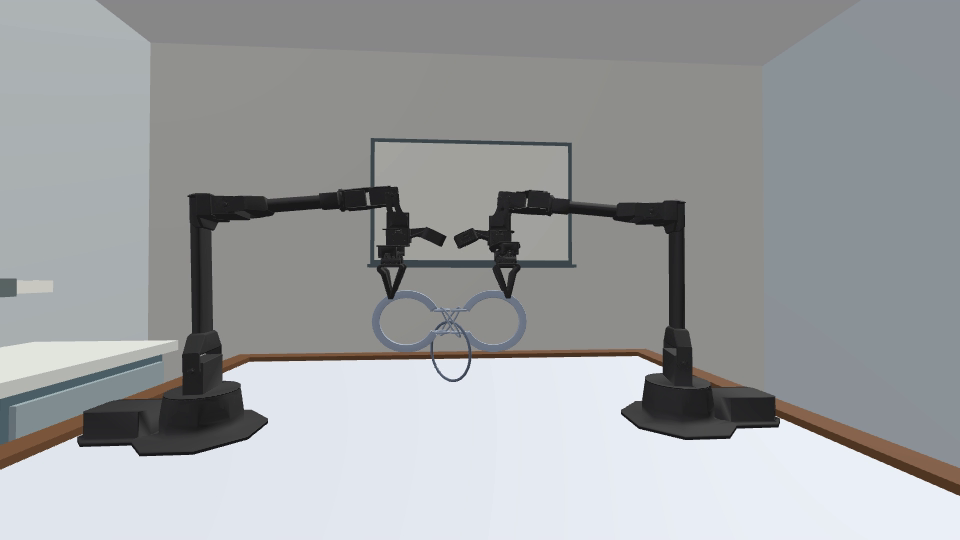
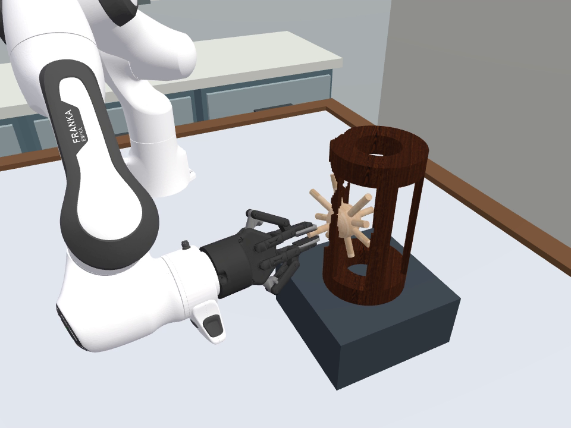
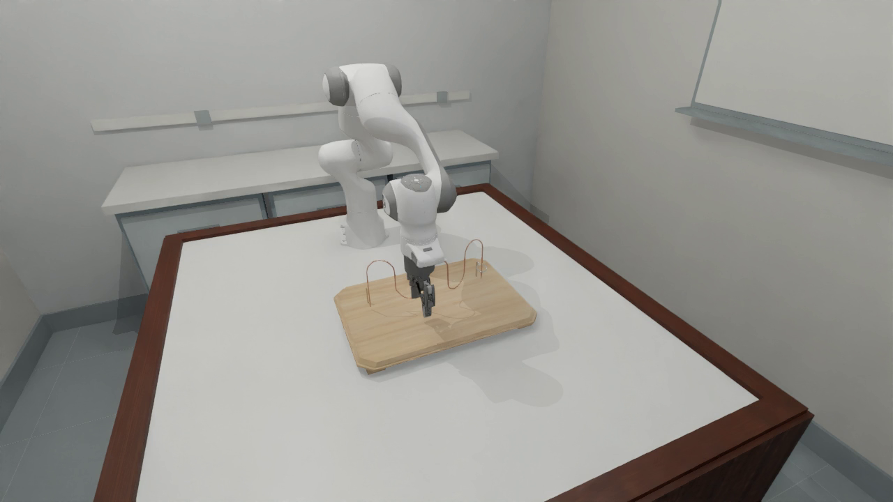
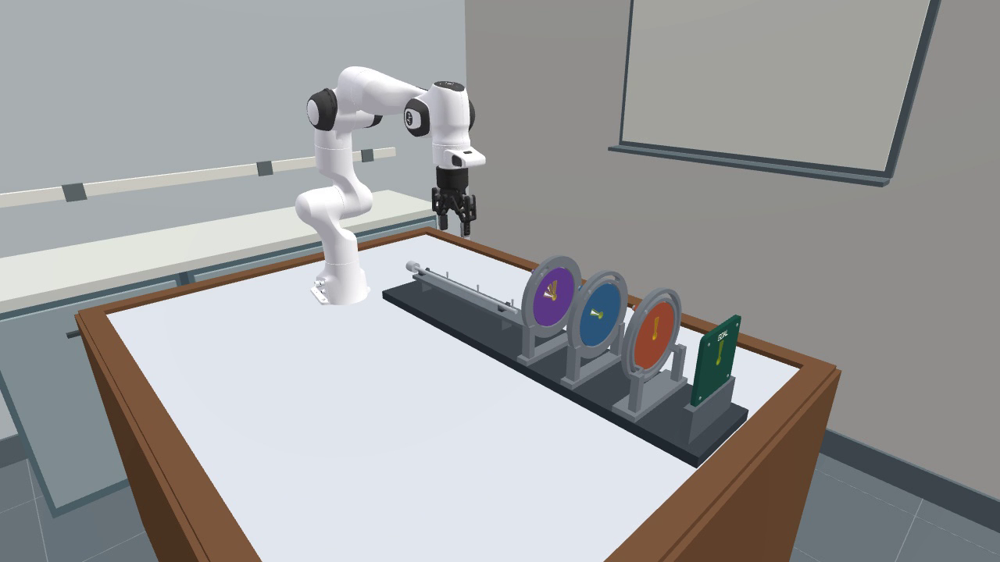
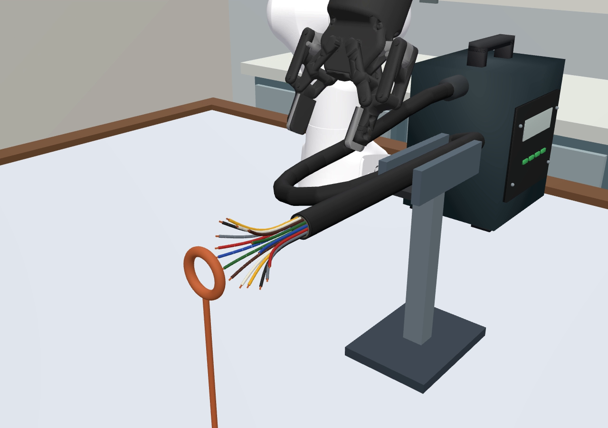
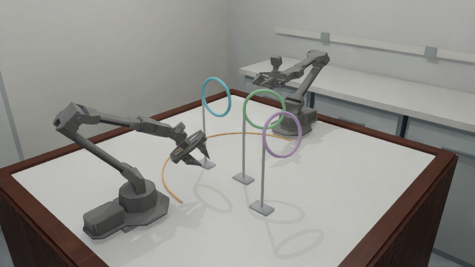
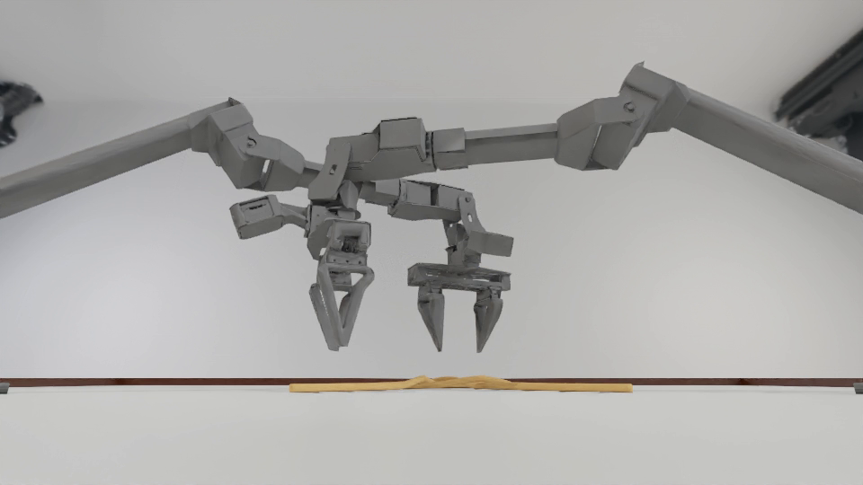
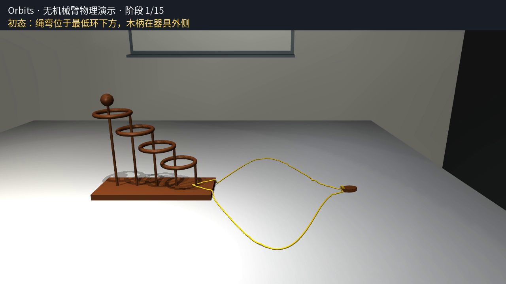
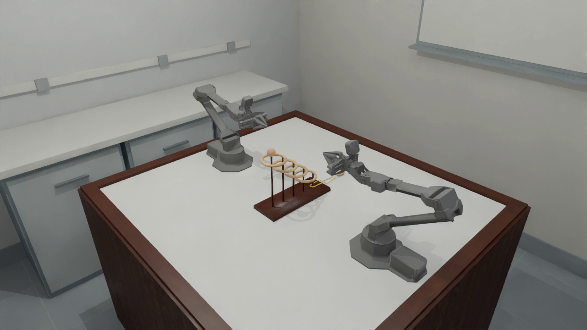
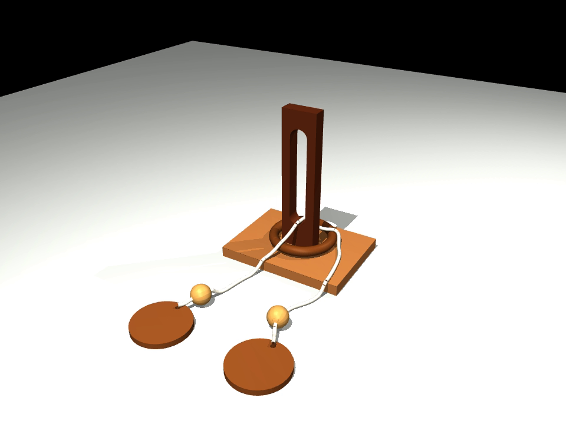

# 默认场景预设恢复：原因核查、参考画面与开发计划

日期：2026-09-24。本文保留批准时的方案与历史参考截图；**实施已开始并合入主项目，当前状态以[实施报告](scene_preset_restoration_implementation_20260924_zh.md)为准。** 下文“尚未执行”等表述属于方案形成时的历史状态，参考截图仍不是修改后渲染。

**2026-09-25 补充：** 用户已接受其余材质与初始预设，第 11 节仅涉及 Horseshoe 配色、Lock Picking 孔缘描线、Orbits 纵向居中三项，并覆盖旧方案中的 Orbits 横向摆放设计。**代码已实施，并在用户追加授权后完成快速验证：21 项单元检查、三项 0.075 s 真实场景、Orbits home/张爪及 5/5 代表性接近路径的几何检查通过。** 数秒稳定性、连续双臂操作及完整生命周期仍待验证。实际文件变更、耗时与剩余范围见[实施报告增补](scene_preset_restoration_implementation_20260924_zh.md#scene-refinements-20260925)。

> **2026-09-24 并行实施边界更新（覆盖下文初稿中的跨模块候选）：** 已获授权实施，目前在 `/home/jianwen/topogym-scene-restoration-20260924/` 独立副本开发，后已仅将本轮归属文件合入主项目。为与另一 API session 完全分开，本轮不修改 `topogym/simulator/`、`topogym/config/`、`topogym/world/`、`topogym/robot/`、`topogym/sensors/`、`topogym/recording/`、`tests/runtime_evidence.py`、`scripts/test_base_tasks.py`、`pyproject.toml`、`tasks/base.py` 或 `tasks/task_variations/`。`assets/geometry/lock_picking.py` 也归为只读：副本中的两处外观改动已撤回，并核对与开始时 SHA-256 完全一致；改由本轮新增 `assets/scene_visuals.py` 处理生成后的 visual 资产。预设放在新增 `tasks/scene_presets.py`，由任务默认值直接消费，不向 SimulatorConfig/Env 增加接口。完整写入边界见[并行实施记录](scene_preset_restoration_implementation_20260924_zh.md)。若必须修改上述只读文件，先报告并等待另一 session 完成；不靠“同文件不同几行”并行写入。

目标：把用户本轮指定的材质、配色、结构、尺度和初始布局落实为 simulator 的默认预设，供普通 `make/reset/observe/render` 与公共录制模块共同使用。之后的难度变体从这一套基线派生。

## 1. 先纠正“完整 setting”和“尚不完整”的含义

上次“13 项都有完整 simulator setting”的表述过宽。准确情况是：**13 项均已接入基础场景与物理生命周期，并有旧批次的短程 GPU 运行证据；完整 demo 的外观、夹具、初态优化没有全部迁移，七项任务还没有完整成功判定。** 当前源码还包含后续公共接口变更，不能用旧批次通过记录证明最新工作树已全部复验。

需要分别看四件事：

| 层次 | 已有什么 | 尚不能据此证明什么 |
|---|---|---|
| 基础运行 | 建场景、初始化、机器人响应、step、保存/恢复、重建，有真实 Nyx 图像 | 场景完整、每个重要物体都可见、夹具布局可操作 |
| 成功判据实现 | 六项有结果计算；七项显式 `goal_complete=False` | 不能把进度数值、位置接近或测试通过当作任务成功 |
| 操作与物理验收 | 一部分旧实例有连续机器人/外力执行证据 | 不自动覆盖新资产、新尺寸、新机器人布局或新的 FEM 模型 |
| 默认场景保真 | 部分几何和材质函数保留 | 不等于它们已经被统一 Env 调用；本轮正要修复这层 |

依据：[当前 registry](../../../topogym/config/registry.py)、[任务基础合同](../../../topogym/tasks/base.py)、[基础运行结果](../../../runs/test_results/base_acceptance_final/README.md)。该结果中的普通任务主片段只有 **0.075 s 物理时间**，另有回溯/重建片段，并非完整任务操作。当前基础测试也以生命周期和数值一致性为主，没有要求用机器人把每项任务做完。

### 七项缺的具体是什么

| 任务 | 当前代码真正计算了什么 | 仍需实现的成功/失败判据 | 需要新增的验证证据 |
|---|---|---|---|
| Buzz Wire | 工具位置是否有限、是否掉桌、距终点距离、最近轨道采样点 | 圈孔沿整段 wire 连续通过，不能跳段；碰撞/越界；终点实体支撑、松手、稳定与能量历史 | 正确全程和跳段、擦碰、悬停伪终点等反例；从 home 拾取至放回；新尺度下主步长/半步长对照 |
| Lock Picking | 钥匙位置、三个被动圆盘角度 | 转角机械限位、钥匙凸片真实过槽净空、过载状态、拔出/释放资格 | 错误槽位与错误转角必须被挡；机械止挡和受力记录；完整插入/转盘/退出路径及释放 |
| Fiber Bundling | 关节链位置是否有限、是否掉桌、观测链节数 | 每一根子线按材料顺序完整穿环；禁止夹持细线；接触及抓持资格 | 漏一根、部分穿过、回退、只看质心等反例；真实粗护套抓取、全部穿环和释放后的状态 |
| Rope Threading | `evaluate_state()` 返回未完成说明，无完整目标计算 | 绳材料坐标上的有向、按序过环记录；释放后仍满足任务 | 顺序错误、回穿、仅绳端穿过等反例；实际机器人完整穿绳、接触/形变/稳定性记录 |
| Knot Untying | 同上 | 实测绳结拓扑、完全解开、释放与稳定 | 已解/未解/松结但仍缠绕的对照；连续解结与松手；接触、时间步/网格适用性验证 |
| Orbits | 同上 | 绳与器具完全解脱，不能只凭 winding 或木柄位置 | 绳、木柄全部脱离且保持永久端点连接；不得保留隐蔽穿环；双夹爪可执行性另验 |
| Slotted Post Ring | 同上 | 木环真正脱离绳和立柱，拓扑/接触合格 | “环越过柱顶但仍被绳套住”必须判失败；连接、珠孔/柱槽净空、释放后完整分离 |

因此，七项不是“成功逻辑已齐，只缺测试证明”。当前实现主动禁止它们返回成功。公共辅助抓持的获取、移动和释放也尚未全部接入，不能假定历史 demo 的辅助抓持会自动在新 Env 中工作。六项已有判据同样只表示代码存在，不表示已获得新框架下完整任务资格。

本次场景恢复将覆盖外观、模型、初态、可达性和相关物理回归。七项完整求解判据单独保留缺口；涉及 Buzz 首尾支撑、Lock 机械框架的真实结构随本轮补齐，但不提前将其 `goal_complete` 改为 true。

## 2. 为什么会出现这些退化

重构记录明确把第一阶段设为“全部任务经统一 Env 基础运行”，允许任务未完成，见[13 项接入记录](simulator_task_integration_20260923_zh.md)。这个阶段边界可以解释为什么完整求解器没有一起迁移，**但不能把遗漏已有材质和夹具视作合理的默认场景结果**。迁移验收缺少了逐任务“原场景—新场景”的实体、外观和布局对照。

已确认的共性问题：

1. **运行入口换了，历史任务预设未完整迁移。** 新 Env 从 `Task.defaults + task_parameters` 创建 Task，不再自动读取旧 `configs/*preview.yaml` 或 demo 录制配置。历史预设仍在磁盘，不等于默认场景使用了它。
2. **资产生成与实际加载脱节。** Orbits/Slotted 生成器同时输出 OBJ 和带 PBR/木纹的 GLB，新任务却加载 OBJ；仅保留生成函数无法恢复画面。
3. **物理 material 与视觉 surface 被混淆。** `EntitySpec.material` 的摩擦、密度、弹性模量不负责颜色。多项任务只填写物理材料，`surface` 留空；FEM 动态表面也不会自动继承旁边某个预览 GLB 的颜色。
4. **场景声明被简化。** Lock 当前没有实体底板、转盘支撑架、钥匙托架；Buzz 使用普通 Box 底座，没有使用历史玩具版底座与首尾支撑。这些是实际结构遗漏，不能靠调亮画面修好。
5. **测试范围没有拦住视觉和操作回归。** 图像非空、相机类型正确、视频能解码、状态能恢复，都无法发现“只剩桌面和机器人，任务 wire 消失”。短程保持动作也无法证明从 home 能抓取工具或完成放回。
6. **历史说明与源码版本不同步。** 一些任务页还指向已删除的独立 `scene.py`/demo 入口。此次以当前源码、归档视频和真实报告交叉核对；后续更新文档入口，避免继续误用旧配置。

### 逐任务原因与确认程度

| 任务 | 已确认的代码事实 | 尚待定位/验证 |
|---|---|---|
| Horseshoe | `target_ring` 走独立 URDF，自由刚体，重力补偿 0；未声明附件约束；正常 tick 没有环位置纠正 | 还需新预设下专门的重力/接触测试，不能只凭 0.075 s 录像判断 |
| Hedgehog | Task 调用 `generate_assets(..., finish="metal")`；生成器已有 `finish="wood"`，深浅木纹 PNG 也已随包保留 | 木纹/PBR 是否在当前 Nyx 加载后保持，要实景验证 |
| Buzz | `finish` 回落到 `legacy`，`supported_endpoints=False`；底座是无指定外观的 Box；默认板面 0.826×0.574 m；wire/wand 仍是多 primitive visual 的 URDF | 原始 PNG 已确认几乎看不到线/圈。历史代码明确记录过 Nyx 同 link 多 visual 问题，是优先排查方向；未做新旧导出器对照实验，不能断言它是唯一原因 |
| Lock | Task 只建三个盘、goal、key；没有底座、frame、cradle；`write_disc()` 未传 `stop`；钥匙初态直接贴近桌面 | 需要选择并迁移匹配当前转盘的限位框架，验证几何/自由度，不照搬外观模型冒充机械止挡 |
| Fiber | MJCF 生成器已写黑色 `JACKET_COLOR` 与终端盒/彩线 rgba，但旧验收 PNG 的箱体与引线呈灰白；Task 只给整个 bundle 物理材料 | 色值在 Genesis 导入、vgeom、Nyx export 哪一层丢失/被覆盖，需逐层检查。不能说颜色定义完全不存在，也不能用一个全黑 surface 覆盖全部彩线 |
| Rope / Knot | FEM Task 未给 rope 显式 surface；Knot 生成器另存彩色 `rope_initial.glb`，运行路径却用 `rope.obj + rope_volume.npz` | 动态表面材质/UV 与材料坐标如何绑定；当前 FEM 工厂显式 `_uvs=None`，不可只给纹理文件就宣称编织纹理有效 |
| Orbits | 加载 `*.obj` 而非生成器已有木质/黄色绳 GLB；全场景位置硬编码 `(0, -.22, table_height)`，未按双夹爪中心组织 | 新朝向/尺寸的双臂可达性、绳余量和连接一致性 |
| Slotted | 同样加载 OBJ，跳过生成器保留的木纹 GLB；FEM 绳无显式外观 | 木环、珠、端片与 FEM 的接触/连接在恢复外观后仍须验证 |

对照原始证据：[Buzz PNG](../../../runs/test_results/nyx_base_acceptance_urdf/buzz_wire_3d/initial_frames/oblique.png)、[Lock PNG](../../../runs/test_results/nyx_base_acceptance_urdf/lock_picking/initial_frames/oblique.png)、[Fiber PNG](../../../runs/test_results/nyx_base_acceptance_urdf/fiber_bundling/initial_frames/oblique.png)、[Orbits PNG](../../../runs/test_results/nyx_base_acceptance_anchored/orbits/initial_frames/oblique.png)。这些都是旧验收帧，不是本轮新渲染。

## 3. Horseshoe：圆环有没有被固定或位置矫正

**源码核查结论：没有发现这样的逻辑；当前声明符合自由受重力影响的圆环。** 证据链如下：

- [任务定义](../../../topogym/tasks/horseshoe_ring.py)：每个 puzzle body 均不设置 `fixed=True`；显式 `gravity_compensation=0.0`；`TaskSpec.attachments` 为空。
- [EntitySpec](../../../topogym/tasks/base.py)：`fixed` 缺省为 false。
- [模型生成器](../../../topogym/assets/geometry/horseshoe_ring.py) `write_body()`：target_ring 是独立单 link、有正质量和惯量的 URDF，没有跨物体 joint；报告标明 `inter_body_joints=0, fixed=False`。链条通过碰撞/真实穿套保持连接。
- [公共 World](../../../topogym/world/genesis_world.py)：`spec.fixed` 传给 Genesis；普通 `advance()` 执行 `scene.step()`，没有 Horseshoe 特例或每步 `set_pos/set_quat`。
- [公共重力配置](../../../topogym/config/profiles/env_configs/world_tabletop_v1.yaml)：重力为 `[0,0,-9.81]`。机器人自身重力补偿不是任务圆环重力补偿。
- 任务 `evaluate_state()` 读取位姿、链环拓扑和桌面接触来判定，不写回位置。初始化摆放和显式 checkpoint 恢复属于独立操作，不能与正常 step 的约束混为一谈。

后续物理验证分两类：① 单独诊断初态将同一模型圆环放在足够净空的无接触区域，检验重力加速度/轨迹、无外加力及无位姿写入；② 原装配初态验证环在重力与接触下滑动/悬挂、链条不穿透，以及最终释放接触桌面。自由落体诊断不能代替原场景验证；旧完整 demo 的重力通过也不能直接算新版本通过。

## 4. 新默认场景具体长什么样

以下为开发目标，颜色/缩放是拟定预设，不是已完成渲染或已验证可达的位置。

| 任务 | 材质与外观目标 | 模型/布局目标 |
|---|---|---|
| Horseshoe | 保留可辨识的金属马蹄、链环和目标圆环 | 保留自由圆环与真实接触；本轮不增加位置维持、焊接或重力补偿 |
| Hedgehog | **深色木笼＋浅色木刺球**，有真实木纹 UV，非棕色塑料；沿用已存木纹 | 保持笼口/刺球碰撞几何；固定笼、自由刺球；支撑座完整可见 |
| Buzz | **浅木底座、铜质 wire、银色金属环和连杆、木质手柄**；所有细构件可见 | 当前基线再缩小；实体起点/终点托座，手柄下方留夹爪净空；从 home 连续接近拾取、终点放下并撤手 |
| Lock | 保留紫/蓝/橙转盘与绿色终端；底板可见；**框架、限制环、钥匙初始托架采用灰白工程塑料**，钥匙保持金属外观 | 加回底板和盘架；将整套装置向机器人舒适区域移动；钥匙放在开放 V 托架上，手柄露出可抓，托架不把钥匙固定 |
| Fiber | 配电箱采用深蓝灰喷涂金属、黑色面板/护口；**整段主电缆/护套哑光黑**；子线保留清晰绝缘彩色、末端铜色 | 保持固定终端、柔性引线、粗护套抓持区、独立子线；不得将彩线整体染黑或把动态链换成静态 GLB |
| Rope | 绳为**赭黄/麻绳色**，非金属、高粗糙度；环保留青/绿/紫等分色，支架清晰可见 | 整套环/支架放在双臂基座和扫掠路径之外，抓取端点及过环入口可达；移动夹具与绳初态时保持原始相对关系 |
| Knot | 绳为**暖橙色**，与浅桌面有明显对比；可保留蓝/红短端标识 | 保持结型、材料坐标与物理模型；外观不能改变结的拓扑或初态净空 |
| Orbits | 深木底座/立柱，浅木环/木柄，**饱和金黄色非金属绳** | 整体横向放在两夹爪的共同工作区域，初拟当前线性尺寸的 **85%**；底板长边与双夹爪中心连线方向对齐，木柄和有效绳端均可达 |
| Slotted | 深浅木色区分底板、立柱、木环、珠与端片；**自然黄褐麻绳色**，比历史近白绳更易辨识 | 保持真实柱槽/环孔、自由珠/木环/端片和永久端点连接；不照搬旧一维绳替换当前 FEM |

### Buzz 缩放与支撑尺寸口径

**用户已确认：长、宽、高各为当前版本的 60%，即线性因子 0.60。** 几何相似部分的体积因此是当前的 21.6%；不按“总体积 60%”解释。下表以当前统一 Task 的默认尺寸为基准，不以旧 demo 的尺寸为基准。

按线性 0.60 的候选：

| 参数 | 当前默认 | 拟缩放值 |
|---|---:|---:|
| 底板长×宽×厚 | 826×574×45 mm | 495.6×344.4×27 mm |
| route 横/深/高比例 | 0.7 / 0.7 / 0.7 | 0.42 / 0.42 / 0.42 |
| wire 半径 | 3.5 mm | 2.1 mm |
| 环中心线半径 / 环管半径 | 26 / 3 mm | 15.6 / 1.8 mm |
| 木柄长度 / 直径 | 70 / 18 mm | 42 / 10.8 mm |

缩放必须作用于 visual、collision、route、惯量计算和检查用几何，不能只缩图片或修改 route 三个比例。底座抬升和托座高度作为**另外的可抓取结构参数**确定：先按夹指完整包络求所需高度，再检查桌面/底板净空；不预先把“27 mm 板厚”当成已满足抓取高度。任何因为夹爪尺寸而需要偏离上述缩放的手柄/托座尺寸，都列入最终尺寸表，不悄悄修改。

历史 Buzz F1 截图只参考材质、首尾支撑和紧凑布局；本轮不因挑选 F1 视频就擅自将当前路线替换为三拱家族。路线拓扑保留；后续难度家族另行规划。

### “更舒适的位置”的可执行定义

不直接用旧脚本 world XY 或仅凭截图指定最终坐标。以当前机器人 mount、home FK 和夹爪几何为准，在任务坐标系内选布局：

- 单臂：拾取、退出托座、主要操作点、终点放置均有连续 IK 解；检查全臂/夹爪碰撞和关节余量，避免工作空间边缘及近奇异姿态。
- 双臂：初态以左右 home 夹爪中心的桌面投影中点为参考，按操作区域调整前后偏移；“中心”固定在初始化时确定，不在运行中追着机器人移动。
- 非预期接触要求正净空；初拟静态/接近阶段最小 10 mm 安全余量、关节限位至少 5° 余量作为选位筛选目标。真正操作接触另定义，不能以该余量排除抓持接触。
- FEM 场景若需旋转，统一变换刚体、绳 spawn、连接位置和参考坐标，不只转刚体。当前 FEM `add_volume()` 要求 identity quaternion；优先在生成阶段烘焙一致的旋转，保留材料坐标和端点对应。
- 最终预设中保存确定的平移/旋转和尺寸，不在每次 reset 临时跑一个可能得出不同布局的优化器；同配置同 seed 应重建一致结果。

## 5. 从现有视频提取的参考截图

截图直接解码原 MP4，保留原分辨率，无重绘、调色、补物体或拼接。时间是视频时间，不保证与物理时间一一相同。来源路径、SHA-256、截图时间及尺寸见[来源清单](scene_preset_restoration_20260924/references.json)。这些是供确认的参考画面；修改后的效果要由真实 simulator 再渲染。

### 5.1 Horseshoe：最新 F1 的自由环场景

[原视频](../../../demos/horseshoe_ring/varaition_f1/cam_low/2026-09-21_F1_full_v1_cam_low.mp4)，8 s。来自完整实测状态重渲染，图中圆环下垂；静态截图本身不能证明没有约束。



### 5.2 Hedgehog：深笼浅球

[原视频](../../../demos/hedgehog_in_cage/varaition_oblique_gate/front_oblique/2026-09-21_oblique_gate_restored_v1_front_oblique.mp4)，2 s。采用这张图的深浅木质分工，不自动换成该变体几何。



### 5.3 Buzz Wire：木底座、铜线、银环木柄与支撑

[最新三拱 F1 视频](../../../demos/buzz_wire_3d/varaition_f1_vertical_wave/front_oblique/F1_triple_home_lab_v1_full.mp4)，2 s；同一视频 [15 s 截图](scene_preset_restoration_20260924/buzz_wire_pickup.png)用于观察接近阶段。目标是在新默认观察相机下仍可辨识细线/环，不能只在近景参考中可见。



### 5.4 Lock：完整支架与钥匙托架

[当前完整流程视频](../../../demos/lock_picking/varaition_standard_150mm/front_oblique/2026-09-18_standard_150mm_purple_trace_v1_front_oblique.mp4)，2 s。较新的 F1/F3 只是运动学预演，故选择现有完整版本。新方案将框架改成灰白工程塑料，并重新布局到机械臂近侧。



### 5.5 Fiber：终端盒、黑主缆、彩色子线

[最新密集 16 芯视频](../../../demos/fiber_bundling/varaition_dense_16_r13p5mm/front_oblique/2026-09-21_dense_16_r13p5mm_clean_v1_front_oblique.mp4)，2 s。它用于材质参考，**不把默认 8 芯改成 16 芯**。



### 5.6 Rope：麻绳色与分色环

`demos/rope_threading/` 未找到可用 MP4。采用现存[机器人前缀诊断录像](../../../runs/environment-solvability/rope_threading/physics_soft50_damped20_compressible_fine_v13/robot_prefix_attempt_2/detail.mp4)，2 s，**不宣称它是完整成功 demo 或已证明机器人避碰的最终布局**。



### 5.7 Knot：暖色绳与浅桌面区分

[归档 Trefoil 视频](../../../demos/knot_untying/varaition_trefoil/cam_low/2026-09-17_bounded_spread_trefoil_v9_cam_low.mp4)，2 s。参考非灰白的绳色；新方案略偏暖橙，改善远景对比，不照搬这张低机位。



### 5.8 Orbits：木质和金黄绳，横向居中

[最新无臂 v2 视频](../../../demos/orbits/varaition_rope_only/front_oblique/rope_video_full_v2.mp4)，2 s，参考木质与绳色。它是外力操作，不能提供双臂可达证明。



布局另参考[较早的居中静态视频](../../../demos/orbits/varaition_base_centered/overview/2026-09-20_static_base_centered_v5_overview.mp4)，2 s。新预设使用当前统一 home，重新计算中心和 85% 缩放后的操作范围，不继承图中的近抓取姿态。



### 5.9 Slotted：木结构和自然绳色

[36 mm 外力流程视频](../../../demos/slotted_post_ring/varaition_clearance36/front_oblique/2026-09-21_clearance36_full_physics_v1_front_oblique.mp4)，2 s。参考深浅木色；新绳改为黄褐自然色。旧一维绳、36 mm 变体和外力成功不自动迁为当前 FEM 的资格，也不因此改默认槽宽。



## 6. 开发方式：默认预设只走一条加载路径

拟定 `lab_tasks_v1` 为统一任务场景预设：普通 `topogym.make(task_id)` 默认加载它，录制仅消费同一 Env 的帧。

```text
topogym.make(task_id)  [现有 API，不新增配置字段]
  → Task.defaults 消费 tasks/scene_presets.py 中 lab_tasks_v1
  → named variation + explicit task_parameters
  → TaskDefinition.declare(): entities / visual assets / physics / layout
  → GenesisWorld + shared Nyx Sensors
  → observe / render / RecordingSession
```

优先级为任务物理/算法基础默认值 → 包内场景预设 → 具名变体 → 用户显式覆盖。新增预设统一持有外观角色、初始布局和完整夹具选项；Task 保持物理与判据职责。嵌套参数按受控键合并，未知材质角色、非法缩放、缺纹理明确失败，不能静默变灰。

预设不读取 `runs/`、`demos/` 或旧 preview YAML。可复用参数和纹理迁成包内资源；保存预设版本、最终参数、纹理/资产哈希到 episode 元数据，后续变体必须保留这些身份信息。新增配置和资源需要验证 wheel 安装后也能独立加载。

刚体使用同一物体的视觉/碰撞分离：带木纹/PBR 的 GLB 做 visual，原始碰撞网格/compound 做 collision，必要时由生成器输出单 link URDF 包装；不额外创建一个“只负责好看”的可移动副本。Buzz 同一 link 的多个材质面采用可验证的合并 visual 或材质图集，保留全部碰撞体。Fiber 则必须保留每个动态链节对应的视觉，不能加载整个静态 preview 代替。

FEM 首先通过显式动态 surface 恢复非金属颜色、粗糙度和可见性。若要加入编织纹理，必须补齐随材料坐标移动的 UV/表面映射并测试形变后效果；目前 `_uvs=None` 不能声称纹理已支持。不会为了外观恢复改变 E、密度、摩擦或隐式增加约束；若新增支撑或尺度要求调整物理参数，要单列原因和验证。

## 7. 预计修改的脚本与配置

以下为初稿候选清单。**现行实施以顶部并行边界和实施记录为准：表内公共模块只读，新增预设/外观工具在任务与资产层承接其职责。** 单纯复用已存在的几何函数不重复造模块。

| 文件 | 改动职责 |
|---|---|
| `topogym/simulator/config.py` | 默认场景预设 ID 与合法性；保留 task/variation/seed 的区分 |
| `topogym/simulator/env.py` | reset 建场景前统一解析预设；元数据记录最终配置和哈希；不增加第二套 scene/step |
| `topogym/config/task_presets.py`（新增） | 读取包内预设、受控合并参数、校验字段及返回来源信息 |
| `topogym/config/profiles/task_presets/lab_tasks_v1.yaml`（新增） | 13 项默认条目；九项本轮恢复目标，另四项沿用当前设置；存最终确定布局/材质角色 |
| `topogym/tasks/base.py` | 必要的公共外观参数校验与实例身份；保持 physics material / visual surface 明确分离 |
| `topogym/tasks/task_variations/__init__.py` | 变体在统一基线之上覆盖，避免覆盖整个 geometry/appearance 时丢掉其他默认参数 |
| `topogym/assets/surfaces.py` | 复用木纹 UV，集中木材/铜/银/塑料/橡胶/涂层/绳的视觉角色；必要的视觉网格组合 |
| `topogym/world/visuals/surfaces.py` | 解析 surface、纹理和 PBR 参数；明确继承/覆盖规则；缺资源失败 |
| `topogym/world/genesis_world.py` | 若材质追踪证明需要，修正公共资产/逐 visual 材质传递；保留原动力学、固定/自由身份 |
| `topogym/world/physics/fem.py` | 显式动态表面材料；仅在需要编织纹理时补材料坐标 UV，不改求解模型 |
| `topogym/tasks/horseshoe_ring.py` | 按新基线记录自由环要求/配置身份；不增加每步修正；无必要则仅新增对应验收 |
| `topogym/tasks/hedgehog_in_cage.py` | 选择深笼浅球木质，接入统一预设 |
| `topogym/tasks/buzz_wire_3d.py` | 缩放和初态；接入真实木底座/首尾支撑资产；工具自由落在托座 |
| `topogym/tasks/lock_picking.py` | 完整底板/盘架/限位框/钥匙托架声明；统一任务坐标和平移 |
| `topogym/tasks/fiber_bundling.py` | 终端盒/主缆/子线材料按动态部件映射；保持模型与默认线数 |
| `topogym/tasks/rope_threading.py`、`knot_untying.py` | FEM 绳外观、Rope 环/支架布局；保留拓扑/成功判据缺口 |
| `topogym/tasks/orbits.py`、`slotted_post_ring.py` | 木质刚体正确加载、绳表面；Orbits 一致缩放/朝向/位置与连接 |
| `topogym/assets/geometry/buzz_wire_3d.py` | 复用 finish/support 工具，统一尺寸缩放，合并可见 visual；重新生成质量/惯量 |
| `topogym/assets/geometry/lock_picking.py` | 复用 `write_key_cradle`、机械框架生成；灰白工程塑料与碰撞分离 |
| `topogym/assets/geometry/fiber_bundling.py` | 按实际导入问题补每个动态 link 的可见材质，终端盒细节；不改成静态替身 |
| `topogym/assets/geometry/orbits.py`、`slotted_post_ring.py` | 复用木纹 finish；输出视觉/碰撞分离资产，支持一致变换 |
| `topogym/assets/geometry/hedgehog_in_cage.py`、`rope_threading.py`、`knot_untying.py` | 按需要暴露外观参数、坐标变换和一致材质映射；已有函数够用则不改 |
| `topogym/assets/library.py`、`resources/catalog.json`、`pyproject.toml` | 按需登记新增资源/哈希和打包规则；复用已有两张木纹，避免复制任务私有纹理 |
| `tests/unit/test_scene_presets.py`（新增） | 配置契约、未知值拒绝、默认/变体覆盖、资源身份；不为每个颜色常量写重复测试 |
| `tests/integration/test_scene_presets.py`（新增） | 逐任务真实初态、材质可见性、必要净空与物理性质验证 |
| `tests/integration/test_scene_interactions.py`（新增） | Horseshoe 重力；Buzz 拾取/支撑放回；Lock 钥匙托架与盘架；报告具体操作范围 |
| `tests/runtime_evidence.py` | 复用公共录制，新增实体—材质—可见性清单、位姿/接触/IK 证据输出 |
| `scripts/test_scene_presets.py`（新增） | 单个验收调度入口，调用统一 Env 和上述测试；保存报告/截图/录像，不另写 writer |
| `tests/integration/test_base_task_runtime.py`、`test_installed_simulator.py` | 默认入口及安装包复验；不能只测试显式传入新 preset 的旁路 |

现有 `solvers/genesis_kinematics.py`、`robot/collision_geometry.py` 与 `solvers/collision/` 用于可达性/碰撞核查，优先复用；不先假定需要修改求解器。相机保持当前公共 ALOHA 四路、Panda 三路合同；必要的诊断近景仅作补充，不能用它替代默认相机可见性验收。不为本轮重新引入旧 demo runner 或直接 MuJoCo 运行路径。

文档更新范围：本文实施状态、任务页的当前入口/基线、根 README 的能力表、tests/README 的命令和新结果链接。七项 registry solve 缺口持续保留。

## 8. 开发后目录（目标）

```text
topogym/
├── topogym/
│   ├── simulator/{config.py,env.py,...}
│   ├── config/
│   │   ├── registry.py / scene.py
│   │   ├── task_presets.py                       新：单一预设解析
│   │   └── profiles/
│   │       ├── task_presets/lab_tasks_v1.yaml     新：默认任务场景
│   │       └── 现有 robot / camera / compact_lab 配置
│   ├── tasks/
│   │   ├── base.py / <13 个 task_id>.py
│   │   └── task_variations/                      难度差异覆盖基线
│   ├── assets/
│   │   ├── surfaces.py / materials.py / library.py
│   │   ├── geometry/<task_id>.py
│   │   └── resources/{catalog.json,templates,meshes,textures}
│   ├── world/{genesis_world.py,visuals/,physics/}
│   └── sensors/ / robot/ / solvers/ / recording/  继续共用
├── tests/
│   ├── unit/test_scene_presets.py                新
│   ├── integration/test_scene_presets.py         新
│   ├── integration/test_scene_interactions.py     新
│   └── runtime_evidence.py
├── scripts/test_scene_presets.py                 新：验收调度
├── docs/develop/dev-logs/
│   ├── scene_preset_restoration_20260924_zh.md    本文
│   └── scene_preset_restoration_20260924/         参考 PNG + 来源清单
├── runs/test_results/scene_presets_<run_id>/      实施后新证据，不覆盖旧批次
└── demos/                                       保留历史参考与正式视频
```

## 9. 开发顺序与验收要求

### A. 锁定参考与配置入口

按已确认的 Buzz 线性 60% 起草；本页截图展示外观目标，Orbits 初拟线性 85% 供确认。迁移包内预设，记录源参数与资源哈希；先检查变体覆盖不会退回 legacy 外观。直接 `make(task_id)` 即得到相同默认场景。

### B. 修复可见性与已有材质迁移

按源资产 → Genesis entity/vgeom → Nyx scene/材质 → 初始 RGB 四层检查，优先定位 Buzz 和 Fiber。生成逐任务“重要实体/材质角色/实际视觉资产/像素可辨识性”清单。对 URDF、MJCF、静态 mesh 和动态 FEM 分别验证，不因为一种格式通过就推断全部通过。

实景 PNG 检查要求：任务物体完整、材质分区正确、wire/环/彩线可辨识、木纹有纹理而非纯色；至少一个固定默认观察视角能看清关键对象，实际操作时相关 wrist 相机也须有效。可使用几何投影 ROI 与人工逐图审阅，不能依赖当前 Nyx 尚未提供的公共 segmentation 模态。

### C. 补结构、缩放和选位

补 Lock 底板/框架/钥匙托架、Buzz 首尾支撑；缩放和移动相关整个装配。记录尺寸、AABB、初态间隙、home 与接近路径全臂/夹爪碰撞、IK 连续性和限位余量。先静态几何筛选，再真实物理验证，不凭 IK 成功就报告操作成功。

### D. 真实物理回归

先保存测试方案与预期断言，再运行 GPU 测试并通过 `RuntimeEvidence + topogym.recording` 留下真实场景视频。每个范围单独判定：

| 检查 | 本轮完成标准 |
|---|---|
| 13 项默认建场景 | 全部统一入口加载；9 项目标材质/结构正确，另外 4 项无默认回归；seed 重建及资源完整 |
| 初态稳定 | 变更任务至少数秒真实推进；按任务检查掉落、穿透、漂移、连接残差；不会用重复视频帧充时长 |
| Horseshoe | 无接触自由落体诊断与原装配接触测试分别通过；物体无隐式补偿/位姿写入 |
| Buzz | 从 home 接近、实际拾取、退出托座；工具到达终点后实体支撑、释放、撤手并停稳。若中段 wire 路径未完成，只报告首尾操作通过；不假称全任务解出 |
| Lock | home→钥匙拾取→从支架退出的连续可执行性，盘架/限位环真实存在，钥匙无 weld；完整开锁仍单独判据验收 |
| Rope / Orbits 布局 | home、接近及代表性操作点与环/底座不发生非预期碰撞；双臂可达不等于完整绳操作已完成 |
| 缩放/新增接触 | 选关键接触段做独立半步长对照；重新计算质量/惯量，旧实例成功不能继承 |
| 生命周期与加载一致性 | 新预设 reset/step/observe/render/特权 rewind 及重建；普通 Env 与录制同帧；安装包独立加载 |

新增操作脚本只是验证公共控制接口的测试消费者，不承担产品级 planner/agent。若真实抓取/支撑操作失败，报告具体失败与未完成范围，场景恢复不能因此被包装为完成。

### E. 交付与进入难度规划

交付确定的默认预设、逐任务修改后真实 PNG、多视角实际录像、尺寸/位置/材质清单及验收报告。视频仍使用公共录制；预设验收产物放 `runs/test_results/`，只有符合正式完整 demo 规则的内容才进入 `demos/`。

完成这些之后，再以该基线定义 easy/medium/hard 的几何与初态参数；外观恢复不是难度升级，旧 F1/F2/F3 的成功标签也不自动传递给新尺度/新物理实例。

## 10. 本次交付与未做事项

- 已完成：当前源码核查、旧验收 PNG 对照、11 张直接视频截图、来源/哈希清单和本开发方案。
- 尚未执行：上述代码改动、全新场景渲染、任何新物理/IK 验收。本文没有把拟定位置或材质目标表述成已验证结果。
- 已确认：Buzz 长宽高各缩放至当前默认的 60%。供进一步确认的设计点：截图所示外观分工；Orbits 初拟线性 85% 与横向居中方案。确认针对这些具体设计，不是重新询问是否允许完成已授权的文档整理。

## 11. 三项后续修正计划（2026-09-25，代码已改，待验证）

以用户本轮截图中间的纵向矩形为 Orbits 布局参考。其余任务沿用当前预设，本轮不扩展到难度变体或机器人/API 修复。以下保留批准时的设计与完整验收计划；代码已按此实施，并完成上述快速补验，剩余验证以实施报告为准。

### 11.1 Horseshoe：圆环与马蹄环分色

当前生成器已给零件设置不同 RGB，但目标圆环、马蹄环和链条都在银灰色系，仅明暗有区别，实际画面中辨识不足。

拟将 `target_ring` 改为暖铜色，左右马蹄环保留冷银灰色，链条保留原钢灰色。复用 `assets/scene_visuals.py` 的 `finish_generated_urdf(..., "copper")`，只处理目标圆环生成后的 visual，并清除会覆盖 PBR 的旧 URDF 统一色。颜色由 Task 默认预设指定，正常 `make/reset` 和录制均使用这一配置。

圆环的自由刚体、质量、惯量、碰撞形状、重力补偿为零及无附着约束保持原样。验收重点是 Nyx 固定视角和腕部视角下的实际色差，以及修改前后物理描述一致；沿用并运行已有自由圆环合同检查。

### 11.2 Lock Picking：沿实际孔缘绘制细黄线

源码已有 `assets/geometry/lock_picking.py::paint_aperture_outline`：根据槽孔轮廓生成贴图，在孔外的实体面上描线，覆盖正反两面。当前 `LockPickingTask.declare()` 直接调用 `write_disc/write_endpoint`，没有接入该函数，因此默认场景没有黄线。

在三块转盘及终点目标板生成后调用现有描线函数。拟定亮黄色 RGB `[1.0, 0.95, 0.0]`，线宽先用 **0.8 mm**，以默认分辨率下“细且可辨”为验收条件；若需要调整，记录最终毫米值。描线沿完整钥匙孔/槽孔形状，不描盘的外圆，也不填充孔口；转盘旋转时随盘同步。采用表面贴图，不增加实体线条或碰撞体。

保留转盘配色、目标板配色、灰白支架、限位环及钥匙。复用现有生成器，不计划改动该几何脚本。接入后统一处理相对资产路径；该函数生成的元数据也需去除 episode 绝对目录依赖，保持同 seed 跨目录重建可复现。

验收包括孔缘近照、正反面与转盘旋转后的贴图对应关系，并比对碰撞、惯量、孔口净空及关节限位没有变化。固定总览中细线不必占据夸张宽度，孔形清晰度同时用实际腕部/近景验证。

### 11.3 Orbits：整套纵向摆正，位于双臂之间

当前预设为 `linear_scale=0.85`、`yaw_deg=0`、`center_xy_m=[-0.1356786, -0.24]`。Task 对木座、木环、绳子和木柄的整体包围盒居中；因木柄在一端伸出，这个中心不是底座中心。当前长轴仍沿左右方向，也没有满足截图中的纵向摆放要求。

新布局按以下规则确定：

1. 整套装置绕桌面法向旋转约 90°，长轴改为桌面前后方向。木座、环、柱、球、木柄、绳子以及两端连接整体采用同一变换，保持彼此相对关系。
2. **底座纵向中线与双臂固定安装布局的中线重合**；采用当前 profile 的名义中线 `x=-0.1356786 m`，实施时核对左右安装位置及 home 夹爪投影。摆放由世界坐标确定，不随相机或运动中的夹爪移动。对称指装置摆放轴线，不把原本高低有序的木环结构改成镜像结构。
3. 以底座中心靠近 `y=0 m`、`yaw=+90°` 为首个布局候选；前后位置结合整套占地、双臂 home、张爪和接近路径的间隙确定，只沿中线微调。候选坐标尚未经可达性验证，不继续把旧的 `y=-0.24 m` 当作新布局已验收位置。
4. 保留当前 85% 尺寸、木质刚体和绳子颜色。明确区分底座定位锚点与整体 AABB 统计量，不悄悄改变旧 `center_xy_m` 的含义；用显式定位模式/锚点配置选择底座居中，并在元数据分别记录两种中心。

底座现尺寸约 **399.5 × 153 mm**；转为纵向后，该底座在桌面上的左右宽度约 153 mm，前后长度约 399.5 mm。绳子和木柄超出底座的部分仍计入占地与碰撞检查。整套渲染网格、碰撞网格、FEM 初始体积及连接位置需一致变换。

验收先给俯视和默认斜视的修改前后实际截图，并标明双臂中线、底座轴线及数值偏差。随后检查 home/张爪间隙、双臂代表性接近路径，以及数秒真实物理推进中的有限状态与绳端连接。旧横向布局的 IK/间隙结果不能作为新布局证据；此处不宣称完成 Orbits 全任务操作。

### 11.4 文件范围与交付

| 文件 | 计划变更 |
|---|---|
| `topogym/tasks/scene_presets.py` | 目标圆环配色角色、孔缘黄线参数、Orbits 纵向定位参数 |
| `topogym/tasks/horseshoe_ring.py` | 在生成目标圆环资产后应用指定外观 |
| `topogym/tasks/lock_picking.py` | 接入已有孔缘描线工具，规范生成资产与元数据路径 |
| `topogym/tasks/orbits.py` | 显式底座定位锚点、整套统一变换与布局元数据 |
| `tests/unit/test_scene_presets.py` | 必要回归：外观处理不改变物理描述、资产复现、Orbits 定位及端点一致性 |
| 本文与现有实施报告 | 记录方案、最终参数、修改范围和实际验收结果 |
| `runs/test_results/base_acceptance_final/README.md` | 实施验证后更新这三项对应视频入口 |

复用 `assets/scene_visuals.py`、Lock Picking 几何描线函数以及 `scripts/test_scene_presets.py` / 现有证据消费者；暂不计划新增公共模块或目录。公共 `simulator/config/world/robot/sensors/recording`、API 测试支持文件均无需改动。

实施顺序为颜色与描线接入、Orbits 布局核对、针对性回归、真实 Genesis + Nyx 录制。交付三项真实对照 PNG、默认同步多视角短视频及修改报告，录像存入新的 `runs/test_results/` 批次。旧证据保留，README 仅在新产物检查通过后切换链接；短程场景录像仍明确标为预设验证。
