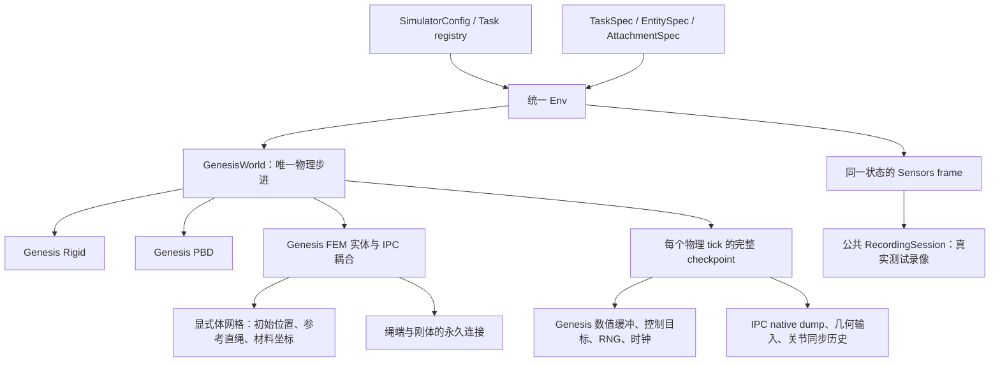

# 基础 Task 运行、FEM/IPC 与测试证据

日期：2026-09-23。对应 [13 项基础环境计划](../../../legacy/cleanup_20260929/docs/develop/dev-logs/simulator_base_task_runtime_plan_zh.md)。本轮已获准运行 simulator 测试及实际场景录像；agent/API 和完整成功策略不在范围内。

**本阶段已完成：13/13 基础任务及两个公共机制通过真实 GPU 短程验收。** 统一使用 Genesis，能够 reset、step、回溯已有状态并继续积分；范围、逐项证据、失败历史及尚缺能力见第 6–8 节。

## 1. 共用的运行链



- `world/physics/fem.py`：材料、显式四面体体网格实体、顶点/速度/材料索引读取；及时释放 Genesis 查询对象。
- `assets/geometry/rope_volume.py`：沿中心线构造拓扑对应的初始体网格与直绳参考坐标，拒绝翻转四面体；不把曲绳初态冒充无应力参考形。
- `world/physics/ipc.py`：限定 Genesis 1.2.1 / pyuipc 0.0.25 / CUDA；校正 IPC 子步时长、同步 FEM 位置和速度、保存及恢复 native checkpoint、实现永久绳端连接。
- `world/genesis_world.py`：统一声明构建、积分、数值状态、回溯与关闭；`world/state.py` 保存 Genesis 缓冲和 native IPC 记录。
- `tasks/base.py`：用 `AttachmentSpec` 声明连接身份、材料端点/区间、目标刚体和刚度。Orbits 连接两端到活动把手；Slotted 连接两端到活动盘，末端止挡属于同一 FEM 体。
- `robot/joint_position.py`：共享关节控制；IPC 分支核对 World 已设置的 home，不在构建后瞬移。实际 home 由 `world/physics/ipc.py` 在刚体分配后、原生关节机构创建前设置，保持模型参考坐标 `qpos0` 不变。

这是固定依赖版本的局部桥接实现，不是通用于未来 Genesis 版本的 codec；升级依赖须重新审查并运行这些物理测试。没有改写已安装的 Genesis 源码；适配位于项目的共享 World/physics 模块。

## 2. 原生 checkpoint 的边界

1. 原生 `World.dump/recover` 保存 FEM 位置、速度、前一位置；ABD 位姿/速度/前一位姿；全局顶点和接触候选缓存。已审查 [libuipc v0.0.25 源码](https://github.com/spiriMirror/libuipc/tree/v0.0.25/src/backends/cuda)。
2. native 文件按 frame 原文件名读取并压缩成独立 bytes；同一 native frame 的后续分支不会覆盖内存中的旧记录。
3. Python 层还保存几何数值属性、控制/耦合缓冲和会被 Genesis 替换引用的上一帧关节变换。仅保存裸数组句柄不能恢复后者。
4. `reset(state_id)` 恢复原生状态、Genesis 状态和任务历史，不通过重播动作补到目标 tick；native frame 与 Env physics tick 分开记录。
5. 快照是当前已构建 World 内部的回溯机制，不是跨版本、跨进程的通用存档格式。报告中的 NPZ 是观测证据，也不是可单独加载的完整 checkpoint。
6. close 清理本场景拥有的 native workspace；失败构建的原生检查材料保留在 episode 的 `physics_diagnostics/ipc/`。
   每个物理 tick 都保存状态，目前优先保证内容完整，内存和复制开销较高；报告中分别列出 reset、真实 step、回溯与重建耗时。本阶段没有宣称实时运行性能。
7. Genesis 缓冲仍完整保存；超过 64 KiB 的 NumPy 缓冲用 zlib level 1 无损压缩，保留形状、dtype 和原始数值位模式；首次实测的小型 FEM 首态从约 704 MB 压至 14 MB。仅排除 Quadrants 对同一存储的 `_qd_dc_unwrapped` 包装缓存，并去掉默认 `to_numpy(copy=True)` 后的重复深拷贝。报告列出各缓冲路径和字节数，便于审查内存开销；经源码确认不可变的 SupportField 查找表共享第一份完整记录。
8. 恢复瞬间使用绝对误差 `1e-8`；续跑位置/四元数为 `2e-6`，接触力为 `1e-4 N`（0.1 mN）。IPC 原生 Newton 停止条件为速度残差，续跑线速度容差 `1e-4 m/s`、角速度 `1e-3 rad/s`，报告逐数组实际误差，原生 dump 恢复要求字节一致。

## 3. 运行前审查与新增测试脚本

原有真实引擎测试主要覆盖刚体、部分 PBD 和初态恢复；没有强制的逐阶段报告与本次运行视频。因此本轮先实现以下证据入口，再运行。

| 脚本 | 检查/职责 |
|---|---|
| `scripts/test_base_tasks.py` | 固定 13 项清单，逐项独立进程；默认全量时附加公共机制检查；保留 Python、包内配置和资源的快照/哈希、pytest 日志、JUnit、汇总与退出码；超时终止本用例进程组并标明不完整证据 |
| `tests/runtime_evidence.py` | 每阶段状态/耗时/异常栈，每次采样的动作、时钟、状态身份、全部数值数组 NPZ、非有限状态与速度检查、FEM 体积及连接残差；接触实体身份与刚体穿透不超过 1 mm、公共录制、分支切段和 MP4 解码检查 |
| `integration/test_base_task_runtime.py` | 固定 13 个 base：真实 reset/step、小关节命令响应、非法动作原子性、observe/render 不步进、中间状态/子步/旧未来/初态恢复、同动作续跑、seed A/B/A 重建及 close |
| `integration/test_genesis_fem_ipc.py` | 仅供测试的短 FEM 管，一端固定一端连接活动刚体；使用同一个 Env、World、连接和回溯路径；不加入生产 Task 清单 |
| `integration/test_task_switch_runtime.py` | 同一进程依次运行 Coil → Rope → Blanket → Hedgehog → Coil，检查不同求解器、两种机器人与旧状态隔离 |
| `unit/test_world_diagnostics.py` | NaN/Inf 须报告具体实体与字段；检查快照无损压缩的原始位模式、dtype、非连续数组与副本独立性 |

`architecture/`、`unit/` 和 `contracts/` 用来验证模块边界、配置/材料/体网格/连接声明以及 Env 编排；这些不替代 GPU 物理结果。旧 integration 脚本仍保留独立的重力、接触、FK/IK 等用例；未执行的旧脚本不能算本轮通过。

## 4. 每次测试保留什么

```text
runs/test_results/<run>/
├── source_hashes.json + source_snapshot.tar.gz  源码、配置与必要资源
├── summary.json + README.md
├── <task>.log + <task>_junit.xml
└── <task>/
    ├── report.json                 配置、依赖、阶段、误差和失败原因
    ├── steps.jsonl                 动作、状态/tick 身份、数值范围、相机与 IPC 信息
    ├── state_0000.npz ...          真实读取的 World/Robot 数值数组
    ├── episodes/<episode_id>/      本次生成资产与失败物理诊断
    └── branch_000/.../videos/      公共录制器生成的各相机 MP4
```

- 视频来自测试正在使用的 Sensors 帧；回溯或新 episode 开始新的片段，不跨分支伪造连续轨迹。
- 一次运行失败也保留已有画面与日志；在初始化之前失败时如实没有视频。异常中断的 `.part.mp4` 单独标记并尝试完整解码，不冒充正常结束的录像。
- 每个用例 120 秒后会自动输出一次 Python 栈以便定位慢点；这条 faulthandler 信息本身不是失败。真正的默认用例超时是 1800 秒，超时会终止该用例并记录结果。
- `task_success=False` 与测试通过是不同含义；本轮的录像是生命周期/物理检查证据，不是成功 demo。
- 物理时长由 `steps × control_decimation × physics_dt_s` 决定；诊断用 3 个控制动作是 0.075 s，默认 20 个是 0.5 s，另有回溯及重建片段。短程通过不保证长程稳定、可解或可抓持。

## 5. 可复现入口

```bash
cd /home/jianwen/topogym
.venv-gs121/bin/python scripts/test_base_tasks.py \
  --device cuda --steps 20 \
  --output runs/test_results/base_acceptance_local
```

指定目录必须尚不存在。第 7 节统一短程验收实际使用 `--steps 3`；复现该时长时把上面的 20 改为 3。只复测某些任务可增加 `--tasks rope_threading knot_untying`；只检查公共机制用 `--mechanisms-only`，再用 `--mechanisms fem` 或 `--mechanisms task-switch` 缩小范围。需要原生迭代日志时设置 `TOPOGYM_IPC_VERBOSE=1`。不要并行跑多套 GPU 集合。

本轮可以访问 CUDA，因此实际在此运行；如果换到不能访问 GPU 的执行环境，使用上面的命令在本机运行。FEM 不会静默退化成 CPU 刚体或跳过后记通过。

## 6. 保留的任务功能缺口

- 主动 assist grasp 的选择、抓住、移动和释放仍独立于本轮永久连接，不据此宣称已支持。
- Buzz Wire、Lock Picking、Fiber、Rope、Knot、Orbits、Slotted 的完整成功判据仍未完成，保留 `goal_evaluation_complete=False` 和 registry 的 solve 缺口。
- `world/physics/ipc.py` 尚未把全部 FEM 接触对/接触力统一导出到公共 observation；`world.contacts` 当前来自 Genesis 刚体求解器。IPC 的真实接触由原生求解器处理，缓存纳入 native dump；当前公开诊断包括有效性、顶点/速度、体积与连接残差。后续完整成功审计需要补齐该观测接口。
- 本轮不做 planner、agent/API、全变体、任务可解证明或完整 demo 验收。

## 7. 实测结果

**最终固定源码验收：13/13 基础任务通过，另有 2/2 公共机制用例通过；CLI 正常退出（0）。没有跳过任务，没有测试中源码/配置变化。**

- [自动汇总、全部任务视频与日志](../../../runs/test_results/base_acceptance_final/README.md) · [机器汇总](../../../runs/test_results/base_acceptance_final/summary.json) · [13 项采样数值汇总](../../../runs/test_results/base_acceptance_final/base_numeric_review.json)。
- 设备：NVIDIA GeForce RTX 4090；Genesis 1.2.1、pyuipc 0.0.25、Torch 2.12.0+cu126；64 位精度，唯一 `compact_lab`。
- 每项基础任务主连续段为 **3 控制步 / 30 个 World 物理 tick / 0.075 s**，每个 tick 有 4 个内部求解子步。另包含中间状态恢复并续跑、旧分支、控制步内部 tick、初态恢复、seed 0→1→0 重建与重建后 step。
- 这是短程基础生命周期验收，不是长时间稳定性、实时性能或完整任务可解性的证明。每个回溯/重建片段独立录制，不能把它们拼成更长的连续物理运行。
- 架构、单元、Env 合同及录制/数据合同：**118 passed，1 项 HDF5 未选择**。见 [pytest 日志](../../../runs/test_results/static_and_contracts_06/pytest.log) 和 [JUnit](../../../runs/test_results/static_and_contracts_06/junit.xml)。旧 integration 中未选择的重力、运动学等独立用例不计入本轮通过数。

| 任务/机制 | 机器人 / 物理模型 | 结果与本次实景视频 |
|---|---|---|
| `cast_coil` | ALOHA / 刚体 | 通过 · [报告](../../../runs/test_results/base_acceptance_final/cast_coil/report.json) · [MP4](../../../runs/test_results/base_acceptance_final/cast_coil/branch_000/videos/oblique.mp4) |
| `cast_keyhole` | ALOHA / 刚体 | 通过 · [报告](../../../runs/test_results/base_acceptance_final/cast_keyhole/report.json) · [MP4](../../../runs/test_results/base_acceptance_final/cast_keyhole/branch_000/videos/oblique.mp4) |
| `horseshoe_ring` | ALOHA / 刚体 | 通过 · [报告](../../../runs/test_results/base_acceptance_final/horseshoe_ring/report.json) · [MP4](../../../runs/test_results/base_acceptance_final/horseshoe_ring/branch_000/videos/oblique.mp4) |
| `hedgehog_in_cage` | Panda＋Robotiq / 刚体 | 通过 · [报告](../../../runs/test_results/base_acceptance_final/hedgehog_in_cage/report.json) · [MP4](../../../runs/test_results/base_acceptance_final/hedgehog_in_cage/branch_000/videos/oblique.mp4) |
| `interlocked_claws` | ALOHA / 刚体 | 通过 · [报告](../../../runs/test_results/base_acceptance_final/interlocked_claws/report.json) · [MP4](../../../runs/test_results/base_acceptance_final/interlocked_claws/branch_000/videos/oblique.mp4) |
| `buzz_wire_3d` | Panda＋Robotiq / 刚体 | 通过 · [报告](../../../runs/test_results/base_acceptance_final/buzz_wire_3d/report.json) · [MP4](../../../runs/test_results/base_acceptance_final/buzz_wire_3d/branch_000/videos/oblique.mp4) |
| `lock_picking` | Panda＋Robotiq / 刚体＋被动关节 | 通过 · [报告](../../../runs/test_results/base_acceptance_final/lock_picking/report.json) · [MP4](../../../runs/test_results/base_acceptance_final/lock_picking/branch_000/videos/oblique.mp4) |
| `fiber_bundling` | Panda＋Robotiq / 刚体＋被动关节 | 通过 · [报告](../../../runs/test_results/base_acceptance_final/fiber_bundling/report.json) · [MP4](../../../runs/test_results/base_acceptance_final/fiber_bundling/branch_000/videos/oblique.mp4) |
| `blanket_flatten` | ALOHA / PBD 布料 | 通过 · [报告](../../../runs/test_results/base_acceptance_final/blanket_flatten/report.json) · [MP4](../../../runs/test_results/base_acceptance_final/blanket_flatten/branch_000/videos/oblique.mp4) |
| `rope_threading` | ALOHA / FEM＋IPC | 通过 · [报告](../../../runs/test_results/base_acceptance_final/rope_threading/report.json) · [MP4](../../../runs/test_results/base_acceptance_final/rope_threading/branch_000/videos/oblique.mp4) |
| `knot_untying` | ALOHA / FEM＋IPC | 通过 · [报告](../../../runs/test_results/base_acceptance_final/knot_untying/report.json) · [MP4](../../../runs/test_results/base_acceptance_final/knot_untying/branch_000/videos/oblique.mp4) |
| `orbits` | ALOHA / FEM＋IPC | 通过 · [报告](../../../runs/test_results/base_acceptance_final/orbits/report.json) · [MP4](../../../runs/test_results/base_acceptance_final/orbits/branch_000/videos/oblique.mp4) |
| `slotted_post_ring` | ALOHA / FEM＋IPC | 通过 · [报告](../../../runs/test_results/base_acceptance_final/slotted_post_ring/report.json) · [MP4](../../../runs/test_results/base_acceptance_final/slotted_post_ring/branch_000/videos/oblique.mp4) |
| `fem_checkpoint_probe` | ALOHA；测试用短 FEM 管与固定/活动端连接 | 通过 · [报告](../../../runs/test_results/base_acceptance_final/fem_checkpoint_probe/report.json) · [MP4](../../../runs/test_results/base_acceptance_final/fem_checkpoint_probe/branch_000/videos/oblique.mp4) |
| `task_switch` | 同进程两机器人；Rigid→FEM→PBD→Rigid | 通过 · [报告](../../../runs/test_results/base_acceptance_final/task_switch/report.json) · [MP4](../../../runs/test_results/base_acceptance_final/task_switch/branch_000/videos/oblique.mp4) |

采样数据中，最大刚体穿透约 **0.1122 mm**（阈值 1 mm）；Orbits / Slotted 永久连接的最大残差约 **9.1 µm / 7.2 µm**（阈值 1 mm），四项 FEM 的采样四面体体积均为正。这里统计的是已录制的控制/回溯采样点，不冒充对每个内部求解子步的离线审计。完整误差、体积范围和桌面间隙见各自 JSON。

### 较长诊断与失败记录

此前逐项运行过 **20 控制步 / 0.5 s** 的主连续段。诊断过程中有代码修正、失败和驱动中断，因此不能合称为“同一源码的一轮 13 项 20 步全通过”。下面保留关键回归证据及其当时状态：

| 记录 | 事实及边界 |
|---|---|
| [Buzz Wire 20 步](../../../runs/test_results/contact_regression_03/README.md) | 修正摆位与候选容量后，pytest、逐任务报告和录像完整通过；外层随后收到 SIGTERM，未运行其余两个任务，来源未确定。 |
| [Fiber / Lock 20 步](../../../runs/test_results/contact_regression_04/README.md) | 两项完整通过，驱动正常退出；使用修正后的摆位/接触配置，含 1 mm 穿透检查。 |
| [Slotted / Keyhole 等诊断批次](../../../runs/test_results/base_completion_02/README.md) | Slotted、Keyhole 各完成 20 步与回溯；同批 Buzz 暴露候选容量不足，Fiber 当时存在源码变化，不能把整批记通过。 |
| [先前 20 步诊断](../../../runs/test_results/base_acceptance_01/README.md) | 包含 PBD 与四项 FEM 的长段记录，也包含旧摆位、内存、容差等问题和源码变化；Orbits 的 pytest/报告完成，外层未汇总。以逐任务原报告和其源码快照为准。 |

Blanket 的早期 20 步数组另经复核，最低粒子位置保持在桌面上方约 4 mm，与其接触半径一致。最终全量验收使用上表固定源码；旧诊断均保留，不覆盖失败记录。

## 8. 本轮定位并修正的问题

- IPC 初始化：区分实际 home 与模型参考坐标 qpos0；不能为设置出生姿态改模型参考形。
- IPC 初态：Genesis build 的预热恢复后还残留 Python 刚体速度及关节同步缓存，已在原生 reset 后重新同步。
- 绳与机器人底座实际相交：Rope / Orbits 的整套任务初始摆位沿桌面平移，保留真实接触。
- 永久连接：只关闭质量为零的虚拟锚点的重复碰撞，保持真实绳体和刚体表面接触。
- Fiber：撤销传给 Genesis MJCF morph 的 URDF 专有 `merge_fixed_links` 参数。
- Fiber 的历史碰撞缓冲在 140 多个 tick 后累计超过 70 GB，已主动终止该诊断进程并保存故障栈；据此加入无损压缩与原始位模式/独立副本测试。随后完成 20 步完整回归；新摆位同时去掉了出生穿插。
- 快照：去掉同一 Quadrants 存储的重复包装拷贝，完整状态范围不缩减。Buzz Wire 首态缓冲约 3.3 GB，其中约 2.3 GB 是引擎碰撞支持表；已核对固定版本 `SupportField.activate` 仅在建场景时写入该只读查找表，因此各 tick 共享首份已保存内容；没有省略其快照内容或可变控制/接触缓冲。
- 碰撞归属：上游刚体 collider 会过滤委托给 IPC 的实体。桥接在本场景 collider 构建期间保留机器人自身及机器人/固定场景的碰撞对，构建后立即恢复原材料对象；IPC 负责软体及其活动刚体接触。移除重复桌面碰撞体，报告检查机器人 self/table 对存在且原生活动体没有双重刚体求解。
- Cast Keyhole：20 步后恢复到旧状态并续跑，位置差约 `8.1e-12 m`，接触力差 `2.44e-5 N`；原测试错误地对全部单位使用同一绝对容差。改为按物理量声明续跑容差，直接恢复仍保持严格阈值，失败记录保留。

- 实际视频和接触数值复查发现 Buzz 的旧轨道与 Panda 上臂穿插约 58 mm、Fiber 固定端子/线束与机器人穿插约 33 mm。Buzz 基础轨道尺寸采用已有的 0.7 各轴缩放参数，底板 0.826 × 0.574 m、中心 (-0.02, -0.32) m；Fiber 整套沿 y 平移 -0.25 m。保留机器人共享 home 和真实碰撞，统一测试增加逐接触实体身份和 1 mm 刚体穿透上限；先前仅有限性通过的结果不作为该项验收。
- Buzz 密集胶囊组合的 broad-phase 候选超过默认 1200 对，显式把候选倍率从 8 改为 64（候选容量 9600），没有关闭碰撞。Lock Picking 钥匙落桌曾有约 2.1 mm 的软约束穿透，刚体接触时间常数改为 0.00125 s 后重测。

- 外层驱动两次在用例完成后中断（Orbits 后的批次未汇总，Buzz 后的工具退出码为 143/SIGTERM；来源未确定）。原始逐任务报告、JUnit、视频保留，另记驱动中断，不把未启动的任务算通过；CLI 增加终止信号记录和有界的子进程清理。
