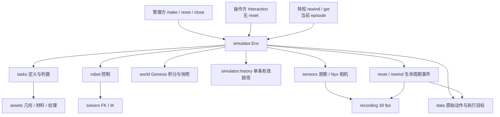

# Simulator 公共接口实施报告

日期：2026-09-24。范围：Simulator 本体、本地操作权限、逐物理 tick 历史、两种机器人控制与相机、验收证据；agent/网络调用继续延期。本文以本轮开始时的工作树为对照，不把此前未提交重构计为本轮新改动。

**交付状态：接口与测试代码已实施，GPU 验收未全部完成。用户已要求优先让场景会话使用 GPU，本会话 GPU 进程已停止。** 下列通过结果只对应保存的源码版本，不能称为最新 13 个场景全部验收通过。

## 1. 最终权限和历史合同

- **管理方**持有 `topogym.make(...)` 返回的 Env，可 `reset(seed=...)` 切换 seed，也可 close；相同 seed、配置、资产和运行条件应复现初态。没有 last_seed 属性。
- **操作方**只接收 `env.interaction(privileged=False/True)`；两种模式都无 reset、make、close、seed/config 设置接口。普通模式不能 rewind/get。
- **特权操作方**可 `rewind_to(StateRef)`，但仅限当前 episode 当前有效路径；不能切换 seed，也不能进入同 seed 的旧 episode。管理方 reset 后旧普通/特权句柄全部失效。
- 初态保存为 tick 0；每次成功的 World 物理 tick + Task 更新后，保存 World/Robot/Task/RNG。默认 dt=0.0025 s，step 推进 10 tick；不是每 action 或每视频帧才保存。内部 solver substeps 不单独成为公开恢复点。
- 回溯到 tick k 后，旧未来 checkpoint 及 IPC 对应文件被释放，旧引用永久失效；续跑使用新 ID。state_id 是身份，不能当作仿真时间；branch_id 仅表示连续片段编号，不代表可以选择旧分支。
- 回溯不会重复插入一个相同物理状态的新 checkpoint，也不自动补完旧 action；下一次 step 使用新提交的动作。重置才开启新 episode。
- Python facade 是受信本地调用的接口边界，不是针对同进程反射攻击的安全沙箱。

```python
import topogym

with topogym.make("cast_coil", enable_privileged=True) as env:
    obs, info = env.reset(seed=17)          # 管理方
    initial = info["state_ref"]
    actor = env.interaction(privileged=True)
    obs, reward, terminated, truncated, info = actor.step({})
    obs, info = actor.rewind_to(initial)    # 同一 episode；旧未来失效
    obs, info = env.reset(seed=18)          # 管理方允许更换 seed
    actor = env.interaction()              # 必须重新发放操作句柄
```

完整字段、单位和模式说明：[本地接口用法](../modules/simulator_api_zh.md)。

## 2. 按模块列出的主要改动

下表路径均相对仓库根目录；完整逐文件差异见 §7，全部项目代码清单见 [script_inventory_zh.md](../../../legacy/cleanup_20260929/docs/develop/dev-logs/script_inventory_zh.md)。

| 脚本坐标 | 改动与作用 |
|---|---|
| `topogym/simulator/api.py`、`simulator/__init__.py`、`topogym/__init__.py` | 新增 env_list/make；查询和构造规格不启动引擎；公共类型和惰性 Env 导出统一 |
| `topogym/simulator/config.py` | 从 config/simulator.py 迁入；校验观察/控制模式、seed、特权开关；默认开启 RGB |
| `topogym/simulator/env.py` | 从根 env.py 迁入；唯一 reset/step/close 编排、控制转换、故障阶段记录、权限句柄、逐 tick 保存及生命周期事件 |
| `topogym/simulator/history.py` | 从根 episode.py 迁入；StateRef 强制 episode 身份、单条有效历史、未来截断、ID 永不复用 |
| `topogym/simulator/interaction.py`、`simulator/privileged.py` | 普通/特权操作接口与白名单 get；旧句柄失效，不暴露 reset 或原生 Scene |
| `topogym/config/__init__.py`、`config/scene.py` | 改用统一配置类型；按 observation_cameras 在构建前选择相机，关闭 RGB 时不创建相机 |
| `topogym/robot/control.py` | 将 JOINT_ABS、JOINT_DELTA、EE_ABS、EE_DELTA 编译为同一关节目标；全动作校验后才提交 |
| `topogym/robot/description.py`、`robot/aloha/description.py`、`robot/panda_robotiq/description.py` | 加入明确的 hand→TCP 固定变换，统一控制和观察所指的工具坐标 |
| `topogym/robot/joint_position.py` | 共享本体观察增加关节速度/TCP；保留控制目标恢复；初态 checkpoint 前准备 FK/IK 缓冲 |
| `topogym/solvers/genesis_kinematics.py` | 检查 IK 的 FK 位置/姿态残差；保护查询 RNG/临时缓冲；修正 Genesis 1.2.1 首次 FK 依赖 IK 尚未创建缓存的问题 |
| `topogym/sensors/observation.py` | EE/JOINT 公共观察 schema，完整 World 数据改为特权读取；观察/录制共用不可变 SensorFrame |
| `topogym/config/profiles/camera_configs/aloha_observation.yaml` | 双臂严格四路，两个固定近景和左右腕部，848×480 |
| `topogym/config/profiles/camera_configs/panda_robotiq_observation.yaml` | 单臂严格三路，agentview/front_oblique/wrist，848×480 |
| `topogym/config/profiles/tabletop_panda_robotiq.yaml`、`env_configs/world_tabletop_v1.yaml` | 接入单臂相机配置并清除父配置中多余机位 |
| `topogym/utils/variant_rng.py` | 明确命名子流和进程随机源初始化；先加载 Torch 再设 seed，覆盖首次 reset |
| `topogym/world/genesis_world.py`、`world/physics/ipc.py` | 回溯后丢弃旧未来资源和缓存引用；World 仍唯一推进物理 |
| `topogym/recording/session.py` | 默认30 fps；记录来源 state_id；已关闭审计视频也能标记被 rewind 作废的帧 |
| `topogym/data/episode_dataset_writer.py`、`data/h5_schema.py` | schema 2.0；保存原命令及实际关节目标；生命周期事件维护有效/作废 transition 索引，保留原始审计记录 |
| `tests/runtime_evidence.py`、`scripts/test_base_tasks.py` | 新接口/稳定性/相机/输出/安装验收入口；强制真实 Nyx、相机规格、源码身份、配置、状态数组、实际视频和可解码检查 |
| `scripts/inventory_sources.py`、`pyproject.toml` | 目录/脚本清单适配 simulator；测试依赖加入 psutil；验证非 editable wheel 的打包资源 |

三个旧实现路径已撤销：`topogym/env.py`、`topogym/episode.py`、`topogym/config/simulator.py`。`topogym.config` 的配置类型导出仍指向唯一实现，不是另一份类。历史文档及 agents/deferred 的旧路径不代表当前入口。

### 控制与观察的边界

- observation_mode 和 control_mode 独立，2×4 组合；双臂组名 left/right，单臂组名来自 Panda 描述；维度由模型决定。
- 增量相对提交前实测状态。EE_ABS 必须给完整位置与四元数；EE_DELTA 中省略的位移/旋转分量等于零增量。省略整组、夹爪或空 action 保持已有目标。
- Robotiq 控制沿用原生驱动角度，不冒称开口米数。ALOHA TCP 采用模型夹爪参考点；Panda TCP 是手部到闭合夹爪附近的固定工具参考，不是随开度变化的两指实时中点。
- IK 只做可达残差与限位检查，不等于避障规划。求解不下发控制、不推进物理。
- `terminated`、`truncated`、`task_success`、`goal_evaluation_complete` 分开；数值异常进入 faulted，不能伪装为正常失败 episode。

## 3. Nyx、相机与录像

- 标准路径固定为 **Genesis + Nyx + compact_lab**；没有 Rasterizer 回退。普通运行也默认有 RGB，显式 enable_rgb=False 才是纯物理。
- 所有标准相机 **848×480**；RecordingSession 默认 **30 fps**。默认物理400 Hz、控制40 Hz和媒体30 fps是三个不同频率，由源仿真时间对齐。
- ALOHA：cam_high、cam_low、cam_left_wrist、cam_right_wrist；Panda+Robotiq：agentview、front_oblique、wrist。固定镜头向桌面操作区靠近；腕部随模型安装点运动。
- 相机测试不是只检查尺寸：固定视角用三个彩色实体的渲染像素验证 K/外参投影，腕部用实际关节运动验证安装变换。
- 短测试不填充成假长视频，报告区分物理秒数、样本数和 MP4 编码时长。默认完整 base 命令是200动作/5秒主连续段；缩短 smoke 的时长须看每项报告。
- 源图 PNG、NPZ 状态、逐帧/tick 记录、完整源码快照和日志随视频一起保存。视频证明所测试场景真实执行，不证明任务完成或所有姿态下细节可辨。

## 4. 实测结果与入口

<!-- VALIDATION_RESULTS -->
| 验证项 | 本轮实际结果 | 证据 |
|---|---|---|
| 非引擎合同、配置、资产、数据和 HDF5 | **174 项通过**；该命令排除 49 项真实引擎用例；未包含场景会话后来新增的测试 | [JUnit](../../../runs/test_results/simulator_contract_20260924/contracts_final/junit.xml) |
| 两种机器人 × 2 种观察 × 4 种控制 | 16 组合真实通过，计为 2 个参数化测试用例 | [接口与相机索引](../../../runs/test_results/simulator_contract_20260924/interfaces_rig_install_v2/README.md) |
| 双臂四路 / 单臂三路相机 | 2 用例通过；固定相机三个标记点最大误差分别约 0.835 / 1.062 像素；腕部随动检查通过 | 同上，`cameras_aloha` / `cameras_panda_robotiq` |
| ALOHA G2 | **十轮全部通过**，包含时限截断、积分后故障恢复、close 和资源增长检查 | [报告](../../../runs/test_results/simulator_contract_20260924/isolated_core_validation/stability_aloha/report.json) |
| Panda G2 首轮 | 第八次 reset 在 Nyx 原生 `load_scene_from_file` 处 SIGSEGV（-11）；没有明确 OOM 报错 | [日志](../../../runs/test_results/simulator_contract_20260924/isolated_core_validation/stability_panda_robotiq.log) |
| Panda G2 复跑 | 完成八轮，第九轮按用户指示中断，共 49 个证据样本；**不能计作十轮通过** | [报告与录像](../../../runs/test_results/simulator_contract_20260924/panda_stability_exclusive/README.md) |
| wheel 安装 | 原环境缺 pip 的构建问题已修复；构建、独立 venv 安装、仓库外导入和规格查询通过，真实物理运行待重跑 | [CPU 检查报告](../../../runs/test_results/simulator_contract_20260924/packaging_cpu/report.json) |
| 输出不改变物理轨迹 | ALOHA 首次尝试中断，Panda 尚未运行；均无通过结论 | [首轮队列](../../../runs/test_results/simulator_contract_20260924/isolated_core_validation/README.md) |
| 新接口下 FEM/IPC 探针、同进程任务切换 | 本轮尚未运行；早期合同的结果不算本轮验收 | 待恢复队列 |
| 最新 13 个基础场景 | 等场景修改合并稳定后重跑；不得继承旧默认场景通过标签 | 逐项 base 验收 |

ALOHA 的预热后 RSS 最大增长约 513 MiB、文件描述符增长 0、Torch CUDA allocated 增长 384000 bytes、reserved 增长 0，均在测试预先定义的阈值内。这里不是对 Nyx 全部原生显存或小时级泄漏的证明。

Panda 复跑开始时另一 TopoGym GPU 进程已经退出，但在第八轮附近重新出现；参见[并发取样记录](../../../runs/test_results/simulator_contract_20260924/panda_stability_exclusive/runtime_concurrency.json)。因此目录名 `panda_stability_exclusive` 只反映原定排期，**实际并非全程独占**。首次崩溃原因仍未确定，不能断言由争用造成，也不能凭复跑八轮排除 Nyx 生命周期问题。

中途的 source_changed、失败及中断报告均保留，不混入通过数量。[本轮总索引](../../../runs/test_results/simulator_contract_20260924/README.md)提供实际视频和原始证据入口。
<!-- END_VALIDATION_RESULTS -->

所有真实运行通过公共证据驱动；逐测试脚本职责见 [simulator_test_scripts_zh.md](simulator_test_scripts_zh.md)。

### 待恢复的验收顺序

当前待完成 **6 个公共机制用例**：Panda G2、两种机器人各一项输出一致性、wheel 真实运行、FEM/IPC 探针、同进程任务切换。此外，场景会话完成后需对 **13 个基础任务**重跑新合同，共 19 项验收用例；不含长期压力测试、未完成 solved 判据和完整任务策略。

下列命令留待用户恢复 GPU 验收后执行，**本次没有启动**。第一条优先排查 G2；第二条补齐安装/输出/FEM/切换；第三条对合并后的实际任务版本验收。输出目录须尚不存在。正式复跑应使用冻结的合并版本，不能在另一会话仍改源码时把结果标为最终通过。

```bash
cd /home/jianwen/topogym
.venv-gs121-nyx/bin/python scripts/test_base_tasks.py \
  --checks stability --robots panda_robotiq --timeout 2400 \
  --output runs/test_results/simulator_resume_panda_g2

.venv-gs121-nyx/bin/python scripts/test_base_tasks.py \
  --checks outputs installation --mechanisms-only --steps 20 --timeout 3600 \
  --output runs/test_results/simulator_resume_mechanisms

.venv-gs121-nyx/bin/python scripts/test_base_tasks.py \
  --checks base --steps 200 --timeout 3600 \
  --output runs/test_results/simulator_merged_base
```

最后一条默认还会附带 FEM/任务切换两项机制检查，因此与第二条存在两项重复，并不增加“19 项”中的唯一用例数。要定位旧 Nyx 崩溃，应先在保存的隔离源码副本 `/tmp/topogym_simulator_api_isolated_20260924` 复跑第一组，再测试合并版本。

## 并行场景修改的边界

用户确认另一个会话负责[默认场景恢复](scene_preset_restoration_20260924_zh.md)。本会话停止修改 Task、几何、材质及场景预设；共享的 Env/配置/World/测试支持保留当前接口合同，后续验收使用独立源码快照，不覆盖该会话文件。

在接口快照中，Lock Picking 的 `assets/geometry/lock_picking.py::mesh_xml` 将绝对输出路径写进 URDF；只读的13任务 seed A→B→A 资产检查发现五个 Lock URDF 文件不同，其余12任务资产一致。已定位的差异是输出路径文本，不等于已发现物理初态不同。该文件与本会话开始时哈希相同，**不是两个会话互相覆盖造成的差异**。本会话拟议修复仅在 `/tmp`，未应用。随后只读检查发现场景会话已加入 `assets/scene_visuals.py::localize_generated_urdfs` 并由 Lock Task 调用；其最新效果留给场景及合并验收，不能把旧快照的问题直接当作最新版本仍失败，也不能替其宣告已通过。

潜在重叠脚本：`simulator/config.py`、`simulator/env.py`、`world/genesis_world.py`、`tests/runtime_evidence.py`、`tests/integration/test_base_task_runtime.py`、`test_installed_simulator.py`、`pyproject.toml`。最终只读扫描发现场景会话修改12个已有文件、增加7个文件，**未发现与本会话接口改动重叠的文件**；详见[并行工作树检查](../../../runs/test_results/simulator_contract_20260924/concurrent_worktree_changes.json)。GPU 使用发生过时间重叠，现已按用户要求暂停本会话验收；代码和资源排期分别报告。

## 5. 明确保留的限制

1. **完整任务成功不是全部就绪**：Buzz Wire、Lock Picking、Fiber Bundling、Rope Threading、Knot Untying、Orbits、Slotted Post Ring 的完整 solved 判据仍缺；精确位置是各 `topogym/tasks/<task_id>.py::evaluate_state`，并由 registry 的 solve gap 明示。其余六项已有判据，本轮没有证明完整可解策略。
2. 统一可逆 assist grasp 尚未接入：刚体动态焊接/释放及软体选区移动约束仍是 `world/genesis_world.py` 所属缺口；四项 FEM 的原有永久端约束不等同于机器人 assist。
3. 本地一次只允许一个已 build Env，因为 Genesis/RNG 具有进程级状态；可通过独立进程隔离，未实现批量向量环境。
4. 每 tick 完整快照不隐式淘汰，时间和内存成本随有效轨迹增长。十轮生命周期/短程轨迹通过不证明小时级无泄漏；长时资源、复杂接触和大量随机 seed 仍需独立验证。
5. 回溯 checkpoint 只用于当前内存 World/episode；不是跨进程、跨版本或磁盘永久存档。历史审计视频可以保留，但已作废未来不能经公共 API 恢复。
6. seed 复现限定当前配置/资产/依赖/设备。Nyx 当前没有公开 seed 参数，严格初始 RGB 重建比较提供本机测试证据；不据此承诺任意 GPU/版本逐像素一致。
7. IPC 公共诊断还不是完整接触清单，get(diagnostics)明确标示覆盖；没有用空列表声称“无 IPC 接触”。
8. wheel 验收在新 venv/仓库外验证实际 wheel 和配置资源，但离线复用已安装的引擎依赖及显式外部机器人/视觉资产，不是从网络重新解析所有依赖的全新机器安装。

## 6. 当前项目结构（交付时只读扫描）

下面展开活动包的 Python 脚本与配置；资源目录和延期 agent 代码折叠。`assets/scene_visuals.py` 和 `tasks/scene_presets.py` 是并行场景会话后来新增的文件，已列入当前结构，但不属于本会话改动或已验收快照。详细功能、工程脚本和历史副本见[完整脚本清单](../../../legacy/cleanup_20260929/docs/develop/dev-logs/script_inventory_zh.md)；该次扫描含146个当前脚本、59个延期脚本，历史目录另列。

```text
topogym/
├── agents/
│   ├── deferred/  （折叠：延期代码/静态资源）
│   ├── README.md
│   └── __init__.py
├── assets/
│   ├── geometry/
│   │   ├── blanket_flatten.py
│   │   ├── buzz_wire_3d.py
│   │   ├── cast_coil.py
│   │   ├── cast_keyhole.py
│   │   ├── fiber_bundling.py
│   │   ├── hedgehog_in_cage.py
│   │   ├── horseshoe_ring.py
│   │   ├── interlocked_claws.py
│   │   ├── knot_untying.py
│   │   ├── lock_picking.py
│   │   ├── orbits.py
│   │   ├── rope_threading.py
│   │   ├── rope_volume.py
│   │   └── slotted_post_ring.py
│   ├── resources/  （折叠：延期代码/静态资源）
│   ├── library.py
│   ├── materials.py
│   ├── robot.py
│   ├── scene_visuals.py
│   ├── surfaces.py
│   └── textures.py
├── config/
│   ├── profiles/
│   │   ├── camera_configs/
│   │   │   ├── aloha_observation.yaml
│   │   │   └── panda_robotiq_observation.yaml
│   │   ├── common_configs/
│   │   │   └── manipulation_space_tabletop_v1.yaml
│   │   ├── env_configs/
│   │   │   ├── world_tabletop_aloha_v1.yaml
│   │   │   └── world_tabletop_v1.yaml
│   │   ├── presentation_configs/
│   │   │   └── compact_lab.yaml
│   │   ├── robot_control_configs/
│   │   │   ├── aloha_position_ik.yaml
│   │   │   └── panda_robotiq.yaml
│   │   ├── tabletop_aloha.yaml
│   │   └── tabletop_panda_robotiq.yaml
│   ├── __init__.py
│   ├── registry.py
│   └── scene.py
├── data/
│   ├── README.md
│   ├── __init__.py
│   ├── episode_dataset_writer.py
│   └── h5_schema.py
├── evaluation/
│   ├── README.md
│   ├── __init__.py
│   ├── cloth_metrics.py
│   └── motion_certificate.py
├── planning/
│   ├── motions/
│   │   └── cast_coil.py
│   ├── README.md
│   └── __init__.py
├── recording/
│   ├── README.md
│   ├── __init__.py
│   ├── encoding.py
│   ├── session.py
│   └── timeline.py
├── robot/
│   ├── aloha/
│   │   └── description.py
│   ├── panda_robotiq/
│   │   ├── description.py
│   │   └── gripper.py
│   ├── __init__.py
│   ├── control.py
│   ├── description.py
│   └── joint_position.py
├── sensors/
│   ├── renderers/
│   │   └── nyx.py
│   ├── __init__.py
│   ├── camera_info.py
│   ├── cameras.py
│   └── observation.py
├── simulator/
│   ├── __init__.py
│   ├── api.py
│   ├── config.py
│   ├── env.py
│   ├── history.py
│   ├── interaction.py
│   └── privileged.py
├── solvers/
│   ├── collision/
│   │   ├── box_compounds.py
│   │   ├── convex_compounds.py
│   │   └── triangle_meshes.py
│   ├── __init__.py
│   └── genesis_kinematics.py
├── tasks/
│   ├── task_variations/
│   │   ├── __init__.py
│   │   ├── blanket_flatten.py
│   │   ├── cast_coil.py
│   │   └── knot_untying.py
│   ├── __init__.py
│   ├── base.py
│   ├── blanket_flatten.py
│   ├── buzz_wire_3d.py
│   ├── cast_coil.py
│   ├── cast_keyhole.py
│   ├── fiber_bundling.py
│   ├── hedgehog_in_cage.py
│   ├── horseshoe_ring.py
│   ├── interlocked_claws.py
│   ├── knot_untying.py
│   ├── lock_picking.py
│   ├── orbits.py
│   ├── rope_threading.py
│   ├── scene_presets.py
│   └── slotted_post_ring.py
├── utils/
│   ├── geometry/
│   │   ├── rigid_geometry.py
│   │   ├── rigid_motion.py
│   │   └── rope.py
│   ├── __init__.py
│   ├── arrays.py
│   ├── io.py
│   ├── snapshots.py
│   └── variant_rng.py
├── world/
│   ├── physics/
│   │   ├── fem.py
│   │   ├── ipc.py
│   │   └── pbd.py
│   ├── visuals/
│   │   ├── __init__.py
│   │   ├── lighting.py
│   │   ├── nyx.py
│   │   ├── presentation.py
│   │   └── surfaces.py
│   ├── __init__.py
│   ├── entities.py
│   ├── genesis_world.py
│   ├── lab.py
│   ├── state.py
│   └── tabletop.py
├── README.md
└── __init__.py
```

依赖方向：



## 7. 本轮逐文件清单

下列链接相对本次操作开始前的文件哈希清单生成；改动包括实质逻辑、导入迁移和文档。新增列表中的三个文件属于迁入，不代表另造实现。

### 新增或迁入

- [tests/contracts/test_privileged_access.py](../../../tests/contracts/test_privileged_access.py)。
- [tests/contracts/test_public_api.py](../../../tests/contracts/test_public_api.py)。
- [tests/integration/test_installed_simulator.py](../../../tests/integration/test_installed_simulator.py)。
- [tests/integration/test_interface_modes.py](../../../tests/integration/test_interface_modes.py)。
- [tests/integration/test_lifecycle_stability.py](../../../tests/integration/test_lifecycle_stability.py)。
- [tests/integration/test_observation_rig.py](../../../tests/integration/test_observation_rig.py)。
- [tests/integration/test_output_invariance.py](../../../tests/integration/test_output_invariance.py)。
- [tests/unit/test_control_modes.py](../../../tests/unit/test_control_modes.py)。
- [tests/unit/test_seed_streams.py](../../../tests/unit/test_seed_streams.py)。
- [topogym/config/profiles/camera_configs/panda_robotiq_observation.yaml](../../../topogym/config/profiles/camera_configs/panda_robotiq_observation.yaml)。
- [topogym/robot/control.py](../../../topogym/robot/control.py)。
- [topogym/simulator/__init__.py](../../../topogym/simulator/__init__.py)。
- [topogym/simulator/api.py](../../../topogym/simulator/api.py)。
- [topogym/simulator/config.py](../../../topogym/simulator/config.py)。
- [topogym/simulator/env.py](../../../topogym/simulator/env.py)。
- [topogym/simulator/history.py](../../../topogym/simulator/history.py)。
- [topogym/simulator/interaction.py](../../../topogym/simulator/interaction.py)。
- [topogym/simulator/privileged.py](../../../topogym/simulator/privileged.py)。

### 修改

- [AGENTS.md](../../../AGENTS.md)。
- [pyproject.toml](../../../pyproject.toml)。
- [scripts/inventory_sources.py](../../../scripts/inventory_sources.py)。
- [scripts/test_base_tasks.py](../../../scripts/test_base_tasks.py)。
- [tests/README.md](../../../tests/README.md)。
- [tests/architecture/test_module_boundaries.py](../../../tests/architecture/test_module_boundaries.py)。
- [tests/conftest.py](../../../tests/conftest.py)。
- [tests/contracts/test_env_lifecycle.py](../../../tests/contracts/test_env_lifecycle.py)。
- [tests/contracts/test_episode_rewind.py](../../../tests/contracts/test_episode_rewind.py)。
- [tests/integration/test_base_task_runtime.py](../../../tests/integration/test_base_task_runtime.py)。
- [tests/integration/test_genesis_robot.py](../../../tests/integration/test_genesis_robot.py)。
- [tests/integration/test_genesis_seed_reset.py](../../../tests/integration/test_genesis_seed_reset.py)。
- [tests/integration/test_task_lifecycle.py](../../../tests/integration/test_task_lifecycle.py)。
- [tests/integration/test_task_switch_runtime.py](../../../tests/integration/test_task_switch_runtime.py)。
- [tests/recording_data/test_dataset_transitions.py](../../../tests/recording_data/test_dataset_transitions.py)。
- [tests/recording_data/test_snapshot_isolation.py](../../../tests/recording_data/test_snapshot_isolation.py)。
- [tests/runtime_evidence.py](../../../tests/runtime_evidence.py)。
- [tests/unit/test_configuration.py](../../../tests/unit/test_configuration.py)。
- [tests/unit/test_task_support.py](../../../tests/unit/test_task_support.py)。
- [topogym/README.md](../../../topogym/README.md)。
- [topogym/__init__.py](../../../topogym/__init__.py)。
- [topogym/config/__init__.py](../../../topogym/config/__init__.py)。
- [topogym/config/profiles/camera_configs/aloha_observation.yaml](../../../topogym/config/profiles/camera_configs/aloha_observation.yaml)。
- [topogym/config/profiles/env_configs/world_tabletop_v1.yaml](../../../topogym/config/profiles/env_configs/world_tabletop_v1.yaml)。
- [topogym/config/profiles/tabletop_panda_robotiq.yaml](../../../topogym/config/profiles/tabletop_panda_robotiq.yaml)。
- [topogym/config/scene.py](../../../topogym/config/scene.py)。
- [topogym/data/README.md](../../../topogym/data/README.md)。
- [topogym/data/episode_dataset_writer.py](../../../topogym/data/episode_dataset_writer.py)。
- [topogym/data/h5_schema.py](../../../topogym/data/h5_schema.py)。
- [topogym/recording/session.py](../../../topogym/recording/session.py)。
- [topogym/robot/aloha/description.py](../../../topogym/robot/aloha/description.py)。
- [topogym/robot/description.py](../../../topogym/robot/description.py)。
- [topogym/robot/joint_position.py](../../../topogym/robot/joint_position.py)。
- [topogym/robot/panda_robotiq/description.py](../../../topogym/robot/panda_robotiq/description.py)。
- [topogym/sensors/observation.py](../../../topogym/sensors/observation.py)。
- [topogym/solvers/genesis_kinematics.py](../../../topogym/solvers/genesis_kinematics.py)。
- [topogym/utils/variant_rng.py](../../../topogym/utils/variant_rng.py)。
- [topogym/world/genesis_world.py](../../../topogym/world/genesis_world.py)。
- [topogym/world/physics/ipc.py](../../../topogym/world/physics/ipc.py)。

### 撤销的旧路径（已迁入 simulator）

- `topogym/config/simulator.py`。
- `topogym/env.py`。
- `topogym/episode.py`。


### 文档与索引

- [本地 Simulator 用法](../modules/simulator_api_zh.md)：新公共入口、管理方/操作方边界、动作和观测字段。
- [逐测试脚本说明](simulator_test_scripts_zh.md)：接口会话32个测试脚本及2个公共支持文件，另列场景会话后来增加的测试和辅助脚本。
- [项目脚本全量清单](../../../legacy/cleanup_20260929/docs/develop/dev-logs/script_inventory_zh.md)及机器可读 JSON/历史附录：按现存文件和哈希生成，不把清单存在当作运行通过。
- [原实施计划](simulator_public_api_and_validation_plan_20260924_zh.md)、开发记录目录及模块目录：更新权威入口；保留早期方案的历史身份。
- [旧交互方案](../modules/simulator_interaction_contract_zh.md)、[旧 rollout 方案](../../../legacy/cleanup_20260929/docs/develop/modules/rollout_pipeline_refactor_plan_zh.md)、[Harbor 指南](../../../legacy/cleanup_20260929/docs/develop/modules/harbor_coding_agent_pipeline_guide_zh.md)：增加当前权限合同说明和源码迁移路径，不启用 agent/网络功能。
- 根 README、topogym/README、tests/README、data/README 和 AGENTS：同步模块结构、使用边界、数据 schema 与并行会话分工。

并行场景会话后续增加或修改的代码不计为上述接口改动；本轮证据绑定各自的源码快照。
