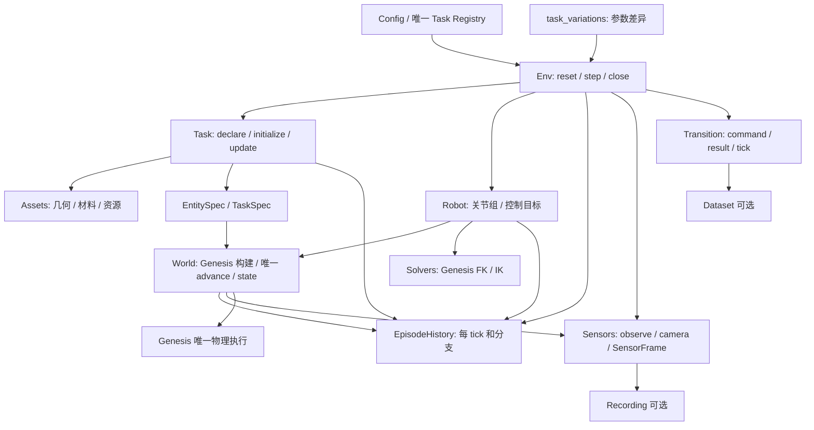

# 13 项任务统一接入与目录收敛记录

> 本页保留任务接入时的实现记录。随后已清理无调用脚本、归并实验室和外观工具，并修正 Hedgehog/Fiber 默认机器人；文件位置与默认值以[本轮精简记录](simulator_simplification_20260923_zh.md)和当前 registry 为准。

日期：2026-09-23。本轮执行[后续整理计划](../../../legacy/cleanup_20260929/docs/develop/dev-logs/simulator_structure_followup_plan_zh.md)的 5.1 目录目标，并采用用户最新交付边界：**允许任务未完成，但所有任务进入同一框架，缺口必须指出任务、模块、脚本和功能。**

本页替代上一轮“6 项已接入、7 项 pending”的当前状态说明；旧记录保留为历史。**所有新增、迁移和保留运行路径均未执行测试、导入验证、仿真、渲染或 agent/API 实验。** 下文“代码已接入”不表示物理运行或任务成功已经验收。

## 1. 这一步完成了什么

- 13 项任务都有实际 `TaskDefinition` 子类，负责资产/实体声明、初态参数和结果计算；不再有 `implementation=None` 的任务。
- 统一入口为 `config/registry.py → env.py → World / Robot / Task / Sensors`；没有为七项任务恢复独立 runner、adapter 或录制循环。
- 8 项刚体/关节链任务及 1 项 PBD 布料任务有完整生命周期的代码路径，等待真实验证。
- 4 项 FEM/IPC 任务已有实体和材料声明，但 `Env.reset` 会在创建场景前明确报告缺口；不以静态网格或刚体绳代替可回溯软体。
- 新接入的七项任务全部标记 `goal_complete=False`；可提供进度/失败信息的三项刚体任务也不能返回成功奖励。
- `envs/` 撤去，公共 `Env` 和 episode 历史位于包根；World 保持物理构建、积分和状态职责。
- 公共模块不再出现 `assets/.../<task_id>/`、`solvers/.../<task_id>/` 等任务名子目录；必要专用逻辑以 `<task_id>.py` 保存。
- 活动代码没有直接 MuJoCo import；模型 XML/MJCF 仍可由 Genesis 加载。历史目录和上游引擎依赖不计为活动模拟后端。

## 2. 当前实际目录

以下省略 `__init__.py`、缓存和部分通用工具；全部脚本逐项见[更新后的全仓清单](../../../legacy/cleanup_20260929/docs/develop/dev-logs/script_inventory_zh.md)。这里是实际源文件布局，不是尚未创建的空目录蓝图。

```text
topogym/
├── env.py                            唯一生命周期编排
├── episode.py                        每 tick 历史、分支、Transition
├── config/
│   ├── simulator.py / scene.py
│   ├── registry.py                   13 项定义及按操作列出的缺口
│   └── profiles/                     两种机器人与共享环境配置
├── tasks/
│   ├── base.py
│   ├── <task_id>.py                  13 项任务各一个定义文件
│   └── task_variations/<task_id>.py   变体差异或离线参数派生
├── assets/
│   ├── library.py / robot.py / materials.py / textures.py
│   ├── geometry/<task_id>.py          13 项基础几何；另有 braid.py
│   ├── appearance/                   surfaces.py、buzz_wire_3d.py、lock_picking.py
│   ├── importers/rope_threading.py
│   └── resources/                    catalog.json、templates/、meshes/、textures/
├── robot/
│   ├── description.py / joint_position.py / collision_geometry.py
│   ├── aloha/description.py
│   └── panda_robotiq/                 description.py、gripper.py
├── solvers/
│   ├── genesis_kinematics.py
│   ├── collision/                    box_compounds.py、convex_compounds.py、triangle_meshes.py
│   └── geometry/lock_picking.py
├── world/
│   ├── genesis_world.py / state.py / entities.py
│   ├── tabletop.py / lab_layout.py / nyx_lab.py / signatures.py
│   ├── physics/                      pbd.py、fem.py、ipc.py、constraints.py
│   └── visuals/                      surfaces.py、lighting.py、nyx.py、presentation.py
├── sensors/
│   ├── observation.py / cameras.py / camera_info.py / camera_rigs.py
│   └── renderers/nyx.py
├── planning/
│   ├── subgoal.py / waypoint.py / grasp_sites.py
│   └── motions/                      cast_coil.py、horseshoe_ring.py、lock_picking.py
├── recording/                        被动消费共享 SensorFrame
├── data/                             真实 Transition 输出；importers/rope_threading.py
├── evaluation/                       只读测量；含 lock_picking.py
├── utils/                            数组、快照、随机、I/O、geometry/
└── agents/deferred/                   延期源码，不接入当前 simulator、不随核心发行
```

- Robot 按两个**实际机器人组合**分目录；Robotiq 是夹爪，单臂组合名为 `panda_robotiq`。
- `materials.py` 专指物理材料；`appearance/surfaces.py` 是离线外观和角色参数；`world/visuals/surfaces.py` 把外观应用到 Genesis 表面。
- `planning` 提供参考运动与子目标，既不拥有时钟，也不等于 agent policy。
- `resources/catalog.json` 是静态文件清单；`config/registry.py` 是任务目录；`world/entities.py` 是运行时实体句柄注册表，三者职责不同。
- `assets` 内文件数量按实际职责决定；不为凑齐每任务相同数量而建立无用 loader、manifest 或 appearance 文件。

## 3. 模块交互



一次普通 step 的代码顺序：校验整个动作 → Robot 提交目标 → World 推进一个 tick → Task 更新判据 → 保存 World/Robot/Task/RNG → 按 decimation 重复 → Sensors 输出 → 被动消费者接收 Transition/Frame。`observe`、录制和求解器没有自己的物理推进循环。

## 4. 全部任务接入状态与缺口

表中“生命周期路径”只说明代码连接范围；**所有行都未验证运行**。默认机器人可以通过 `SimulatorConfig.robot_id` 显式选择另一组合，但这不保证其可达性或适合该任务。

| Task 定义脚本 | 默认组合 | 物理声明 | 生命周期路径 | 成功判据状态与剩余功能 |
|---|---|---|---|---|
| [cast_coil.py](../../../topogym/tasks/cast_coil.py) | ALOHA | rigid | 已接入 | 保留装配/拆卸目标、释放、接触和稳定判据代码，待验收 |
| [cast_keyhole.py](../../../topogym/tasks/cast_keyhole.py) | ALOHA | rigid | 已接入 | 保留分离和稳定判据，允许保持抓持，待验收 |
| [horseshoe_ring.py](../../../topogym/tasks/horseshoe_ring.py) | ALOHA | rigid | 已接入 | 保留目标环与链条分离等判据代码，待验收 |
| [hedgehog_in_cage.py](../../../topogym/tasks/hedgehog_in_cage.py) | ALOHA | rigid | 已接入 | 保留 cage 外分离等判据代码，待验收 |
| [interlocked_claws.py](../../../topogym/tasks/interlocked_claws.py) | ALOHA | rigid | 已接入 | 保留分离后短暂停稳、允许抓持的判据代码，待验收 |
| [blanket_flatten.py](../../../topogym/tasks/blanket_flatten.py) | ALOHA | PBD cloth | 已接入 | 保留覆盖、拉伸、高度、速度和漂移判据；缺软体 assist |
| [buzz_wire_3d.py](../../../topogym/tasks/buzz_wire_3d.py) | Panda＋Robotiq | rigid | 新接入 | `evaluate_state` 仅进度/失败；缺连续穿环、终点支撑和能量/释放历史 |
| [lock_picking.py](../../../topogym/tasks/lock_picking.py) | Panda＋Robotiq | rigid articulated | 新接入 | 已声明三个被动转盘、固定终点与自由钥匙；缺转盘 stop 装配、真实间隙、过载锁存和退出/释放验收 |
| [fiber_bundling.py](../../../topogym/tasks/fiber_bundling.py) | ALOHA | rigid articulated | 新接入 | 已声明固定根部被动关节链、环及支架；缺每根细丝有序穿环和精细接触/抓持验收 |
| [rope_threading.py](../../../topogym/tasks/rope_threading.py) | ALOHA | FEM＋IPC | reset 前报告缺口 | 已声明绳和刚体环/支架；缺 FEM 参考构形、材料坐标、IPC 回溯、软约束及完整穿环判据 |
| [knot_untying.py](../../../topogym/tasks/knot_untying.py) | ALOHA | FEM＋IPC | reset 前报告缺口 | 已声明结型绳网格；缺共享 FEM/IPC 支持及实测解结、释放/停稳判据 |
| [orbits.py](../../../topogym/tasks/orbits.py) | ALOHA | FEM＋IPC | reset 前报告缺口 | 已声明 cord/handle/fixture；另缺 cord 两端与动态手柄的双向耦合、完整解缠判据 |
| [slotted_post_ring.py](../../../topogym/tasks/slotted_post_ring.py) | ALOHA | FEM＋IPC | reset 前报告缺口 | 已声明 cord/移动环/珠/盘/固定 post；另缺端盘连接、珠孔接触、同一软绳端部止挡与完整取环判据 |

新加入的 Task 有实际资产构建与 `EntitySpec`，不只是类名占位。四项软体任务的实体声明可以由离线声明测试检查，但当前 Env 有意阻止缺少完整物理合同的构造。

### 4.1 缺口应具体补在哪些模块

- **`world/physics/ipc.py::branch_checkpoint`，影响四项 FEM 任务：** 尚无任意已保存 tick 的独立原生 IPC 快照与恢复。已安装 Genesis 1.2.1 的 coupler 使用 frame 0 dump/recover；不能把它等同于任意分支回溯。需同时覆盖 native solver、约束目标、缓存和 Python 包装状态，之后才能解除 reset 阻塞。
- **`world/physics/fem.py::reference_shape_and_material_coordinates`，影响四项 FEM 任务：** 目前只有材料转换与顶点读取；仍需将直绳无应力参考构形、四面体材料坐标和实体映射接入构建/状态合同。弯曲表面网格直接导入不保证物理等价。
- **`world/genesis_world.py::from_tabletop/add_entities/read_state`、`world/state.py`，影响四项 FEM 任务：** 当前完整状态链允许 rigid/PBD；需在上述 codecs 完成后接入 FEM/IPC options、状态读取、保存恢复。仅创建 `gs.materials.FEM.Elastic` 不足以解除这层限制。
- **`world/physics/constraints.py::soft_attachment`，影响 Blanket 及四项 FEM 任务：** 还需可选择粒子/材料带、移动抓取目标、释放及可回溯状态。目前 PBD 材料支持不包含完整软体 assist。
- **`world/physics/constraints.py::rigid_attachment_creation`，影响刚体任务的辅助抓取：** 保留已有焊接的查询和释放；统一 grasp 请求、创建、生命周期尚未接通。普通关节动作可以不使用 assist，但不能声称旧辅助抓取已恢复。
- **同一 constraints 脚本的 `cord_handle_coupling`、`cord_disc_bead_coupling`：** 分别为 Orbits、Slotted 的刚体/软体动力学约束；止挡必须属于真实模型，不能拿独立装饰刚体代替绳结。
- **七项新 Task 的 `evaluate_state`：** 注册信息逐项列出成功判据缺口；`tasks/base.py` 对 `goal_complete=False` 强制禁止成功奖励和成功终止。不是用 `return False` 宣称终态功能已经完成。
- **`tasks/task_variations/<task_id>.py`：** 旧复杂变体仍有离线派生函数，但尚未全部形成具名运行参数合同；不能把旧 run 名自动当成可用 variation。

### 4.2 缺口在运行入口如何可见

- `task_catalog()` 每项提供实际 implementation、physics model、默认 robot、`gaps` 和 `validation`。
- `Env.support_report()` 不需要创建场景即可取得同一条目。
- 每个 gap 有 `module / feature / blocks / reason`；`blocks` 区分 `reset`、`rewind`、`solve`、`assist_grasp`。
- FEM reset 抛出 `TaskSupportError`，包含任务、操作和具体脚本；没有先构建一个不完整场景再伪装成已支持。
- 普通 step 的 info 附带同一 support 信息；新任务的 metrics 标记 `goal_evaluation_complete=False`。

## 5. 共享能力的实际范围

### 5.1 两种机器人

- 两套模型描述共用 `robot/joint_position.py`，按描述选择关节名称、限位、home、增益和末端 link。
- ALOHA 是 `left / right` 两组，每臂 6 个关节；`gripper_position_m` 表示原生滑轨坐标，不是完整开口宽度。
- Panda＋Robotiq 是 `arm` 一组，7 个机械臂关节；`gripper_position_rad` 为 2F-85 旋转驱动角，范围 0–0.8 rad，不冒充米制开口宽度。
- 模型组装集中于 `assets/robot.py`，FK/IK 集中于 `solvers/genesis_kinematics.py`。
- 原生 Robotiq 关节联动在 Genesis 中是否完整保留、两种组合的控制行为、目标可达性和碰撞，需要以后运行真实机器人测试；没有继承旧 demo 的有效性结论。

### 5.2 资产、变体、相机

- 12 项打包资源按 catalog 身份定位、检查路径和 SHA-256；模板、网格、纹理按文件类型集中，包配置包含 catalog。
- `describe_build` 记录一次任务生成的文件和哈希；纯 box 等无需文件的任务也合法。
- 生成文件包含绝对路径或第三方导出信息时，同 seed 不保证产物字节相同；当前记录用于追踪真实输出，**不是已实现跨目录规范化的内容身份**。Task `instance_id` 目前也不等于包含引擎/机器人全部来源的完整物理签名。
- 所有任务支持 `variation_id="base"`；新增具名参数差异为 Blanket 的 `three_folds / five_folds` 和 Knot 的 `figure_eight / double_overhand / left_overhand`。后者仍受 FEM/IPC 缺口限制。
- 其余保留的变体脚本是参数派生工具；未迁入具名合同的旧变体会明确拒绝，不从历史目录读取并执行源码。
- 相机创建/附着、动态更新、标定、同状态缓存、Nyx 取帧位于 Sensors；World 保留灯光、布景和 Genesis surface 应用。双臂与单臂继续使用各自配置的相机安装关系，尚未渲染检查。

### 5.3 reset 与初态

- 对已经能够构建的 rigid/PBD 路径，`reset(state_id=0)` 恢复当前 episode 的保存初态，并建立一个新分支；初态指可选准备步之后、episode 时钟归零的状态。
- 其他 state_id 可以指向控制动作中途的已保存物理 tick；旧分支未来状态保留。
- 通过 `env.episode_metadata["seed"]` 读取 seed 后，`reset(seed=last_seed)` 销毁重建 World，创建新 episode；这与回溯旧 episode 是不同操作。
- 新建 episode 时重设资产生成和 Genesis 随机种子；同 seed 的物理复现用 A/B/A 重建测试验证，**尚未运行**。
- 历史保持在当前进程、当前场景内，不支持跨进程重载；一个进程只允许一个已构建 Env。完整历史没有自动淘汰，内存成本仍需实测。
- 四项 FEM/IPC 任务当前不能用上述历史合同；没有用“只能回到起点”偷换任意 tick 要求。

## 6. 拆分、合并与保留边界

- 各任务 geometry/support/family 文件按职责合并为单个 `assets/geometry/<task_id>.py`；公共曲线、刚体运动和交叉数学放在 `utils/geometry/`。
- Coil / Horseshoe / Lock 参考运动移入 `planning/motions/`；Lock 连续几何证书位于 Solvers，实测回退周期位于 Evaluation。
- 三角网格碰撞改为通用 `TriangleMeshPair`，不再以 Claw 名称绑定任务 assembly；机器人碰撞网格提取仍归 Robot。
- 旧 prepare_assets CLI 包装和源代码副本 manifest 退出活动目录；资源定位使用清单，不使用历史 run 源码。
- 根 `assets/` 中机器人原始模型仍是有效资源输入；其中历史任务源码副本、`runs/`、`legacy/` 和 `reports/` 仍存在，完整索引单独列出。本轮没有把“未引用”描述为“已全部删除”。
- `agents/deferred/` 不随核心包发行，也没有接入这次改名。其历史引用可能失效，恢复 agent 工作时再迁移。

## 7. 检查与测试状态

本轮实际执行的只有源码/配置读取、格式化、AST 和符号/路径静态核对、Ruff 未定义名称检查、打包资源哈希核对、全仓脚本清单生成。

静态结果：145 个活动 Python 文件可解析，未发现悬空的项目模块/符号引用；12 项打包资源路径和哈希匹配；当前源码直接 MuJoCo import 为 0。全仓清单覆盖 17,217 个代码路径，其中当前 145、延期 59、历史 17,013。没有执行 pytest、collect、import smoke、安装/包构建、几何生成试验、仿真或视频/API 实验。

已补写的测试逐脚本见[测试说明](simulator_test_scripts_zh.md)。特别区分：

- “全部 13 项定义存在”的检查，不等于“全部 13 项可运行”。
- “FEM 启动会明确报缺口”的测试，不是 FEM 物理通过测试。
- 真实 Genesis 测试覆盖两种机器人、8 项刚体任务、PBD、初态/任意 tick 恢复和观察不积分；需等用户指示执行。
- 4 项 FEM 的真实续跑测试需在共享状态/耦合合同补齐后增加；目前没有用 skip/xfail 充当完成。

## 8. 下一步应按什么顺序补齐

1. 用户允许后，先运行架构、资源、参数和替身合同测试，再运行两机器人与刚体/PBD 的真实生命周期和回溯测试，记录真实失败位置。
2. 在 `world/physics` 与 `world/state.py` 完成 FEM/IPC 任意分支恢复、参考构形和可逆约束；增加相应恢复后续跑测试，通过后再解除四项任务的 reset 阻塞。
3. 补七项 Task 的实际终态/历史判据，再逐项解除 `solve` 缺口；补统一刚体/软体 assist 后再解除 `assist_grasp` 缺口。
4. 将确有需要的旧变体转为参数合同，按每个新实例重新验证，不恢复任务专属 runner、录制或 solver。

当前交付的是“所有任务在同一源码框架中、生命周期能力和缺口可区分”的阶段结果；不是“13 项任务已经成为全部可运行、可解的完整模拟器”。
