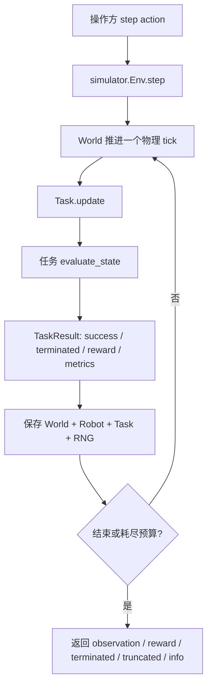
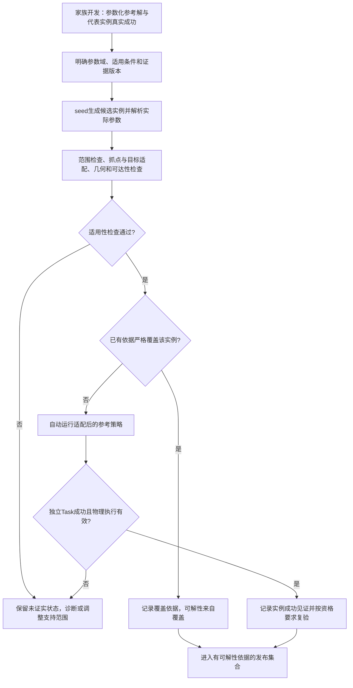

# Task 成功判据、机械臂操作与可解性验证计划

日期：2026-09-24。**本次仅更新计划，不修改运行代码、不运行测试，GPU 验收继续暂停；代码现状保留此前源码核对的结果。** 场景建模、材质和默认布局仍由另一会话负责；下列涉及 Task 初态的修改必须在其版本稳定后接续，不能整份覆盖任务脚本。

## 1. 这两步要达成什么

1. **让环境准确判断任务是否完成。** **Cast Coil 从两个已经分开的零件出发，通过manipulation重新合并拼装；Cast Keyhole 的目标是把两件分开；Blanket 是把布展平。** 成功由实际模拟状态触发，不要求复刻历史 demo 的动作、额外放桌或完成训练标签。
2. **让参考策略通过统一机械臂接口完成任务，并能复用于同类实例。** 保留已有四种控制模式，补执行验证、抓持及必要的规划支持。按解法机制划分变体家族，每个受支持家族先建立参数化参考解和真实成功的代表实例；seed生成的实例复用、适配该解法，不要求逐个手工从头找解。每个正式发布实例仍须有自己的成功见证，或有明确覆盖它的家族级可解性依据；具体规则见第5.5和第6节。

不做 RL 训练时，无需设计稠密 reward。建议本阶段默认返回 `reward=0.0`，成功时也为0；保留 `TaskResult.reward`、`step()` 五元组及数据字段，未来需要奖励时再实现。`task_success` 才是成功依据；距离、覆盖率、穿环顺序等诊断指标继续保留，不把它们自动变成 reward。

**Planner 并非必需。** 手写参考策略、人工遥操作、已知解法的动作序列或带反馈的状态机，都可以找到一条成功执行。Planner 的用途是寻找可行路径、IK和换抓次序；它输出路径本身不证明机器人已完成任务。“不需要 label”可以理解为不生产训练集，但仍应保存动作、结果和状态证据用于复验。

**本计划的工作量目标：每个解法家族开发一套可适配的solution，而不是为每个seed重写solution。** 颜色等纯视觉随机化可以复用物理解；摆位和允许范围内的尺寸变化由参数化策略自动调整；改变解谜机制的变化才需要扩展或新建解法。省去的是重复人工开发，不是把未经检查的新实例直接标为可解。目前这些家族适配和证据复用仍是开发计划，并非已经具备的能力。

## 2. 当前代码：成功接口已有，具体规则尚不统一

### 2.1 当前公共调用链



- [`tasks/base.py`](../../../topogym/tasks/base.py)：`evaluate_state()` 返回 `(reached, failure, metrics)`；`update()` 每个物理 tick 调用一次，统一计算持续时间和结果。`get_state()/set_state()` 保存及恢复判据状态。
- 当前 `stable_duration_s` 必须大于0，默认0.5秒；首次满足目标时计时为0，后续连续满足才累计。因此当前不支持“第一次满足就结束”。
- 当前成功时 `reward=1.0`，其余为0，是稀疏成功奖励；还不是零奖励占位。
- [`simulator/env.py`](../../../topogym/simulator/env.py)：一个 action 最多推进10个外部物理 tick，默认每 tick 2.5 ms；中途成功会提前结束这个 action，并保存成功 tick。`is_solved()` 仅读取结果。
- `terminated=True` 也可能是 Task 失败；超时是 `truncated=True`；引擎异常进入故障状态。不能把 `terminated` 单独当作成功。
- [`config/registry.py`](../../../topogym/config/registry.py)：13项已注册；7项仍明确缺少完整 `evaluate_state`。现有6项能够产生成功结果，不代表它们都符合本轮目标或已完成正反例验收。

### 2.2 13项任务逐项核对与拟定基础目标

下表“拟定”是下一轮开发目标。前三项采用本轮明确要求；其余按经典目标和现有任务说明提出。历史文档中的动作顺序、释放静置和严格物理资格不自动全部加入基础成功条件。Claws 继续保留此前明确要求的短暂停稳。

| Task / 当前脚本 | 当前 `evaluate_state` 的实质 | 拟定基础成功规则及要改的内容 |
|---|---|---|
| [Cast Coil](../../../topogym/tasks/cast_coil.py) | **默认 `objective="assemble"`，两件分离初态与目标方向正确**：相对位置误差<1 mm、姿态误差<0.02 rad，再要求静止、释放和持续0.5秒；另保留拆解分支 | **从两件分离的初态，通过操作完成正确拼装。** 保留默认装配方向；以目标装配相对位姿、实际嵌合及无非法穿透判断成功，已有1 mm/0.02 rad作为待校准起点。释放/放桌不默认追加为成功要求，相关 `goal_requires_release` 元数据随最终规则同步 |
| [Cast Keyhole](../../../topogym/tasks/cast_keyhole.py) | 两件轴对齐包围盒分离>20 mm，静止且持续0.5秒；允许夹持 | 两件完整脱离。去掉无依据的静止等待，复核20 mm是否只是数值余量还是额外搬远要求；不限定解锁路线 |
| [Blanket Flatten](../../../topogym/tasks/blanket_flatten.py) | 投影覆盖率≥0.90、最大高度≤3 cm、最大拉伸≤1.15、速度≤3 cm/s、漂移≤3 mm，并持续0.5秒 | 布在操作台上展开、明显叠层/褶皱消除；以实际投影覆盖和高度判断。先保留已有0.90/3 cm作为待校准起点，补“仍有薄折层”“被拉伸撑大”“悬空拉平”反例；不要求恢复某个精确网格姿态 |
| [Horseshoe Ring](../../../topogym/tasks/horseshoe_ring.py) | 检查原链/眼连接，目标环与其余件包围盒分离>20 mm；还要求静止、释放和桌面接触力 | 目标环脱离整套马蹄/链，原连接未破坏。拟去掉额外放桌、松手要求；用整体脱离判定，不能只看环与某一只马蹄距离 |
| [Hedgehog in Cage](../../../topogym/tasks/hedgehog_in_cage.py) | 球/笼包围盒分离>10 mm，放桌、释放、静止并持续2秒 | 带刺实体完整离开笼体，允许夹持；不把放桌和2秒等待作为解谜目标 |
| [Interlocked Claws](../../../topogym/tasks/interlocked_claws.py) | 两件包围盒分离>10 mm，静止并持续0.5秒，允许夹持 | 保留“两件完全分离并短暂停稳”，按既有约定允许夹持；不加释放/落桌，不要求某只手恰好转指定角度 |
| [Buzz Wire 3D](../../../topogym/tasks/buzz_wire_3d.py) | 只记录工具原点最近导线采样点和到终点距离；始终 `False` | 工具环沿导线有效到达终端，维持穿套关系，不能脱环后搬到终点。用真实工具环孔几何、线路参数和必要的遍历历史；触线是否失败作为任务规则显式声明，不能从缺少接触记录推断从未触线 |
| [Lock Picking](../../../topogym/tasks/lock_picking.py) | 记录钥匙原点、三个被动盘角度；始终 `False` | 钥匙的有效部分穿过盘组并进入 END 的正确位置/姿态，受限结构保持有效；钥匙原点达到某个X不足以判成。拟不要求松手或固定回退次数；物理结构应让错误动作受阻，而不是判据强迫重演参考步骤 |
| [Fiber Bundling](../../../topogym/tasks/fiber_bundling.py) | 只检查链节数值、掉桌和数量；始终 `False` | **每一根**目标细芯都完整通过目标环孔，符合约定穿入方向/材料段范围；不能只看粗护套、线束中心或多数细芯通过。补每根线的材料顺序和末端标识 |
| [Rope Threading](../../../topogym/tasks/rope_threading.py) | 始终 `False`，暂无穿环测量 | 按绳材料顺序获得正确三环穿越关系。既有目标是从节点0到80依次 `R1− / R2+ / R3+`，无多余反向穿越；局部坐标变换后仍用实际环法线。此为穿线几何目标，历史放回/释放窗口独立说明 |
| [Knot Untying](../../../topogym/tasks/knot_untying.py) | 始终 `False` | 实际开放绳中目标穿套全部解除，绳未断裂/穿透。先定义支持结型的操作性“解开”规则并构造正反例；不能用单视角交叉数为0、两端远或某个不充分不变量直接宣告无结 |
| [Orbits](../../../topogym/tasks/orbits.py) | 始终 `False` | 整根绳连同与其永久相连的木柄脱离四环/五杆器具；永久端连接仍在。可用整个可移动组合越过器具分离边界的充分证据，不仅看木柄退出或总绕数为0 |
| [Slotted Post Ring](../../../topogym/tasks/slotted_post_ring.py) | 始终 `False` | 目标木环脱离立柱、绳与端部挡件，绳及挡件未拆卸；仅越过柱顶或环心离柱较远不够 |

其中 Fiber 当前是 `rigid_articulated` 被动关节细芯，Blanket 是 PBD，其余四项 Rope/Knot/Orbits/Slotted 是 FEM/IPC。不能为写统一判据而把细芯也当成FEM顶点读取。

### 2.3 装配与脱离的判定边界

**Cast Coil 保留“分离初态 → 操作拼装”的任务方向。** 当前 `objective="assemble"` 与本轮明确的目标一致，不改成 `disassemble`，也不把默认初态换成已经拼好的受困姿态。后续重点是完善装配成功判据：根据当前几何/变体定义目标相对变换，在实际物理状态中检查位置、朝向和嵌合是否到位；仅靠近、仅接触、中心重合但朝向错误或靠穿透重合都不算拼装完成。初态必须未装配，最终完成允许整体位于不同世界位置，不要求把装配体搬回固定坐标。历史装配轨迹可作候选参考，仍需在当前配置中执行复验；历史拆解轨迹不能直接作为装配成功证据。

**“脱离”不同于“没有接触”。** 互锁环或爪可以彼此不接触，最近表面距离也可以大于0，但仍互锁。现有 AABB 完全分离是保守的充分条件，可能漏掉斜向已脱离的情况。应复用碰撞求解，加入姿态无关的分离平面或无碰撞向外退出检查；仍处于交叠包围范围时不能只凭正间距判成功。每项任务明确被移出的整体、保留的连接和可接受终态区域，避免把“再搬远一段”偷偷当成新的任务步骤。

## 3. 第一步：补齐统一成功判据

### 3.1 成功、过程规则和物理诊断分清职责

| 内容 | 应放的位置 | 本阶段做法 |
|---|---|---|
| 任务目标：拼装、分离、展平、穿环、解结 | `tasks/<task_id>.py::evaluate_state` | 每项任务一个权威规则；planner和视频不另写成功条件 |
| 目标确认时间、结果锁存、逐tick更新和回溯 | `tasks/base.py` | 复用公共实现，允许 `stable_duration_s=0`；无需持续确认的装配/拆解在首次满足完整判据时结束；确需持续成立的任务显式设置时间 |
| 距离、投影面积、材料顺序、穿越等纯计算 | 现有 `utils/geometry/`、`solvers/collision/`、`evaluation/cloth_metrics.py` | 多任务共用；不复制13份数学工具，不另建一套平行 success registry |
| 原生数值错误、无效体单元、连接破坏等 | World/physics诊断及必要Task完整性检查 | 明确无效执行不能作为可解证据；不会因 reward=0 或判据简化而忽略 NaN、断绳、穿模 |
| 网格/时间步收敛、长期静置、严格能量审计 | 离线 evaluation/测试报告 | 单独记录，不能将全部高级资格混入“任务到底有没有完成” |

当某项完整性正是谜题规则的一部分，例如“不拆环、不剪绳”，它必须是在线成功前提；“必须按planner的第三步退回”则不是规则。检查器本身不完整或数据缺失时明确未能确认，不填 `True`，也不把未确认伪装成数值故障。

现有 `RigidTaskDefinition` 将非有限状态、掉桌、接触穿透>1 mm混在失败返回中。下一轮逐项区分数值故障与任务失败，并把这类阈值来源写进报告；不自动把所有任务都套进同一1 mm物理资格要求。

### 3.2 公共结果与可恢复状态

- 保留 `TaskResult` 及 `step()` 返回格式；默认reward改为0，不添加进度奖励。
- `task_success=True` 时 `terminated=True`；超时和失败均不成功；成功与时间预算在同一tick发生时，沿用成功优先。
- `goal_complete` 继续表示判据是否完整，**不表示planner已找到解**。逐任务规则实现并验证后再清理 registry 的对应判据缺口，assist缺口单独保留。
- 新增的线路进度、材料穿越事件、触线记录、目标确认计时等必须进入 Task 的 `get_state()/set_state()`，随 rewind 回到同一个tick。重放未来不能继承被作废轨迹的完成记录。
- `initialize()` 当前会忽略已满足目标的 `reached`。改成明确检查标准初态尚未完成；若需要成功态夹具用于测试，走测试专用构造，不靠忽略真实初态来防止空动作获胜。
- 判断只从实际World状态读取；重复 `observe/render/is_solved/get` 不修改判据。测试用状态夹具不算真实可解性证明。

### 3.3 具体脚本与实施顺序

1. **先改公共合同和三个明确目标。** 修改 `tasks/base.py` 的零等待/零奖励/初态检查；完善 `tasks/cast_coil.py` 的拼装、`cast_keyhole.py` 的拆解及 `blanket_flatten.py` 的展平判据。同时调整相关测试和任务元数据。Coil保留默认装配方向和两件分离初态；若需调整初始摆位或抓取可达性，与场景会话逐段接续。
2. **收敛已有刚体判据。** 修改 `tasks/horseshoe_ring.py`、`hedgehog_in_cage.py`、`interlocked_claws.py`；复用 `solvers/collision/convex_compounds.py`、`triangle_meshes.py` 和 `utils/geometry/rigid_geometry.py` 做分离测量。保留关键连接检查，移出非目标要求的释放/落桌条件。
3. **补有序通过判据。** 修改 `tasks/lock_picking.py`、`buzz_wire_3d.py`、`fiber_bundling.py`、`rope_threading.py`；分别声明终端坐标系、孔边界、材料段身份及必要历史。纯穿越计算集中补到 `utils/geometry/rigid_geometry.py` / `rope.py`。
4. **补复杂绳体脱离判据。** 修改 `tasks/orbits.py`、`slotted_post_ring.py`、`knot_untying.py`。前两项优先用完整移动组合的明确脱离证据；Knot先为已支持结型建立实际中心线和解开规则，再扩结型。闭合方法、退化投影及判定不充分时的行为必须写清；不以“绕数=0”或“任意开放绳数学上可拉直”替代当前状态已经解开的判断。
5. **完善数据来源，不重复造软体后端。** `world/physics/fem.py::read_vertices` 已提供顶点位置/速度、`material_s_m` 和顶点索引；`assets/geometry/rope_volume.py` 已有材料参考坐标。复用这些构造确定的材料中心线采样映射，按需要补World读数；不得把重新按空间最近邻排序当成材料顺序。Fiber从实际关节链及局部几何端点读取，不能只用link原点。
6. **最后更新能力和文档。** `config/registry.py`、相应Task说明及完整脚本清单同步。任务目标、判据版本、参数和资产身份进入报告；旧目标的成功标签不继承。

### 3.4 变体共用判据，当前变体接入需要补查

以下接入数量保留原源码核对时的快照，不代表下文计划中的家族适配已经实现。

- [`tasks/task_variations/__init__.py`](../../../topogym/tasks/task_variations/__init__.py) 只读取各文件的 `VARIATIONS`。当前 Knot有3项具名变体，Blanket有2项；其余只开放base。
- `tasks/task_variations/cast_coil.py` 虽有大量几何派生代码和 `KINDS/PRESETS`，**没有 `VARIATIONS`**，因此这些名字还不是 `make(..., variation_id=...)` 可直接选择的运行变体。
- 目前共18个可选择的 task/variation 配对：13个base、3个Knot、2个Blanket；Blanket的 `five_folds` 与当前base折数相同，18不等于18种不同几何难度。
- 不把[变体难度审阅](../../../legacy/cleanup_20260929/docs/develop/tasks/variant_difficulty_review_20260924_zh.md)中的历史家族、候选难度或旧demo直接填成当前已接入、已可解。
- 拟让 `task_variations/<task_id>.py` 保持参数差异声明；Coil保留的几何派生实现按需要并入 `assets/geometry/cast_coil.py`，Task消费实际参数。不能只补一个名字字典却仍生成同一套基础网格。
- 同一种目标由同一个Task判据处理，通过实际尺寸、环法线和材料身份派生阈值。变体可以改变解法，不能通过降低成功门槛制造“已解”。

规划中区分三个概念，避免把每个seed都算作一个需要重新开发的变体：

| 概念 | 表示什么 | 对应职责 |
|---|---|---|
| Task | 解谜目标及合法操作规则，例如Coil拼装 | `tasks/<task_id>.py`拥有独立成功判据 |
| 解法家族 | 可由同一套参数化操作机制处理的结构及参数范围 | 变体声明描述结构/参数；参考策略声明适用条件。同一家族可以覆盖多个`variation_id`，不强制一名变体对应一份策略 |
| seed实例 | 某个家族中已解析出几何、物性、初态和外观参数的具体环境 | 固定seed及完整配置后可复现；生成器限制参数范围，策略读取实际参数进行适配 |

继续沿用现有`variation_id`和任务registry，不另建一套家族环境或注册框架。`task_variations/<task_id>.py`负责声明参数差异和合法生成范围，几何构建仍在`assets/geometry/`，解法及适用性判断在`planning/`。seed只是随机化入口，不是可解性保证，也不单独决定环境身份。

## 4. 当前代码：四种机械臂控制模式已经存在

RoboWits公开README列出同名四种控制模式，并说明其关节增量模式的夹爪命令仍为绝对宽度；它的双臂EE/JOINT向量维数和表示与本仓库并不相同。我们对齐控制含义，不把模式同名写成数组格式兼容。[RoboWits官方控制/观察说明](https://github.com/UMass-Embodied-AGI/RoboWits/blob/main/README.md#control-modes)

### 4.1 当前实际动作字段

实现集中在 [`robot/control.py`](../../../topogym/robot/control.py)，由 `simulator.Env.step()` 调用。

| 模式 | 每个arm group的字段 | 现有含义 |
|---|---|---|
| `EE_ABS` | `position_world_m[3]`、`orientation_wxyz[4]`、夹爪字段 | 世界坐标TCP目标；目标姿态必须为单位四元数，位置和姿态一起提交；内部转换hand目标并做Genesis IK |
| `EE_DELTA` | `translation_world_m[3]`、`rotation_world_rad[3]`、夹爪字段 | 相对提交前实测TCP；旋转是世界轴旋转向量，`R_target = Exp(delta) × R_measured` |
| `JOINT_ABS` | `joint_position_rad[N]`、夹爪字段 | 实际机器人关节序列对应的绝对角度目标 |
| `JOINT_DELTA` | `joint_delta_rad[N]`、夹爪字段 | 相对提交前实测关节角的增量 |

- ALOHA组名为 `left/right`，每臂6个控制关节；夹爪字段 `gripper_position_m`，当前值是原生指滑轨坐标，不是两指总开口。
- Panda+Robotiq组名为 `arm`，7个控制关节；夹爪字段 `gripper_position_rad`，是原生驱动角，不是米。两种机器人均支持四种模式。
- 四种模式中的夹爪始终为绝对命令。具体字段、顺序和限位从 `action_spec` 读，不能照搬RoboWits的14/16维数组。
- 观察模式 `EE/JOINT` 与控制模式独立；默认仍是 `JOINT` 观察和 `JOINT_ABS` 控制。每个Env配置固定控制模式，不在同一轨迹中隐式切换。
- `{}` 或省略某整组表示保持已有目标；显式零增量表示以当前实测状态为目标，两者可能不同。EE_DELTA省略单个分量按零增量处理。
- 输入先全体校验，再统一下发。双臂共享step时钟，但不保证两臂同时到达目标；一条EE_ABS只设置伺服目标，不等于完整无碰撞运动已经完成。

动作调用链：

```text
参考策略输出 action
    → Interaction.step
    → Env.step
    → robot/control.py::compile_action
    → 必要时 GenesisIKSolver.solve_checked
    → robot/joint_position.py::apply_action
    → World.advance / Task.update / 保存tick状态
```

### 4.2 已经验证到哪里，还没验证什么

- 上一轮两种机器人各8个观察/控制组合真实通过，包含小幅关节/EE运动、夹爪命令、非法目标和回溯；见[接口验收](../../../runs/test_results/simulator_contract_20260924/interfaces_rig_install_v2/README.md)。
- 这不证明完整路径避碰、狭孔通过、接触抓取、双臂搬运或FEM换抓成功。`solve_checked`检查IK残差和关节限位，不是避障planner。
- 默认Nyx + compact_lab、848×480/30 fps、双臂4视角和单臂3视角沿用，不再为planner另设场景或录制路径。
- Panda G2、输出一致性、安装和合并版本的基础任务复验仍有未完成项；GPU暂停状态见[实施报告](simulator_public_api_implementation_20260924_zh.md)。Coil保留默认分离初态和装配方向；完善成功规则后的终态、回溯及完整装配执行仍需补验，旧短程接口通过不等于装配成功。
- 公共可逆 assist grasp 仍未接通。夹爪能开合不等于能稳定抓住软绳，永久端连接也不等于可以动态换抓。

## 5. 第二步：统一操作验证，再按需要补参考求解策略

### 5.1 机械臂接口需要补强什么

| 脚本位置 | 保留和进一步工作 |
|---|---|
| `robot/control.py` | 保留唯一四模式编译器；补验证姿态边界、连续增量、双臂一个目标非法时全命令无副作用；不加入Task策略 |
| `robot/aloha/description.py`、`robot/panda_robotiq/description.py`、`panda_robotiq/gripper.py` | 用真实夹爪接触/抬升校准TCP与闭合坐标；现有Panda TCP是固定参考点，不冒称任意开度的接触中心 |
| `robot/joint_position.py` | 保留关节执行与控制状态保存；核对真实目标跟踪、夹爪联动及回溯恢复 |
| `solvers/genesis_kinematics.py` | 复用Genesis FK/IK；验证连续解的关节余量、查询无副作用；避免planner和Env各存一套不一致的IK |
| `solvers/collision/` | 复用现有几何距离能力，补整条路径、完整手爪/机械臂/被抓物体的检查；允许任务需要的接触，不把所有接触当作碰撞失败 |
| `simulator/interaction.py`、`privileged.py` | 保留操作方无reset、特权仅当前episode回溯。参考策略只能输出动作或使用明确授权的查询，不能修改目标、seed或Task结果 |
| `robot/grasp_constraints.py`、`world/physics/attachments.py`（确需assist时新增） | Robot表达抓持语义，World拥有物理约束及其可恢复状态；接到真实夹爪操作和接触/抓区条件，不在各Task里分别加焊接/顶点固定代码 |

原生接触能完成的刚体任务优先直接使用接触抓取。若软体任务必须启用assist，先定义统一模式并在实例配置和报告中显式记录；原生接触成功与辅助抓持成功分开统计。规划最多使用真实机械臂数量对应的抓持点，不能把四点外力预演直接称为双臂解法。

不急于增加第二套统一“夹爪开口米数”API。先用现有明确单位完成验证；以后若需要统一宽度，应在Robot层完成标定映射，替换重复表达，而不是让Task自行换算。

### 5.2 当前planner现状与应该保留的边界

- 活动 `planning/` 只有 [`motions/cast_coil.py`](../../../topogym/planning/motions/cast_coil.py)，提供物体相对运动段和采样，没有完整机器人执行器，也不是所有任务的planner。
- 并行场景会话新增 [`tests/scene_preset_pickup.py`](../../../tests/scene_preset_pickup.py)：包含Buzz/Lock的拾取规划、碰撞查询和物理拾放诊断。它只覆盖局部拾取，仍读取Env私有对象；本轮只登记，不移动或改写。对方完成后再提取真正共用的部分。
- 历史Task文档中的 `tasks/<name>/planner.py` 等路径不少已过时。算法可以静态审阅后迁入活动模块，但不能运行时从 `runs/legacy` 动态加载源码，也不恢复每个任务自己的环境循环。
- Planner不能读取 `task_success` 后直接写回成功标记；Task判据也不检查“参考脚本是否走到最后一行”。二者必须相互独立。

### 5.3 采用最小参考策略体系，不要求每项都有搜索器

建议继续使用 `planning/`，不再平行新建 `policies/`、`planners/`、`runners/` 三套目录。需要时添加以下文件，而不是先生成13个空planner。

```text
topogym/
├── tasks/<task_id>.py            初态、目标、可恢复判据
├── tasks/task_variations/       参数差异
├── planning/
│   ├── reference.py             最小参考策略合同：适用性/参数适配、状态 → 公共action
│   ├── cartesian.py             共用姿态插值、限速及目标跟踪（确有复用时）
│   ├── motions/cast_coil.py     已有纯物体运动段
│   └── solutions/<task_id>.py   该任务各家族的参数化解法/反馈策略；必要时调用搜索
├── solvers/                     FK/IK、距离与碰撞
├── robot/                       描述、伺服、夹爪及统一抓持语义
├── world/physics/               原生动力学及约束
├── recording/                   公共录像
└── evaluation/                  离线物理/轨迹测量
scripts/verify_solutions.py      一个外层执行与报告工具，所有物理都走Env.step
```

`solutions/` 的策略按需有状态，例如Coil的“接近→抓住→对准→插入/转动→拼装到位”，或拆解任务的“接近→抓住→解锁→脱离”；这些是候选策略阶段，不是必须输出的训练label或强制成功步骤。只创建一个轻量协议，不先恢复通用subgoal图、调度框架或复杂planner registry。任务清单仍来自现有registry。

同一个`planning/solutions/<task_id>.py`可包含多个家族的解法及共用适配函数；不为每个seed复制脚本或存一份手改轨迹。最小参考策略合同需要表达“支持哪些实例、如何从实际参数得到抓点/目标、何时适配失败”，但不承担Task成功判定。历史固定轨迹只能作为参考解的起点，不能直接冒充适用于任意seed的闭环策略。

参考策略可以由管理方提供经白名单复制的真实几何/物体状态，用于寻找解；报告明确其使用了特权信息。未来视觉policy仍只获得规定观察。参考策略和被测policy采用同一机械臂动作模式、机器人、物理参数和抓持权限；几何读取能力不能变成物体瞬移、外力或额外手臂。

### 5.4 各任务参考解的建议路线

| 任务组 | 第一版参考策略 | 后续真正需要的规划能力 |
|---|---|---|
| Coil | 优先复用已有装配参考，从分离零件的实际初态规划拾取、对准和拼装；已有拆解几何路线可反向作为装配候选，但须重新验证接近、抓取、接触和可达性 | 连续IK、双臂相对位姿协调、插入/转动中的接触及被抓物体扫掠；反放拆解视频或反序关节命令不能替代真实装配验证 |
| Keyhole / Claws | 复用已知相对拆解路线，适配当前实例和抓点，再生成双臂目标 | 连续IK、两臂协同、被抓物体扫掠与换抓 |
| Horseshoe / Hedgehog | 基于当前几何的姿态对准、退出和必要交接 | 姿态窗口搜索、夹爪/全臂可达、目标穿孔与结构避碰 |
| Lock / Buzz | 带实际状态反馈的阶段策略；Lock关注盘状态和有效深度，Buzz按线参数跟随 | 连续姿态/IK及狭小间隙；历史参考顺序仅作为候选解法 |
| Fiber / Rope Threading | 逐根/材料段状态反馈；按实际夹持能力做穿孔和换手 | 抓取、供绳、被动形变与重抓；先解决共享夹持支持 |
| Blanket | 依据布角和叠层的抓点、抬起/拖展/放回策略 | PBD可靠抓取、多次展开反馈；不强求复原历史逐粒子轨迹 |
| Knot | 每个已支持结型的局部松解/退穿策略 | 材料段识别、换抓、软体接触；新结型没有找到成功路线时保留“未证实” |
| Orbits / Slotted | 已知解谜步骤改写为最多两只真实夹爪的操作 | 同时抓持数量、绳供给、孔下交接和端件姿态；无臂多点预演仅供参考 |

每项参考解先选一个控制模式即可，建议需要姿态路线时用 `EE_ABS`，已有可靠关节轨迹时用 `JOINT_ABS`。四模式合同通过公共测试，不要求13项任务各复制四份planner。不同控制模式可有不同数值轨迹，不要求逐位一致。

### 5.5 家族级solution与seed级适配：如何避免逐个手工找解

**可以理解为“先为一种解法建立solution，其余实例在此基础上自动调整”，但solution应是参数化解法或反馈策略，不只是一串固定关节角。** “每个变体一条solution”也不是严格的一一对应：外观不同的变体可以共用；同一名称下若出现不同穿越顺序或抓取机制，可能需要多套策略。

| seed改变的内容 | 可以复用什么 | 必须满足的条件/检查 |
|---|---|---|
| 颜色、纹理、灯光等纯视觉变化 | 同一物理实例的解法与物理可解性依据 | 网格、碰撞形状、质量、摩擦、初态和目标均未改变；复用物理可解性不保证某个视觉policy仍能识别或完成任务 |
| 物体初始位置/朝向 | 相同操作阶段、物体局部坐标下的抓点和相对运动 | 重新适配home到抓取的接近段、世界坐标目标和IK；检查机器人/桌面边界、全臂及被抓物体碰撞。固定机器人下平移物体不自动构成整个系统的物理等价变换 |
| 非关键外形、有限尺寸或间隙变化 | 经参数化的抓点、插入深度、姿态窗口及运动段 | 先定义受支持范围，检查夹爪开口、质量/惯量、间隙、可达性、接触与数值有效性。“无关尺寸”须有依据，不能仅凭外观看起来相似；检查不足以覆盖动力学时需实际执行 |
| 摩擦、刚度、阻尼、质量等物理参数 | 解法机制可能可复用，控制参数可能需适配 | 不继承纯外观随机化的保证；只在已验证/有覆盖依据的范围内使用，否则进入自动执行验证或待开发集合 |
| 新结型、新互锁方式、不同穿越顺序等结构变化 | 可复用公共IK、抓持和运动工具 | 重新判断是否仍属已有解法家族；超出范围就开发新家族解法，不能只调阈值、改seed后继承成功 |

**以Cast Coil装配为例：** 为一种零件配合结构建立“拾取两个分离件→对准→插入/转动→正确嵌合”的参数化策略。换颜色不改物理解法；改变桌面摆位时重新计算拾取位姿和接近路径，装配段尽量使用两零件的相对坐标；改变配合尺寸时重新生成目标关系及运动段并检查间隙。若新结构改变了装配路线，则扩展或新建家族解法。所有实例仍由同一Task根据实际几何独立判断是否正确拼装。

开发和生成流程拟为：



- **先做有限而明确的支持域。** 不承诺任意seed、任意尺寸都能生成正式可解实例。允许在开发期拒绝超范围候选或采用有记录、确定性的重采样；相同seed和版本必须解析成相同实例，不在运行失败后暗中换场景。
- **自动复用不等于重新搜索。** 对未被覆盖的新实例，优先自动运行已有参数化参考策略；失败才诊断适配或扩大解法支持。人工工作按家族组织，运行成本仍可能随需要验证的实例数量增长。
- **初期不追求覆盖整个连续域的复杂证明系统。** 刚体任务先建立可用的参数化解法和自动验证。接触复杂的PBD/FEM任务先发布有限已验证物理实例及其纯视觉变化，或对新物理实例自动执行参考策略；不能把小扰动默认当作软体可解性保证。
- **“所有变体可解”约束正式发布集合。** 生成器可以产生用于研究的候选，但未被证据覆盖、尚未成功验证的实例必须标为待验证，不能进入声称全体可解的集合。保留既有Fiber逐实例可达、夹爪禁碰、稳定性、穿环、seed复现及重载检查；家族复用不取消这些检查。

## 6. 如何建立可信的可解性证据

### 6.1 实例见证与家族覆盖分别证明什么

固定任务、变体、seed、目标规则、资产、物理和机器人配置后，一条合法动作序列在真实Genesis执行中触发Task成功，构成**该具体实例在这些模拟条件下的可解见证**。

- **实例级见证：** 自动适配并成功执行已有solution即可建立，不要求为这个seed重新设计solution。一个seed通过不代表同族所有seed可解；失败、超时或planner未找到路径也不证明不可解。
- **家族级覆盖：** 必须给出明确参数域、适用假设，以及保证该域中每个实例都有合法解的论证。例如，物理场景完全相同、只更改不影响物理的外观时，可以复用同一物理解。仅有“尺寸变化很小”、IK通过或抽样成功率不能充当全域覆盖；几何路径可行也不自动覆盖接触、抓持和动力学。
- **发布依据二选一：** 实例有自己的实际成功见证并完成规定复验；或它落在有效家族覆盖内且所有适用条件通过。没有后者时仍须自动验证该实例，或缩小正式发布集合。无需为严格覆盖的每个seed重复完整录像和从头求解，但报告必须注明它并未逐实例实跑。
- **抽样用于检验，不替代证明。** 家族开发需检查代表实例和参数边界，后续抽样可发现实现退化；有限抽样不能推出未经论证的连续参数域全部可解。
- 几何路径、IK可达、静态截图、外力演示均不能替代完整机器人执行。基本数值有效性必须检查；更高等级的收敛性/真实性资格单独记录，不能把本机模拟成功扩大为真实机器人可行证明。
- 不要求最短路径或证明某一步“必不可少”。若找到更简单的合法解，应接受成功并修订难度描述，不能为维护hard标签拒绝它。

### 6.2 家族开发、自动适配与最终见证分开

下列完整执行流程用于建立家族代表见证，以及验证尚未被家族依据覆盖的新实例；不是要求为每个seed进行一次人工搜索。

1. **固定实例及所属家族。** 管理方以指定seed创建环境；保存Task/variation、完整参数、资产及代码哈希、目标规则版本、机器人/TCP、控制模式、材料和抓持模式。查找适用解法和已有覆盖依据，严格覆盖的实例记录检查结果即可，不冒称实际执行过。
2. **开发一次家族解法，之后优先自动适配。** 新家族可以手写、遥操作或使用planner；已有家族按真实参数更新抓点、目标和接近路径。开发时可用特权rewind搜索当前episode，但仅维护一条有效历史，被丢弃未来不能重新选回；若算法需要树搜索，必须从仍有效祖先重新执行候选前缀，不能绕过公共历史限制保存可恢复旧分支。
3. **固定候选执行方式。** 保存策略及适配参数。有状态参考策略在rewind后必须同步恢复自身阶段/随机状态，或从祖先重建。仅恢复Env不会自动恢复planner的Python变量。
4. **需要实例见证时，管理方同seed重建并完整执行。** 从标准home和默认未完成初态开始，包含接近、实际抓取和解谜；普通操作接口执行，不在最终见证中rewind、reset、瞬移物体或写入判据。管理方的准备动作不计作操作方能力。
5. **只由Task判定成功。** 成功tick保存终态与各项测量；非法执行、超时、引擎故障分别记录。Coil达到完整拼装条件、拆解任务达到完整脱离条件时，按各自规则结束，不为拍片加放桌动作；要求短暂停稳的任务由其规则计时。
6. **复验与复用。** 家族代表以及依靠自身执行结果取得发布资格的实例，至少独立同seed重建再执行一次，排查缓存依赖并检查复现；两次成功不代表任意扰动下都可靠。开环控制可复放保存action；闭环参考策略需同时固定策略版本/随机源并保存本次实际action。严格覆盖的派生实例引用已有依据和适用性检查，不要求重复两次完整运行；另外抽样做回归。扩大支持域时补证据，不通过修改范围数字直接扩大原结论。

### 6.3 不做训练数据，但保留最小证据

家族证据和实例记录分开保存，避免为每个seed复制同一份solution及证明。拟在 `runs/test_results/solvability_<run_id>/` 下使用：

```text
families/<task>/<family_id>/                  参数域、适用条件、解法版本、代表见证引用
instances/<task>/<variation>/<seed>/         已解析参数、适配/检查结果、实际运行或覆盖依据
```

家族目录只有代表成功录像时，不能把它写成覆盖全族的证书；覆盖依据须明确说明为什么适用于整个声明范围。实际执行时通过公共录制保存真实Nyx视频，保持双臂4路/单臂3路、848×480、30 fps。

- `report.json`：实例身份、家族和解法版本、已解析参数、适配及适用性检查、目标版本、控制/抓持模式、是否使用特权信息、证据类型及引用。实际运行另存成功状态、成功tick、失败/故障原因、物理诊断覆盖、运行次数。
- `actions.jsonl`：实际公共命令、执行后状态引用、实际tick数和关节目标；用于复验，不要求LeRobot/HDF5或监督label。
- 关键状态数组及终态测量：足以检查装配相对位姿与嵌合、分离、覆盖或穿越关系；源视频帧与状态/tick对齐。
- `videos/`：公共RecordingSession输出，多视角同次执行；不拼接不同尝试为成功轨迹。
- 汇总所有已启动尝试，包括失败和中断；成功率分母、seed范围和未验证变体明确，不只收录成功文件。

仅由家族依据覆盖的实例不伪造自己的actions、成功tick或成功录像；它的报告明确标为“覆盖成立、未单独实跑”，与“实际执行成功”分别计数。参考解/证据可缓存复用，但缓存键须包含实际物理参数与初态、资产及碰撞几何、目标规则、机器人/TCP、控制与抓持模式、相关代码/引擎版本；**不能只按seed命中**。纯视觉派生可以共享物理证据，同时单独记录渲染配置；影响假设的修改须使覆盖失效并重新检查。

状态报告分别记录基础可运行、判据已实现，以及可解性证据类型：候选路线、真实成功见证/复验、家族覆盖成立、未证实。`goal_complete=True`、planner存在和视频存在，均不能代替可解性证据。视觉policy成功率是另一项评测，不从物理可解性覆盖中推导。

## 7. 测试脚本与验收顺序

以下是计划，尚未新增或运行。优先复用现有参数化测试，不为13个任务各复制整套测试框架。

| 脚本 | 进一步检查的功能 |
|---|---|
| `tests/unit/test_task_state.py`（修改） | 零等待首次成功、持续确认边界、失败/成功/超时、reward始终0、回溯恢复判据历史、只读查询不计时 |
| `tests/unit/test_success_conditions.py`（新增） | 13项规则的正例、近似成功反例和边界；Coil正确拼装、分离初态、仅靠近、错向/未插到位和非法穿透；另含互锁但无接触、斜向脱离、薄折叠、漏穿一芯、穿环反向/重复穿越、木柄已退而绳仍缠等；只证明判据逻辑 |
| `tests/unit/test_task_definitions.py`、`test_task_variations.py`、`test_task_support.py`（修改） | 默认初态尚未完成；变体按声明改变几何或纯外观；同seed解析结果一致；家族参数边界、超范围拒绝、纯视觉变化不改物理身份；判据缺口与参考解/assist状态独立；候选与正式发布集合分开 |
| `tests/unit/test_control_modes.py`、`tests/integration/test_interface_modes.py`（扩展） | 两机器人四模式的单位、TCP、零增量/保持目标、姿态合成、全动作拒绝、实际关节/EE跟踪及夹爪接触；不是完整可解证明 |
| `tests/integration/test_task_success_runtime.py`（新增） | 真实Genesis成功前一tick/成功tick、action中途终止、合法rewind后再次触发成功；先覆盖代表性的刚体、PBD和FEM，再补各Task |
| `tests/integration/test_reference_solutions.py`（新增） | 按家族代表、边界及尚未覆盖的实例参数化运行同一套参考解，验证换seed后的自动适配和合法机器人执行；Coil从分离初态完成拼装。实跑保存视频与报告；覆盖实例单列依据并抽样回归，不能把抽样全过称为全域证明。未有依据的发布条目明确失败/待完成，不静默skip后称13/13 |
| `tests/runtime_evidence.py`、`scripts/verify_solutions.py`（复用/新增） | 增加家族证据引用、实例适配结果、完整解轨迹及覆盖/实跑分别计数；检查目标、物理参数和代码等变化导致旧证据失效，不能凭相同seed复用；复用公共录制与唯一Env物理循环 |
| 现有 G2、输出一致性、安装、FEM及基础任务测试（继续） | 待用户恢复GPU验收后补齐；成功规则改动须回归默认初态、reset、step、rewind和输出；不以参考解通过替代simulator稳定性 |

**第一步完成标准：** 13项Task都有明确基础目标及与之相符的初态；判据具备正反例和必要历史恢复；零奖励接口、成功/失败/超时语义一致；复杂判据仍缺的条目明确列出，不提前标完整。

**第二步完成标准：** 两机器人四模式统一可用；必要抓持支持已验证；每个受支持解法家族有参数化参考解、明确适用范围和当前配置下的代表成功见证及复验。每个正式发布实例有自身完整机器人成功见证和复验，或通过有效家族覆盖的全部适用性检查。未覆盖实例自动运行复用解法或暂不发布，不要求为每个seed人工开发新解；未发布随机域、未完成复杂变体和严格物理资格单列。家族代表通过、覆盖检查通过与逐实例实跑通过分别报告，不扩大结论。

## 8. 与其他会话的衔接

- 本轮仅更新本计划，明确家族级解法复用、seed级适配和可解性证据边界；未修改Task、几何、材质、操作接口或测试源码。
- 实施第一步前对齐场景会话最终版本，尤其Coil的分离初始摆位与目标装配关系、Lock的端点/支架、Horseshoe的自由环和软体材料坐标。共享文件逐段修改，出现冲突先列明影响。
- 上一轮GPU验收暂停指令继续有效。本计划不启动agent rollout、网络API、训练或新GPU运行。
- 代码现状与历史变体资料分别取证：代码现状来自此前活动源码核对，本次文档更新未重新验收运行行为；历史说明仅用于识别目标和候选解法。
