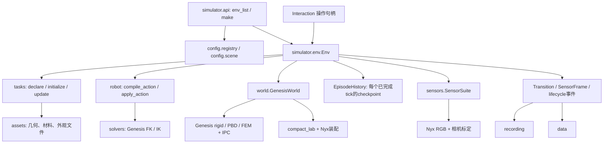
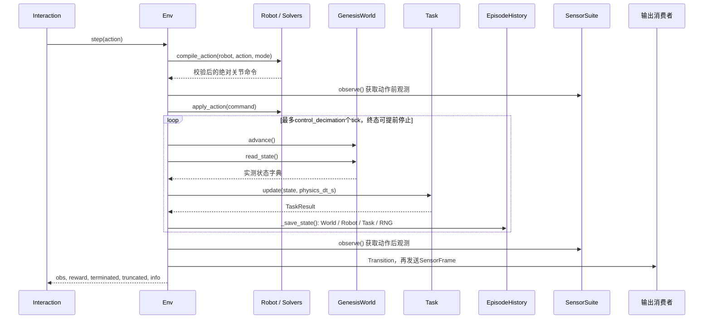

# 当前模拟器模块：源码功能、输入输出与运行链

> 2026-09-29 归档提示：本文涉及的独立研究／诊断／测试入口已移入[统一归档](../../../legacy/research_tools_20260929/README.md)；相关旧路径与命令保留为历史说明，不再是当前运行入口。rollout 准备、执行及 Harbor 工具仍在活动目录。

2026-09-29 新增 [按 seed 的场景随机变体](scene_variation_zh.md)：`variation_id="seeded"` 由 seed%3 选难度档，再按同一 seed 抽 2–3 个位置/朝向/颜色变量（`tasks/scene_variation.py`）；显式档名的标称场景与 `instance_id` 不变。Blanket 的抽样在冻结存档之前。

2026-09-29：当前 Harbor 入口为 [Harbor 手册](../../rcb/README.md)。旧 runner、usage 与三条流程说明已移入 [归档](../../../legacy/cleanup_20260929/README.md)，归档与本轮检查见 [维护记录](../../maintenance/legacy_cleanup_20260929_zh.md)。

2026-09-27 已按用户收窄范围接入 [公共终态确认：夹爪离开后的稳定](final_settling_zh.md)：Coil、Buzz、Knot、Blanket 共用释放/间隙/运动确认，复用 TaskDefinition 的唯一计时和历史；真实物理资格单独报告。

2026-09-27 的 [公共 terminal 原工程计划](../../../legacy/cleanup_20260929/docs/develop/modules/terminal_support_stability_plan_20260927_zh.md) 保留 13 项任务合同调查；用户进一步将范围收窄为释放后稳定，当前实现以上述终态确认说明为准，未实施通用承载力/支撑图求解。

2026-09-27 新增 [FEM IPC 绳与 PBD 布的公共自动抓持开发计划](soft_grasp_assist_engineering_plan_20260927_zh.md)：历史代码回收、独立材料夹具、双手材料区域归属、原生约束与 rewind、碰撞边界和逐后端验收；尚未实施。

2026-09-26 新增 [公共自动抓持辅助](grasp_assist_zh.md)：`utils/grasp.py` 提供纯计算，`world/physics/grasp_manager.py` 管理可恢复生命周期，`grasp_rigid.py` 适配实际约束。管理方显式配置，默认关闭；任务抓持资格与公共工具验收分开记录，PBD／IPC 物理后端尚未部署。

2026-09-26 已接入 [Scripted policy 调度](scripted_policy_execution_plan_20260926_zh.md)：统一 `act(obs)`，limited 提供 RGB + 基础本体 + 可选公开固定相机标定，继续限制环境真值。执行模块已集中到 `simulator/rollout_simulation/`，`planning/examples/cube_pick_place.py` 提供被动策略样板。实际测试资格、源码快照和视频见[实施记录](../dev-logs/scripted_policy_execution_implementation_20260926_zh.md)，调用方式见[本地 API](simulator_api_zh.md)。下文模块扫描仍保留原日期，不代表新增文件的完整清单。

源码核对日期：2026-09-24。本页直接说明当前 `topogym/` 活动源码，覆盖本次扫描的103个Python文件（包含包初始化文件，不包含`agents/deferred`及历史源码），按模块定位到脚本及函数；本次仅静态阅读和文档整理，未运行仿真或测试。源码实现、测试通过、完整任务可解是三件不同的事。

阅读方式：先看第1节运行顺序和第2节数据结构，再进入对应模块。函数表以跨模块入口和实际运行方法为主，建模/数学辅助函数按职责分组；`__init__.py` 的导出统一在末尾说明，不把包导出当作第二份实现。参数只省略与理解无关的可选项，精确签名可点击源码查看；“无返回”表示通过修改对象或写文件产生结果。本文不是所有内部局部函数的逐行注释。

| 模块 | 核心职责 | 主要对接 |
|---|---|---|
| [config](#config) | 任务身份、能力缺口、场景配置解析 | task_id / SimulatorConfig → Task类、场景配置 |
| [simulator](#simulator) | 公共入口、生命周期、权限、历史和输出编排 | action → 物理执行 → step五元组 |
| [tasks](#tasks) | 任务实体声明、初态、成功/失败判据、判据历史 | 参数 → TaskSpec；World读数 → TaskResult |
| [assets](#assets) | 生成几何、定位资源、声明物理材料和外观 | 几何参数 → 文件/网格/建模报告 |
| [world](#world) | 创建Genesis场景、唯一物理积分、状态恢复、实验室外观 | TaskSpec + 配置 → 实体；tick → World状态 |
| [robot](#robot) | 机器人描述、动作转换、关节目标和本体状态 | 四种控制命令 → 原生关节目标 |
| [solvers](#solvers) | FK/IK、距离和碰撞计算 | 位姿/关节/几何 → 候选解或测量 |
| [sensors](#sensors) | 观测、相机、标定和Nyx RGB | 当前保存状态 → observation + SensorFrame |
| [recording](#recording) | 多视角视频与仿真时间映射 | SensorFrame → MP4及帧来源记录 |
| [data](#data) | 动作前后观测及真实命令存储 | Transition → JSONL/HDF5及有效性索引 |
| [evaluation](#evaluation) | 布面测量、连续几何间隙检查 | 实测数组/运动段 → 指标或几何证书 |
| [planning](#planning) | 当前Coil纯参考运动 | 家族参数 → 相对物体运动段；不直接执行机器人 |
| [utils](#utils) | 数组、随机、快照、文件和通用几何支持 | 各模块数据 → 数值/文件结果 |
| [延期模块与其他入口](#other) | 包导出、开发工具、旧agent资料 | 不构成另一条活动Env运行循环 |

## 1. 先串起一次真实运行

### 1.1 模块依赖与所有权



这里的箭头表示调用/依赖，不表示每个模块都拥有引擎。`Env`决定执行顺序，`GenesisWorld.advance()`调用`scene.step()`；Task、Robot、Sensors、录制和数据模块不各自推进物理。FEM/IPC内部子步由Genesis求解循环调用。

### 1.2 make和reset：规格建立与真正建场景是两个阶段

| 顺序 | 实际调用 | 输入 → 结果 |
|---|---|---|
| 1 | `simulator/api.py::make` → `SimulatorConfig` → `Env.__init__` | task_id与配置 → 未build的Env；解析任务类，不在make内推进物理 |
| 2 | `Env.reset(seed=...)` | 校验seed、reset能力及单进程活动Env限制；释放旧World/历史，分配新episode_id和seed |
| 3 | `utils/variant_rng.py::seed_process`、`config/scene.py::load_scene_config` | seed与配置 → 进程随机源初始化、已展开的机器人/桌面/相机配置 |
| 4 | `tasks/task_variations::resolve_variation` → Task构造器 | 变体、覆盖参数、seed → 任务参数、Task实例、instance_id |
| 5 | `Task.declare(asset_dir, table_height_m)` → `assets/library.py::describe_build` | 任务参数 → 生成文件、TaskSpec和AssetBuild哈希记录 |
| 6 | `GenesisWorld.from_tabletop` → `add_entities` → `add_attachments` → `build` | 场景配置及实体/约束声明 → Genesis场景、机器人和任务实体；build前接入compact_lab/Nyx |
| 7 | `make_robot` → `reset_home`；`Task.bind` | 引擎机器人实体/控制配置 → 控制器与home目标；Task取得命名实体引用 |
| 8 | 可选`reset_physics_steps`次`World.advance` → `reset_clock` → `Task.initialize` | 预稳定后状态 → episode时钟归零、初始化判据；默认预稳定0步 |
| 9 | 创建`SensorSuite`、`EpisodeHistory` → `_save_state` → `observe` | 保存tick 0，取得初始观测；发出reset生命周期事件，返回`(obs, info)` |

tick 0是**完成声明、build、home及显式预稳定后的初态**。预稳定过程不保存成可回溯的episode历史。相同seed复现还依赖相同配置、资产、代码和运行条件；不能只凭seed声称跨版本/跨设备逐位相同。

### 1.3 一次step的准确顺序



- 默认`physics_dt_s=0.0025`、`control_decimation=10`：物理400 Hz、控制至多40 Hz；`solver_substeps=4`是每个物理tick内部积分细分，不是额外的公开state_id。
- **每个完成物理积分、Task更新并成功保存的tick有一个checkpoint；每个成功返回的action只有一个Transition。** 摄像与frame sink在action结束时取样，不是每tick自动录一帧。
- 动作校验失败时不下发两臂命令、不增加时钟。积分/Task/checkpoint/输出异常则记录fault并抛出；已完成的物理不因异常自动撤销。
- `terminated`由Task成功或失败决定；`truncated`由物理步数上限决定。是否solved看`info.task_success`，不能只看`terminated`。

### 1.4 rewind与reset不是同一种恢复

```text
特权Interaction.rewind_to(StateRef)
  → PrivilegedAccess校验当前episode及引用格式
  → Env._restore → EpisodeHistory.resolve（先验证，后修改）
  → World.restore_state（引擎、IPC、缓冲、时钟、随机源）
  → Robot.restore_state（控制目标账本，不重复下发控制）
  → Task.set_state + Env RNG/计数/结束标记恢复
  → 分配新branch_id，Sensors缓存失效
  → truncate_after：删除旧未来；释放对应IPC dump
  → 发出rewind事件，返回该状态的(obs, info)
```

恢复点由已保存的`StateRef(episode_id, state_id)`指定，不重新计算“某秒应该处于什么姿态”，也不靠重放action模拟恢复。回溯可以落在一个action的中间tick；下一次step提交新action，不补执行旧action的余量。`state_id`是单调分配的身份，回溯后不会重用，不能当作当前`physics_step`。

管理方`reset(seed=...)`则重建新episode，旧句柄和全部旧恢复点失效；普通、特权Interaction都没有reset。回溯只能进入当前episode唯一有效路径，不能切换seed或进入同seed的旧episode。

## 2. 模块之间实际传递什么

| 数据/定义位置 | 主要字段、单位与形状 | 产生者 → 消费者 |
|---|---|---|
| `SimulatorConfig`，`simulator/config.py` | task/robot/variation、seed、控制/观察模式、dt、decimation、RGB及权限开关 | `make` → Env、配置解析器 |
| `TaskSpec`，`tasks/base.py` | `entities`、`physics_options`、`metadata`、`attachments` | `Task.declare` → Env、World；metadata不等于自动全部进入公共observation |
| `EntitySpec`，同上 | 名字、morph类型/文件、世界位置m、四元数wxyz、固定标记、物理材料、外观、初始关节、FEM volume路径 | Task → `World.add_entities` |
| `AttachmentSpec`，同上 | soft/rigid实体名、start/end材料端点、抓区长度m、刚度N/m | Task → World/IPC；当前为永久端连接，不是动态assist |
| `AssetBuild`，`assets/library.py` | 生成文件相对路径、SHA-256、参数、seed、坐标/单位描述 | `describe_build` → Env记录；不含引擎句柄 |
| 公共action，`robot/control.py` | `left/right`或`arm`分组；关节rad、位置m、方向wxyz或世界轴旋转向量rad；夹爪为原生坐标 | 操作方 → `compile_action` → `JointPositionRobot` |
| `World.read_state()`字典 | `bodies/articulations/particles/fem/contacts/ipc`及`physics_step/sim_time_s` | World → Task与特权查询；不是完整checkpoint |
| `TaskResult`，`tasks/base.py` | reward、terminated、task_success、reason、metrics | `Task.update` → Env返回值、info、Task快照 |
| observation，`sensors/observation.py` | `state/robot/task/rgb/cameras`；RGB为`uint8[H,W,3]`，标准`[480,848,3]` | SensorSuite → 操作方、Transition；没有完整World真值字典 |
| `SensorFrame`，同上 | episode/branch/state/tick/time、RGB映射、相机内外参 | SensorSuite → render及RecordingSession |
| `WorldState`，`world/state.py` | native状态、补充缓冲、控制/约束缓存、引擎标记、时钟、RNG、IPCState | World capture → EpisodeState → 同一World restore |
| `RobotState`，`robot/joint_position.py` | robot_id及各组`targets`；实测qpos/速度由World保存 | Robot capture → EpisodeState → Robot restore |
| `StateInfo / StateRef / EpisodeState`，`simulator/history.py` | 元数据/跨episode校验引用/完整组合快照，三者不能混用 | Env → EpisodeHistory；外部只能取元数据或受控查询 |
| `Transition`，同上 | 动作前后state_id和observation、原action、实际tick数/时长、reward/结束标记/info | Env每action → dataset sink；执行关节目标在`info.executed_joint_targets` |

`freeze()`将对外字典和数组复制成不可变数据；`WorldState`内部保留引擎缓冲目标引用，属于同一进程/同一已build World的恢复对象。JSONL/HDF5和视频是输出证据，不能据此调用公共rewind恢复一个已关闭的环境。

<a id="config"></a>

## 3. config：选任务与解析环境配置

### 3.1 [config/registry.py](../../../topogym/config/registry.py)

| 函数/类型 | 输入 | 输出及用途 | 调用方 |
|---|---|---|---|
| `TaskRegistration`、`SupportGap` | 任务类路径、物理模型、默认机器人、按operation列出的缺口 | 注册描述；`integrated`只表示定义已接入 | 目录查询、support报告 |
| `task_catalog()` | 无 | 注册项字典的tuple | `env_list` |
| `task_registration(task_id)` | 规范task_id | 一个TaskRegistration；未知名字抛ValueError | 配置解析、Task工厂、变体解析 |
| `task_definition(task_id)` | task_id | 按`module:class`加载的Task类，不创建Scene | `Env.__init__` |
| `require_task_support(task_id, operation)` | 如`reset`、`solve`、`assist_grasp` | 无返回；被缺口阻塞时抛`TaskSupportError` | reset及显式能力检查 |
| `_registration / _goal_gap` | 注册参数/缺口文本 | 组装注册项及SupportGap | 本文件初始化`_TASKS` |

默认单臂任务为Hedgehog、Buzz Wire、Lock Picking、Fiber；其余默认ALOHA。当前7项完整判据缺口阻塞的是`solve`，不是因为判据未完成就拒绝它们reset/step。Env不会在每次step中调用planner或要求已有solution。

### 3.2 [config/scene.py](../../../topogym/config/scene.py)

`load_scene_config(config) → OmegaConf配置`：按`robot_id`或registry默认值compose包内`tabletop_aloha`/`tabletop_panda_robotiq`，写入计算设备、精度、dt/substeps、Nyx、机器人资产目录，强制非批量`n_envs=0`与home settle为0。按`observation_cameras`选择实际创建的相机；关闭RGB时相机映射清空。它只解析配置，不创建引擎。

相关配置入口：[profiles](../../../topogym/config/profiles)、[compact_lab.yaml](../../../topogym/config/profiles/presentation_configs/compact_lab.yaml)、[双臂相机](../../../topogym/config/profiles/camera_configs/aloha_observation.yaml)、[单臂相机](../../../topogym/config/profiles/camera_configs/panda_robotiq_observation.yaml)。这些是配置数据，不是各任务的第二个环境工厂。

<a id="simulator"></a>

## 4. simulator：入口、生命周期和历史

### 4.1 [simulator/api.py](../../../topogym/simulator/api.py)与[config.py](../../../topogym/simulator/config.py)

| 函数/类型 | 输入 → 输出 | 行为 |
|---|---|---|
| `env_list(details=False)` | 无/详细开关 → 排序task_id列表；details为真则返回字典列表 | 详细项含registry、变体、控制/观察模式、标准视觉和回溯说明，不代表已通过验收 |
| `make(task_id, **configuration)` | 名字与配置 → Env | 调用唯一SimulatorConfig和Env；不自动reset |
| `SimulatorConfig.__post_init__()` | dataclass字段 → 无返回 | 校验模式、seed、dt、步数、机器人与设备；冻结task_parameters、规范化路径；拒绝CPU+RGB及非Nyx渲染 |

### 4.2 [simulator/env.py](../../../topogym/simulator/env.py)

| 函数/属性 | 输入 → 输出 | 下游调用/状态影响 |
|---|---|---|
| `Env(config=None)` | SimulatorConfig → 管理方Env | 解析Task类，建立空生命周期；尚无World |
| `reset(*, seed=None)` | 显式seed优先，否则配置seed，否则生成seed → `(obs, info)` | 第1.2节完整建场景链；生成新episode并替换历史 |
| `step(action)` | 按action_spec提交的映射 → 五元组 | 第1.3节；已结束episode拒绝继续step |
| `observe()` | 无 → 不可变observation | `SensorSuite.sample`；不推进物理 |
| `sensor_frame()` | 无 → SensorFrame | 先保证observe缓存存在，再返回同状态帧 |
| `render()` | 无 → `{camera_id: RGB数组}` | 读取SensorFrame；关闭RGB则报错；不走第二次物理执行 |
| `is_solved()` | 无 → bool | 读取`Task.result.task_success`，不重新累计成功时间 |
| `interaction(privileged=False)` | 权限请求 → 当前episode的Interaction | 需先reset；True还要求创建Env时启用特权 |
| `privileged`属性 | 无 → PrivilegedAccess | 管理方取得当前episode特权入口；禁用时抛PermissionError |
| `action_spec / observation_spec`属性 | 当前配置/机器人 → 格式字典 | reset前也可查询规格；调用Robot/Sensors规格函数 |
| `support_report()` | 无 → registry字典 | 不build场景；能力缺口和实测结果仍要分开 |
| `episode_metadata`属性 | 当前episode → 不可变元数据 | task/instance/seed/资产hash/机器人/控制与观察等；不是完整源码证明包 |
| `state_history`属性 | 当前历史 → `tuple[StateInfo]` | 不暴露可写引擎checkpoint |
| `_save_state()` | 当前World/Robot/Task/Env RNG → 无返回 | 分配ID、capture、append，成功后更新state_id并使Sensors缓存失效 |
| `_restore(state_ref)` | StateRef → `(obs, info)` | 完整恢复并截断旧未来；由特权接口调用，不作为普通操作入口 |
| `_info()` | 当前计数/TaskResult → dict | seed、state_ref、tick/time、success、终止原因、判据完整性、support |
| `add_transition_sink(callback)` / `remove_transition_sink` | `callback(Transition)` → 添加时返回取消订阅函数 | action完成后被动消费；不自动创建writer |
| `add_frame_sink(callback)` / `remove_frame_sink` | `callback(SensorFrame)` → 取消订阅函数 | 必须启用RGB；action完成后发帧，初态需调用方显式append |
| `add_lifecycle_sink(callback)` / `_emit_lifecycle(kind, **payload)` | 回调/事件参数 → 取消订阅函数/无返回 | 通知reset、rewind、close；含身份和被作废state_id |
| `_require_ready()` | 无 → 无返回或异常 | 检查已reset、未关闭、未faulted；恢复路径另有检查 |
| `_release_world()` / `close()` | 无 → 无返回 | 释放Scene和临时目录；close再清历史/订阅。释放异常保留句柄以便重试 |
| `__enter__ / __exit__` | with上下文 → Env/关闭 | 离开with时close；进入with不自动reset |

fault不是正常Task失败。普通observe/step在fault后被拒绝；管理方可reset/close，特权恢复入口可尝试回到已有有效checkpoint，diagnostics保留故障阶段。恢复本身失败也会继续标为faulted。

### 4.3 [interaction.py](../../../topogym/simulator/interaction.py)与[privileged.py](../../../topogym/simulator/privileged.py)

| 函数 | 输入 → 输出 | 对接与限制 |
|---|---|---|
| `Interaction._env()` | 当前弱引用及创建时episode_id → Env或异常 | 每次调用检查owner存在、未close、episode未变 |
| `Interaction.step/observe/render/is_solved`及两个spec属性 | 同名Env接口的参数 → 同名结果 | 统一委托Env，不复制运行机制 |
| `Interaction.rewind_to(state_ref)`、`get(name)` | 引用/白名单名字 → 恢复结果/详细数据 | 普通句柄中方法名仍存在，但调用抛PermissionError；特权句柄转交PrivilegedAccess |
| `PrivilegedAccess._env()` | 当前owner、授权、episode → Env或异常 | 旧episode句柄失效；不允许提权或换seed |
| `PrivilegedAccess.rewind_to(state_ref)` | StateRef，或仅有episode_id/state_id的映射 → `(obs, info)` | 拒绝裸整数/seed，调用`Env._restore` |
| `PrivilegedAccess.get(name)` | `history/state_info/world/robot/task/diagnostics` → 冻结副本 | world为read_state、robot为observe、task为get_state；diagnostics只声明rigid接触覆盖，不冒称完整IPC接触 |

Interaction没有`reset/make/close`或config setter。它是受信本地Python接口边界，未实现恶意同进程反射隔离或网络服务。

### 4.4 [simulator/history.py](../../../topogym/simulator/history.py)

| 函数/类型 | 输入 → 输出 | 语义 |
|---|---|---|
| `StateRef.__post_init__`、`StateInfo.ref` | 非空episode_id和非负state_id/StateInfo → 校验/StateRef | 防止裸tick与恢复引用混淆 |
| `EpisodeHistory(episode_id)` | 新episode身份 → 空历史 | 不隐式淘汰快照 |
| `next_state_id()` / `append(EpisodeState)` | 无/快照 → 下个ID/无返回 | append校验episode、ID顺序及父节点；只有成功append才增长计数 |
| `get(state_id)` / `resolve(StateRef)` | 当前有效ID/完整引用 → EpisodeState | resolve先检查episode；失效未来、旧episode均拒绝 |
| `new_branch()` | 无 → 新branch_id | 标记续跑片段，不保留可选择的历史树 |
| `truncate_after(StateRef)` | 有效恢复点 → 被移除的EpisodeState tuple | 删除该点之后所有有效未来；下个ID不回退 |
| `states()` | 无 → 有效StateInfo tuple | 外部历史列表来自这里 |
| `EpisodeState / Transition` | 第2节字段 → 结构化记录 | 前者用于tick恢复，后者用于action输出，粒度不同 |

<a id="tasks"></a>

## 5. tasks：定义实体、测量目标、恢复判据

### 5.1 [tasks/base.py](../../../topogym/tasks/base.py)

| 函数 | 输入 → 输出 | 职责与下游 |
|---|---|---|
| `TaskDefinition(config, seed)` | 参数覆盖与seed → Task | 校验未知参数，合并defaults，创建Task RNG；instance_id来自task_id/config/seed，不含全部引擎身份 |
| `declare(asset_dir, table_height_m)` | 输出目录与桌面世界高度 → TaskSpec | 抽象入口，由13项任务分别实现；可以写建模文件，不创建Env |
| `bind(entities)` | 命名Genesis实体映射 → 无返回 | 保存实例引用；Rigid版本额外缓存link索引 |
| `evaluate_state(state)` | World实测状态字典 → `(reached: bool, failure: str或None, metrics: dict)` | 任务专属只读测量入口；不是step五元组 |
| `initialize(state)` | tick 0状态 → 无返回 | 检查出生失败、清成功计时、记录初始metrics；当前不会因`reached=True`直接报告成功，也不通用拒绝已达目标初态 |
| `update(state, physics_dt_s)` | 连续tick状态及dt → TaskResult | 同tick重复调用不累计；跳tick报错；调用evaluate_state、累计持续达标时间并设置reward/终止 |
| `observe()` | 无 → dict | 基类当前返回`{}`；公共observation.task因此不会自动带完整判据metrics |
| `get_state()` | 当前Task → 深拷贝字典 | schema/task/instance、stable_time、last_tick、goal_active、result、Task RNG |
| `set_state(saved)` | 同一Task实例快照 → 无返回 | 校验身份和字段后恢复；由Env rewind调用 |
| `RigidTaskDefinition.rigid_measurements(state)` | bodies、contacts、局部顶点 → `(poses, bounds, quiet, failure)` | 世界位姿/AABB、速度阈值、落桌下和过深接触检查；供刚体Task共用 |
| `RigidTaskDefinition.released(state, names=None)` | rigid接触及可选任务体名 → bool | 根据机器人-任务体接触力判断释放；不是夹爪开度判断，也不是assist解锁 |

**当前实现**仍要求`stable_duration_s>0`，第一次达标计时为0，成功reward为1；改为零reward和允许即时成功属于[后续计划](../dev-logs/task_success_control_and_solvability_plan_20260924_zh.md)，尚未实施。

### 5.2 13项任务脚本：同一入口，不同几何与目标

以下每项都有`declare(asset_dir, table_height_m) → TaskSpec`与`evaluate_state(state) → (reached, failure, metrics)`；输入输出合同相同，实体内容不同。表中是**当前判据**，不是此前讨论的拟定简化目标。

| 脚本 / 类 | declare对接的生成器与实体 | evaluate_state实际读取/返回 |
|---|---|---|
| [cast_coil.py](../../../topogym/tasks/cast_coil.py) / `CastCoilTask` | 同名geometry.generate_assets → gold/silver两刚体；默认分离初态、assemble目标 | 刚体位姿→相对位置/旋转误差、AABB间隙、quiet/released；默认装配需误差达标且静止释放，再由base计时 |
| [cast_keyhole.py](../../../topogym/tasks/cast_keyhole.py) / `CastKeyholeTask` | 同名generate_assets → 两个keyhole刚体 | 两件AABB间隙与quiet→达标；允许夹持，base计时 |
| [blanket_flatten.py](../../../topogym/tasks/blanket_flatten.py) / `BlanketFlattenTask` | `generate/write_obj/fabric_weave` → 一件带纹理PBD布 | particles位置/速度→投影覆盖、最大高度、拉伸、速度和漂移门槛 |
| [horseshoe_ring.py](../../../topogym/tasks/horseshoe_ring.py) / `HorseshoeRingTask` | 同名generate_assets → 马蹄、链/眼、自由目标环 | 实测位姿重建环关系，检查原连接；目标环整体脱离、quiet、released、桌面接触后达标 |
| [hedgehog_in_cage.py](../../../topogym/tasks/hedgehog_in_cage.py) / `HedgehogInCageTask` | 同名generate_assets/cage_meshes/hedgehog_meshes → 固定笼、带刺体及支撑 | 球笼AABB间隙、静止、落桌和释放；仍有2秒默认持续条件 |
| [interlocked_claws.py](../../../topogym/tasks/interlocked_claws.py) / `InterlockedClawsTask` | 同名generate_assets → 两爪刚体 | AABB完全分离与quiet；允许夹持，base计时 |
| [buzz_wire_3d.py](../../../topogym/tasks/buzz_wire_3d.py) / `BuzzWireTask` | 同名generate_assets/endpoint_pose → 导线、底座、工具环及支撑 | wand原点→最近线路采样与终点距离；`reached=False`、`goal_complete=False` |
| [lock_picking.py](../../../topogym/tasks/lock_picking.py) / `LockPickingTask` | `write_disc/write_key/write_endpoint/write_key_cradle` → 被动盘铰链、钥匙、终点及托架；外观/路径处理走scene_visuals | 读key位置、3个disc_hinge角度；检查非有限/落桌下；完整目标仍False |
| [fiber_bundling.py](../../../topogym/tasks/fiber_bundling.py) / `FiberBundlingTask` | `generate_anchored_assets`、`RingMount.parts` → 刚体关节链纤维束、环/支撑；默认Panda+Robotiq | 读取articulations各link位置，检查有限/高度，返回link数量；全芯穿环判据仍False |
| [rope_threading.py](../../../topogym/tasks/rope_threading.py) / `RopeThreadingTask` | `ThreadingLayout/generate_assets/write_rope_volume` → FEM绳、刚体环/支架，启用FEM/IPC | 当前只返回材料顺序穿环缺口metrics，不产生成功 |
| [knot_untying.py](../../../topogym/tasks/knot_untying.py) / `KnotUntyingTask` | `KnotLayout/generate_assets/write_rope_volume` → 有直参考构形的FEM绳 | 当前只返回结拓扑/释放资格缺口，不产生成功 |
| [orbits.py](../../../topogym/tasks/orbits.py) / `OrbitsTask` | 同名geometry、volume、visual_collision_urdf → 架/环/柄与FEM绳，绳端永久连柄 | 当前完整脱离判据False；不是只看winding即可成功 |
| [slotted_post_ring.py](../../../topogym/tasks/slotted_post_ring.py) / `SlottedPostRingTask` | 同名geometry、volume、visual_collision_urdf → 柱/环/端件与FEM绳，声明端连接 | 当前完整取环/拓扑判据False |

Blanket额外覆盖`bind`（粒子到材料UV映射、面/边及参考长度）、`initialize/update`（维持稳定窗口的粒子基准）、`get_state/set_state`（保存/恢复`stable_origin`）。这说明Task的历史不仅是一个success布尔值。

Lock/Fiber的`rigid_articulated`指多个刚体通过关节相连，仍由Genesis刚体机制运行；四项`fem_ipc`是另一类物理模型，不是另一个MuJoCo后端。当前7项完整判据缺失与13项是否能短程step必须分别报告。

### 5.3 场景默认值与变体

| 脚本 / 函数 | 输入 → 输出 | 当前用途/限制 |
|---|---|---|
| [scene_presets.py](../../../topogym/tasks/scene_presets.py) `defaults(task_id, **parameters)` | 基础参数 → 深拷贝并应用PRESETS后的defaults | 部分Task共享当前摆位/外观默认值；增加scene_preset_id |
| 同文件`record_preset(task, folder)` | Task与目录 → preset身份字典；写scene_preset.json | Task.declare记录生成参数和视觉角色；不读取历史demo运行源码 |
| [task_variations/__init__.py](../../../legacy/research_tools_20260929/topogym/tasks/task_variations/__init__.py) `available_variations(task_id)` | task_id → `("base", ...VARIATIONS名字)` | 校验任务后读取同名变体文件；没有VARIATIONS则仅base |
| 同文件`resolve_variation(task_id, variation_id, overrides, seed)` | 变体与覆盖参数 → 独立参数dict | 顶层同名dict做一层update；当前seed形参未参与采样，不是通用随机场景生成器 |
| [knot_untying.py](../../../legacy/research_tools_20260929/topogym/tasks/task_variations/knot_untying.py) | `VARIATIONS`常量 | figure_eight、double_overhand、left_overhand几何差异；没有另一套执行函数 |
| [blanket_flatten.py](../../../legacy/research_tools_20260929/topogym/tasks/task_variations/blanket_flatten.py) | `VARIATIONS`常量 | three_folds、five_folds参数差异；不实现独立Env |
| [cast_coil.py](../../../legacy/research_tools_20260929/topogym/tasks/task_variations/cast_coil.py) `family_parameter/coordinate_scale/corner_cuts/create_template` | 家族名/参数/模板尺寸 → 派生量、缩放、切削块或模板dict | 被Coil建模/运动工具使用；当前没有VARIATIONS，不能把KINDS/PRESETS直接当成make可选变体 |

家族级参数化solution、seed自动适配和可解性覆盖仍见后续计划；这些能力没有因为当前存在变体文件就自动实现。

<a id="assets"></a>

## 6. assets：几何文件、机器人模型和外观

### 6.1 公共资源与材料脚本

| 脚本 / 函数 | 输入 → 输出 | 对接与副作用 |
|---|---|---|
| [library.py](../../../topogym/assets/library.py) `resource_path(resource_id)` | catalog中的资源ID → 已核对SHA-256的Path | 任务模板/参考JSON/静态网格定位；不搜索runs |
| 同文件`describe_build(task_id, root, parameters, seed)` | 已生成目录及参数 → AssetBuild | 遍历实际文件计算hash；不代替几何生成、可解性或物理验证 |
| 同文件`visual_asset_path(value)` | 绝对路径或视觉资源相对名 → Path | 解析`TOPOGYM_VISUAL_ASSET_ROOT`或用户Nyx缓存；调用方检查文件是否存在 |
| [materials.py](../../../topogym/assets/materials.py) `MaterialSpec.__post_init__` | model及参数 → 校验或异常 | 校验模型、有限值、密度/弹性模量/泊松比/摩擦等，不导入Genesis |
| 同文件`rope_fem_parameters()` | 无 → FEM参数dict | 当前stable_neohookean、E/nu/rho/friction_mu起点；四项FEM Task使用，不表示物理资格已充分验证 |
| [surfaces.py](../../../topogym/assets/surfaces.py) `wood_visual(mesh, texture_file, roughness, tile_size, ...)` | trimesh、木纹图片及纹理参数 → 带UV/PBR外观的网格 | 供任务geometry使用；视觉网格可分裂UV接缝，碰撞资产须保持独立 |
| [textures.py](../../../topogym/assets/textures.py) `fabric_weave(color, size_m, pattern, ..., seed, preview_path)` | 实际布面尺寸、格纹/条纹/角点等参数 → `uint8[H,W,3]` | 可写PNG；Blanket.declare实际调用，生成blanket_diffuse.png，不创建PBD材料 |
| 同文件`_base_colour/_paint_corners/_cells/_smooth_noise/_bilinear/_write_png` | 色板/纹理坐标/随机场/数组 → 底色、角点、噪声插值或PNG | fabric_weave内部绘纹工具，不拥有仿真随机推进 |

`assets/resources/catalog.json`存静态资源位置与hash；它不是Task registry。各geometry返回的layout/assembly/report类型目前并未完全统一；Env是在Task.declare之后统一生成AssetBuild记录，不能把所有generator描述成同一种返回签名。

### 6.2 [assets/robot.py](../../../topogym/assets/robot.py)：模型组装，不控制关节

| 函数 | 输入 → 输出 | 行为 |
|---|---|---|
| `asset_root(explicit=None)` | 显式目录/环境变量/默认仓库assets → Path | 校验机器人来源目录；区别于Python包内`topogym/assets` |
| `robot_cache_dir()`、`tool_model(cfg)` | 无/机器人配置 → 缓存Path/工具模型名 | 模型选择辅助 |
| `robot_asset(cfg)` | robot_control配置 → 模型路径字符串 | frozen_asset优先，否则选择ALOHA组装或Panda+Robotiq组装；World builder消费 |
| `build_tabletop_aloha(base_riser_height_m, assets=...)` | 原ALOHA文件与安装高度 → 缓存MJCF Path | 展开include、调整安装面，保留本体比例和关节；原子写缓存 |
| `build_robotiq_panda(source, assets=...)` | Panda MJCF和Robotiq资源 → 组装MJCF Path | 替换末端、命名隔离、保留夹爪联动/接触定义，记录固定hand参考 |

这里保留MJCF/XML作为**模型文件格式**，实际加载者是Genesis的`gs.morphs.MJCF`；这不等于用MuJoCo执行模拟。

### 6.3 [assets/scene_visuals.py](../../../topogym/assets/scene_visuals.py)：生成文件的视觉处理

| 函数 | 输入 → 输出 | 调用位置 |
|---|---|---|
| `surface(role)` | silver/hemp等角色名 → 新的surface参数dict | Task的EntitySpec.surface；不改物理摩擦/密度 |
| `finish_generated_urdf(path, role)` | 已生成URDF、角色 → 外观处理报告 | 写PBR GLB，替换URDF visual引用；不替换collision，Lock使用 |
| `localize_generated_urdfs(folder)` | 本次生成目录 → 无返回 | 将目录内mesh引用改为相对路径并验证未越界；Lock使用，避免episode绝对路径污染资产字节 |
| `visual_collision_urdf(folder, name)` | 同名GLB视觉和OBJ碰撞文件 → URDF Path | Orbits/Slotted使用，隔离UV接缝与碰撞拓扑 |

这层处理**源资产文件**；`world/visuals`负责把声明变成运行场景的surface/Nyx设置，二者作用阶段不同。

### 6.4 13项几何生成脚本的入口与输出

文件均位于`assets/geometry/`。输出目录里的网格/URDF/MJCF/报告由Task挑选，转换为EntitySpec后交World；生成报告通过不等于机器人已成功求解。

| 脚本 / 入口 | 输入 → 返回值 | 生成内容 / Task如何消费 |
|---|---|---|
| [cast_coil.py](../../../topogym/assets/geometry/cast_coil.py) `generate_assets(output, template=None, scale=3)` | 模板/尺度 → `(CoilAssembly, report)` | 两件视觉及碰撞资产、URDF、装配/分离预览、模板/几何报告；Task用body局部原点放置实体 |
| [cast_keyhole.py](../../../topogym/assets/geometry/cast_keyhole.py) `generate_assets(output, template=None, scale=3)` | 模板/尺度 → `(KeyholeAssembly, report)` | 带孔轮廓的挤出几何、凸分块、两件URDF及来源；Task使用两件几何和相对位姿 |
| [blanket_flatten.py](../../../topogym/assets/geometry/blanket_flatten.py) `generate(layout)`；`write_obj(path, vertices, faces, uv, layout)` | BlanketLayout → `(vertices, faces, uv, panels, report)`；网格数组 → 写OBJ | Task先平移到桌面位置，再写带UV布面并加共享织纹；没有独立Scene |
| [horseshoe_ring.py](../../../topogym/assets/geometry/horseshoe_ring.py) `generate_assets(output, template=None, scale=2)` | 模板/尺度 → `(HorseshoeAssembly, report)` | 马蹄、链环及目标环的独立URDF；Assembly.loops/edges也供运行时连接检查 |
| [hedgehog_in_cage.py](../../../topogym/assets/geometry/hedgehog_in_cage.py) `generate_assets(folder, scale, template_path, finish)` | 模板、尺度、外观 → `(HedgehogLayout, report)` | 笼与带刺体网格/碰撞体、初始可放置姿态；choose_initial_pose只找初态，不证明退出路线 |
| [interlocked_claws.py](../../../topogym/assets/geometry/interlocked_claws.py) `generate_assets(output, render_variant=None)` | 包资源参考/可选渲染变体 → `(ClawAssembly, report)` | 两件视觉与碰撞网格、原始相对位姿和几何报告；Task平移整套装配到桌上 |
| [buzz_wire_3d.py](../../../topogym/assets/geometry/buzz_wire_3d.py) `generate_assets(folder, layout)` | BuzzWireLayout → `(SpatialWire, report)` | 线路、wand、支撑/底座、reference_path.npz及外观；Task用rail/endpoint_pose放置工具 |
| [lock_picking.py](../../../topogym/assets/geometry/lock_picking.py) `write_disc/write_key/write_endpoint/write_key_cradle` | LockGeometry、盘槽/stop/质量/外观等 → 前三者返回模型Path，cradle返回网格Path列表，同时写对应文件 | 当前Task逐件调用，并声明被动disc_hinge；`export_assets(g, stops, cfg, folder)`是较粗的打包工具，不是当前Env工厂 |
| [fiber_bundling.py](../../../topogym/assets/geometry/fiber_bundling.py) `generate_anchored_assets(folder, layout, anchor)` | FiberLayout + AnchoredLayout → `(layout, report)` | 生成锚定束的MJCF及视觉/环/支撑资产；不是FEM绳。另有generate_assets基础建模工具 |
| [rope_threading.py](../../../topogym/assets/geometry/rope_threading.py) `generate_assets(folder, layout)` | ThreadingLayout → `report`（不是layout/report二元组） | 参考JSON派生中心线、环、支架与视觉资产；FEM体网格由Task另调write_rope_volume |
| [knot_untying.py](../../../topogym/assets/geometry/knot_untying.py) `generate_assets(output, layout)` | KnotLayout → `(layout, report)` | 打结中心线、表面网格及投影/间距诊断；FEM参考直绳另由volume生成器创建 |
| [orbits.py](../../../topogym/assets/geometry/orbits.py) `generate_assets(output, layout)` | OrbitsLayout → `(layout, report)` | 柱环/木柄/绳等可视和碰撞资产、中心线；Task追加体网格和永久端连接 |
| [slotted_post_ring.py](../../../topogym/assets/geometry/slotted_post_ring.py) `generate_assets(output, layout)` | SlottedPostLayout → `(layout, report)` | 开槽柱、环、端件、绳的网格与报告；Task追加FEM及端连接 |
| [rope_volume.py](../../../topogym/assets/geometry/rope_volume.py) `write_rope_volume(path, centerline, radius, spacing=..., sides=8, end_stops=False)` | 中心线`[N,3]`和绳尺寸 → NPZ Path | 输出`rest/spawn/elements`：直参考构形、弯曲出生构形、四面体索引；四项FEM共用 |

### 6.5 几何脚本里的其他功能函数

这些函数服务同文件建模、诊断或离线候选构造；**存在函数不表示每次reset都会调用它**。输入中的长度为米或模板明确的局部尺度，输出再经Task转换为世界坐标。

| 所在脚本 | 函数组 | 输入 → 输出/用途 |
|---|---|---|
| cast_coil | `load_template/box/occupied/partition_solid/merge_cells` | 模板、点及加减盒 → 模板dict、占据mask、精确正交CSG分块 |
| cast_coil | `CoilAssembly/clearance/geometry_report/write_body` | 模板与尺度/两盒复合体/单body → Assembly、带符号轴向净空、报告、URDF/网格文件 |
| cast_coil | `synthesize(kind, output, pitch, growth, parameters)` | 家族与派生参数 → 生成候选几何及路线/间隙诊断产物 |
| cast_keyhole | `load_template/arc/outlines/polygon_slabs/extrude_slabs` | JSON轮廓/圆弧/孔洞/厚度 → 多边形与封闭挤出视觉/碰撞分块 |
| cast_keyhole | `KeyholeAssembly/mesh_clearance/geometry_report/write_body` | 模板/两个网格/assembly/body → 装配、三角面与包含检查、报告、模型文件 |
| blanket_flatten | `BlanketLayout.validate/rotation/panel_clearance` | 布尺寸/折角/板片网格 → 参数检查、旋转、板片间距离 |
| blanket_flatten | `material_coordinates(points, vertices, uv, panels)` | 重采样粒子与出生布面 → `(uv, distances)` |
| blanket_flatten | `generate_flat_binding/gathered_target` | layout/材料UV与gather、twist参数 → 平布绑定几何/候选聚拢位置；当前基础Task走generate |
| horseshoe_ring | `ellipse/tube_mesh/band_centerline/horseshoe_band` | 环/马蹄参数 → 曲线、光滑管面及带状网格 |
| horseshoe_ring | `Loop.points/Loop.linking/HorseshoeAssembly.topology_report` | 环几何/另一环 → 采样点、有向穿盘计数、连接报告 |
| horseshoe_ring | `sample_segments/point_segment_distance/geometry_report/write_body` | 曲线/段/assembly/body → 重采样、距离、报告及模型文件 |
| hedgehog_in_cage | `load_template/HedgehogLayout.spike_segments/band_mesh/cage_meshes/hedgehog_meshes/write_body` | 模板/尺寸/刺轴 → 带孔笼体、刺体视觉与碰撞网格及文件 |
| hedgehog_in_cage | `clearance_samples/pose_clearance/choose_initial_pose` | 刺体采样、笼体、候选位姿 → 初态净空/位姿选择；不是完整机械臂解法 |
| hedgehog_in_cage | `union64/Sweep.distance/boxes_from_mask/annular_cells/rectangular_gate_cells` | 实心分块、扫掠体/采样点或占据mask → 并集、距离/分块，用于候选几何 |
| interlocked_claws | `load_reference/reference_body_poses/ClawAssembly.world_meshes/geometry_report` | 包资源参考、可选关节状态 → 参考变换、世界网格、几何报告 |
| interlocked_claws | `pose/rot/box/box_mesh/Segment.at/Segment.rotation_angle` | 刚体参数/归一化进度 → 变换、盒网格和旋转量 |
| interlocked_claws | `FamilyModel.relative_pose/negative_paths/save/geometry_audit` | 候选家族、时间或目录 → 相对路线、错误路线、文件与几何审查；不接管Env |
| buzz_wire_3d | `BuzzWireLayout.control_points/tool_capsules/SpatialWire.pose/fixed_capsules` | layout/线路进度 → 导线控制点、工具/线路胶囊、参考工具位姿 |
| buzz_wire_3d | `transported_frames/front_facing_frames/capsule_mesh/tube_mesh` | 切线、端点、半径 → 连续标架和表面网格 |
| buzz_wire_3d | `clean/line/vertical_wave_controls/comb/eight/w_valleys/omega/coil/join/compose/reference_maze_controls` | 路线规格/阶段/控制点 → 清理或组合后的线路控制点；不等于已发布变体 |
| buzz_wire_3d | `endpoint_pose/support_spheres/support_boxes/fixture_boxes/plinth_layers` | 线路或底座尺寸 → 工具初始位姿、支撑几何、底座分层 |
| buzz_wire_3d | `wood/metal/toy_wood/replace_visuals/finish_assets/finish_toy_assets` | 网格/生成目录/线路 → 视觉材质与模型引用处理；不改变目标判据 |
| lock_picking | `LockGeometry.from_config/validate/tip_x/disc_x/grip_pos/slot_margin/clearance/variant_geometry/angle_error` | 配置、插入深度、钥匙/盘角度、变体seed → 布局、位置和间隙；角度单位以具体参数后缀/实现为准 |
| lock_picking | `annulus/sector/rounded_square_radius/disc_assets/goal_mark_assets/limit_assets/slot_profile/ring_limit_assets` | 半径、角区间、槽形及stop配置 → 盘/框/字样网格或径向边界及文件 |
| lock_picking | `inertial/mesh_xml/key_rest_layout/disc_colors/paint_aperture_outline` | 质量/mesh路径/几何/外观配置 → XML片段、钥匙托架布局、颜色及轮廓视觉文件 |
| fiber_bundling | `FiberLayout.ring/fibers/minimum_aperture_radius`、`segment_distance/minimum_fiber_clearance/frame/shape_in_root_frame` | 布局/线段/方向/线束 → 环与纤维中心线、最小净空、标架及根部局部几何 |
| fiber_bundling | `AnchoredLayout.from_task_config/spacing/lead/terminal_parts/cradle_parts` | 锚定配置/布局 → 出线间隔、引线及终端/托架部件声明 |
| fiber_bundling | `write_bundle/write_anchored_bundle/write_dynamic_material_visuals/part_color` | 路径、布局/锚定或部件名 → 写模型、补MJCF visual或颜色 |
| fiber_bundling | `RingMount.from_task_config/signature/parts`及`export_fixture` | 环座配置、中心/桌面高度、布局 → 环座描述/规格、部件或检查资产 |
| rope_threading | `ThreadingLayout.reference/transform/centerline/rings` | 包参考/局部点与布局 → 来源、变换后的中心线和环描述 |
| rope_threading | `route_crossings/surface_intersects_ring_disk/ring_mesh/inspect_geometry` | 材料有序点/三角面/环/layout → 有向过盘序列、面盘相交、环网格、几何报告 |
| knot_untying | `KnotLayout.centerline/projected_crossings/minimum_nonlocal_distance/template_diagram_matches/inspect_geometry` | 结型、中心线、材料邻域排除长度 → 曲线、XY交叉及高度符号、非局部距离、模板匹配和诊断；模板匹配不是通用结不变量 |
| orbits | `OrbitsLayout.scaled/validate/post_x/ring_x/ring_z/ball_z/eyes` | 尺寸配置/缩放 → 合法布局与各构件位置 |
| orbits | `cord_centerline/tube_mesh/make_meshes/winding_numbers/geometry_report/finish` | 布局/中心线/部件 → 绳曲线、管网格、部件映射、绕数和报告、外观；绕数不单独决定成功 |
| slotted_post_ring | `SlottedPostLayout.validate/post_polygon/cord_controls/ring_inner_radius/ring_z` | 槽柱/绳/环配置 → 截面、多段控制点和几何量 |
| slotted_post_ring | `centerline/tube_mesh/make_meshes/geometry_report` | 布局/采样间距/绳半径 → 中心线、实体网格和必要几何检查；不证明可解 |

<a id="world"></a>

## 7. world：Genesis执行、物理状态与实验室

### 7.1 [world/genesis_world.py](../../../topogym/world/genesis_world.py)

| 方法 | 输入 → 输出 | 实际作用 |
|---|---|---|
| `from_tabletop(env_cfg, robot_cfg, physics_options, compute_backend, precision, seed, cameras)` | 已解析配置 → 未build的GenesisWorld | 初始化/核对进程级Genesis设备与精度；创建TabletopBuilder；FEM/IPC时配置coupler并安装当前Scene专用桥 |
| `add_entities(specifications)` | EntitySpec序列 → 无返回，更新entities | 按URDF/MJCF/mesh/primitive及rigid/PBD/FEM构造；surface_from_spec解析外观；FEM调用add_volume |
| `add_attachments(specifications)` | AttachmentSpec序列 → 无返回 | 只允许未build IPC World；交给coupler建永久材料端约束 |
| `build()` | 已声明Scene → 无返回 | builder.finalize或scene.build；检查checkpoint支持、设置任务初始关节；失败清理 |
| `advance()` | 当前Scene → 无返回，physics_step增长1 | 唯一外层scene.step；核对引擎确实完成一个tick；异常保留实际进度并标fault |
| `reset_clock()` | 已初始化World → physics_step归0 | 仅episode计数归零，不重置物理、不倒转引擎scene.t |
| `sim_time_s`、`cameras`属性 | 当前World → tick×dt、相机映射 | 分别供Task/Env、Sensors使用 |
| `read_state()` | 当前实体与求解器 → 状态dict | 汇集rigid、关节/link、PBD粒子、FEM材料节点、rigid接触、IPC诊断；检查非有限数值 |
| `capture_state()` | 当前完整可恢复World → WorldState | native状态、缓冲、控制输入、flags、RNG、引擎tick/substep、可选IPC原生dump |
| `restore_state(state)` | 同world_id的WorldState → 无返回 | scene.reset(native) → IPC恢复 → 补充缓冲/flags/inputs → 时钟/RNG；不以重放动作代替 |
| `discard_states(states)` | 被截断未来的WorldState列表 → 无返回 | 释放对应IPC磁盘dump；当前有效快照仍保留 |
| `close()` | 当前World → 无返回 | 释放IPC、Scene/Nyx及实体映射；失败保留可重试状态 |
| `_check_checkpoint_support/_require_open/_require_built` | 当前运行配置 → 校验或异常 | 当前checkpoint绑定Genesis 1.2.1，拒绝批量、梯度、emitters及未支持求解器/外力状态 |

`read_state()`的主要子结构：

- `bodies[name]`：位置`[3] m`、wxyz姿态`[4]`、线速度m/s、角速度rad/s、link索引。
- `articulations[name]`：每joint的position/velocity、每link的世界位姿/速度。关节坐标维数和单位依关节类型，不能全部当成单个rad。
- `particles[name]`：PBD位置/速度`[N,3]`。
- `fem[name]`：顶点位置/速度`[N,3]`、active、材料弧长`material_s_m`和稳定vertex_indices。
- `contacts`：rigid collider的link_a/link_b/force/penetration；`ipc`是原生帧、有效性、约束残差、体积比等诊断，**不是完整IPC接触清单**。

### 7.2 场景构建与实体定位

| 脚本 / 函数 | 输入 → 输出 | 对接 |
|---|---|---|
| [entities.py](../../../topogym/world/entities.py) `EntityRegistry.add/get/as_dict` | 名字+Genesis句柄/名字/无 → 句柄/句柄/映射副本 | 重名、未知实体报错；与资源catalog区别在于这里存运行时句柄 |
| [tabletop.py](../../../topogym/world/tabletop.py) `tabletop_frames_from_config(env_cfg)` | 桌面/安装配置 → TabletopFrames | 集中桌面高度、任务原点、机器人位置 |
| 同文件`TabletopFrames.task_to_world/task_z_to_world` | 局部位置/高度 → 世界位置/高度 | 当前是基于task_origin的平移；不是任意旋转坐标变换 |
| 同文件`StandardTabletopSceneBuilder.create(...)` | env/robot配置及可选材料 → TabletopBaseScene | 创建Scene、地面、桌、框/台、机器人、相机；返回scene/entities/cameras/frames/footprint，尚未build |
| 同文件`finalize(base_scene)` | 已有任务实体的base_scene → 无返回 | prepare_presentation后scene.build，建立腕部安装状态；GenesisWorld.build调用 |
| 同文件`_validate_geometry/_frames/_add_table_frame/_select_renderer` | 配置/坐标/Scene → 足迹检查、坐标、框架实体、renderer选择 | 检查安装面/操作区等；Nyx sensor在finalize注册，不静默回退Rasterizer |
| [lab.py](../../../topogym/world/lab.py) `compact_lab_layout()` | 无 → 装饰部件dict列表 | 描述唯一compact_lab的墙、窗和实验室物件 |
| 同文件`add_lab(scene, manifest)` | Scene与EntityRegistry → 添加的部件名列表 | 加背景视觉实体；presentation调用，不建立第二个环境 |

### 7.3 物理材料与FEM/IPC桥

| 脚本 / 函数 | 输入 → 输出 | 对接与边界 |
|---|---|---|
| [physics/pbd.py](../../../topogym/world/physics/pbd.py) `material(model, parameters)` | pbd_cloth/pbd_elastic及参数 → Genesis PBD材料 | World.add_entities调用；不积分、不保存历史 |
| [physics/fem.py](../../../topogym/world/physics/fem.py) `material(parameters)` | 经过MaterialSpec检查的参数 → `gs.materials.FEM.Elastic` | 物理材质构造 |
| 同文件`add_volume(scene, spec, morph, physical_material, surface)` | NPZ体网格和实体声明 → Genesis FEM实体 | 校验`rest/spawn[N,3]`、`elements[M,4]`和正体积；当前要求单位姿态；局部工厂以显式体网格代替自动四面体化 |
| 同文件`read_vertices(entity)` | 有material_coordinates的FEM实体 → 顶点/速度/active/材料索引dict | 只读取测量并释放查询记录，不是checkpoint |
| [physics/ipc.py](../../../topogym/world/physics/ipc.py) `require_episode_checkpoint(compute_backend)` | 后端名 → 无返回或异常 | 明确要求CUDA、Genesis 1.2.1、pyuipc 0.0.25及可用设备 |
| 同文件`scene_options(parameters)` | IPC覆盖参数 → IPCCouplerOptions | 接触距离、Newton/线性容差和接触类型 |
| 同文件`install_for_scene(scene, initial_robot_positions)` | 未build Scene、机器人home → 当前Scene的EpisodeIPCCoupler | 安装嵌套子类和接触所有权处理；不全局替换Genesis类 |
| 同文件`CheckpointStore.capture/restore/discard/close` | 当前coupler/IPCState/废弃states → IPCState或恢复/清理 | capture保存native dump压缩字节、几何属性、前一关节变换；restore恢复原文件及native frame，再恢复输入引用 |

`install_for_scene`内部的`EpisodeIPCCoupler`也是重要源码功能，虽不是可从模块直接import的顶层类：

| 内部方法 | 输入 → 输出/效果 |
|---|---|
| `build/_init_ipc/_add_rigid_geoms_to_ipc` | 当前Scene声明 → 构造native世界、预设机器人home、检查封闭碰撞网格、记录接触所有权；修补视觉接缝后恢复原几何引用 |
| `_register_contact_pairs`与局部`init_owned_contacts` | rigid/native实体集合 → 分配接触负责方；机器人自身/静态接触与native动态体避免双算 |
| `_add_fem_entities_to_ipc` | FEM材料坐标及四面体 → 当前和参考native几何；只支持stable_neohookean桥 |
| `_create_attachments` | AttachmentSpec → 材料端点选区、刚体局部锚点和SoftVertexStitch约束 |
| `_finalize_ipc` | 完成声明的native场景 → 合法性检查、FEM状态accessor与CheckpointStore |
| `couple(f)` | Genesis子步索引 → 执行耦合并检查native有效；只从Genesis内部求解循环调用 |
| `_retrieve_fem_states` | native位置/速度 → 写回Genesis对应FEM子步缓冲，校验顶点次序 |
| `reset` | 引擎reset请求 → 同步关节输入历史、刚体/FEM状态，清除warm-up遗留；不是操作方reset入口 |
| `diagnostics()` | 当前native状态 → attachment_residual、volume_ratio、native_valid等 |
| `rigid_velocities()` | native动态刚体缓存 → 线速度/角速度映射，补充World.read_state |
| `close(diagnostics_dir=None)` | 可选诊断目录 → 保存故障资料并释放native对象/私有工作目录 |

桥还禁止原FEM post-coupling位置更新重复积分；因此不能把“FEM位置读取正确”单独视为整个耦合/回溯链已经验证。永久端连接也不代表公共机器人assist grasp已经接入。

### 7.4 [world/state.py](../../../topogym/world/state.py)：完整checkpoint的构成

| 函数/类型 | 输入 → 输出 | 作用 |
|---|---|---|
| `require_finite_state(value, path="world")` | 嵌套实测数据 → 无返回或FloatingPointError | 指明NaN/Inf所在字段；World.read_state调用 |
| `copy_native_state(state, device=None)` | Genesis SimState → 独立tensor/array存储副本 | 不深拷贝整个Scene；保存时可搬CPU，恢复时搬回引擎设备 |
| `capture_engine_buffers(scene, previous=())` | 支持的solver/coupler/entity图、前次缓冲 → BufferState tuple | 控制、碰撞warm-start、休眠、PBD约束等补充数组；相同不可变payload可共享 |
| `pack_buffer/unpack_buffer`、`PackedArray.nbytes/stored_nbytes` | 数值数组/压缩记录 → 无损存储/独立可写数组、大小 | 大数组zlib压缩，不降精度、不按运动近似 |
| `restore_engine_buffers(buffers)` | BufferState序列 → 写回原引擎目标 | 按engine/torch/numpy类型恢复 |
| `capture_rng(rng)` | World Generator及进程随机源 → Python/NumPy/Torch/CUDA/World RNG状态tuple | capture_state调用 |
| `restore_rng(state, rng)` | WorldState与World Generator → 还原上述随机源 | 不更换episode seed；Task RNG、Env RNG另在组合快照中恢复 |

这些记录带原对象引用和版本约束，不能直接pickle后当作跨进程通用状态格式；保留完整tick历史也会持续消耗内存/IPC存储。

### 7.5 world/visuals：compact_lab与Nyx的装配

| 脚本 / 函数 | 输入 → 输出 | 阶段 |
|---|---|---|
| [presentation.py](../../../topogym/world/visuals/presentation.py) `default_presentation_config()` | 无 → compact_lab的OmegaConf配置 | 独立几何检查场景复用相同视觉预设 |
| 同文件`prepare_presentation(scene, manifest, env_cfg, cameras)` | 实体、相机与配置 → presentation报告，并原位替换相机映射 | build前添加唯一实验室背景、应用外观、注册Nyx sensors并包装相机；关闭RGB则不建Nyx sensors |
| [nyx.py](../../../topogym/world/visuals/nyx.py) `apply_finishes(manifest, rules)` | 实体名匹配规则、颜色/金属度/粗糙度/贴图 → 已应用外观报告 | 修改视觉surface及PBR载体；不控制机械臂、不推进Scene |
| [lighting.py](../../../topogym/world/visuals/lighting.py) `vis_options(env_cfg=None)` | 显示配置 → Genesis VisOptions | 创建Scene使用；Nyx的HDRI/光源另由Nyx sensor options接入 |
| [surfaces.py](../../../topogym/world/visuals/surfaces.py) `from_spec(parameters)` | EntitySpec.surface映射 → Genesis Default surface | 解析diffuse_texture_path；拒绝同时指定图像与color |
| 同文件`plastic(role, color, vis_mode, texture)` | 语义角色、颜色/数组 → Genesis Plastic surface | builder的桌面/台等使用；ROLE_ROUGHNESS来自assets |
| 同文件`texture_reaches_renderer(surface)` | surface → 检查文本 | 诊断实际get_rgba解析结果；当前不是标准reset必经步骤 |
| 同文件`restore_renderer_materials(entity)` | 含GLB视觉的实体 → 无返回、恢复视觉PBR | 保留的辅助工具；当前活动调用链未发现调用方，不应写成必经路径 |

**Nyx RGB实际读帧代码在`sensors/renderers/nyx.py`，不是`world/visuals/nyx.py`。** 后者主要处理build前外观；仅看到World中调用了某个nyx脚本，并不足以判断最终视频从哪里取得RGB。

<a id="robot"></a>

## 8. robot：描述、动作转换与执行

### 8.1 两种机器人共用一个控制器

| 脚本 / 函数或类型 | 输入 → 输出 | 内容 |
|---|---|---|
| [description.py](../../../topogym/robot/description.py) `JointGroup / RobotDescription` | 模型与控制配置 → 结构化描述 | 分组、arm/finger关节名、受驱动夹指、限位、home、kp/kv/force、hand与TCP固定变换 |
| 同文件`describe_robot(config)` | robot_control → RobotDescription | 选择下面两个describe实现；不创建Scene |
| [aloha/description.py](../../../topogym/robot/aloha/description.py) `describe(config)` | ALOHA配置 → left/right两JointGroup | 每臂6关节，夹爪字段gripper_position_m；TCP固定偏移在该文件定义 |
| [panda_robotiq/description.py](../../../topogym/robot/panda_robotiq/description.py) `describe(config)` | Panda+Robotiq配置 → arm组 | 7轴、Robotiq驱动角、固定hand到TCP变换 |
| [panda_robotiq/gripper.py](../../../topogym/robot/panda_robotiq/gripper.py) | 无函数；DRIVER_JOINTS、DRIVER_LIMITS_RAD常量 | 指明finger_joint1/2和0～0.8 rad原生驱动范围；不是独立夹爪执行循环 |

模型网格、MJCF拼装在assets/robot.py；这里描述如何控制已加载模型。ALOHA的米值是原生指滑轨坐标，Robotiq的rad是驱动角，两者都不能直接称为“两指总开口宽度”。

### 8.2 [robot/control.py](../../../topogym/robot/control.py)

| 函数 | 输入 → 输出 | 调用链 |
|---|---|---|
| `action_spec(description, mode)` | RobotDescription、四种模式之一 → 字段/形状/单位/限位dict | Env.action_spec及动作校验使用 |
| `_vector(value, count, name)` | 数值向量及要求维数 → float数组 | 拒绝bool、错误维数、非有限数 |
| `compile_action(robot, action, mode)` | 当前robot、公共action、固定控制模式 → 绝对关节目标映射 | JOINT_ABS直接validate；DELTA先读实测；EE转换TCP→hand后solve_checked；最后全体validate，不下发控制 |

| 控制模式 | 每组动作字段 | 如何解释 |
|---|---|---|
| JOINT_ABS | joint_position_rad`[N]` | 各控制关节绝对目标 |
| JOINT_DELTA | joint_delta_rad`[N]` | 提交前实测关节位置加增量 |
| EE_ABS | position_world_m`[3]`、orientation_wxyz`[4]` | 世界坐标TCP完整目标位姿；四元数需单位化；两字段必须一起给 |
| EE_DELTA | translation_world_m`[3]`、rotation_world_rad`[3]` | 相对实测TCP，旋转为世界轴旋转向量，左乘当前朝向；省略的EE增量分量为0 |

各模式均可带绝对夹爪命令；省略夹爪/整组保持旧目标。`{}`保持旧目标，显式零增量重新以当前实测状态为目标，二者不必相同。控制模式在Env配置中固定；EE目标通过IK并不代表整条运动已无碰撞。

### 8.3 [robot/joint_position.py](../../../topogym/robot/joint_position.py)

| 方法 | 输入 → 输出 | 对World的影响 |
|---|---|---|
| `make_robot(entity, config)` / `JointPositionRobot(...)` | Genesis robot实体及配置 → 通用控制器 | 建关节/qpos索引，设kp/kv/force并缓存home目标 |
| `validate_action(action)` | 关节位置/夹爪映射 → 规范化dict | 检查组名、字段、维数、有限值、限位，无物理推进 |
| `apply_action(action)` | 已转换关节命令 → 无返回 | 合并省略字段，调用entity.control_dofs_position；保存targets；本身不step |
| `reset_home()` | 描述中的home → 无返回 | 普通rigid设实际初始关节并下发保持目标；IPC机器人home须在build前声明，此处核对；准备FK/IK缓冲 |
| `observe()` | 当前entity → 每组实测和目标字典 | joint_position/velocity、finger、hand/TCP位姿、目标值；SensorSuite会筛选公共字段 |
| `capture_state()` | 当前targets → RobotState | 保存控制目标账本，不重复保存完整引擎状态 |
| `restore_state(state)` | 同robot_id完整目标 → 无返回 | 校验并恢复账本；实际伺服缓冲已由World恢复，不重新下发命令 |
| `action_spec`属性 | RobotDescription → 基础关节控制规格 | 四模式公共规格由control.action_spec进一步生成 |

当前`robot/`没有已经接通的通用可逆assist grasp；夹爪能开合、FEM有永久连接，都不代表动态获取/释放抓持已完成。

<a id="solvers"></a>

## 9. solvers：数值查询，不是任务执行器

### 9.1 [genesis_kinematics.py](../../../topogym/solvers/genesis_kinematics.py)

| 函数 | 输入 → 输出 | 边界 |
|---|---|---|
| `prepare_kinematics(entity, link=None)` | 机器人实体与可选link → 无返回 | 用不动的IK查询初始化Genesis 1.2.1 FK/IK工作缓冲；在首checkpoint前执行 |
| `_query_state(entity)` | entity → 上下文管理器 | 查询前后保存/恢复RNG和已有IK/jacobian临时缓冲；不下发控制 |
| `GenesisIKSolver.solve(link_name, position_world_m, orientation_wxyz, joint_dof_indices, initial_qpos, ...)` | hand/link目标及可选受限DOF → 全机器人qpos候选数组 | 原始IK候选，不负责目标跟踪和物理避碰 |
| `solve_checked(..., position_tolerance_m=1e-4, orientation_tolerance_rad=1e-3)` | 同上及容差 → 通过FK残差检查的qpos，或ValueError | `compile_action`使用；随后机器人validate_action检查受控关节限位 |
| `GenesisFKSolver.solve(qpos)` | 完整`[entity.n_qs]`坐标 → 各link位置/四元数dict | 验证形状/有限值，保护查询工作状态；不改变真实关节姿态 |

### 9.2 collision：三类几何查询

| 脚本 / 函数 | 输入 → 输出 | 当前含义 |
|---|---|---|
| [box_compounds.py](../../../topogym/solvers/collision/box_compounds.py) `box_corners(boxes)` | `[N,2,3]`局部盒上下界 → 全部角点 | 位移上界/间隙检查使用 |
| 同文件`BoxCompoundCollision(fixed_boxes, moving_boxes).gap(rotation, translation)` | 两组盒、`R[3,3]/t[3]` → 有符号SAT间隙m | 正值为分离下界；不是一般精确表面距离 |
| [convex_compounds.py](../../../legacy/research_tools_20260929/topogym/solvers/collision/convex_compounds.py) `ConvexCompoundCollision(fixed, moving).gap(R,t)` | 封闭凸网格集合及变换 → SAT间隙m | 包含关系按重叠处理；`_data/_directions`准备面法线和边轴 |
| [triangle_meshes.py](../../../topogym/solvers/collision/triangle_meshes.py) `TriangleMeshPair(meshes).clearance(poses)` | 两三角网格、两个4×4变换 → 表面距离或-1 | -1仅表示相交，**不是穿透深度估计** |
| 同类`contact_depth()` | 上次查询所设姿态 → 最大三角接触深度 | FCL接触输出；缓冲饱和明确报错 |
| 同文件`surface_clearance(positions, faces, obstacle_meshes)` | 动态表面与命名障碍网格 → 最小表面距离 | 不以“所有顶点离得远”代替三角面距离 |

这些工具供资产审查、连续几何检查及局部规划使用；标准Env.step不会自动给每条机器人轨迹调用整套collision工具。几何查询结果也不是Genesis完整接触/动力学结果。

<a id="sensors"></a>

## 10. sensors：observation、标定和Nyx取帧

### 10.1 [observation.py](../../../topogym/sensors/observation.py)

| 函数/类型 | 输入 → 输出 | 对接 |
|---|---|---|
| `SensorSuite(world, robot, enable_rgb, observation_mode)` | 已build对象及模式 → 传感器集合 | 由reset创建；不另建世界 |
| `sample(episode_id, branch_id, state_id, task)` | 当前状态身份、Task → `(observation, SensorFrame)` | 同身份直接复用缓存；新身份读取Robot、Task.observe、相机RGB/标定；不step |
| `invalidate()` | 无 → 清缓存 | 每个新checkpoint和rewind调用；即使物理tick相同、分支不同也重新取观测 |
| `observation_spec(action, config, scene)` | action规格、SimulatorConfig、配置 → 观察字段/shape/dtype字典 | 无需建立Scene即可查询 |
| `SensorFrame` | 身份、物理时间、rgb和camera_metadata → 不可变帧记录 | Env.render、frame sink、RecordingSession共用 |

公共robot观察为float64：JOINT模式给关节位置/速度，EE模式给TCP世界位置/wxyz姿态；二者都保留实际双指坐标。完整World状态和控制目标没有自动全部进入公共observation。当前Task.observe继承空dict，目标metrics通过内部Task状态/特权get查询。

### 10.2 [cameras.py](../../../topogym/sensors/cameras.py)与[camera_info.py](../../../topogym/sensors/camera_info.py)

| 函数 | 输入 → 输出 | 作用 |
|---|---|---|
| `create_camera(scene, config, entities, name, include_robot)` | 相机参数及实体registry → Genesis camera | builder创建固定/腕部相机；挂载矩阵可显式给或由offset_pos/lookat/up计算 |
| `update_dynamic_camera(camera)` | 挂载或跟随相机 → 更新姿态，无返回 | 读取当前link/entity位姿，不推进物理 |
| `add_preview_camera(scene, manifest, res, pos, lookat, fov, renderer="nyx")` | 独立检查场景 → Nyx包装相机 | 几何fixture检查复用背景/视觉；不是运行中操作方任意加相机接口 |
| `pinhole_intrinsics(resolution_px, vertical_fov_deg)` | `[W,H]`与垂直视场角（度）→ K_px及投影说明dict | 正方像素、理想无畸变；标准图像数组却按`[H,W,3]`排列 |
| `optical_transform(pos, lookat, up)` | 光学位姿参数 → 4×4 OpenGL相机到父坐标变换 | GL轴为右/上/后；前向为-z |
| `pose_metadata(transform)` | GL相机世界变换 → CV内外参相关姿态dict | 转成CV右/下/前轴，给T_world_from_camera_cv及其逆 |
| `camera_contract(configs)` | 相机配置映射 → 静态规格/挂载描述dict | 固定相机给世界位姿，腕部给link局部安装变换；实时外参仍以SensorFrame为准，当前标准sample直接使用前两个标定函数 |

### 10.3 [renderers/nyx.py](../../../topogym/sensors/renderers/nyx.py)

| 函数 | 输入 → 输出 | 与World视觉层如何对接 |
|---|---|---|
| `camera_kwargs(camera_cfg, manifest)` | 统一相机配置和实体 → Nyx相机参数dict | 将腕部link名转entity/link索引及局部安装矩阵 |
| `add_camera(scene, renderer_cfg, camera_cfg, manifest, include_lighting=True)` | Nyx质量/HDRI/光源及机位 → Genesis Nyx sensor | presentation在build前调用；只在第一路注册共享照明，避免每相机重复增亮 |
| `rgb(sensor)` | Nyx sensor → 独立NumPy RGB数组 | read并复制CUDA缓存，支持单环境3维或首轴为1的4维输出 |
| `NyxCamera(raster_camera, sensor)` | 原相机标定/挂载对象 + Nyx sensor → 包装相机 | 原Genesis camera保留姿态接口，RGB来自Nyx；不调用raster_camera.render来产生正式RGB |
| `NyxCamera.render(rgb=True, ...)` | RGB请求 → `(RGB, None, None, None)` | 同步当前相机姿态，读Nyx；当前depth/segmentation/normal明确不支持 |
| `invalidate_frame()` / `_rgb()` | 无 → 标记Nyx帧失效/实际RGB | 与SensorSuite的episode/branch/state缓存一起工作，避免rewind同tick读到旧图 |
| `__getattr__` | 姿态/标定属性名 → 原相机属性 | 保持res/fov/transform及挂载协议；不是第二套图像渲染路径 |

默认ALOHA四路`cam_high/cam_low/cam_left_wrist/cam_right_wrist`，Panda三路`agentview/front_oblique/wrist`，848×480。Nyx的spp、denoise、光照读renderer配置；30 fps属于录制采样，不规定物理步频或每次render的墙钟速度。

<a id="recording"></a>

## 11. recording：被动消费帧并编码

### 11.1 [session.py](../../../topogym/recording/session.py)

| 方法 | 输入 → 输出 | 文件/状态影响 |
|---|---|---|
| `RecordingSession(output, fps=30, metadata=None, writer_factory=VideoWriter)` | 新目录、帧率和元数据 → session | 此时不接管Env；进入with才创建目录及frame_map |
| `append(frame)` / `_append(frame)` | SensorFrame → 无返回 | 校验所有视角RGB、身份、时间和state_id后写同步帧；拒绝跨episode/branch拼视频 |
| `on_lifecycle(event)` | Env的rewind事件 → 无返回 | 将旧未来对应帧标为invalidated；已关闭录像也可更新manifest，保留审计视频 |
| `finish(result)` | 显式Task/测试结果映射 → 无返回 | 声明本次录制结果；不会从“视频存在”推断任务成功 |
| `close(commit=False)` / `__exit__` | 是否提交 → 关闭writer和帧映射 | 完整finish且正常退出才能complete；否则incomplete并保留诊断 |
| `_status(status, **extra)` | 状态和报告字段 → 写recording_manifest.json | 保存来源数、编码帧数、hash、无效state等 |

输出为`videos/<camera>.mp4`、`frame_map.jsonl`、`recording_manifest.json`及编码日志。frame_map记录目标媒体时间和实际来源sim_time/tick/state_id。回溯续跑应新建RecordingSession/目录，不能把两段不同轨迹当成连续视频。

### 11.2 [timeline.py](../../../topogym/recording/timeline.py)与[encoding.py](../../../topogym/recording/encoding.py)

| 函数 | 输入 → 输出 | 语义 |
|---|---|---|
| `positive(value, name)` | fps等标量 → 正有限float | 公共参数检查 |
| `SimulationTimeline(fps, start_time).advance(sim_time)` | 严格递增仿真时间 → 到期`(video_frame_index, relative_video_time)`列表 | 以整数帧索引/fps计算时间，不看渲染墙钟；源码不会插值物理状态 |
| `VideoWriter(path, fps, crf=18).append_data(image)` | `uint8[H,W,3]` → 无返回、写ffmpeg管道 | 固定分辨率，H.264/yuv420p；背压只拖慢执行墙钟，不额外推进物理 |
| `VideoWriter.close(commit=True)` | 提交开关 → 关闭进程并将.part.mp4转正式文件 | 空视频/编码失败报错；不覆盖已有正式文件 |
| `command(args, timeout=600)` | 子进程argv列表 → stdout bytes | 有限超时并传播错误 |
| `probe(path, decode=True)` | 视频路径 → 宽高、帧数、时长、fps、codec、像素格式dict | 可先完整ffmpeg解码，再ffprobe统计；不生成新仿真 |

如果两个SensorFrame相隔很久，当前实现会把本次输入图像写到这期间到期的媒体帧，并用frame_map保留真实来源；它不能补出中间未采样的运动。完整tick checkpoint、step后取帧、30 fps编码三者必须分别理解。

**订阅由外层管理代码负责：** 对已打开recorder使用`env.add_frame_sink(recorder.append)`及`env.add_lifecycle_sink(recorder.on_lifecycle)`，需要初态时显式`recorder.append(env.sensor_frame())`。Env默认有RGB不等于默认写MP4；只创建RecordingSession也不会自动录制。

<a id="data"></a>

## 12. data：存真实action与前后观测

### 12.1 [episode_dataset_writer.py](../../../topogym/data/episode_dataset_writer.py)

| 方法 | 输入 → 输出 | 作用 |
|---|---|---|
| `EpisodeDatasetWriter(path, metadata=None)`、`__enter__` | 新.jsonl/.h5/.hdf5路径 → writer/打开输出 | JSONL不需h5py；HDF5在使用时才导入，写入临时.part文件 |
| `append(transition)` / `_append` | Transition或同字段映射 → 无返回 | 检查身份、字段、实际正时长、分支及计数连续性；逐条保存，不从下一帧反推action |
| `_write_group(group, values)` | HDF5 group及嵌套字段 → 数据集/子group | 数值数组保留数值存储，字符串及特殊结构按标明的JSON编码 |
| `on_lifecycle(event)` | reset/rewind/close事件 → 更新manifest | rewind作废旧未来样本并允许新片段；跨episode reset未先finish会使旧writer不完整 |
| `finish(result)` | 显式结果 → 无返回 | 独立于是否solved的输出完成声明 |
| `close(commit=False)` / `__exit__` | 提交开关 → 文件关闭/原子改名 | 完成条件不满足保留.part；不会把旧episode样本混入新episode |
| `_status(status)` | 输出状态 → manifest文件 | 含active/invalidated transition索引及lifecycle事件，原始审计记录不直接抹掉 |

通过`env.add_transition_sink(writer.append)`连接动作记录，另注册`writer.on_lifecycle`处理失效。文件只包含一个episode，但可以包含该episode回溯前后的审计片段；应依据manifest选择当前有效轨迹。它不是EpisodeHistory的完整引擎状态存档。

### 12.2 [h5_schema.py](../../../topogym/data/h5_schema.py)

该脚本没有运行函数，定义`SCHEMA_VERSION="2.0.0"`及`TRANSITION_FIELDS`。字段见第2节Transition；HDF5放在`transitions/<index>`下。模块顶部仍有旧“Version 1”文字，**实际schema常量是2.0.0**，本文按执行代码解释。

<a id="evaluation"></a>

## 13. evaluation：测量与几何检查，成功结果仍归Task

| 脚本 / 函数 | 输入 → 输出 | 当前连接方式 |
|---|---|---|
| [cloth_metrics.py](../../../topogym/evaluation/cloth_metrics.py) `footprint_area(positions, faces)` | 粒子/顶点`[N,3]`、三角面`[M,3]` → XY投影并集面积m² | Blanket.evaluate_state实际调用，折叠重叠区域不重复算面积 |
| 同文件`measure(positions, velocities, faces, edges, rest_lengths, table_z, table_bounds, material_area, ...)` | 实测数组/参考边长/桌面 → 覆盖、高度、速度、越界、拉伸metrics | 通用纯测量；当前Blanket并未全量调用此函数 |
| 同文件`health_gates/settled/initial_gates/flatten_gates` | metrics、limits，flatten另给released → gate字典或bool | 独立阈值工具；不是13项Task的中央success注册表 |
| 同文件`AcceptanceWindow(seconds, maximum_drift_m).update(now, positions, gates)` | 递增时间、位置及门槛 → 是否连续达标bool | 内部维护起点/漂移；与Task基类自己的计时不同，当前Blanket使用自己的可恢复窗口逻辑 |
| [motion_certificate.py](../../../topogym/evaluation/motion_certificate.py) `certify_motion(collision, motion, margin_m, max_depth=22)` | 碰撞协议+运动协议、正间隙 → passed、下界、查询数、失败见证及motion描述 | Coil.synthesize及几何测试使用；不执行机械臂/动力学 |

`certify_motion`需要collision提供`moving_corners/gap(R,t)`，motion提供`pose(u)/point_speed_bound/name/to_dict`，用位移上界细分区间。只有这些数学假设成立，结论才覆盖该条连续几何运动；深度耗尽按未通过处理。它**不是**上一份计划里“整个任务家族机器人可解”的现成证明器。

<a id="planning"></a>

## 14. planning：当前只有Coil几何参考运动

[planning/motions/cast_coil.py](../../../topogym/planning/motions/cast_coil.py)：

| 函数/类 | 输入 → 输出 | 当前用途 |
|---|---|---|
| `ScrewMotion`、`pose(u)`、`point_speed_bound(corners)` | 刚体运动段+advance向量、进度u → `(R,t)`或位移上界 | 在通用RigidMotionSegment上增加螺旋推进 |
| `variant_route(kind, parameters=None)` | Coil家族名与参数 → 运动段列表 | 参考滑移、转动、抽出段；assets.geometry.cast_coil.synthesize调用 |
| `sample_route(motions, boxes, displacement_m=...)` | 运动段与移动体盒 → `(R,t,motion_name)`采样列表 | 按材料位移上界采样，不调用robot/Env |
| `prototype_route(assembly)` | CoilAssembly → 3段参考相对运动 | 现有slide/quarter_turn/extract几何路线，不是完整机器人装配policy |

当前Cast Coil Task的目标是**分离件重新装配**；这里保留的抽出方向参考路线只能供候选设计，不能因为它存在就声称已有装配solution。`planning/reference.py`、`planning/solutions/`和家族适配器尚属计划，不是当前目录中的已实现模块。

有关完整机器人 policy 如何组织、RoboWits / ACT / Ravens 的源码对照、现有抓取流程与完整解谜策略的差距，见[机器人 Policy 参考实现对比](../../../legacy/cleanup_20260929/docs/develop/dev-logs/robot_policy_reference_comparison_20260924_zh.md)。该文包含函数输入输出、调用图和拟定的最小策略合同，不表示规划模块已新增这些实现。

<a id="utils"></a>

## 15. utils：共享数值、快照与I/O

### 15.1 数组、随机与文件

| 脚本 / 函数 | 输入 → 输出 | 主要调用方/语义 |
|---|---|---|
| [arrays.py](../../../topogym/utils/arrays.py) `to_numpy(value, copy=True)` | tensor/array-like → NumPy数组，默认独立副本、保留dtype | World、Robot、FK/IK读取；copy=False可能共享存储；不是自动完整checkpoint |
| [snapshots.py](../../../topogym/utils/snapshots.py) `freeze(value)` | 数组/映射/list/标量 → 隔离不可变表示 | SensorSuite、Transition、特权返回；数组用不可写底层bytes、映射用MappingProxyType |
| 同文件`thaw(value)` | 冻结配置 → 普通dict/list/可写数组副本 | Env处理task_parameters；不修改原配置 |
| [variant_rng.py](../../../topogym/utils/variant_rng.py) `seed_process(seed)` | episode seed → 无返回，设Python/NumPy/Torch/CUDA随机源 | Env.reset实际调用；先导入Torch再设随机源 |
| 同文件`VariantRng(seed).stream(name, retry=0)`、`tier(n)` | seed、名字/重试序号/层数 → Generator/seed%n | 具名独立随机工具；同名调用返回相同初始序列，不是暗中递增；当前resolve_variation未全面采用它 |
| 同文件`_spawn_key(name)` | 名字与RNG版本 → 稳定hash派生整数 | stream内部使用；不用进程盐化Python hash |
| [io.py](../../../topogym/utils/io.py) `sha256_file/canonical_hash` | 文件/可JSON序列化值 → hash字符串 | 资产、录制、来源身份 |
| 同文件`write_json_atomic/read_json/to_jsonable` | 路径及结构/文件/数值记录 → 写文件/解析值/JSON兼容值 | 拒绝非有限值或不支持类型，避免静默把数组对象写成字符串 |
| 同文件`relative_file(root, relative)` | 根目录与相对路径 → 经过越界/符号链接检查的Path | 产物清单解析 |
| 同文件`code_provenance(root, task_id)` | 仓库与Task → git/部分源码hash/包版本dict | 只覆盖函数列出的recording、world顶层和Task文件，**不是全仓源码清单**；完整测试证据另由tests/runtime_evidence生成 |

### 15.2 [geometry/rigid_motion.py](../../../topogym/utils/geometry/rigid_motion.py)

`RigidMotionSegment`描述纯平移或绕axis/pivot转动的一个刚体运动段。`pose(u) → (R[3,3], t[3])`接受0～1的归一化进度；`point_speed_bound(corners) → float`给单位进度的材料位移上界，单位不是m/s；`to_dict() → dict`用于报告。Coil参考运动和连续几何检查共享，不触碰World实体状态。

### 15.3 [geometry/rigid_geometry.py](../../../topogym/utils/geometry/rigid_geometry.py)

| 函数/类型 | 输入 → 输出 | 用途 |
|---|---|---|
| `RingGeometry`、`points()`、`mass_kg` | 环半径/管径/分段/密度等 → 采样点/质量 | 共用环几何描述 |
| `vector_text/primitive/cylinder_between` | 数值向量、XML link及形状/端点 → 字符串/修改XML | 供URDF几何写入，不创建Genesis实体 |
| `write_ring(path, geometry, color, handle=False)` | 环参数与输出路径 → 质量/惯性等报告，并写URDF | Fiber等建模生成器使用 |
| `world_ring(geometry, position, quaternion_wxyz)` | 局部环与世界位姿 → `(世界曲线点, 世界法线)` | 纯坐标变换 |
| `disk_linking_number(center, normal, radius, other_points)` | 圆盘与另一闭合折线 → 有向穿盘计数int | 指定几何下的拓扑测量，不是任意软体结的求解判据 |

### 15.4 [geometry/rope.py](../../../topogym/utils/geometry/rope.py)

| 函数组 | 输入 → 输出 | 职责 |
|---|---|---|
| `RopeMesh / RopeEndpointHandle` | 几何/实体相关字段 → 描述对象 | 共享绳几何支持的数据容器，不是另一套World |
| `resolve_mesh_dir/safe_asset_name` | 路径/名字 → 目录Path/安全文件名 | 建模输出定位；当前私有_repo_root取`parents[2]`，实际是仓库内的`topogym/`包目录，不能据名理解成仓库根 |
| `sample_polyline/catmull_rom_centerline` | 控制点`[N,3]`、最大段长及可选alpha → 密集中心线 | 线性重采样/向心Catmull–Rom曲线 |
| `reserve_endpoint_footprint` | 曲线、端部保留长度、start/end选择 → 修剪中间近端点的曲线 | 保持端点，预留接头占用空间 |
| `parallel_transport_frames` | 中心线 → tangent/normal/binormal数组 | 生成连续管截面标架 |
| `tube_material_coords` | 网格顶点与中心线 → `[N,3]`材料坐标 | 弧长、normal偏移、binormal偏移；不是空间最近点重新编号 |
| `make_elastic_tube_mesh` / `write_obj` | 中心线/半径/径向分段或vertices/faces → 网格数组/OBJ文件 | 生成管状表面；FEM体单元另见assets/geometry/rope_volume |
| `self_contact_clearance/check_self_contact_clearance` | 半径、环分段、轴向间距、contact_d_hat → 几何间距/校验 | 避免接触阈值触及绳自身邻近表面；不是全过程自碰撞保证 |
| `endpoint_particle_indices/connector_anchor_indices` | rope_entity、端点中心/圆柱选区、可选positions → 索引列表 | 选择端点材料/粒子区域；有选区工具不等于已接通动态assist |
| `unit_xy/revolve_profile` | 平面方向/`(z,r)`截面 → 单位方向/旋转体vertices和faces | 共用计算 |
| `connector_grasp_height/connector_cap_top/connector_entry_heights` | connector配置与可选base_z → 高度/入口高度dict | 接头安装与抓取几何参考 |
| `connector_mesh/connector_obj_path` | 针脚/法兰/柱/盖尺寸或配置 → 网格数组/写出的Path | 生成接头模型，不控制机器人 |
| `with_end_entries/with_connector_entries` | 曲线、绳半径和两端入口/接头配置 → 更新中心线 | 使两端从实体接头正确出线 |
| `fixed_terminal_mesh/fixed_terminal_heights/fixed_terminal_obj_path` | 固定端件配置 → 网格/高度tuple/文件Path | 工业端件建模支持 |
| `routing_post_base_mesh/routing_post_base_obj_path` | 绕线柱配置 → 网格/文件Path | 共用柱底座生成 |

上述辅助函数按需被geometry调用；保留工具中有些并不位于13项基础Task的每次reset路径，不应仅因名字含rope或grasp就把它描述成运行中的FEM控制器。

<a id="other"></a>

## 16. 包入口、开发工具和延期内容

### 16.1 包初始化脚本没有另建执行路径

- [topogym/__init__.py](../../../topogym/__init__.py)：导出`env_list/make/SimulatorConfig/StateRef`。
- [simulator/__init__.py](../../../topogym/simulator/__init__.py)：导出上述类型/函数，通过`__getattr__`惰性取得唯一Env类。
- [config/__init__.py](../../../topogym/config/__init__.py)：重新导出同一SimulatorConfig及task_catalog。
- [world/__init__.py](../../../topogym/world/__init__.py)：导出GenesisWorld/WorldState/EntityRegistry，惰性取得tabletop类型。
- [recording/__init__.py](../../../topogym/recording/__init__.py)、[data/__init__.py](../../../topogym/data/__init__.py)：分别导出RecordingSession、EpisodeDatasetWriter。
- [tasks/__init__.py](../../../topogym/tasks/__init__.py)、[robot/__init__.py](../../../topogym/robot/__init__.py)、[solvers/__init__.py](../../../topogym/solvers/__init__.py)、[sensors/__init__.py](../../../topogym/sensors/__init__.py)、[evaluation/__init__.py](../../../topogym/evaluation/__init__.py)、[planning/__init__.py](../../../topogym/planning/__init__.py)、[utils/__init__.py](../../../topogym/utils/__init__.py)、[world/visuals/__init__.py](../../../topogym/world/visuals/__init__.py)：包说明/导出层，核心逻辑在前文脚本。
- [agents/__init__.py](../../../topogym/agents/__init__.py)及[agents/deferred](../../../legacy/cleanup_20260929/topogym/agents/deferred)：旧agent/API/rollout资料延期保存；当前make/reset/step不调用这些代码。本页不将旧agent内部函数混入活动Simulator接口。

### 16.2 外层工具如何连接核心

| 位置 | 功能 | 与本页范围的关系 |
|---|---|---|
| [scripts/test_base_tasks.py](../../../legacy/research_tools_20260929/scripts/test_base_tasks.py) | 批量选择任务/机制检查、隔离执行、汇总报告 | 测试驱动，不是第二个环境实现 |
| [tests/runtime_evidence.py](../../../legacy/research_tools_20260929/tests/runtime_evidence.py) | 记录真实测试源码/配置/状态、接入公共录像及证据 | 外层消费者；不把测试记录函数当作操作方API |
| [tests/integration](../../../legacy/research_tools_20260929/tests/integration) | 基础环境、接口、生命周期、相机等真实引擎用例 | 用例入口与结果见下方测试说明；本次未执行 |
| [scripts/inventory_sources.py](../../../legacy/research_tools_20260929/scripts/inventory_sources.py) | 静态文件/AST/hash清单生成 | 文件级索引补充；不检查物理可运行性 |

活动包外的全部工程/测试脚本和历史副本仍见[完整脚本清单](../../../legacy/cleanup_20260929/docs/develop/dev-logs/script_inventory_zh.md)，本页聚焦活动Simulator如何连接和运行，不把runs中保存的旧源码当成当前依赖。

## 17. 当前边界与进一步阅读

- 13项Task有统一定义和reset/step路径，但7项完整success判据仍缺；基础可运行不等于完整可解。源码位置见第5节，后续目标见[成功、控制与可解性计划](../dev-logs/task_success_control_and_solvability_plan_20260924_zh.md)。
- 公共可逆assist grasp、所有任务的参数化参考解/家族覆盖、网络agent接入并未由本页描述自动补齐。
- 当前一个进程只允许一个已build Env，checkpoint限定支持的单环境、前向Genesis 1.2.1及对应IPC版本；不声明批量/梯度/跨进程恢复支持。
- `reset/rewind/observe/render/record`各自的数据与副作用见第1～2节；只读查询不推进时间，视频/HDF5不是引擎checkpoint。
- 本页覆盖本次静态扫描的活动包脚本，包括场景会话已加入的preset/外观函数；不替另一会话的最新场景宣告测试通过。相同函数名或旧文档注释与运行代码不一致时，以本页引用的实现及实际报告为准。

使用示例见[本地公共接口](simulator_api_zh.md)；改动和实际验收状态见[公共接口实施报告](../dev-logs/simulator_public_api_implementation_20260924_zh.md)；逐测试脚本功能见[测试说明](../dev-logs/simulator_test_scripts_zh.md)。该段保留 2026-09-24 的静态说明；后续 GPU 授权与实际结果以页首最新实施记录为准。

[Harbor与coding agent pipeline指南](../../../legacy/cleanup_20260929/docs/develop/modules/harbor_coding_agent_pipeline_guide_zh.md)说明延期接入方案，不表示已经实现。旧architecture、agent/adapter、recording/replay文档中包含重构前路径或讨论稿；理解当前核心优先使用本页与本地公共接口。移动及命名审计留在[dev-logs](../dev-logs/README.md)。

[统一segment rollout与Harbor runner目录设计](../../../legacy/cleanup_20260929/docs/develop/modules/harbor_docker_delivery_and_runner_layout_zh.md)先说明一套共用rollout、任务配置入口和标准任务模板的最小结构，再介绍按需采用的Docker交付；不在runner目录复制Task/Env源码，当前仅为设计。

[共享镜像与Harbor pipeline开发计划](../../../legacy/cleanup_20260929/docs/develop/modules/harbor_shared_image_pipeline_plan_20260925_zh.md)已于 2026-09-26 同步现有 `simulator/rollout_simulation/` 与 `SegmentRunner.run_policy()`：先做薄会话／提交连接，再验收正式隔离；共享镜像与自动生成并冻结的 `harbor_tasks/` 分开维护。§4.3.1 通过 Harbor 原生 environment healthcheck 保证初态先于 agent run，无需修改 Harbor 核心。容器内 `/rollout/` 供 agent 逐段读完成媒体，宿主 `task_rollouts/<experiment_content>_<experiment_date>/<task_name>/rollout_<编号>/` 保存正式归档。本轮 token 模式 off，用量模块独立后续开发；§10.7 区分开发方 CPU 检查与用户 GPU／API 验收，开发后交付实际 CLI。本次只更新文档，未运行 Harbor pipeline。

[Harbor rollout 本地提交协议 v1 草案](../../../legacy/cleanup_20260929/docs/develop/modules/harbor_rollout_protocol_v1_draft_20260926_zh.md)按当前配置、权限、policy、action、segment、artifact 和日志实现梳理输入输出，定义拟新增 ready/status/submit/result CLI、单文件源码冻结、幂等与结果路径回执。保留现有 segment JSON 和 Task 判据，说明 instruction 应包含的使用合同与内部消息格式的区别；仍为未实现草案。

[segment 执行计划](simulator_segment_execution_plan_20260925_zh.md)按 agent 输出低层控制动作实施，包含时间规格与方块搬运 scripted policy 验收，不设置单段 action 数、token 或时间预算。[原高层动作计划](../../../legacy/cleanup_20260929/docs/develop/modules/simulator_high_level_actions_plan_20260925_zh.md)已撤出开发范围，仅保留历史设计和参考源码核对。

2026-09-25 已新增 `simulator.SegmentRunner`、`SegmentInteraction`、逐 tick 日志和共享 segment 媒体封装。实际调用见[本地 API](simulator_api_zh.md)，测试配置、源码快照、录像和未通过项见[实施验收记录](../dev-logs/simulator_segment_implementation_20260925_zh.md)。本页前文的 2026-09-24 静态扫描不包含这些新增文件。
