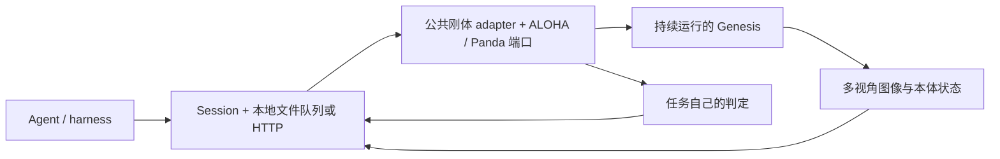

# Task adapter 的公共模块与任务边界

2026-09-19。adapter 随任务类型变化，但不用为每个任务重写整个接口。
当前按三层组合，Cast Keyhole、Horseshoe Ring、Interlocked Claws、Hedgehog in Cage、Lock Picking 和 Buzz Wire 3D 共用刚体执行循环；机器人端分别适配 ALOHA 与 Panda。

| 层 | 实现 | 职责 |
| --- | --- | --- |
| 通用会话和传输 | `agent_bridge/session.py`、`local.py`、`server.py`、`package.py`、`budget.py` | 不可回滚 episode、动作段预检查、幂等、完整图像存档、任务包、预算；可选本地文件队列或 HTTP |
| 机器人运行接口 | `agent_bridge/robot_adapter.py`、`aloha_contract.py`、`panda_contract.py`、`robot/grasp_constraints.py` | ALOHA / Panda 关节与夹爪端口、单位/限位、公开本体状态、接触辅助生命周期、单步执行和稳定时间累计；相机渲染复用 `GenesisAdapter` |
| 任务适配 | `tasks/<task_id>/agent_adapter.py` 与 `agent_spec.py` | 配置和固定初态、可辅助抓持对象、任务目标、私有几何/连接检查、成功和失败阈值、公开任务说明 |

[Knot Untying](knot_untying_agent_adapter_zh.md) 使用同一会话和传输层，并新增
`agent_bridge/fem_robot_adapter.py`：共享 ALOHA 动作契约，以实测手位驱动 FEM 软约束、按双指表面接触自动选带。
任务只提供场景、原生 FEM 诊断与解结判据；公共模块不读取任务规划器或预置解题抓点。
这一路需要 CUDA/IPC，不使用刚体焊接循环；验证状态以任务文档为准。

`RigidRobotAdapter` 执行顺序为：设置控制目标 → 一次 `scene.step()` → 任务判定与跟踪检查 →
按真实接触更新辅助抓持 → 累计连续稳定窗口。终态被锁定；Session 保存本控制步图像并停止或继续。
任务实现 `_failure_and_goal(contacts)`，返回失败原因与当前目标是否满足。
`StableVerdict` 的持续时间和成功说明可配置，不包含任何具体任务的解题步骤。
`AlohaRigidAdapter` 保留旧任务的默认命名和动作验证；Panda 用 `PandaPort` 对接已有控制器，
注入单臂手部／指垫映射和七关节验证。二者只设目标，不在端口内偷跑物理步。
Panda 夹爪为半开口米数，ALOHA 为指轨位移米数，不能混用。

辅助抓持是可选的场景机制：任务声明允许附着的对象和初始抓持。
Keyhole 和 Hedgehog 从无辅助约束的预抓取位开始、首次真实接触后附着；Horseshoe 和 Interlocked Claws 从明确声明的双手辅助预抓持开始。
Lock Picking 从 home 和承托架上的自由钥匙开始，要求自行抓起；场景旧有抛异常保护由 adapter 的逐步锁存保护接管，以保存失败发生时的图像。
Buzz Wire 3D 复用 Panda 端口，但辅助候选集合为空，闭爪也不会启用附着；环杆完全通过真实指垫摩擦抓持。
其静态初态包只含碰撞资产、物理导线与单个初态，不加载参考姿态曲线；任务内负责沿线连续性、通行禁碰和末端释放承载判定。
模块本身不指定下一步动作、不查询规划器，也不读取 demo 或动作轨迹。
老 `cast_coil.robot_grasp` 保留兼容导出，约束添加/删除的公共工具移到 `robot/grasp_constraints.py`。
Cast Coil 原有无辅助 adapter 继续使用 `GenesisAdapter`，没有强迫所有任务启用相同抓持机制。

两种传输共享 `registry.py` 中的任务注册和工厂选择；接入新任务无需修改两套分支。
继续保留 `--factory module:function`，供 operator 加载自定义任务实现。

## 同任务的变体

通常应复用同一个任务 adapter，通过实例配置/seed 改变场景，而不是每个变体新增一个 adapter。
如果机器人类型改变，替换机器人接口；如果目标或判定发生实质变化，替换任务判定。

当前 Keyhole、Horseshoe 和 Hedgehog 工厂都绑定固定基础初态、尺度和模板哈希。
Interlocked Claws 也只接基础实例，绑定静态场景文件和原网格哈希，不读取参考动作。
Buzz Wire 3D 同样只接 `compact_single_arm_v1`，未接新动作家族和随机实例。
它们**尚未接入随机变体加载**：不能把新变体的配置直接套在旧初始关节/位姿上。
后续应让生成器输出独立的 episode 初始化材料，检查机器人可达、初始接触和视野，
再交给同一个任务 adapter；无需把参考求解轨迹交给 solver。

## 新任务的交付边界

- `describe()` 提供目标、机器人/相机知识、动作单位和声明的物理机制。
- 首次提供单臂三路或双臂四路本轮初态图片；实际打开或作为多模态内容输入由 harness 完成。
- `observe()` 不返回物体几何、真值位姿或目标误差。evaluator 可内部使用这些数据。
- 不向 solver 导出演示、代码、参考图、历史试验或初始化私有文件。
- 固定初态及短程动作通过，只代表接口可运行；完整成功轨迹与物理资格需另行验证。

具体入口：[Horseshoe](horseshoe_agent_adapter_zh.md) · [Cast Keyhole](cast_keyhole_agent_adapter_zh.md) · [Interlocked Claws](interlocked_claws_agent_adapter_zh.md) · [Hedgehog in Cage](hedgehog_agent_adapter_zh.md) · [Lock Picking](lock_picking_agent_adapter_zh.md) · [Buzz Wire 3D](buzz_wire_agent_adapter_zh.md)。
