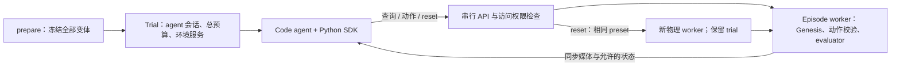

# 固定变体、工具驱动的 agent rollout pipeline

更新：2026-09-21。当前实现支持 **RGB / simulator 两种访问模式**，通过环境 SDK 让 code agent
自主查询、执行动作、查看多视角反馈，并按权限 reset 到同一冻结初态。
直接运行见 [Agent rollout 实用手册](agent_rollout_usage_zh.md)。
[旧 segment 协议](agent_rollout_segments_v1_zh.md)继续兼容；[reviewer 对比文档](agent_rollout_target_gap_review_zh.md)保留改造前分析。

## 访问模式与生命周期

| 配置 | 实时输入 | 可执行操作 |
| --- | --- | --- |
| `rgb + tools + disabled` | 多视角 RGB、共同的任务/控制文档、操作状态与预算 | observe/render、step、finish |
| `simulator + tools + same_preset` | 同样的 RGB，加上 adapter 声明的状态字段 | 上述操作 + get_state/get_pose/list_entities/reset |

配置字段分别为 `access_mode`、`interaction`、`reset_policy`。`mode` 是 access_mode 的兼容别名；
未指定 interaction 时，simulator 使用 tools，旧 rgb / rgb_privileged 使用 segments。
`reset_policy` 可以独立改变，以进行状态信息与重试权限的消融比较。

一次 prepare 生成共享的冻结 suite。每个 task 的每个 variant 由各 agent 使用，默认独立重复 3 次。
`rollout_i` 仍表示第 i 个变体；`repeat_j` 是独立 agent 求解会话，也就是一个 trial。
trial 内每次 reset 新建一个物理 episode，agent 会话、scratch 与累计预算不变。

只有显式动作推进物理，模型思考、查询与代码编辑期间暂停。
同一 episode 跨脚本保持物理状态；每个 env.step 形成一个 segment，持续步数由 agent 在限制内选择。
代码可以使用普通 Python、函数和反馈循环，通过 SDK 逐次查询与控制；无需在可信 worker 中执行任意 agent Python。
底层每次动作仍复用 bridge 的 AST 校验与连续执行器。

reset 通过关闭旧物理进程并从固定 preset 启动新进程实现，恢复控制器和 evaluator，避免只还原 pose。
它不接受 seed、variant 或任意状态写入参数。每次重建核对初态；动作 request ID 去重，revision 防止旧动作跨 reset 执行。
成功 trial 不再 reset；失败 episode 若还有 reset 额度，可以继续同一 trial。

## 冻结与初态验证

`prepare` 完成所有场景抽样，保存解析配置、构建参数、场景 seed 和源码/资产哈希。
evaluate/reset 不调用变体生成器。源码或资产变更会拒绝载入旧 preset，需要重新 prepare。
当前内置 preparer 为 counter 与 Cast Coil；其他任务可用 `--preparer TASK=MODULE:FUNCTION` 扩展。

冻结的是构建输入，不是通用 Genesis solver checkpoint。每个 repeat/reset 都执行物理初态审计：
Cast Coil 覆盖物体位姿、速度和机器人状态；通用 adapter 的覆盖范围写入 `initial_state_scope`。
RGB 默认逐字节核对；Cast Coil 在 preset 中声明光栅边缘容差，物理状态检查不因此放宽。
这些检查不承诺所有隐藏 solver buffer 或跨 GPU 位级一致。

## 环境接口与权限

SDK 源码为 [env_sdk.py](../../../topogym/agent_rollout/env_sdk.py)，每个 trial 发布为 `topogym_env.py`。
只依赖 Python 标准库，连接 worker 自动启动的 localhost 服务；路径与临时凭据由 runner 注入 agent 环境。
调用返回 `data`、episode/state revision、累计预算、最新媒体 manifest 与图片路径。

| API | 说明 |
| --- | --- |
| describe | 英文任务契约与能力清单 |
| observe / render | 最近一次同步相机材料；物理暂停，因此仍对应当前 tick。RGB 的结构化 observation 为空 |
| step(action, steps=N) | 执行机器人目标；报告完成步数；成功或失败时可提前停止 |
| get_state(fields=...) | simulator 可查询的已声明字段 |
| get_pose(entity, frame="world") | simulator 的物体/机器人手 pose，world metres / wxyz |
| list_entities | 可使用 get_pose 查询的实体 |
| reset | 根据 profile 恢复同一初态，新增 episode |
| finish | agent 请求结束；不能自行宣布成功 |

Cast Coil 目前声明 bodies、robot、camera_poses、contacts，pose 实体为 gold/silver 零件和左右手。
不宣称已开放全部 Genesis 内部对象、软体状态或 solver buffers；任务能力范围在 `capabilities.json` 中明确。
刚体 API 无传送/修改物理参数/修改 evaluator 接口，模型无需获得构建源码。

权限由服务端执行，不能仅靠 prompt。RGB 的状态查询被拒绝，公开媒体不携带隐藏观测。
Codex 仍由 bwrap 隔离目录：只读本 trial，scratch 可写；仓库、其他 trial 和私有 evaluator 不挂载。
本机工具访问需要 network_access；这不是完整网络隔离。服务使用每个 trial 独立的临时凭据。
`command` provider 仍只提供 prompt 约束，需要部署方另外隔离；结果继续标明 isolation 类型。

## 预算与结果

默认每 trial 3M input + output tokens，Codex 的每个底层请求都经输入计数、预留、输出上限和 usage 结算。
账本位于物理 worker 之外，reset 不改变账本；代理未知用量会阻止后续请求。
查询/动作反馈给出当前用量，公开 `token_budget.json` 可实时读取；规则见 [计量说明](model_service_design_zh.md#token-budget)。

物理步数、segment 数、API 次数、reset 次数和墙钟也按 trial 累计。
单次 step 超限在执行前拒绝；重复 request ID 不执行第二次；物理过程部分失败保留已记录计数，
不能确认完整执行量时写 `execution_accounting_complete=false`，不把未知推进量计成确认的零。

结果分别记录 `succeeded`、`agent_stopped`、`task_failed`、`limit_reached`、`token_budget_exhausted` 和 `pipeline_error`。
summary 按 agent、access mode、interaction 和 reset policy 分组；保留总成功率、各变体成功率和 any-repeat 成功率，
增加 first-episode 成功率、reset/物理步数/墙钟合计。基础设施错误保留在分母并单列。
物理资格与 token usage 完整性继续保留，不能将 pilot 成功当作正式物理验收。

## 材料与实现位置

新格式在 `repeat/episodes/episode_E/` 中保存 segment 媒体，每个 episode 的 segment_0 是初态。
各 camera 子目录保存独立 MP4，manifest 保存帧/tick/时间映射；实际模型输入为图像附件与工具查看的像素。
完整历史保留，默认从 MP4 抽帧不等于模型已经理解完整视频。

`events.jsonl` 实时记录环境调用、拒绝、reset 和预算快照；`trajectory.json` 是本地工具/decision schema，
不是 ATIF。私有目录保留原始 Codex 事件、provider 回执、每个 episode 的物理记录和初态审计。
完整的目录和读取示例见 [实用手册](agent_rollout_usage_zh.md)。

| 文件 | 职责 |
| --- | --- |
| [profiles.py](../../../topogym/agent_rollout/profiles.py) | 访问模式、工具/segment 交互与 reset 策略 |
| [tool_runtime.py](../../../topogym/agent_rollout/tool_runtime.py) | trial 生命周期、环境服务、累计预算、工具 prompt 与结果 |
| [episode.py](../../../topogym/agent_rollout/episode.py) | 独立物理进程、固定预设重建、初态审计、媒体发布 |
| [env_sdk.py](../../../topogym/agent_rollout/env_sdk.py) | agent 可导入的 Python SDK 和 JSON CLI |
| [agents.py](../../../topogym/agent_rollout/agents.py) | Codex/command/replay，临时连接环境与模型代理 |
| [runtime.py](../../../topogym/agent_rollout/runtime.py) | 路由新工具模式、兼容旧 segment 执行 |
| [evaluate.py](../../../topogym/agent_rollout/evaluate.py) | 共享变体、独立重复与指标汇总 |

目前参考 Harbor 的生命周期组织，尚未提供 Harbor task package / runner adapter 或 ATIF 导出。
独立模型服务模块、更多任务的 frozen preparer、正式物理资格验证仍是后续事项。

## 验证记录

2026-09-21 真实 Cast Coil 检查：同一冻结变体，simulator 与 RGB 各一次 trial，均为固定 replay SDK 程序。
simulator 查询状态、执行 3 tick、reset、核对相同初态、再执行 2 tick；RGB 拒绝状态查询/reset，并连续执行 5 tick。
这是实际 Genesis CPU + rasterizer 的短程接口检查，不是模型装配成功。
[原始结果](../../../runs/agent_rollouts/20260921_cast_coil_tools_v1/evaluation/results.json)。

重置后 2 tick 的同步视角：
[高位](../../../runs/agent_rollouts/20260921_cast_coil_tools_v1/evaluation/agent_sdk_smoke_simulator_rollouts/cast_coil/rollout_1/repeat_1/episodes/episode_1/cam_high/segment_1.mp4)、
[低位](../../../runs/agent_rollouts/20260921_cast_coil_tools_v1/evaluation/agent_sdk_smoke_simulator_rollouts/cast_coil/rollout_1/repeat_1/episodes/episode_1/cam_low/segment_1.mp4)、
[左腕](../../../runs/agent_rollouts/20260921_cast_coil_tools_v1/evaluation/agent_sdk_smoke_simulator_rollouts/cast_coil/rollout_1/repeat_1/episodes/episode_1/cam_left_wrist/segment_1.mp4)、
[右腕](../../../runs/agent_rollouts/20260921_cast_coil_tools_v1/evaluation/agent_sdk_smoke_simulator_rollouts/cast_coil/rollout_1/repeat_1/episodes/episode_1/cam_right_wrist/segment_1.mp4)。

回归检查覆盖旧协议、预算、任务说明、新 SDK 的权限与生命周期，以及真实 Codex CLI 在隔离终端调用 SDK。
模型响应全部模拟，没有真实付费模型成功回执。实际 API 账单问题与自主装配能力仍需单独验证。
