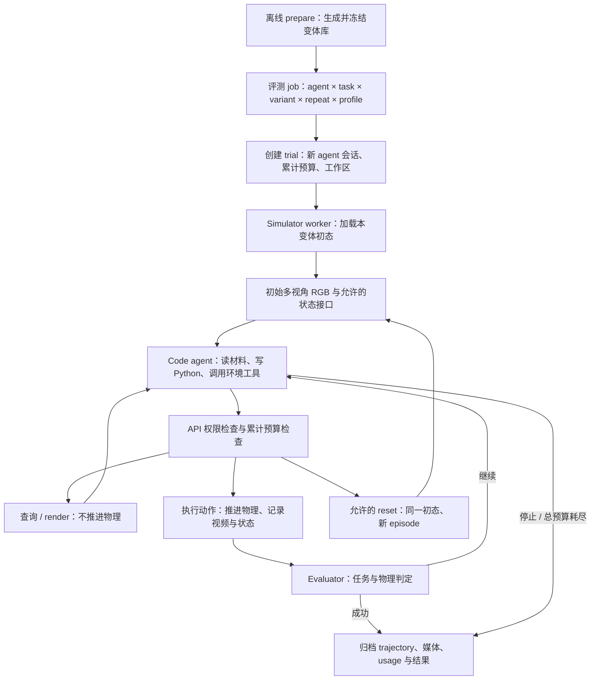

# Reviewer 意见解析：目标 agent rollout pipeline 与当前实现差距

> 实施更新（2026-09-21）：下文保留**改造前的差距分析**。现已接入 tools 交互、RGB/simulator 权限、
> Cast Coil 状态查询、同一 preset 的新物理进程 reset、跨 episode 预算与目录、SDK 和相应回归检查。
> 当前行为见 [pipeline 说明](agent_rollout_pipeline_zh.md)，操作步骤见 [实用手册](agent_rollout_usage_zh.md)。
> Harbor 集成、全任务接入与正式物理资格验证仍未完成；真实模型自主装配成功未验证。

日期：2026-09-21。本文核对了当前工作区实现、reviewer 提供的 Harbor / RoboWits 仓库及 Harbor 官方文档。
**以下保留改造前的目标设计与差距分析；当时尚未实现拟议 API、reset 或 Harbor 接入。**
当前可运行入口仍见 [rollout pipeline](agent_rollout_pipeline_zh.md) 和 [模型接入教程](model_service_design_zh.md#openai-api-evaluation)。

核心调整是：将当前“RGB + 静态构建知识”的第二条件，升级为一个明确的 **simulator access 条件**，
允许 agent 查询实时环境状态、执行控制 API，并在同一个冻结变体上 reset 和继续求解。
同时保留严格 RGB 条件。环境接口参考 RoboWits 的组织方式，agent 求解会话与评测生命周期参考 Harbor。
现有冻结变体、视频反馈、独立重复和 token 计量可以继续使用。

## 1. Reviewer 具体改变了什么

| Reviewer 的意见 | 可以确认的要求 | 对我们的影响 |
| --- | --- | --- |
| 第一种可以访问所有 information，并 reset | 至少要有实时 simulator 状态查询和 reset 能力，pose 是明确例子 | 当前 `rgb_privileged` 不满足这个条件 |
| 不需要知道 Genesis 上怎么做出来，只需要访问 API | 构建源码不应成为获得实时状态的前提；agent 要能直接操作接口 | 从“增加一份说明材料”转向“提供可调用的环境能力” |
| 第二种只拿多视角 RGB input | 保留视觉条件，动态物体和机器人状态不能经其他路径默认泄漏 | 继续提供共同的任务目标、控制与相机文档；另行限制动态反馈 |
| 随机化在 rollout 之前，用这个预设 | 同一次变体求解和它的重复尝试不能重新抽布局 | 保留 `prepare → frozen suite → evaluate`；reset 也必须固定变体 |
| agent rollout 参考 Harbor | 参考 agent 在任务工作区中自主调用工具、完成任务，再由 verifier 判定的生命周期 | 环境 API 应进入 agent 的工具循环，而不只接受最终的一段动作列表 |
| 先按 RoboWits 的方式推出 | 先形成可创建、可操作、可评测的机器人任务包 | 优先把环境接口和一个任务的闭环做实，再扩展任务和框架集成 |

最后两行是结合参考仓库作出的**实施解释**，不是 reviewer 明确要求我们现在就安装 Harbor、迁移到 LeRobot，
或训练 ACT / Pi0。reviewer 也没有规定 RGB 条件是否能 reset、reset 次数，以及“全部 simulator 内容”是否包含可写源码。
这些未定项在第 10 节列出，下面先给出可实施的建议契约。

## 2. Harbor 和 RoboWits 分别参考哪一层

### 2.1 Harbor：一次求解的组织方式

Harbor 将任务说明、运行环境、verifier 分开；一个 trial 是一个 agent 对一个任务的求解尝试，
job 则组织多个 trial。它还记录 agent 的对话与动作轨迹，标准格式为 ATIF。
对应到 TopoGym，`task + frozen variant + access profile + agent + repeat` 可以形成一个 trial。
来源：[Harbor core concepts](https://docs.harborframework.com/core-concepts)。

Harbor 同时支持在任务环境内运行 CLI 的 installed agent，以及在外部运行工具循环、通过环境接口操作的 external agent。
因此“参考 Harbor”并不要求 agent 和 Genesis 在同一个 Python 进程，也不规定 agent 必须读取模拟器源码。
来源：[Harbor custom agents](https://docs.harborframework.com/core-concepts/agents/custom-agents)。

我们适合借鉴的流程是：准备任务工作区和环境 → 启动 agent → agent 自主查看资料、写代码、调用工具并读取反馈
→ verifier 判定 → 保存轨迹、媒体和结果。Harbor 本身不会替 TopoGym 定义 pose API、物理 reset 或观测权限；
这些仍由我们的任务环境实现。其 task 目录约定见
[Harbor task format](https://docs.harborframework.com/core-concepts/tasks/overview)。

Harbor 的 verifier 可以在 agent 结束后运行，也支持独立验证环境。
TopoGym 可以继续在动作执行中监测物理失败和成功，再由 trial 层汇总；不必为了形式一致而取消实时判定。
来源：[Harbor verifier](https://docs.harborframework.com/core-concepts/tasks/verifier)。

### 2.2 RoboWits：机器人环境与 benchmark 的组织方式

RoboWits 提供任务注册、`gs_gym.make(...)`、Gym 风格的 `reset()` / `step()`、相机观测、机器人控制模式，
以及基于 LeRobot 的策略评测脚本。它的公开用法包含 RGB 和机器人状态；现有评测脚本加载 policy checkpoint。
这些接口与脚本可以作为机器人 benchmark 的参考，不能直接当作我们已经拥有的 LLM code-agent harness。
来源：[RoboWits README](https://github.com/UMass-Embodied-AGI/RoboWits)、
[评测脚本](https://github.com/UMass-Embodied-AGI/RoboWits/blob/9cc30aedbbebea86b975c0d66ea9ac227ca38535/scripts/robowits/eval/eval.sh)。

源码中有两个需要主动适配的区别：

| RoboWits 中核实的行为 | TopoGym 应怎样处理 |
| --- | --- |
| `get_observations()` 返回 `agent_pos`、`agent_pos_joint`、`agent_pos_ee` 和相机图像 | 严格 RGB 条件不能照搬完整 observation；机器人 proprioception 也属于额外动态信息 |
| `reset_env()` 调用物体摆放逻辑；有 eval dataset 时，`_get_next_eval_data()` 会推进条目索引，没有时使用随机摆放 | 我们的 agent reset 必须钉住本 trial 的初态条目，不推进 dataset、不重新随机 |

上述行为直接见
[RoboWits 环境实现](https://github.com/UMass-Embodied-AGI/RoboWits/blob/9cc30aedbbebea86b975c0d66ea9ac227ca38535/gs_gym/envs/robowits/robowits.py)。
Gym 风格的返回值和 step 流程见
[BaseGymEnv](https://github.com/UMass-Embodied-AGI/RoboWits/blob/9cc30aedbbebea86b975c0d66ea9ac227ca38535/gs_gym/envs/base_gym_env.py)。
这里不照搬它的机器人维度、坐标约定或控制参数；TopoGym 的 ALOHA / Panda 应继续使用自己的契约。

**建议的组合：RoboWits 式任务环境接口 + Harbor 式 agent 求解会话 + TopoGym 自己的冻结变体和物理 evaluator。**
第一版可以在现有 runner 上实现这种组织方式，实际 Harbor adapter 是后续独立交付项。

## 3. 目标的两种访问条件

建议新增 `access_mode=rgb` 与 `access_mode=simulator`；另用 `reset_policy` 定义重置权限。
这些是拟议字段，当前 CLI 仍只接受旧的 `rgb` / `rgb_privileged`。

| 能力 | `rgb` | `simulator` |
| --- | --- | --- |
| 英文任务目标、动作语义、单位、机器人限位与通用相机说明 | 有 | 相同 |
| 所有规定视角的 RGB、历史视频和帧索引 | 有 | 相同 |
| 编写 Python 规划代码、使用数值库、读取自己的历史 | 有 | 有 |
| 调用机器人动作接口、选择动作持续步数 | 有 | 相同 |
| 实时物体 pose / velocity、机器人关节与末端状态 | 无 | 可查询 |
| simulator 中其他可读取的任务状态，如接触、关节、软体粒子等 | 无 | 按任务能力清单提供，并注明覆盖范围 |
| agent 主动 reset | 本文建议首版关闭，单独记录此设定 | 开启，回到同一冻结初态 |
| Genesis 构建源码、完整场景配置 | 不提供 | 获得状态查询能力不依赖这些材料；是否开放源码另行配置 |
| 修改初始预设、传送物体、改重力、改 evaluator | 不属于本文建议的正式控制接口 | 同左；如需要完全可写 simulator，作为单独实验协议 |

这里把“全部信息”理解为**环境运行状态的充分访问**，而不是只放开两三个 pose 字段。
首版若仅实现刚体与机器人查询，就应公布实际能力，不能标成已开放全部 simulator 状态。
对“直接访问整个 simulator 对象/源码”的更强解释，建议保留独立的开发模式：可以开放，
但必须标明与正式评测的权限差异。reviewer 没有明确要求禁止读源码，也没有明确授权任意修改物理或评分规则。

查询当前状态与直接设置状态应区分：`get_pose()` 有助于规划，`set_pose()` 可能直接把零件放到目标处。
我们建议正式成绩仍通过机器人动作达成；reset 是被记录的特定状态恢复操作。
这项边界是**本文建议**，需要在评测协议中写明，不能隐含在“full access”这个模糊名字里。

旧 `rgb_privileged` 可以作为“增加静态知识”的历史消融条件保留，但不能直接重命名为 `simulator`，
也不能把旧实验结果当成新的 simulator access 结果。

### 3.1 观测权限与 reset 是两个实验因素

reviewer 的两档设置可以先实现成 `rgb + no reset` 与 `simulator + reset same preset`。
但两档成绩差异同时包含“更多状态信息”和“允许重试”的影响，不能仅解释为 privileged observation 的增益。
后续若要区分原因，可追加 `simulator + no reset` 或 `rgb + reset same preset` 对照。
这不要求第一版跑满四档，但配置与结果应该从一开始分开记录这两个因素。

RGB 权限应覆盖所有反馈渠道：不仅清空 `obs`，还要检查 tool result、`info`、错误信息、文件和服务接口。
共同的接口文档、预算、执行步数和必要的终止信号可公开；精确距离奖励、隐藏目标位姿和动态腕部外参
不能不加说明地进入严格 RGB 条件。若加入机器人状态，应明确改称另一个条件。

## 4. 目标 rollout 的完整过程



1. **准备变体。** 在任何模型求解前抽样布局、几何或预设；保存解析配置、资产与实现版本、随机种子、
   初态和资格验证信息。所有 agent 使用同一 bank，求解时不运行随机生成器。
2. **开启 trial。** 为一个 agent、一个变体、一次 repeat 创建独立工作区与模型会话，加载访问权限和总预算。
3. **给出初态。** 渲染全部 3/4 个视角，提供英文任务目标、API 文档、目录规则、当前预算和 reset 规则。
4. **agent 自主交互。** agent 可写和修改普通 Python 程序，经 SDK/CLI 调用允许的查询、动作和 reset API。
   Python 循环可以根据本条件允许的反馈继续控制；每个物理调用都进入同一记录与计量路径。
5. **记录动作反馈。** agent 决定每段动作步数，worker 执行、录制并返回视频/抽帧路径和允许的结构化反馈。
   现有 `segment_N.mp4` 可以继续作为视觉材料。查询和代码编辑不推进物理。
6. **按权限重置。** simulator 条件可在额度内从当前失败状态回到同一初态，读取新 episode 的初始图像后继续。
   agent 会话与累计预算保持；不能偷偷创建新变体或新 repeat。
7. **结束与判定。** 建议首次满足可信 evaluator 的成功条件就结束 trial；否则在 agent 停止或总预算耗尽时结束。
   记录任务失败、预算耗尽、agent 程序错误和基础设施错误，避免把它们混为装配失败。

这里的“实时”指连续的在线交互闭环，不要求模型思考时物理持续按墙钟运行。
继续采用“只有显式动作推进模拟”的约定，可避免不同模型延迟改变任务难度。

### 4.1 环境 API 的建议契约

下面是**接口草案，当前不可直接复制运行**。可用 Python SDK 包装 HTTP / 本地队列，底层环境保留在持久 worker 中。

| 拟议调用 | 行为与返回 | 权限 / 计量 |
| --- | --- | --- |
| `env.describe()` | 任务目标、控制契约、相机和支持的 API 能力 | 两种条件；不暴露隐藏动态状态 |
| `env.observe()` / `env.render()` | 同步 RGB；simulator 条件按声明追加状态 | 不推进物理；带 episode、tick、state revision |
| `env.list_entities()` / `env.get_state(fields=...)` | 可查询实体、机器人、物体、接触等状态 | simulator；没有支持的字段必须明确返回不支持 |
| `env.get_pose(entity, frame=...)` | 指定坐标系下的 position / orientation | simulator；标明单位、四元数顺序、取样 tick |
| `env.step(action, steps=N)` | 执行动作；返回完成步数、终止状态、允许的观测与媒体索引 | 两种条件；可因成功/失败或预算提前停止 |
| `env.reset()` | 回到本 trial 冻结初态，返回新 episode 的初态材料 | 由 reset policy 授权；不允许 agent 传新 seed 或 variant |
| `env.finish()` | 请求结束当前 trial | 成功只由 evaluator 判定 |

例如 agent 可以在普通 Python 中“查询位姿 → 计算动作 → 执行 → 再查询”，形成段内或跨段反馈控制。
RGB 程序同样能用图像反馈，但不能调用真值状态接口。反馈读取粒度和录制粒度应有单独配置，
不能要求每个物理 tick 都重新请求一次 LLM。

多次终端命令应连接**同一个** worker，不能每次运行脚本就 `make()` 一个新的模拟器。
工具服务需要串行化动作/reset、去重 request ID，并拒绝来自旧 episode 的延迟动作。
推荐让 `episode_id + state_revision` 随请求和响应传递，避免 reset 后执行旧计划。

原来的 `segment / inspect / stop` JSON 协议可以作为兼容接口保留；
新增的工具驱动模式让 agent 在自己的工具循环中直接调用环境 API。
不是给现有 AST 解释器简单加一个 `get_pose` 名字就能完成这项变化：它目前在物理执行前把整段展开成动作列表。

## 5. reset、repeat、预算与成绩的明确语义

| 名称 | 建议含义 |
| --- | --- |
| variant / 旧目录 `rollout_i` | 离线冻结的一份任务实例；整个评测期间不变 |
| repeat / trial | 一个 agent 对这个实例的一次独立求解会话；初始无前次 repeat 记忆 |
| episode | trial 内一段从初态开始、尚未 reset 的物理执行；reset 后编号递增 |
| segment | episode 内一次动作执行与对应媒体材料；允许 agent 自定长度 |
| model request | 底层一次推理请求；一个 agent turn 或工具任务可能包含多次 |

每变体重复约 3 次仍成立。**3 次 repeat 不等于允许 3 次 reset。**
若某 trial 内允许 2 次 reset，它最多包含 3 个物理 episode，但最终仍只贡献一条 trial 结果。
`max_resets` 应是独立配置，具体值在正式实验前冻结。

reset 必须恢复物体与机器人状态、速度、控制目标、任务 evaluator 的累计/终止状态，以及任务所需的其他状态。
对于软体，还可能需要粒子、形变和约束状态。仅把刚体 pose 改回去不能自动等同于完整 reset。
第一版可销毁物理 worker，再从冻结预设重建；agent 会话、媒体历史和 trial 账本由外层保留。
每次恢复都重新做初态检查，声明检查范围。当前初态哈希并不覆盖所有 Genesis solver 内部 buffer，
不能据此承诺跨硬件位级一致性或已经支持通用 checkpoint。

预算应放在 trial 外层，不随 episode 清零：

- **模型预算：** 默认累计 3M input + output tokens；每个底层模型请求的预检查和输出上限继续生效。
- **物理预算：** 累加所有 episode 的实际执行步数，同时保留 episode 内 tick；不能用 reset 刷新剩余动作步数。
- **其他预算：** 累计墙钟时间、reset 次数、API/工具调用；初始化与稳定化步骤应单独记账并固定规则。
- **状态提示：** 每次工具/动作反馈给出累计使用量，例如 `Used 120,000 / 3,000,000 tokens; resets 1 / 2.`

现有预算代理应属于 trial 生命周期；不能把它放到会被 reset 销毁的物理 worker 内，导致账本重建。
账单授权失败和传输失败继续单列；配置 3M 本身不提供 API 可用余额。

建议主要报告 `trial_success_rate`，并同时报告 `first_episode_success_rate`、实际 reset 次数、
成功前累计物理步数、token 与耗时。保留逐变体的 repeat 成功率、`any_repeat_success_rate` 和基础设施错误数量。
若允许 reset，成绩是“该固定预算与访问条件下的求解成功率”，不应称为单次无重试控制成功率。
已有 `physics_qualified` 与 token usage 完整性标记继续保留。

## 6. 目录与模型输入的变化

保留专用空间 `runs/agent_rollouts/`，不要把评测记录混入 `demos/` 的正式成功演示视频目录。
建议新协议增加 episode 层，避免 reset 覆盖原来的 `segment_0.mp4`：

```text
runs/agent_rollouts/<run_id>/
  evaluation.json
  results.json
  summary.json
  agent_astra_simulator_rollouts/cast_coil/rollout_1/repeat_1/
    task_spec.json
    capabilities.json
    trial.json
    token_budget.json
    events.jsonl
    trajectory.json
    scratch/
    episodes/
      episode_0/
        segment_0.mp4
        segment_0.json
        segment_1.mp4
        segment_1.json
        cam_high/segment_0.mp4
        cam_high/segment_1.mp4
        cam_low/...
        cam_left_wrist/...
        cam_right_wrist/...
        frames/...
        inputs/...
      episode_1/              # 同一 trial 的第一次 reset
        segment_0.mp4         # 重置后重新观测；不是新的随机变体
        ...
  _private/<same-trial-path>/
    initial_audits/
    authoritative_events.jsonl
    simulator_state/
    evaluator/
    provider_calls/
```

公开事件与 trajectory 只能包含该访问条件允许的信息；完整真值和判定证据保存在可信侧。
reset 事件连接旧、新 episode ID，记录预设哈希、原因和累计计量值。
完整 agent 对话/工具轨迹和物理动作轨迹是两种记录，应通过调用 ID、episode 和 tick 关联，视频不能代替两者。
第一版可以用本地 schema，之后再映射到 Harbor ATIF。

目录 schema 应显式升版；旧记录继续按旧结构读取。源文件和 prompt 版本要进入结果，
不能混用旧 `rgb_privileged` 与新 `simulator` 的语义。

### 6.1 英文 prompt 应改变哪些句子

保留共同的英文任务目标、控制说明、视角标签和预算提示。
当前 prompt 中对所有条件统一使用的 `obs is an empty dict`、`No reset` 和禁止 simulator access，
需要改成依据能力配置生成。下面是**新模式的示意补充**，并非已经接入的模板：

```text
Access profile: simulator.
You may inspect the current simulator state through the documented environment API,
including object poses and robot state, and run your own Python control programs.
Call describe() to inspect the supported state-query capabilities.

This trial is pinned to one frozen scene variant. reset() restores its initial
state and starts a new episode within this trial. Your conversation, files and
cumulative token, step and wall-time budgets are retained across resets.
Do not select a new variant or change the task physics or evaluator.

All robot actions must go through the documented control API so they are recorded.
Physics advances only during action execution. Inspect returned observations and
media before deciding how to continue. Only the evaluator determines success.
```

RGB 模式则明确：

```text
Access profile: rgb.
Live environment observations are limited to the provided RGB camera views.
Object poses, live robot state and simulator internals are unavailable.
Use the shared control API and inspect recorded visual feedback.
Agent-initiated reset is disabled for this evaluation profile.
```

最后一句依据本文的首版建议；如果确定 RGB 也可 reset，应由 profile 配置生成对应文字，不能另写一套相互矛盾的 prompt。

## 7. 改造前 pipeline 与目标逐项对照（历史快照）

下表保留改造前的源码审计；完成改造后的状态见 [当前 pipeline](agent_rollout_pipeline_zh.md)。

| 维度 | 当前实现 | 目标 / 差距 | 主要位置 |
| --- | --- | --- | --- |
| 场景随机化 | `prepare` 冻结解析配置、种子、依赖哈希；`evaluate` 重用 bank | 方向正确；扩展更多任务 preparer 和可移植任务包 | [suite.py](../../../topogym/agent_rollout/suite.py) |
| 初态一致性 | 跨 repeat 比较物理审计哈希和相机初态，记录审计范围 | 保留，并扩展到每次内部 reset | [initial.py](../../../topogym/agent_rollout/initial.py) |
| RGB 条件 | `VisualAdapter.observe()` 恒为 `{}`，3/4 视角和公共文档 | 基本符合；新增工具 API 后仍需保证动态字段不外泄 | [runtime.py](../../../topogym/agent_rollout/runtime.py) |
| 第二条件 | `rgb_privileged` 只追加 `privileged.json`；两档仍共用空 `obs` | **主要设计偏差：缺少实时 simulator access** | 同上；`suite.prepare_cast_coil()` |
| reset | `Session` 明确没有 reset/checkpoint/undo；repeat 内禁止重置 | **主要设计偏差：缺少同一 trial 的多个物理 episode** | [session.py](../../../topogym/agent_bridge/session.py) |
| 动作脚本 | AST 子集只允许算术、赋值、for/range 与 `env.step`；执行前展开全部动作 | 需要可查询状态并据反馈执行的 SDK；不能把当前动作列表称为通用在线 policy | [policy.py](../../../topogym/agent_bridge/policy.py) |
| code agent 自主性 | Codex 可在 scratch 中运行规划、查看图像；每轮最终返回 JSON decision | 已有部分工具能力；环境查询/reset 尚未进入它的工具循环 | [agents.py](../../../topogym/agent_rollout/agents.py)、`runtime.py` |
| 已有环境服务 | bridge 已有 HTTP / 本地队列、state/submit/finish 等入口 | 可复用 transport，但缺 capability 控制、pose 查询和 reset 生命周期 | [server.py](../../../topogym/agent_bridge/server.py)、[local.py](../../../topogym/agent_bridge/local.py)、[client.py](../../../topogym/agent_bridge/client.py) |
| adapter 状态 | Cast Coil 内部可读取机器人状态，`initial_state()` 可供 operator 审计物体；被 rollout 包装层隐藏 | 不必重做 Genesis 场景；需新增正式状态接口、完整字段契约与恢复能力 | [Cast Coil adapter](../../../topogym/tasks/cast_coil/agent_adapter.py)、[protocol.py](../../../topogym/agent_bridge/protocol.py) |
| 输入隔离 | Codex 的 bwrap 只挂本 repeat 材料与 scratch；其他 provider 隔离能力不同 | 按 profile 提供 SDK/服务权限；现有挂载隔离不能自动代替服务授权和网络边界 | [isolation.py](../../../topogym/agent_rollout/isolation.py) |
| 视频闭环 | 初态、每段多视角 MP4、逐 tick 图片、时间索引、默认抽帧 | 可直接保留；增加 episode/reset 索引与结构化 API 反馈 | [media.py](../../../topogym/agent_rollout/media.py) |
| Token 限额 | Codex 路径默认每 repeat 3M，底层请求 count/reserve/output cap；已有离线测试 | 保留，提升为跨 reset 的 trial 账本；新 provider 也必须接入计量 | [token_budget.py](../../../topogym/agent_rollout/token_budget.py)、[budget_proxy.py](../../../topogym/agent_rollout/budget_proxy.py) |
| 评测组织 | agent × variant × repeat；同一 repeat 复用 thread、不同 repeat 新建，当前串行 | 结构接近所需 trial；补访问/reset profile 和新增统计，之后再做并发 | [evaluate.py](../../../topogym/agent_rollout/evaluate.py) |
| 任务覆盖 | rollout 内置 preparer 为 counter / Cast Coil，支持自定义 preparer；bridge 已有更多任务 adapter | 已有 adapter 不等于已经进入冻结变体 benchmark；逐任务接入和资格验证 | [rollout CLI](../../../topogym/agent_rollout/__main__.py)、[bridge registry](../../../topogym/agent_bridge/registry.py) |
| Harbor 接入 | 自有 runner、Codex 原始事件和结果 JSON | 未提供 Harbor task package、adapter 或 ATIF 导出；可后置 | `agent_rollout/` |
| 物理与模型验证 | Cast Coil pilot evaluator；短程 replay 与初始化验证；已记录真实模型调用因额度失败 | 仍缺新访问模式的真实 agent 闭环及正式任务物理验收，不能据现状报告自主装配成功率 | [现有验证记录](agent_rollout_pipeline_zh.md) |

现有 pipeline 不是整体方向错误：固定变体、独立重复、视频材料和计量已经形成可复用基础。
需要调整的是**访问权限的定义、环境的交互方式、trial 与物理 episode 的边界**。

## 8. 建议的模块改动与实施顺序

### 阶段一：把 Cast Coil 的可操作环境接口做完整

优先实现一个任务的 `describe / observe / step / get_state / get_pose / reset`，并提供清晰的英文 API 文档。
复用现有 adapter 和 bridge transport；新增 capability 配置，不需要先拆出完整远端模型服务模块。

把生命周期拆为外层 `TrialRunner` 与内层物理 `EpisodeSession`：前者持有 agent、预算、变体身份和全部历史，
后者持有当前 Genesis 场景、控制器、evaluator 与录像。
保留旧 `Session` 的无回滚语义作为单 episode 执行器是可行的；reset 由外层关闭旧 episode、创建新 episode 实现。
需要补可靠的 close/资源释放，避免 GPU 场景和旧控制请求残留。

验收重点是：执行动作后查询到新状态；reset 后初态满足声明的一致性标准；agent 记忆和累计预算不变；
RGB 无法得到相同的真值查询结果；所有动作、失败和 reset 都有完整记录。

### 阶段二：接入一个真实 code agent，完成两档最小闭环

把环境 SDK/CLI 放进 agent 的工作区与工具环境，让它自行写 Python、调用环境、看反馈并修改程序。
先做一个冻结 Cast Coil 变体，simulator 条件至少覆盖一次查询、动作和 reset；RGB 条件覆盖动作与多视角反馈。
使用相同任务目标、动作契约和冻结实例，记录两档的不同 reset 规则。

这一步的交付先证明“工具驱动求解链路可用”，再报告是否成功完成任务。
真实 API 账单问题是当前模型验证的独立阻塞，不影响接口设计；模拟 provider 的通过不能替代真实调用验证。

### 阶段三：形成 RoboWits 式可发布 benchmark 包

统一任务注册、`make` / observation / action / reset 契约、冻结实例文件、资格验证、评测脚本和结果 schema。
将各任务已有的变体生成器接到统一 prepare 接口；以共享 x 个变体、每个约 3 次独立 repeat 做正式评测。
输出成功率、预算、reset、错误和物理资格信息，以及可直接查看的多视角视频。

Cast Coil 还应补齐任务文字与 evaluator 的一致性，例如桌面承载/放稳判定；
当前 `physics_qualified=false` 和 pilot 结果必须继续如实标注。
不以现成示范视频或固定 replay 代替 agent 的求解轨迹。

### 阶段四：按需要接入 Harbor

环境接口稳定后，再将任务说明、依赖环境、verifier 入口和轨迹导出映射到 Harbor。
应固定 Harbor 版本，并验证 Genesis/GPU/渲染资源、服务生命周期、超时和失败回收。
Harbor 可负责 trial 调度与日志组织，TopoGym worker 继续负责物理、观测权限和 reset 语义。
在此之前可以称为“参考 Harbor 的交互设计”，不能宣称已经 Harbor-compatible。

## 9. 建议验收清单

| 验收项 | 可检查的通过条件 |
| --- | --- |
| 固定变体 | step/reset 不调用随机生成器；跨 agent、repeat、reset 都指向同一预设哈希 |
| reset 完整性 | 控制器、物体状态和 evaluator 全部恢复；初态检查通过；失败恢复不会复用旧终止标志 |
| 访问模式 | simulator 能查询声明的动态字段；RGB 的工具、文件和日志不返回这些字段 |
| 在线控制 | agent 程序在执行后读新反馈，再决定动作；不是只提交预展开的固定动作序列 |
| 累计预算 | 多次 reset 后 token、总动作步数、墙钟和 reset 计数单调累计；到上限停止 |
| 调用一致性 | 重复请求不重复推进物理；旧 episode 动作在 reset 后被拒绝 |
| 媒体 | 初态及每段动作有同步视角、帧数/时间索引；reset 保留旧材料且产生新初态记录 |
| 重复独立 | 每个 repeat 新 agent 会话与 scratch；同 trial 的 reset 保留学习历史 |
| 结果可信 | evaluator 掌握成功判定；状态访问不等于改写评分或直接放置物体；错误与资格状态如实报告 |
| 真模型闭环 | 留存至少一份真实模型的完整工具/动作/usage/视频记录，任务成功与否均如实呈现 |

这些是改造前拟定的验收项；现有验证记录见 [当前 pipeline](agent_rollout_pipeline_zh.md)。

## 10. 仍需在实验协议中确定的少数事项

| 未定项 | 本文建议的首版选择 | 会影响什么 |
| --- | --- | --- |
| RGB 是否允许 reset | 首版保持禁止；独立字段记录 | 两档成绩的可比性及消融解释 |
| “整个 simulator”开放到何种程度 | 正式模式开放状态读取和机器人控制；源码读取可选，任意状态写入另立开发条件 | 评测的是机器人求解，还是可修改任务的程序开发 |
| reset 次数和总物理预算 | 明确配置并在试验前冻结，不沿用 repeat 数字 | 成功率所对应的搜索成本 |
| 是否额外提交可重跑 policy | 首版评测在线求解；保存 agent 脚本，最终 policy 泛化另立实验 | 是否需要单独的训练/搜索与测试阶段 |
| 是否现在就使用 Harbor runner | 首版复用现有 runner，接口稳定后接入 | 实施依赖和首个可用版本的范围 |

推荐立即优先处理的是 **simulator 状态 API、固定初态 reset、工具驱动交互、跨 reset 计量**。
模型服务拆分、Harbor 包装和批量并发可以建立在这四项能力之上。

## 11. 核对来源与版本

外部源码按下列 commit 核对；官方在线文档按 2026-09-21 读取，未来可能更新。

- [RoboWits 源码快照](https://github.com/UMass-Embodied-AGI/RoboWits/tree/9cc30aedbbebea86b975c0d66ea9ac227ca38535)：
  重点检查 `gs_gym/envs/base_gym_env.py`、`gs_gym/envs/robowits/robowits.py`、`scripts/robowits/eval/eval.sh`。
- [Harbor trial 源码](https://github.com/harbor-framework/harbor/blob/404bae708cf284f4c6ed054422ad4f5b2aca764f/src/harbor/trial/trial.py)
  与 [Codex agent 集成](https://github.com/harbor-framework/harbor/blob/404bae708cf284f4c6ed054422ad4f5b2aca764f/src/harbor/agents/installed/codex.py)：
  核对 agent 生命周期、工具执行与轨迹记录；本文不复制其完整实现。
- 第 7 节记录的是改造前审计，所链接源码此后已有更新；当前实现与操作方式见
  [rollout 文档](agent_rollout_pipeline_zh.md)和 [实用手册](agent_rollout_usage_zh.md)。
