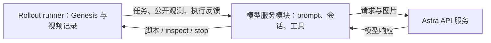

# TopoGym 独立模型服务与 Prompt 设计草案

状态更新：2026-09-21。**工具驱动的 RGB / simulator rollout 已实现**，包含状态查询、固定初态 reset、
跨 episode 累计预算和目录；当前操作步骤见 [Agent rollout 实用手册](agent_rollout_usage_zh.md)。

本文第 1—7 节保留此前独立模型服务拆分草案和旧 segment 协议背景，其中“当前输入”为旧协议描述。
`topogym/model_service/` 独立模块仍未实现；新功能直接接入了 `agent_rollout`。
[第 8 节](#openai-api-evaluation)链接当前工具模式教程，[第 9 节](#token-budget)说明逐请求 token 计量。
英文模型 prompt 的当前实现为 `tool_runtime.tool_prompt()`，旧 `runtime.prompt()` 仅用于 segment 模式。

真实 Cast Coil 的 SDK/reset/权限短程检查已通过，实际 Codex 工具调用已用模拟服务验证；
真实付费服务成功响应与自主装配成功仍未验证。旧版因 API 余额不足失败的记录保留在第 10 节。

建议使用 **Python 模块管理模型接入与会话，Bash 提供启动入口**。第一版以用户提供的 Astra 服务为目标，
先独立验证 prompt、图片输入和结构化响应，再接回 Cast Coil 的实时 rollout。
这里的“模型服务模块”负责连接远端模型；远端推理由所配置的 API 服务承担。

## 1. 当前已有能力与缺口

| 项目 | 当前实现 | 拟议改动 |
| --- | --- | --- |
| Prompt | [`runtime.py`](../../../topogym/agent_rollout/runtime.py) 中的 `prompt()` 拼接字符串 | 独立模板与 builder，支持单独预览和版本记录 |
| Agent 接入 | [`agents.py`](../../../topogym/agent_rollout/agents.py) 提供 Codex、command 和 replay | 迁移模型相关职责，统一配置和调用接口 |
| 服务配置 | Codex 接收 model、timeout 等；忽略用户 `config.toml` | 显式配置服务地址、认证方式、协议、模型参数 |
| 多轮状态 | 同一 repeat 复用 Codex thread；不同 repeat 新建 | 保留该契约，由模型服务模块管理 |
| 输入隔离 | [`isolation.py`](../../../topogym/agent_rollout/isolation.py) 用 bwrap 挂载本次公开输入 | 保留边界，按配置传入必要的认证和 provider 参数 |
| 调试 | 通过一次 rollout 生成调用记录 | 新增独立的 `check`、`preview`、`call` 入口 |

第一版继续使用 Codex 作为 agent runtime，保留终端、图片查看和代码分析能力。
未来可以增加直接 Responses API 后端；该路径需要自己的会话与工具循环，不能仅替换 HTTP 请求便声称具有相同 agent 能力。

## 2. 当前模型输入包含什么

现有输入是 **任务 prompt + 实际图片附件**，不是只向模型发送视频文件名。

| 输入部分 | 内容 |
| --- | --- |
| 交互规则 | 编写 scripted policy；思考时暂停物理；执行后不可回滚 |
| 观测条件 | `rgb` 或 `rgb_privileged`；两者的实时 `obs` 都是空字典 |
| 任务与接口 | 任务目标、机器人动作语义、单位、限位、世界坐标与相机说明 |
| 目录契约 | segment 命名、各视角视频、帧索引与读取方式 |
| 本轮上下文 | 下一个 segment 编号、剩余步数、已完成片段、校验错误和请求查看的材料 |
| 视觉附件 | 初态包含全部 3/4 个视角；动作反馈默认附带各路视频抽帧 |
| 特权知识 | 仅 privileged 条件提供该变体冻结的配置和构建知识 |
| 输出协议 | `segment`、`inspect` 或 `stop` 的 JSON decision |

**语言约定：** 直接提供给模型的 prompt、任务目标、动作/相机说明、反馈文字、privileged 说明及示例统一使用英文；
要求模型的自然语言响应和 `decision.reason` 也使用英文。维护文档使用中文，代码标识符和数据字段保持原名。
当前已落实 Cast Coil 和公共 rollout 协议；其他任务接入时须核对其完整任务包，不能只翻译最外层 prompt。

这里的 RGB 条件仍包含操作所需的通用机器人和相机说明，不附加实时关节测量或物体真值。
privileged 条件增加静态场景知识，不开放实时 simulator state、现成解法或其他尝试的轨迹。

更新前的 Cast Coil 首轮材料包含约 **9,255 个字符的 prompt 和四张图片**，可查看这份
[输入记录](../../../runs/agent_rollouts/20260920_cast_coil_v3/_private/agent_hold_smoke_rgb_rollouts/cast_coil/rollout_1/repeat_1/call_1.request.json)。
它来自 replay 流程验证，未实际发送给模型，不能作为真实 API 调用成功的证据。

**输入记录的边界：** 当前 `call_N.request.json` 记录我们交给 Codex 的任务输入。
服务端实际上下文还包括 Codex 自身指令、工具定义、历史对话及工具结果；这份文件不是完整的底层 HTTP 请求。
独立模块也必须在记录中区分“任务输入”“agent 事件”和“可获取的 provider 请求/响应”。

## 3. Prompt 的整理方式

建议将任务 prompt 分成四个可独立检查的部分：

1. **公共协议**：脚本语法、不可回滚、目录读取方式、输出格式；固定版本。
2. **任务包**：文字目标及操作接口；同一任务的两种观测条件共用。
3. **条件材料**：明确 RGB 边界，按模式添加允许的 privileged 内容。
4. **本轮材料**：当前 segment、剩余预算、上一段执行反馈、媒体索引和真实图片附件。

初始轮给出全部视角；后续轮明确每张图片的 camera、segment 和时间位置。
完整视频继续存档，模型可请求其他历史帧。历史保留、抽帧和上下文裁剪策略必须显式配置并记录，
避免不同模型无意中得到不同的信息预算。

整理模板时，应清理旧任务说明中不适用于当前 RGB 条件的观测字段描述，避免模型误以为 `obs` 中存在关节测量。
模板组织与后端的 system/developer/user 消息映射分开处理：Codex 与直接 API 后端的指令层级不能混为一谈。

### Cast Coil 的目标终态

Hanayama 将装配态描述为由两件卷绕零件组成、带孔的盒状整体，见
[官方产品说明](https://hanayama-toys.com/product/cast-coil/)。本项目据此将任务目标表述为：
两件充分嵌合、外缘对齐，形成保留中央开口的紧凑盒状块体；然后放到桌上、释放并静置。
该文字描述提供预期结果，不提供装配步骤或目标位姿真值，RGB 与 privileged 两种模式共用。

当前[几何原型](../../../assets/tasks/cast_coil/photo_reference_v1/README.md)的三边长度并不完全相等，且有设计间隙。
因此采用 “box-shaped block with a square outer profile and a central opening”，不要求“无缝实心正方体”或零间隙压合。
稳定保持的时间指推进模拟后的时间，模型思考时的等待不计入。文字说明更明确后，仍沿用现有 pilot evaluator；
“放到桌上”是任务要求，当前 evaluator 主要检查目标相对位姿、释放与速度，尚无独立桌面承载接触验收。

下面是英文 prompt 示例，省略完整动作参数；花括号字段由运行时填写：

```text
You are solving the Cast Coil assembly task by writing robot action scripts.
Use English for all natural-language responses, including decision.reason.

Observation condition: rgb.
You receive four RGB camera views and general robot-control documentation.
The obs dictionary is empty; no live joint measurements or object poses are provided.

Goal:
Use both robot arms to assemble the gold and silver Cast Coil pieces into one
compact box-shaped block with a square outer profile and a central opening.
Fully seat the two coiled pieces in their complementary, interleaved positions
so that their outer edges align and neither piece remains partially withdrawn.
Preserve the central opening and the designed clearances between surfaces;
do not force the pieces to overlap.
Place the completed assembly on the tabletop, release both grippers and withdraw
them, and leave the assembly at rest for at least 0.5 seconds of simulated time.

The scene is fixed. Physics is paused while you reason. Executed actions cannot
be undone. Use env.step(action, steps=N) to specify the next action segment.
Choose its duration within the supplied step limits. After execution, you will
receive the segment's recorded visual feedback and may inspect earlier segments.

segment_0.mp4 shows the initial state; segment_N.mp4 shows action segment N.
Each camera subdirectory contains its synchronized video. segment_N.json maps
frames to camera names, simulation ticks and timestamps.

Next segment: {next_segment}
Maximum control steps in this segment: {max_segment_steps}
Remaining control steps in this attempt: {remaining_steps}
Previous execution or validation feedback: {feedback}
Attachments: RGB images identified by camera, segment and simulation time.

Return a JSON object with kind, code, paths and reason.
kind must be segment, inspect or stop. Only the environment evaluator declares success.
```

沿用现有输出协议，以下仅为格式示例：

```json
{
  "kind": "segment",
  "code": "env.step({}, steps=20)",
  "paths": [],
  "reason": "Hold the current control targets briefly to observe whether the pieces remain stable."
}
```

`segment` 提交动作脚本；`inspect` 读取允许的历史材料，不推进物理；`stop` 结束尝试。
`reason` 是简短动作意图说明。通用规划代码可以在 agent 的 scratch 中运行，提交给环境的代码仍遵守已有受限脚本语法。

## 4. 模块职责与接入边界



| 组件 | 负责内容 |
| --- | --- |
| Rollout runner | 加载冻结变体、持有唯一环境实例、校验与执行动作、录制视频、任务判定 |
| Prompt builder | 按观测条件筛选内容、构建本轮任务输入、标注图片与时间 |
| 模型服务模块 | 连接服务、维护 agent 会话、组织工具循环、解析响应、记录 usage 和错误 |
| Bash 入口 | 加载配置、引用环境变量中的凭据、转交 Python 命令及退出状态 |

模型服务只接收本次允许公开的任务包和材料，不接收 Genesis 对象或整个项目目录。
runner 持有物理推进权限；模型服务返回 decision，不自行执行动作或创建新变体。
同一 repeat 保持 agent 会话，跨 repeat 清空会话与 scratch，继续采用共享冻结变体的评测规则。

建议的文件组织如下，**这些新增路径尚未实现**：

```text
topogym/model_service/
  config.py             # 服务与模型配置
  prompt_builder.py     # 输入筛选、模板渲染和媒体索引
  prompts/rollout.md    # 版本化公共协议
  service.py            # 会话生命周期与统一调用接口
  providers/codex.py    # 首个后端，迁移现有 Codex 接入
  __main__.py           # check / preview / call
configs/model_services/astra.yaml
scripts/model_service.sh
```

<a id="model-service-config"></a>

## 5. 通用模型服务配置与需要提供的输入（以 Astra 为例）

服务配置应分别描述 agent 执行后端、模型服务地址/协议、model ID 和认证来源。
API key 属于模型服务；配置中的 `api_key_env` 只保存环境变量名，不保存 key 本身。
切换服务时，需要选择相应的协议与预算适配器；模型名或凭据变化本身不构成兼容性保证。

拟议配置示例；独立模型服务模块尚未实现，以下 `base_url` / `api_key_env` 不是当前 `agents.json`
已接入的配置项。参数是否支持，以用户服务的实际协议为准：

```yaml
name: astra_trial
backend: codex
model: astra-6
base_url: https://YOUR_ENDPOINT/v1
api_key_env: TOPOGYM_MODEL_API_KEY
reasoning_effort: medium
timeout_s: 600
```

如果 `astra-6` 是服务端给出的别名，就按该名称请求。OpenAI 官方模型 ID 为 `gpt-6-astra`；
官方模型支持图片输入，当前不支持直接视频输入，因此首版继续使用“MP4 存档 + 抽帧/按需取帧”的方式。
依据：[OpenAI 官方模型说明](https://developers.openai.com/api/docs/models/gpt-6-astra)。

Codex 支持自定义 provider 的地址、认证和通信协议；需要将所选配置显式传入本次隔离运行环境，
不能依赖当前被忽略的用户配置。依据：[OpenAI 官方 provider 配置说明](https://learn.chatgpt.com/docs/config-file/config-advanced)。

| 用户提供的输入 | 用途 |
| --- | --- |
| `base_url` | 确定服务地址 |
| 准确的 model ID | 确认是否就是 `astra-6` |
| 脱敏调用示例或接口文档 | 核对协议、图片输入、工具调用、流式响应和结构化输出能力 |
| 认证方式与额外请求头 | 配置访问方式；真实 key 保存在本机环境变量中 |
| 需要的推理参数、超时和试跑预算 | 形成明确的实验配置 |
| 初次测试材料 | 可直接选用现有 Cast Coil 四视角初态，也可指定其他公开输入包 |

凭据不写入 prompt、配置快照或调用日志。基础文本请求通过后，还要检查图片和 agent 所需能力；
仅有一个可用的聊天接口，不能证明与 Codex 的完整交互协议兼容。

## 6. 独立调试与记录

拟议命令如下，**目前不可直接执行**：

```bash
# 验证认证、模型与所需协议能力；会调用模型服务
bash scripts/model_service.sh check --config configs/model_services/astra.yaml

# 仅导出任务 prompt 和媒体清单，不调用模型
bash scripts/model_service.sh preview --request example_request.json

# 用给定输入运行一个 agent 回合，保存 decision，不执行 Genesis 动作
bash scripts/model_service.sh call \
  --config configs/model_services/astra.yaml \
  --request example_request.json
```

建议每轮保存渲染后的 prompt、模板版本/哈希、相机与时间对应的媒体路径/哈希、脱敏配置、
agent 可返回的事件与响应、解析后的 decision、usage 和错误状态。调用记录继续放在 operator 私有目录，
不混入下一轮 agent 可读的任务包。

Codex 模式保存任务输入与可返回的 agent 事件；只有能实际捕获 provider 请求的后端才标记为完整 API 请求记录。
请求失败且无法取得 usage 时，记录为未知，不能计为零消耗。
agent 回合数、动作段数、物理步数和 token 预算分别记录；一轮 Codex 可能包含多次模型调用，不能用回合数冒充费用上限。
服务请求重试不得导致环境动作重复执行；动作提交仍由 runner 的顺序和幂等契约控制。
现有 Codex 路径已增加[逐请求预算代理](#token-budget)，无需等待完整模型服务模块实现。

## 7. 建议的实现顺序与验收

| 阶段 | 交付 | 验收依据 |
| --- | --- | --- |
| 1. 输入预览 | 独立 prompt builder、模板和 `preview` | 可人工核对实际文字与全部图片；RGB 包不含 privileged 数据 |
| 2. 服务接入 | Astra 配置、认证、Codex 后端和 `check` | 真实服务完成文本、图片及所需协议检查，错误信息可定位 |
| 3. 单轮调用 | `call` 入口和调用记录 | 给定 Cast Coil 初态，模型返回可解析的 decision；不推进物理 |
| 4. 环境闭环 | runner 接入独立模块 | 同一环境连续执行多个模型生成片段，后续输入对应实际执行反馈 |
| 5. 重复评测 | 共享变体、多模式、多次 repeat | 初态与预算可核对，会话互不串扰，错误与 usage 明确记录 |

当前已完成的环境和 replay 验证见 [pipeline 验证记录](agent_rollout_pipeline_zh.md)。
这些证据不能替代第 2—4 阶段的真实模型服务与自主闭环验证。

<a id="openai-api-evaluation"></a>

## 8. 用户教程：从模型服务凭据到 Cast Coil evaluation

教程已更新并集中在 [Agent rollout 实用手册](agent_rollout_usage_zh.md)，使用当前工具驱动模式：

1. [本地环境与无模型 smoke 检查](agent_rollout_usage_zh.md)：可直接执行 Bash，无需粘贴长 Python 命令。
2. [提供模型服务凭据](agent_rollout_usage_zh.md#api-key)：执行时隐藏输入，或从 `TOPOGYM_MODEL_API_KEY` 环境变量读取；脚本映射到适配器所需变量。
3. [配置 agent](agent_rollout_usage_zh.md#configure-agent)：`tests/run_agent_rollout.sh prepare` 自动生成配置并保存预算。
4. [冻结变体](agent_rollout_usage_zh.md#prepare-suite)：同一 prepare 命令完成所有随机化，也可通过 `--suite` 引用已有冻结变体。
5. [运行短 evaluation](agent_rollout_usage_zh.md#run-evaluation)：`evaluate` 读取保存参数，结束自动汇总；`report` / `watch` 查看结果和实时 token。

当前可运行示例使用 OpenAI API + Codex 执行后端，需提供 OpenAI Platform key；严格预算代理也只实现了这条接入路径。
其他模型服务是后续适配目标，不能仅替换 key 或 `model` 就视为接入完成。通用配置设计见第 5 节。

RGB 对照使用 `access_mode: rgb`、`interaction: tools`、`reset_policy: disabled`。
两种模式使用同一 suite；每变体三次 repeat 的组织方式保留。
新的目录为 `repeat_N/episodes/episode_E/segment_N.mp4`；不要用旧教程中的扁平 segment 路径寻找新录像。
旧的 `mode: rgb` / `rgb_privileged` 配置仍可运行 segment 协议，详情见
[旧版 segment 协议](agent_rollout_segments_v1_zh.md)。

<a id="token-budget"></a>

## 9. 每个 repeat 的 3M token 预算与监测

当前默认对 Codex 开启 `--token-limit 3000000`。计数口径是每个底层模型请求的
`input_tokens + output_tokens` 之和：包含完整历史、图片、工具定义、工具反馈与输出；
缓存输入按 input 中的实际数量计入，reasoning 已包含在 output 中，不重复相加。
每个独立 repeat 新建账本；同一 repeat 的全部 episode、内部 reset、工具回合和无效动作都共享这份预算。

实现位于 [`token_budget.py`](../../../topogym/agent_rollout/token_budget.py) 和
[`budget_proxy.py`](../../../topogym/agent_rollout/budget_proxy.py)：

1. 拦截每次 Codex 的底层 Responses 请求，追加英文用量提示。
2. 将这份完整模型输入提交给官方输入计数接口；图片、工具、结构化输出格式和提示文字均参与计数。
3. 计算 `output_cap = min(配置的输出上限, 请求原上限, 剩余预算 - 本次输入)`。
4. 容纳不下输入与至少一个输出 token 时，拒绝模型请求；否则先落盘预留，再发送带输出上限的请求。
5. 收到最终 usage 后结算实际用量、释放未使用的预留，并更新下一次请求可用额度。

计数依据是[官方输入 token 计数接口](https://developers.openai.com/api/docs/guides/token-counting)；
输出上限同时覆盖可见输出与推理 token，见[Responses 参数说明](https://developers.openai.com/api/reference/cli/resources/responses/methods/create)。
上限依赖服务端遵守计数和输出限制；若返回的 usage 超过预留，程序记录实际值、停止并标记异常，不能把超额记录为合规成功。

每次底层请求的英文提示类似：

```text
Token budget for this attempt: 124,800 / 3,000,000 tokens used.
Remaining unreserved tokens: 2,875,200.
The budget includes all model input and output across tool calls and action segments.
```

在另一个 Linux 终端查看实时记录（按实际实验名修改路径）：

```bash
tail -f /home/jianwen/topogym/runs/agent_rollouts/cast_coil_openai_02/evaluation/_jobs/job_1.log
```

`token_budget.json` 的 `used` 是已收到 usage 的实际总数，`reserved` 是尚未结算的最大预留，
`remaining` 是扣除两者后可分配的额度。**推理进行中的精确 token 总数仍需等待该底层请求的 usage，
不会用输出字符数冒充实时 token。** 因此监测会在请求前显示预留，在每次底层请求结束后更新实际值，
不必等到整个 action 生成完。原始 Codex 事件中的 usage 另行保留，避免与代理账本重复累加。

连接中断、缺少 usage 或 worker 结束时仍有未结算请求，会保留预留、标记未知并停止后续模型请求；
不会自动重试或用零填补未知消耗。Codex 的 HTTP/流重试关闭，代理也不自动重试。
账本保存在每个 repeat 的公开根目录及对应 `_private/`；私有版本包含逐请求回执。
`result.json` 提供 `token_budget` 与 `success_within_token_budget`；summary 的
`known_metered_tokens` 只汇总已知的代理计量用量，必须结合 `usage_complete` 阅读。

目前计量通路支持 HTTP Responses 与本地执行的工具；WebSocket、远端压缩接口及服务端托管工具等
未接入的推理路径会被禁用或拒绝，不能绕过计量继续调用。保留 Codex 本地 shell、图片查看和脚本规划能力。
`provider=command` 尚无同等逐请求控制，默认有预算时会拒绝运行。
`--token-limit 0` 可显式选择旧的无预算模式，但该结果不能作为 3M 限制实验；replay 不调用模型。

验证使用模拟服务完成计数、输出缩限、超额拒绝、未知 usage 停止、密钥隔离及真实 Codex CLI 的首轮/续轮接入。
尚未取得真实 OpenAI 成功回执，因此不把本地测试称为线上 3M 预算验收。

## 10. `cast_coil_openai_01` 短尝试分析与重试

这次运行约 38.75 秒，完成了场景初始化、物理初态审计、四路初态录制和一次 Codex agent 回合尝试。
`segments=0`、`ticks=0` 表示没有执行任何动作。`calls=1` 包含旧 Codex transport 的多次重连，
不是一次成功的模型响应。API 的最终错误是 `You have no credits remaining`，见
[原始事件记录](../../../runs/agent_rollouts/cast_coil_openai_01/evaluation/_private/agent_astra_rgb_rollouts/cast_coil/rollout_1/repeat_1/call_1.events.jsonl)。
日志中的 Astra 元数据 fallback 是另一个警告，不能用它替代明确的额度错误诊断。
`usage=[]`、`usage_complete=false` 表示未取得实际用量回执，不能据此确认消耗为零。

本次初态视频均已解码检查，为 20 帧、1 秒的静止观测，**不代表机器人装配执行**：
[高位](../../../runs/agent_rollouts/cast_coil_openai_01/evaluation/agent_astra_rgb_rollouts/cast_coil/rollout_1/repeat_1/cam_high/segment_0.mp4)、
[低位](../../../runs/agent_rollouts/cast_coil_openai_01/evaluation/agent_astra_rgb_rollouts/cast_coil/rollout_1/repeat_1/cam_low/segment_0.mp4)、
[左腕](../../../runs/agent_rollouts/cast_coil_openai_01/evaluation/agent_astra_rgb_rollouts/cast_coil/rollout_1/repeat_1/cam_left_wrist/segment_0.mp4)、
[右腕](../../../runs/agent_rollouts/cast_coil_openai_01/evaluation/agent_astra_rgb_rollouts/cast_coil/rollout_1/repeat_1/cam_right_wrist/segment_0.mp4)。

先在创建 key 的组织/项目中处理 API 余额或额度；反复重试不会恢复余额，见
[官方错误处理说明](https://developers.openai.com/api/docs/guides/error-codes)。
随后按 [新实用手册](agent_rollout_usage_zh.md#configure-agent)使用新的 run ID，重新生成配置和 suite。
新的工具协议与预算代码已改变依赖哈希，旧 suite 保留为历史证据，不能直接复用于新代码。
