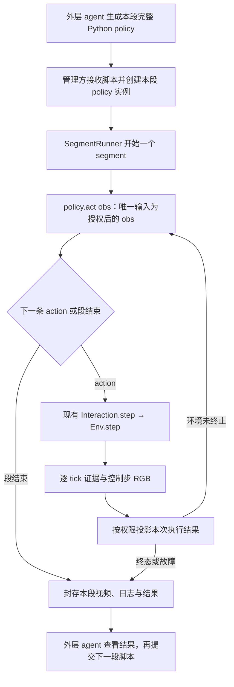

# Scripted policy 由 simulator 调度的工程计划

> 2026-09-29 归档提示：本文涉及的独立研究／诊断／测试入口已移入[统一归档](../../../legacy/research_tools_20260929/README.md)；相关旧路径与命令保留为历史说明，不再是当前运行入口。rollout 准备、执行及 Harbor 工具仍在活动目录。

> 2026-09-28 接口更新：任务文字统一放在各 rollout YAML 的 instruction，生成 instruction.md；spec/context/profile 格式为 v2，policy obs 不再包含 task.instruction。旧文中的 observation_profile.task_instruction 已移除。当前用法见 [Harbor runner](../../../harbor_runners/README.md)。

日期：2026-09-26。状态：**用户已授权实施；单输入调度、权限投影、目录迁移和方块样板已完成，本轮真实验收通过。** 最新资格与视频见[实施记录](../dev-logs/scripted_policy_execution_implementation_20260926_zh.md)。§1 保留批准实施前的草稿基线；其余章节说明确认的设计。

最新输出约定：runner 的 output_root 直接为 `/home/jianwen/topogym/task_rollouts/<experiment_content>_<experiment_date>/<task_name>/rollout_<编号>/`，不再额外嵌套 trail 或测试目录。例如 `task_rollouts/scripted_policy_pick_place_20260926/cube_pick_place/rollout_0001/`。该目录保存初态、segment 视频、逐视角录像、日志和管理报告；源码快照／测试身份也保存在此次 rollout 内。后续编号保留失败尝试，不覆盖已有输出。

本次确认：统一 `obs → policy.act(obs) → env.step(action)`；limited 提供任务配置的外部／腕部 RGB，以及关节位置、当前 EE 位姿、夹爪状态；可选标定只来自明确公布的固定机位。物体、接触、Task 内部状态等环境真值继续严格受限。本条替代前稿“limited 仅 RGB”和 `act(observation, feedback)` 的方案。

目录组织修订：将本地段执行、policy 调度、观测投影和产物管理集中到 `topogym/simulator/rollout_simulation/` 子包。policy 提供动作，该子包负责连续执行并形成有起止状态、视频和日志的 segment。迁移已实施，根层公开导出保持不变；归属与导出约定见 §6.5。

本文讨论本地 scripted policy 接入方式，承接 [segment 执行计划](simulator_segment_execution_plan_20260925_zh.md)。目标是让 policy 负责产生低层 action，管理方的 SegmentRunner 负责执行和收尾。具体调用以[本地 API](simulator_api_zh.md)为准；测试资格以实施记录和冻结报告为准。

## 1. 批准实施前的草稿基线（历史记录）

用户要求先看工程计划之前，曾提前写入以下草稿。下表仅记录当时的 172 行改动；用户随后批准实施，草稿已按后文设计重写并迁移，不能作为当前代码状态。

| 文件 | 本轮已写入内容 | 行数／状态 |
|---|---|---|
| [topogym/planning/base.py](../../../topogym/planning/base.py) | `PolicyDecision`、`ScriptedPolicy` 协议、固定动作序列适配器 `ActionSequencePolicy` | 新增 57 行，未验证 |
| `topogym/simulator/policy.py`（迁移前） | 调用本地 policy 的循环、观测初步过滤、请求身份及失败收尾草稿 | 新增 105 行，未验证 |
| `topogym/simulator/segment.py`（迁移前） | 在 `SegmentRunner` 增加 `run_policy()` 管理端入口，转交上述草稿 | 新增 10 行，原有方法未改 |

当时草稿合计 **3 个文件、172 行新增**。这里统计的是本次提前写入的部分，不是整个工作区的 Git diff；工作区还包含前一轮 segment 开发和其他会话的改动。

当时尚未修改 `Env.step()`、物理参数、生产 Task、方块测试 policy、测试驱动或现有测试。没有启动仿真，没有运行新增代码的测试，没有提交 Git commit。已有直接调用 segment 的样例尚未迁移。

以下方案并不等同于这 172 行草稿：草稿仍使用双参数 `act(observation, feedback)`、必需的 `PolicyDecision` 包装和仅 RGB 的 limited 投影，均尚未按最新约定修改。最终步通知、按需授权状态、完整输入说明和新接口验收也尚未实现。草稿不作为正式接口定稿依据。

## 2. 建议采用的职责划分

**采用统一决策链 `obs → policy.act(obs) → env.step(action)`。** 对 scripted policy，完整脚本先提交，SegmentRunner 本地逐控制步调用同一实例。policy 可以保留阶段、计数器、插值进度和预先写好的反馈逻辑；既可以存一个 actions 列表，也可以每步计算下一条 action。VLA 和 RL actor 也沿用单输入、输出 action 的接口，具体观测编码和动作解码由各自适配器完成。



| 对象 | 负责什么 | 持有哪些能力 |
|---|---|---|
| 外层 agent | 在段开始前生成完整策略程序，段结束后分析结果 | 提交脚本、查看允许的反馈；执行期间无须逐步调用模型 |
| 管理方 | 创建／reset Env、决定观测权限、创建 policy 实例、提交给 runner | 配置、授权、源码与参数身份、episode 生命周期 |
| SegmentRunner | 获取观测、调用 policy、执行 action、识别环境终态、结束 segment、封存记录 | 现有 segment 和 step 执行接口 |
| scripted policy／VLA／RL actor | 根据 obs 与自身状态返回一条低层 action；有限脚本还可表达本段已结束 | 不可变的数据副本；没有 Env／Interaction／Runner 句柄 |
| Env／Robot／World | 校验并执行既有 action、推进物理、更新 Task 与历史 | 保持现有职责 |

这里“环境方负责”具体落实在 simulator 的管理执行层 `SegmentRunner`，不把 policy 加载和运行塞进底层 `Env.step()`。因此不会改变一次 step 的物理含义，也不会产生第二套物理推进循环。

policy 仍然可以写 `if`、循环、插值和重试逻辑。但本接口要求每次 `act(obs)` 有限计算后返回一条 action 或本段结束信号；跨控制步的循环进度保存在实例字段中。首版不新增控制流 DSL，也不要求把完整程序转换为描述分支／循环的大 JSON。

## 3. policy 是否能收到每步 Env.step() 的信息

**建议可以，而且应该在每个控制步后得到该步的授权结果。** “policy 不调用 step”只改变执行所有权，不取消反馈能力。

正常顺序是：

```text
初态 obs_0 → policy.act(obs_0) → action_0
runner 执行 step(action_0) → 按权限组装 obs_1
policy.act(obs_1) → action_1
runner 执行 step(action_1) → 按权限组装 obs_2
……
```

按观测模式筛选后的控制步执行信息放在 `obs.execution_state`，不再单独增加 `feedback` 参数。这里的“执行”具体指 runner 调用一次 `Env.step(action)`：校验并下发 action、推进该控制步的物理、更新 Task／历史并返回结果。该字段记录最近一次控制步的状态及本段累计步数，不表示 policy 代码运行进度，也不表示“移动到位”或“抓取完成”。原始 step 的 reward、info 和训练 transition 有各自管理侧用途，不整体塞进 actor 的 obs。

### 3.1 反馈粒度

- 一条 action 对应一次既有 `Env.step(action)`，即一个控制步。
- 当前默认 `physics_dt_s=0.0025`、`control_decimation=10`，完整控制步为 0.025 秒，通常为 40 Hz；这只是默认配置，policy 应读取 `timing_spec`。
- 提前终止时，该步实际推进的 tick 数可能少于 10；反馈必须使用实际 `physics_steps`、`action_duration_s` 和状态时间，不能始终加上名义控制周期。
- 不在每个 physics tick 或求解器内部子步调用 policy。逐 tick 日志继续由管理方记录；它与 policy 每个控制步的输入是两个层次。
- policy 计算期间不推进物理。计算消耗的墙钟时间不会自动变成仿真时间。

### 3.2 每步可以看到什么：机器人自身传感与环境真值分开

模式沿用既有设计文档的规范名称 `limited`／`unlimited`；讨论中所说的 privileged 对应后者。权限由管理方确定，脚本不能通过自己的输出提升权限。

**limited 的默认输入为 RGB + robot proprioception；严格限制的是未经授权的环境真值。** 以下“允许”均指按字段、相机 ID 和观测规格投影后的数据，不是将完整引擎状态交给 policy。

| 输入信息 | limited | unlimited |
|---|---|---|
| RGB：外部视角与腕部视角 | 按任务公开配置提供，不开放隐藏展示相机 | 同样提供；其他视角按管理方授权 |
| 本体：关节位置、当前 EE 位置／朝向、夹爪实测开合 | 基础观测，三类同时提供 | 同样提供 |
| 其他机器人量，如关节速度、力矩、控制器内部目标 | 不自动加入；后续增加传感字段须明确修改公开合同 | 在已有能力范围内按字段授权 |
| 相机标定 | 可选，仅限明确公布的固定机位 | 按管理方授权，包括已支持的其他标定 |
| 腕部／跟随相机的动态世界外参、额外 link pose、安装变换 | 不由 simulator 自动提供 | 在已有能力范围内按字段授权 |
| 状态身份、控制步计数、仿真时间、实际执行时长 | 有，用于关联动作与观测 | 有 |
| 任务文字、动作格式、单位、控制周期等静态说明 | 有；由管理方明确提供 | 有 |
| 上一步提交的 action 及是否执行完成 | 有，这是自身指令与执行回执 | 有 |
| 物体真实位姿／速度、物体间距离、接触、粒子／FEM 状态 | 无 | 在已有读取能力范围内按字段授权 |
| Task 的隐藏目标、随机关联初态、进度指标、内部状态 | 无 | 按管理方授权 |
| reward／完整 info | 不注入 actor obs；训练侧另见 §4.4 | 也不默认注入 actor obs；训练侧另见 §4.4 |
| 必要终态信号、判据是否可用、Task 的最终成功与否 | 有 | 有 |
| 私有异常堆栈、任意路径、引擎对象、可恢复 checkpoint | 不提供 | 不作为 policy 观测交付 |

本体数据使用实测关节位置、EE 位姿和夹爪位置，不用下发目标代替实测反馈。字段必须公布单位、关节／机械臂顺序、四元数顺序、参考坐标系，以及 EE 指的是 TCP 还是其他指定 link。可以使用已公布的机器人基座／世界坐标系，不提供依赖隐藏物体位姿的“物体相对坐标系”。夹爪开合读数不等于“已抓住物体”，不附带从接触或 Task 真值推断的抓取成功标签。

**现有 `interaction(privileged=False)` 仍不等于新的 limited 合同。** 当前普通观测同时包含 Task 声明字段和完整相机标定；这些不能直接透传。另一方面，当前 `observation_mode=JOINT/EE` 只选择其中一类机器人读数，也尚未满足这里关节、EE、夹爪同时提供的要求。

计划在 `sensors/observation.py` 复用同一状态下已有的机器人测量，缓存完整本体测量供 policy 投影，再选择基础字段。保留既有普通 JOINT／EE 返回语义；新 policy view 不受这项二选一限制，也不能要求先启用 privileged 才取得基础本体数据。RGB、本体与 `state_ref` 应来自同一控制边界，不二次推进物理。

limited 的过滤覆盖 `obs`、`obs.execution_state`、公开 step info、结束通知、错误、PNG／MP4／JSON 与媒体 metadata。禁止通过 `Task.observe()`、随机 seed、资源名、相机 pose 或日志间接交付物体真值。policy 用获准的 RGB 和本体数据自行做视觉估计或运动学计算是允许的，不应将这种推断与 simulator 直接泄漏真值混为一谈。

### 3.3 可选固定相机标定的公开规则

- 默认不公开标定；管理方在观测 profile 中列出 `calibration_camera_ids`。列表必须是当前公开 RGB 相机的子集，且每一路在整个 episode 中固定。
- 固定意味着不附着机械臂、不跟随 entity、不逐步更新 look-at／pose；不能仅凭相机名称像“external”就认定固定。相机在 episode 开始时的已公布位姿可以不同，但发布后不得悄悄移动。
- 对获准固定相机，可公开内参 K、分辨率、畸变约定、固定外参，以及坐标轴／变换方向／单位。这些字段、相机 ID、是否固定和标定版本应在运行前明确公布并记录配置身份。
- 腕部 RGB 正常提供，但首版 limited 不发布腕部相机标定，包括安装变换、动态世界外参，也不从完整 camera metadata 中顺带暴露腕部内参；这遵守“可选标定只限固定机位”的约定。
- 标定关闭时，在所有公开入口中一致省略；错误授权移动相机时拒绝配置。静态标定可通过不可变对象复用，不为它增加渲染或物理步。

### 3.4 首步、末步和异常步

| 情形 | 计划行为 |
|---|---|
| 首次决策 | 传本段初态，`obs.execution_state.control_steps=0`、`previous=None`；没有虚构的上一步 |
| 普通成功返回的一步 | 下一次 `act()` 收到该步结束时的观测及回执 |
| 最后一动作触发 terminated／truncated | 不再调用 `act()` 取新动作；将最后一步反馈交给可选结束通知，并返回管理方 |
| policy 主动结束本段 | 不执行额外 step；结束通知取得最后已知的授权观测与本段结果 |
| 动作非法，未执行物理 | 保存已执行前缀，反馈该 action 未完成；不伪造一次成功 step |
| 物理或输出故障，step 未正常返回 | 保留实际推进与已保存 tick 计数；只能使用最后可用观测并标明其状态来源，不能将旧 RGB 标为故障后的新观测 |

建议为需要结束通知的脚本提供可选的 `on_segment_end(obs, result)`。授权回执已经包含在 obs 中；不再传第二份 feedback。它用于收到终止步／最终状态，**不用于产生下一条 action**，返回值必须为 `None`，不提供执行句柄。VLA／RL actor 不必实现这个扩展。

现有 segment `_step` 会在终态时自动封存；新适配层可在取得封存结果后发出此通知，不为了通知增加物理步。通知异常单独写入 policy 运行报告，不能重放最后一个 action，也不能改写 Task 的判定或冒称先前物理没有发生。若环境故障，通知中的观测必须标明 `observation_state_ref` 与可用性。

正式实现已补齐末步通知；旧草稿在终态直接返回的行为已替换。

## 4. 拟定的最小接口

### 4.1 policy 侧

```python
class SubmittedPolicy:
    def initialize(self, context):  # 可选，不是 act 的额外输入
        # 每个新 segment 只调用一次；取得静态规格，初始化阶段/计数器。
        ...

    def act(self, obs):
        # 返回一条原生低层 action；不调用 env，也不操作 segment。
        return action

    def on_segment_end(self, obs, result):  # 可选脚本扩展
        # 只接收最终反馈，不返回 action。
        pass
```

**必需接口只有 `act(obs)`。** 普通动作直接返回当前 `action_spec` 接受的 mapping；VLA 或 RL 模型如果输出 tensor／数组，由其轻量适配器显式转换单位、坐标系与控制格式，再交给同一个 runner。

有限 scripted policy 的返回约定：

| 返回值 | 语义 |
|---|---|
| 非空 action mapping | 执行一次标准控制步 |
| `{}` | 保持既有目标，仍执行一次控制步 |
| `None` | 本段程序正常结束，交回控制；不执行 step，不宣称 Task 成功 |
| 其他返回值 | 非法输出，不猜测其含义 |

```python
# 管理端核心调度示意：终态判断、异常和证据收尾在 runner 中处理。
action = policy.act(obs)
if action is None:
    # 结束本段；不将 None 传入 Env.step。
    ...
else:
    next_obs, reward, terminated, truncated, info = env.step(action)
```

不再强制 policy 返回 `PolicyDecision`。之前草稿中的 `action/phase/segment_done` 包装不作为统一决策协议；phase 可以留在策略内部或明确的管理侧诊断中，不占用 action 字段，不触发高层执行。持续输出动作的 VLA／RL actor 不必实现结束信号，由环境终态和管理方采集逻辑决定停止。连续重复 delta action 是连续叠加增量，不应拿它代替 `{}` 保持。

固定动作列表仍计划用 `ActionSequencePolicy(actions)` 适配到 `act(obs)`，列表耗尽返回 None。需要反馈的策略自行维护阶段和进度；无需预先保存所有 action，也无需每步重新构造实例。首版不强制所有策略注册 `PolicySpec` 或加入 oracle registry。

### 4.2 输入结构

`obs` 是决策唯一输入。拟定的 limited 结构如下；尖括号表示由机器人或任务规格确定的名称，并非固定数组维度：

```text
obs
├── rgb[<camera_id>]                    公开外部／腕部 RGB，H×W×3 uint8
├── robot[<arm_name>]
│   ├── joint_position_rad             按公布关节顺序排列
│   ├── tcp_position_world_m           当前实测 TCP 位置，注明坐标系
│   ├── tcp_orientation_wxyz           当前实测 TCP 朝向
│   └── <gripper_measurement_field>    如 finger_position_m/rad；明确单位和形状
├── camera_calibration[<fixed_id>]      可选，只含显式公布的固定相机
├── task                               公开任务文字；不复制 Task.observe/get_state
├── state                              episode/branch/state 身份与采样时间
└── execution_state                    最近一次 Env.step 的状态与本段累计步数
```

机器人字段必须由统一 observation_spec 声明，不能假定所有夹爪都使用米或同样的标量。初始版本只承诺已声明的基础本体量；任何缺失字段要在建运行前显式报告，不静默填零。关节速度等其他量即使当前底层可读，也不因便利而自动暴露。

unlimited 使用相同基础结构，再增加经管理方选择的 `obs.privileged` 字段；不改变 action 协议。普通 `obs.robot` 不接收整份 privileged robot/controller 状态。

`execution_state` 是数据字段，其主要结构为：

```text
control_steps                    本段已完成的控制步数
previous                         首步为 None，否则为上一步回执
  action_index                   上一步在本段中的序号
  action                         policy 自己提交的指令副本
  completed                      该次 Env.step 是否正常返回；不代表动作目标已达成
  terminated / truncated         环境终态与已有 episode 时限
  info                           白名单身份、时间与必要 Task 反馈，不含原始 Task metrics
observation_state_ref            本次观测对应的真实已保存状态
```

最终异常回执另包含公开错误码、实际推进／已保存／未保存 tick 计数；正常 `act(obs)` 输入不会伪造异常 step 的完整五元组。state 与 execution_state 关联信息保持一致。对只接受图像／状态张量的模型，适配器可以只消费 obs 的所需键，不要求模型本身理解全部元数据。

可选 `initialize(context)` 只取得静态合同：`schema_version`、mode、action_spec、timing_spec、observation_spec 和观测 profile 身份。任务指令同时可从 obs 取得，避免 VLA 必须依赖初始化扩展。`schema_version=1` 是数据格式版本，不表示物理频率、控制模式、任务版本或 segment 编号。

观测 profile 明确列出 RGB 相机 ID、本体字段、允许标定的固定相机 ID、坐标系和标定版本。每次 run_policy 调用固定配置并写入段的运行身份，不能由 policy 动态要求更多字段。RGB 关闭只用于明确声明的无 RGB 测试，不作为完整多模态输入验收。

### 4.3 管理侧

管理方调用方式如下；真实资格见实施记录：

```python
# 由管理方接收已提交脚本、创建其 policy 实例，并计算提交身份。
with SegmentRunner(env, output_root=output_root) as runner:
    result = runner.run_policy(
        request_id="move-001",
        policy=submitted_policy,
        submission_hash=submission_hash,
        mode="limited",
    )
```

管理方另通过 `observation_profile` 选择公开相机和可选固定相机标定；普通机器人基础传感不依赖 `enable_privileged`。在 unlimited 模式下，可通过 `state_fields=("robot", "world", "task")` 从已有白名单选择额外状态，默认空集合。limited 不能用 state_fields 绕过基础本体白名单，任何额外 privileged 状态请求均应拒绝；不能把“机器人基础数据获准”扩展成“完整 robot/world 状态获准”。

原始 `Env.step()` 返回的 `(observation, reward, terminated, truncated, info)` 由 runner 接收，再投影成下一次 `policy.act(obs)` 的单个输入。policy 不接收 `Env`、`Interaction`、`SegmentRunner` 或它们的 getter。

`submission_hash` 由管理方对脚本源码、依赖清单及策略参数计算；不是让 policy 自报身份，也不能只对可变 Python 对象的 `repr()` 求哈希。模型适配时同样记录模型／checkpoint 与动作解码参数身份。同一 request ID 与同一提交、权限配置重试，返回既有结果，不再次初始化 policy 或推进物理；改变源码、参数、模式、观测 profile 或授权字段应判冲突。

本地第一阶段接收**已经由管理方准备好的可信 Python 实例**。外层 agent 如何上传源码、在哪个 worker 加载、如何隔离文件和进程权限，需要后续 worker／Harbor 接入，不能把这份本地接口称为已能安全运行任意 agent 源码。当前 172 行草稿也没有实现源码上传或加载。

### 4.4 VLA 与 RL 的兼容边界

统一的是 actor 决策接口，不要求所有算法具有相同的模型结构、训练方式或输入张量排列。

| 消费者 | 如何接入 | 执行边界 |
|---|---|---|
| scripted policy | `act(obs)` 使用本体、RGB、计数器计算一个 action | runner 持有所有 step／segment 操作 |
| VLA | 适配器从 obs 取图像、公开任务指令与本体；将模型输出转换为标准 action | 模型不取得环境句柄 |
| RL actor | `act(obs)` 将规定的 observation 编码为模型输入，返回标准 action | 不要求额外 feedback 参数或 PolicyDecision 类型 |
| RL collector／learner | 管理侧接收 `(obs_t, action_t, reward_t, obs_t1, terminated, truncated)` 等已授权训练数据 | reward／训练 info 不自动回灌 actor obs；reset 仍在管理侧 |

支持 action chunk 的 VLA 可在适配器内部缓存 K 条 action，每次 `act(obs)` 只取一条；并不要求每个控制步重新运行大模型。重规划时机与剩余 chunk 的处理必须显式定义，遇环境终态立即停止；统一执行层不把 chunk 当作一次 step，也不隐式重复 action。循环／历史输入模型的隐藏状态保存在适配器，episode 与段初始化语义显式声明。

RL 训练 reward 不因 limited 而一概禁用，但须有管理方明确登记的训练信号合同。默认不将 raw reward 注入 policy obs，也不把含隐藏距离的 shaping metrics 或完整 Task info 交给普通脚本。训练侧允许哪些标量 reward、成功信号或诊断要逐项公开；未声明的训练信号保持不可用，不伪造零值。若使用特权 critic，需单独授权，不能由 critic 的数据权限自动扩大 actor 的 limited 观测。

本轮计划只保证输入、输出和管理侧 transition 边界可以接这些适配器，不宣称已集成 VLA 模型、RL 训练器、并行／向量化环境或异步实时控制。

## 5. segment、policy 状态和异常的所有权

1. 一个 scripted policy 提交对应一个 segment、一个持续存在的实例。开始与结束只由 runner 执行；模型适配器如需跨段保留历史，必须在管理侧显式定义，不能假定每段结束都是 episode reset。
2. 有限脚本可以返回 None 表达本段结束；下一段是否执行、提交哪份新脚本，仍由外层管理方／agent 决定。策略内部 phase 改变不会自动新建 segment。
3. 每个 action mapping 最多执行一次 step。记录回执与实际状态身份，避免 policy 和 runner 对同一动作各执行一次。
4. 环境 terminated／truncated 后立即停止取动作；即使 policy 还有 actions，也不继续推进。
5. policy 初始化或决策异常应结束本段、保留已执行前缀和媒体，公开返回简短错误码，详细堆栈只入管理日志。是否可开始下一段取决于 Env／记录链是否仍健康。
6. 物理／记录故障沿用原 runner 的停止规则；不通过重试 policy 自动重放已经执行的物理。
7. 管理方 reset 后旧 runner 和当前 episode 的调用身份失效。执行期间保持互斥，禁止重入、并发动作、reset 或 rewind 与本段交错。
8. 回溯只在段外由获授权一方处理。首版回到历史 Env 状态后创建新的 policy 实例和新的 request ID；**不声称 Env checkpoint 能恢复 policy 的计数器、Python 栈或随机源**。暂停后恢复同一 policy 是后续独立能力。

不新增单段 action 数、token、仿真时间或墙钟预算；沿用已有 episode 时限。策略自己写的次数／阶段条件属于策略逻辑。若 `act()` 自身死循环不返回，同进程实现不能靠 episode 时限中断它；本计划如实保留该限制，进程取消和不可信代码隔离留给后续 worker 层，不偷偷增加 timeout。

需要分别记录“policy 是否正常结束”“证据是否完整”“Task 是否成功”。已封存一段 `policy_error` 的完整前缀不等于 policy 成功；Task 成功只能来自已实现的判据。

## 6. 改造后的目录与逐文件范围

以下是已实施目录，仅展示相关部分；`[迁入]` 表示本轮移动现有模块或草稿。`rollout_simulation/` 属于 simulator 的本地执行层，使用现有 Env，不另建物理引擎或外层 agent 循环。

```text
topogym/
├── planning/
│   ├── base.py                      [重写] 单输入 act(obs) 协议 / 列表适配
│   ├── examples/
│   │   └── cube_pick_place.py       [新增] 抓起方块再放下的可读 scripted policy 样板
│   └── motions/                     现有纯运动构造，按需复用
├── simulator/
│   ├── __init__.py                  [调整] 保持 Env / SegmentRunner 的统一惰性导出
│   ├── env.py                       沿用既有 step，不接入 policy 执行逻辑
│   ├── interaction.py               基础动作权限与通用 step info 白名单
│   ├── privileged.py                沿用既有真实状态白名单
│   └── rollout_simulation/          [新增子包] 本地 rollout 的段执行与记录
│       ├── __init__.py              轻量导出；导入时不启动环境或执行 policy
│       ├── segment.py               [迁入] run_policy 与现有段生命周期
│       ├── policy.py                [迁入重写] 调度、异常与结束通知
│       ├── policy_observation.py    [新增] obs、本体与固定相机标定投影
│       ├── segment_contract.py      [迁入] 段结果、execution_state 与错误合同
│       ├── evidence.py              [迁入] tick／action／policy 执行记录
│       └── artifacts.py             [迁入] 段产物 ID、权限与完整性校验
├── sensors/
│   └── observation.py               [调整] 同状态完整本体缓存，供新 policy view 选择
└── recording/                       继续复用 RecordingSession / SegmentMedia

tests/
├── contracts/
│   ├── test_scripted_policy_execution.py   [新增] 控制步、生命周期、错误、幂等
│   ├── test_policy_observation_access.py  [新增] 本体同步、标定权限与环境真值隔离
│   └── test_cube_pick_place_policy.py     [新增] 样板按输入观测产生动作与切换阶段
├── fixtures/
│   ├── cube_policy.py               现有直接调用样例，先保留作为行为对照
│   ├── cube_pick_place.py          [新增] 复用方块场景、提供原位拾起放下的测试判据
│   └── cube_transfer.py             复用现有测试 Task 与独立成功判据
└── integration/
    └── test_policy_cube_transfer.py [调整] 增加管理方调度的验收入口

scripts/
├── test_scripted_policy_rollout.py  [新增] 输出目录、提交哈希、独立快照与被动策略验收
└── test_policy_cube_transfer.py     保留直接 segment 与控制模式矩阵驱动

docs/develop/modules/
├── scripted_policy_execution_plan_20260926_zh.md  本计划
├── simulator_api_zh.md              [已调整] 正式调用与权限说明
└── simulator_segment_execution_plan_20260925_zh.md [实现后关联] 既有执行能力
```

`planning/base.py` 只定义策略输入输出，不依赖 simulator 的 Env 或物理引擎。`simulator/rollout_simulation/policy.py` 管执行，同子包的 `policy_observation.py` 管输入投影；`sensors/observation.py` 提供同步原始本体测量，不能把完整原始测量直接开放给 policy。分开这些职责便于验收信息权限。不会为每个 Task 添加另一套 runner。

方块新策略的唯一实现放在 `planning/examples/cube_pick_place.py`，供测试和管理端导入；不再另外创建前稿拟议的 `tests/fixtures/cube_decision_policy.py`。`tests/fixtures/` 保留场景与判据，以及旧直接调用样例的行为对照，不复制新的策略逻辑。`planning/README.md` 在样板实现后补调用说明。

生产 `tasks/`、几何材质、39 个 oracle／planner 迁移、辅助抓持、网络 RPC、模型 API、Harbor 部署均不属于这次本地适配计划。

### 6.1 产物沿用现有目录

```text
task_rollouts/<experiment_content>_<experiment_date>/<task_name>/rollout_<编号>/
├── report.json                     现有管理报告
├── segments/segment_N.json          现有段结果；不混入 private policy 诊断
├── segment_N.mp4                   现有同步拼屏
├── views/<camera>/segment_N.mp4     现有逐视角视频
└── private/
    ├── control_steps.jsonl          增加提交身份、动作产生与失败等事件
    ├── physics_states.jsonl         继续逐 tick 记录
    ├── history_events.jsonl         继续记录 reset／rewind 等事件
    └── policies/segment_N.json      源码/参数身份、授权、policy 核心执行状态
```

目录还包含 `run_report.json`、`run_source_manifest.json`、`source_snapshot/`、`rgb/` 和 `recording/`。可选结束通知状态写入核心封存之后的 `control_steps.jsonl` 事件，避免通知异常改写已完成的执行结果。记录在执行过程中持续写入，结束时封存和校验。limited 只取得允许的媒体与反馈，不获得整个 `private/`。

### 6.2 五个执行相关文件具体怎样写

以下五个模块统一位于目标子包 `topogym/simulator/rollout_simulation/`，通过一个管理入口串联，不各自启动执行。下列函数名和签名说明职责划分；精确实现以所链接源码为准。该子包还一并迁入已有 `artifacts.py`，职责见 §6.5。

依赖方向为：管理方 → 子包中的 `segment.py` → `policy.py`；二者调用观测投影、合同和证据模块。`policy_observation.py` 与 `segment_contract.py` 只处理数据，不反向依赖 runner；`evidence.py` 只接收要保存的记录。policy 实例只收到最终 obs。底层 Interaction 的通用公开 info 过滤保留在 `simulator/interaction.py`，段合同调用它，避免基础交互为了筛选 info 而导入整套 rollout 执行模块。

#### 6.2.1 `segment.py`：段的所有者与唯一执行入口

保留 `SegmentRunner`、`SegmentInteraction` 和现有段状态机。文件负责 episode 绑定、互斥、请求去重、step 执行、终态与媒体封存；不加入方块阶段或模型推理逻辑。

| 方法 | 实施内容与输入输出 |
|---|---|
| `run_policy(*, request_id, policy, submission_hash, mode="limited", observation_profile=None, state_fields=())` | 管理端入口；进入现有 `_dispatch` 互斥，预检权限／观测配置，再交给 `policy.execute_policy`；返回现有 SegmentResult 风格的不可变结果 |
| `_begin(identifier, signature=...)`（现有） | 分配段 ID、初态与记录资源；signature 增加提交身份、模式、显式观测设置及所选状态字段；解析后的实际 profile 另写入运行身份。已有同内容请求直接返回既有结果 |
| `_step(identity, token, action, sequence, *, finalize_terminal=True)` | 继续调用唯一的 `Interaction.step → Env.step` 路径；动作验证、执行计数、逐 tick 记录仍由此处负责；managed policy 传 finalize_terminal=False，以先投影末步观测再封存 |
| `_end(identity, token, reason=...)`（现有） | 幂等封存；如本段来自 policy，先保存必要的 policy 运行报告，再发布公共完成结果；不推进物理 |
| `_policy_inputs(state_fields=(), access=None)`（管理内部） | 获取当前缓存观测、同状态本体测量，以及管理方批准的额外只读状态；检查状态身份一致，供纯数据投影使用，不交给 policy 本人 |

`run_policy` 的锁覆盖初始化、所有 act 调用和本段收尾。内部调度使用已持锁的 `_begin/_step/_end`，不能再调用会重复获取同一锁的公开 `interaction.begin_segment/step/end_segment`。外层调用、reset、rewind、重入和并发仍沿用现有 guard。

请求重试必须在执行 policy 初始化、推理或结束通知之前命中缓存。对重试请求，任何 policy 方法都不再调用。这里的签名计算和动作指纹沿用合同工具，不在每个入口另写散列规则。

#### 6.2.2 `policy.py`：逐控制步调用策略

本文件实现一个有限职责的调度函数，复用 runner 的段管理能力，不定义第二个 Runner 类。

| 函数 | 实施内容与输入输出 |
|---|---|
| `execute_policy(runner, identifier, policy, *, submission_hash, mode, observation_profile=None, state_fields=())` | 管理内部函数，在 runner 锁内运行一个 segment；调用可选 initialize、循环 act(obs)、交给 `_step`，直到 None／终态／故障 |
| execute_policy 尾部通知逻辑 | 若存在 `on_segment_end` 则调用一次；仅通知、要求返回 None；将通知状态交给证据模块，不取新动作 |
| 异常分段处理 | 明确区分 initialize、观测读取／投影、act、action 验证、step、封存和通知；保留原始异常阶段，不能把 Env 或磁盘故障都归为 policy_error |

核心顺序如下，属于说明性伪代码：

```text
先检查请求缓存；若已有结果，直接返回
读取和校验观测 profile，再从 _begin 取得 descriptor
写入提交身份、模式和观测规格
取得初态 obs（previous=None），调用可选 initialize(context)
循环：
    value = policy.act(obs)
    检查 value 为 action mapping 或 None
    记录本次决策对应的输入 state_ref 和 action_index
    若 value 为 None：调用 _end，结束循环
    step_result = runner._step(..., value, sequence=action_index)
    使用该次返回观测和真实步数，更新 execution_state 并投影下一份 obs
    若返回终态：调用 _end，结束循环；step 故障已封存时直接使用其结果
取得最后可用的授权 obs，发送一次可选结束通知
返回段结果
```

这段循环每轮最多执行一次 `_step`；`{}` 不能被 `if not value` 误当结束。具体动作字段及 IK／delta 的合法性仍由原路径验证。本文件不生成轨迹、不直接调用 World、不中途重置 Env，不调用模型服务。

执行故障后不能继续读取故障 Env 来“补最新观测”：使用最后成功投影的 obs，并标出 `observation_state_ref` 和是否为当前末态。正常终止步则从已返回的 step_result 构造最终 obs；不再调用 act。结束通知失败不重放动作，通知状态与段执行结果分开记录。

#### 6.2.3 `policy_observation.py`：只从白名单组装 obs

采用“管理方取数，纯函数投影”的方式。该模块拿到的是数值快照和明确的配置，不拿 Env／entity 句柄，不调用 step、render 或物体查询。

| 对象／函数 | 实施内容与输入输出 |
|---|---|
| `ObservationProfile`（不可变配置） | 保存 mode、RGB 相机 ID、基础本体字段、可公开固定相机标定 ID、额外 state_fields、任务文字和格式版本 |
| `validate_profile(*, mode, settings, camera_specs, action_spec, state_fields, privileged_enabled, raw_observation, proprioception)` | 核对相机存在且归属公开列表、标定相机确实固定、本体字段／形状齐备、特权字段确已授权；错误在首次物理执行前拒绝 |
| `build_context(profile, action_spec, timing_spec)` | 生成可选 initialize 所用的静态输入合同；包含投影后的 observation_spec，不包含 seed、Task 配置全集或私有路径 |
| `project_observation(raw_observation, proprioception, *, profile, execution_state, privileged_values)` | 逐字段构造 §4.2 的 obs，检查采样身份一致并冻结输出；limited 不访问或复制额外状态 |

投影的具体顺序为：选 RGB 相机 → 选基础关节／EE／夹爪 → 附上明确公布的固定标定 → 放入公开任务文字和状态身份 → 放入白名单 execution_state → 仅 unlimited 附加指定 privileged 字段。

`sensors/observation.py` 提供一个管理侧可读的同状态本体缓存，复用一次 `robot.observe()` 得到的测量；不能重新调用 Env.step，也不能把当前 JOINT／EE 二选一视图误认为完整本体。超大 privileged 数组按字段请求，RGB 静态引用可在确认不可变后共享，不因每次组装 obs 无条件复制全部 World／历史。

这里“固定标定”的校验使用相机配置与传感器规格，不只相信 policy 输入的相机名或一个 `fixed=True` 字符串。过滤规则同时用于普通 step 后观测与结束通知，避免两条路径给出不同权限的数据。

#### 6.2.4 `segment_contract.py`：集中定义数据格式与公开错误

本文件保持无物理、无文件写入的工具模块。现有 `SegmentError`、`action_copy`、`fingerprint`、`request_id` 随模块迁入子包；通用 `public_info` 原逻辑移回 `simulator/interaction.py`，由段合同导入复用，基础 Interaction 自身也使用同一函数。不会复制两套白名单。

| 拟调整项 | 实施内容 |
|---|---|
| `validate_policy_output(value)` | 只区分 None／action mapping／非法返回类型；不猜测 array 是哪种控制，也不执行 IK；原有 `_step` 继续做 action_copy 与动作验证 |
| `make_execution_state(...)` | 根据管理方给出的真实控制步计数、上一动作结果和观测身份，返回不可变 execution_state；只使用白名单 info，不把原始 Transition 全量放入 |
| 请求身份规范 | 规定提交散列、模式、显式 observation_profile 设置和额外状态字段如何进入 fingerprint；实际解析 profile 单独存档；同一配置避免不同字典顺序产生不同身份 |
| 公开 reason／错误码 | 沿用 `env_terminal`、`env_time_limit`、`invalid_action`、`env_error`、`evidence_error`；补充 `policy_done`、`policy_error`、`invalid_policy_output`、`observation_error` 等明确原因 |

公开 SegmentResult 沿用目前的段 ID、起止状态、控制步数、实际／已保存／未保存 tick 数、reason、evidence_complete、Task 反馈和媒体引用，不为了接 policy 把它改成引擎对象或任意字典。`policy_done` 只表示程序交回控制；`observation_error` 或其他原因是否导致证据不完整，要根据真正发生的读取／记录故障确定，不能一概当作成功封存。

基础 Interaction 的 `public_info` 负责 step 元信息的白名单，子包内 `policy_observation.py` 负责整个 policy 观测视图，两者不各自维护冲突的 Task 成功或计时解释。异常原文不作为公开错误码，详细原因交由 evidence 保存。

#### 6.2.5 `evidence.py`：在现有记录链增加 policy 事件

复用当前 `SegmentEvidence.write/tick/statistics/close`、JSONL、数值数组分块与原子 JSON 写入，不创建第二套 tick logger 或视频 writer。

| 拟新增方法 | 保存什么 |
|---|---|
| `policy_event(kind, *, segment_id, state_ref, action_index, **data)` | 包装现有 control_steps JSONL 写入，保存提交／输出／错误／结束通知等事件；命名与已有 requested/completed/failed/end 区分 |
| `write_policy_report(segment_id, report)` | 原子保存 `private/policies/segment_N.json`：源码及参数身份、profile、开始／结束状态、决策次数、执行结果及私有错误；路径由 runner 生成 |
| 结束通知事件 | 在封存后追加通知是否执行、是否失败的独立事件；不伪装成新控制步，也不修改已发生的物理 |

每次 act 的输入只记录关联的 state_ref／观测规格身份，输出 action 使用既有控制请求记录；不在 policy 日志中重复存一套 RGB 或全部物体状态。phase 若以后作为可选诊断加入，只入明确的私有诊断通道，不从 Python 实例任意遍历属性，也不要求统一 action 包装它。

必要事件在对应 step 前写入；写入失败就不推进该新步。已推进后的证据错误保留实际 tick 计数并标记 incomplete，不能重跑动作。`_end` 在发布公共完成结果前写好必需的 policy 核心报告；可选结束通知的记录在封存后独立追加，通知失败不改写 Task 判定。不能因段结果已缓存而把必要报告保存失败吞掉。

### 6.3 一次完整调用怎样穿过这五个文件

```text
管理方：创建 Env / reset / policy / SegmentRunner
  segment.run_policy：绑定 episode、持锁、检查请求与权限
    policy.execute_policy：先检查请求缓存；命中则返回
      policy_observation.validate_profile：明确输入字段与标定
      segment._begin：创建本段
      evidence：记录提交身份
      policy_observation：构造 context 和初态 obs
      用户策略 act(obs)：只返回 action 或 None
      segment_contract：确认返回类型，约定 execution_state 格式
      segment._step：Interaction.step → Env.step
        已有 state/frame/transition sinks → evidence / recording
      policy_observation：组装下一控制边界的 obs
      ……直到 None、环境终态或故障
    segment._end：统一写核心报告、封存媒体与结果
    policy：可选结束通知；evidence 单独记录通知状态
  返回 SegmentResult 给管理方
```

实现时按“合同与观测投影 → 本体缓存 → 调度接入 → 事件／封存 → 样板与验收”的顺序写，避免先在样板里另造临时 runner。现有流式 begin／step／end 和新 run_policy 共用同一 `_step`，回归测试必须同时覆盖这两种调用方式。

### 6.4 新增可读的方块拾起／放下 scripted policy 样板

**位置：`topogym/planning/examples/cube_pick_place.py`；主要类：`CubePickPlacePolicy`。** 放在 examples 下，表示用户可参考和复制的策略程序，不是 simulator 的公共“抓取”指令，也不注册成 39 个生产 planner 中的新任务解法。

第一版聚焦一个清楚的成功样例：Panda + 现有夹爪 + EE_ABS，从默认 home 连续接近方块，抓起、抬高、放回、张开夹爪并撤离。默认放回原处；可选 `place_entity_id="target_marker"`，复用同一状态机增加搬运阶段，接上现有跨距离搬运验收。

#### 输入与权限

- policy 的初始化读取 action_spec／timing_spec／observation_spec，检查支持的机器人与 EE_ABS 模式，从规格取得夹爪字段、单位和开合范围；不硬编码所有夹爪都使用米。
- `obs.robot` 提供当前 TCP／关节／夹爪。第一版定位方块使用 `obs.privileged.world["bodies"][cube_entity_id]["position_m"]` 等获准测量，明确按 **unlimited** 运行，管理方选择 `state_fields=("world",)`。
- 放回原处时保存初次看到的方块位置；搬运版本从获准的 target_marker 位姿确定目标 XY，落下高度结合初态和测试场景规格确定。场景必要的静态参数由管理方明确传入并记录提交身份。
- 不从 `obs.task` 偷取旧测试中的方块初始／目标坐标，不导入 Env、World 或 Task 实例，不读测试日志找真值。世界状态缺失时显式报错，不偷偷切换数据来源。
- 这份样板验证状态化脚本和统一执行链；有限观测下的视觉定位版本另行实现，不能直接把运行 mode 改成 limited 就宣称可用。

#### 阶段与低层输出

```text
张开夹爪 → 接近方块上方 → 下降 → 闭合夹爪
    → 抬高 → 短暂持稳 → [可选搬运] → 下降放回
    → 张开夹爪 → 撤离 → None
```

| 方法／状态 | 写法 |
|---|---|
| `__init__(cube_entity_id="cube", place_entity_id=None, ...)` | 只保存实体名称和策略参数，不创建环境。默认 None 表示原位放回 |
| `initialize(context)` | 校验控制规格，清空当前段阶段、计时和插值缓存；本样板首次支持完整一段，后续两段版本由管理方显式传入阶段起点 |
| `act(obs)` | 读取当前阶段与观测；满足阶段条件时更新自身状态；每次最多返回一个 action，最终返回 None |
| `_update_phase(obs)` | 有限次判断当前阶段是否可转移；调用 `_phase_ready` 与 `_enter_phase`，不在这里执行任何 action |
| `_enter_phase(name, obs)` | 保存阶段起点的实测 TCP、朝向和仿真时间，计算本阶段目标；函数只改 policy 自身字段 |
| `_pose_action(obs)` | 依据 elapsed simulation time 计算平滑位置插值与姿态插值，返回一次 EE_ABS pose + gripper 命令；IK 留给既有 Env 控制链 |
| `_phase_ready(obs)` | 根据实际 TCP 偏差、仿真持续时间，以及本样板获准的方块运动检查切换条件 |
| 内部 hold／gripper 阶段 | 返回 `{}` 保持，或只含夹爪字段的低层命令；不调用 sleep 或循环 step |

仅展示返回格式的伪代码如下，目标计算和阶段条件在类的纯策略方法内完成：

```python
def act(self, obs):
    self._update_phase(obs)
    if self.phase == "done":
        return None
    if self.phase == "hold":
        return {}
    return {
        self.arm: {
            "position_world_m": self._position_target(obs),
            "orientation_wxyz": self._orientation_target(obs),
            self.gripper_field: self._gripper_target(),
        }
    }
```

阶段进度使用 `obs.state.sim_time_s` 与实际反馈；`execution_state.previous.completed=True` 只说明控制步正常返回，不能据此认定抬起成功。插值到终点后观察 TCP 是否真正到位；夹爪接触方块时不要求实测关节达到空抓闭合极限。抬起检查需看获准的方块实际高度／随手运动，不能用末端上升代替方块上升。

有限次策略重试或阶段等待条件可以写在样板自身参数中，不能变成 runner 的单段预算。抓取失败或无法完成阶段要返回明确策略失败（由 runner 记录），不能以 None 假装成功；可用简单策略异常表达失败，保持 action 返回合同不变。所有 success 判定仍由独立 Task／测试判据完成。

#### 场景、运行入口与验收归属

| 位置 | 计划内容 |
|---|---|
| `planning/examples/cube_pick_place.py` | 唯一策略实现，导入无建场景／推进物理副作用；代码注释讲清每步输入、阶段与原生 action |
| `tests/fixtures/cube_pick_place.py` | 复用已有方块场景，补原位拾起／放下的独立测试判据，检查真实抬起、持稳、释放、撤离和落桌稳定；与搬运判据分开 |
| `tests/fixtures/cube_transfer.py` | 保留原来至少搬运一段距离的成功标准；用于样板可选 transfer 路径，不能为原位放回降低它的成功阈值 |
| `tests/contracts/test_cube_pick_place_policy.py` | 给定观测序列，检查返回 action、阶段推进、抓空／不动方块不被当作抓起、终态前后的返回语义；不启动 Genesis |
| `scripts/test_scripted_policy_rollout.py` | 提供样板运行选择：原位拾起放下／搬运、单段／明确两段；管理方注册测试场景、reset、创建 runner、调用样板并记录实际身份 |
| `tests/integration/test_policy_cube_transfer.py` | 调用同一驱动验收原位和搬运流程，不复制策略；真实测试保持独立快照、报告和多视角视频 |

验收同时报告三个结果：policy 是否正常交回控制、记录是否完整、方块是否真实完成目标。原位放回用其独立判据，搬运用原有搬运判据；两者不能互相冒充成功。空抓、只抬手没抬物、夹着不释放或物体掉落均要作为负例。样板初版不使用辅助抓持或位置传送。

该交付物已写入包内样板、管理方运行驱动和独立测试；真实结果及配置范围单独记录。

### 6.5 rollout_simulation 子包的边界与迁移

可以把这个子包理解为 **rollout 中“执行并形成 segment”的公共模块**：policy 决定下一条 action，执行层连续调用 Env、收集结果、处理停止条件，再封存 segment。segment 的创建、step 调用和结束仍由执行层持有；policy 不需要重新承担 begin／end 的职责。

“形成 segment”包含实际物理执行和记录，不只是预先把 actions 拼成一个数据结构。外层一个 rollout 可以提交多段 policy；这个子包先提供一段一段连续执行的能力，不包含模型对话、训练算法或 agent 选择下一段脚本的逻辑。已有固定动作列表和流式控制也继续使用同一段执行能力。

建议使用 `topogym/simulator/rollout_simulation/` 而不是立即新增顶层 `topogym/rollout_simulation/`：目前这些模块绑定本地 Env、episode 权限、历史及输出钩子，属于 simulator 的执行组织。它与旧文档中延期的顶层 `rollout/` 网络／agent 管理方案职责不同，不重复建设两套段执行器。

| 保留或迁移对象 | 目标归属与理由 |
|---|---|
| segment、policy 调度、policy 观测投影、段合同、evidence | 集中到 rollout_simulation；它们共同构成段执行链 |
| `artifacts.py`／`ArtifactStore` | 一并迁入；逻辑 ID、私有文件权限、路径及哈希检查服务于段产物。保留 add/read 行为，不与 video writer 合并 |
| Env、Interaction、PrivilegedAccess、episode history | 留在 simulator 根层；不使用段执行时也可独立提供基础环境能力 |
| 基础 `public_info` | 放在 interaction.py 内作为纯数据过滤函数；段结果与 policy 投影复用它 |
| policy 接口与方块样板 | 留在 planning/base.py 和 planning/examples；策略定义与执行器分开 |
| SensorSuite | 留在 sensors，负责原始同步测量；权限投影位于 rollout_simulation |
| RecordingSession／SegmentMedia | 留在 recording，共享帧采样／视频编码与封存能力 |

迁移采用以下约定：

1. `from topogym.simulator import Env, SegmentRunner` 保持可用；simulator 的惰性导出指向新子包内的同一个 SegmentRunner，不添加另一个类或运行循环。
2. 子包 `__init__.py` 仅作轻量／惰性导出。导入 Env、策略接口或段合同，不启动 Genesis、不建目录、不实例化 policy，不引入循环导入。
3. 仓库活动代码中直接导入 `topogym.simulator.segment/evidence/artifacts/segment_contract` 的位置迁往新路径或稳定的根层导出；同步修改测试、当前 API 文档与工具。默认不在旧文件保留第二份实现；若发现需要保留的外部旧路径，只使用明确的薄重导出，不复制执行逻辑。
4. 原有 relative imports 按新层级统一核对；`interaction.py` 不再反向导入 rollout_simulation 的段合同来取得 public_info。共享工具仍使用 `topogym.utils`，观测与录制模块也保持单一实现。
5. 目录迁移先独立做导入与原 segment 合同回归，再接入新的 act(obs) 行为。测试需要确认两条公开导出拿到同一个类、基础 Env 可独立导入，以及无新增初始化副作用。
6. 旧运行目录里的 source_snapshot、实际哈希、视频和历史报告不改写。新验收使用迁移后的新源码快照；产物目录和既有 step 的物理语义不因源码目录改变。

以上迁移已实施；旧源码快照与历史产物保持原样。§1 的 172 行清单只描述批准实施前的历史基线。

## 7. 实施顺序与验收

单输入接口和 limited 的范围已确认并实施；P1–P5 已完成；189 项相关测试与 9 项真实验收通过，具体配置和范围见实施记录，不继承历史成功标签。

| 阶段 | 计划改动 | 必须给出的证据 |
|---|---|---|
| P1：合同定稿 | 固定 `act(obs) → action/None`、obs 字段、末步通知、本体与固定标定、幂等身份；审查保留草稿 | 文档与类型／校验一致；列出与草稿的差异 |
| P1a：执行子包整理 | 将现有段执行模块迁入 simulator/rollout_simulation，保留根层惰性导出，调整内部导入及 public_info 归属 | 导入无副作用，无循环依赖；原流式／批量段合同回归通过后再接新行为 |
| P2：本地调度与观测 | 复用现有 `_begin/_step/_end`；完成同状态本体缓存、权限投影、生命周期、异常和结束通知 | 确定性合同测试，确认没有额外物理步或重复执行，基础传感不依赖 privileged |
| P3：包内方块样板 | 新增 `planning/examples/cube_pick_place.py`，实现只返回 action 的状态机；运行驱动导入同一份样板 | 原位拾起放下、可选搬运；纯策略输入输出验证，与旧策略对照；两段边界连续 |
| P4：真实验收 | 独立源码快照、固定配置、Genesis + Nyx + compact_lab、统一录像与报告 | 原位放回和跨距离搬运分别通过各自判据，失败对照、各视角视频和实际哈希 |
| P5：正式文档 | 更新 API、测试说明与既有 segment 文档，说明首选接入方式 | 明确哪些能力已实现、哪些真正实跑、哪些仍延期 |

合同测试至少覆盖：

- 只实现 `act(obs)` 的策略即可接入；首步 `obs.execution_state.previous=None`，后续观测与上一步真实状态一致；可选 initialize 每个新提交只调用一次。
- N 条 action 恰好 N 次控制调用；`{}` 执行一步、None 执行零步；终态提前停止剩余动作，包括 VLA 适配器已缓存的 chunk。
- 最后一动作的反馈能够进入可选结束通知；通知不能执行动作，通知异常不引起重放。
- 空策略、非法返回类型、非法 action、初始化异常、运行中异常、物理故障与输出故障保留准确前缀。
- limited 在 `enable_privileged=False` 下仍同时取得真实关节、TCP 和夹爪；双臂名称／顺序、夹爪单位、四元数顺序正确，三类测量与 RGB／state_ref 对齐。
- limited 不透传物体 pose／速度、距离、接触、Task metrics、隐藏目标、随机初态、完整 robot/controller 对象；info、结束通知、错误和公开媒体同样受限。
- 固定相机标定默认关闭；公开名单、固定性、内外参方向与单位可核对；腕部 RGB 仍存在但标定和动态外参不公开；错误将移动相机列为固定时拒绝。
- reward 不出现在 actor obs，训练侧只得到显式授权信号；特权 critic 的数据不能进入 limited actor；unlimited 只增加选定字段。
- policy 没有执行句柄；输入副本不能改动 Env；重入、并发操作、reset／rewind 边界保持有效。
- 同提交重试不再调用 policy；更换源码、参数、权限模式、观测 profile 或状态字段会冲突；旧 episode 不能续用。
- 录像继续经过公共录制模块，段结束不增加 physics tick；物理失败不把旧图像冒充新状态。
- 目录迁移后根层与子包导出为同一 SegmentRunner；基础 Env 不依赖 policy 实例或执行子包初始化；原产物解析和现有段测试继续通过。

真实验收先做样板的原位抓起／放下，再做一段完整方块搬运和同 seed 两段连续执行，外加空抓负例；通过后再按原计划扩展搬运固定 seeds 0–4，逐案记录失败，不继承上一轮成功标签。

方块新 policy 读取 TCP／关节／夹爪属于 limited 允许的本体数据；读取 Task 提供的方块初始坐标、隐藏目标坐标或物体实时真值，仍必须按 unlimited 授权。现有方块样例依赖初始物体／目标坐标，不能仅因本体数据改为公开就将旧成功记录改称新 limited 合同下通过。

limited 先验收 RGB + 本体同步输入、固定标定投影和短动作闭环（例如根据本体 TCP 判断是否到位）。要报告 limited 下完整方块搬运成功，须另有只使用获准输入的视觉定位／策略实现并独立实跑；不能继续注入 Task 隐藏坐标。

真实运行报告必须注明实际物理 tick、控制 decimation 和 solver substeps。若长程测试沿用 25 ms tick／decimation 1 的显式测试配置，不能将它称为默认 2.5 ms tick／decimation 10 的完整资格验证。

## 8. 与保留草稿的明确差异

| 草稿现状 | 正式计划要求 |
|---|---|
| 执行模块散放 simulator 根层 | 迁入 simulator/rollout_simulation，保留统一公开导出，样板仍在 planning/examples |
| `act(observation, feedback)` 返回必需的 PolicyDecision | `act(obs)` 直接返回标准 action；有限脚本返回 None 结束；移除必需包装 |
| limited 只有 RGB 和状态身份 | 同步提供基础关节／EE／夹爪；仍严格排除环境真值 |
| limited 一律丢弃相机标定 | 可选公开明确列出的固定机位标定；腕部 RGB 保留但不公开腕部标定 |
| unlimited 每步复制 robot／world／task，并保留整个普通 observation | 管理方显式选择状态字段；统一白名单投影，避免大数组无条件复制 |
| 首步 context 只有模式、动作规格、时序和 RGB 开关 | 补充实际输入字段说明；任务文字与隐藏 Task 状态分开 |
| feedback 作为第二参数且 unlimited 包含 reward | 控制步执行信息进入 obs.execution_state；reward／训练 transition 与 actor 输入分开 |
| 环境终态直接返回，不通知 policy | 可选结束通知覆盖最后一步；不追加 act 或 step |
| 只有调用者传入的 submission_hash | 规定管理方怎样绑定源码、参数、依赖和权限；本地草稿并未实现提交加载器 |
| 若干错误归为 policy_error，缺少专项验证 | 区分策略、观测读取、执行、记录和通知失败，保留证据 |
| 未新增测试、未迁移样例、未真实运行 | P2–P4 完成后才能宣布正式可用 |

本计划建议把“环境负责执行、policy 负责决定”作为新 scripted policy 的首选方式；已有低层 Interaction 接口继续服务管理工具和已有测试。两个接口最终仍使用同一个 Env.step，不改变 action 的物理语义。
