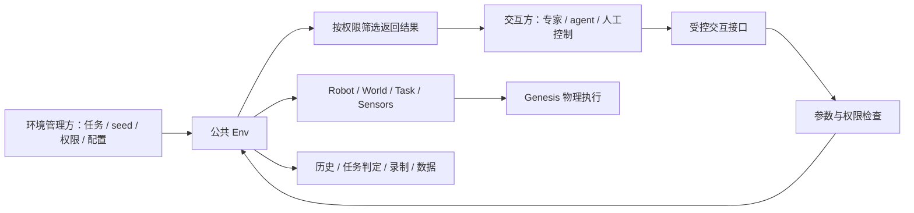

# TopoGym Simulator 交互接口合同（讨论稿）

> 2026-09-29 归档提示：本文涉及的独立研究／诊断／测试入口已移入[统一归档](../../../legacy/research_tools_20260929/README.md)；相关旧路径与命令保留为历史说明，不再是当前运行入口。rollout 准备、执行及 Harbor 工具仍在活动目录。

> 2026-09-24 接口更新：本文的 agent/网络方案尚未启用；其中旧 `reset(state_id=...)`、操作方 reset、旧未来可访问等约定已失效。当前管理方可 `reset(seed=...)`；普通/特权操作方均无 reset，特权仅在当前 episode 内 `rewind_to` 并作废旧未来。实现集中于 `topogym/simulator/`，以[当前本地接口](simulator_api_zh.md)和[实施报告](../dev-logs/simulator_public_api_implementation_20260924_zh.md)为准。

日期：2026-09-23。状态：**设计讨论稿，尚未实现本文提出的完整对外接口。**

> 后续讨论更新：具体目录、文件迁移与开发阶段见 [Rollout Pipeline 改造计划](../../../legacy/cleanup_20260929/docs/develop/modules/rollout_pipeline_refactor_plan_zh.md)。新计划采用 `limited/unlimited` 两个规范 mode 名称（本文 `privileged` 对应 `unlimited`），明确支持 policy 自选长度的 segment、固定 `rollout_id/reset/segment` 反馈目录，并按最新要求在终态结束 rollout。涉及旧命名、单步/动作段与终态后回溯的差异，以新计划为准；两份文档都不是已实现 API 声明。

本文整理当前讨论、官方框架参考和工作树源码核对结果。本轮仅编写文档，没有修改 simulator 代码，没有执行仿真、渲染、测试或 agent/API 实验。文中的建议方法、字段和错误码不是可直接调用的现有 API。

## 1. 我们要先解决什么

TopoGym 应向任务交互方提供一份完整、稳定的合同：它能控制什么、读取什么、申请什么视角、恢复哪些历史状态，以及每次操作如何影响时间、状态、记录和任务判定。

**正式 demo 是参考策略通过公共环境接口完成的一次 rollout；正式 agent 使用相同执行机制，替换动作来源。** 环境的物理规则、控制语义、抓持条件和成功判据不随动作来源改变。策略可以是专家脚本、运动规划器、学习模型或人工遥操作，不要求每个物理 tick 都重新调用模型。

当前工作的优先产物是这份合同及其与现有核心的对应关系。网络服务、SDK、模型接入和具体任务求解程序的实现可以随后安排；不能为这些交互方再建设第二套场景、物理时钟或任务私有执行循环。

### 1.1 已确定的用户要求

- 交互方可以控制机器人机械臂和夹爪，通过真实模拟执行任务。
- `limited` 的动态环境观测仅来自预设相机的 RGB。
- `privileged` 可以在授权范围内读取真实状态和物体间距离、创建新观察视角、恢复历史状态。
- 两种模式都不能自行添加实体、重建任务环境、调用底层积分或任意修改物理规则。
- demo 与正式 agent 应依托同一套 simulator 交互机制。

### 1.2 本文提出、仍可讨论的设计

- 交互方使用受控 `EnvClient`，环境管理方持有真实 `Env`；名称为暂定。
- 对外保留 `step(action)` 的 Gym 风格语义；若命名为 `act(action)`，其权限与行为不变。
- 历史恢复只接受服务端保存的状态 ID；不允许交互方上传任意状态覆盖环境。
- 权限由观测、相机和回溯三类能力组成，对外先提供两个具名 profile。
- 特权相机作为会话级虚拟观察工具，其配置独立于物理历史保存和记录。

后文使用“必须”描述目标合同约束，使用“建议”描述本稿选择；两者都不代表当前代码已经满足。

## 2. 可借鉴的框架经验及边界

| 参考 | 官方提供的相关机制 | 可以借鉴什么 | 不能直接据此宣称什么 |
|---|---|---|---|
| [RoboWits](https://github.com/UMass-Embodied-AGI/RoboWits) | `gs_gym.make`、reset/step、关节/末端控制模式、图像和机器人状态、策略评测入口 | 环境生命周期、动作控制语义、策略与环境连接 | 没有据本次资料核对确认它提供本文整套严格权限与任意历史回溯合同 |
| [ManiSkill 观测](https://maniskill.readthedocs.io/en/latest/user_guide/concepts/observation.html) | `state_dict` 特权状态、传感器数据、RGB/深度等模式组合 | 分开组织真值和传感器观测 | 视觉模式中仍可含 `agent`、`extra` 和传感器参数，不自动等于严格 RGB-only |
| [ManiSkill 相机](https://maniskill.readthedocs.io/en/latest/user_guide/concepts/sensors.html) | 策略传感器、展示用相机、GUI 相机分别配置 | 分开管理策略输入和 demo 展示 | 创建时可配置相机，不等于已验证任意后端能在运行中无限添加相机 |
| [ManiSkill 状态与查询](https://maniskill.readthedocs.io/en/latest/user_guide/tutorials/custom_tasks/advanced.html) | 状态保存/恢复、额外任务状态扩展、物体间接触力查询 | 可恢复状态必须包含任务信息；将测量组织为明确查询 | actor/articulation 状态机制不能直接证明 TopoGym FEM/IPC 的完整续跑一致性 |
| [robosuite 传感器](https://robosuite.ai/docs/modules/sensors.html) | Observable 管理采样、噪声、滤波、延迟和观测输出 | 内部真实状态与对外观测分离 | 允许开发者配置 Observable，不等于限制了交互方对内部对象的访问 |
| [Gymnasium Env](https://gymnasium.farama.org/api/env/) | 标准 step 五元组、reset、动作/观测空间、`unwrapped` | 生命周期和终止/截断区分 | `info` 可含隐藏状态，`unwrapped` 可取得内部环境；普通 wrapper 不是权限隔离 |

RoboWits 的[环境示例](https://github.com/UMass-Embodied-AGI/RoboWits/blob/main/scripts/robowits/examples/run_env.py)展示了创建、reset、step 和图像保存；该示例执行保持命令，并不证明成功求解。其[评测脚本](https://github.com/UMass-Embodied-AGI/RoboWits/blob/main/scripts/robowits/eval/eval.sh)将 checkpoint 与任务交给 LeRobot 评测；[论文](https://arxiv.org/html/2605.30326v1)同时使用人工遥操作示范。因此动作来源可以不同，共同点是通过环境实际执行。

**从上述公开接口作出的设计判断：TopoGym 可以借鉴生命周期、观测分类、相机分组和状态序列化，但必须自行定义并落实交互方的访问边界。**

## 3. 所有权与执行边界



| 角色 | 拥有的职责 | 对外边界 |
|---|---|---|
| 环境管理方 / runner | 创建和关闭环境，选择 task/variation/seed，冻结配置，分配权限和预算，启动记录 | 交互方不能请求提升权限、切换 seed 或修改任务参数 |
| 交互方 / solver / policy | 根据允许的观测计算机器人动作；按权限查询、申请视角、回溯 | 只持有数据与受控客户端，不持有引擎对象 |
| 公共 Env | 生命周期、动作提交、物理推进编排、状态历史、任务更新和结果 | 所有交互动作进入同一条执行路径 |
| World / Robot / Task / Sensors | 物理执行、控制、任务语义和观测实现 | 由 Env 协调，不对交互方暴露可修改句柄 |
| 记录与评测方 | 保存实际动作、状态、分支、视频及成功/失败证据 | 可以保存比策略可见内容更完整的数据，私有记录不自动成为策略输入 |

这里的“solver”指任务求解策略；当前 [`topogym/solvers`](../../../topogym/solvers/__init__.py) 中的 FK/IK 等数值工具是另一个层次，不拥有物理时钟。

### 3.1 make、step 与 reset 分别由谁调用

- `make(...)` 或当前 `Env(SimulatorConfig(...))`：环境管理方创建任务实例。交互方接入已分配实例，不获得任意环境工厂。
- 公共 `step(action)`：交互方提交合法机器人命令，环境推进配置好的物理 tick、更新任务、保存历史、产生观测。
- 底层 `scene.step()` / `World.advance()`：只由 simulator 内部调用。交互方不能跳过动作校验、判定和记录自行积分。
- fresh `reset(seed=...)`：环境管理方开启新 episode。是否安排再次尝试由外层运行规则决定。
- `reset(state_id=...)`：仅 privileged 请求恢复当前 episode 已保存状态，由环境完成并建立新分支。

机器人动作、授权回溯和虚拟视角配置都会改变某类运行状态。因此准确边界是：**只允许合同定义的状态变化，不允许任意改写场景、求解器或任务规则。**

## 4. limited / privileged 权限合同

| 能力 | limited | privileged |
|---|---|---|
| 读取任务指令、机器人动作格式、单位、限位、控制周期 | 允许 | 允许 |
| 提交机械臂/夹爪目标、保持现有目标 | 允许 | 允许，动作和物理规则相同 |
| 获取预设策略相机 RGB | 允许 | 允许 |
| 读取实测关节、末端、物体位姿/速度 | 禁止 | 按支持字段允许 |
| 查询接触、物体间距离、软体节点等真实状态 | 禁止 | 按任务和后端能力允许 |
| 获取深度、分割或点云 | 禁止 | 本稿不默认启用；后续显式声明扩展 |
| 创建、移动、删除自定义虚拟视角 | 禁止 | 允许，遵守相机合同与公布的资源额度 |
| 查询历史状态目录、回到已保存状态 | 禁止 | 当前 episode 内允许 |
| 自行 fresh reset、传入 seed、选择另一个任务实例 | 禁止 | 禁止 |
| 添加/删除物理实体，改几何、材质、质量、重力、摩擦、碰撞 | 禁止 | 禁止 |
| 任意传送物体、写粒子位置、修改关节实际位置、施加外部任务物体驱动力 | 禁止 | 禁止 |
| 创建任意焊接/抓持约束、修改成功判据、直接积分 | 禁止 | 禁止 |
| 获取 Scene/Entity/Camera 原始对象、任意 set_state、调用 unwrapped | 禁止 | 禁止 |

“预设相机”指交互方不可修改的相机集合、参数和挂载关系。可以包含随机器人运动的腕部相机，不要求所有相机在世界坐标中静止。

limited 仍可接收任务说明、动作说明、自己的指令回执和必要的结束信号；“仅 RGB”限定动态环境感知，不表示没有交互协议。交互方知道已提交的关节目标，不表示可以读取实际关节角。

建议内部将权限拆为 `observation_access`、`camera_access`、`rewind_access`，由管理方组合成两种 profile，交互方不能修改。这样以后可以单独比较真值观测、额外视角和回溯带来的影响；当前两种 profile 的成绩差异不能只解释为“看到了更多状态”。

## 5. 对外交互接口草案

以下均为建议接口。`env` 在本节代表受控客户端，不是当前真实 `Env` 对象。

| 操作 | 输入与返回 | 权限 | 对状态和时间的影响 |
|---|---|---|---|
| `describe()` | 任务说明、动作 schema、可见观测 schema、能力与限额、当前公开身份 | 两种 | 无物理变化，不推进时间 |
| `observe()` | 当前权限允许的观测与来源身份 | 两种 | 不推进时间；不得刷新出另一物理时刻的数据 |
| `step(action)` | 机器人命令 → `(obs, reward, terminated, truncated, info)` | 两种 | 唯一普通动作入口，推进物理并保存真实转移 |
| `render(camera_ids=None)` | 允许访问的相机 RGB 与帧身份 | 两种 | 不推进时间；默认只取本 profile 的策略相机 |
| `list_entities()` | 可查询实体的稳定 ID、公开类型及字段能力 | privileged | 返回描述数据，不返回对象句柄 |
| `get_state(entities, fields)` | 已声明字段 → 带单位、坐标系和状态 ID 的副本 | privileged | 只读；不暴露任意对象属性遍历 |
| `distance(a, b, kind)` | 两实体及距离定义 → 数值与几何依据 | privileged | 只读；不支持的组合明确拒绝 |
| `contacts(entities)` | 指定范围内引擎支持的接触信息 | privileged | 只读，不伪造接触力或无接触结论 |
| `cameras.list()` | 可访问相机的 ID 和允许公开的说明 | 两种 | 只读；limited 不获得隐藏展示相机列表 |
| `cameras.create(spec)` | 虚拟相机描述 → camera ID 与版本 | privileged | 改变观测配置，不推进或改变物理 |
| `cameras.update(id, spec)` / `delete(id)` | 修改或释放自定义视角 | privileged | 只能管理本会话可修改的相机，预设相机受保护 |
| `list_states()` | 当前 episode 各已保存分支的状态身份、tick、时间与父关系 | privileged | 只返回历史目录，不返回内部快照 |
| `reset(state_id=...)` | 服务端保存的 ID → 恢复后观测与新分支身份 | privileged | 恢复完整物理/控制/任务状态；不额外积分 |
| `finish()` | 请求停止交互 → 运行结束回执 | 两种 | 不产生动作，不由交互方指定 success；资源由管理方关闭 |

`describe()` 应区分“本 profile 无权限”“本任务不支持”“支持但未通过对应验证”。不能统一返回空值让交互方猜测。公开能力描述不含私有源码路径、隐藏实例参数和原生快照路径。

### 5.1 生命周期与异常

正常会话由管理方完成创建/reset 后交付客户端。`terminated` 表示任务结束，可能成功也可能失败；`truncated` 表示时间上限等外部截断。两者都不能直接当作 success。

结束状态允许只读查询；普通动作拒绝。privileged 可在会话仍开放、资源预算允许时恢复历史并继续，旧结束事件仍保留。`finish()` 或管理方关闭后不再允许回溯。

建议统一错误类别：`PermissionDenied`、`UnsupportedCapability`、`InvalidAction`、`UnknownState`、`StaleRequest`、`EpisodeEnded`、`SimulationFault`。权限、身份和参数错误必须在物理变化前拒绝；仿真故障可能发生在部分 tick 已完成之后，应保留已完成证据并如实返回完成量，不能声称整段没有执行。

limited 的错误只给必要类别与可操作说明；原始引擎堆栈和隐含物体状态留在私有诊断。传输超时后通过请求 ID 查询执行结果，不盲目重复动作。

## 6. 动作与时间合同

第一版建议沿用当前公共 Robot 的关节位置目标动作，先把已有能力说清楚；末端位置/姿态控制可作为后续具名模式添加，不隐式切换控制语义。

| 项目 | 必须明确的含义 |
|---|---|
| 机器人与关节组 | ALOHA 的 `left/right`，Panda＋Robotiq 的 `arm`；关节名称、顺序、维度由 action schema 提供 |
| 关节命令 | `joint_position_rad` 是弧度制绝对控制目标，不是设置实际 qpos |
| 夹爪命令 | 沿用具体模型字段：ALOHA `gripper_position_m` 是原生滑轨坐标；Robotiq `gripper_position_rad` 是原生驱动角，不统一冒充完整开口宽度 |
| 省略字段 | 当前语义是保留之前的目标；空动作保持既有目标，不表示冻结机器人实际位置 |
| 控制周期 | 一次 step 最多推进 `control_decimation` 个物理 tick，每 tick 为 `physics_dt_s`；引擎子步与公共 tick 分开描述 |
| 真实执行 | 控制器驱动后由物理引擎得到实际状态；目标接受不等于目标到达，也不自动保证碰撞自由 |
| 校验 | 在任意机械臂写入前完成整条动作的维度、有限值、范围和权限检查 |
| 结束处理 | 执行中达到结束条件可提前停止，返回实际完成 tick 和持续时间 |
| 查询/思考 | 不因查询、渲染或交互方思考所花墙钟时间而偷偷推进物理 |

v1 不要求另设任意 `steps=N`。连续控制可以循环调用 step；未来若增加动作段，应定义分段反馈、提前终止、最大时长和逐步记录，全部仍进入同一公共执行路径。

将来提供末端控制时，应明确世界/基座/工具坐标系、姿态约定、绝对量/增量、IK 失败处理，以及插值与可达性规则。环境可以内部读取关节状态进行 IK；limited 不因此获得真实状态返回。

**辅助抓持属于环境物理规则，不属于 privileged 特权。** 若某任务采用辅助抓持，触发、维持、释放及回溯语义应在两种 profile 中一致；不能只让专家或 privileged 任意焊接目标物体。普通夹爪动作不等于已经抓住物体，当前未接通的辅助机制也不能通过脚本私下补上。

## 7. 观测、奖励与状态查询合同

### 7.1 limited 返回范围

动态观测仅包含预设策略相机的 RGB：相机 ID、`uint8`、`H×W×3`、RGB 通道顺序及对应状态身份。允许基本协议字段，如 episode/state ID、完成 tick、终止/截断标记。

不得直接返回物体/机器人位姿、接触、粒子、深度、分割、实时腕部世界外参、任务距离或隐藏中间目标。建议允许在任务开始提供固定相机内参和静态安装说明；是否公开这些静态标定需在 profile 中固定声明，不能动态夹带真值。

`info`、reward、错误消息、录像字幕、公开日志、文件和历史查询同样受权限约束。建议 limited 的中间奖励恒为 0，仅在任务完成时返回已声明的稀疏结果；距离型 shaping reward 和详细 metrics 仅供有权限的读取方。未知判据不能伪装成失败或成功，应有公开的评测可用性说明。

### 7.2 privileged 状态查询

按任务实际支持暴露机器人关节/末端、刚体姿态与速度、接触，以及 PBD/FEM 点状态。使用字段白名单和稳定实体 ID，返回不可修改内部状态的数据副本。

每项应包含来源 state ID、单位、坐标系和数据定义。例如位置为世界坐标米制，姿态约定为 `wxyz`，速度区分线速度和角速度；软体点附带稳定材料索引，不把 PBD 粒子与 FEM 顶点混为同一数据类型。未查询字段不默认全部导出。

距离至少区分：

| 距离类型 | 语义与边界 |
|---|---|
| `origin` | 两实体约定参考原点间的欧氏距离；只有明确使用质心才叫质心距离 |
| `aabb` | 当前世界轴对齐包围盒的间隔，可作为粗略量，不能当作真实表面净空 |
| `surface` | 指定碰撞或视觉几何的表面最短距离；必须注明使用哪种几何，软体使用哪个时刻的变形数据 |
| `signed` | 有符号距离或穿透量；仅在算法有明确符号和穿透定义时开放，不将分离下界当作精确穿透深度 |

返回建议包含 `value_m`、`kind`、几何依据、方法/近似说明及 `state_id`。接触查询应区分“无接触”“引擎未提供该类型接触”和“查询失败”；不能用空列表掩盖不支持。

## 8. 相机合同：允许观察配置，不开放场景编辑

相机分为预设策略相机、privileged 自定义相机、评测/展示相机。只有前两类中的授权视角可以返回交互方；展示录制不能成为 limited 的额外信息入口。

建议自定义相机描述为：世界位置 `position_world_m`、注视点 `lookat_world_m`、上方向 `up_world`、垂直视场角 `vertical_fov_rad`、图像分辨率。这样避免把渲染后端的局部轴和单位隐式暴露为公共标准。将来允许挂载机器人 link 时，另行定义挂载变换。

- 相机没有质量、碰撞或动力学约束；创建/移动/删除不推进物理。
- 不开放材质透明化、物体隐藏、分割调试、碰撞网格展示或剖切参数。near/far 等由环境规则管理；允许位置范围和穿入几何的处理规则应明确，不能无意获得穿透视图。
- 相机数量、分辨率、渲染请求限额由管理方公布，交互方不能修改。查询额度耗尽与任务失败分开记录。
- 每次更新相机增加 `camera_revision`；相同物理 state 在不同相机配置下是不同观察结果。缓存至少识别物理状态、相机版本和权限视图。
- 多相机响应必须来自同一个物理状态；分批渲染期间不允许其他动作穿插。
- 建议自定义相机配置在物理回溯后继续保留，配置变化单独记录；挂载相机依据恢复后的机器人姿态计算视角。重建旧录像使用当时记录的相机版本。

运行中创建视角是**逻辑接口目标**。底层可采用已验证的动态相机机制或预留相机池，不能为了加相机重建世界、丢弃历史或多走一个物理步。尚未支持的后端必须明确报告，不能冒充已实现。

## 9. 历史恢复与执行身份

建议每次交互使用以下身份，物理历史与客户端请求身份分开：

| 字段 | 含义 |
|---|---|
| `session_id` | 交互会话；权限及累计使用记录归属 |
| `episode_id` | 管理方创建的一次任务实例运行；fresh reset 产生新身份 |
| `branch_id` | 恢复历史后创建的新执行分支 |
| `state_id` | 当前 episode 内服务端保存的不可变状态，不能只用 tick 替代 |
| `physics_tick` / `sim_time_s` | 物理时钟；回溯后可以变小 |
| `revision` | 会话串行变更版本；动作、回溯、相机修改后递增，不随物理回溯倒退 |
| `request_id` | 请求去重与超时后结果查询；重试相同请求不得重复执行 |

这是目标命名：当前实现使用 `physics_step` 等字段，并没有上述完整会话协议。最终接口可以映射现有命名，但语义必须一致。

恢复要求：

1. 只接受当前 episode 已保存、由环境拥有的 state ID；范围包括控制动作中途已保存的物理 tick 和旧分支未来状态。
2. 恢复物理位置/速度、必要求解器缓存、机器人控制目标、约束与活动状态、任务判据历史、随机状态和时钟。
3. 成功恢复后新建分支，保留旧分支；刷新观察缓存，不额外执行“补偿物理步”。
4. 不重新采样 seed、几何或变体，不用从头动作重放冒充完整快照恢复。
5. 无法正确恢复时明确报错并将环境置于可识别状态，不能只恢复外形后继续宣称成功。
6. 动作/回溯/相机变更串行处理；旧 revision 的延迟请求拒绝，防止把旧计划作用到新分支。

物理 episode 的时间上限可以随快照恢复；外层累计动作量、查询次数、回溯次数和已经产生的终态事件不随之清零。具体额度后续确定。任务 success 由 Task/evaluator 判断，不由客户端 `finish()` 或“选中一段好看的历史”设置。

单个分支录像只描述该分支的一次连续执行。回溯前后的画面不能拼成未中断的一次机器人成功；允许制作带明确跳转标记的完整交互记录。

## 10. 权限落实与 demo 使用方式

### 10.1 数据筛选与执行隔离是两项不同工作

在同一 Python 进程内向任意代码交付真实 Env，然后隐藏几个字段或方法，不能保证交互方无法访问内部状态。`_world` 私有命名、wrapper 或“不要调用”的文档约定都不是充分隔离。

针对可运行任意代码的交互方，建议 simulator 在受保护的独立执行端持有引擎、快照和 evaluator，客户端只通过类型化请求访问。还需限制私有内存/句柄、可写代码与配置、快照目录、日志及调试入口的访问；仅分成两个进程仍不能自动保证这些条件。具体通信方式和运行隔离实现后置设计。

真实 Env 仍作为受信任的核心模块使用。受控接口只做权限、请求编排和数据投影，不实现第二份任务动力学。

### 10.2 同一合同下生成 demo

管理方冻结任务和权限 → 初始化 Env → 参考策略通过同一客户端读取观测/提交动作 → Env 统一推进与判定 → 录制模块被动消费共享帧 → 归档状态、动作、权限、相机和结果。

参考策略如需 privileged，必须标明 demo 的权限条件；其机器人动作能力不能因此高于正式交互方。控制过程不得另行调用实体 set_pose、直接写粒子、添加抓持约束或自行 scene.step。

历史视频保留各自证据范围。例如 [Blanket 的历史执行入口](../../../runs/demo_metadata/blanket_flatten/2026-09-18_single_arm_clear_home_v1/source_snapshot/robot_demo.py)使用专用执行程序，[重渲染程序](../../../runs/demo_metadata/blanket_flatten/2026-09-18_single_arm_clear_home_v1/source_snapshot/render_execution.py)则恢复保存的位置和关节状态出图。这说明有原始物理执行，但不等于当前公共 Env 已通过相同任务验收。

## 11. 与当前工作树的对应关系

下表仅为本次只读核对结果，不能代替物理验证；此前部分开发记录反映较早阶段，不能机械沿用其中的阻塞数量。

| 能力 | 当前依据 | 与本合同之间的差距 |
|---|---|---|
| 环境创建与生命周期 | [`env.py`](../../../topogym/simulator/env.py)、[`SimulatorConfig`](../../../topogym/simulator/config.py) 有公共构造、reset/step/observe/render/close | 当前是内部对象接口，尚无本稿完整受限客户端；不宣称已兼容 Gymnasium 或已有 `topogym.make()` |
| 动作合同 | [`joint_position.py`](../../../topogym/robot/joint_position.py) 有动作 schema、整体校验、关节目标和模型特定夹爪字段 | 末端模式不是现有公共 step 的已实现能力；权限和协议身份仍需接入 |
| 观测 | [`observation.py`](../../../topogym/sensors/observation.py) 统一取帧、缓存，返回 world/robot/task/rgb | 缺 limited 投影；内部完整观测不能直接交给 limited |
| info 与结果 | `Env._info()` 包含 metrics/support；Task 提供结果 | 缺返回渠道的统一权限筛选及公开错误合同 |
| 历史回溯 | [`episode.py`](../../../topogym/simulator/history.py) 与 `Env._restore()` 有逐 tick 历史、新分支和旧历史保留 | 缺客户端权限、请求去重/过期处理、外层累计记录合同；真实恢复能力需逐模型验证 |
| FEM/IPC | [`world/physics/ipc.py`](../../../topogym/world/physics/ipc.py) 已出现版本约束及原生 dump/recover 的分支快照实现 | 不能再仅据旧说明写“完全没有实现”；也不能仅据源码存在就宣布四项 FEM 全部可运行或完整回溯已验收 |
| 相机 | [`sensors/cameras.py`](../../../topogym/sensors/cameras.py) 有创建、挂载、更新等内部工具 | 缺受控运行期相机管理、相机版本缓存和策略/展示权限分组 |
| 距离与接触 | [`solvers/collision`](../../../topogym/solvers/collision) 有不同几何算法 | 缺实体级统一查询合同、字段支持矩阵和 privileged 访问入口 |
| 录制与数据 | [`recording`](../../../topogym/recording/README.md) 消费共享帧；[`data`](../../../topogym/data/README.md) 保存真实转移 | 还需记录完整权限/请求/相机版本，并区分私有与策略可见产物 |
| agent 接入 | [`agents/README.md`](../../../topogym/agents/README.md) 将旧实现放在 deferred | 不能把旧 bridge 当作本合同已实现的客户端；本稿不启动 agent/API 实验 |

当前 `runs/test_results/` 已有测试产物。例如 [rigid/PBD 诊断摘要](../../../runs/test_results/rigid_pbd_diagnostic_01/summary.json)同时包含通过和失败项，`full_coverage=false`；[FEM 诊断 09](../../../runs/test_results/fem_diagnostic_09/summary.json)记录的 Rope Threading 用例失败。这些只是本次抽查到的既有报告，不是完整或最新测试审计，也不是本轮运行结果。

支持状态建议最终分别列为：`implemented`（代码接通）、`validated`（具体条件下验证）、`allowed`（当前 profile 授权）。某能力已实现、在另一机器人上已验证、或在 privileged 允许，均不能推导出当前 limited 可用。

## 12. 交互示例：目标行为，不是现有可运行代码

管理方预先选择 profile 并完成环境初始化，将已经连接好的客户端交给策略。交互方不调用 make，也不能传入 profile 切换权限。

```python
# limited：client 已由管理方绑定到初始化后的环境。
spec = client.describe()
obs = client.observe()
while True:
    action = policy(obs["rgb"], spec["action_spec"])
    obs, reward, terminated, truncated, info = client.step(action)
    if terminated or truncated:
        break
client.finish()
```

```python
# privileged：相同机器人动作入口，额外获得授权查询、视角和历史恢复。
states = client.list_states()
saved_id = states[-1]["state_id"]
camera_id = client.cameras.create({
    "position_world_m": [0.6, -0.5, 1.2],
    "lookat_world_m": [0.0, 0.0, 0.8],
    "up_world": [0.0, 0.0, 1.0],
    "vertical_fov_rad": 0.8,
    "resolution": [640, 480],
})["camera_id"]
entities = client.list_entities()
a, b = choose_supported_pair(entities)  # 策略自己的逻辑
gap = client.distance(a, b, kind="surface")
images = client.render(camera_ids=[camera_id])
action = plan_action(gap, images)       # 策略自己的逻辑
result = client.step(action)
obs, info = client.reset(state_id=saved_id)
# 恢复真实历史、新建分支；没有上传位置数组，也没有清除之前的尝试记录。
```

示例省略请求 ID 等传输字段，可由 SDK 自动管理；省略不表示执行端无需检查。示例中的策略函数、相机数值和实体选择都不保证对任何具体任务适用。

## 13. 后续实施顺序与验收目标

本节是后续路线，不是本次代码实施授权或已完成事项。

1. **先固定合同与能力清单。** 确定公开方法、数据字段、权限、单位、时钟、终态和异常语义；按当前模块标明实现/验证缺口。
2. **保持核心唯一执行路径。** 继续补齐各任务基础物理、状态恢复与判据，所有动作仍走公共 Env。接口设计不要求等全部任务可解后才开始。
3. **实现观测投影和受控访问。** 统一筛选 obs/reward/info/错误/产物，建立客户端与执行端边界。
4. **接入受控查询、相机和回溯。** 按明确支持范围开放，不以内部工具函数存在代替接口完成。
5. **参考策略通过同一接口完成代表性 rollout。** 再逐任务扩展 demo 和正式 agent，记录真实资格范围。

后续验收至少覆盖以下行为：

| 验收对象 | 应检查的行为 |
|---|---|
| limited | 所有返回渠道只包含允许的动态信息；不能借 render/metrics/文件得到真值或隐藏视角 |
| 动作 | 非法命令没有部分写入；有效命令真实推进；终止提前返回实际完成量；重试不重复执行 |
| 查询 | 结果来自同一状态，含明确单位/距离定义；查询不改变物理轨迹；不支持与零值区分 |
| 相机 | 增删改不改变物理；更新后缓存失效；不能修改预设相机或读隐藏展示相机 |
| 历史 | 非零速度/接触/约束状态恢复后续跑一致；旧分支仍可访问；新分支不覆盖旧记录 |
| 访问边界 | 任意交互代码拿不到受保护引擎对象、快照或写入入口；不能绕过代理改变当前正式实例 |
| demo 一致性 | 专家和 agent 使用相同执行/判定路径；录像与状态身份对应，辅助条件和访问 profile 可追溯 |

仍需在实现前定稿的细节包括：首版是否仅支持关节目标；limited 静态标定的公开范围；距离查询对各类软体的支持范围；相机可放置区域及资源额度；回溯次数与累计执行预算；执行端具体隔离方式。上述事项不改变已经确定的两种权限模式及禁止任意修改环境的边界。
