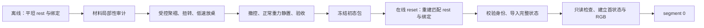

# Blanket 冻结初态与绑定修复工程计划

2026-09-26。状态：冻结初始化主链已实现，单折对照的准备／恢复／segment／重复 reset 分项验收通过；复杂聚褶尚未稳定，默认三档未切换。前期已经完成绑定审计工具与静态检查，见[前期证据](../../../runs/test_results/setting_independent_20260925_01/README.md)。本文细化并调整[三难度补齐计划 §8–9](three_tier_setting_completion_plan_20260925_zh.md)：**正式 reset 直接恢复离线验收的稳定初态，塑形／落桌／静置只在离线制作时执行。**

目标：segment 0 的首帧与首个可回溯状态都是已落桌、撤除准备控制、经过稳定性验收的布料；每次 reset 不重新掉落、不在线重新塑形、不通过紧密折叠形状重新建立 visual binding。消除这些在线准备过程带来的初态差异来源，同 seed 重复性仍须实际验证。

## 1. 要改哪些文件

所有路径相对 `/home/jianwen/topogym/`。“接入时改”表示先在隔离 fixture 验证能力，再改共享入口；不是本轮写计划时就改。

### 1.1 核心实现：5 个现有文件、3 个新模块

| 文件 | 类型／时机 | 具体改动 |
|---|---|---|
| `topogym/assets/geometry/blanket_gathered.py` | 修改；离线准备阶段 | 将三档准备参数集中为可校验 profile，复用 `gathered_target`；明确总扭转角与准备进度，固定聚褶、轴向收缩等其他参数；记录目标与释放后实测形态的区别 |
| `topogym/assets/geometry/blanket_flatten.py` | 修改；离线准备阶段 | 保留 `generate_flat_binding`、材料坐标与 OBJ 导出能力；确认其 remesh 映射适用于新 profile；收敛重复 `gathered_target` 到共享实现，保留旧折叠构造的复现入口 |
| `topogym/tasks/blanket_flatten/common.py` | 修改；接入时 | 新修订声明平坦 rest mesh 和冻结初态资源；`bind` 在恢复前建立材料坐标并消费真实 binding 审计；`initialize` 检查恢复后的有效状态，诊断基准不从扭曲 XYZ 重建 |
| `topogym/tasks/base.py` | **共享，修改；接入时** | 在 `TaskSpec` 尾部增加默认 `None` 的声明式初态字段，拟为 `InitialStateSpec`；只含资源身份、格式版本等数据，不接收任意回调／Scene。原任务继续走原流程 |
| `topogym/simulator/env.py` | **共享，修改；接入时** | 在 `build → robot home → task.bind` 之后调用管理侧初态恢复，完成只读验收后归零 episode 时钟、`Task.initialize`、保存首状态和首帧；记录初态来源，复用原失败清理与句柄失效逻辑 |
| `topogym/world/initial_state.py` | **新增；先验证格式** | 冻结初态 manifest／数组包校验、资源身份解析、后端分派和恢复报告；这是管理方初态导入模块，不是 episode history，也不执行 policy |
| `topogym/world/physics/pbd_initial_state.py` | **新增；最高风险，先做试验** | 针对当前固定版本的 rigid＋PBD 场景，实现跨重建的数值状态导出／导入适配；列明恢复覆盖和不支持条件，校验材料、绑定、实体顺序及索引范围，隔离后端字段访问 |
| `topogym/world/physics/cloth_preparation.py` | **新增；离线准备阶段** | 聚褶／扭转、受限速度放置、撤控、正常重力静置及失败处理；经现有 `World.advance()` 推进，输出逐 tick 准备报告。正式 reset 不调用这个控制器 |

上述 8 个文件是主体。`genesis_world.py` 是否新增委托方法见下表：初态模块可以消费现有 World 的管理侧句柄，但不应为少写一行入口而把后端写入散到 Env 或 Task。

### 1.2 只在确认缺口后修改

| 文件 | 何时才改 |
|---|---|
| `topogym/world/genesis_world.py` | 推荐增量增加管理侧 `restore_initial_state(...)` 委托及相关状态校验，具体签名在 A 阶段确定；准备依旧用原 `advance`。不放宽原 `restore_state` 的 world_id 检查 |
| `topogym/world/state.py` | 优先复用现有数值复制／压缩工具；只有可移植 codec 确认缺少可复用的纯函数时才抽取。`WorldState` 仍是同一 World 内的 checkpoint，不能直接改成任意跨场景恢复 |
| `topogym/world/physics/pbd_binding.py` | 现有只读出生审计原样复用；仅在需要实际当前 visual 顶点等额外只读数据时扩展。状态写入放新 codec，不混进只读 binding 接口 |
| `topogym/evaluation/cloth_binding.py` | 原审计优先复用；只补已知形变反例确实需要的指标 |
| `topogym/evaluation/cloth_metrics.py` | 当前已有 `measure`、`initial_gates`、`AcceptanceWindow`，直接复用。只有实际扭转、物理／视觉分离诊断、自接触检查存在缺口时增量扩展，不另造一套静置判定 |
| `topogym/assets/library.py`、`variation_resources.py` | 优先使用现有资源 ID 和 SHA-256 校验；仅在 manifest 引用数组包无法被现有接口完整核验时补能力 |
| `topogym/simulator/evidence.py` | 优先让现有 evidence 保存 Env 新增的管理侧来源元数据；若当前字段过滤丢掉初态身份，才补字段透传，并验证普通句柄不泄露私有状态 |

不预设修改 `SimulatorConfig`、action 格式、`interaction.py`、`history.py`、`segment.py`、机器人控制、Harbor 或 `planning/`。初态资源选择由任务参数和 TaskSpec 声明；本地 actor 权限保持原合同。

### 1.3 验收通过后才改的入口和资源

| 文件／目录 | 改动与门槛 |
|---|---|
| `topogym/tasks/blanket_flatten/blanket_flatten_easy.py` | 低扭转聚褶 profile＋初态资源身份＋新 revision；整组三档通过后切换 |
| `topogym/tasks/blanket_flatten/blanket_flatten_medium.py` | 中扭转聚褶，同上；旧 fold_roll 的参数与证据身份保留 |
| `topogym/tasks/blanket_flatten/blanket_flatten_hard.py` | 高扭转聚褶，同上；验收通过后才替换 UnavailableTaskDefinition |
| `topogym/config/variation_records.py` | 同步 family、revision、资源、状态和原因；绑定审计通过不能直接改成完整物理资格 |
| `topogym/assets/resources/variations/blanket_flatten/<revision>/<state_id>/` | 新增验收后的 manifest、数值状态包、平坦材料／拓扑／绑定身份及简要来源；具体数组文件名由 A 阶段 schema 决定 |
| `topogym/assets/resources/catalog.json` | 注册资源 ID、SHA-256 和来源，正式启动不依赖历史 runs 或个人绝对路径 |
| `topogym/tasks/legacy/manifest.json` 与对应 Blanket 文件 | 切换时归档旧主档定义；核对旧 `five_folds` 等别名，不能把旧家族名悄悄解析为新扭转家族。普通 `base/easy/medium/hard` 按新修订更新 |

当前包配置已经包含 `resources/variations/**/*`，因此不把 `pyproject.toml` 列为必改；安装包验收时确认新文件实际进入 wheel。

### 1.4 脚本、测试与文档

| 文件 | 类型／职责 |
|---|---|
| `scripts/prepare_blanket_initial_states.py` | 新增可复用 CLI：离线构建、控制准备、撤控静置、候选导出和来源记录。每个候选独立运行；失败也保留报告；通过验收前不自动注册正式资源 |
| `scripts/test_blanket_initialization.py` | 新增验收入口：固定源码快照、串行子进程、报告、标准录像和汇总；实际断言放 integration 测试，物理推进与录像不另写一套 |
| `tests/unit/test_pbd_initial_state.py` | 新增：资源损坏、版本／拓扑／绑定／数组形状不匹配、索引越界与不支持状态明确拒绝 |
| `tests/contracts/test_env_initial_state.py` | 新增：导入在首状态之前、恢复路径零 advance、失败不发布 episode、旧句柄失效、普通 actor 不获得导入接口、原任务路径不变 |
| `tests/integration/test_blanket_initialization.py` | 新增：真实准备与跨进程恢复、无动作续跑、重复 reset、首 RGB／state 对应、segment 0 连续、checkpoint 回溯与 Nyx 对照 |
| `tests/unit/test_pbd_binding_metrics.py` | 按需扩展材料局部性、形变与真实映射负例；保留现有误绑反例 |
| `tests/unit/test_task_definitions.py`、`test_task_variations.py` | 三档落位时更新初态资源合同、占位和参数冻结断言 |
| `tests/contracts/test_env_lifecycle.py`、`test_episode_rewind.py`、`test_segment_execution.py` | 优先原样回归；新初始化破坏既有合同则修实现，不改断言掩盖问题 |
| `scripts/check_variation_assets.py` | 三档切换时更新 Blanket 检查；当前 medium 分支写死三折／五卷，需要改为核验新 revision／profile／初态资源。静态声明不能宣称稳定性通过 |
| `scripts/test_variation_runtime.py` | 优先原样复用，补齐的新专用检查由上面的验收入口承担 |
| `docs/develop/modules/simulator_api_zh.md`、`tests/README.md` | 实现后说明管理侧冻结初态、零预运行语义、失败方式和重跑命令 |
| 本文、三难度计划、`variation_deployment_implementation_20260925_zh.md`、`blanket_flatten_zh.md` | 同步实际状态与证据，不提前把 planned 写成 implemented |

## 2. 方案与当前接口的准确关系

当前已具备：平坦出生网格 `generate_flat_binding`、聚褶目标 `gathered_target`、真实 binding 读取／纯数组审计、静置窗口指标、`World.advance/capture_state/restore_state`、标准 segment 与录制。

计划编写时缺少跨新 World／新进程的冻结初态格式和管理侧 reset 导入入口；本轮已实现这两项，单折候选的真实恢复验收见 §8。稳定三档初态仍未齐备。`WorldState` 含原生对象引用和原 World 身份，直接 pickle 或移除 world_id 检查不能补齐这个缺口。

本方案分两个执行途径，均复用现有 World；在线途径不运行离线准备器：



视觉映射使用平坦出生时建立并审计的 supports／weights；紧密姿态只恢复粒子等状态，不对该姿态 remesh 或重新选最近邻，也不把扭转几何当成新的无应变材料。

## 3. A 阶段先解决的状态格式问题

首版只支持锁定版本、精度、物理参数、实体布局和桌面条件的 rigid＋PBD Blanket 场景，不泛化为所有任务／所有引擎版本的 checkpoint 格式。初态资产首先在当前生产场景和机器人 home 条件下制作，避免从无机器人或不同桌面 fixture 导入后重新处理不同的接触。

必须建立并验证以下覆盖清单：

| 数据 | 导出／恢复要求 |
|---|---|
| 材料与网格 | 平坦 rest、实际 remesh 粒子与约束拓扑、原始长度／弯曲约束、材料 UV、visual 拓扑、support 索引／权重；不能假定输入 OBJ 顺序等于粒子顺序 |
| 动力学状态 | 粒子位置／速度、上一位置及积分历史等实际需要的缓冲区；不能只保存 x/v 就声称完整 |
| 求解与耦合 | PBD 约束、接触、空间结构、rigid/PBD 耦合、参与接触的桌面／机器人等必要状态；逐字段说明是直接恢复、确定性重建还是只校验不改写 |
| 控制与时钟 | 正常重力、临时控制已撤除、无 pin／残留目标；同时核对引擎里的机器人目标与 Robot 控制器缓存，优先复用其已有 capture/restore 接口，不能只恢复关节位置。记录源 scene/substep 时钟及 RNG；新 episode 对外从 0 开始，源物理时间不能简单清零后遗漏其余依赖 |
| 场景身份 | 引擎／适配 schema／源码哈希、设备与精度、dt/substeps、材料参数、实体名称／顺序／计数／索引范围、姿态、桌面与碰撞参数 |
| 来源 | profile、目标角度、稳定后形态、准备和验收报告哈希、初态 ID、生成 seed、全部状态数组哈希 |

数组包使用明确 dtype/shape 的数值数据，manifest 使用可审查字段；不序列化可执行 Python 对象、内存地址或原 Scene 引用。首版要求重建后的实体排列和索引布局精确匹配，避免先做未经验证的全局索引重映射。

**关键门槛：** 在新进程重建后，导入过程不调用物理 advance；恢复后的状态与源状态匹配，随后用相同正常重力、相同动作继续执行，状态演化在事先规定的容差内一致。需要动力学重新静置才能匹配的方案，不满足这里的正式 reset 合同。

若后端缓存无法完整恢复／无物理步重建，A 阶段明确报告具体字段与失败证据，暂停正式接入。历史“恢复形状＋速度清零”仅作为带明确标签的诊断对照，不自动替代完整状态方案；无法达到的稳定初态不能靠隐藏在线掉落来补。

## 4. 正式 reset 接入合同

建议顺序为：

```text
解析初态资源及配置身份
→ Task.declare 平坦出生资产与 InitialStateSpec
→ World.build，机器人 home
→ Task.bind：映射 remesh 材料坐标、审计出生绑定
→ World 管理侧导入冻结状态（无 advance）
→ 恢复完整性、当前控制与静态健康检查
→ 重置公开 episode 时钟，Task.initialize
→ 保存首 checkpoint，生成初始 RGB，开放 interaction
```

- 初态资源必须在 declare／资产登记期间纳入 SHA-256 来源链；恢复结果放管理侧 episode metadata，使用现有 segment evidence 保存。不能让 report 仅有平坦 OBJ 身份而漏掉实际初态。
- 冻结初态 profile 要求 `reset_physics_steps == 0`。若管理方配置非零，明确报配置冲突，不能悄悄忽略或恢复后继续运行。未使用冻结初态的其他任务保留原行为。
- 在线只读检查不能取代离线的时间窗口稳定性证明：manifest 必须关联已通过的离线验收；离线验收也不能代替在线的身份／数据完整性检查。
- `Task.initialize` 只建立任务诊断基准和初始检查，不复制源 episode 的成功累计时间、state_id 或 task_success。初态须另验尚未达到展平目标，不能通过清零成功计时掩盖已展平初态。
- 导入任一阶段失败，沿现有 reset 清理路径撤销未完成场景，不发布首状态或新 interaction。原 episode 句柄按现有规则失效，失败不能返回“部分恢复成功”。
- 初态导入仅存在于管理方建场景期间；普通／特权 actor 均不新增加载状态包、写粒子或跨 episode 导入功能。源初态日志归准备证据，不混入 segment 0 的 agent 动作日志。

## 5. 初态制作与三档选择

首轮只制作一个低扭转代表；稳定完整状态恢复通过后再扩展 0°／135°／270°候选。easy 的 0°仍须聚褶且未满足展平目标。固定尺寸、材料、mesh、褶数、聚褶幅度和轴向收缩，不因准备进度不同而引入另一条隐藏难度轴。

离线准备允许显式记录的管理侧控制，保留原材料 rest 与 support 表；每步经 World 推进。不能复制历史脚本中未封装的 `scene.step()`、任意 solver 重力写入、最终强制清零速度来冒充撤控稳定。所有准备控制和重力调整必须有可靠的失败清理。

验收复用 `cloth_metrics.measure/initial_gates/AcceptanceWindow`，补足当前缺少的自接触／穿透诊断；比较真实粒子材料边与渲染 visual 边，分别报告拉伸和视觉异常。至少包含无控制位移窗口、速度尾部、桌面范围／穿透、材料完整性、初态未成功、实际扭转与覆盖。几何未知或检查缺失不能记为“无穿透”。阈值在试验配置中预先记录，不为高扭转档单独放宽。

先冻结明确的 `initial_state_id`。同 seed 与配置必须选择同一状态；若多个 seed 共享同一个固定物理代表，metadata 明示该事实，不声称获得多个不同布团。不同物理配置必须有匹配的状态包；缺包、绑定不匹配或版本不兼容时明确失败，不在线补生成、自动降角度或偷偷换 seed。

源物理状态的随机流与 episode 的资源选择／外观随机流需要在 A 阶段核对。不能恢复源 RNG 后覆盖用户 seed 的语义而不声明；若需要改变现有随机流协议或扩大配置接口，先列出具体新增文件与兼容影响，完成对应验收后才切默认三档。

## 6. 执行顺序与交付门槛

| 阶段 | 本阶段重点文件 | 通过条件 |
|---|---|---|
| A：可移植状态验证 | 新 `world/initial_state.py`、`physics/pbd_initial_state.py` 及 codec 测试 | 当前版本 rigid＋PBD 小 fixture 跨新进程恢复；材料／绑定不变；不推进物理；相同续跑可复现；未知状态拒绝 |
| B：低扭转完整初态 | 几何 profile、`cloth_preparation.py`、离线 CLI | 生产匹配场景完成受控落桌、撤控和静置；冻结后跨重建恢复仍稳定；保留实际 Nyx 对照 |
| C：标准 reset 接入 | `tasks/base.py`、Blanket common、Env、World 委托及合同测试 | 首状态与首 RGB 对应恢复状态；reset 不含准备 tick；失败原子清理；原任务／权限／segment 合同回归通过 |
| D：三档候选与资源落位 | 三个难度入口、registry、资源 catalog、资产检查器 | 三档释放后的状态稳定、可区分且未自动成功；资源随包可用；新 revision 与旧别名处理清楚 |
| E：重复性与连续性验收 | 专用 integration／验收 CLI、既有 runtime／segment 测试 | 同 seed 多次 reset、不同进程／目录、state/RGB 哈希或规定容差、无动作续跑、动作后 rewind 和两段连续均通过 |

A/B 可以先在独立源码快照中开展，不必先修改 Env。C 修改共享文件前重新核对最新实现，以函数为单位增量衔接；不覆盖 terminal 或 segment 会话已经完成的生命周期逻辑。

物理试验使用 Genesis；正式视觉使用 Nyx＋compact_lab 和共享录制。CPU 无 RGB 仅作为显式状态／物理诊断，不计标准视觉通过。新验证写报告、配置与源码身份后再运行；GPU 试验串行开展，避免叠加现有任务显存。

证据建议放 `runs/test_results/blanket_initialization_<date>_<run>/`，分开保存准备报告／逐 tick 数据、状态包、恢复报告、无动作验证和正常 segment 试验。离线日志、可读 segment log、可恢复状态包分别标明用途，不相互替代。

至少保存：正确绑定后压紧／恢复的正例、跨层 support 负例、损坏／错版本／错材料包拒绝、非零 reset_physics_steps 拒绝、源状态与新进程相同续跑对比、准备控制残留负例、首帧／首状态对应，以及一次真实 agent action 后的回溯。

完成本计划表示 Blanket 获得可复现的稳定初态交付；不等于三档机器人完整可解，也不等于已经证明 0°／135°／270° 的模型难度排序。

## 7. 实施中发现的准备问题与增量范围

实际证据集中于 `runs/test_results/blanket_initialization_20260926_01/`，各试跑使用独立源码快照，失败均保留。

- `low_03`：平放的 0° 聚褶候选撤控后摊平，覆盖率接近 100%，不符合初态条件。该次录像末帧重复提交导致包装未完成，已修复 CLI；原 `.part.mp4` 通过完整解码，仍标为不完整诊断录像。
- `low_04`：增大 bending compliance 未保住褶皱，中止后保留报告和视频；不声称通过完整静置预算。
- `low_05`：显式采用历史 `bending_relaxation=0`（无抗弯响应）后仍摊平。因此不能把问题完全归咎于绑定或抗弯参数。
- `low_06`：聚褶同时做整体 90° 侧放，形成叠层，但撤控下落触发 1.15 的材料边长比保护。随后新增 5 s 离线限速落桌，速度上限 0.04 m/s；这一控制必须在资格窗口开始前撤除，不导入到正式运行。
- `low_07`：限速落桌后保留褶层，材料、视觉和非局部粒子间距检查通过，但正常重力下整团滑动，未达到原静置门槛。

本地 Genesis 1.2.1 的 `LegacyCoupler._func_pbd_collide_with_rigid_geom` 只处理法向位置／速度，明确没有切向摩擦。PBD Cloth 的 `static_friction/kinetic_friction` 用于粒子自接触，不能代替桌面接触摩擦。历史 Blanket 配置另有桌面粒子摩擦补偿。

因此增量加入 `topogym/world/physics/pbd_table_friction.py`，由 `GenesisWorld.advance` 在每个物理 tick 后自动处理声明实体的桌面接触切向速度。Task 通过可选 `table_friction` 参数声明，默认 `None`，其他任务和旧三档不变。候选使用静摩擦 0.5、动摩擦 0.4、接触带 1 mm；模型用水平支撑载荷 `N=m*g` 近似计算 Coulomb 冲量，不写位置／法向速度、不 pin，不处理悬空粒子。它是**离线与正式运行相同的显式物理模型**，不是只在初始化生效的助力。堆叠负载的真实接触力没有被完整求解，报告需保留这一近似范围。

对应新增测试 `tests/unit/test_pbd_table_friction.py`；共享 `world/genesis_world.py` 修改前已确认与本会话开始时一致，只增量接入该可选模型。完整数值包同时锁定 World 与该模型源码哈希，避免恢复时静默改变后续动力学。

## 8. 本轮实现与真实证据

统一入口已接入声明式冻结初态，原任务路径和三档定义保持原版本。实际文件变化以本节为准：

| 文件 | 已实现内容 |
|---|---|
| `topogym/world/initial_state.py` | JSON＋无 pickle 数组包、SHA/格式/资格检查、场景及机器人资产身份；空 Torch 张量恢复使用正常分配，避免后续快照字节比较的零 stride 错误 |
| `topogym/world/physics/pbd_initial_state.py` | rigid＋PBD 原生状态、缓冲区、控制目标、引擎标志、RNG/时钟的完整数值导出及目标 World 句柄重建；保留原 world_id 隔离 |
| `topogym/world/physics/cloth_preparation.py` | 平坦出生后的受限速度成形、约束投影、低速落桌、完全撤控后的原门槛验收；记录临时控制边界、失败 tick 和不变量 |
| `topogym/world/physics/pbd_table_friction.py`、`world/genesis_world.py` | §7 的可选桌面摩擦，离线／正式执行一致；默认关闭 |
| `topogym/assets/geometry/blanket_gathered.py` | 校验 profile、固定最终压缩比例、可选整体侧放；双面板无压缩单折作为工程对照 |
| `topogym/tasks/base.py`、`tasks/blanket_flatten/common.py`、`simulator/env.py` | 初态声明、平坦出生真实绑定审计、首状态前恢复、拒绝非零 reset 预运行、来源元数据、已展平初态拒绝 |
| `scripts/prepare_blanket_initial_states.py`、`scripts/test_blanket_initialization.py` | 真实 CUDA/Nyx 四视角准备录像、每 tick 数组和报告；独立源码快照中的标准 Env/SegmentRunner 验收 |
| `tests/unit/test_pbd_initial_state.py`、`test_pbd_table_friction.py`、`test_cloth_preparation_projection.py`、`tests/contracts/test_env_initial_state.py`、`tests/integration/test_blanket_initialization.py` | 格式/权限/时序、摩擦、形变投影及真实恢复验收 |

`world/state.py`、action 格式、SegmentRunner、Harbor、planner、默认三档、registry 和资源 catalog 本轮没有因冻结初始化而修改。旧几何入口继续复用，不为整理目录额外搬动。

**有效的准备正例是 `single_fold_02`，并非三档聚褶的替代定档。** 它在完整 ALOHA 场景中用 5,281 个物理 tick 完成单折、低速放置、撤控与静置；同一张平坦出生绑定贯穿全过程。最终覆盖率 49.99%、最高点离桌 11.72 mm、最大材料边长比 1.0054、最大视觉边长比 1.0713；0.6 s 完全撤控窗口内最大漂移 0.559 mm，最大速度 5.47 mm/s。没有位置／rest／support 写入，没有新增 pin，也没有在冻结时清零速度。

八面板候选 `low_09` 加桌面摩擦后整体滑移减小，但局部运动仍超出稳定性门槛；`low_11` 避开 home 夹爪后成形完整，撤控静置 16 s 仍失败。材料与视觉完整性通过不能代替静置通过。两者都保留失败报告及完整视频，没有导出为可用初态，没有放宽验收阈值。高扭转档尚未进入正式资格验收。

**绑定问题与动力学问题已经分开：** 本轮平坦出生的 2,091 个 visual 顶点各使用 12 个实际支持粒子，支持的最大材料距离 18.97 mm，小于 32 mm 门槛，无跨材料非局部支持；形变过程中绑定身份不变。历史紧密折叠出生可能让 XYZ 最近邻跨到材料上很远的层，视觉插值随这些错误支持运动，产生“拉丝／撕裂”外观；它不等同于布料物理拓扑真的断裂。当前绑定已通过的复杂候选仍有接触抖动，不能继续把所有异常归因于 binding。

实际恢复、续跑、RGB、segment/rewind 验收结果和所有视频集中在[本轮证据说明](../../../runs/test_results/blanket_initialization_20260926_01/README.md)。源码快照分别保留，准备与恢复使用的 codec 解码修复明确记录，不改写原始失败报告。正例只证明该配置和 seed 的初始化流程；未证明机器人可解、三档完成或完整连续曲面无自穿透。

最终恢复证据：2,067 个缓冲区导入后粒子 x/v 精确匹配，导入及 episode 初始化无 World 推进；相同续跑 5 tick 的最大位置／速度误差为 2.58e-14 m／4.53e-11 m/s。两个 0.5 s 标准 segment 共 400 tick，布料最大漂移 0.04585 mm；小关节动作后 rewind 精确恢复。重复 reset 的 x/v 和四路首 RGB 完全相同。原完整验收在最后读取懒加载 NPZ 参考文件时失败；修正测试文件生命周期后，只补跑重复 reset 并通过，未重新执行已经通过的动态段。汇总如实标为分项检查通过，保留原整次 pytest 失败状态及原因。

## 9. 粒子归属、绑定和速度的实时诊断

已增加可选 `--particle-diagnostics`，作为管理侧只读观测，不改变 action、正式 Task 或物理参数。`scripts/prepare_blanket_initial_states.py` 复用原 on_tick；`world/physics/cloth_diagnostics.py` 读取真实后端表，`evaluation/cloth_diagnostics.py` 做纯数组分析。新增 `scripts/inspect_blanket_preparation.py` 可回看已有逐 tick 轨迹，`tests/unit/test_cloth_particle_diagnostics.py` 覆盖归属、跨层支持变更、相邻条带正常支持、负权重、接触候选和只读适配。

| 监测对象 | 记录内容／语义 |
|---|---|
| 粒子身份与归属 | entity-local ID、原始 solver global ID、出生材料 UV、条带 ID、距折线距离。条带是同一块布的材料区域；不会随当前堆叠层数改变 |
| visual binding | 出生时实际 support 索引／权重完整归档；每 tick 读取实际表，对比具体变化的 visual ID 与材料距离，变更表另存。不同条带的相邻材料点可以合法支持同一个 visual 顶点；负 affine 权重也不自动判错 |
| 物理状态与约束 | 全量 x/v 继续由原轨迹保存；诊断记录最快 10 个粒子、每条带统计、相邻物理边长度比、速度差以及 free 标志。物理约束边及 rest 长度另存静态表 |
| 接触线索 | 桌面接触高度带、材料上不相邻但空间距离约一个粒径的粒子对。这些是几何接触候选，不是引擎确认的接触／力 |
| 时序 | 外部物理 tick、仿真时间、准备阶段，和原 RGB frame_map 对齐；默认每个 World.advance 后一次，包含配置的桌面摩擦结果 |

Genesis 的 PBD 空间哈希会重排内部数组。监测使用回写后的原始 `particles` 顺序与 entity offset，不能拿 `particles_reordered` 的行号当稳定 ID。归属和绑定均来自出生材料坐标／实际表，不从弯折后的 XYZ 重新猜测。

输出目录 `particle_diagnostics/` 包含 `static.npz`、`metadata.json`、逐 tick 刷新的 `ticks.jsonl` 与最终 `summary.json`。它是随模拟执行落盘的管理日志，不是新的 agent 观测或 GUI。正常 RGB 保持不变；热点图是独立科学诊断图。新增观测会增加墙钟开销，不改变仿真 dt；当前粒子采样不能看到每个内部 substep 的过程。

已对 `low_11` 保存轨迹最后两秒（26.6–28.6 s，801 个样本）做回看：99.69% 的“粒子速度超过 30 mm/s 的采样次数”位于条带 ID 7，即第八条；801 帧最快粒子均位于该条带，最快粒子速度中竖直分量占比平均约 99.82%。峰值发生在 tick 11298／28.245 s，粒子 ID 8167 达到 244.78 mm/s；其原材料坐标为 (294, 186) mm。这一结果定位了边缘区域的竖直抖动，但尚未证明究竟是自碰撞、拉伸投影还是耦合阶段产生了异常修正。

旧日志没有完整保存 support 表、free 状态和内部约束修正，因此历史分析明确标记这些字段 unavailable，不能把另一轮出生表冒充原记录。已有出生／结束 binding 审计与本次每 tick 实时读取是不同强度的证据。实时适配验证、热点图及复现命令见[粒子诊断证据](../../../runs/test_results/blanket_particle_diagnostics_20260926_01/README.md)。

下一步故障复现先保持 `low_11` 的参数不变，开启监测，核对同一材料区域是否重复异常；然后围绕该区域增加 substep 分阶段观测（拉伸／自碰撞／刚体耦合前后），才能给出因果归因。单因素对照应保持相同出生／准备条件，依次取消轴向压缩或调整接触离散参数。关闭自碰撞只能作为诊断对照，不能因此把穿层状态记为有效初态。当前没有修改已安装 Genesis 内核，也没有自动修复或重绑粒子。

## 10. 八面板完整复现与求解阶段定位（2026-09-26）

已完成上述复现及失败末态的同状态对照。完整报告、逐 tick 数据、子步轨迹、源码身份和录像见[八面板复现证据](../../../runs/test_results/blanket_eight_panel_reproduction_20260926_01/README.md)。执行使用历史 `source_candidate_09` 的物理源码，与 `low_11` 的配置、profile、准备参数相同；增加只读监测和诊断失败检查点，未覆盖其他会话正在修改的 World/state 实现。

**复现了资格失败，但没有逐粒子复现旧热点。** 完整执行 28.6 s／11,440 tick，其中 12.6 s 后完全撤控静置 16 s。最后一次采样所有单点 gates 都为真，但按实际 25 ms 验收采样间隔，速度条件最长连续通过仅 0.175 s，达不到 0.6 s。最后两秒 801 次观测中有 188 次最大速度超过 30 mm/s，峰值 141.89 mm/s。本次末段热点主要在材料条带 4、5、0，而非旧运行的条带 7；“八面板”仍指八个连续材料区域，不能理解成固定八个堆叠层或第八块独立刚体。

**本次失败不是已观测到的 visual binding 变更。** 从出生到结束共 11,441 次逐 tick 读取，实际 support／weight 改动为 0，超出材料局部距离门槛的支持为 0，固定粒子数始终为 0。rest 和绑定身份的结束审计也通过。当前证据不能替旧紧密折叠出生排除错误绑定，但已经将这个八面板失败与那类故障分开。

子步只读记录定位到拉伸、自碰撞和桌面法向投影之间的交替修正。例：tick 11449 的下层粒子 2057（条带 1）与上层 8051、8173（条带 7）接触，自碰撞将其向下修正 70.136 µm，生成 −116.59 mm/s 的中间竖直速度；桌面随后向上修正 72.871 µm，把竖直速度恢复到约 0。上层两粒子先被拉伸约束向下修正，再被自碰撞推回。根据真实粒子对重算的碰撞修正与内核输出最大分量误差约 5.7e−17 m。该例证实了约束间的反复修正，但其末态修正基本抵消；不能单凭该中间速度把它等同于最终 tick 超速，也不能据此宣布唯一引擎 bug。最终失败还包含局部剩余下落、切向运动与其他粒子的间歇性速度尖峰。

同一失败末态导入 x/v 精确相等、导入不推进物理。分别续跑 40 tick 的对照显示：去掉自碰撞或拉伸后明显更差；去掉粒子摩擦没有消除超速；去掉桌面切向摩擦也更差。这些是短时机制诊断，不是有效初态或充分的参数优劣评测。重复无监测续跑也出现约 12.85 µm 的最大位置分叉、25.17 mm/s 的最大速度分量差，因此未证明本配置逐粒子确定性，也不能把开／关监测的细小差异都归因于监测。

后续优先保留平坦出生绑定路线，针对多层接触的稳定性做受控对照：先取消 `axial_scale=0.92` 的轴向压缩、减少准备阶段残余应变；再分别检查粒径／材料采样间距与层间间隙、时间子步与约束迭代的影响。每次都须通过原 0.6 s 稳定门槛及完整性检查，并检查同状态重复续跑；不能靠清零速度、取消碰撞、冻结中间状态或放宽门槛交付 segment 0。当前没有将本次失败状态部署到任何三档入口，也没有修改正式物理内核。

## 11. 与 legacy unroll 的机制核对及稳定 segment 0 试验

### 11.1 Visual binding 不会每 tick 重新找邻居

当前安装的 Genesis 中，`engine/entities/particle_entity.py::_add_to_solver` 在建场景时调用 `_add_vverts_to_solver`，按出生 XYZ 距离选出支持粒子，算出 affine 权重并写入 `vverts_info.support_idxs/support_weights`。之后 `engine/solvers/pbd_solver.py::_kernel_update_render_fields` 只按这张表和粒子新位置求加权和，更新可见网格的位置。它没有在此重新选邻居或重算权重。

这里有三种不同的关系，不能都叫作动态 binding：

| 关系 | 什么时候建立／变化 |
|---|---|
| 可见网格顶点→仿真粒子的 skinning 支持表 | 建场景时建立；当前固定拓扑 Blanket 运行中不自动重绑 |
| 材料边／rest 与接触约束 | 材料边及 rest 固定，接触对可随运动变化；求解器每 substep 修正粒子位置／速度 |
| 抓取粒子→机械臂 link 的 assist attachment | 只有调用抓持后端才建立／释放；与可见网格的支持表是不同的数据 |

因此上节“反复修正”指第二行，不是第一行。反复折叠后 visual 顶点的位置当然会变化，但它仍跟随原来那组粒子。重建新场景会重新生成出生绑定；正常运动、渲染或 segment 切换不重绑。

### 11.2 legacy unroll 提供的证据

核对了 [unroll 历史说明 §3–4、§9.12](../../../legacy/docs/develop/tasks/cloth_unroll_zh.md)、[历史配置](../../../legacy/configs/task_configs/cloth_unroll_topogym_tabletop_v1.yaml) 与 [settle_band／Spool 源码](../../../legacy/topogym/tasks_legacy/deformation/cloth_unroll.py)。记录确实是：出生层距从 4.5 mm 扩到 14 mm，实测粒子间距约 3.7 mm，先避开跨圈最近邻混淆；只固定卷尾，让其余卷身在重力下自然压实。旧整卷固定方案反而一直保持悬空松螺旋，所以被替换。

这说明“出生时便于正确绑定”与“最终紧密自然的形状”可以分开。没有必须等待若干物理 tick 才完成绑定的机制；绑定发生在 build，之后的等待是在做物理静置。历史约 3 倍间距是那套网格／支持邻域的经验，不是所有 PBD 参数通用的保证，当前仍以实际 support 的材料距离审计为准。

可复用到 Blanket 的是：先平坦或疏开的出生形状建立正确表，再通过物理构形／放置，撤除准备控制，验收静置后保存全量状态。unroll 的卷筒与永久尾端固定属于该任务的物理结构；自由放在桌上的 Blanket 不继承这些约束。它们也不能证明八面板自由堆叠必然稳定。

### 11.3 当前试验与交付边界

本轮以独立当前源码快照试验，证据位于 `runs/test_results/blanket_stable_segment0_20260926_01/`。先试无轴向压缩的八面板，资格门槛不变；合格候选再经标准 Env／SegmentRunner 检查：reset 不推进物理、三个 trial 的初始 x/v 与四路 RGB 精确相同、完全自由续跑 5 s 的逐 tick 速度／漂移、绑定不变、普通动作及特权 rewind。准备视频与 agent 的正式 segment 录像分别保存。

每个 trial 导入同一合格状态包，不在每次 reset 重跑可能分叉的构形或掉落过程。同一 setting、物理配置与 seed 的初态重复性，与任意不同 seed 或任意长轨迹的逐位确定性分开报告；后一项不因冻结初态自动成立。资源身份继续严格检查，其他会话更改 World/state 后需要重新复验。

assist 的独立排期与公共模块建议已更新到 [assist 工程计划 §9](assist_integration_engineering_plan_20260925_zh.md#9-blanket-初始化之外可以独立推进的-assist2026-09-26-复核)。当前没有为了辅助抓持而修改本轮物理参数或固定粒子。

### 11.4 本轮实测：八面板仍失败，单折准备通过

依次试了三种八面板设置：取消轴向压缩；再取消端部展开与中心线摆动；再把折弯过渡带从 12 mm 扩到 36 mm。每次均保持同一材料／接触模型、完全撤控静置 16 s，最后两秒最大速度峰值分别为 254.70、348.55、311.38 mm/s，均未通过原静稳门槛。三者逐 tick 的实际 support／weight 变化数为 0，非局部支持与固定粒子也为 0。减少几何残余应变尚不足以解决多层接触问题，没有因此放宽阈值或关闭自碰撞。

随后在当前快照重新生成单折候选，5281 tick／13.2025 s 完成准备和资格验收。最终覆盖率 49.988%，最高点离桌 11.717 mm；末帧最大速度 5.569 mm/s，0.6 s 撤控资格窗口漂移 0.559 mm。材料／visual 完整性通过，无位置、rest 或 support 写入，无 pin，没有在保存时清零速度。

单折仍是独立工程候选，不把它标成原八面板的修复或新三档已完成。标准 Env 的两段连续运行共 2000 tick／5 s 已通过全量检查：最大粒子速度 6.734 mm/s，最大漂移 0.148706 mm，binding 不变；正常关节 action 后 privileged rewind 精确恢复布料 x/v 和关节位置。源状态与恢复后前 5 tick 的最大位置／速度分量误差为 5.55e−17 m／8.88e−14 m/s。过程没有 pin 或速度清零。

**严格 RGB 验收仍失败，不能写成整次测试通过。** 原完整测试第三次 reset 时，粒子 x/v 精确比较通过，但三个相机 RGB 不逐像素相同。随后保留原失败，另做三次短 reset 补证：三次布料 x/v、机器人观测、相机参数和 binding 均一致，reset 零推进；每次有 40 tick 普通执行录像。第三次 RGB 再出现差异：high 4855 个像素、low 4 个、left wrist 5 个，最大通道差分别 2、2、1（0–255）；right wrist 相同，所有相机 P99 通道误差为 0。原轮第三帧未在断言前保存，因此上述差值仅属于补证。没有放宽相等门槛或用缓存旧图替代实际渲染。

物理上稳定、每次恢复同一起点的目标已在该单折配置／seed 上得到支持；任意运行历史之后的逐像素 RGB 一致性还没有保证。该现象与本项目已有[独立 RGB 复现调查](../../debug_logs/scene_lifecycle_rgb_repro_20260925_zh.md)属于需要分开跟踪的问题，尚未定位唯一渲染根因。本轮没有修改共享渲染器。

完整报告、原失败、补证、录像、配置和状态包见[本轮证据](../../../runs/test_results/blanket_stable_segment0_20260926_01/README.md)。资源采用显式候选配置，默认三个难度入口未切换。导出的配置已通过实际恢复验证；须保留原 `asset_root=null` 与相同 `TOPOGYM_ASSET_ROOT` 选择方式，任意改写 scene 配置仍会被身份检查拒绝。

当前公共 SegmentRunner 的编号约定是：segment 0 只保存初始 RGB 和 tick 0 状态，首个有时间长度的执行段是 segment 1。视频第一帧对应恢复好的初态；不为满足文件名而把准备过程或别的执行段改名成 segment 0。
