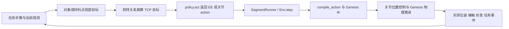

# 现有 Task 变体解法与 action / IK 采样路线

> 2026-09-29 归档提示：本文涉及的独立研究／诊断／测试入口已移入[统一归档](../../../legacy/research_tools_20260929/README.md)；相关旧路径与命令保留为历史说明，不再是当前运行入口。rollout 准备、执行及 Harbor 工具仍在活动目录。

研究核对日期：2026-09-27；执行补充：2026-09-28。最初的独立解法研究依据**当时工作区源码、随包路线、历史运行证据和联网查阅的一手资料**整理，当时未执行新的机器人仿真或改动任务、物理、控制器。后续实际执行结果在各任务节单独注明日期、配置与证据；其中 Cast Coil 三档已完成本文要求的 policy / IK / Task success 验收。其余标为“建议”的内容仍是待实现／验证路线。

覆盖当前注册的 **13 个任务、45 个具名入口**：39 个三档入口，以及 5 个实验入口、1 个兼容入口。三档中 32 个 integrated、6 个 planned、1 个 blocked；全部入口合计 37 个 integrated、6 个 planned、2 个 blocked。`integrated` 只说明构造接入。身份来自 [variation_records.py](../../../topogym/config/variation_records.py)，完整入口和源码 SHA-256 保存在[研究清单](task_variant_solutions_action_ik_inventory_20260927.json)。工作区有未提交改动，不能仅用 Git HEAD 代表本次阅读的源码。

## 阅读入口与结论

- [当前变体总表](#catalog)：先核对任务究竟是哪一个版本。
- [共用 action / IK 流程](#action-ik)：接口、坐标、采样层次、失败回退。
- [逐任务解法](#solutions)：每项包含变体差异、动作步骤、采样变量、反馈和证据边界。
- [迁移顺序](#priorities)：哪些可回收旧路线，哪些应先解决几何／抓持问题。
- [联网来源](#sources)：原型答案与可迁移方法分别标明。

已有资料最适合组织为两层：**带事件条件的任务步骤**，以及**把每一步变成连续机器人动作的局部规划器**。刚体任务主要搜索相对位姿、过孔姿态和抓持安排；绳／布任务还必须搜索材料抓点、支撑手角色、松弛长度及交接顺序。逐帧 IK 成功只回答末端是否可达，不回答物体能否通过、抓持能否维持或整个任务是否完成。

### 证据用语

| 用语 | 本文含义 |
|---|---|
| 当前执行证据 | 当前标准 runner 的特定源码／配置确有执行报告；仍注明时序、assist、末态与过程质量 |
| 历史机器人完整 | 旧精确实例曾完成其当时目标；新摆位、起点、材料、目标区均须重验 |
| 对象几何路径／IK | 对象路径或机器人运动学候选；不等于动力学可执行 |
| 外力流程 | 可借鉴穿套顺序，不能当成两只夹爪已实现的解法 |
| 建议／未找到通路 | 可供下一轮搜索；有限搜索失败不证明不可解 |

<a id="catalog"></a>
## 当前变体总表

表中 easy / medium / hard 对应规范 ID `<task_id>_<难度>`。所有未冻结入口只给构思，不编造具体可执行坐标。解法基础不是难度校准结果。

| Task | Easy | Medium | Hard | 当前应怎样理解其解法基础 |
|---|---|---|---|---|
| [Cast Keyhole](#keyhole) | `long_stroke` | `eccentric_window` | `turnback` | 三档均有当前 home→拾取→换抓→解锁→目标区的实际 success，逐 tick 复核通过 |
| [Cast Coil](#coil) | `baseline_assembly` | `axial_screw_turn`，9 mm | `split_turn_offset`，9 mm | 三档 policy 已在当前 Env 达到原 Task success 并通过逐 tick 复核；限 seed=0 默认实例、25 ms tick、辅助抓持 |
| [Horseshoe Ring](#horseshoe) | `waist_mild` | `u_mild` | `waist_ellipse` | 当前形状三档有完整零件几何路径；旧 F1/F2/F3 是接近路线，不能等同新三档 |
| [Hedgehog in Cage](#hedgehog) | `classic_3star` | **`elliptical_windows`** | `gen_keyhole` | easy/hard 有历史对应；新 medium 尚未找到完整通路 |
| [Lock Picking](#lock) | F1，一次回退设计 | `standard_150mm` / **`historical_physics_v2`** | F3，三次回退设计 | medium 已恢复两次回退槽形并有标准 runner 全流程；easy/hard 仍需独立机制计划 |
| [Fiber Bundling](#fiber) | 4 芯 | 8 芯 | 16 芯 | 同为 13.5 mm 环内半径；可共用抓护套、整理、穿环策略，均有历史完整代表 |
| [Buzz Wire 3D](#buzz) | F1 三拱 | F2 八字／回折 | F3 梳齿／W／Ω／螺旋 | 三族有历史 home 至释放的完整流程；当前垫高后必须重新求 IK 和避碰 |
| [Interlocked Claws](#claws) | `helical_claws_balanced_v2` | **`acute_windows_opposed`** | `claw_weave` | 当前三档从双手预持件开始；新 medium 不继承旧正交窗解法，纯摩擦持件诊断未通过 |
| [Knot Untying](#knot) | **`two_overlap_loop`** | **`overhand_trefoil`** | **`figure_eight`** | 旧单结完整路线对应现在 medium 的结型；新 easy 尚无完整 oracle，hard 有换抓候选 |
| [Blanket Flatten](#blanket) | `simple_folds`，5 折 | `fold_roll`，3 折＋5 卷曲铰 | `gathered_twist`，**blocked** | 简单初态有旧机器人流程；复杂展开及 hard 初态资格仍缺 |
| [Rope Threading](#rope) | `two_rings`，**planned** | `wang_reference_v1` | `three_tight_rings`，**planned** | 三环有参考路线、反馈换手候选和失败经验；未找到当前完整成功 |
| [Slotted Post Ring](#slotted) | `large_ring`，内径 108 mm | `middle_ring`，内径 105 mm | `original_scale`，内径 102 mm | 三档 28 mm 槽场景已接入，静置验收见任务页；完整 FEM 机器人解法未验证 |
| [Orbits](#orbits) | `2_rings`，场景已接入 | `3_rings`，场景已接入 | **`four_rings_compact`，0.85 比例、外置木柄** | 三档共用约 0.8 m 绳；静稳验收待完成，旧长绳外力路线仅供顺序参考 |

另外六个规范入口均在下文单列：`knot_untying_double_overhand`、`blanket_flatten_three_folds`、`blanket_flatten_fold_spiral`、`blanket_flatten_corner_cross_twist`（blocked）、`slotted_post_ring_clearance36`、`orbits_reference85`（兼容 base）。

**容易引用错的地方：** 9 月 25／26 日表格中的 Hedgehog 斜窗、Claws 正交窗、Knot 三档、Orbits 75% 长绳，均不是当前对应入口。Lock medium 也已从三盘多槽候选恢复成历史两回退结构。Hedgehog medium 仍沿用名含 `oblique_gate` 的资源路径，但类与修订已是椭圆窗；资源目录名不能替代内容身份。旧文档中“队列正在运行”“等待 GPU”不视为当前进程状态。

<a id="action-ik"></a>
## 共用 action / IK 流程

### 当前真正存在的执行链



实现依据：[robot/control.py](../../../topogym/robot/control.py)、[genesis_kinematics.py](../../../topogym/solvers/genesis_kinematics.py)、[policy 协议](../../../topogym/planning/base.py)、[标准 API](../modules/simulator_api_zh.md)。

| 项目 | 当前行为及对规划的影响 |
|---|---|
| `EE_ABS` | 每个 arm group 同时给 `position_world_m` 和单位 `orientation_wxyz`；位置为世界坐标、米 |
| `EE_DELTA` | `translation_world_m` 与 `rotation_world_rad`；后者是世界轴旋转向量，左乘，基于提交前实测位姿 |
| `JOINT_ABS / JOINT_DELTA` | `joint_position_rad / joint_delta_rad`；精确关节分支需要在规划侧保留并审计 |
| 夹爪 | 查 `action_spec.groups[arm].gripper_field` 和 limits；ALOHA 滑轨与 Robotiq 驱动角不能统一当“开口宽度” |
| `{}` | 保持旧目标并推进一个控制步；重复非零 delta 会继续产生相对位移 |
| IK | `max_samples=1`，默认最多 100 次 solver 迭代；内部容差 1e-5 m / 1e-4 rad，之后 FK 拒绝门槛为 1e-4 m / 1e-3 rad |
| IK 初值 | `compile_action` 用提交时实测完整 qpos；双臂按各自 DOF 分别求解，不是双臂联合避碰搜索 |
| TCP／hand | 控制层用 `tcp_position_in_hand_m`、`tcp_orientation_in_hand_wxyz` 换算真实 hand-link 目标；不能把物体原点直接当手掌原点 |
| 默认时间 | tick=2.5 ms，10 tick/action，即 40 Hz 控制；4 solver 子步/tick，即积分子步 0.625 ms。30 fps 是录像采样率 |
| 观测权限 | 当前状态 oracle 使用明确授权的 unlimited world；limited policy 需要视觉估计。完整对象／接触真值不能暗中用于 limited 解法 |

以上 IK 容差是**机器人 FK 残差**，不是实测跟踪误差、物体通道净空、夹持稳定性或碰撞保证。当前 `compile_action` 没有整条轨迹的自碰／障碍避碰规划。Genesis 官方也提供多初值、多 link IK 的方法，但外部文档版本为 v1.2.2；本仓库实际适配代码写明 1.2.1，不能把文档能力说成当前已接入。[官方高级 IK](https://genesis-world.readthedocs.io/en/v1.2.2/user_guide/robot_control/advanced_ik.html)

### 对象路线怎样变成手的路线

以下是建议规划侧统一采用的坐标约定。设 `T_WO` 是物体到世界的变换，`T_WT` 是 TCP 到世界，实测抓持关系为 `T_TO = inverse(T_WT) * T_WO`，则目标为：

```text
T_WT_desired = T_WO_desired * inverse(T_TO_measured)
双物体：T_AB = inverse(T_WA) * T_WB
```

先规划 `T_AB(s)`，再选两物体在公共工作空间中的整体位姿；双臂共享运动能避免把全部旋转交给一只已接近限位的腕部。滑移、换抓之后重估抓持关系。绳只可把**局部材料抓点**映射到手；整条绳不能套用一个刚体变换。

### 建议的采样顺序：四种采样不要混在一起

| 层次 | 采样内容 | 保留／拒绝依据 |
|---|---|---|
| 变体实例 | 家族、冻结几何、seed、摆位、材料 | 先固定身份；改变实例不等于找到新解法，不沿用母实例成功标签 |
| 解法与对象路径 | 槽分支、过窗姿态、回退深度、螺旋相位、绳的穿越顺序 | 拓扑事件正确，全零件与工具有可检查的通道 |
| 抓持和 IK 分支 | 抓点／抓边、roll、接近侧、肘／腕分支、双臂整体位姿 | 抓得住、关节限位有余量、全工具避碰、前后分支连续 |
| 路径离散与时间 | 路径进度、局部插值、关节速度、控制周期 | 细分后段内净空仍成立，反馈误差不超预算；几何采样与物理积分分别控制 |

建议先用历史对象路径或几何关键构型作种子，再在瓶颈附近采样；随机均匀撒满 SE(3) 在狭窄通道上效率低。C-Space Tunnel Discovery 先发现缺口／薄部件对应的关键构型，再从通道内扩展局部路线；可用于 Claws、Hedgehog、Keyhole 的候选生成，但论文没有给我们的新变体机器人成功证明。[原论文项目与补充材料](https://xinyazhang.gitlab.io/puzzletunneldiscovery/)

IK 建议顺序：当前实测 q → 同一路线前一候选 q → 同抓姿的少量肘／腕分支 → 改抓姿／整体位姿 → 改对象路线。多初值是后续规划层建议，当前每条 EE action 没有这个外层搜索。若最终仍用 EE_ABS，运行时会从实测 q 再求 IK；离线选中的分支并不会自动被强制保留。需要精确分支时，可由管理侧规划器生成已审计的 JOINT_ABS，并以实测反馈监督执行。

路径细分建议按最坏材料点位移控制：刚体转动半径上界为 `r` 时，一段运动的位移上界可取 `||Δp|| + r·θ`；双物体相对检查累加两侧运动上界。只有当该上界连同距离计算误差小于已测净空减去保留裕量时，才可用端点净空推得该小段安全；否则继续细分。均匀每 5 mm 或每 5° 采样不能普遍证明无碰撞。

实际执行建议由**实测到位和事件**推进阶段：过孔完成、槽重新啮合、双指接触稳定、接手后支撑未丢失、材料余量充足。卡滞时停下路径进度和积分补偿，再评估退回上一可行位姿；不要在物体停住后让名义轨迹继续走完。非接触通道与允许的抓持／机构接触分别检查。

<a id="solutions"></a>
## 逐任务解法

<a id="keyhole"></a>
### 1. Cast Keyhole：在三维槽道中推进、换向和脱出

**证据与原型。** 官方说明把原型描述为相互嵌套的三维迷宫，需要连续转动和滑动；它不是“统一转 90° 即可拔出”的钥匙。本地 F1/F2/F3 是各自冻结的派生几何，具体路线应读本地帧序列。[官方原型说明](https://www.eureka-puzzle.eu/product/huzzle-cast-keyhole/)

| 变体 | 已有对象动作顺序 | 重点采样 |
|---|---|---|
| easy / F1 | 下孔转动 → 沿上部圆弧到右侧 → 对右齿 → 过右齿 → 清下齿 → 撤出 | 沿槽行程、过齿姿态、两手共同行进的中心位置 |
| medium / F2 | 同一阶段骨架，但偏心窗口改变沿弧侧移与通过窗口的目标 | 相对横向偏移、窗口中心位置、姿态与平移的配合；不能只延长 F1 时间 |
| hard / F3 | 前三段后：进入转向室 → 室内旋转 → 返回偏置门 → 横移过门 → 恢复姿态 → 撤出 | 转向室进入深度、转轴、回退点和过门姿态；允许非单调进度 |

以上阶段直接取自 [F1 robot_motion](../../../assets/tasks/cast_keyhole/seed_families_v2/F1/robot_motion.json)、[F2](../../../assets/tasks/cast_keyhole/seed_families_v2/F2/robot_motion.json)、[F3](../../../assets/tasks/cast_keyhole/seed_families_v2/F3/robot_motion.json)，分别为 269／282／323 个名义帧。文件内 `physics_steps=0`：这些文件是路线与 IK 输入；历史动力学报告另见[已有执行清单 §1](../../../legacy/cleanup_20260929/docs/develop/tasks/planner_oracle_inventory_20260925_zh.md#1-cast-keyhole)。

**落到 action。** 当前 [policy 与实际验证](../../../topogym/planning/cast_keyhole/README.md) 从桌面初态和默认 home 接近两件抓区，双指接触后协同抬起，再依次完成右手和左手的真实换抓。根据本轮抓持变换重做双臂联合 IK，沿实测换抓相对路径返回入口，再执行解锁路线。双手由同一个 `T_AB(s)` 和整体位姿生成 TCP 目标，输出两组 EE_ABS；最后把**整件银色件**送入实例固定目标区，金件留在另一侧，持稳。本轮不回放历史 qpos 或旧成功标签。

**反馈与坑。** 不能在 F3 的回退阶段要求距离出口单调下降。历史 robot_motion 的采样最小间隙约 0.46–0.58 mm，数值 IK 精确不意味着负载下实际物体也能保持该精度。本轮采用实测相对误差限制推进、有限积分及速度反馈；全路线预检也包含腕部相机。F1 的收尾需要先把左手和金色件向世界 −x 撤开 80 mm，避免银色件搬运时与左腕相机干涉。具体抓姿、误差预算及采样线路单独记录在上述 policy 说明中。

**2026-09-28 实测。** F1/F2/F3 均已在当前统一 Env 中从 home 连续运行至 `task_success=True`，独立复核分别覆盖 19,547 / 18,385 / 21,492 个状态并通过，正式完成 3/3。详见 [实际证据与复现命令](../../../solvability_proof/cast_keyhole/2026-09-28/README.md)。均为无视频、显式 25 ms World tick / 40 子步、实际双指接触触发的辅助抓持，不扩大为纯摩擦或随机参数域资格。

<a id="coil"></a>
### 2. Cast Coil：当前目标是装配，反向走对象拆解路线

**原型与本地路线不同。** 官方图解给出八步拆／装说明，可以借鉴“交替滑移与转向”的机制；本地 `prototype_route` 明确是一条另外发现的三段拆解路线，不能声称逐步复现官方八步。[官方 Coil 图解](https://www.eureka-puzzle.eu/wp-content/uploads/2022/09/515056-Huzzle-Cast-Coil-Oct-2017.pdf)

| 变体 | 本地拆解参考 | 当前装配执行应采用的顺序 |
|---|---|---|
| easy | `prototype_slide → prototype_quarter_turn → prototype_extract` | 两件拾起并对齐 → 逆向 extract 插入 → 逆向 90° 转动 → 逆向 slide 闭合 |
| medium | slide → 90° 螺旋转动，轴向同时变化 9 mm → extract | 逆向插入 → 旋转／轴向耦合回程 → 闭合；轴向平移不能等转完才做 |
| hard | slide → 前 45° → 中间错位 9 mm → 后 45° → extract | 逆向插入 → 逆后 45° → 撤销错位 → 逆前 45° → 闭合 |

来源：[当前参考运动](../../../topogym/planning/motions/cast_coil.py)与[medium 模板](../../../topogym/assets/resources/variations/cast_coil/axial_screw_turn.json)、[hard 模板](../../../topogym/assets/resources/variations/cast_coil/split_turn_offset.json)。段名和正负角均为作者局部系；反向需同时反转段顺序和各段进度，再经当前摆位变换到世界系，不能直接给世界 Y 轴写一个固定角度。

**action / IK。** 三档已由 [CastCoilPolicy](../../../topogym/planning/cast_coil/policy.py) 共用执行骨架：home → 双手接近 → 双指接触后自动 assist → 实测对象到 TCP 变换 → 装配 → 放桌 → 释放 → 沿手轴撤离 → 静置。策略从对应任务模板读取对象路线及 9 mm 参数，以实测跟踪误差控制路线进度，再通过普通 `EE_ABS` action 请求 Genesis IK。medium/hard 放桌使用抓取前实测的桌面支撑姿态，避免抓持倾斜导致目标进入桌面。`sample_route` 默认 `displacement_m=0.00015`，按零件角点运动上界确定采样数；这是几何采样参数，不是低层 action 步长或可容许的伺服误差。

**最需要吸收的失败经验。** [时序／卡滞复核](../../../task_rollouts/cast_coil_assist_20260927/investigation_06/README.md)报告，旧视频即使达到 terminal，转动时两件目标跟踪误差仍达毫米至厘米级，角度积分补偿饱和，随后突跳。[坐标实体复核](../../../task_rollouts/cast_coil_assist_20260927/investigation_07_geometry/README.md)进一步确认正体积局部重叠。它不是合格过程的证据，不能概括为“只有视觉突跳”。

**已实现的反馈与边界。** 当前策略按实测材料位姿误差暂停路径推进，以限幅位置／姿态补偿跟踪参考；持续无进展会超时失败。后续若要求更严格的过程资格，仍需覆盖所有积分子步和默认检查时序。历史视频的 100 ms tick／160 子步、本轮 25 ms tick／40 子步与默认 2.5 ms tick／4 子步虽有相同积分子步，但 Task / assist 检查频率不同，不能互代。

**2026-09-28 实测完成。** 当前注册的三档各一个默认参数、seed=0 实例，均经标准 `SegmentRunner → Env → Genesis IK → 物理` 从 home 连续执行至原 `task_success=true`，最终辅助解除、机器人撤离并稳定放桌；逐 tick 独立复核均通过。

| 变体 | task_success / 独立复核 | 模拟时间 | 最终相对位置误差 |
|---|---|---:|---:|
| easy | true / passed | 162.900 s | 0.176 mm |
| medium | true / passed | 181.300 s | 0.206 mm |
| hard | true / passed | 167.250 s | 0.190 mm |

采用 CPU、float64、无 RGB／视频、25 ms tick／40 子步／1 tick/action：动作 40 Hz，积分子步 0.625 ms，Task / assist 检查与历史记录 40 Hz（默认检查为 400 Hz）。使用 unlimited 对象状态和接触触发的 `contact_weld_v1`；这是该配置的有限实例 success 证明。采样碰撞盒仍有微米级重叠，数值和过程边界完整记录在[验收报告](../../../solvability_proof/cast_coil/2026-09-28/README.md)，不声称连续时间无穿透或纯摩擦资格。easy 的最终源码在成功日志上逐项复现 6516 次 action，medium/hard 直接运行最终源码。复现命令见[任务页](cast_coil_zh.md#当前三档-policy-与可解性验收)，原始报告、冻结源码与哈希见[机器汇总](../../../solvability_proof/cast_coil/2026-09-28/summary.json)。

<a id="horseshoe"></a>
### 3. Horseshoe Ring：先改变马蹄与链的相对构型，再取环

**动作骨架。** 历史成功路径采用双臂翻转、折合马蹄，让两端和链环形成可过环的局部构型，随后交接持件／抓环、使目标环依次越过限制部件，最后搬离。不是在初态直接拉铜环。当前形状三档的主要区别位于过环配合阶段。

| 变体 | 具体差异与建议 |
|---|---|
| `waist_mild` | 轻收腰＋近圆环，先回收既有完整零件路径；在相同链构型下重建抓点和双臂 IK |
| `u_mild` | 较方 U 形，过肩／弯角时重点搜索环平面倾角、中心横移；不要只缩小 easy 直线步长 |
| `waist_ellipse` | 椭圆长短轴使**环在自身平面内的相位**成为必要规划变量；既有路线相对种子增加约 58.66° 相位，但此数字只属于该路线 |

来源：[当前形状三档与几何证书核对](../../../legacy/cleanup_20260929/docs/develop/tasks/horseshoe_existing_candidates_tier_review_20260925_zh.md)。已知路径的最小保守间隙下界约 0.1481／0.1274／0.1173 mm，均未取得对应完整机器人资格。58.66° 的去相位对照说明那一条路径依赖该调整，不能推出所有解法都必须转这个角度。

**action / IK 采样。** 建议用 `马蹄相对折角 × 链环姿态 × 环中心 × 环法向 × 椭圆相位` 表达对象关键构型，优先沿证书附近搜索。离开折合持件后，一只手转抓铜环，另一只手必须实际承托剩余机构；交接前后分别测抓持关系和重力下链形。对象见证里独立运动的多个零件不能直接视作双臂可施加的控制自由度。最终铜环全体进入目标区，其余系统留在分界另一侧。

**复用范围。** [旧完整执行器及路线](../../../runs/demo_metadata/horseshoe_ring/2026-09-18_gravity_replanned_v1)可提供翻转／折合／交接经验；旧 high/outer/rear approach 的 F1/F2/F3 只改变接近方式。当前三个形状代表仍要验证夹爪能否通过、链在受载时是否改变瓶颈，不能继承旧圆环成功。

<a id="hedgehog"></a>
### 4. Hedgehog in Cage：让刺逐组过窗，搜索全刺球姿态

厂商对 CLASSIC 的提示是寻找最宽窗和两根短刺；GEN 使用不同的顶部通行原理。这些提示支持“按刺的组合找通道”，不能当作我们新椭圆窗的精确动作角度。[RADEMIC 原厂提示](https://help.rademic.cz/)及[产品结构](https://puzzles.rademic.cz/gallery.htm)

| 变体 | 解法步骤／待验证构思 | IK 和对象采样重点 |
|---|---|---|
| easy `classic_3star` | 从可抓刺建立抓持 → 对最大通窗 → 倾斜让短刺先过 → 连续小平移和转动让后部刺越窗 → 取出 | 窗选择、抓哪根刺、球心偏移、完整 SO(3) 朝向；`3star` 不是三根刺 |
| medium `elliptical_windows` | **构思**：低位抬至椭圆中央较宽区 → 倾转 → 侧向逐步退出；可能需要出窗时同时改变高度和姿态 | 六窗离散选择＋高度＋朝向＋径向进度；窗口中线与球心对齐还不足以让所有刺通过 |
| hard `gen_keyhole` | 复用该精确家族旧对象路线：先把适合的刺组合导入顶盖空隙／钥匙孔，再调整姿态逐组取出 | 顶部入口姿态、轴向深度、侧移和转向点；不能复制 CLASSIC 的侧窗直退 |

**medium 当前实际结果。** [2026-09-27 搜索报告](../../../runs/test_results/hedgehog_claws_policy_20260927/README.md)列出 8,192 个候选及 12,000 次 SE(3) RRT 扩展，未找到完整通路。现有 [search_geometry](../../../topogym/planning/rigid_reference/search.py)先尝试中心抬升／定向／径向直退，随后可做有界 SE(3) 搜索；`窗口×高度×姿态` 只是候选参数化，不是已找到的答案。

**下一步建议。** 以整个十刺球及窗框建立通道关键构型，尤其关注后方刺与相邻窗柱；对已有受阻姿态附近采样高度—旋转耦合路径，再把夹爪、腕壳加入障碍。几何通过后才采样抓姿和手臂分支。当前 [medium policy](../../../topogym/planning/hedgehog_in_cage/hedgehog_in_cage_medium_planning.py)是依赖显式路线的执行器，CLI 不开放未经资格检查的 solve。完整取出后还需把整刺球放入目标区，不能仅球心出笼即结束。

<a id="lock"></a>
### 5. Lock Picking：按啮合状态回退换槽，再继续插入

这是本项目的三转盘／三榫片钥匙机构；不套用现实弹子锁挑拨教程。建议状态为 `插入深度 d、钥匙角 θ、三盘实测角 α_i、当前啮合盘集合、所选槽分支`，先在这个低维混合状态图上找路线，再做 Panda TCP／IK。

| 变体 | 当前槽角，单位度 | 参考策略 |
|---|---|---|
| easy F1 | 第一盘 −30/0；第二盘 −30；第三盘 0 | 一次脱耦回退设计：先联动到允许范围，退到只影响前盘的位置，换下一槽后重入 |
| medium | 第一盘 −60/−30/0；第二盘 −60；第三盘 0 | 两次回退换槽；当前已有此精确槽形的反馈 policy |
| hard F3 | 第一盘 −72/−48/−24/0；第二盘 −72；第三盘 0 | 三次回退设计；应从盘限位和啮合可行窗口生成三段换槽，不能只重复 medium 的数值 |

三档盘距均 150 mm、握柄偏移 495 mm。源码：[easy](../../../topogym/tasks/lock_picking/lock_picking_easy.py)、[medium](../../../topogym/tasks/lock_picking/lock_picking_medium.py)、[hard](../../../topogym/tasks/lock_picking/lock_picking_hard.py)。一次／两次／三次是设计参考，不是本轮全空间最短解证明。

**medium 已有动作。** home 侧向接近钥匙 → 抓持确认 → 抬至锁轴 → 对 −60° 入口 → 第一／第二盘插入 → 联动旋转 → 第一次回退与前盘复位 → 换中槽重入 → 再联动 → 第二次回退与复位 → 换末槽重入 → 对齐三盘 → 插第三盘 → 有支撑地换抓 → 推至终点 → 松手、撤手、静置。

当前 [policy](../../../topogym/planning/lock_picking/lock_picking_medium_planning.py)用 `x = first_x + (d−1)·pitch` 定义名义深度。重要值为第一盘 `d=1`、两盘 `d=2`、三盘 `d=3`、脱开过渡 `d=1.15`、终点 `d=4.08`。每次回退先离开第二盘，**重读第一盘角**，再对准进入第一盘；下一槽角由实测盘角计算，不能把脚本里的名义角当真实角。

**IK／反馈经验。** 抓柄 roll、侧向接近、支撑后换抓位置是主要搜索变量。狭孔阶段保持负载补偿的连续性；每阶段重新以 TCP 实测值清零补偿会把已经对准的钥匙再拉偏。对准残差、盘角停稳、接触力和失抓都应限制推进；支撑换抓时先确认钥匙由机构承托，再开爪、退出、重新夹持。

**证据。** [当前运行报告](../../../task_rollouts/lock_assist_20260927/README.md)记录 medium 从 home 完成 CUDA/Nyx 156.4 s 全程，独立插入／释放／静置通过；使用自动 contact-weld 与显式 100 ms tick／160 子步，Task terminal 尚未校准。它不构成 easy/hard、纯摩擦抓持或默认 40 Hz 控制通过。旧失败包括盘角漂移后回退顶盘、重抓后插入超接触力门槛，均支持采用实测槽对准。

<a id="fiber"></a>
### 6. Fiber Bundling：抓粗护套，用固定环整理细丝，再整体送入

**三档同一动作骨架。** easy／medium／hard 分别 4／8／16 芯，环内半径均为 13.5 mm。主要难点随芯数增加：外围丝的包络、彼此扰动、遮挡和重新整理次数；不应为了凑三档而强行设计三种不同 IK。当前 [common](../../../topogym/tasks/fiber_bundling/common.py)使用固定末端、被动关节细丝和固定铜环，不是可任意移动每根丝的控制问题。

**已有解法细节。** [历史 RobotSequence](../../../runs/demo_metadata/fiber_bundling/2026-09-18_standard_08_r13p5mm_clean_v1/source/robot_sequence.py)的 `grasp → prepare → align_and_check_bundle → final_axial_feed` 可拆为：

1. 只在粗护套可抓区域闭爪，双侧接触确认后取得抓持；先抬起离开托架，再后退或侧移，避免夹爪连杆撞支撑。
2. 观察当前哪根细丝的径向包络过大。通过转动／平移整束，使该丝朝向铜环外缘，缓慢接近并借环缘整理；手指不直接夹细丝。
3. 离开环缘、等待响应并重新观测**全部**细丝。某根之前整理过，不代表后续仍保持同一形状。
4. 从固定环坐标系重查整束包络；需要时对不满足者再次整理。都满足候选条件后对中，轴向推进。
5. 持续确认每根丝从 tip 到 root 的材料顺序穿越，最后连前端护套越过；仅所有 tip 在环后不够。

**action / IK。** 建议采样 `粗护套抓点、绕束轴 roll、环前停放距离、周向位置、压环径向量、馈入深度／速度`。以实测分叉根部中心为对象控制目标，转换到 TCP。逐段从前一 q 延续 IK，并检查大角度 roll 时的腕分支。历史 [ik_search.py](../../../runs/demo_metadata/fiber_bundling/2026-09-18_standard_08_r13p5mm_clean_v1/source/ik_search.py)另有整束轴向／螺旋试探，不必先人为规定丝的编号顺序；**材料顺序**是每根丝沿自身的穿越次序，不能误写成必须先 1 号丝再 2 号丝。

**差异化建议。** 4 芯优先测试简单对中与少量整理；8 芯沿用闭环重查；16 芯增加对当前外围包络的采样，并降低接触附近推进速度。三档使用相同最大弯曲／穿越规则，不能以芯数多为理由放宽。历史 4／8／16 芯完整报告见[清单 §6](../../../legacy/cleanup_20260929/docs/develop/tasks/planner_oracle_inventory_20260925_zh.md#6-fiber-bundling)，抓持含辅助约束；当前终态资格仍关闭。

外部窄孔穿绳研究可启发“对准实际柔性端部，随观测重新计算手部运动”，但并不直接给出多芯线束的完整答案。[Wang 等，ICRA 2015 原文](https://rlab.cs.dartmouth.edu/publications/Wang2015b.pdf)

<a id="buzz"></a>
### 7. Buzz Wire 3D：以弧长进度和工具朝向连续跟随导线

**2026-09-28 执行中：已验收证明仍为 0/3。easy 的有回溯开发 episode 已取得实际完整
Task success；无回溯重跑与独立审计尚未完成。** 已实现
[观测驱动 policy 与 IK／避障规划](../../../topogym/planning/buzz_wire_3d/README.md)、
[无视频执行入口](../../../scripts/oracle_runners/run_buzz_wire_policy.py)和
[逐 tick 独立审计](../../../legacy/research_tools_20260929/scripts/audit_buzz_wire_policy.py)。当前使用 Panda Robotiq、
默认参数 seed 0、CPU 双精度、25 ms tick／40 子步、接触后辅助抓持。
easy 已实测完成走线、多次换抓、释放与静止，开发末态位置误差 3.61 mm、角度误差 4.71°。
medium 已实际走至后半段，hard 正在加密检查反向搜索所得路线。所有运行均关闭 RGB／录像。
部分运行通过、静态 IK 候选与开发回溯均不计入完整证明。最终验收仍要求从默认 home
连续执行、原任务阈值下 `task_success=true`，并通过独立审计。

三族历史上都有 home → 拾取预套在线上的工具 → 完整走线 → 托架放回、释放、撤手的机器人流程，且历史归档明确无 assist。当前三档提高了底座，旧关节角不能原样重放。[任务与历史路线说明](buzz_wire_3d_zh.md)

| 变体 | 结构与动作差别 | 重点采样 |
|---|---|---|
| easy F1 triple | 三个高拱／两个深谷，沿导线连续升降过弯 | 高低谷间环中心路径、手柄倾角；防止第二谷附近手臂／桌面干涉 |
| medium F2 | 回折、错层八字及竖直 W | 弧长分支、前后错层与转弯朝向；空间接近的两段导线不可错配 |
| hard F3 | 梳齿、竖直 W、侧 Ω、倾斜螺旋 | 连续换平面、绕切向的 roll、腕部累积旋转及夹爪避让 |

**建议参数化。** 以导线弧长 `s` 作为阶段进度，环中心在导线局部邻域中选取，环面法向近似对齐当地切线；再采样切向周围的工具 roll，给手柄和机器人留余量。它是路径生成启发式，弯曲处必须用完整环和手柄形状验碰，不能只检查中心点或一段切线。采用连续运输的局部标架或连续姿态插值，避免拐点处法向突然翻转。

**实际可回收输入。** [F2 历史规划代码](../../../legacy/research_tools_20260929/assets/tasks/buzz_wire_3d/F2_compact_toy_s70_home_lab_v4/planning/implementation/robot_plan.py)、[规划结果](../../../assets/tasks/buzz_wire_3d/F2_compact_toy_s70_home_lab_v4/planning/plan.json)和[完整机器人种子](../../../assets/tasks/buzz_wire_3d/F2_compact_toy_s70_home_lab_v4/robot_seed.json)可作为每族迁移范式：历史 IK 用前一关节解为初值，以末端残差与微弱关节连续项求解，再另做机器人／导线／支撑碰撞检查。历史工具依赖旧 MuJoCo 运动学；迁移的是目标和审计方法，执行接回当前 Genesis 接口。

**反馈与坑。** 持续维护当前弧长邻域，不能在八字交会处每步全局取最近线点而跳段。最窄处减速并根据实测工具位姿调整；环外缘、手柄、夹指、腕壳都纳入检查。到终点不算结束，需对准托架、释放、由实测 q 重求撤臂路径。F2 历史上已出现负载反馈改变冗余分支，名义撤臂关节路径因此不能直接接上的问题。

外部已有在 SE(3) 中操作 buzz-wire 的共享控制研究，可作为连续位置／朝向辅助的经验；该论文的实验不验证本地三条冻结线路。[Luo 等，2024](https://arxiv.org/abs/2403.13177)

<a id="claws"></a>
### 8. Interlocked Claws：预持件之后规划相对解锁

**当前起点。** 三档为 `pregrasp/opposed_pregrasp`：两手已夹各自握柄，在中央相扣。此任务从解锁开始，不能再给它添加通用 home→拾取前缀。要先验证实测抓持能稳定保持，随后才做解锁动作。[当前 common](../../../topogym/tasks/interlocked_claws/common.py)

| 变体 | 对象解法骨架 | 采样变量与限制 |
|---|---|---|
| easy B0 螺旋爪 | 沿三头螺旋指的通道作轴向移动＋相对旋转，全部爪尖越过后分离 | 螺旋相位、轴向深度、中心偏移、两臂分担；不能原地转够角后再直拔 |
| medium 锐角双窗 | **设计构思**：J 钩倾转并居中通过第一窗 → 在两窗间重新定向 → 沿第二窗方向退出 | 钩头 roll、横向／高度对中、过首窗深度、第二窗 yaw、真实转动中心；还要避开长杆、握柄、U 形连接架 |
| hard A0 `claw_weave` | 沿已有多爪网格相对路径交替侧移与转动／翻转，到最后约束爪尖越过后分离 | 从旧关键构型初始化 SE(3) 通道搜索，重验当前持件变换和全夹爪包络 |

**medium 不是已知可执行的两次转动答案。** 当前模型两窗为 55° 锐角，旧 C0 `orthogonal_gate_balanced_v2` 的 90° 换轴路线不适用。现有 [搜索代码](../../../topogym/planning/rigid_reference/search.py)尝试单次预旋转抽拉、首窗居中以及第二窗转向。例如局部首窗候选 roll 在 ±33° 附近，第二窗 yaw 45–65°；这些是搜索点，不是通过值。

[当前报告](../../../runs/test_results/hedgehog_claws_policy_20260927/README.md)中的 64 个固定朝向抽拉、2,000 次 RRT 扩展与 150 个居中／抬升／roll 首窗候选均未找到完整通路，后者连第一窗都未通过。不能从“turn first / turn second”代码段名推出两阶段路线已成立；也不能证明不存在单转捷径。

**action / IK。** 对几何搜索通常固定棕色件、移动蓝色钩只是选择相对坐标系。当前终态目标是**棕色 `piece_0` 全体进入目标区**；机制脱开后还要正确分配双臂搬运，而不是将搜索中的移动件当作目标件。建议先在物体空间验证全路径及所有工具，然后对两手共同位姿采样，把所需旋转分摊到双臂；每次抓持关系变化后重做目标映射。

**抓持先于解锁。** 当前无 assist 摩擦持件 2 s 诊断，三档均未通过 2 mm／3° 门槛，medium 蓝钩抗转尤需处理。现有 [medium policy](../../../topogym/planning/interlocked_claws/interlocked_claws_medium_planning.py)是路线驱动反馈执行器，不是自动发现答案的完整 oracle。可借鉴 [C-Space Tunnel Discovery 的关键通道构型](https://xinyazhang.gitlab.io/puzzletunneldiscovery/)，但对象通道与机器人稳持必须分别通过。

<a id="knot"></a>
### 9. Knot Untying：识别上下穿关系，给绳留余量，再逐次退穿

当前三档已改为“两交叠圈 → 单结 → 八字结”，double-overhand 是表外实验入口。依据：[当前结型生成器](../../../topogym/assets/geometry/knot_untying.py)。`two_overlap_loop` 明确不以结不变量命名，不能将两处投影交叉自动称为真正的非平凡结。

| 入口 | 建议动作顺序 | 当前证据 |
|---|---|---|
| easy `two_overlap_loop` | 辨认两处上下交叠 → 支撑保留段 → 抬开／侧移可释放的绳弯或自由尾端 → 重新检查交叉 → 松手铺平 | 新家族；本轮未找到完整当前 oracle。直接拉尾能否解决，需作为候选对照实际检查 |
| medium `overhand_trefoil` | 找靠自由端的首个下穿 → 一手稳定上穿／结区 → 另一手在下穿内侧的可抓材料段夹持 → 短程抽回 → 重新观测，必要时换抓 | 有旧单结完整机器人路线，不能继承旧材料／起点资格 |
| hard `figure_eight` | 先支撑展开结区 → 找首下穿窗口 → 倾斜换抓 → 分段抽回 → 重抓支撑尾段补余量 → 处理剩余交叉 | 历史候选完成过两次换抓，仍有残余交叉和材料跨度瓶颈 |
| 实验 `knot_untying_double_overhand` | 先抓尾端支撑 → 抬移目标上穿段打开窗口 → 在可达侧换抓下穿段 → 短行程抽拉／换抓，逐次复查 | 有局部候选；没有在此认定完整成功。源码来源为 (2,5) 环面曲线，不写成 5₂ 扭结 |

**建议状态。** 以有材料顺序的中心线、端点、交叉的上／下关系、左右手所持材料坐标表示。投影交叉数只作辅助；相同二维交叉可能有不同高度关系，不能只把“交叉少了”当作解开证明。

**action / IK 采样。** 优先采样抓取材料带 `u`、沿绳切向的夹爪方向、绕闭合轴的倾角、接近方位和抬升高度，然后才对每个候选做全接近／闭合／退离路径 IK。一次动作建议为 `扶住 → 接近单股 → 接触确认 → 短程拉出 → 观察 → 换抓或继续`。避免一次夹住上／下两股，或支撑手固定太近却持续要求另一手拉远。

两抓点之间的直线距离必须小于可用材料长度并留有弯曲余量；这个条件必要但不充分。附近有环／障碍时还应计算绕行所需长度。余量不足应改变支撑抓点，不提高刚度或扩大末端目标。

**具体失败经验。** [历史家族记录](knot_untying_family_space_zh.md)里八字结曾用 −30° 倾角成功抓到 band 60 和 band 38，但下一段抽拉在两抓点仅约 299.8 mm 材料跨度时被拒绝；另一个看似可达的 60° 夹爪候选因腕部相机壳碰桌而被排除。材料点编号、倾角仅属于该次冻结绳形，不作为当前通用常量。

可参考 HULK／LOKI／SPiDERMan 对“找解结关键点、细化抓姿、识别停滞并恢复”的分工；论文包含 overhand、figure-eight 和 double-overhand 实验，但没有覆盖本项目的新 FEM 模型和终态。[原论文](https://arxiv.org/abs/2107.08942)

**结束条件。** 当前任务要求解除抓持、绳贴桌且稳定、投影无交叉／重叠；正确退出某个下穿只是中间事件。新 [common](../../../topogym/tasks/knot_untying/common.py)仍关闭正式判据资格。

<a id="blanket"></a>
### 10. Blanket Flatten：先露出可抓单层，再解卷／解扭和展开

| 入口 | 解法建议 | 注意点 |
|---|---|---|
| easy `simple_folds` | 选外露角／边 → 掀起单层 → 朝展开方向翻开 → 放下、重观测 → 逐边铺展 | 当前 5 折初形，不是历史所有单臂初态的同义词 |
| medium `fold_roll` | 找卷曲外层 → 沿卷曲切向揭开，另一手适时支撑 → 展开折层 → 找到相邻边／角再双臂展平 | 3 折＋5 个卷曲铰，不是五整圈；整块硬拉容易使卷层一起移动 |
| hard `gathered_twist` | **待初态资格后**：识别两端材料方向 → 充分抬离桌面 → 限幅反向解扭 → 展开聚褶 → 放桌整理 | 标准入口仍 blocked；270° 是构造目标，不是可直接给两腕的动作 |
| 实验 `blanket_flatten_three_folds` | 同 easy 的单层揭折，减少折层处理 | 独立入口，不给它继承 easy 的具体成功标签 |
| 实验 `blanket_flatten_fold_spiral` | 从外露卷边逐段揭卷、换抓，再展开 | 配置为 3 折＋7 个卷曲铰，具体符号／摆位从该实例读取 |
| 实验 `blanket_flatten_corner_cross_twist` | **待初态资格后**先解除整体扭转，再识别交叉折层顺序 | 同样 blocked，不能提供假定可执行的末端坐标表 |

来源：[当前 common 与初始化模式](../../../topogym/tasks/blanket_flatten/common.py)、[medium](../../../topogym/tasks/blanket_flatten/blanket_flatten_medium.py)、[spiral](../../../topogym/tasks/blanket_flatten/blanket_flatten_fold_spiral.py)、[已有执行／失败记录](blanket_flatten_zh.md)。存在 `frozen` 初态导入底层能力，不等于 hard 已有合格稳定资源。easy/medium 默认仍为 authored。

**action / IK。** 建议按当前外露单层边缘采样两个材料抓点，联合搜索接近方向、双手跨度、抬升高度与展开方向。将其转换为双臂局部 TCP 目标，检查布面可能扫过的机器人区域。先从两个可抓点展开，不要求第一步就抓到两个被遮住的最终角点。局部抓持规则取当前公开支持的接触／辅助机制；不在 policy 中写粒子位置。

**反馈。** 同时观测覆盖面积、离桌高度、材料边长／应变、抓点附近是否多层、抓持是否滑移。覆盖率变大可能来自拉伸，不代表展开。换抓先安排另一手或桌面支撑，再释放旧抓点；扭转松开后重估布边，不能把布当刚性麻花绕轴转。

**经验。** 旧 ALOHA 复杂初态尝试因第二角被覆盖、解扭受桌面牵制或两抓点间拉伸超限而停止。即使静态 IK 很准，也不能据此保证布形可达。FlingBot 表明双臂抓取、拉展、甩开可有效露出布角；这是可研究的另一类 primitive，仍需本项目机械臂速度、抓持、布料材料和碰撞资格，不能直接照抄速度。[作者项目](https://flingbot.cs.columbia.edu/)

**结束条件。** 读取当前实例的覆盖／拉伸／高度阈值，完整松手、撤离，并经过稳定窗口；最终角点到位不能替代全布指标。

<a id="rope"></a>
### 11. Rope Threading：穿环后在出口重新抓到实际绳端

**当前只有 medium 三环冻结入口。** 目标有向穿越序为 `R1− / R2+ / R3+`。easy 两环与 hard 小孔三环仍 planned：只能提出“减少一次交接”和“缩窄通行误差预算”的迁移构思，具体环选择、孔径、绳初态未冻结，不给它们填写成功路线。

**三环参考流程。** 桌面拾取绳端 → 对准第一环入口和端部切线 → 送过 R1− → 接手并释放供绳手 → 绕至第二环正确侧 → 送过 R2+ → 出口重新接绳并退出旧手 → 对准 R3+ → 穿过 → 保持整绳稳定。历史流程另有两端放桌、全释放的收尾，可作为更完整的操作候选。每次过环都应从实际材料顺序重查已有穿越，防止换手时退回前一环。

**当前结束条件。** [common](../../../topogym/tasks/rope_threading/common.py)检查按材料坐标排列的有向穿越序、考虑绳厚后的孔内净空、无歧义、整绳静止和 IPC 完整性；没有要求两端贴桌或解除抓持。默认速度阈值为 1 mm/s、稳定窗口 0.5 s，`goal_complete=False`，判据仍待校准。不能把历史释放流程写成当前硬性成功条件。

**值得复用的第二环候选细节。** [反馈换手 IK 记录](../../../legacy/cleanup_20260929/docs/develop/tasks/rope_threading_feedback_ik_zh.md)提供了一条**条件候选**：供绳手围绕实测抓点小角度调整尾部 → 重新测端点和尾段切线 → 接绳手按切线选朝向、先到后方预抓位 → 沿工具轴接近 → 双指接触、双手短暂共持 → 原手小幅松爪、沿工具轴退出 → 出环后再全开 → 新手把绳端送到第三环准备位。该次离线候选采用 6° 调整、60 mm 预抓距离、原手仅多开 0.3 mm 再退出 100 mm；这些数值绑定旧模型与当时绳形。

**IK 采样路线。** 对实测绳端位置与切线，在切线周围采样接近方位和夹爪 roll，再搜索连续腕分支；同时预检另一只手不动时的整段接近和退出。历史问题是绳端漂移约 72.9 mm 后，仅平移旧抓取位置却保留旧朝向，导致腕部不可达。正确修改同时涉及位置、朝向和关节分支，不能只降低位置残差。

**柔性闭环。** 2015 年穿绳论文使用引导端部穿孔的向量场、近似变形 Jacobian 和重抓策略，支持把“绳端位置／方向”作为反馈目标。[作者原文](https://rlab.cs.dartmouth.edu/publications/Wang2015b.pdf) 在本项目中，建议每小段重估端点到手的响应，并按孔径、绳半径、弯曲和夹爪包络筛选目标；绳随供绳手转动的预测需要 FEM 实际响应确认。

**证据边界。** 历史 37 s 换手候选及三段拼接 IK 检查不是完整物理执行；旧报告中有实际机器人自碰、环内全开撞环和参考分支跳变的反例。当前迁移需用 Genesis 原生全机器人／夹具几何重新审计，不能继续使用旧候选的 MuJoCo 胶囊预筛当最终资格，也不能让普通 policy 直接调用旧 attach/detach 接口。

<a id="slotted"></a>
### 12. Slotted Post Ring：环离柱后，还要解除绳对环的穿套

**原型答案有直接对应。** Fisherman’s Folly 的孔柱、滑珠、端盘、绳和活动环与本地机构相符。论文用沿长物体排列的有向穿孔序列表示状态；仅活动环离开柱子不满足目标，绳对环孔的穿越也须消除。[Cabalar 与 Santos 原文，Figure 4](https://www.ime.usp.br/~logprob/articles/fishermansAIJ-15.pdf)

**可借鉴的五类拓扑动作。** 将一侧端盘连同尾段侧穿柱孔 → 环越柱顶使柱脱出环 → 让相关滑珠越环 → 将活动环本体侧立穿柱槽 → 再让滑珠相对过环，解除残留绳套。操作方向随左右命名和初始绳路变化，不能把五类符号动作机械翻成五次直线 TCP。

| 入口 | 路线与限制 |
|---|---|
| hard `original_scale` | 原 28 mm 槽；参考上述穿套顺序，但环厚、双绳和夹爪同时通过的几何／FEM 可行性需重新验证 |
| 实验 `slotted_post_ring_clearance36` | 槽为 36 mm，其他关键目标不自动改变。旧长度约束绳有 147 s 外力完整流程；不是当前 FEM 机器人成功 |
| easy `large_ring` | 2026-09-29 已冻结内径 108 mm、外径 148 mm，28 mm 槽；增加过柱径向净空，端盘仍有 2 mm 直径限位余量。完整路线未验证 |
| medium `middle_ring` | 已冻结内径 105 mm、外径 145 mm，28 mm 槽；端盘限位余量 5 mm。三档仅净空分级，操作难度尚未标定 |

**action / IK。** 建议状态同时包含环／珠／盘位姿、有向绳路和左右手占用。先枚举哪些部件必须过哪个孔、以什么侧立方向过孔，再采样抓点、边缘抓姿、穿孔倾角、绳松弛量和换手侧。窄槽允许零件通过，不代表夹爪可以随零件通过；需要在入口送件、出口接取，或利用已确认的桌面／器具支撑换抓。

**几何瓶颈。** 旧 36 mm 设计说明以 20 mm 环厚＋两股 7 mm 绳估算约 2 mm 并排余量；这只是设计尺寸关系，不是新 FEM 受载形状的通行保证。28 mm 版更不能直接移植动作。需要检查端盘、绳孔连接、滑珠、整环及两手共存的中间状态，禁止以球／环中心路径替代全形状通行。

**结束条件与证据。** 当前目标环全体进入目标区，其余机构留在分界另一侧；独立还应查绳—环穿越消失和完整几何分离。已有原版过珠局部机器人与 36 mm 外力记录见[任务说明](slotted_post_ring_zh.md)，新材料边界见[FEM 说明](../../../legacy/cleanup_20260929/docs/develop/tasks/slotted_post_ring_fem_zh.md)。

<a id="orbits"></a>
### 13. Orbits：按穿套状态反复送圈、越球和外侧展圈

**版本首先分清。** 当前 hard 是 `four_rings_compact / compact_external_handle_v1_fem_soft50_fine_v1`，0.85 比例、约 0.800 m 紧凑绳和外置木柄；表外兼容 `orbits_reference85` 为另一初态，`base` 仍指它。9 月 29 日 easy 两环、medium 三环已接入同一紧凑绳 profile，三档资产与重复构造通过，物理静稳及完整解法仍待验收，详见[当前场景与验收记录](orbits_zh.md)。旧无臂完整路线为 75% 器具、约 1.698 m 工作绳，不能把旧 213 s 流程直接缩放到当前 hard。

厂商仍提供 Orbits 产品及解法目录；旧 PDF 直链本轮未能联网打开，但仓库保存了[厂商 PDF 副本](../../../runs/demo_metadata/orbits/2026-09-22_rope_video_full_v2/evidence/source/reference/orbits_solution_printable.pdf)，本轮已检查首页图解。下列具体步骤依据**本地已审阅的厂商视频阶段映射**，不声称本轮重新观看了整段视频。[厂商产品](https://www.siammandalay.com/products/orbits)及[解法目录](https://www.siammandalay.com/pages/solutions)

**旧四环参考路线的可复用顺序。** 编号沿用参考配置：R1 为上层、R4 为下层；实际实例须核对各环位姿。来源：[15 阶段映射](../../../configs/task_variants/orbits/rope_video_solution_v2.json)。

| 阶段组 | 参考动作 |
|---|---|
| 初始与第一次回穿 | 从 R4 提圈越顶球，向 R1 外侧下放；由 R1 送新弯头、过球、回落；再将下方弯头提过上部环孔并翻套 |
| R3 左侧与第二次回穿 | 从 R3 左／R2 右的重叠开口提圈过球；再做 R1 送圈回落；清上层后把弯头放至 R4 下方 |
| R4 外展与第三次回穿 | 展开下层整圈，从 R4 **外侧**越过环缘；从 R3 右侧提圈过球；再做 R1 送圈回落 |
| R3 外展与第四次回穿 | 清上层至 R3 下方；从 R3 外侧展开，经 R2 右侧提起并越球；最后一次 R1 送圈与回落 |
| 最后脱出 | 绕开 R2，从 R1 回穿、翻套、过球向右释放；整绳连木柄取出并整理 |

这里**木柄不穿环**，外侧越环缘与从孔内穿过也不是同一拓扑操作。另存的二进制参考 [symbolic_solution.json](../../../runs/environment_bootstrap/orbits/solution_development_v1/reference/symbolic_solution.json)是抽象状态序列，不能把 bit 翻转数、FEM 交叉数和机器人 action 数画等号。

**action / IK 建议。** 每一拓扑阶段先选两处材料抓点，做 `双手撑弯头 → 一手供圈／另一手接取 → 越球或过指定开口 → 有支撑地换抓`。优先从环上方完成交接，或由两手仍持两条绳腿时让自由弯头垂入；这可减少夹爪挤在环口，但必须验证实际绳形。采样抓点材料坐标、两手间距、弯头长度、供绳方向、过球高度和接手方位，每段用当前实测绳形重新算 IK。

**关键限制。** 旧外力路线有阶段同时控制超过两个材料点，不能一比一映射成双臂。历史交接曾出现旧手退出后绳弯塌落、真实接触丢失而辅助约束仍连接；还有过球时从球旁绕开、实际穿越错环的失败。应以真正过孔／绕柱事件推进，而非到达名义 TCP 点。[完整失败与迁移记录](orbits_zh.md)

**当前 hard 的第一步。** 先检查紧凑绳初态的残余弹动与可用长度，再搜索第一个提圈／越球／回穿闭环；当前缩短绳长可能使旧后续动作没有材料余量。easy/medium 减环也需重新定义受困初态和状态图，不能截取旧路线前两／三环即称完整解法。最后必须将**整绳和木柄**都整理进目标区，并稳定保持。

## 历史家族怎样利用

`assets/` 里有旧代表不表示它仍是注册入口。以下资料适合作为种子、失败反例或对照，不重新计入 45 个当前入口，也不覆盖现有任务说明。

| 历史组 | 可复用内容 | 不能继承的结论 |
|---|---|---|
| Coil `eccentric_turn`，以及 `face_small / depth_thick / corner_cut` | 偏心转轴路线或几何扰动模板 | 资产存在不等于每种外形都已有机器人完整装配 |
| Horseshoe high/outer/rear approach、11 个 chain 变体、coupled-shape 池 | 接近／交接顺序、链尺寸对既有路径的影响、对象几何证书 | 不等于当前形状三档的机器人成功或难度排序 |
| Hedgehog `oblique_gate / staggered_gates / helical_guide / fixed_side_window` | 旧窗口／刺组合的对象位姿路线与抓持经验 | 新椭圆窗没有继承旧斜窗通路 |
| Claws `orthogonal_gate_balanced_v2`、旧 A0/B0 | 相对路线、双臂 retarget 经验和几何原型 | 锐角窗＋J 钩＋U 形架改变通道；新预持件的摩擦资格独立 |
| Lock F2 `two_unequal` | 不等间隔回退的机制状态图 | 当前 medium 是恢复的 standard 两回退版本，不能按 F 编号混用角度 |
| Buzz 旧双拱 F1、compact/supported 版本 | 标架连续性、拾放托架和撤臂经验 | 新三拱及垫高版本重新验 IK；同一家族不同日期录像不自动算新变体 |
| Orbits 75% 长绳、Slotted 旧一维绳 | 完整穿套顺序、局部动作和失败事件 | 当前短绳／FEM、两夹爪与新终态都需重新验证 |

历史具体代码和报告的定位统一参照[原 planner/oracle 清单](../../../legacy/cleanup_20260929/docs/develop/tasks/planner_oracle_inventory_20260925_zh.md)，其中 2026-09-25 的支持统计不再当作当前版本统计。

<a id="priorities"></a>
## 建议的落地顺序和每步应产出的内容

### 按现有证据选择下一步

| 优先工作 | 为什么先做 | 下一项可明确验收的结果 |
|---|---|---|
| Lock medium | 已有标准 policy 与特定配置全程 | 保留实测盘角／负载补偿，独立验证当前默认时序；之后才把状态图推广到 F1/F3 |
| Coil 三档：本轮 success 验收已完成 | 当前 policy 在三档默认实例达到原 Task success，独立复核通过 | 本轮范围已完成；若另做过程资格，再验证默认检查时序、全部积分子步和参数域 |
| Buzz 三族 | 旧 home、拾取、全程、释放最完整，且有无 assist 证据 | 在当前垫高／摆位下重定向一族，全工具避碰＋完整释放；再迁其余两族 |
| Keyhole 三族 | 当前 home、拾取、真实换抓与目标区后缀已接通；3/3 正式 success 通过 | 本轮已收口；复现命令、采样细节与逐 tick 证据见 Keyhole policy 说明 |
| Fiber 与 Knot medium | 有已知机器人动作经验，主要缺新模型／接口闭环 | Fiber 完整材料顺序穿越；Knot 至少完成一次真实单股退穿并保留余量 |
| Horseshoe 三档 | 有很窄的完整对象路径，缺对应抓持与机器人执行 | 完成一次“折合—交接—过环”全工具路径与受载持件验证 |
| 新 Hedgehog／Claws medium | 当前全对象通路／抓持尚未过关 | 优先找到可核查的全对象路径，Claws 同时解决抗转保持；先不投入长程 solve |
| Rope、Slotted、Orbits、复杂 Blanket | 瓶颈是换抓、材料可用性或初态资格 | 分别验证一次完整环口交接、窄槽送接、提圈过球、单层揭卷／受控解扭 |

这是研究后的工程排序；后续已实施的项目在表中及对应任务节明确标记，其余仍为建议。

### 一条解法建议保存的数据

每族可先整理为一个小型路线包。以下是**建议格式**，不声称仓库已存在通用 schema：

```text
identity: task_id, variation_id, family_id, model_revision, seed,
          asset/source hashes, material, initial_state, timing, assist_mode
stage:    name, object/material targets, grasp assignment, reference frame,
          allowed contacts, completion event, timeout, recovery predecessor
search:   parameter names and bounds, rng seed, sample count,
          accepted candidate, rejection reasons, clearance assumptions
robot:    measured grasp transform, IK seed/branch, q/TCP samples,
          joint-limit margin, full-tool collision checks
execute:  submitted action, measured TCP/object/material state,
          contacts and grasp status, crossing/engagement events
result:   object_path_valid, robot_path_valid, grasp_valid,
          physical_process_valid, goal_candidate, task_success
```

保留“未找到通路、失抓、错穿、余量不足、卡滞、超时”等失败原因，便于下一轮缩小搜索域。不要只存成功 qpos，也不要将视频帧率当动作采样率。当前统一 runner 已保存大量执行证据，路线包应引用这些证据，而不是另建物理推进或录制框架。

<a id="sources"></a>
## 本轮联网查阅的一手来源与适用范围

访问日期均为 2026-09-27。具体技术结论已在对应任务旁链接；此表便于继续研究。未采用搜索结果里把 Keyhole 简化成“一次 90°”的通用商业文章作为解法依据。

| 来源 | 本轮实际获得的信息 | 用于哪些任务／限制 |
|---|---|---|
| [Hanayama/Eureka Coil 官方 PDF](https://www.eureka-puzzle.eu/wp-content/uploads/2022/09/515056-Huzzle-Cast-Coil-Oct-2017.pdf) | 官方八步图解及动作文本 | Coil 原型机制；本地三段原型另有路线，不能一一对照 |
| [Eureka Keyhole 官方产品说明](https://www.eureka-puzzle.eu/product/huzzle-cast-keyhole/) | 三维迷宫、滑转与死路机制 | 支持原型解释；未取得官方完整图解，本地 F1/F2/F3 以冻结路线为据 |
| [RADEMIC 原厂提示](https://help.rademic.cz/) | CLASSIC 的宽窗／短刺提示，GEN 的刺组合提示 | Hedgehog 原型；当前椭圆窗为自定义派生 |
| [RADEMIC 原厂结构说明](https://puzzles.rademic.cz/gallery.htm) | CLASSIC 十刺、GEN 钥匙孔机制 | 防止将型号星级误读为刺数量 |
| [C-Space Tunnel Discovery，作者项目](https://xinyazhang.gitlab.io/puzzletunneldiscovery/)及[原文](https://xinyazhang.gitlab.io/puzzletunneldiscovery/assets/MainPaper.pdf) | 窄通道关键构型、局部扩展与连接方法，提供原型补充资源 | Claws/Hedgehog/Keyhole 对象规划；不提供当前机械臂抓持资格 |
| [Genesis v1.2.2 高级 IK](https://genesis-world.readthedocs.io/en/v1.2.2/user_guide/robot_control/advanced_ik.html) | 高级、多 link IK 的接口思路 | 后续规划设计参照；当前实现与参数仍以本地适配层为准 |
| [Wang、Berenson、Balkcom，ICRA 2015](https://rlab.cs.dartmouth.edu/publications/Wang2015b.pdf) | 窄孔穿绳的端部反馈、近似 Jacobian、重抓方法 | Rope 的闭环思路及 Fiber 的有限类比，不等同本地参考资产来源 |
| [Sundaresan 等，2021 解密集绳结](https://arxiv.org/abs/2107.08942) | 解结关键点、抓姿细化、进展检测与恢复 | Knot 各结型的策略分解，不能直接套用其成功率 |
| [FlingBot 作者项目](https://flingbot.cs.columbia.edu/) | 双臂抓取、拉展和动态甩开布料 | Blanket 备选 primitive，需另做本地动力学可行性 |
| [Luo 等，2024 buzz-wire 共享控制](https://arxiv.org/abs/2403.13177) | SE(3) 中精细操作的共享控制实验 | Buzz 的反馈／辅助思路，不给本地三族路线 |
| [Cabalar、Santos：Fisherman's Folly](https://www.ime.usp.br/~logprob/articles/fishermansAIJ-15.pdf) | 孔、长物体、有向穿越序列和 Figure 4 解法 | Slotted 的直接拓扑参考；尺寸、FEM 与机器人可达性需单独验证 |
| [SiamMandalay Orbits](https://www.siammandalay.com/products/orbits)、[解法目录](https://www.siammandalay.com/pages/solutions) | 原型身份与官方解法入口 | 旧 PDF 直链本轮不可访问，使用上文链接的已存 PDF／本地阶段映射；未据此认证新紧凑绳 |

对于 Horseshoe 当前形状三档、Lock 派生槽形、Fiber 芯数变体，以及新 Claws/Hedgehog medium，本轮未找到与冻结几何和机器人状态完全相同的外部答案。它们的具体参数与步骤来自本地证据；网络资料提供原型提示或方法，不补写不存在的验证。
