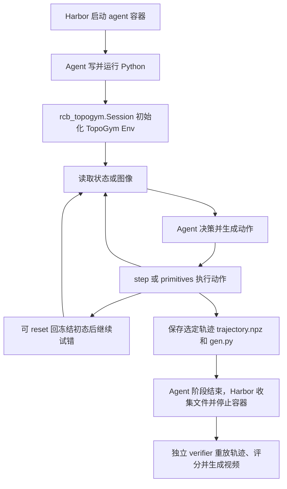
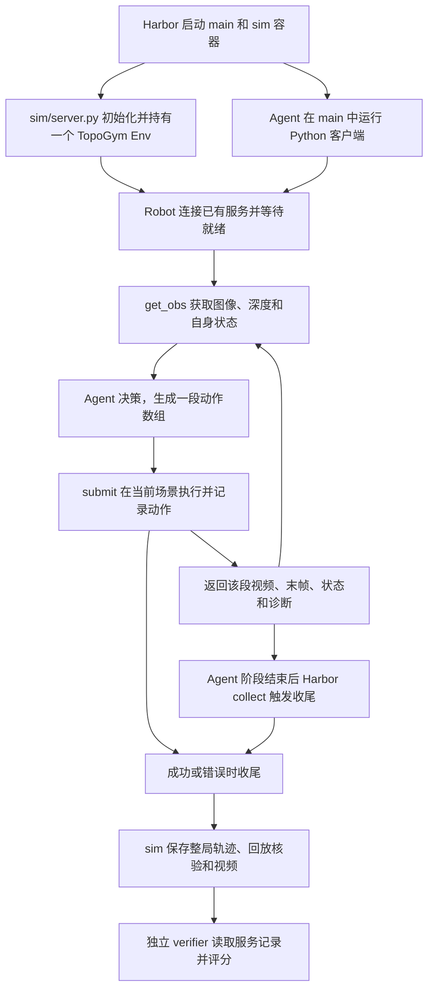

# TopoGym Harbor 层：使用手册与改动说明

面向 helper 的正式交付说明统一以 [`SHARING_RUNS.md`](SHARING_RUNS.md) 为入口；本地固定 oracle 实例 K=3 的维护方操作记录见 [标准 helper 操作说明](standard_helper_operations_zh.md)。统一入口 `bash_scripts/run_helper_batch.sh --config <本机配置>` 涵盖准备、运行、打包和 HF 交付，内部调用原 `scripts/run_agent_batch.sh`；接收/网站导入独立。当前预设排除 Knot/Slotted Post Ring/Orbits：10 任务、三档、双模式、K=3，共 60 包/180 trials；Sol xhigh，每 trial 12 小时、150M input/10M output（token 超预算运行后判失败）。正式任务包与真实实验仍待准备和放行。下述全局 active 选择器和历史流程继续保留。

上游已确认私有 HF 接收库建好；第三方 helper 需要独立、可访问的固定 release。官方 `SHARING_RUNS.md` 同步、§3b、release 导出和真实上传/下载小测试见 [下一阶段工程计划](helper_release_and_hf_smoke_plan_zh.md)。

可复制的当前 CLI 见 [把建文作为 helper 的正式流程小批次](helper_native_cli_zh.md)：只筛选 Coil easy、双模式、K=1，不增加 smoke 专用执行脚本。独立 release 导出、HF 权限检查、配置生成及独立 HF 下载验收入口已加入；历史小批次曾被 12 GB 显存门槛拦住；该门槛已移除，实际执行和 HF 上传状态以批次记录为准。

当前唯一新实验目标是 tooling **v16** / `0.2.14-dev-cu128`（merged-v16：v15 候选流程与环境参数，加上评分回放和物理有效性规则，见 [版本说明](benchmarks/topogym.md)；v15 候选的工具哈希已冻结）。根目录 `tasks/` 是历史任务包。
先按根 README 的候选构建流程完成 `topogym_candidate_pipeline.py --phase all`，再设置：

```bash
export TASKS_ROOT="$(.venv-gs121-nyx/bin/python scripts/topogym_versions.py tasks-root)"
.venv-gs121-nyx/bin/python scripts/topogym_versions.py list --inspect-docker
```

选择器在活动版本尚未具备完整验收证据时明确报错。新批量实验和随机难度实验使用同一份活动版本环境参数；
随机实验仍保留随机 seed 和场景扰动。下方历史验收记录保留发生时的版本，不作为当前版本的成功证据。
重评分只读取原任务路径，并把结果写入新的 `regrades/` 目录，不覆盖原始 verdict。


历史记录（2026-10-03、v15 迁移前）：当时新生成包使用 tooling v13 / standard 2.3，合并远端 v12 的 IPC 初态恢复、性能设置与稳定判据优化，以及本地 Fiber/Lock 变体推荐抓持。远端 v12、本地 v11 和既有历史包保持各自身份；两套 v11 按完整工具 hash 与镜像分别检查。见 [版本说明](benchmarks/topogym.md)。

2026-10-01 合并后修复及当时的 v5 / 0.2.6-cu128 验收，见[实施报告](../debug_logs/run_trials_post_merge_repair_20261001_zh.md)；下文历史结果不追溯修改。

2026-10-01：本次 pull 的 39 个三档实例与双模式交付，以及 builder 反馈 A 至 F 的逐项解释、修补顺序和验收标准，见 [RCB builder 反馈修补工程计划](builder_feedback_repair_plan_zh.md)。计划同时覆盖预检工具和镜像标签不一致；下文带日期的历史验收记录保留原有范围。

> 2026-09-29 归档提示：本文涉及的独立研究／诊断／测试入口已移入[统一归档](../../legacy/research_tools_20260929/README.md)；相关旧路径与命令保留为历史说明，不再是当前运行入口。rollout 准备、执行及 Harbor 工具仍在活动目录。

2026-09-29。对齐基准是 robot_coding_bench（下称“参考仓库”）服务器上最新的 `origin/dev/qineng@fa59c1a6`。参考仓库的 `main`（`fa2d613a`）是更早的祖先提交，不作为基准。

## 0. 结论

Harbor 层已经按参考仓库重建完成，运行方式与参考仓库相同：`harbor run -p tasks …`，两种模式，官方 agent 或 `harbor_agents/` 里的模型网关，独立沙箱评分。

2026-09-29 启动入口复核：按本轮要求只核对 Harbor 配置和调用方式，不新增物理、协议或真实模型测试。已用本机 Harbor 0.23.0 解析全部 28 个任务，确认独立 verifier 配置；Codex、Claude Code、oracle、nop、CodexChatGPT 和 CodexOpenRouter 的 agent 入口均可加载，下面 Luna 命令的 agent 参数可被接受。33 个原样复制文件与参考提交逐字节相同，基础镜像已在本机存在。这表示本地启动接口对齐；完整运行记录及未验收范围仍以第 6、7 节为准。

- **任务**：14 个家族（13 个 + cube 示例）× 2 种模式 = 28 个任务，全部列在 `tasks/dataset.toml`。
- **静态检查**：`bash ci_checks/run_all.sh` 全部通过。参考仓库原封不动的 CI 在我们的任务上只有 org 名一项不过（参考要求 `robot-coding-bench/`，我们是 `topogym/`）。
- **端到端**：在 Docker 里用 `harbor run` 实测了 cube 的两种模式：
  - `-a oracle`（跑参考解）得 1；
  - `-a nop`（什么都不做）得 0；
  - 重负载的 FEM 家族 knot_untying 在 limited 模式下能起服务、收尾、出分。
- **limited 协议一致性**：用参考仓库的检查脚本测 cube 的 sim 服务，203 项 PASS，0 项 FAIL。
- **模拟器调用**：只通过 `topogym.simulator` 的公开接口（`Env`、`SimulatorConfig`、特权接口 `rewind_to`）和只读状态。
- **模拟器改动（经你同意）**：历史模式新增 `"segment"` 并设为默认，只在这局的第一个 tick 和每个 segment 的起点存完整检查点。原来每个物理 tick 都存，在 cast_coil 上实测占每步耗时的 85%。对原先记录的两个问题（第 5 节）：
  1. 每个控制步耗时原来是 0.9–40 s，现在是 0.27–31.4 s。刚体家族快了 9–23 倍；knot_untying 仍要 31 s，它的耗时主要不在检查点上；
  2. 4 个 FEM 家族原来的历史每步增长约 325 MB 内存，现在一局只存一份检查点。
- **基础镜像已重建**：镜像里的模拟器是构建时复制进去的，改完模拟器后用 `scripts/build_images.sh topogym` 重建了 `ghcr.io/luigivamper/rcb-topogym:0.1.0`（仍只在本机）。
- **28 个任务已在新模式下重新生成**：同时带上了 09-29 interlocked_claws 和 horseshoe_ring 的场景修改。interlocked_claws 按任务推荐开启辅助抓持，hard 变体开局时已夹住部件。

### 0.1 两种模式的执行流程与旧执行层边界

2026-09-29 流程整理：以参考仓库 `fa59c1a6` 的两种 trajectory 任务作为正式 Harbor 接口。
TopoGym 提供场景、物理、相机、机器人控制和任务判定；Harbor 管容器、agent 预算、产物收集及独立评分。
参考协议允许每个模拟器实现自己的薄适配器，因此 `rcb_topogym.Session` 和 TopoGym 的 sim 服务仍需保留，
它们连接 RCB 接口与 TopoGym `Env`。当前这两条路径都不调用 `SegmentRunner`。

| 阶段 | Unlimited：产出一条可重放轨迹 | Limited：在同一局里在线控制 |
| --- | --- | --- |
| 任务入口 | `$TASKS_ROOT/topogym-cast-coil-easy-i00-privileged` | `$TASKS_ROOT/topogym-cast-coil-easy-i00-standard` |
| 模拟器位置 | agent 容器内 | 独立 `sim` 容器，agent 容器只装客户端 |
| 初始化责任 | agent 的 Python 调用 `Session(...)` | `sim/server.py` 启动时创建一个 `Session`；`Robot()` 等待服务就绪 |
| 观测 | 图像、深度、自身状态、物体位姿等特权信息 | 图像、可选深度、自身状态、标定和机器人模型；不提供物体真值与判定源码 |
| 操作入口 | `s.step`、`s.primitives()`、渲染、记录与回放 | `r.get_obs`、`r.submit`、`r.fk/ik` |
| 试错 | 可 reset 到冻结初态，多次探索后选择最终轨迹 | 无 reset；后续请求继续当前场景，一次 trial 对应一局 |
| agent 代码 | 在 agent 容器运行的 Python，可逐段决策或自动循环 | 同样在 agent 容器运行；HTTP 请求发送动作数组，不上传 policy 源码 |
| 轨迹责任 | agent 保存 `/app/output/trajectory.npz`；`gen.py` 记录生成过程 | sim 服务自动记录实际执行动作；`gen.py` 只作过程记录 |
| 评分 | 独立 verifier 用自己的实例与工具重放提交轨迹 | sim 收尾、回放核验并导出记录；独立 verifier 读取服务端证据 |
| 分段视频 | 代码显式调用 `start_video/stop_video`，或对轨迹 `render_video` | 每次动作请求可返回多相机视频；`result.save(...)` 保存该段 |

**Unlimited 的完整过程：**



保存文件本身不会结束 agent 阶段。超时后 Harbor 只能收集已经写出的产物，因此需要尽早保存可重放的版本。
最终评分输入是选定的动作轨迹，评分器不依赖重新执行 agent 的生成脚本。探索过程可以是看图后继续写代码，
也可以在同一个 Python 程序里反复观察与控制；RCB 没有要求把策略交给 Env 编译。

`Session(...)` 同步建场景。命令工具的 `yield_time_ms` 是本次等待时长，不是模拟器的运行上限：
命令还在运行时应保留完整返回值和 `session_id`，继续等待同一进程。RCB 的 RoboWits unlimited 也采用这套
直接调用模式，没有跨进程单例锁；重新启动 Python 并调用 `Session` 会创建另一个场景。

针对重复初始化，全部 28 个任务的固定 `instruction.md` 已加入 `Startup and long-running commands`：说明初始化
可能持续数分钟（Cast Coil 近期约 120 秒）、保留完整命令状态并等待原进程。Unlimited 另有避免并发建场景与
复用 Session 的要求；limited 说明连接重试和避免重复提交动作。两个任务生成器共用
`scripts/topogym_mk_task.py::startup_instruction`，以后生成任务也会带上这些规则。
正常启动无需再加 `--extra-instruction-path`；现有 `--extra-instruction` 的 540 秒预算仍可保留。
[旧的附加指令文件](simulator_startup.instruction.md)仅为兼容已有命令保留。这是提示词层的修正，尚未通过新一轮
模型运行验证效果。

**Limited 的完整过程：**



同一个 trial 内重新运行客户端只会连接已有场景；不会 reset，也不会再建一个模拟器。
`Robot()` 默认给连接重试预留 600 秒。Compose 的 `depends_on` 只保证启动顺序，场景就绪由客户端连接重试处理。
模型可逐次看图、修改下一段，也可写一个自动观察与控制的客户端循环；两者都通过同一套动作协议。
服务不执行 agent 上传的任意 Python 源码。

一次 `submit` 可以包含多个动作目标：`joint_position` 按 `dt` 插值执行多个关节目标（每块至多 10 秒模拟时长）；
`ee_pose` 一次至多 50 行末端位姿与夹爪目标，每行做 IK 后再执行多个关节控制步。模型通常在整段返回后作下一次
决策，因此需要视觉确认的节点可以分成不同请求。`get_obs()` 默认只取当前帧，`get_obs(seconds=...)` 则保持当前
指令并推进物理。该实现没有在模型思考时自行推进物理的后台循环，墙钟预算仍会消耗。

图像与视频不会自动进入模型上下文：客户端代码必须保存并通过 agent 的看图工具查看，或自行处理数组。
用 `result.save('/app/output/segments/001')` 保存单段可让 Harbor 自动收集到
`jobs/<job>/<trial>/artifacts/app/output/segments/001/`。这些观察片段与 sim 收尾生成的整局 `replay.mp4` 用途不同。

Limited 的服务端轨迹是整局实际执行历史，不由 agent 挑选或替换。TopoGym 的 CUDA 评分要求 live 与 replay
都成功，状态哈希一致性作为诊断；RCB RoboWits 的 CPU 任务还要求哈希一致。这里只整理当前实现，不把未做的新运行
宣称为已验收。

**旧流程的归档范围：**

后续归档对象是 `topogym/simulator/rollout_simulation/` 的 `SegmentRunner`、`run_policy` / `policy.act(obs)`
管理循环及其专属观测、产物和历史包装，以及直接依赖它们的旧执行入口、专属测试与文档。
当前 `scripts/run_*_policy.py`、部分参考解/可解性流程仍在调用它；实际移动时需同步整理
`topogym.simulator` 的导出和这些调用点，不能只移动一个类。这里记录归档边界，本次没有移动运行代码。

保留的部分包括：TopoGym `Env`、场景与资产、Genesis/Nyx、机器人控制与 IK、任务终止/成功判定、公共录制能力、
冻结初态与回放，以及 RCB 的 `Session`、limited 客户端/服务和 verifier。`Env.step` 中的 `compile_action` 是
底层动作转换，Genesis 的编译是物理内核初始化，都不属于待退役的 policy 执行层。
`history_storage="segment"` 是检查点存储策略，现有 RCB reset/replay 仍依赖初态检查点；名称包含 segment
不代表它应随 `SegmentRunner` 删除。参考解算法和历史视频也不因旧 runner 退役而丢弃。

## 1. 怎样用 harbor run 实测一个任务

### 1.1 准备（每台机器一次）

```bash
cd /home/jianwen/topogym
source .venv-harbor/bin/activate           # 本机已装 Harbor 0.23.0 / Python 3.12
scripts/build_images.sh topogym             # 构建基础镜像 ghcr.io/luigivamper/rcb-topogym:0.1.0（本机已建好）；改过 topogym/ 模拟器后要重建
```

本机当前镜像已存在时可跳过构建。保持这个虚拟环境激活后再运行配套脚本和静态检查：系统 Python 3.10 不带 `tomllib`，直接运行会导入失败。新机器需要 Python 3.11+，并安装相同的 Harbor 0.23.0（例如 `uv tool install --python 3.12 harbor==0.23.0`）；依赖 `python3` 的配套脚本也要使用 Python 3.11+。

机器要求：
- Docker 权限；
- nvidia-container-toolkit；
- GPU 显存要够（见 1.6）。

模型凭据任选一种：

| 用什么 | 怎么设 |
| --- | --- |
| Anthropic API | `export ANTHROPIC_API_KEY=…` |
| OpenAI API | `export OPENAI_API_KEY=…` |
| ChatGPT 订阅登录（Codex） | `export CODEX_FORCE_AUTH_JSON=1`，使用本机 `~/.codex/auth.json` |
| Claude 订阅登录 | `export CLAUDE_CODE_OAUTH_TOKEN=… CLAUDE_FORCE_OAUTH=1` |
| OpenRouter | 在 `.env` 里写 `OPENROUTER_API_KEY=…`，运行时加 `--env-file .env` |

也可以把 `.env.example` 复制成 `.env` 再填写。注意：本机旧的 `.secrets/harbor.env` 用的是旧 runner 的变量名，Harbor 不读。

### 1.2 先确认环境（可选，约 10 分钟）

```bash
harbor run -p "$TASKS_ROOT/topogym-cast-coil-easy-i00-standard" -a nop -o "$PWD/jobs" --job-name check-nop
python3 scripts/check_topogym_trial.py jobs/check-nop --expected 0
```

### 1.3 用真实模型跑一个 unlimited 任务

任务名来自活动目录 `$TASKS_ROOT`，例如 `topogym-cast-coil-easy-i00-privileged`。`-p` 和 `-o` 都用绝对路径。

```bash
# Claude Code（Harbor 官方 agent）
harbor run -p $TASKS_ROOT/topogym-cast-coil-easy-i00-privileged -a claude-code -m anthropic/<模型ID> -o $PWD/jobs --job-name coil-u-claude

# Codex（Harbor 官方 agent）
harbor run -p $TASKS_ROOT/topogym-cast-coil-easy-i00-privileged -a codex -m openai/<模型ID> --ak reasoning_effort=medium -o $PWD/jobs --job-name coil-u-codex

# 经 OpenRouter，走参考仓库的容器内模型网关：真实 key 不进 agent 环境，锁定上游提供方，限流时重试
PYTHONPATH=. harbor run -p $TASKS_ROOT/topogym-cast-coil-easy-i00-privileged -a harbor_agents.codex_openrouter:CodexOpenRouter \
  -m openrouter/<提供方>/<模型ID> --env-file .env --ak reasoning_effort=medium --ak provider_only=<提供方>/<档位> \
  -o $PWD/jobs --job-name coil-u-openrouter

# 多个任务：-p 指向整个数据集，用 -i 按名字筛选；-n 并行 trial 数，-k 每个任务尝试次数
harbor run -p $PWD/tasks -i 'topogym-*-i00' -a codex -m openai/<模型ID> -n 1 -k 1 -o $PWD/jobs --job-name all-u
```

一次 unlimited trial 依次发生：
1. Harbor 用 `environment/Dockerfile` 构建 agent 容器（基础镜像 + `rcb_topogym.py` + `instance.json`），并用 `tests/Dockerfile` 构建评分容器。
2. 启动 agent，把 `instruction.md` 交给它。agent 在容器里写 Python，调用 `from rcb_topogym import Session`，可以任意 reset、试错。
3. agent 交出 `/app/output/trajectory.npz`（和 `gen.py`）后，agent 容器停止。
4. 评分容器在全新进程里把轨迹重放两遍，再录一遍视频，写出分数。

#### 本机用自己的 ChatGPT 订阅跑一次 Cast Coil + GPT-6 Luna Max

按你提供的 Qineng 说明，这次配置是自己的 ChatGPT 订阅、Codex、GPT-6 Luna、`max` 推理强度。参考仓库 README 已有 `-a codex -m openai/gpt-6-luna` 和 `CODEX_FORCE_AUTH_JSON=1` 的订阅运行方式；这里直接使用 Harbor 标准 Codex agent。此前命令的 `xhigh` 来自仓库网关适配器的历史示例，这次改为你指定的 `max`。这不是对尚未收到的完整 setting 文件的逐项复现。

Codex 登录会取得并缓存认证 token，无需手动提取、复制或填写 API key。ChatGPT 登录使用账号的 Codex 订阅额度，不采用 OpenAI API key 的按 token 计费；仍会使用订阅额度，不能保证每次只占 1–2%。官方说明：[认证](https://learn.chatgpt.com/docs/auth)、[Luna 支持 Max](https://learn.chatgpt.com/docs/models)、[订阅与 API 计费](https://learn.chatgpt.com/docs/pricing)。

```bash
cd /home/jianwen/topogym
source .venv-harbor/bin/activate

# 本轮明确使用 ChatGPT 订阅认证，不加载 API key / OpenRouter 的 .env。
unset OPENAI_API_KEY OPENAI_BASE_URL OPENROUTER_API_KEY
export CODEX_FORCE_AUTH_JSON=1
export CODEX_AUTH_JSON_PATH="${CODEX_HOME:-$HOME/.codex}/auth.json"

# 首次执行：按终端提示在浏览器登录自己的订阅账号。
# file 让 Harbor 能读取登录缓存；已完成这种登录时可跳过 login 命令。
codex -c 'cli_auth_credentials_store="file"' login --device-auth
codex -c 'cli_auth_credentials_store="file"' login status

# 先查看 GPU 占用，再启动一个 trial。模型推理走远端，模拟器在本机 GPU 上运行。
nvidia-smi
COIL_JOB="coil-luna-max-subscription-$(date +%Y%m%d-%H%M%S)"
harbor run \
  -p "$TASKS_ROOT/topogym-cast-coil-easy-i00-privileged" \
  -a codex -m openai/gpt-6-luna \
  --ak version=0.157.0 --ak reasoning_effort=max \
  --ak config='{"forced_login_method":"chatgpt"}' \
  -n 1 -k 1 -o "$PWD/jobs" --job-name "$COIL_JOB"

# 单个 trial 结束后查看评分；找不到文件时到 Harbor 查看异常。
python -m json.tool "$PWD/jobs/$COIL_JOB"/*/verifier/reward.json
harbor view "$PWD/jobs"
```

上面的 `openai/` 是 Harbor 的模型提供方前缀，不决定计费方式。`CODEX_AUTH_JSON_PATH` / `CODEX_FORCE_AUTH_JSON` 让 Harbor 将登录缓存交给容器内 Codex，`forced_login_method=chatgpt` 要求其使用 ChatGPT 认证。本轮只核对命令、配置和语法，未替你登录或发起模型请求。

判断 rollout → eval 是否完整接通，查看这个 job 中 trial 的 `result.json`、`artifacts/app/output/trajectory.npz` 和 `verifier/`：应有真实模型交互和模拟器执行记录、提交的轨迹、`verifier_environment_mode="separate"`、评分文件以及实际重放记录。`grader_error`、`missing_trajectory`、`bad_trajectory`、`wrong_family` 等不能为 1，基础设施或认证异常需单独处理。`success=0` 可以是正常完成重放后任务未解开；只有一个 0 分文件而没有轨迹或重放证据，不能证明整条链路已接通。

该任务是 `cast_coil_easy`、seed 0、ALOHA 双臂，agent 预算 5400 秒，评分另计。它没有 Harbor oracle 参考解，因此首次模型运行使用上面的模型 agent；不能用 `-a oracle` 来代替。要跑 limited，只把任务路径改成 `$TASKS_ROOT/topogym-cast-coil-easy-i00-standard`，并使用新的 job 名。

如果需要使用参考仓库的自定义 ChatGPT 网关，保留同一登录准备，在根目录加 `export PYTHONPATH="$PWD${PYTHONPATH:+:$PYTHONPATH}"`，并把 agent / model 改为 `-a harbor_agents.codex_chatgpt:CodexChatGPT -m chatgpt/openai/gpt-6-luna`，去掉标准 Codex 专用的 `--ak config='{"forced_login_method":"chatgpt"}'`。这个适配器也使用 ChatGPT 登录；文件头的历史实验参数是 `xhigh`，本次仍可显式指定 `--ak reasoning_effort=max`。

其他凭据途径沿用参考仓库：OpenAI API 用 `-a codex -m openai/gpt-6-luna` 和 `OPENAI_API_KEY`（取消订阅登录用的 `CODEX_AUTH_JSON_PATH` / `CODEX_FORCE_AUTH_JSON`）；OpenRouter 用 `-a harbor_agents.codex_openrouter:CodexOpenRouter -m openrouter/openai/gpt-6-luna --env-file .env`，并在 `.env` 中配置自己的 `OPENROUTER_API_KEY`。

#### 快速检查：Luna → 8 步仿真 → 独立重放评分

已经完成上面的 ChatGPT 订阅登录后，可以先用这个命令检查 unlimited 的完整链路。保留相同的 Luna Max、容器、冻结实例和评分器，通过 Harbor 原生 `--extra-instruction-path` 附加[短流程指令](cast_coil_smoke.instruction.md)：模型写并执行固定的 `gen.py`，渲染一帧，调用真实模拟器执行 8 个保持当前姿态的控制步，保存轨迹后结束。Harbor 随后重放两次并录制短视频。本次结果是流程检查，不能作为解题能力的正式评测成绩；也不覆盖 limited 的 sim 服务链路。

```bash
cd /home/jianwen/topogym
source .venv-harbor/bin/activate
unset OPENAI_API_KEY OPENAI_BASE_URL OPENROUTER_API_KEY
export CODEX_FORCE_AUTH_JSON=1
export CODEX_AUTH_JSON_PATH="${CODEX_HOME:-$HOME/.codex}/auth.json"

COIL_JOB="coil-smoke-$(date +%Y%m%d-%H%M%S)"
harbor run \
  -p "$TASKS_ROOT/topogym-cast-coil-easy-i00-privileged" \
  -a codex -m openai/gpt-6-luna \
  --ak version=0.157.0 --ak reasoning_effort=max \
  --ak config='{"forced_login_method":"chatgpt"}' \
  --extra-instruction-path "$PWD/docs/rcb/cast_coil_smoke.instruction.md" \
  --agent-timeout-multiplier 0.1 \
  --verifier-timeout-multiplier 0.035 \
  -n 1 -k 1 -o "$PWD/jobs" --job-name "$COIL_JOB"

python -m json.tool "$PWD/jobs/$COIL_JOB"/*/verifier/reward.json
harbor view "$PWD/jobs"
```

时间上限：agent 为 540 秒（9 分钟），verifier 为 598.5 秒（约 10 分钟）；正常完成就提前退出。镜像构建和 Codex 安装时间另计，首次运行还需编译模拟器内核，8 步不代表能在几秒内完成。

流程通过应有：

- `agent/` 中有 Luna 的实际工具执行记录，trial 的 `result.json` 中 `exception_info` 为 `null`、`verifier_environment_mode` 为 `separate`；
- `artifacts/app/output/` 下有 `gen.py`、`smoke.initial.png` 和 `trajectory.npz`；
- `verifier/reward.json` 中 `n_actions=8`、`sim_steps=8`、`grader_error=0`、`video_rendered=1`，并有非空的 `verifier/replay.mp4`；`missing_trajectory`、`bad_trajectory`、`wrong_family` 等不能为 1。

`success=0` 是这次保持动作的预期结果，不影响流程检查通过。单有 0 分文件不够：若缺少轨迹、重放或视频，仍需查看 trial 异常及 `verifier/grade.log`。这组指令已做静态配置与语法检查，尚未实际运行。

### 1.4 跑 limited（机器人即服务）

```bash
harbor run -p $TASKS_ROOT/topogym-cast-coil-easy-i00-standard -a codex -m openai/<模型ID> -o $PWD/jobs --job-name coil-l-codex
```

一次 limited trial 依次发生：
1. 起两个容器：`sim`（基础镜像，运行 `server.py`，GPU 给它）和 `main`（只有 Python 和 `rcb_client`，没有模拟器）。
2. agent 用 `Robot()` 连到 `sim:8000`，只能调用 `get_obs` / `submit` / `fk` / `ik`；不能 reset，也看不到物体位姿。
3. agent 结束后，Harbor 的 collect 钩子向 sim 发 SIGUSR1。sim 把整局录成轨迹，重放一遍核验，再重放一遍录视频。
4. 评分容器读取 sim 写的 `final.json`，给出分数。

### 1.5 看结果

每个 trial 一个目录：`jobs/<作业名>/<任务名截断>__<随机后缀>/`。

| 路径 | 内容 |
| --- | --- |
| `verifier/reward.txt` | **分数：1 = 解开了，0 = 没解开** |
| `verifier/reward.json` | 同一个分数 `success`，加上诊断字段（见 2.3） |
| `verifier/replay.mp4`、`replay.last.png` | 评分重放的视频：第一台相机原尺寸，其余相机缩放后竖排在右侧 |
| `agent/` | agent 的对话与命令记录；走网关时还有每次模型请求的 `gateway.jsonl` |
| `artifacts/app/output/` | unlimited：`trajectory.npz`、`gen.py`、`rcb_session_log.jsonl`（agent 自己的调试记录） |
| `artifacts/data/` | limited：sim 的 `final.json`、`episode.jsonl`、`trajectory.npz`、视频 |
| `result.json` | Harbor 汇总：耗时、token、费用、异常；`verifier_environment_mode` 应为 `separate` |

浏览：`harbor view $PWD/jobs`。

### 1.6 批量两种模式、汇总

```bash
AGENT=codex MODEL=openai/<模型ID> AK="--ak reasoning_effort=medium" ENV_FILE=$PWD/.env \
  scripts/run_agent_batch.sh <批次名> topogym-cast-coil-easy-i00 topogym-horseshoe-ring-easy-i00
scripts/collect_batch_results.py jobs/agents <批次名>-unlimited-<任务> <批次名>-limited-<任务> <输出目录>
scripts/make_two_mode_report_zh.py jobs/agents <unlimited 作业> <limited 作业> <报告目录>
```

- `run_agent_batch.sh` 默认 `SEQ=1`，按顺序跑每个任务的 `-privileged` / `-standard` 孪生任务；`SEQ=0` 才让两种模式并行。`topogym_guarded.py` 监控本次 Harbor 进程，内存达到 90% 时停止；CPU 仅记录。日志镜像容器 `rcb-log-mirror` 会继续常驻，可用 `LOG_MIRROR=0` 关闭启动。
- 它会在每个作业后扫描输出里是否泄漏 key，并写出汇总表 `jobs/agents/<批次名>.summary.md`。

注意事项：
- **显存**：每个 trial 同时占一份 GPU 显存，刚体家族约 2–3 GB，FEM 家族可达 10 GB。与其他 GPU 任务共用这块卡时会 CUDA OOM，表现为 limited 的 `missing_log=1`，或 unlimited 的 `grader_error=1`。`-n` 请按显存来设。
- **时长**：每步耗时见 5.1；每个任务的 instruction 里也写了该任务的实测值。
- **只允许 agent 访问模型 API**：`scripts/set_agent_egress.py allowlist`，然后 `cd tasks && harbor add --scan .`；恢复用 `public`。

## 2. 这几个核心脚本是什么

下面的行号以 cube 模板任务里的文件为准。所有任务里的同名文件逐字节相同，由 `ci_checks/check-tooling-identity.sh` 检查。

### 2.1 `rcb_topogym.py`：unlimited 工具（对应参考仓库的 `rcb_robowits.py`）

位置：`tasks/*/environment/rcb_topogym.py`。同一份文件也放在 `tests/`（评分器用）和 limited 的 `environment/sim/`（sim 服务用）。

它是 agent、评分器、sim 服务共用的一层，把 TopoGym 的 `Env` 包装成参考仓库那种 `Session`。

- **家族表 `TASKS`（101 行）和 `simulator_config()`（199 行）**
  - 每个家族对应哪个 `task_id`、机器人、变体、种子，以及可选的辅助抓持配置；
  - 公共配置 `_COMMON`（99 行）：`JOINT_ABS` 关节目标控制、不设物理步上限、历史模式 `"segment"`（见 5.1）、打开 RGB 和深度、打开特权接口；
  - 辅助抓持写 `"recommended"` 的家族（interlocked_claws）由任务自己的 `recommended_grasp_assist(variation_id, seed)` 给出配置（208 行）。
- **`Session.__init__`（672 行）**
  - 读 `instance.json` 里冻结的 simulator 配置，构造 `SimulatorConfig` 和 `Env` 并 `reset(seed)`；
  - 记下第一帧状态的引用 `S0`；
  - 算状态哈希 `state_sha()`（754 行：状态记录去掉 episode 编号，数值保留 12 位小数后取 sha256），与实例里存的哈希比较，得到 `instance_exact` / `instance_matches`。
- **`reset()` / `_restore()`（770、778 行）**：用特权接口 `env.privileged.rewind_to(S0)` 回到冻结初态。`"segment"` 历史模式下这局的第一个 tick 总有完整检查点，所以不用重建场景。
- **`step(action)`（795 行）**：
  - 一行动作 = 每个手臂的关节目标（rad）加夹爪开口宽度（m），执行一个控制步；
  - `_Robot.command()`（529 行）把宽度换算成夹爪的原生坐标（Robotiq 是弧度），再交给 `env.step`；
  - 任务自己的成功或失败判据结束这一局后，之后的步照常记录，但不再推动场景（`episode_end`）。
- **记录与重放**：
  - `record_start/record_stop`（835、838 行）记下每一步动作；
  - `save_trajectory`（844 行）写成与参考仓库同格式的 `trajectory.npz`；
  - `replay`（849 行）= `reset` 之后逐行 `step`，最后返回 `status()`：成功与否、progress、步数、状态哈希。
- **观测与机器人信息**：
  - `render_frame` / `render_depth` / `camera_info`（864、1071、1050 行）：Nyx RGB、几何深度、相机内外参；
  - `objects()`（951 行）：刚体给位姿和包围盒，布、绳这类形变体给质心和包围盒；
  - `robot_spec()` / `kinematics()`（1148、1095 行）：关节限位、PD 增益、TCP 定义，以及只在机器人模型上算的 FK/IK，不碰场景；
  - `object_in_hand()`（1022 行）：辅助抓持当前抓着的物体。
- **`primitives()`（1193 行）**：与参考仓库同名的 14 个薄动作，比如 `move_ee`、`move_joints`、`open_gripper`、`close_gripper`、`hold`、`top_down_quat`，外加 BEHAVIOR-1K 的 `object_in_hand`。
- **`exec_code()`（1302 行）**：在上述函数都可用的环境里执行一段代码。oracle 就是这样跑的。
- **命令行（1333 行起）**：
  - `make-instance`：冻结实例；
  - `run-oracle`：执行参考解并录成轨迹；
  - `replay`：与评分器同样的检查，agent 可以自测；
  - `render`：录视频；
  - `describe`：给生成器读取相机、机器人、判据源码和每步耗时；
  - `selftest`。
- **cube 示例任务**：定义在 `_cube_classes()`（286 行）里，运行时注册进模拟器的任务表。它是 harbor 层的示例，不属于模拟器。

### 2.2 `server.py`：limited 的 sim 服务（对应 RoboWits 的 `sim/server.py`）

位置：`tasks/*-limited/environment/sim/server.py`。HTTP 层、RCB1 编码、帧轴对齐和 `/spec` 白名单检查都在与参考仓库逐字节相同的 `rcb_limited.py` 里。`server.py` 只负责把 TopoGym 接上去。

- **`SPEC`（143 行）**：`/spec` 的全部内容，包括相机（内参、挂载方式）、两种动作格式及其限位、本体数据的列名与分组、世界坐标约定、机器人规格、运动学接口、深度格式和时间预算。启动前由 `L.check_spec(SPEC)` 校验，缺字段或出现禁止字段（物体、质量、分割等）就不启动。
- **`do_submit`（283 行）**：
  - 校验动作块的行数、维度、`dt`，以及每块最多 10 s；
  - `joint_position` 走 `run_joint_position`（246 行）：按 `dt` 展开成控制步，线性插值或保持，夹爪在行首切换，越界值裁剪并报告；
  - `ee_pose` 走 `run_ee_pose`（260 行）：每行做一次 IK，关节距离决定步数，哪个手臂 IK 失败，那个手臂就保持不动，并记进 `plan`；
  - 每一步由 `ctrl_step`（238 行）调用 `S.step`，同时让 Recorder 按帧率截取画面、深度、本体数据和相机位姿。
- **`do_observe`（313 行）**：只看不动，或保持当前指令观察几秒。
- **`do_kinematics`（336 行）**：无状态的 FK/IK。
- **episode 生命周期**：
  - 启动后写 `/data/server.pid`（358 行）；
  - collect 钩子发来 SIGUSR1 时，`on_usr1`（351 行）→ `finish("timeout")` → `finalize`（73 行）：把整局轨迹存成 `trajectory.npz`，重放一次核验，写 `final.json`（`finalized`），再重放一次录 `replay.mp4`（`video_done`）；
  - 每次调用都记进 `episode.jsonl` 和 `calls/`。
- **与 RoboWits 的一处结构差异（`on_main`，35 行；主循环，364 行）**：Genesis 的 CUDA 只能在建场景的那个线程里调用。所以 HTTP 服务放在子线程，所有模拟器调用都排进主线程的任务队列。收尾也在主线程里做；RoboWits 是另开一个线程做收尾，放到我们这里会段错误。

### 2.3 两份 `grade.py`：评分器（对应 RoboWits 的两份 grade.py）

这里的 **grade 就是“判定解开没有”**，不是给出一个连续的分数。分数只有 `reward.txt` 里的 1 或 0，对应 `reward.json` 的 `success` 字段。其他字段都是诊断信息，不影响分数。字段名沿用参考仓库，方便跨基准比较。

- **unlimited：`tests/grade.py`（97 行）**，由 `tests/test.sh` 调用：
  1. 先解析 agent 自己写的 `rcb_session_log.jsonl`，统计 `agent_*` 调试开销（36 行）。这些是 agent 自报的，只作参考。
  2. 检查轨迹文件：没有就 `missing_trajectory=1`，家族不对就 `wrong_family=1`，维度、NaN、长度不对就 `bad_trajectory=1`，分数都是 0。
  3. 在评分容器的全新进程里重建冻结场景，把轨迹重放两遍（69 行）。
  4. 判定（74 行）：`success = 两遍重放都成功`。GPU 物理不是逐位可复现的，所以两遍的状态哈希是否相同（`deterministic`）、重建场景是否与冻结实例一致（`instance_ok`）只报告，不参与判定；这与参考仓库 RoboWits 的 GPU 规则相同。
  5. 再重放一遍录视频，写出 `reward.txt` 和 `reward.json`。评分器自己出错时写 `grader_error=1`。
- **limited：`tests/grade.py`（21 行）**：只读 sim 写的 `/data/final.json`。`success = 现场成功 且 sim 的重放也成功`（17 行）。没有 `final.json` 时写 `missing_log=1`。
- **`test.sh`**：第一件事是清空 `/logs/verifier`。Harbor 把这个目录也挂进了 agent 的容器，清空后，agent 预先放进去的假分数文件不可能被当成成绩。

**regrade（重判）是什么意思**：不是换一种评分，而是“用同一个评分器，在新容器里把同一条轨迹再判一次解开没有”。参考仓库有这个脚本（`scripts/regrade_trials.sh`），是因为评分容器偶尔会因为基础设施问题出错，比如和其他作业抢 GPU 导致 CUDA 显存不足。这时 `grader_error=1`，或者没有录出视频。重判不需要 agent 重新跑一遍，重评写入独立输出目录，原来的 `reward.json` 保持不变。

### 2.4 两个生成器：`scripts/topogym_mk_task.py`、`scripts/topogym_mk_limited.py`（对应参考仓库的 `robowits_mk_task.py`、`robowits_mk_limited.py`）

- **`topogym_mk_task.py <家族>`** 默认生成候选目录 `runs/task_candidates/v<活动 tooling>/topogym-<家族>-i00-privileged/`，固定套件由 candidate pipeline 指定独立目录：
  1. 从 cube 模板复制共享文件（`SHARED`，19 行）：工具、Dockerfile、compose、`grade.py`；
  2. 调用 `rcb_topogym.py make-instance` 冻结实例（需要 GPU，把场景建一次）；
  3. 调用 `describe` 读出相机、机器人、判据源码和实测每步耗时，缓存到 `runs/task_build/<任务>/describe.json`；
  4. 按参考仓库的章节结构写出 `instruction.md`（80 行）、`README.md`（138 行）、`task.toml`（171 行）、`tests/test.sh` 和 `solution/solve.sh`。有参考解时 `solve.sh` 执行 `run-oracle`，没有时按参考写法 `exit 1`。
- **`topogym_mk_limited.py <家族> <参考解轨迹 | ->`** 在同一候选根目录生成 `-standard` 孪生任务：
  - 复制客户端、共享层、`server.py`、评分器；
  - 复制同一份冻结实例；
  - 写出 compose（sim 服务的配置，collect 钩子写在 task.toml 里，等待时长由 `polls`（170 行）按预算推出）；
  - 有参考解轨迹时，把它存成 `oracle_qpos.npy`，交给原样复制来的 `oracle_replay.py` 逐块发送。
  - 这个脚本不需要 GPU，读的是上一步缓存的 `describe.json`。
- candidate pipeline 生成清单与 runtime catalog；完成实例恢复和双模式 Harbor 验收后才激活目录。

## 3. 改了哪些

### 3.1 按层对照

- “原样”：与参考仓库逐字节相同，33 个文件，哈希记在 `ci_checks/rcb_vendor.json`，CI 核对。
- “改写”：参考文件加最小修改，10 个，文件头注明原因。
- “自写”：按参考结构为 TopoGym 写的。

| 层 | 参考仓库 | TopoGym 现在 | 方式 |
| --- | --- | --- | --- |
| 任务目录 | `tasks/<sim>-<family>-i<NN>/`，limited 孪生任务加 `-limited` | `tasks/topogym-<family>-i<NN>/` 与 `-limited` | 同结构 |
| task.toml | schema 1.3、artifacts、metadata 字段、limited 的 5 个 sim 产物和 collect 钩子 | 相同 | 生成器渲染 |
| instruction.md / README.md | 固定章节 | 相同章节，内容由生成器按实例填写 | 生成器渲染 |
| limited 客户端 | `rcb_client.py` + `rcb1.py`，镜像装 requests / numpy / pillow / scipy | 相同 | 原样 |
| limited 共享层 | `sim/rcb_limited.py` + `sim/rcb1.py` | 相同 | 原样 |
| limited sim 服务 | RoboWits `server.py` | `server.py`，逐段对应（2.2） | 自写 |
| unlimited 工具 | `rcb_robowits.py` | `rcb_topogym.py`，同名同签名的方法集（2.1） | 自写 |
| 评分 | 两份 `grade.py`，`test.sh` 先清空日志目录 | 相同字段和流程，判定按 GPU 规则（2.3） | 改写 / 原样 |
| 轨迹文件 | `actions` float32 + task、eval_index、instance_sha、action_layout、meta | 相同 | 同格式 |
| 基础镜像 | `images/<sim>/`，只装模拟器，`images/VERSION` | `images/topogym/`（`prune.py` 删掉可能含参考解的目录），0.1.0 | 自写；构建 / 推送脚本改写 |
| 数据集清单 | `tasks/dataset.toml` | `topogym/topogym@0.1.0` | 同做法 |
| CI | 11 项检查 + `run_all.sh`，两个 GitHub 工作流，PR 模板 | 相同；3 项改写（org 名、topogym 的一致性检查、limited 文本检查的匹配范围） | 8 项原样 + 3 项改写 |
| 模型接入 | `harbor_agents/`：容器内模型网关 | 相同 | 原样 |
| 批量运行 | `run_agent_batch.sh`、`log_mirror.py`、`account_failure_check.py`、`scan_secrets.py`、`set_agent_egress.py` | 相同 | 原样 |
| 批量结果 | `regrade_trials.sh`、`collect_batch_results.py`、`write_task_results.py`、`make_two_mode_report_zh.py`、`mem_guard.py` | 写死 RoboTwin 的部分改为 TopoGym | 改写 |
| 凭据与忽略 | `.env.example`；`.gitignore` 忽略 `.env.*`、`/jobs/`、`/exps/` | 相同 | 原样 / 补齐 |
| 协议文档 | `docs/PROTOCOL.md` 等 | `docs/rcb/` 同名 | 原样 |

### 3.2 仓库里其余被改动的地方

- 旧的 harbor 层整体移到 `legacy/harbor_native_20260929/`，只移动不修改，那里的 README 写明了原因。
- `pyproject.toml`：删掉旧的 `benchmark` extra、`topogym-benchmark` 入口和 3 个 `harbor_*` pytest 标记。
- 根 `README.md` 第 3 行改为指向本文。
- `.dockerignore` 改为基础镜像的构建上下文。
- `docs/develop/modules/rcb_harbor_*_20260929_zh.md` 两份旧记录各加一段说明，指向这次的重建。
- **模拟器：只改了历史模式一处**（经你同意，见 5.1）：
  - `topogym/simulator/config.py`：`history_storage` 增加 `"segment"`，并设为默认；
  - `topogym/simulator/history.py`：`EpisodeHistory` 接受 `"segment"`，新增 `upgrade()`，把某个 tick 的轻记录补成完整检查点；
  - `topogym/simulator/env.py`：`_save_state` 在 `"segment"` 模式下只给这局的第一个 tick 存完整检查点；新增 `_checkpoint_current()`；`_restore` 遇到只有轻记录的目标时，在改动任何状态之前报错；
  - `topogym/simulator/rollout_simulation/segment.py`：`SegmentRunner._begin()` 加一行 `self.env._checkpoint_current()`，让每个 segment 的起点可以回退；
  - 测试：`tests/conftest.py` 让已有测试继续用 `"memory"`；新增 `tests/contracts/test_history_segment.py`（3 个测试）。合同测试 117 个、单元测试 540 个全部通过。
- 模拟器的其他部分、`configs/`、`demos/` 没有改。

### 3.3 与参考仓库有意保留的差异

1. **命名空间**：`topogym/`。
2. **判定**：按参考仓库的 GPU 后端规则（2.3），因为 TopoGym 的物理只在 CUDA 上跑。
3. **结束原因多一个 `task_failed`**：部分家族有失败判据，例如碰到蜂鸣线，模拟器会就此结束这一局。limited 下以 `reason="task_failed"` 结束，这个值参考仓库没有；unlimited 下 `status()["episode_end"]` 给出原因。
4. **GPU 驱动能力**：compose 里多了 `runtime: nvidia` 和 `NVIDIA_DRIVER_CAPABILITIES: all`，因为 Nyx 用 Vulkan 渲染，需要图形驱动库。
5. **sim 服务的线程结构**（2.2）。
6. **辅助抓持**：以实际生成的 `instance.json` 中 `simulator.grasp_assist` 为准，规则由同一实例生成到 `/spec` 和 instruction。当前新实例对七类纯刚体任务的 easy/medium/hard 统一启用 `contact_weld_v1`：lock_picking、interlocked_claws、buzz_wire_3d、cast_coil、cast_keyhole、hedgehog_in_cage、horseshoe_ring。cube 测试任务也开启。Fiber 按柔性线缆排除，与 blanket_flatten、knot_untying、rope_threading、orbits、slotted_post_ring 保持关闭。limited/unlimited 共用同一份冻结配置。已有实例不会被家族表的新默认值覆盖，缺少该字段的旧实例仍为 `none`；采用新设置须使用新源码／镜像重新生成实例、describe 和任务包。

   Lock 保留钥匙柄区域与 0.05 s 接触准入；Claws 保留各档两件的推荐区域和闭合预抓意图，仍需双指接触满足准入后取得约束。Buzz、Coil、Keyhole 的任务模块提供与参考执行器相同的手柄／零件区域。Hedgehog 根据球体及尖刺的 link 局部几何生成抓持区域，Horseshoe 对两只马蹄和目标环分别生成区域，允许整个 episode 中的换抓；不依赖 oracle 输入文件或阶段。两者的 TCP 距离门限随区域尺寸确定。所有绑定仍需真实双指接触，张开夹爪即释放，保持原有穿透、相对位姿和单手占有约束。

   terminal 与 success 默认启用适用于全部 13 类任务、39 个难度档；`goal_complete=True` 表示允许进行成功判定，不表示已经成功或已通过物理可解性验收。运行时证据缺失仍可能得到 `evaluation_status="unavailable"`。确认时长和是否需要释放取自所选任务的有效参数与 `public_goal`：默认 Buzz Wire 为 1 s、Hedgehog 为 2 s，其余为 0.5 s；Blanket、Buzz Wire、Cast Coil、Knot 要求释放及停稳。其他任务按各自的持握、速度与几何条件判定，不由 assist 开关替代成功条件。

## 4. 目录结构（Harbor 层）

括号里注明来源：原样 / 改写 / 自写。

```
topogym/                                   仓库根目录
├── tasks/                                 Harbor 数据集（harbor run -p tasks；--repo 默认也读这里）
│   ├── dataset.toml                       清单 topogym/topogym@0.1.0：28 个任务的 org/name + sha256 摘要
│   ├── README.md
│   ├── topogym-cube-pick-place-i00/       unlimited 模板任务（示例，生成器从这里复制共享文件）
│   │   ├── task.toml                      Harbor 配置：[metadata]、[verifier] separate、[agent] 5400 s
│   │   ├── instruction.md                 给 agent：判据源码、交付物、工具用法、约定、每步耗时
│   │   ├── README.md                      给人看的任务卡
│   │   ├── environment/                   agent 容器
│   │   │   ├── Dockerfile                 FROM ghcr.io/luigivamper/rcb-topogym:0.1.0 + 工具 + 实例
│   │   │   ├── docker-compose.yaml        GPU：runtime nvidia，驱动能力 all
│   │   │   ├── instance.json              冻结实例：simulator 配置、state_sha、物体初始位姿、复位关节
│   │   │   └── rcb_topogym.py             unlimited 工具（自写，2.1）
│   │   ├── tests/                         评分容器（agent 拿不到）
│   │   │   ├── Dockerfile / docker-compose.yaml
│   │   │   ├── test.sh                    清空 /logs/verifier，然后调用 grade.py
│   │   │   ├── grade.py                   unlimited 评分（改写，2.3）
│   │   │   ├── instance.json              实例副本
│   │   │   └── rcb_topogym.py             工具副本（与 environment/ 逐字节相同）
│   │   └── solution/                      只挂给 oracle agent
│   │       ├── solve.sh                   run-oracle → /app/output/trajectory.npz
│   │       └── oracle_cube_pick_place.py  参考解（15 行 primitives 调用）
│   ├── topogym-cube-pick-place-i00-limited/    limited 模板任务
│   │   ├── task.toml                      5 个 sim 产物 + collect 钩子（写 server.pid，发 SIGUSR1，等 finalized / video_done）
│   │   ├── instruction.md / README.md     limited 的文字不含任何位置信息（CI 检查）
│   │   ├── environment/
│   │   │   ├── Dockerfile                 python:3.12-slim + 客户端（没有模拟器）
│   │   │   ├── docker-compose.yaml        main 依赖 sim；sim 用基础镜像，只读挂载 ./sim，运行 server.py
│   │   │   ├── rcb_client.py、rcb1.py     agent 的客户端（原样）
│   │   │   └── sim/
│   │   │       ├── server.py              sim 服务（自写，2.2）
│   │   │       ├── rcb_limited.py、rcb1.py   HTTP 层（原样）
│   │   │       ├── rcb_topogym.py         工具副本
│   │   │       └── instance.json          同一冻结实例
│   │   ├── tests/  Dockerfile、test.sh（原样）、grade.py（改写）
│   │   └── solution/  solve.sh、oracle_replay.py（原样）、oracle_qpos.npy（281×8 关节目标）、oracle_meta.json
│   └── topogym-<家族>-i00[-limited]/     13 个家族，结构同上；solve.sh 暂为 exit 1（参考解待写）
├── images/
│   ├── VERSION                            0.1.0
│   └── topogym/
│       ├── Dockerfile                     基础镜像：torch 2.11 / cu128（可选 cu130）+ Genesis 1.2.1 + Nyx + 机器人资源 + topogym 包
│       └── prune.py                       构建时删掉 agents / planning / data 等目录和 cast_coil 的 synthesize，写源码哈希
├── harbor_agents/                         自定义 agent（原样）：codex_openrouter.py、codex_chatgpt.py、llm_gateway.py
├── scripts/
│   ├── topogym_mk_task.py、topogym_mk_limited.py   任务生成器（自写，2.4）
│   ├── build_images.sh、push_images.sh    构建 / 推送基础镜像（改写：仓库名；topogym 暂不许推送）
│   ├── run_agent_batch.sh、log_mirror.py、account_failure_check.py、scan_secrets.py、set_agent_egress.py（原样）
│   ├── regrade_trials.sh、collect_batch_results.py、write_task_results.py、make_two_mode_report_zh.py、mem_guard.py（改写）
│   └── vendor_rcb.py                      按 ci_checks/rcb_vendor.json 从参考仓库重新同步
├── ci_checks/                             run_all.sh + 11 项检查（8 项原样，3 项改写）+ rcb_vendor.json
├── .github/                               工作流与 PR 模板（原样）
├── .env.example（原样）、.dockerignore（基础镜像构建上下文）
├── docs/rcb/                              本文 + PROTOCOL.md、LIMITED_MODE_PROTOCOL.md、TAXONOMY.md（原样）
├── jobs/                                  Harbor 作业输出（gitignore）
├── runs/task_build/<任务>/describe.json   生成器缓存（gitignore）
└── legacy/
    ├── harbor_20260929/                   第一版 Harbor 层
    └── harbor_native_20260929/            第二版（独立复现），本次归档
```

## 5. 来自模拟器的两个问题，以及这一轮在模拟器侧的修改

原先按“不改模拟器”的约束，这两点只做了记录。之后你决定改模拟器的历史模式：FEM 的内存问题已解决；速度问题在刚体家族上基本解决，布料、丝束和 FEM 家族剩下的耗时主要在物理计算上（见 5.1 表后说明）。

### 5.1 速度：改为每个 segment 开始时保存一次检查点

**原因。** `Env` 的设计是“每个成功的物理 tick 都保留在历史里，可以用特权接口回退到任意一个 tick”。所以 `Env.step` 在每个物理 tick 都调用 `_save_state`：`capture_state` 复制 Genesis 场景状态、所有求解器 / 耦合器 / 实体的数值缓冲（含几何数组），以及 IPC 检查点，然后写进历史。

cast_coil 的一个控制步（10 个物理 tick）实测 11 s：

| 部分 | 耗时 | 占比 |
| --- | --- | --- |
| 物理计算 | 0.1 s | 1% |
| 存检查点 | 9.4 s | 85%（抓取 7.4 s，pickle + gzip 写盘 1.9 s） |
| 任务判定读取世界状态 | 1.4 s | 13% |

cube 的比例相同（86%）。

**参考仓库的做法。** 我读了 5 类基准的工具：它们都只在建场景时保存**一份**初始状态，`step()` 只执行动作并把这一行追加进录制列表，不保存每一步的状态。这些基准都没有 segment 的概念，只能回到这局的初始状态。

| 基准 | 初始状态怎么存 | reset 怎么回去 |
| --- | --- | --- |
| RoboWits（Genesis） | `scene.get_state()` | `scene.reset(S0)` |
| robosuite（MuJoCo） | `qpos/qvel` 加 warm start | `set_state` |
| RoboLab（Isaac Lab） | `scene.get_state()` | `env.reset_to()` |
| BEHAVIOR-1K（OmniGibson） | 序列化状态 | `load_state(S0)` |
| RoboTwin（SAPIEN） | 不存 | 按配方重建场景，核对状态哈希 |

**修改。** `SimulatorConfig.history_storage` 新增 `"segment"`，并设为默认：
- 完整检查点只存两类 tick：
  - 这局的第一个 tick（`env.reset()` 之后）；
  - 每个 segment 的起点：`SegmentRunner._begin()` 调用 `env._checkpoint_current()`，把这个 tick 补成完整检查点。
- 其他 tick 只存轻记录：tick 编号、机器人关节目标、任务状态、随机数状态。`tick_record()`、`state_history` 照常可用。
- 特权回退（`rewind_to`）只能回到上面两类 tick。回到其他 tick 会报 `ValueError`，而且报错在改动任何状态之前。
- 检查点都放在内存里，不走 pickle，所以 FEM 家族也能用（见 5.2）。

Harbor 的 `rcb_topogym.py` 和 limited 的 `server.py` 不用 `SegmentRunner`，所以一局只存第一个 tick 的完整检查点，与参考仓库一致。`reset()` 回到的正是这个 tick。

现有的回退用法都落在这两类 tick 上，不受影响：
- `planning/solvability.py` 回到某个阶段开始前的 tick，这个阶段作为一个 segment 执行；
- `scripts/oracle_runners/run_rigid_reference_policy.py` 回到 `runner.initial`，即这局的第一个 tick。

需要回退到任意 tick 的代码，显式设 `history_storage="memory"`。历史测试通过公共 conftest 选择 `"memory"`；该独立测试套件现已[归档](../../legacy/research_tools_20260929/tests/conftest.py)，当前 rollout 默认值不受其修改。

**效果。** 下表是每个控制步的耗时。数据来自生成任务时 `describe` 在 3 个保持步上测的平均值；测量时另一个会话的 GPU 作业也在跑，而且两个生成同时运行，所以数字偏保守。参考仓库 RoboWits 约 700 步/秒。

| 家族 | 原来（每个物理 tick 存检查点） | 现在（`"segment"`） | 提速 | 90 分钟约能执行 |
| --- | --- | --- | --- | --- |
| cube_pick_place（每个控制步 1 个物理步） | 0.9 s | 0.27 s | 3.3× | 19700 步 |
| cast_keyhole | 7.5 s | 0.36 s | 21× | 15040 步 |
| horseshoe_ring | 12.4 s | 0.54 s | 23× | 10050 步 |
| interlocked_claws | 11.7 s | 0.65 s | 18× | 8250 步 |
| cast_coil | 7.4 s | 0.73 s | 10× | 7390 步 |
| hedgehog_in_cage | 8 s | 0.86 s | 9.3× | 6240 步 |
| lock_picking | 11.8 s | 0.87 s | 14× | 6220 步 |
| buzz_wire_3d | 14.5 s | 1.05 s | 14× | 5130 步 |
| fiber_bundling | 12.8 s | 2.75 s | 4.7× | 1960 步 |
| blanket_flatten | 11.9 s | 4.62 s | 2.6× | 1160 步 |
| rope_threading（FEM） | 14.4 s | 6.63 s | 2.2× | 810 步 |
| orbits（FEM） | 13.2 s | 6.84 s | 1.9× | 780 步 |
| slotted_post_ring（FEM） | 15 s | 9.78 s | 1.5× | 550 步 |
| knot_untying（FEM） | 39.9 s | 31.40 s | 1.3× | 170 步 |

去掉逐 tick 检查点后，cube 以外的刚体家族快了 9–23 倍。cube 只快了 3.3 倍，因为它每个控制步只有 1 个物理步，省下的检查点本来就少。blanket_flatten、fiber_bundling 和 4 个 FEM 家族只快了 1.3–5 倍，说明它们剩下的耗时主要不在检查点上，而在物理计算（布料和丝束的粒子求解、FEM 的 IPC 求解）和每步的任务判定上。这两部分各占多少我没有拆开测。knot_untying 每步仍要 31 s，90 分钟只能执行约 170 步，是现在最慢的家族；要再提速需要在模拟器侧看 IPC 求解的设置，不属于 Harbor 层。

评分超时和 collect 等待时间都按“一次重放最长与 agent 那一局一样长”来设，所以不会因为慢而误判。

### 5.2 FEM 家族的历史：已解决

**原来的问题。** knot_untying、orbits、rope_threading、slotted_post_ring 的 IPC 状态里有无法 pickle 的 `uipc` 原生对象，写盘历史会直接报错，所以这 4 个家族只能用 `"memory"`，把每个 tick 的完整快照留在内存里。在 knot_untying 上实测，每个控制步增加约 325 MB 内存；task.toml 里的 16 GB 容器约 30 步就会超限。

**现在。** `"segment"` 模式下，Harbor 的一局只在内存里存一份完整检查点（这局的第一个 tick），内存不再随步数增长。4 个 FEM 家族生成的 README 里也不再有这条限制说明。

**“写盘”是什么意思。** `SimulatorConfig.history_storage` 决定逐 tick 历史放在哪里：
- `"segment"`（默认）：见 5.1；
- `"memory"`：每个 tick 的完整快照留在进程内存里；
- `"disk"`：每个 tick 的快照先用 pickle 序列化、再 gzip 压缩，写进进程私有临时目录下的一个文件（`topogym/simulator/checkpoint_spool.py` 的 `Spool.save`），内存里只留很小的索引，需要回退时再读回来。

序列化时，Genesis 的引擎对象（缓冲、求解器标志、实体输入、场景）不能复制，`Spool` 把它们登记成“引擎引用”，只写一个 id。

**`"disk"` 模式下 FEM 仍会报错。** FEM 场景用 libuipc 做 IPC 接触求解。它的检查点 `CheckpointStore.capture()`（`topogym/world/physics/ipc.py`）做三件事：
1. 让 libuipc 原生引擎把 IPC 世界状态（FEM 网格顶点、速度、接触等）dump 成文件，再读回来用 zlib 压缩；
2. 复制每个 FEM 几何属性的数组；
3. 把数组和它的**原生句柄**（`uipc` 的 `AttributeSlot` C++ 对象）成对存进 `IPCState.attributes`，`restore()` 时用这个句柄把数组写回原生引擎。

第 3 步的句柄没有登记进 `Spool` 的引擎引用列表，pickle 于是尝试序列化这个 C++ 对象，报错 `cannot pickle 'uipc._native.pyuipc.geometry.AttributeSlotI32'`。Harbor 不用 `"disk"`，所以这一轮没有修。以后需要时，修法是让 `Spool.save` 把这些句柄也登记为引擎引用，或者在 `CheckpointStore` 里改存句柄的标识（几何序号 + 属性集合 + 属性名），restore 时再查回句柄。

## 6. 尚未做的

1. **真实模型 rollout**：尚未执行。可使用自己的 ChatGPT 订阅登录运行 Luna Max，消耗订阅额度；选择 API key 路径时才按相应 API 计费。命令见 1.3、1.4。
2. **除 cube 外各家族的参考解**：按你的决定以后再做。没有参考解的家族，`-a oracle` 得 0，这与参考仓库多数家族的状态相同。补法是逐个家族写参考解，再用 `topogym_mk_task.py --oracle` 和 `topogym_mk_limited.py <轨迹>` 重新生成。
3. **`harbor run --repo`**：不需要做。TopoGym 是独立仓库，由你以后自己推到 GitHub。镜像推送仍要等 Nyx 的再分发许可确认，在那之前 `push_images.sh topogym` 会拒绝推送。
4. **cube 验收之后又改过共享工具和模拟器**：上下限改存 float32 精确值；历史模式改为 `"segment"`。这两处都不改变 cube 的动作和判定，但通过验收的 cube 作业是修改前的版本。最终版本上的复验已按你的要求取消。
5. **cube 的 limited 参考解沿用旧轨迹**：重新生成时，`oracle_qpos.npy` 来自验收时录的那条 cube 轨迹，没有在新实例上重录。cube 的场景（变体、种子）没有变；复核 regrade 时，这条轨迹在新实例上由 unlimited 评分器重放 2 遍都成功（第 7 节），limited 的 sim 服务重放没有单独测。

## 7. 验收记录

证据在 `runs/test_results/harbor_rcb_parity_20260929/`（下称 E）和 `jobs/`。

| 项目 | 结果 | 证据 |
| --- | --- | --- |
| CI | `run_all.sh` 全部通过（28 个任务，含 33 个原样复制文件的 blob 核对） | E/run_all.log |
| limited 协议一致性 | 203 PASS / 0 FAIL / 9 WARN（关节不限速，参考仓库同样报这条） | E/limited_protocol_cube/ |
| cube unlimited | oracle = 1（两遍重放都成功，录像 94 帧）；nop = 0 | jobs/cube-u-oracle-2、jobs/cube-u-nop |
| cube limited | oracle = 1（现场成功，sim 重放也成功，裁剪 0 个值）；nop = 0 | jobs/cube-l-oracle-3、jobs/cube-l-nop-2 |
| FEM 家族 limited | knot_untying 的 nop：sim 起服务、收尾（`finalized=1`）、出分 | jobs/knot-l-nop |
| 批量脚本 | nop agent 跑完两种模式，写出汇总表和结果 README | jobs/agents/accept-nop.*、jobs/results/accept-nop/ |
| 结果脚本 | 汇总表、结果 README、中文报告 | E/results_scripts/ |
| 其他 | 出网开关往返逐字节还原；账号失败检测自测 13/13；两个模型网关 adapter 能加载、参数被 Harbor 接受（未调用付费模型）；回归测试 147 通过 | 本节 |
| 基础镜像 | 构建成功，镜像里没有 planning / agents / demos | E/build_images.log |
| `"segment"` 历史模式 | 模拟器合同测试 117 个、单元测试 540 个通过（含新增 3 个）；28 个任务在新模式下重新生成，每步耗时见 5.1；`run_all.sh` 全部通过；重建镜像后 knot_untying limited nop：sim 服务以 strict 模式启动、收尾（`finalized=1`）、出分（`grader_error=0`），整个作业 2 分 52 秒 | E/segment_history/、jobs/knot-l-nop-segment |
| 冻结实例在镜像里能否重建 | cube：镜像里算出的 `state_sha` 与本机生成的逐位相同（`instance_exact=1`）。knot_untying：哈希不同（镜像里前后两次都是 a58f…，本机是 22d0…），但每个物体和关节的位姿都在容差内（`instance_matches=1`），strict 模式照常启动。不影响得分，只是 `instance_exact` 报 0。推测是本机与镜像的 FEM / GPU 库构建不同，末几位小数不同，没有逐项核实 | E/segment_history/instance_sha_in_image.txt |
| `regrade_trials.sh` | 复制 cube oracle 作业，把副本的 `grader_error` 改成 1 后重判：第一次 GPU 被其他作业占到只剩约 1.5 GB，Nyx 建不了 Vulkan 设备，评分器中止、reward 未被改写；有足够显存后重跑，`success=1`、`grader_error=0`、两遍重放都成功、重录视频，原文件留作 `reward.orig.json`，新文件归当前用户。这条轨迹是在旧实例上录的，在新实例上重放照样成功，每遍重放 122 s（旧模式下 462 s） | E/segment_history/regrade_*.log、jobs/regrade-check |

这一轮在验收中发现并修复的问题：
1. Nyx 需要 Vulkan：compose 加 `runtime: nvidia` 和驱动能力 all。
2. Genesis 的 CUDA 只能在建场景的线程里调用：sim 服务把模拟器调用集中到主线程。
3. float32 动作在上下限处被误报为裁剪：上下限改存 float32 精确值。
4. FEM 状态无法写盘，内存历史又每步增长：改为 `"segment"` 历史模式后，一局只存一份检查点（5.2）。
5. GPU 由多个会话共用，几个 Genesis 进程同时跑会显存不足：验收作业改为按顺序执行，并请其他会话暂缓 GPU 任务。

## 8. 难度评测入口

当前新生成包使用 tooling v13 / standard 2.3；新旧轨迹、评分和恢复差异见 [2.3 合同](STANDARD_MODE_2_3.md)，本地输入分类修复见 [A01/A03 修复记录](../debug_logs/run_trials_a01_a03_repair_20261002_zh.md)。镜像构建通过与逐任务物理资格分别报告。

合并后 B04–B13 的修复顺序、接口合同及验收安排见 [Run trials 合并后问题修复工程计划](run_trials_post_merge_repair_plan_zh.md)；该文是待实施计划，实际问题状态以链接的审查与验收记录为准。

外部 helper 后续按 [标准 helper 流程核对与修复计划](standard_helper_pipeline_engineering_plan_zh.md) 对齐 `run_agent_batch.sh`、`jobs/agents` 和原文交付命令；该标准链路尚未全部接通。此前 difficulty/helper-bundle 的实现记录见 [上一版工程计划](helper_delivery_engineering_plan_zh.md)，其独立格式操作见 [Helper 手册](helper_quickstart_zh.md) 与 [异机验收手册](helper_import_zh.md)。现有 HF 指标上传不等于完整原始记录交付。独立 GPU 主机与异机离线验收待完成；网站接通按用户决定暂缓。
面向 helper 的操作手册只有一份：本目录的 [`SHARING_RUNS.md`](SHARING_RUNS.md)（英文，所有基准共用，含 TopoGym 的版本选择、blanket 硬件约束和上传目标 `eai-v2-internal/helper-uploads`；与 robot_coding_bench `dev/qineng` 的 `docs/SHARING_RUNS.md` 逐字相同，两处一起改）。上述计划实现其中 TopoGym 随机难度试验的部分，验收后把命令写入该手册（§3b），不另建手册。

主逻辑在 [`scripts/difficulty_eval.py`](../../scripts/difficulty_eval.py)，[`bash_scripts/run_difficulty_trials.sh`](../../bash_scripts/run_difficulty_trials.sh) 默认负责 Docker 镜像准备与控制器启动，实验阶段由 Python 调度器执行。配置在
[`configs/sweeps/difficulty_eval.yaml`](../../configs/sweeps/difficulty_eval.yaml)。默认全部 **13 tasks × 3 难度 × 1 sample × 2 模式 = 78 trials**，每次 agent 最长 **21600 秒**。
`--samples-per-difficulty 3` 或 `5` 可扩展样本；三档和双模式固定，每个实例/模式只跑一次。

先只抽样和冻结当前源码，不启动 GPU 或模型：

```bash
# 在仓库根目录运行。
bash bash_scripts/run_difficulty_trials.sh --list-tasks
bash bash_scripts/run_difficulty_trials.sh --phase plan --run-id difficulty-eval-20260929
```

也可直接使用 `.venv-gs121-nyx/bin/python scripts/difficulty_eval.py`，后面的参数完全相同。
显式 `--backend local` 时默认使用 `.venv-gs121-nyx/bin/python`，可通过 `TOPOGYM_EVAL_PYTHON` 指定解释器；默认 Docker 入口使用镜像内 Python。
抽样与 manifest 仍由 `sample_difficulty_instances.py` 负责，Python 调度器直接调用其共享函数；任务生成和结果分类继续复用现有工具。

入口现默认启动 Docker 控制器；新用户见 [Docker 启动说明](docker_quickstart_zh.md)。以下难度评测命令使用 Docker；复用旧宿主环境与历史 run 时加 `--backend local`，或直接调用 Python；交付范围及分级验收见 [Docker 交付实施计划](difficulty_sweep_delivery_plan_zh.md)。

结果可通过 `--results_to_hf` 集中上传到私有 dataset `LGVamper/toponym_evaluation_results`，支持环境变量或 `--hf-token-file` 注入凭据、离线预览及 `--phase upload` 补传。具体命令见 [HF 上传用法](docker_quickstart_zh.md#上传结果到私有-hf-dataset)，设计与验收范围见 [HF 结果上传工程计划](difficulty_results_hf_plan_zh.md)。

CUDA 配置默认 `cu128`；面向 R580+ 驱动的新机器可显式使用 `--cuda-flavor cu130`。两套固定 torch 2.11 和原始 pyuipc 0.0.25 材料源码，采用独立依赖锁与镜像身份；Blackwell 构建目标和实机验收状态分开记录，见 [双 CUDA 配置实施](cuda_blackwell_delivery_plan_zh.md#10-双-cuda-配置实施)。同一个 run ID 不能切换 CUDA 配置。

订阅方式延续此前 Luna 的 agent/model 配置；实际模型访问资格由账户决定：

```bash
bash bash_scripts/run_difficulty_trials.sh \
  --phase all --run-id luna-all-tasks \
  --tasks 1-13 --samples-per-difficulty 1 \
  --agent-wall-clock-s 21600 \
  --auth subscription --agent codex --model openai/gpt-6-luna \
  --agent-arg version=0.157.0 --agent-arg reasoning_effort=max
```

API 方式无需手工 `export OPENAI_API_KEY`。`--api-key` 不带值时从当前终端隐藏读取：

```bash
bash bash_scripts/run_difficulty_trials.sh \
  --phase all --run-id api-all-tasks \
  --tasks 1-13 --samples-per-difficulty 1 \
  --agent-wall-clock-s 21600 \
  --agent codex --model 'openai/<model-id>' --api-key
```

也支持 `--api-key='实际 key'`，但这种形式可能进入调用方 shell 历史及进程参数；脚本不会把它写入 manifest、Harbor 参数或配置。
凭据优先级为显式/隐藏输入 > `--env-file` 所选值 > `--api-key-env` 所指环境变量；显式空值失败。
`--api-key` 自动选择 API 模式；不使用它时需明确 `--auth subscription|api-key`。
Docker 订阅先运行 `bash bash_scripts/run_difficulty_trials.sh auth login --device-auth`，凭据保存在工具的私有目录；`--auth-json` 可只读导入已有登录。本地后端仍默认读取 `${CODEX_HOME:-$HOME/.codex}/auth.json`。
OpenRouter 使用 `--provider openrouter --model openrouter/<provider>/<model>`，脚本选择现有 CodexOpenRouter 适配器并映射 `OPENROUTER_API_KEY`。
`--agent-arg` 首版开放 `version`、`reasoning_effort`，拒绝通过该参数旁路认证或预算。

- `--tasks` 默认全部，支持 `8`、`8-9`、`cast_coil` 和逗号混合；编号见 `--list-tasks`。
- `--phase plan|prepare|preflight|run|collect|all`：依次抽样、建镜像/任务、短物理检查、模型执行、汇总。独立调用后续阶段使用相同 run-id 加 `--resume`。
- `--phase all` 在 prepare 和 preflight 各阶段结束时检查全部计划实例；任一实例未通过就返回非零退出码，保留日志和汇总，不进入下一阶段，也不启动模型 canary 或正式 trial。单独 `--phase run` 同样检查全部实例已准备并通过预检，不能绕过此守卫。修复后用同一 run-id 加 `--resume` 继续。
- limited preflight 按当前 Harbor standard / privileged grader 的做法，CPU 和 CUDA 的末态哈希差异均仅记录，不因 `deterministic=false` 或 `live_matches_replay=false` 单独拦截；冻结实例初态与运行时绑定仍须严格一致，轨迹、回放结果、视频、正常收尾和无基础设施错误检查继续保留。preflight 检查协议能否完整执行，不要求短程试动作解出任务，也不替代正式 grade 的任务成功与人工审查判定。逐项判断保存在 `build/<实例>/limited/preflight-check.json`（`harbor_hash_diagnostic_v1`）；新通过记录同时保存实际执行的 controller 脚本哈希。原始诊断字段不改写。
- 终端实时输出带时间戳的五阶段标题（planning / preparing / preflight / running / collecting）；逐实例/试验显示任务名、进度编号、难度、sample、seed、模式和 attempt。恢复时标注跳过项；模型运行时显示对应详细日志路径，结束后输出 trial 状态与汇总路径。
- `--agent-wall-clock-s` 默认 21600，上限 21600。unlimited verifier 为 `3B+900`；limited collection 为 `600+2(B+600)`（奇数 B 向上对齐 2 秒轮询）。评分时间独立于 agent，不用外层 6 小时 timeout 杀掉整个 Harbor job。
- `--concurrency` 首版只接受 1；运行目录及 GPU 调度各有锁。每次 GPU 检查仅查询所选设备是否可访问，不设空闲显存或利用率门槛，不等待或重试。原 12000 MiB 默认值没有可追溯的实测依据，已移除；实际 OOM 仍按运行错误记录。旧 `--gpu-wait-s` 和 `--gpu-min-free-mb` 仅为命令兼容保留，不再控制等待或显存门槛。
- 每次 run 先做独立认证/工具/图像 canary，不计入 78 次正式试验。该检查要求模型查看已记录相机图、通过工具写出确认；不是机器人任务成功证明。canary 或基础设施失败会暂停后续队列。
- `--resume` 只启动从未开始的 job，不重用中断的 limited episode。显式 `--resume --rerun-incomplete` 才给中断/基础设施错误创建新 attempt，旧 job 保留。
- SIGINT/SIGTERM 和系统内存 90% 保护（CPU 仅记录）只清理本次拥有的进程组及带本次标签的容器，不终止其他任务。

每个 run 的实际源码和机器人资源复制到 `runs/difficulty_trials/<run-id>/source/`，按哈希构建独立镜像。
真实建场、describe、preflight、正式双模式使用这份镜像。Blanket 会先为抽中 seed 生成数值初态，并将依赖打包到实例中；失败不换 seed。
`tasks/` 根目录中的历史实例不被这次评测覆盖；它们的共享工具副本按历史版本冻结，不随当前模板更新。

Docker 模式下，以下目录都位于 `topogym-work/`（可用 `--work-dir` 覆盖）；本地后端仍位于仓库根目录。`runs/difficulty_trials/<run-id>/` 保存 `manifest.lock.json`、源码/镜像身份、任务包、逐实例检查、`trials.jsonl`、`summary.csv` / `summary.md`；原始 Harbor job 在 `jobs/difficulty_trials/<run-id>/`。
汇总保留所有 attempt，按每个计划 trial 的最后一次 attempt 判断批次完成。缺轨迹为 `invalid_submission`，基础设施错误为 `infra_failed`，判据未完成为 `not_evaluable`，三者均不进入已有效评分场景的 solved/unsolved 比率。

开发验证命令：

```bash
.venv-gs121-nyx/bin/python ci_checks/test-difficulty-eval.py
PATH="$PWD/.venv-gs121-nyx/bin:$PATH" bash ci_checks/run_all.sh
```

这套 CPU 合同测试覆盖双入口兼容、默认值、抽样稳定性、预算、任务包、运行锁、资源停止，以及模拟 Harbor 进程下的认证/中断/恢复，不调用真实模型、不证明物理正确。
Python 调度器拆分后的 14 项测试全部通过，日志在 `runs/test_results/difficulty_eval_refactor_20260929/contracts.final.log`。
加入全批准备/预检守卫后，17 项测试全部通过，覆盖部分准备失败、部分预检失败时零模型启动，以及补齐预检后恢复；日志在 `runs/test_results/difficulty_eval_guard_20260929/contracts.log`。
2026-09-29 的验证只确认默认清单为 39 个实例、78 trials，当时 GPU 忙碌，未启动本批真实物理或模型 trial。后续 Docker 交付验证记录见 [交付计划](difficulty_sweep_delivery_plan_zh.md)。
