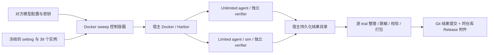

# 难度 Sweep 的 Docker 交付与结果发布计划

2026-09-29。状态：实现计划，尚未实现、发起模型请求、运行 sweep 或发布远端内容。

目标：由我们交付固定版本的镜像和实验 setting，对方提供模型连接信息及凭据，在 GPU 机器上通过一个 Docker 入口运行；系统自动执行、断点恢复、整理结果，并提交到 [topogym_eval_and_sweep_results](https://github.com/LUIGIVAMPER/topogym_eval_and_sweep_results)。

**1. 已确认的实验范围**

- 13 个正式 task，每个 task 的 easy / medium / hard 每档抽 1 个实例。
- 每个实例同时运行 limited 和 unlimited；每种模式独立跑 3 次 trial。
- 每个模型共 `13 × 3 × 1 × 2 × 3 = 234` 次正式 trial；M 个模型共 `234 × M` 次。
- `cube_pick_place` 单独用于交付和模型接入检查，不计入正式成绩。
- 同一 task / difficulty 抽出的实例，在全部模型、两种模式及 3 次 trial 中保持一致。每次 trial 新建 agent 会话与模拟器环境，不继承前次模型上下文或探索产物。
- 本轮衡量一个固定实例上的重复执行表现；3 次 trial 不等于 3 个独立场景样本，不能据此宣称覆盖该难度的完整场景分布。

当前 tier 目录为每个 task 提供一个 easy、medium、hard 具名变体，因此首版“抽样”的主要随机量是变体内的 scene seed。将来同档有多个候选时，再由相同 manifest 机制记录候选池及选择结果。抽样不按模型能否解开来筛选；场景初始化不合格需留存原因，不能静默换 seed。

**2. 已有基础与需要补齐的部分**

核对基线：源码 HEAD `f8f10e02a4de1bf1865089c7aee3b274a1447ca9`；工作区另有进行中的修改，因此正式交付必须使用单独冻结的发布快照，不能仅以该 HEAD 表示当前全部文件。

| 已有实现 | 本计划如何使用 / 补齐 |
| --- | --- |
| `docs/rcb/README.md`、`tasks/` 的 Harbor 两种模式及独立 verifier | 继续沿用正式执行链路 |
| `images/topogym/Dockerfile` | 复用 Genesis / Nyx / 资产镜像，按 digest 固定并发布可拉取版本 |
| `topogym/config/variation_records.py` | 读取正式 tier 候选；integrated 不代表真实运行或成功判据已验收 |
| `rcb_topogym.py` 的实例注册与 make-instance | 当前实例列表主要是固定变体、seed 0；补显式 variation / seed 输入和冻结实例生成 |
| `scripts/topogym_mk_task.py`、`scripts/topogym_mk_limited.py` | 增加独立输出目录及参数化预算；生成 39 个场景、78 个模式任务包，不覆盖现有任务目录 |
| `scripts/collect_batch_results.py`、`scripts/write_task_results.py` | 当前按 task / mode 等路径写结果，会覆盖多个 trial；改为每个 trial、每次 attempt 独立保存 |
| `scripts/run_agent_batch.sh`、`scripts/mem_guard.py` | 复用经验，替换全局容器名和宽泛匹配；新调度器只管理自己的 run |
| `harbor_agents/codex_openrouter.py`、Harbor 内置 agent | 建立明确的模型连接 profile 和接入检查 |

本计划不重新引入旧 `SegmentRunner` / `run_policy` 调度链。评测继续通过现有 Harbor → agent / sim → verifier 完成。`--difficulty` 在当前任务生成器中是说明文字参数，不能靠改这一项来切换物理难度。

目标结果仓库本次未能读取，尚未核实默认分支、已有内容、分支保护与访问权限。实施时先做只读探测，再在不覆盖已有内容的前提下初始化结果结构。

**3. 模型接入：多模型配置，按适配能力开放**

对方提供 model-name 和 api-key 的方式可行，但“任意厂商的任意模型只填这两项”不能保证成立。需要区分：agent harness（例如 Codex）、model（推理模型）、provider（API 服务）以及协议。Harbor 能解析 provider 凭据，不代表当前 agent 自动兼容该 provider 下的所有模型。

| 接入范围 | 对方提供什么 | 首版处理 |
| --- | --- | --- |
| 固定 Codex + 已支持的 OpenAI API 模型 | model-name、API key | 首版交付主路径；每个实际模型需完成接入检查 |
| Codex + 第三方兼容服务 | model-name、API key，通常还需 base URL / provider | 显式 profile；验证 Responses、工具调用、流式响应和图像后开放 |
| 项目现有 CodexOpenRouter | 完整嵌套模型名、OpenRouter key，可选路由约束 | 保留现有适配器；不能因此声明全部 OpenRouter 模型都可用 |
| Claude Code + 对应 API 模型 | model-name、对应 key / provider | 后续扩展，单独验收；报告必须区分 harness |
| 仅 Chat Completions、无所需工具或图像能力的模型 | 上述信息仍不足 | 明确列为不支持；首版不开发通用协议翻译层 |

Codex 的自定义 provider 配置包含 `base_url`、`env_key`，当前文档中的 `wire_api` 为 `responses`。因此“OpenAI-compatible”标签本身不足以证明可接入 Codex。[官方配置说明](https://learn.chatgpt.com/docs/config-file/config-reference)

实现原则：

1. 外部统一使用 `models.yaml`，支持模型列表；默认 profile 为 `codex_openai`，该路径只需 model-name 和对应 key 文件。
2. 非默认服务要求填写 provider / base URL / adapter。未知 profile 提前失败，不猜测供应商，也不按失败情况偷偷切换模型。
3. 设置 `model_id`（用户原始名称）、实际传给 provider 的名称、adapter、harness 版本、推理参数、endpoint 身份和配置哈希。记录返回的模型身份（若服务提供）。
4. 接入检查必须由实际 agent 完成至少一次命令工具调用、读取图像，并通过 cube 的 limited / unlimited 短流程，产出轨迹、评分及录像。连通性检查通过不要求模型解题成功，但必须有真实执行证据。
5. 冻结支持列表后才开始正式 sweep。未通过接入检查的模型记录为 `unsupported` 或 `preflight_failed`，不能把未运行的 234 项伪记为模型失败。
6. 首版限定 Codex harness；多模型可以是同一已支持 provider 下的多个模型。其他 harness 后续单列结果，避免把 harness 差异当成纯模型差异。

拟议配置示例（不是已经存在的 CLI / schema）：

```yaml
models:
  - id: model_a
    profile: codex_openai
    model_name: "<对方提供的模型名称>"
    api_key_file: /run/secrets/model_a_key
    agent_args: {}  # 推理强度等按该模型支持范围显式固定
```

密钥只由对方在本机填写；不写入 setting、镜像、manifest 或 Git。GitHub 发布凭据另行配置，只交给发布组件，不传入 agent / sim / verifier。模型 key 按 provider 定向传递，不能把全部模型及 GitHub 凭据作为公共 env-file 灌入每个 trial。

**4. 固定实验包与身份**

我们在发布阶段完成抽样和 GPU 场景准备，交付时对方执行已经冻结的场景，避免每台机器重新抽样。

拟新增 `configs/sweeps/difficulty_v1.yaml`，定义：正式 task 清单、三档难度、每档 1 个样本、3 次 trial、两种模式、抽样 seed、预算、录制与资源策略。模型列表是独立输入。

生成 `sweep.lock.json`，固定以下内容：

- sweep schema / setting 版本、正式 task 与候选池快照、sampling seed。
- 39 个选中实例的 task_id、difficulty、variation_id、scene seed、完整 simulator 配置、资产与 instance 文件哈希、辅助抓持设定。
- 78 个任务包的哈希，以及 unlimited 环境、verifier、limited sim 所用 instance 的一致性。
- 模拟器源码快照哈希、Git commit、依赖锁、镜像 digest、Harbor 与 agent CLI 版本。
- 每个模型的有效非敏感配置、提示词与工具版本、agent / verifier / sim 各阶段预算。

抽样使用排序后的候选集合和固定算法。不能用进程随机化的 Python `hash()` 推导 seed。trial 编号仅表示重复次数，不自动修改 scene seed；模型随机 seed 仅在供应商支持时传入，并记录是否生效，不承诺云端模型输出可逐字复现。

每个实例需要做初始化、Nyx 观测、基本动作、终止判据接口和重放检查；未满足交付条件的场景明确列为阻塞，不能用 integrated 或静态解析代替运行验收。不同 GPU 的动力学差异按当前 GPU verifier 规则报告，不强加逐位状态哈希相等；配置、资产和实例文件身份必须一致。

**5. Docker 交付架构**

交付一个 `topogym-sweep` 控制镜像，内含固定版本 Harbor、Docker CLI / Compose、任务包、调度器、整理器和发布器；同时发布其依赖的模拟器及任务运行镜像。尽量预构建任务运行镜像，减少对方首次运行时的安装与构建。



首版使用 Linux + NVIDIA GPU + NVIDIA Container Toolkit + 本机 Docker daemon。控制容器挂载 Docker socket，由 Harbor 在宿主 daemon 创建兄弟容器，保持现有两种模式与评分隔离。Docker socket 只给控制器；agent 不能获得它。交付说明需明确控制器具有宿主 Docker 管理权限。

必须解决以下容器化细节：

- **路径**：Harbor 要挂载的任务、sim 文件和 job 目录都必须存在于宿主共享工作目录；控制容器使用与宿主相同的绝对路径。镜像入口先将冻结实验包解包到该目录并校验。仅存在于控制容器 `/opt/...` 的文件不能直接当宿主 bind source。[Docker bind mount 规则](https://docs.docker.com/engine/storage/bind-mounts/)
- **GPU**：按 GPU UUID / 设备 ID 给实际 agent、sim、verifier 容器分配设备；只给控制容器加 `--gpus` 不会完成此事。
- **CPU / 内存**：资源限制落实到各执行容器，不只约束控制器；初始并发设为 1，测量刚体和 FEM 峰值后增加。Docker 默认不会自动限制全部资源。[Docker 资源限制说明](https://docs.docker.com/engine/containers/resource_constraints/)
- **生命周期**：所有自建资源标记 run_id；Harbor 子资源通过 labels 或明确的容器 ID 记录归属。SIGTERM 时停止新任务、等待或终止本 run 的活动任务、整理已完成结果；SIGKILL 后由 resume 对账。
- **持久化**：jobs、状态数据库、整理结果和上传状态放宿主 volume；缓存可丢弃，正式结果不能随 `--rm` 消失。
- **资源保护**：监测 CPU / 内存，达到项目规定的 90% 阈值时停止本 run 的相关工作并保存状态；不沿用现有 mem_guard 的跨项目宽泛匹配，不终止其他实验。

交付给对方的目标操作形式如下；镜像、digest、入口及参数是待实现接口，不可直接运行：

```bash
SWEEP_ROOT="$PWD/topogym-sweep-work"
mkdir -p "$SWEEP_ROOT"
# 先把 models.yaml 放入工作目录；secrets 目录存模型 key 和 GitHub token。
docker run --rm --init \
  --mount type=bind,src=/var/run/docker.sock,dst=/var/run/docker.sock \
  --mount type=bind,src="$SWEEP_ROOT",dst="$SWEEP_ROOT" \
  --mount type=bind,src="$PWD/secrets",dst=/run/secrets,readonly \
  -w "$SWEEP_ROOT" \
  ghcr.io/luigivamper/topogym-sweep@sha256:<release-digest> \
  run --setting difficulty-v1 --models models.yaml \
  --work-dir "$SWEEP_ROOT" --run-id <唯一批次ID> --resume --publish
```

首版不要求对方安装 Python / Harbor 或克隆开发仓库，但仍需准备 GPU 驱动、Docker 环境、镜像拉取权限、模型和结果仓库凭据。镜像发布验收需在无本地构建缓存的新机器完成。

**6. 调度、预算与恢复**

独立调度器维护固定 trial 清单，逻辑 trial 身份为：`setting_hash / model_config_hash / task / difficulty / sample / mode / trial_index`。每个 attempt 映射到实际 Harbor job / trial，不能依赖被截断的目录名推断身份。

首版建议每个逻辑 trial 调用一次 Harbor（`-k 1`），由调度器展开 3 次重复，便于准确恢复与配额控制；以后需要批处理时也必须保留显式映射。各模型、各模式共用同一 GPU 调度池，避免 unlimited、sim 与 verifier 相互抢占。

状态包括 pending、running、completed、infra_error、interrupted、blocked；任务 outcome 另记 solved / unsolved / agent_invalid，基础设施状态与任务结果分开。

- 按配置设定有限的 API 退避与基础设施重试；认证失败、模型不存在或协议不支持立即阻断对应模型队列。
- 已正常结束但未解开、agent 未交轨迹或交出非法轨迹按评测规则保留为失败；不能靠自动重跑直到成功改变样本。
- verifier 故障优先对同一条轨迹重判，不重新调用模型；保存原判分、每次重判证据和最终采用的版本。
- 必须重启模型时另建 attempt，保留原始记录和所有耗时 / token / 费用。预先固定有效 attempt 的选择规则，不按最高分选择。
- resume 先核对 manifest、模型配置和文件哈希，再检查已存结果与活跃容器；不盲目重启仍在运行的 trial。完成且证据完整的 trial 跳过，状态冲突停止并报告。
- 配置、模型或预算改变时创建新 run。首版一个控制器管理一个 run，以锁防止两个实例重复调度；跨机器分片作为后续扩展。

预算暂沿用现有每 trial agent 5400 秒，最终放入 setting 并同步生成到任务、sim 和 verifier 配置。仅 agent 上限为 `234 × 1.5 = 351 小时 / 模型`；这是全部用满预算时的串行 agent 时间，不包含初始化外开销、独立重放、录像和重试。先以小批量分别测刚体 / FEM / 两模式的时间、显存和磁盘量，再给对方总时长与并发建议。模型价格未知时费用记 null，不能填 0；API 返回用量和本地价格估算分开。

**7. 结果结构与统计口径**

结果仓库拟采用：

```text
runs/<run_id>/
  README.md
  manifest.json
  setting.yaml
  models.redacted.yaml
  instances/index.json
  trials.jsonl
  summary.csv
  summary.md
  artifacts.json
  checksums.sha256
  trials/<model>/<task>/<difficulty>/<mode>/trial_01/
    result.json
    attempts/attempt_01/
      result.json
      reward.json
      evidence.json
```

每个 trial 记录：身份、状态、成功与否、诊断码、agent / verifier 用时、token、费用来源、动作与仿真步数、reset 次数、实际模型和 harness、实例哈希、attempt / regrade 链，以及原始产物位置。三次重复全部保留，禁止只取 latest / best。

完整附件包含脱敏后的 Harbor 原始日志、agent 对话与脚本、轨迹、verifier 证据与 replay 视频、冻结实例与复现清单。引用公共录制模块和当前 Harbor 录像产物，不另写一套视频采集循环；模型辅助抓持、失败、局部执行等按实际情况标注。

汇总按 model × harness × mode × task × difficulty 输出：

- expected / completed / evaluable / infra_error / missing 数量。
- 成功次数与 `successes / 3`，并同时显示有效评测数；不足 3 次有效评测的单元格标记 incomplete，不能呈现为完整成功率。
- `successes / evaluable` 作为有效评测成功率；总体同时报告完成率和基础设施错误率，不隐藏失效样本。
- 3 次中至少成功一次可单独列出，但不得替代逐 trial 成功率；本轮不额外引入有统计假设的 pass@k 估计。
- 用时、token、费用统计包含所有重试开销，并与正式计分 trial 的统计分开。

**8. 自动打包、commit 与发布**

建议小型 JSON / CSV / Markdown 元数据直接提交 Git；视频、轨迹和压缩后的完整日志上传到**同一个结果仓库的 GitHub Release**，Git 内的 `artifacts.json` 保存下载位置、大小、SHA-256 和 trial 对应关系。这样 clone 结果仓库即可分析，按需下载完整证据。

普通 Git 在 GitHub 上阻止超过 100 MiB 的单文件，持续把录像压缩包塞进 Git 历史也会增加克隆成本。[GitHub 大文件说明](https://docs.github.com/en/repositories/working-with-files/managing-large-files/about-large-files-on-github)

附件按 task / model 等稳定边界打包，超大包分片；建议单片不超过 1 GiB，并在发布前检查实际平台限制。GitHub 当前 Release 文档列出每文件小于 2 GiB、每个 release 最多 1000 个附件。[GitHub Release 限制](https://docs.github.com/en/repositories/releasing-projects-on-github/about-releases)

发布流程：

1. 结果先在本地完成；失败或中断的 trial 也生成记录，统一校验是否对齐预期矩阵。
2. 生成独立的发布 staging 副本；按白名单收集文件、排除凭据、扫描并脱敏日志，再计算发布版本哈希。保留本地原始证据，不就地修改原件。
3. 在独立 checkout 创建 `runs/<run_id>` 分支，提交 metadata 与文件清单并 push；不把开发源码仓库当结果工作树，不 force push。
4. 创建唯一 Release tag / draft，分片上传并核对大小与哈希；记录每个附件完成状态。发布重试按 run_id + checksum 去重，同名不同内容报冲突。
5. 上传全部成功后补交最终 `artifacts.json` 和发布状态；将唯一最终 tag 指向包含完整清单的提交，再公开该 Release。Git 和 Release 操作不是单个事务，需有可恢复的发布状态机。
6. 默认结果直接 commit 到专用 run 分支。需要汇入默认分支时可选自动 PR；无需 PR 就能访问分支结果和 Release。默认分支保护、PR 权限与汇总索引策略在仓库探测后确定。
7. 上传失败标记 `publish_pending`，结果仍在宿主目录；提供独立 `publish --run-id ...` 重试入口，不重跑 rollout。批量运行中定期更新小型进度元数据，大附件按已完成分组增量发布。

GitHub 凭据使用仅限结果仓库的细粒度 token（contents 写入；启用 PR 时再给相应权限）或仓库安装的 GitHub App。模型 API key 与发布凭据分开。若对方无仓库写权限，仍能执行和生成同样的结果包，但自动 push 必须由持有发布凭据的一方补做。

**9. 实施顺序与交付验收**

| 阶段 | 主要改动 | 验收条件 |
| --- | --- | --- |
| P0 固定实验定义 | setting / lock schema，显式 variation + seed，生成器输出目录与预算参数 | 39 个实例、78 个模式任务包，每模型恰好 234 个唯一逻辑 trial；同场景双模式一致 |
| P1 Docker 可移交 | 新增 `images/sweep/Dockerfile`、入口，锁依赖、发布镜像；处理宿主路径和 GPU | 无源码 checkout 的新 GPU 主机可拉取镜像，cube 两模式完成真实执行与独立评分 |
| P2 模型接入 | `models.yaml`、Codex profile、模型预检与版本锁 | model-name + key 主路径可用；工具 / 图像 / 两模式通过，错误 key 和不兼容协议明确失败 |
| P3 Sweep 调度 | 新增 `scripts/run_sweep.py`，trial 状态库、资源归属、resume、有限重试 | 同一实例连续 3 次不覆盖；中断恢复不重复计分；只清理本 run 资源 |
| P4 整理与发布 | 新增 `scripts/collect_sweep_results.py`、`scripts/publish_sweep_results.py`，调整旧整理器共用逻辑 | 可从原始 jobs 重建汇总；证据和哈希可追溯；断网后只补上传；凭据不进入提交 / 附件 |
| P5 交付演练 | 最小使用说明、启动命令、恢复 / 发布命令、支持列表与预估资源 | 外部机器完整完成一个 task 三档 × 两模式 × 三次 = 18 次；再验证 FEM 场景与负载，确认全量场景资格 |

测试覆盖固定抽样、试次展开、实例一致性、结果聚合不覆盖、agent 失败与基础设施失败分类、attempt 选择、发布幂等和密钥排除。实际 GPU / 模型验收单列；静态测试不代替真运行。

发布器先用本地 Git / 模拟上传失败做恢复测试，再在专用测试 run 分支及 Release 完成一次真实上传、下载校验，不混入正式成绩。故意断网、停止控制器、缺失录像、错误 key、部分 trial 失败均应留下可解释状态。

实施时还需填入实际 model-name、provider、预算参数，以及结果仓库和镜像仓库权限；这些是交付配置，不影响上述架构。首版先完成 Codex 一条可交付链路，再逐个认证其他模型 / provider，无需把通用多模型兼容层作为 Docker sweep 交付前置条件。
