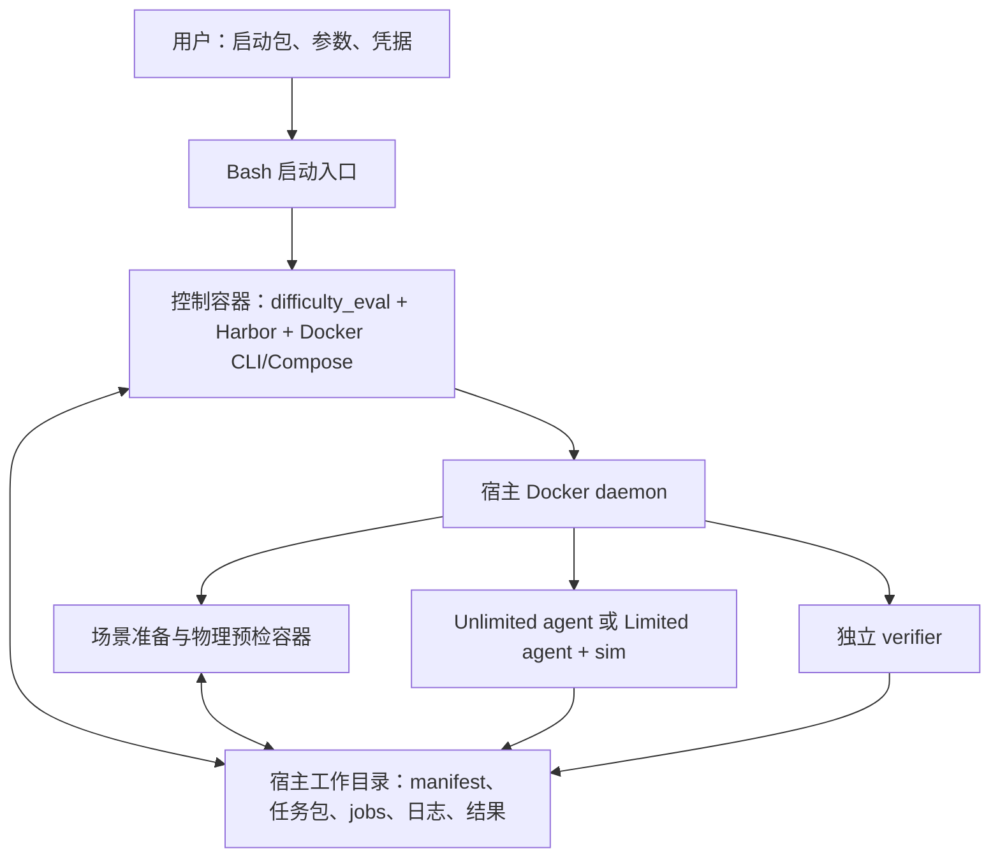

# Difficulty Eval 的 Docker 交付实施计划

更新：2026-09-30。状态：已按计划补充 Docker 交付实现，并完成本机分级验证；独立新机器、真实模型和全部场景的验收仍单列待办。实现与证据见第 11 节，操作入口见 [Docker 启动说明](docker_quickstart_zh.md)。

RTX PRO 6000 Blackwell 上的 CUDA 兼容反馈单列为 [CUDA / Blackwell 工程计划](cuda_blackwell_delivery_plan_zh.md)。当前 cu126 栈不具备该卡的完整验收证据；新计划覆盖 PyTorch wheel 选择、IPC 多架构构建、后端检查与 GPU 使用窗口管理，尚未实施。

目标：没有 TopoGym、Python、Harbor、Codex 或本项目虚拟环境的新用户，在已具备 Docker 与 GPU 运行条件的主机上，拉取本仓库的受支持版本后，直接运行 `bash bash_scripts/run_difficulty_trials.sh ...`，即可自动准备所需镜像与容器，完成抽样、场景准备、预检、订阅/API 认证、双模式 trial、恢复和结果汇总。另保留不含源码 checkout 的发行启动包。

本计划更新原 Docker sweep 交付文档，以当前 `difficulty_eval.py` 为实现基础。旧稿中的每模式三次重复、234 trials、多模型队列、cube 接入前置和自动发布结果，不属于本次容器化的必需范围；后续扩展见第 10 节。本次不另写一套 sweep 调度器。

## 1. 交付合同与首版范围

### 用户需要准备什么

- Linux x86_64 主机、受支持的 NVIDIA GPU、宿主 NVIDIA 驱动、Docker Engine/CLI，以及已配置好的 NVIDIA Container Toolkit。
- 可写的结果目录、足够的磁盘/内存/显存，以及访问镜像仓库和模型服务的网络条件。
- 自己的订阅登录，或 API key 与 model name。模型访问资格由其账户决定。
- 使用 Bash 入口时，需要系统自带的 Bash 和基础文件工具；选择 clone/pull 仓库方式时，Git 仅用于获取代码，下载源码归档或发行包可不安装 Git。Docker 安装须包含本地构建所需的 BuildKit/Buildx 能力。Docker Compose 插件、Python、Harbor、Codex、Node/npm、仿真与渲染依赖由镜像提供。

宿主驱动与 NVIDIA 容器运行时仍需部署；应用镜像不能替用户安装并启用宿主 GPU 驱动。[NVIDIA 官方安装要求](https://docs.nvidia.com/datacenter/cloud-native/container-toolkit/latest/install-guide.html)

首版限定本机 Docker daemon，不把远程 Docker、Docker Desktop、rootless、Windows/macOS、ARM 或跨主机分片列为已支持。具体发行版、驱动下限、Docker/Toolkit 版本、显存和磁盘需求由交付演练确定并记录，不根据开发机配置猜测。

### 实验语义保持不变

| 项目 | 交付版本要求 |
| --- | --- |
| 任务 | 固定 1–13 映射，默认全部，支持编号/区间/名称选择 |
| 难度与模式 | 每个任务固定 easy / medium / hard × unlimited / limited |
| 抽样 | `--samples-per-difficulty` 默认 1，可覆盖为 3、5 等；同 seed 保持样本前缀稳定 |
| Trial 数 | 每实例/模式一次，默认 `13 × 3 × 1 × 2 = 78`；tasks 8,9 为 12 次 |
| 预算 | agent 默认 21600 秒；432 / 1080 秒短预算继续支持，同步到 sim、collection 和 verifier |
| 并发 | 首版保持 1 |
| 认证 | 订阅和 API key 两条路径；保留已有 OpenAI/OpenRouter 接入边界 |
| 启动门槛 | 全部所选实例完成 prepare 和 preflight 才能启动模型 canary/正式 trial；单独 run 也检查 |
| 恢复 | 完成项跳过；中断/基础设施失败仅在显式 `--rerun-incomplete` 时创建新 attempt |
| 日志 | 保留五阶段标题、任务/难度/sample/mode/attempt、GPU 等待提示、逐 job 日志和汇总 |
| 判分 | 保留 not_evaluable、基础设施失败、非法提交的独立分类；容器化不改变成功判据 |

模型名称和推理参数仍由用户明确给出，不把 Luna 固定成唯一可用模型，也不在失败时替换模型。认证 canary 独立于上述正式 trial 数。

## 2. 实施前基线与本次改造

以下记录实施前的代码核对及改造动机；实施结果见第 11 节，不代表全部真实场景或模型已验收。

| 当前实现 | 直接搬进 Docker 会遇到的问题 | 本次改造 |
| --- | --- | --- |
| [Bash 入口](../../bash_scripts/run_difficulty_trials.sh) 默认执行 `.venv-gs121-nyx/bin/python` | 外部用户没有该虚拟环境 | 发布版入口启动控制镜像，实验参数透传 |
| [difficulty_eval.py](../../scripts/difficulty_eval.py) 使用脚本位置推导 ROOT，默认读取 `.venv-harbor/bin/harbor` | 镜像只读代码、用户数据与宿主路径混在一起 | 分离 release/source root 与 work root；使用镜像内固定 Harbor 路径 |
| [抽样器](../../scripts/sample_difficulty_instances.py) 复制 dirty 源码并运行 `git rev-parse HEAD` | 控制镜像及发行包不能假设存在 `.git`，即使用户从仓库启动 | 构建/发布元数据替代容器运行时 Git 探测；保留本地开发快照模式 |
| [模拟器镜像](../../images/topogym/Dockerfile) 已包含 Genesis/Nyx/机器人/视觉资产 | 尚不含调度器与 Harbor；不能直接替代控制镜像 | 复用模拟器镜像，新增控制镜像 |
| 本机 Harbor 0.23.0 元数据要求 Python >=3.12；模拟器镜像使用 Python 3.11.15 | 直接在现有模拟器 Python 中安装 Harbor 不满足其版本要求 | 控制器使用独立 Python 3.12 环境，仿真镜像保留已验证的 3.11 环境 |
| [根 .dockerignore](../../.dockerignore) 只放行仿真镜像需要的文件 | 调度器、模板、配置及 Markdown 指令不会完整进入新控制镜像 | 新控制镜像使用独立构建白名单 |
| limited agent / verifier 模板使用浮动 `python:3.12-slim`，agent 构建时未锁定 Python 依赖 | 只固定主镜像不足以复现整个任务环境 | 锁定所有执行镜像及依赖；把稳定依赖提前构建 |
| prepare 每个 run 按源码哈希重建基础镜像 | 用户运行时重复安装大依赖，且不能直接复用已发布镜像 | 发布模式读取固定 runtime digest；仅构建实例相关的轻量任务层 |
| 各处直接使用 GPU 0、`--gpus all` 或 Compose `count: 1` | 控制器与实际 sim/agent/verifier 可能选到不同设备 | 统一 GPU 选择并映射为宿主 GPU UUID，传播至所有子容器 |
| run/GPU 锁、进程组清理在宿主进程语义下工作 | 杀掉控制容器不会自然清理兄弟容器；不同工作目录的 GPU 锁互不相见 | 增加持久化控制器身份、daemon 内 GPU 锁及容器对账 |
| [push_images.sh](../../scripts/push_images.sh) 明确阻止推送 topogym | 仓库记录的原因是 Nyx 再分发条件尚未确认 | 将发布条件列为交付依赖，同时提供仅用 Docker 的本地构建路径 |

## 3. 推荐架构：一个用户入口，多个职责明确的镜像

“整个项目 Docker 化”指整条实验链路所需软件都由镜像提供。保持 Harbor 当前的 agent、sim 和 verifier 隔离，不把所有角色塞到一个容器里。



图中的工作目录表示数据汇集位置，不表示 agent 可以挂载整个工作目录；实际挂载范围继续由任务包与 Harbor 限定。

### 3.1 控制镜像

新增 `images/difficulty-eval/Dockerfile`，镜像名称建议 `topogym-difficulty-eval`。包含：

- Python 3.12、固定版本 Harbor、Docker CLI/Compose、必要基础工具。
- 当前调度器、抽样器、任务生成器、结果整理器、检查工具及 Harbor adapters。
- 抽样/配置加载需要的 TopoGym CPU 依赖；通过镜像内 `plan` 实测确认，不假定只装 Harbor 就够了。
- 固定版本 Codex CLI 及其运行依赖，用于容器内订阅登录；版本与正式 agent 的选择记录一致。
- 版本化 release bundle：评测源码、模板、配置、资产清单及构建信息。

控制镜像不运行 Genesis 物理。首版在其中验证 Python 3.12 下的抽样结果与发布基线一致；如果数值配置依赖需要独立环境，环境也安装在镜像里，不转移给宿主。

### 3.2 仿真及任务镜像

继续使用 `images/topogym/Dockerfile` 构建 runtime，保留 Python 3.11、CUDA/Torch、Genesis/Nyx、FEM/IPC、机器人与视觉资产。按实际角色补齐并固定：

- unlimited agent 基础层：仿真依赖 + 已支持 agent CLI；
- unlimited verifier / limited sim：仿真运行环境；
- limited agent：客户端依赖 + agent CLI，不装模拟器源码；
- limited verifier：评分依赖。

共享依赖层可以复用同一基础镜像，不要求为每个 task 发布一个巨大镜像。任意 sampling seed / N 对应的 instance、说明和评分工具在用户机器上生成，再由 Harbor 构建轻量任务层；改变样本数无需重新发布仿真基础镜像。

完整评测源码仅供可信控制器使用。agent 能见到的镜像继续遵守现有模板与 [prune.py](../../images/topogym/prune.py) 的内容边界，不打入参考策略、历史轨迹、旧 runs、legacy 或开发机凭据。

### 3.3 使用宿主 daemon，避免额外嵌套 daemon

控制器通过挂载 Docker socket 调用宿主 daemon；Harbor 创建的是与控制器并列的容器。控制器不启动另一个 Docker daemon，agent / sim / verifier 不获得 Docker socket。

这使控制器具备宿主 Docker 管理能力，必须在启动说明中明确，但不要求给所有容器加 `--privileged`。只有可信发布代码负责调度与清理。[Docker daemon 权限说明](https://docs.docker.com/engine/security/)

## 4. 必须完成的工程改造

### 4.1 依赖锁、构建上下文与发行身份

1. 新增控制器依赖输入与锁文件，记录 Python、Harbor、Docker CLI/Compose、Codex 和关键 Python 库版本；运行镜像补齐 `trimesh`、limited 客户端等当前未固定的依赖与基础镜像 digest。
2. 核实安装的 Harbor 是否存在本地改动。版本号相同不足以证明代码相同；如确有修改，交付可重建的 fork/补丁或带哈希的 wheel，而非复制开发机整个 venv。
3. 新增 `images/difficulty-eval/Dockerfile.dockerignore`。现有根白名单继续保护模拟器构建；控制器明确包含任务模板中的 Markdown、shell 与 Python 文件。Docker 支持每个 Dockerfile 使用独立 ignore 文件。[Docker 构建上下文说明](https://docs.docker.com/build/concepts/context/)
4. 在维护方干净的发布快照上构建。开发中的 dirty 文件若进入发布，记录实际逐文件哈希；不能仅用 commit 号冒充完整源码身份。
5. 镜像内记录 `build-info.json`：release ID、源文件清单、配置/抽样版本、依赖锁和 runtime 来源（已发布 digest 或本地构建配方哈希）。发行镜像构建并推送后再生成外部 `release.lock.json`，绑定 controller/runtime/辅助镜像 digest，避免自身 digest 循环写入镜像；本地构建另记实际 image ID，不要求先推送镜像。
6. 核对 robot meshes、task templates、HDRI/纹理、Blanket 初态准备所需数据等是否完整。保留资产来源和哈希；不得依赖开发机的 `~/.cache`、绝对 URDF 路径或未导出的外部文件。
7. 首版允许发布/构建时联网；运行时仅保留明确需要的模型与镜像访问。预装固定 agent CLI，避免每个 trial 无提示地安装 `latest`。用户覆盖 agent 版本时须明确其下载行为并锁入 execution 配置。

### 4.2 拆分源码根目录与可写工作目录

给 `difficulty_eval.py` 增加 `--work-dir`，发布模式从镜像携带的 release bundle 获取源码，工作目录只承载本次实例、构建上下文和结果。示例结构：

Docker Bash 入口未指定 `--work-dir` 时，默认使用**启动命令时宿主当前目录下的 `topogym-work`**（`$PWD/topogym-work`）。启动器在任何切换目录或进入容器之前确定该路径，自动创建目录并打印解析后的绝对路径；用户无需先设置 `EVAL_WORK_DIR` 变量。显式 `--work-dir` 优先，传入相对路径时也相对于同一个宿主启动目录解析。`check` 和实验入口共用该规则，容器内 Python 接收已解析的绝对路径，不按容器的工作目录重新推导。

```text
<work-dir>/
  releases/<release-id>/        # 校验后解包的公共工具/配置
  runs/difficulty_trials/<run-id>/
    source/                    # 该 run 使用的冻结输入
    manifest.lock.json
    source_identity.json
    image.json
    build/ tasks/ instances/
    trials.jsonl summary.csv summary.md
  jobs/difficulty_trials/<run-id>/
  cache/                       # 可丢弃缓存，与正式证据分开
```

改造要点：

- 发行模式读取 build-info，不要求镜像或宿主有 `.git`；本地开发模式仍支持当前 dirty 快照流程。
- 区分 release bundle 哈希、实际模拟器源码哈希和 Docker image digest，不继续把所有调度脚本变化等同于仿真镜像变化。
- `prepare` 验证指定 runtime 来源：已发布镜像核对 digest，本地构建核对配方/源码哈希及对应 image ID；记录架构和源码身份，拒绝 tag 漂移或源码/镜像不匹配。
- 控制器启动、缓存命中和 resume 不重新抽取旧实例，不重写已有 manifest、预算或已完成 trial。
- 保持旧本地 run 的读取和本地运行能力。首版 Docker 新 run 使用新的路径身份；跨机器搬迁旧 run 是显式迁移工作，不默默改写旧文件中的绝对路径。

### 4.3 宿主路径映射、文件权限与临时目录

控制容器内可见文件不等于宿主 daemon 能把它 bind mount 给子容器。Docker 的 bind source 由 daemon 所在主机解析。[Docker bind mount 规则](https://docs.docker.com/engine/storage/bind-mounts/)

采用一个明确规则：启动器将 work-dir 解析成宿主绝对路径，控制器按相同绝对路径挂载它；子容器所需的 source、task package、limited sim、jobs 和 verifier 目录先落在该共享目录。

- 不能将仅存在于控制镜像 `/opt/...` 的路径，直接作为兄弟容器的 bind source。
- 核对 Harbor 生成的 Compose 配置、相对路径、临时文件和 verifier 环境；将需要被 daemon 读取的临时目录放入共享 work-dir，而不是控制器私有 `/tmp`。
- 全流程使用参数数组和正确引用，支持用户目录名含空格；对 Docker mount 语法不能支持的路径字符提前给出明确错误。
- 控制器以调用方 UID/GID 写结果，并适配 Docker socket 的组权限；Harbor 子容器生成的文件也必须验收可读、可恢复、可清理，不能依赖事后对整个磁盘递归 chown。
- 凭据使用独立私有目录，不放进 source、task package、jobs 或结果压缩包。

### 4.4 入口、预检与用户体验

仓库版保留 `bash_scripts/run_difficulty_trials.sh`，独立发行包使用根目录的 `run_difficulty_trials.sh`，两者来自同一入口实现。默认自动准备并启动控制镜像；Bash 仅处理镜像准备/挂载/TTY/信号等启动事务。任务选择、阶段执行、守卫、认证策略和恢复仍由 Python 统一处理，不复制到 Bash。

- 当前 `--phase`、`--tasks`、`--samples-per-difficulty`、`--sampling-seed`、`--agent-wall-clock-s`、`--auth`、`--model`、`--agent-arg`、`--resume` 等参数继续可用。
- 拟增加 `--work-dir`、`--gpu-device` 和发行镜像选择配置；已发布镜像绑定 release.lock 中的 digest，本地构建绑定源码与配方哈希，不默认追踪浮动 latest。
- 开发者仍可直接运行 Python；若在同一个 Bash 入口保留 local 后端，必须显式选择，不能发现 Docker 出错就静默退回宿主 venv。
- 同一入口拟增加 `check` 和 `auth login` 子命令，分别负责无模型调用的环境检查和容器内登录；普通 `--phase ...` 调用仍默认进入 difficulty eval。
- `check` 在容器内检查 Docker/Compose 兼容性、共享目录探针、权限、GPU/CUDA/Nyx 能力、必要资产和磁盘空间；失败给出修复点。它与逐场景 preflight 分工明确。`check` 不调用模型，但空缓存时可能需要先拉取或构建检查所用镜像。
- `all` 自动包含必要的环境检查，不要求用户先手工执行 `check`。实验阶段保持 planning → preparing → preflight → running → collecting；镜像首次准备显示独立的 bootstrap 日志。全部实例过关前不能启动 canary；阶段/任务日志实时输出，同时保存控制器总日志，已有逐实例/job 日志继续保留。
- CPU 合同检查在构建/发布 CI 中执行；用户运行不必每次先跑开发测试套件。

### 4.4.1 `--phase all` 自动准备环境的明确合同

用户获取仓库后，不需要另跑 `docker build`、`docker pull`、`pip install`、`uv`、Harbor 安装或手工创建虚拟环境。统一入口承担以下步骤：

1. **最小宿主检查**：检查 Docker daemon 可访问、工作目录可写及必要 Docker 构建能力。缺 Docker、驱动或 Toolkit 时给出明确安装指引，不自动以管理员权限修改系统。
2. **准备控制镜像**：已有匹配镜像则校验后复用；声明为已发布的版本按 digest 拉取；声明为本地构建的版本使用仓库内固定配方构建。构建不调用宿主 Python，依赖安装都发生在 Docker build 内。
3. **启动控制器**：自动创建/挂载共享工作目录与私有认证目录，传递参数、TTY 和信号。
4. **准备运行镜像和检查环境**：控制器按同一规则获取或构建 runtime/agent/client/verifier 所需基础层，并执行 `check` 的适用检查。源码冻结后生成任务包，Harbor 自动构建实例相关轻量层并管理运行容器。
5. **执行实验**：真实 preflight 全部通过后执行 canary、正式 trial 和汇总。镜像准备失败时停止，不启动模型。

本地构建顺序不能循环依赖：仓库提供固定源码/依赖构建配方，先形成控制镜像；其中携带 runtime 构建配方，运行镜像构建完成后将实际 image ID 与输入哈希写入本机缓存及 run 身份记录。本地尚未推送的镜像不伪造 registry digest；公开发行时再形成完整的 digest 清单。

相同输入复用校验过的缓存；换任务子集或 sample 数不重装基础依赖。源码或依赖变化时重新构建受影响镜像，镜像构建按身份加锁，避免并发启动重复构建。发生仓库权限、校验或网络错误时明确失败，不把任意 pull 错误悄悄当成使用另一份源码的理由。

`auth login` 只准备登录所需的控制镜像；`plan`、`--help`、`--list-tasks` 不要求先构建仿真镜像或通过 GPU 检查。入口按调用需要准备环境，不让 CPU 操作意外变成完整 GPU 实验。

首次下载镜像、编译依赖及仿真内核可能耗时较长，输出构建进度与日志位置；“一条命令开始”表示无需人工安装项目依赖，不承诺空缓存机器几秒启动。后续执行复用缓存。

### 4.5 订阅与 API key 都不依赖宿主 Codex

订阅路径：

1. 控制镜像内提供与发布版本配套的 Codex CLI，`auth login` 在容器内执行设备登录；登录本身不需要 Docker socket。
2. 工具管理的 auth 目录持久化于用户私有目录，供后续 trial 使用；验证重启控制器后仍可读取、凭据过期/刷新能正确处理。
3. 已有登录文件可通过 `--auth-json` 只读导入。不擅自修改用户默认 `~/.codex`，也不把宿主 auth 文件路径原样传到不可见的容器路径。
4. 复用当前 subscription/API 隔离和模型 canary。已有 Luna 配置可以作为验收配置，但不是每个用户都自动获得该模型访问权限。

API 路径：

- 保留 `--api-key` 隐藏输入、显式值、`--env-file` 和 `--api-key-env` 的语义与优先级。
- Bash/Docker 边界不得把显式 key 再写进持久化的 Docker `Config.Cmd` 或控制器 `Config.Env`；拟通过 stdin 启动消息或独立只读凭据文件传入，再由控制器按需传给 Harbor。
- `--env-file` 继续按数据解析，不能 shell source；只向对应 agent 传入所选 provider 的 key。宿主未选中的登录/API 环境不得自动注入全部容器。
- TTY 隐藏输入与 CI 非交互模式分别验收；直接在命令行填写 key 仍可能进入用户 shell 历史，不能宣称对此完全隐藏。
- 核对日志、镜像历史、Docker inspect、发布清单和压缩结果中是否存在意外凭据副本；模型运行所需的容器内凭据由明确的认证路径管理。

### 4.6 GPU、宿主资源保护和容量

新增 GPU 选择后，先解析为宿主 GPU UUID，再传到 prepare、preflight、unlimited agent/verifier、limited sim 和监控。不能只给控制容器加 `--gpus`，也不能混用容器内重新编号的 0 与宿主索引。

控制器只需要 GPU 的监控能力，可使用 NVIDIA `utility` 支持 nvidia-smi/NVML；物理/渲染容器保留 CUDA 与 Nyx 所需的 graphics 能力。具体设备和驱动能力由每个容器独立声明。[NVIDIA GPU 与 driver capabilities](https://docs.nvidia.com/datacenter/cloud-native/container-toolkit/latest/docker-specialized.html)

系统内存 90% 保护必须继续反映宿主状态（2026-09-30 更新：CPU 仅记录，不因超过 90% 停止），不能因为搬进容器而变成控制器自身的 cgroup 读数。实现时验证宿主 `/proc` 只读采样或等价数据源，并与宿主读数对照；无法获得正确读数时明确失败。容器自身限额与宿主保护分别记录，只处理本 run 的工作。

测量基础镜像体积、构建峰值、刚体与 FEM/IPC/Blanket 的显存/内存、录像和缓存增长，发布实际需求范围。首版不提高并发，也不承诺 432 秒包含镜像构建、初始化、准备和评分时间。

### 4.7 容器生命周期、锁与恢复

当前 Python 进程组停止逻辑需要延伸到真实 Docker 资源：

- controller、prepare、preflight、Harbor agent/sim/verifier、网络分别标记角色、release、workspace identity、run-id 和 attempt。清理匹配组合身份，不只依赖容易重名的 run-id。
- 控制器角色必须从工作容器清理集合排除，避免 `cleanup_containers()` 在每个 trial 后把自己删掉；清理结束前锁仍由控制器持有。
- 增加 daemon 内按 GPU UUID 的互斥机制，例如通过唯一名称的锁容器原子占位；记录 owner，并在控制器存在且活跃时拒绝抢占。当前 work-dir 内文件锁不能防止两个不同 work-dir 同时运行。
- 采用 exec 入口和 Docker init，转发 SIGINT/SIGTERM；停止超时应覆盖既有进程组/容器/日志收尾预算，实测确定，不能让外层 Docker 提前强杀收尾。
- 持续更新控制器身份与活动 job。SIGKILL/主机重启后，resume 先对账残留容器和 Harbor 状态；活跃旧 owner 不自动重跑，过期资源仅按确认归属处理。
- 不复用中断的 limited episode；显式重试创建新 attempt，保存旧轨迹、日志和统计。
- 控制器退出或删除后，run/jobs/汇总留在宿主；旧 release 的 run 必须使用匹配版本恢复，不自动升级其工具、判分器或镜像。

## 5. 构建、镜像分发与已有发布阻塞

这里区分“用户无 Python/Harbor 依赖”和“用户无需构建镜像”。前者必须实现；后者需要镜像具备可分发条件。

**首选镜像来源：维护方预构建并提供镜像。** 仓库入口和独立发行启动包都能自动拉取固定镜像；启动包另带 release.lock、说明和校验信息，可供不需要源码的用户使用。公开仓库或带权限仓库均可，但需给出清楚的访问方式。

**本地构建来源：用户获取本仓库或冻结源码归档。** 所需 Dockerfile、依赖锁、构建配方与资产获取逻辑随代码交付；统一入口在缺少匹配镜像时自动构建，用户不需要另跑构建脚本。Python/Harbor/仿真依赖安装均在 build 内完成。源码归档方式不要求宿主 Git；首次下载和构建成本明确说明。

当前 `push_images.sh` 对 `topogym` 存在显式阻止分支，注释原因是 Nyx 再分发条件未确认。这是当前仓库的实际交付依赖，不是本计划对许可证作出的法律结论。实施顺序：

1. 核实 Nyx 及需要随镜像分发的资产/依赖条件，记录可分发范围。
2. 在条件明确前，保留现有 push 阻止逻辑，不把本机已有 tag 描述为外部用户可拉取镜像。
3. 若只能用户自行构建，确认其直接获取依赖的方式可用，再交付 Docker 构建包；不把私有镜像仓库当作自动绕过该问题的办法。
4. 可发布后，维护方构建、冷缓存验证、推送镜像、回填真实 digest，再发启动包；镜像发布仍作为独立交付步骤；本次开发没有推送镜像。

## 6. 预计涉及的文件

下列新增入口、镜像配方和依赖锁已落地；交付辅助逻辑放入 `scripts/difficulty_delivery.py` 与 `scripts/difficulty_release.py`，实验阶段继续复用原调度器。

| 文件/目录 | 计划职责 |
| --- | --- |
| `images/difficulty-eval/Dockerfile`、`Dockerfile.dockerignore`、`entrypoint.sh`（新增） | 控制环境、精确构建内容、exec 启动；复杂逻辑仍留在 Python |
| `requirements/difficulty-eval-controller.in` / `.lock`（新增） | 控制器、Harbor 与 CPU 抽样依赖锁 |
| `requirements/` 的 runtime/client 锁与相关 Dockerfiles | 完整固定仿真、limited 客户端/评分和 agent CLI 依赖 |
| `images/difficulty-eval/release.schema.json`（新增） | build-info / release.lock 的身份、镜像映射与兼容信息 |
| `bash_scripts/run_difficulty_trials.sh` | 仓库/发行包共同入口，自动准备控制镜像、Docker 启动、挂载、TTY 和退出码透传 |
| `scripts/difficulty_eval.py` | work-dir、发行模式镜像、check、资源/生命周期适配，继续管理全部实验阶段 |
| `scripts/sample_difficulty_instances.py` | release 元数据来源、无 Git 运行、显式 source root，保留抽样稳定性 |
| `scripts/topogym_mk_task.py`、`topogym_mk_limited.py`、`harbor_templates/` | 按角色使用固定镜像、GPU UUID、共享路径和资源身份 |
| `scripts/build_images.sh`、`push_images.sh` | 可由统一入口复用的固定构建配方，以及维护方分发流程；用户不必手工调用；保留当前 runtime 发布条件 |
| `ci_checks/` 和现有 CI workflow | 控制镜像合同检查、真实 Docker 连接检查、单独 GPU 交付任务 |
| `docs/rcb/README.md`、本计划、发行包使用说明 | 本地/发行模式、首次登录、运行、恢复、错误与资源要求 |

如果 check、release 打包或 auth 路由使调度器明显膨胀，再提取职责单一的共享模块；不新增另一套 prepare/run/collect 流水线。

## 7. 用户最终操作形式

下面的 Docker 接口已实现；当前默认使用本地自动构建，未发布可供外部用户直接拉取的项目镜像。主要使用方式是拉取本仓库的受支持版本后，从仓库根目录执行。控制器/运行镜像的获取、构建、检查和容器启动由入口自动完成。独立发行包也支持相同参数，只需把 `bash_scripts/run_difficulty_trials.sh` 换为包内的 `run_difficulty_trials.sh`。

```bash
# 在已 clone/pull 到本地的 TopoGym 仓库根目录运行。
# 默认自动创建当前目录下的 topogym-work，无需设置环境变量。

# 可选：只检查容器/GPU/路径/资产，不调用模型。all 已自动包含必要检查。
bash bash_scripts/run_difficulty_trials.sh check

# 首次使用订阅时在容器内登录，不要求宿主安装 Codex。
bash bash_scripts/run_difficulty_trials.sh auth login --device-auth

# 自动准备镜像与容器，运行全部 13 个任务，共 78 个正式 trials。
# 每个 trial 的 agent 阶段最多 6 小时。
bash bash_scripts/run_difficulty_trials.sh \
  --phase all --run-id luna-all-tasks \
  --tasks 1-13 --samples-per-difficulty 1 \
  --agent-wall-clock-s 21600 \
  --auth subscription --agent codex --model openai/gpt-6-luna \
  --agent-arg version=0.157.0 --agent-arg reasoning_effort=max
```

已完成订阅登录后，只运行最后一条 `--phase all` 命令即可，无需每次再次 `check` 或登录。首次订阅登录仍需用户按提示授权账户；脚本不能替代该交互。

示例显式写出全部任务、每难度一个样本和 21600 秒预算；省略这三个选项时默认值相同。6 小时限制单个 trial 的 agent 阶段，整个实验的准备、预检、评分及其他 trials 另计。短试跑可改为 `--tasks 8,9 --agent-wall-clock-s 432`，共 12 个正式 trials。

需要把结果放到其他磁盘时，在 `check` 或实验命令中加 `--work-dir /path/to/topogym-work` 即可覆盖默认值。恢复默认目录中的实验时，从相同宿主目录启动；如果换了启动目录，则显式传入原来的工作目录绝对路径。

API 方式可跳过 `auth login`，保留同一实验参数，使用不同 run-id，把认证部分改为 `--model '<model-id>' --api-key`，终端隐藏输入。认证来源或模型变化不能复用已锁定 execution 配置的 run-id。

恢复时使用同一 work-dir、run-id 和 release，再加 `--resume`；只有希望给中断/基础设施失败另开 attempt 时才加 `--rerun-incomplete`。查看结果直接打开 work-dir 下的 summary 和 jobs，不需要在宿主安装 Harbor。

文档同时提供等价的原生 `docker run` 命令，明确共享目录和凭据挂载；Bash 只是便捷入口，不能成为另一套实验实现。

## 8. 实施顺序和逐阶段验收

| 阶段 | 工程交付 | 通过条件 |
| --- | --- | --- |
| P0 发布基线与内容审计 | 冻结当前代码、依赖和资产；确定镜像角色、来源身份和可分发路径 | controller/runtime 所需文件可列举，无隐式宿主路径；版本与发行限制有记录 |
| P1 控制镜像及统一启动 | Python 3.12 + Harbor/CLI，自动拉取/构建的 Docker 启动器、独立 ignore、无 Git plan | 没有宿主 Python/Harbor 的环境能 `--help`、`--list-tasks`、plan；默认 39 实例/78 trials，2 tasks 为 6/12，N=3/5 前缀稳定 |
| P2 工作目录与运行镜像 | 共享路径、runtime 获取/构建、轻量任务层、UID/GID、GPU 传播 | 未指定 work-dir 时在宿主启动目录自动创建 topogym-work，显式绝对/相对路径覆盖正确；直接 all 且无预先 check/build/pull 时也能自动准备并检查环境；缓存复用和失败退出可验证；兄弟容器路径正确 |
| P3 容器内认证 | 首次订阅登录、外部 auth 导入、API key 传输、固定 agent CLI | 无宿主 Codex 可登录；两类认证分别通过真实 canary；失效凭据不会启动正式队列，日志不泄漏 key |
| P4 生命周期和守卫 | 全批预检门槛、跨 work-dir GPU 锁、准确清理、退出/恢复 | 一个实例预检失败时零模型启动；Ctrl-C、docker stop、强杀恢复不重复计分、不清理无关资源、不误删控制器 |
| P5 冷机器端到端演练 | 发行包、真实 GPU/Nyx、两模式评测和证据、资源实测 | 在独立新主机完成下面的分级验收；结果可在控制器删除后读取并重建汇总 |
| P6 可交付发行 | 可拉取镜像或 Docker 构建包、真实 digest、最小用户手册 | 外部人员按手册运行，无需开发机协助安装项目软件；版本和支持边界可追溯 |

P1–P4 继续复用已有 CPU 工作流测试，增加真实 Docker 边界检查；完整物理与模型证据单列，不以 stub 测试作为外部交付通过依据。

## 9. 端到端验收矩阵

1. **无开发环境验收**：独立 Linux GPU 主机或干净系统实例，不安装宿主 Python/Harbor/Codex。仅获取本仓库的发布代码或发行包，不复用开发机的 venv/cache/旧构建产物。分别验证已发布镜像与自动本地构建两种来源：空缓存、未手工执行 check/build/pull，直接运行 all 能完成环境准备；再次运行应复用匹配缓存。
2. **最小试跑**：Cast Coil + Cast Keyhole，三档 × 双模式 × 每档一个样本，共 12 trials，先使用 432 秒预算验证时限、状态与收尾。短预算耗尽不等于解题失败或容器化失败；若未产出有效轨迹，另用足额预算补齐真实双模式链路证据。
3. **模型与评分证据**：订阅/API 各至少验证真实工具调用、图像查看、仿真动作、轨迹、独立评分与录像。canary 通过不代替这些证据，正常 0 分与基础设施错误分别记录。
4. **全任务部署资格**：全部 13 tasks × 3 档默认样本真实建场并通过物理 preflight；N=3/5 的 CPU 抽样与包生成覆盖，额外选取刚体、FEM/IPC 和 Blanket 非默认 seed 做容器重载。不能从两个刚体任务推断全部任务已验收。
5. **故障矩阵**：缺 GPU/图形库、显存不足、目录无权限、镜像不存在、错 key、账号额度耗尽、网络中断、磁盘不足、prepare/preflight 部分失败、SIGTERM/SIGKILL、陈旧锁、同名 run 跨工作目录、旧 release 恢复。均需有可解释的日志与状态。
6. **结果与配置完整性**：实例在双模式间一致；预算全链路一致；所有 attempt 保留；未具备成功计分资格的任务保持 not_evaluable；汇总不能丢掉失败/未运行位置。
7. **发布边界**：镜像与发行包不含凭据、历史解题轨迹或未声明的本机路径。发布许可未确认时，验收报告明确实际使用了本地构建，不能标记为公开镜像交付。

每次真实验收记录 release/digest、宿主 GPU/驱动、配置、起止时间、资源峰值、实际 trial/result 和录像位置。记录与视频沿用已有公共模块，不新增录像实现。

## 10. 本次不作为 Docker 交付前置的后续工作

- 多模型列表、其他 agent harness、每模式多次 replication：可在现有 manifest/attempt 机制上扩展，不能在容器化时悄悄改变当前每模式一次的实验定义。
- 结果自动提交到 `topogym_eval_and_sweep_results`：保留为独立发布阶段。先形成可校验的本地结果包，再按文件白名单、脱敏和哈希生成发布副本；Git 存元数据，大附件分开管理，上传状态独立恢复，失败不能重跑模型。发布凭据只给发布组件。
- 无外网全离线、跨机器调度、异构平台和更高并发：另行定范围及验收，不加入本次最小交付承诺。

实施前需要落实的外部条件是：可用的镜像/构建包分发渠道、Nyx 等依赖的实际分发条件、独立 GPU 验收机器，以及用于真实接入检查的模型账户。其余目录结构、代码复用和工程顺序已可按本计划推进。

## 11. 2026-09-30 实施结果与验收边界

已实现默认 Docker 入口和显式 local 后端，默认工作目录、无 Git 抽样/发行包、控制器与 runtime/client/agent 三个角色镜像、带哈希的 Python 依赖锁、GPU UUID 传播、无模型 check、订阅登录/导入与 API key 传输、守卫、daemon GPU 锁、所属容器/网络清理，以及持久化日志和结果。构建阶段实际生成全部 39 个实例的计划，以发现缺失的 CPU 几何依赖。

控制器在 Harbor 0.23.0 的已核对源码上应用两项小补丁：Codex 临时凭据清理前，将刷新后的 token 原子保存到工具的私有 auth 目录；Harbor 自建的 egress helper 加入相同 owner 标签，便于中断后清理。补丁应用前校验原始文件 SHA；宿主 Harbor 不变。limited verifier 的生成包也补充归属标签，避免只清理 agent/sim。

本机证据统一位于 `runs/test_results/docker_delivery_20260930/`；失败的早期构建/检查日志保留，后续成功记录使用新目录，不覆盖原证据。

| 验证 | 已取得的证据 | 范围 |
| --- | --- | --- |
| 原工作流回归 | `final-cpu-workflow/`：17 项通过 | 抽样、预算、守卫、认证隔离、中断与恢复；Harbor 为 stub |
| 交付合同 | `startup-contracts/`：10 项通过（含无源码启动包） | 启动参数与 key 边界、默认/覆盖路径、镜像身份、GPU 选择、锁与私有凭据刷新 |
| 当前任务静态检查 | `task-static/` 全部通过 | 28 个历史任务目录的公共工具与协议一致性 |
| 真实控制容器抽样 | `container-plan-04/`：39 实例 / 78 trials | Python 3.12 控制器运行，不依赖宿主 venv 或 Git |
| Python 版本间抽样一致性 | `sampling-parity/`：全部 39 个实例逐项相同 | 本机 Python 3.11 与容器 Python 3.12 |
| 真实环境检查 | `final-container-check/` 和 `work/check.json` 通过；缓存复用检查约 8 秒 | 镜像自动构建、同路径 bind mount、调用用户写权限、CUDA、NVIDIA Vulkan、机器人/视觉资产 |
| 真实 Harbor 容器边界 | `harbor-lifecycle/` 与 `work/harbor-boundary-1790750078034886207/report.json` 通过 | nop agent + 合成 sidecar，真实产物收集与独立 verifier；零模型调用，无任务物理 |
| 真实 daemon 锁与强杀恢复 | 同一 `harbor-lifecycle/` 报告中的 lifecycle 字段通过 | 使用合成 GPU UUID 测试全局互斥；阻止不同 work-dir 的活跃 owner 抢锁，强杀测试 owner 后回收它的工作容器，保留其他测试容器；不占用真实 GPU |
| 无宿主项目工具的源码包 | `archive-no-host-plan/`：18 实例 / 36 trials | 无 `.git`，宿主 Python/Harbor/Codex/Node/npm/uv 替换为报错程序；默认 work-dir，2 tasks、N=3 |
| 无源码最小启动包 | `minimal-startup-plan/`：6 实例 / 12 trials | 仅 Bash + 本机固定控制镜像 ID，无源码目录，宿主项目工具同样禁用 |

验证中修复了容器内普通用户无法读取原始 0600 资产、CPU 几何依赖缺失，以及机器人资产检查错误假设存在现成 URDF 的问题。机器人源资产实际为 XML 与 mesh，运行时按项目方式生成所需模型。构建/检查使用 90% CPU/内存保护，未停止无关作业。

尚未据此验收的项目：真实订阅/API 模型交互及账户 token 轮换；全部 13 × 3 场景的物理预检；双模式真实动作、轨迹、评分和录像；独立新机器空缓存演练；公开镜像分发。当前 GPU 上已有其他作业，本轮未启动会占用大显存的任务物理实验。`check` 通过与合成 Harbor trial 通过均不能代替这些证据。现有 runtime 镜像发布阻止逻辑保留。
