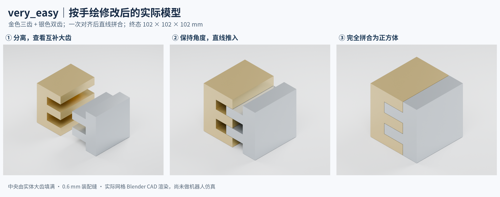
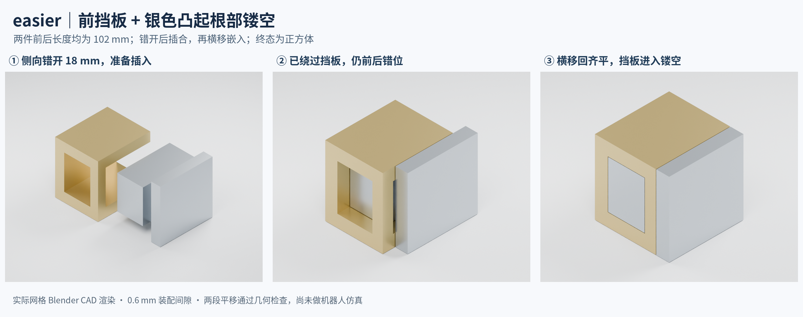

# Cast Coil very_easy 与 easier 正方体装配工程计划

日期：2026-10-02。修订：v5，两档形状已获用户确认，进入完整变体开发。当前模型：very_easy 为 `cubic_comb_v2`，easier 为 `cubic_baffle_v2`。**Task 注册、资源生成、外侧抓持、参考策略及公开目标已接入；18 项几何与变体回归通过，真实机器人流程正在验收。** 102 mm 建模资源保留；仿真实例按 0.5 等比缩放为 51 mm，版本分别为 `cubic_comb_v2_aloha_v1` 和 `cubic_baffle_v2_aloha_v1`。

新增 `cast_coil_very_easy` 与 `cast_coil_easier`，保持两档原定操作区别：**very_easy 对齐后直线拼合；easier 对齐后直插，再保持角度不变横移到位。** 两档最终均为三边等长、外表面齐平的正方体轮廓。两档中央均由实际零件填充，终态为除装配缝外的实心正方体。本次依据用户说明，在 easier 银色大凸起靠外壁处开出镂空槽，让金色前挡板在第二段横移时进入槽内。

very_easy 取消上一版上下框条中的小插销和孔，改成金色三齿、银色两齿的整块互补零件，齿与槽沿深度贯通。easier 改成金色 C 形主体加前挡板，以及银色外壁加中央大凸起；镂空从前侧开口，后段保留凸起与外壁的实体连接。抓持利用两件外侧主体，终态无外凸附件。保留现有 easy／medium／hard 的源码、资产、身份和行为。

## 1. 实际模型截图





以上图片直接由实际导出的三角网格经 Blender Cycles CPU 渲染，没有使用 imagegen，也没有为渲染修改网格。它们是静态 CAD 模型预览，不是 Genesis／Nyx 场景或机器人运行截图。[very_easy 分离正视图与终态](assets/cast_coil_very_easy_comb_front_v2.png)、[very_easy 两件独立视图](assets/cast_coil_very_easy_comb_parts_v2.png)和[very_easy 正交三视图](assets/cast_coil_very_easy_orthographic_v2.png)展示本次修改；[easier 挡板与镂空细节](assets/cast_coil_easier_baffle_parts_v2.png)、[easier 镂空俯视图](assets/cast_coil_easier_baffle_slot_v2.png)与[easier 正交三视图](assets/cast_coil_easier_orthographic_v2.png)可查看细节。

图中金件保持不动以解释相对运动，未来由 ALOHA 双臂抓持两个自由刚体。图中的完成表示几何到位，完整任务仍包括落桌、释放、撤手与稳定。分离视图以平移拉开两件以便查看，不代表已经选定机器人初始摆放。

此前的[imagegen 概念图](assets/cast_coil_very_easy_easier_cube_v2.png)及其[提示词](assets/cast_coil_very_easy_easier_cube_v2_prompts.txt)保留作设计参考；当前形状与尺寸以实际模型及第 9 节记录为准。

| 项目 | very_easy | easier |
| --- | --- | --- |
| 最终外形 | 实心正方体，保留装配缝 | 同尺寸实心正方体，保留装配缝 |
| 两件主体 | 金色三齿与银色两齿，外侧各有连续背板 | 金色 C 形件加前挡板；银色外壁加大凸起 |
| 拼接口 | 沿深度贯通的大齿与互补槽 | 前挡板与大凸起根部的开口镂空 |
| 对齐后的操作 | 一段 X 向平移 | 一段 X 向平移，再一段 Y 向平移 |
| 中间状态 | 尚有左右间距 | 已插入，但两半框前后错位 |
| 到位标志 | 接缝闭合，外表面齐平 | 横移消除错位，前后表面均齐平 |
| 抓持部位 | 外侧连续背板 | 外侧主体，待夹爪验证 |
| 额外旋转或换抓 | 不作为设计要求 | 不作为设计要求 |

## 2. 官方资料和现有三档提供的依据

### 现实 Cast Coil

Hanayama 官方将 Cast Coil 描述为由两件近似同形的卷绕零件组成的带孔盒状整体，通过滑动与旋转分解。官方照片能看到方形回绕、金银交错和中央开口；本次两档简化方案优先服从用户手绘：保留金银两件及方形整体，中央改为实体填充。[官方产品说明](https://hanayama-toys.com/product/cast-coil/)、[官方商品照片及介绍](https://store.hanayamatoys.co.jp/items/55630234)。

官方分销商公布的解法图展示了多次平移和 90° 转动。新版沿用“两件拼回方形整体”的目标，将装配机制分别简化为一段和两段平移，不继承完整解谜动作。[Hanayama 解法图，Eureka 发布](https://www.eureka-puzzle.eu/wp-content/uploads/2022/09/515056-Huzzle-Cast-Coil-Oct-2017.pdf)。

**官方资料没有给出零件精密 CAD，也没有据此确认产品三边严格相等。** 本版的严格正方体约束来自本次用户要求。商品页的 `75 × 119 × 45 mm` 是包装尺寸，不能作为零件尺寸。

### 仓库 easy／medium／hard

当前源码将两件写在共同装配坐标系中，以正交盒体加减构造方形回绕结构，沿深度方向形成金银交错的四层。导出时再转到各自质心坐标，并生成分块碰撞体。新版复用这一几何与资产工程方式，重新设计简化接头。

| 入口 | family | 当前参考装配机制 | 默认名义装配外尺寸 |
| --- | --- | --- | --- |
| `cast_coil_easy` | `baseline_assembly` | 插入、逆 90°、闭合 | 102 × 74.25 × 102 mm |
| `cast_coil_medium` | `axial_screw_turn` | 插入、旋转并撤销 9 mm 轴向位移、闭合 | 102 × 74.25 × 102 mm |
| `cast_coil_hard` | `split_turn_offset` | 插入、逆后 45°、撤销 9 mm 错位、逆前 45°、闭合 | 102 × 74.25 × 102 mm |

尺寸为本轮读取源码和包内资源得到的**装配坐标系中名义尺寸**。easy 的面宽为 `34 × 3 = 102 mm`，深度为 `(4 × 6 + 3 × 0.25) × 3 = 74.25 mm`；medium／hard 的 `authored_boxes_mm` 在默认 scale=3 时具有相同外包围尺寸。因此，当前三档提供构造参考，但不能直接复制并称为严格正方体；本版仅让新增两档满足等边要求。

依据：[现有几何生成器](../../topogym/assets/geometry/cast_coil.py)、[基础模板](../../topogym/assets/resources/templates/cast_coil_template.json)、[medium 几何资源](../../topogym/assets/resources/variations/cast_coil/axial_screw_turn.json)、[hard 几何资源](../../topogym/assets/resources/variations/cast_coil/split_turn_offset.json)、[现有三档说明](../develop/tasks/cast_coil_zh.md)。

## 3. 正方体约束与共同构造

### 先规定完整形状，再划分两件

在最终装配坐标系中定义：

- X：左右拼合轴；银色右半件沿 -X 靠近金色左半件。
- Y：前后／侧向轴；easier 插入时先沿 +Y 错开，最后沿 -Y 横移回齐平。
- Z：上下轴。装配时优先使 X、Y 平行桌面。

目标外包络为 `C=[-L/2,L/2]³`。very_easy 用沿 X／Z 阶梯变化、沿 Y 贯通的分界面划分 C，得到互补大齿两件；只在两件交界处留装配缝。easier 将 C 划分为金色 C 形主体和银色中央大凸起加右外壁，金件前侧的挡板对应银件凸起根部的开口槽。

very_easy 每件有连续外侧背板及与其一体的大齿；easier 的前挡板连接上下框条，终态进入银件根部镂空。两档均不增加外凸定位柄。

本次模型候选已采用 `L=102 mm`，便于和现有面宽比较；这属于建模版本的固定参数，尚未冻结为正式机器人实例。主体尺寸、质量和惯量已在资产中计算，机器人适配仍待验证。把旧结构的深度从 74.25 mm 直接拉伸到 102 mm 会改变质量、抓取空间及通路，不能视为零成本变换；必要时对两档统一缩放，仍保持三轴等长。

### 必须落实到实体的形状条件

1. 最终两件并集的三轴尺寸均为 L。只检查世界坐标下的 AABB 不够，检查在共同装配坐标系中进行。
2. 两件共同形成正方体的外表面，前后、上下、左右均齐平。除合理接缝外，不出现明显缺角、外部台阶、伸出框体的杆或柄。
3. 两档中央由真实实体填满；easier 的根部镂空必须在银件视觉网格和碰撞体中都存在，拼合后由金色挡板进入。
4. 大齿、凸头、颈部、导槽和挡肩均位于正方体包络内部，终态没有外置附属物。
5. 只有两个连通刚体；不能加一个外部方盒或第三件外壳把非正方体的装配遮起来。

仅有等边包围盒也不足以证明外形合格，还要检查六个外表面的覆盖、内部实体填充和正交视图。名义几何采用等边构造，建议导出误差检查以 0.01 mm 为上限；这是构建检查精度，不替代运行时已有的位姿成功容差。

## 4. very_easy 互补大齿拼回正方体

金件为三齿 E 形截面，银件为朝向金件的双齿截面，均沿 Y 挤出整个 102 mm 深度。高度划分为五个名义 20.4 mm 带，中心区域从下至上交替属于金、银、金、银、金。两侧各保留连续 30.3 mm 背板，齿尖和槽壁留 0.6 mm 间隙。

两件从左右分离状态开始。对齐后，银件沿 -X 靠近，两个大齿分别进入金件两条槽，直至所有外表面齐平。两件的前后位置在插入前已对齐，整个装配段不再需要改变相对角度或 Y 坐标。中央没有保留旧方孔，也没有隐藏的小插销。

将银件相对最终目标的平移记为 p，正确装配段为：

`p=(d,0,0) → (0,0,0)，相对旋转保持不变。`

大齿及槽壁约束上下错位，齿尖与对侧连续背板确定插入终点；抓持区在两件外侧背板上。没有需要绕过的倒扣，允许沿原方向拆开；本档不要求插接后不可直拔。槽沿 Y 贯通，前后齐平需要位姿控制，并无额外 Y 向定位小销。

设计验收的关键是：**两个完整实体连同抓持它们的手指，能在对齐后仅靠一次直线相对运动完成拼合。** 当前只完成零件几何通路检查，夹爪验证留到后续接入阶段。

## 5. easier 前挡板与大凸起根部镂空

本次按用户手绘重做为 `cubic_baffle_v2`。金件由左侧、上层、下层组成 C 形主体，前侧靠开口处增加连接上下层的挡板。银件由右外壁及一个中央大凸起组成；凸起靠外壁、靠前缘处有真实镂空，沿前侧开口，后段仍与外壁连成一个实体。两件以及银色大凸起的前后长度都是 102 mm，与正方体边长相等。

名义外侧壁厚 18 mm；金色前挡板 X 向宽 15 mm、Y 向厚 15 mm，上下贯穿 102 mm。银色开口槽宽 16.2 mm、从前缘向内深 15.6 mm，在大凸起上下贯通；槽两侧和尾端按 0.6 mm 装配间隙避让挡板。凸起后段与右壁的连接长度为 86.4 mm，不会因镂空变成第三个零件。

坐标约定：金件保持不动；银件的 X／Y 偏移均相对最终齐平状态计量。前侧对应 Y=-51 mm。装配路线为：

`p=(d,+18 mm,0) → (0,+18 mm,0) → (0,0,0)，相对旋转保持不变。`

1. **先错开再插合。** 银件沿 +Y 错开 18 mm，使其大凸起的前缘退到挡板后方；随后沿 -X 插入金件上下层之间，从侧面绕过前挡板。
2. **横移嵌入镂空。** 保持插入深度，银件沿 -Y 移动 18 mm；金色挡板从银色根部槽的开口进入，直到两件前后表面齐平。

银件镂空是从侧边可进入的槽，后端封闭，保证这条纯平移路径可达。若改成四周封闭且完全藏在凸起内部的孔，当前两段纯平移无法把连接上下层的挡板穿入，不能只在终态做一个看似匹配的孔。

几何验收要求：正确两段路线无实体穿透；齐平 Y 位置直接插入、分离位斜推、提前横移、装好后直接拔出、超过插入终点以及超过槽尾端都被实体阻挡。操作顺序由几何产生，评分不硬编码动作次数。该检查固定相对朝向，不代表排除了所有三维旋转路线。

## 6. 初态 抓持与完成条件

两档均从 ALOHA 默认 home、桌面上分离的自由金银零件开始。初态稳定、无穿透，至少一个水平轴包围盒间隙不小于 10 mm。安排相当的初始角度偏差，让机器人需要识别方向并对齐；一次对齐指进入装配段前完成姿态调整，不限制控制调用次数或小幅纠偏。

抓点直接选择左、右外侧主体上的可夹区域，保证装配后仍可松指撤手。设计同时检查夹爪开度、手指厚度、掌部空间、桌面净空及新质量。不能为了抓取再加终态外凸手柄。原来固定的银件 -90° 翻转初态和旧抓点不自动继承。

两件在**最终齐平位置**写入共同装配参考系，再按各自真实质心导出 URDF；由 `body_origins` 还原装配位姿。这样，easier 的中间态仍有约 s 的 Y 向误差，与最终正方体明确区分。

复用当前 Cast Coil 的终态标准：

- 相对位置误差小于 1 mm，相对角度误差小于 0.02 rad。
- 两件线速度小于 1 mm/s、角速度小于 0.02 rad/s，通过现有 0.5 s 稳定窗口及漂移检查。
- 两件已释放、辅助抓持已解除、手部满足现有撤离距离；至少一件底部距桌面不超过 3 mm，两件均不得穿入桌面超过 1 mm，且与桌面水平范围重叠。
- 沿用共享接触、穿透和抓持豁免规则。

等边与齐平首先是**名义资产和装配目标的构建约束**；物理执行按上述已有位姿容差验收，不额外宣称每个成功帧的数值尺寸绝对相等。若终态诊断需要展示外轮廓误差，可增加任务指标，但不以包围盒等边代替正确拼合，也不放宽旧评分。

依据：[当前 Task 与成功判据](../../topogym/tasks/cast_coil/common.py)、[公开目标说明](../../topogym/tasks/goal_description.py)。

## 7. 工程改动范围

| 动作 | 文件或目录 | 实施内容 |
| --- | --- | --- |
| 新增 | `topogym/tasks/cast_coil/cast_coil_very_easy.py`、`cast_coil_easier.py` | 两个独立入口、family、revision 和资源引用。 |
| 新增 | `topogym/tasks/cast_coil/simplified.py` | 新两档的几何加载、稳定初态及抓持适配，复用原终态。 |
| 新增 | `topogym/assets/geometry/cast_coil_simplified.py` | 划分正方体为互补大齿两件，或前挡板加根部镂空两件；输出专属几何报告。 |
| 新增 | `topogym/assets/resources/variations/cast_coil/{very_easy,easier}/geometry.json` | 边长、主体、挡板、镂空、间隙、横移量、终态参考系；初态与抓持后续接入。 |
| 修改 | `topogym/assets/resources/catalog.json` | 登记资源与哈希。 |
| 修改 | `topogym/config/variation_records.py` | 两个具名入口先进入 experimental 池，保持原三档采样及 base。 |
| 局部修改 | `topogym/tasks/cast_coil/common.py` | 按新 family 分派抓持定义；必要时提取声明复用函数。 |
| 新增 | `topogym/planning/cast_coil/simplified_policy.py` | 接近、抓取、对齐、直插／横移、落桌、释放及稳定的参考策略。 |
| 修改 | `scripts/oracle_runners/run_cast_coil_policy.py` | 同时分派新几何、抓点和 policy，复用 SegmentRunner。 |
| 新增 | `ci_checks/test-cast-coil-simplifications.py` | 正方体约束、实体填充、镂空及接头通路、坐标转换与判据反例。 |
| 按需更新 | `topogym/tasks/goal_description.py`、`configs/`、`docs/develop/tasks/cast_coil_zh.md` | 公开说明与实际机制一致，登记真实验证状态。 |

几何优先复用现有 `partition_solid()`、`CoilBody`、`write_body()` 的实体分块、网格和 URDF 导出。整件凸包不能替代凹形碰撞体。

旧 `CoilAssembly`、`geometry_report()` 固定四层交错、旧中心孔及拓扑假设，新两档应使用自己的报告，不伪造旧检查字段，也不放宽旧变体规则。新报告至少包含 `assembled_extent_m`、`cube_extent_error_m`、六面轮廓检查、两档全体积填充及 easier 根部镂空、每件连通性、水密性、质量、惯量及装配间隙。

`variant_reference()` 目前把无模板分派到旧 baseline，其他模板读取 `inverse_design`；runner 与 baseline 还使用固定 `GRASP_POINTS`。本次须按 family 一起解析几何、抓点和参考路线，仅增加 CLI choices 不足以完成接入。[现有 policy](../../topogym/planning/cast_coil/policy.py)、[现有 runner](../../scripts/oracle_runners/run_cast_coil_policy.py)。

正式素材放在包内 resources，参考路线与 oracle 数据留在 planning／验证范围。根目录 `tasks/` 继续作为生成产物，不作为场景源码编辑入口。

## 8. 实施顺序与验收

| 阶段 | 工作 | 验收门槛 |
| --- | --- | --- |
| P0 方案 | 本文、官方资料核对、新版概念图 | 已完成。 |
| P1 几何 | 先做完整正方体目标及两个主体，再做接头 | 当前候选通过等边、齐平、设计填充与镂空、两个连通水密实体、无穿透与质量检查。 |
| P2 路径与抓取 | very_easy 直线扫掠，easier 两段扫掠及阻挡反例 | 指定零件平移通路已通过；夹爪净空、任意旋转捷径与机器人可达性尚未验证。 |
| P3 接入与机器人 | 注册、初态、抓点、参考策略；从 home 连续完成 | 初态不成功；实测达到终态、释放并稳定；旧三档按影响范围回归。 |
| P4 双模式交付 | 固定代码与资产身份，构建镜像、冻结实例并生成任务包 | 初始化、执行、回放评分、完整成功、失败反例及录像分别有证据。 |

几何验收须保存终态三视图和六面轮廓检查，不能只检查 `extent_x=extent_y=extent_z`。同时验证碰撞体与视觉体的一致性，排除“画成方块，实际碰撞是另一形状”。

对 easier，必须展示并区分：分离初态、插入后前后错位的中间态、横移后齐平终态。中间态应未成功；从最终 Y 位置直推受挡；沿正确两段路径可达。后续排查从顶部、背后或倾斜绕过挡板的明显捷径，并记录检查范围，不将有限采样当作所有三维路线的数学证明。

完整执行还须覆盖未对齐、半插入、未横移、抓持悬空到位和稳定时间不足等反例。轨迹按实测对象误差及实际 tick 推进，名义路径结束不表示装配完成。若使用 `contact_weld_v1`，明确记录辅助配置，最终解除；它不等于纯摩擦抓持证明。

复用 `Env → SegmentRunner → Genesis` 和共享 `topogym.recording`；RGB 使用 Nyx + compact_lab，录像覆盖 home、接近、抓取及完整任务。首版保持 `terminal_contract_version=1`，时间步变化单独登记。运行时监控资源，系统内存达到 90% 时停止本轮拥有的相关进程，CPU 仅记录。

产物存入 `runs/test_results/cast_coil_simplifications_<run_id>/`。进入 Harbor 时，使用包含新代码和素材的镜像重新冻结实例，由现有 `scripts/topogym_mk_task.py` 和 `scripts/topogym_mk_limited.py` 生成 privileged／standard 包，核对安装包与镜像资源，正式交付再登记 `tasks/dataset.toml`。共享 simulator、World、评分及打包工具如需修改，先核对并行会话的实际变更。

总体边界继续遵循[低难度变体计划](two_levels_below_easy_plan_20261001_zh.md)和[修复后的场景开发约定](post_fix_scene_variant_guidelines_zh.md)。首轮仅接入两个独立入口，不扩大全局五档采样；难度排序在相近初态、抓取条件和相同终态标准下用实际运行确认。

## 9. 本次建模结果

本节记录此前用户指定的“先实际建模并查看截图”阶段。新增[几何生成器](../../topogym/assets/geometry/cast_coil_simplified.py)、[very_easy 资源](../../topogym/assets/resources/variations/cast_coil/very_easy/geometry.json)、[easier 资源](../../topogym/assets/resources/variations/cast_coil/easier/geometry.json)，登记包内资源及哈希；该阶段尚未注册新 Task。之后的完整变体开发见第 10 节。

| 指标 | very_easy | easier |
| --- | --- | --- |
| 装配外尺寸 | 102 × 102 × 102 mm | 102 × 102 × 102 mm |
| 中央方孔 | 无；实体大齿填满中央 | 无；中央大凸起填满金件内部 |
| 主体尺寸 | 五个名义 20.4 mm 高度带；30.3 mm 外侧背板 | 名义 18 mm 外侧壁；两件前后均为 102 mm |
| 名义接缝及接头间隙 | 0.6 mm | 0.6 mm |
| 拼接口 | 三齿与双齿互补，沿 Y 贯通 | 15 × 15 mm 前挡板；根部槽宽 16.2 mm、深 15.6 mm |
| 最后一段横移 | 0 | 18 mm |
| 金／银碰撞盒数量 | 5／5 | 4／5 |
| 金／银质量 | 3.785／3.216 kg | 2.931／4.073 kg |

质量由当前实体及沿用的 6700 kg/m³ 材料密度计算；本阶段未验证机器人负载、抓持稳定性或摩擦。若后续需要减重或缩放，生成新的模型版本并重新验证，不将当前几何结果直接沿用。

每件为一个连通、水密、法向一致的实体，视觉网格体积与无重叠碰撞盒体积一致。终态两件之间最小间隙为 0.6 mm；六个外表面按几何分割平面的完整矩形分区检查，目标轮廓无缺口（设计接缝除外）。very_easy 还对 512 个三维分区逐一检查，体积符合“完整正方体减去设计缝隙”的解析值：1,044,977.76 mm³。easier 检查 480 个三维分区，与“正方体减去设计装配缝及镂空间隙”的目标一致，实体体积为 1,045,344.312 mm³。URDF 质心变换、GLB 尺寸、碰撞盒位置及正定惯量均通过回归。

采用固定朝向下所有碰撞盒对的**连续平移区间求交**，检查整条线段而非仅检查离散路点。very_easy 的一段直插、easier 的直插加横移均通过，并通过对固定件向各轴外扩 0.25 mm 的保守检查。very_easy 上下错位 2 mm 后直推和超过终点 2 mm 两个反例均受阻。easier 所测的“终点 Y 位置直接插入”“从分离位直线斜推终点”“提前横移”“不逆向横移直接拔出”“越过插入止挡”“横移超过镂空槽尾”六个反例均发生实体碰撞。该结果不覆盖手指、机器人或任意三维旋转路径，也不等于物理求解成功。

[9 项几何回归检查](../../ci_checks/test-cast-coil-simplifications.py)全部通过。本次 easier 资产、源码快照、几何与通路报告、截图保存在[挡板版建模目录](../../runs/test_results/cast_coil_easier_baffle_20261002_03/)，汇总见[modeling_report.json](../../runs/test_results/cast_coil_easier_baffle_20261002_03/modeling_report.json)。模型文件：[easier v2 GLB](../../runs/test_results/cast_coil_easier_baffle_20261002_03/easier/assembly.glb)、[已确认的 very_easy v2 GLB](../../runs/test_results/cast_coil_very_easy_comb_20261002_02/very_easy/assembly.glb)。每档同时提供两个独立零件的 GLB、STL 与 URDF。

very_easy 包内资源和原三档几何源码哈希保持不变；重新生成的 very_easy 全部 10 个文件逐字节相同，见[回归对照](../../runs/test_results/cast_coil_easier_baffle_20261002_03/very_easy_regression.json)。

历史模型与截图保留：very_easy 的[原方孔加小插销模型](assets/cast_coil_very_easy_actual_models_v1.png)、easier 的[原双 T 形接头模型](assets/cast_coil_easier_actual_models_v1.png)存于[初版目录](../../runs/test_results/cast_coil_cubic_modeling_20261002_01/)；very_easy 大齿版证据存于[第二版目录](../../runs/test_results/cast_coil_very_easy_comb_20261002_02/)。当前 easier 以本次前挡板与根部镂空版为准。

可复现构建命令（输出目录必须尚不存在）：

```bash
OMP_NUM_THREADS=1 OPENBLAS_NUM_THREADS=1 .venv-gs121-nyx/bin/python \
  -m topogym.assets.geometry.cast_coil_simplified \
  --level very_easy --output runs/test_results/cast_coil_new_geometry/very_easy

OMP_NUM_THREADS=1 OPENBLAS_NUM_THREADS=1 .venv-gs121-nyx/bin/python \
  -m topogym.assets.geometry.cast_coil_simplified \
  --level easier --output runs/test_results/cast_coil_new_geometry/easier

OMP_NUM_THREADS=1 OPENBLAS_NUM_THREADS=1 .venv-gs121-nyx/bin/python \
  ci_checks/test-cast-coil-simplifications.py -v
```
