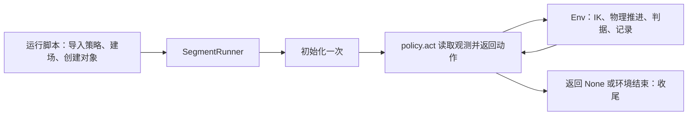
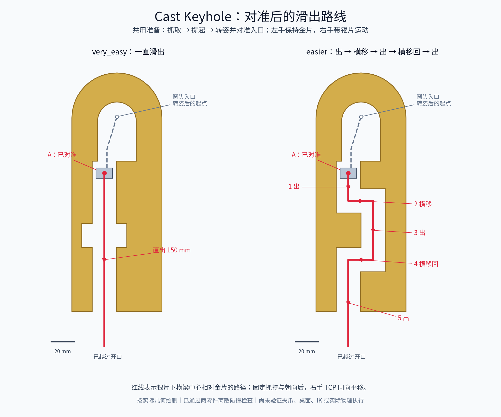

# Cast Keyhole 两个简单档：oracle 调用说明与工程步骤

日期：2026-10-02（本地日期；最终评分完成于 UTC 2026-10-03）。适用场景：`very_easy` / `easier`，`simplified_original_layout_v4`。两档的外端面夹持、连续解锁和目标区收尾已实际通过；Harbor standard／privileged 均为 oracle 1、nop 0，独立回放和完整录像检查通过。四个新任务已在本地 `tasks/` 登记 `oracle = "full"`；资格限定当前冻结 seed 0 和 v6 本地镜像。本文保留实施计划和调用说明，第 7 节记录结果及失败对照。

结论：继续使用现有本地 `SegmentRunner` 开发参考策略。两档共用接近、外端抓取、入口转姿和搬运，仅让通道段不同。当前已补齐原装配到退出姿态的连续动作；开发成功不能代替冻结实例的 Harbor 回放验收。正常模型评测不会自动调用 oracle。

## 1. 现在说的 oracle，分别是什么

Oracle 就是一份我们写好的参考解，用来验证这个实例确实能完成。它不是评分标准；模型可以用不同的方法完成任务。

| 使用场合 | 当前实际调用方式 | 用途 |
| --- | --- | --- |
| 本地开发参考解 | `scripts/oracle_runners/run_cast_keyhole_policy.py` 创建 Env 和 policy 对象，再交给 `SegmentRunner.run_policy()` | 调试抓取、解锁、搬运，保存实际执行证据。 |
| Harbor 专门跑参考解 | 显式执行 `harbor run ... -a oracle`，运行该任务私有 `solution/solve.sh` | 用正式评分流程验收参考解。任务包需要先包含 solution。 |
| 正常模型评测 | 调度器启动所选模型 agent，由模型提交动作／轨迹，再由 verifier 评分 | 评测模型；不自动运行或读取参考解。 |

因此，“仓库里有本地 policy”与“Harbor 任务包已配好 oracle”是两件事。本轮核对时，Keyhole 的 easy / medium / hard 本地有历史成功证据，但六个正式双模式任务包仍标为 `oracle = "none"`；两个新档则已分别通过双模式实际验收，新增四个 `oracle = "full"` 任务包。旧三档的登记状态不因新档通过而改变。

### 本地 SegmentRunner 如何运行 policy



`SegmentRunner` 接收的是已经创建好的 Python 对象，不是每一步重新加载 `.py`。`initialize(context)` 每次新策略提交调用一次，之后循环调用同一个对象的 `act(obs)`。策略只给动作，Runner 管执行；返回 `None` 只表示策略结束，是否成功仍由 Task 判据决定。

代码依据：[本地入口](../../../scripts/oracle_runners/run_cast_keyhole_policy.py)、[run_policy](../../../topogym/simulator/rollout_simulation/segment.py)、[策略调度循环](../../../topogym/simulator/rollout_simulation/policy.py)。

### Harbor 的 oracle 不是直接加载上述 policy 类

目前 privileged 模板的链路是：`solution/solve.sh → rcb_topogym.py run-oracle → Session.exec_code()`。它先重建冻结实例，再执行参考脚本，记录实际关节目标为 `trajectory.npz`。现有 `SimplifiedKeyholePolicy` 不能不经适配就当作这个脚本传进去。

standard 模板则读取私有的 `oracle_qpos.npy`，通过普通客户端分块提交关节目标。虽然文件名叫 qpos，里面应是**控制目标**，不是直接恢复仿真状态，也不是把实测关节角逐帧强行设置到机器人上。实际 `dt` 来自服务的控制频率；本项目默认 40 Hz，即每行 0.025 s。

代码依据：[Session 与 run-oracle](../../../harbor_templates/topogym/common/rcb_topogym.py)、[standard oracle 回放客户端](../../../harbor_templates/topogym/limited/solution/oracle_replay.py)。

## 2. 加载会不会很慢

本机做了 3 次独立 Python 进程的小测，中位数如下。使用当前虚拟环境，操作系统文件缓存未清空；导入按表中顺序进行，后续导入会复用前面已载入的依赖。

| 测量内容 | 中位耗时 |
| --- | ---: |
| 导入 SegmentRunner 及其依赖 | 约 0.150 s |
| 随后导入简化 policy | 约 0.0011 s |
| 加载 Task／几何资源 | 约 0.164 s |
| 生成本次两片几何资产 | 约 0.195 s |
| 创建一个 pickup 策略对象 | 约 0.00062 s |
| 调用策略 initialize | 约 0.000008 s |
| 上述整个探测子进程 | 约 0.60 s |

这项小测**没有创建 Env 或 Runner 实例，没有运行 IK、policy.act、物理或录像**，也不测首次 GPU 编译。不能据此说完整执行只需 0.6 秒。完整源码、原始三次数据及资源监控见[加载探测记录](../../../runs/test_results/cast_keyhole_oracle_plan_20261002_01/loading_probe.json)。

已有实测提供了两个参照：

- 当前两档的 CUDA + Nyx 3 步诊断，各自报告约 **19.7 s** 墙钟时间，物理时间只有 0.075 s。这包括建场、执行、取帧和收尾等成本，不能全部算作加载耗时；该诊断也没有运行 oracle。
- 历史 easy 完整参考运行是 CPU、无 RGB、25 ms tick / 40 子步，物理时间 **488.65 s**、报告墙钟时间约 **2776.8 s（46.3 分钟）**。它的分项记录包含物理积分、状态读取、历史状态保存等大量开销；这不是当前新档或 CUDA 的速度预测。分项可能嵌套，不直接相加。

依据：[当前短测](../../../runs/test_results/cast_keyhole_original_layout_20261002_01/summary.json)、[历史 easy 报告](../../../solvability_proof/cast_keyhole/2026-09-28/evidence/runs/trial_38_easy_qualified/run_report.json)、[历史分项计时](../../../solvability_proof/cast_keyhole/2026-09-28/evidence/runs/trial_38_easy_qualified/timing.json)。这些报告的计时起点不完全相同，不作严格性能对比。

**建议先保留 SegmentRunner。** 实施时补记“导入／建场与 reset／Runner 初始化／路线规划与 IK／动作执行／录像收尾”的分段墙钟时间。若慢在规划，就缓存与几何和配置身份绑定的规划结果；若慢在反复启动，就在一次 Env 生命周期内分段调试；若只是迭代观察，可明确关闭 RGB 做数值调试，最终仍录制真实 Nyx 视频。不要为了省启动时间省掉独立评分、必需记录或重放验证。

## 3. run_trials 到底什么时候用 oracle

当前批量入口是 `bash_scripts/run_difficulty_trials.sh`，核心是 `scripts/difficulty_eval.py` 的 `run_trials()`。正常流程如下：

| 阶段 | 实际做什么 | 是否运行 oracle |
| --- | --- | --- |
| plan / prepare | 抽样、建镜像、冻结实例、生成两种模式任务包 | 否。当前 prepare 不传 `--oracle`，standard 生成器的轨迹参数明确传 `-`。 |
| preflight | 短动作／hold、图像、恢复与回放、standard 协议检查 | 否。它验证流程能跑，记录中明确 `solvability_proven=False`。 |
| canary | 检查模型认证、工具和看图是否可用 | 否，也不启动解题仿真。 |
| 正式 trial | 启动用户指定的模型，让模型自行完成任务 | 否。当前认证分支限定模型 agent，不能简单给这个批量入口换成 `--agent oracle`。 |
| verifier / collect | 回放该次提交、按 Task 条件判分、汇总 | 否。回放的是模型实际提交／执行的动作，不是参考答案。 |

privileged 的评分器在独立 verifier 环境中，对提交轨迹运行两遍物理回放；当前代码在同一新 Session 中 reset 后重放两遍，并非每遍都另启动一个进程。standard 是服务实际运行结果加独立进程回放，随后 verifier 读取结果。两种模式都按任务是否完成、实例是否匹配等条件判定，不比较轨迹与 oracle 是否相似。

只有在**单独验证参考解**时，才显式调用 Harbor 的 `-a oracle`。建议在开发／发布验收时跑一次完整 oracle 和 nop 负对照；后续模型 trial 不重复跑 oracle。它们应分开存放和统计。

代码依据：[批量调度器](../../../scripts/difficulty_eval.py) 的 `prepare/preflight/launch_job/run_trials`、[privileged 评分](../../../harbor_templates/topogym/unlimited/tests/grade.py)、[standard 评分](../../../harbor_templates/topogym/limited/tests/grade.py)。

## 4. 两个新 oracle 的开发步骤

遵循[两档变体计划](../two_levels_below_easy_plan_20261001_zh.md)的目录和公共执行边界，以及[修复后开发约定](../post_fix_scene_variant_guidelines_zh.md)的实际 tick、冻结身份和分层验收要求。用户已确认的尺寸、孔槽设计和初始摆位保持当前 v4。

| 步骤 | 工程内容 | 完成标志 |
| --- | --- | --- |
| 1. 固定实例并记录自然落稳过程 | 记录 geometry／源码哈希、seed、默认时序、抓持配置和判据版本。保留从 home 开始的完整过程，测量初态倾倒后的真实姿态；策略应按实测物体位置接近，不沿用第一帧的静态抓点。 | 原初态可重建，落稳／接近过程有记录，没有改摆位或加支撑。 |
| 2. 跑通共用抓取和提起 | 参考原 easy 的接近、真实接触抓持、提起和状态反馈结构；对新孔形重新检查抓点、腕部相机、双臂和桌面净空。辅助抓持仍须实际双指接触触发。 | 从默认 home 连续抓住两件并提起；失败能指出阶段，不靠设置物体状态完成。 |
| 3. 补最短的解锁路线 | 优先直接从当前装配规划，不强求回到旧 v3 的横向银环姿态。very_easy 以对准后的直通退出为主；easier 在两处错位进行必要横移／方向调整。整片和夹爪一起检查，必要的转姿要有连续连接段。 | 当前初态到完全分离的整段路径可执行；easier 的受限直拉确实受阻，调整后通过。 |
| 4. 共用目标区收尾 | 金片留在分界另一侧，整件银片进入绿色区域并满足稳定窗口，允许保留抓持；阶段推进依据实际模拟时间和反馈。 | 原 Task 判据给出 `task_success=True`，不是仅凭“路线走完”。 |
| 5. 本地完整验收和计时 | 两档分别从 home 完整运行、保存共享录像和实际动作。补初态／nop／错误直拉检查，回归原三档受影响部分，记录每段成本。 | 当前几何和配置下各有真实成功证据；几何、短测、机器人完成分别报告。 |
| 6. 接入 Harbor 参考解 | 用包含当前场景的镜像冻结实例，准备私有 solution，生成双模式包并分别执行 oracle、nop 和正式评分。 | 对应实例两种模式 oracle 得 1、nop 得 0；完成重放、媒体与身份核对后再登记资格。 |

当前 v4 静置 3 步已有倾倒，所以第 1–2 步不能略过。当前策略按自然落稳后的实测姿态接近，已启用 v4 的 `--part all`；旧初态仍拒绝套用这条路线。

## 5. Harbor 接入建议与文件范围

最终采用两条已有接口上的交付方式：**very_easy 回放本地闭环策略生成的关节控制目标；easier 在冻结的正式 `Session` 内根据实际状态生成闭环参考。** easier 的两份跨环境直接回放参考失败，原因对照及适配过程见第 7 节。两档生成的正式轨迹均已通过独立物理回放，standard 使用对应实际公开动作序列。这只证明绑定的冻结实例，不代表任意 seed 都可解。

本地动作是 `EE_ABS`，Harbor 记录接口是关节目标，需显式导出适配：读取公共执行反馈 `info.executed_joint_targets`，按实例 `action_layout` 排列，并保留实际执行步数／时序。不能用观测到的关节位置代替目标，也不能把旧运行的实例身份直接写到新轨迹上。先在目标冻结实例和相同物理时序下回放通过，再作为该实例的参考。

privileged 私有入口逐行调用现有 `session.step()`，由 `run-oracle` 自身录出标准 `trajectory.npz`；不要复制一个旧成功文件冒充本次执行。standard 从这次合格轨迹生成 `oracle_qpos.npy`，先用 `K=1`，复用现有客户端提交和正常收尾。现有标准客户端的超时／恢复逻辑是否适配当前 2.3 协议，也在这一步检查，不另建协议。

| 位置 | 预计工作 |
| --- | --- |
| `topogym/planning/cast_keyhole/simplified_policy.py` | 主要实现位置：共用抓取／搬运、两档通道段、实际反馈、超时和失败诊断。 |
| `topogym/planning/cast_keyhole/kinematics.py` | 按需增加 v4 初态及转姿的 IK／完整网格检查，限定新增逻辑范围。 |
| `scripts/oracle_runners/run_cast_keyhole_policy.py` | 保留现有分派和 SegmentRunner；补分段计时、完整验证、实际关节目标导出。 |
| `topogym/planning/cast_keyhole/public_session.py` | easier 的私有适配器：读取当前状态、调用原生动作编译／IK，全部动作经现有 `Session.step()`；不提供物体写入、重置或强制抓持。只随私有 solution 打包。 |
| `scripts/oracle_runners/package_cast_keyhole_oracle.py` | 核对成功证据和冻结实例，生成私有 `solution/` 的回放脚本、目标序列及身份清单；不再实现物理执行器。 |
| `ci_checks/test-cast-keyhole-oracle.py`及现有简化场景检查 | 检查初态／资源不匹配拒绝、阶段和实际执行时间、目标导出布局、明确失败案例及旧三档回归。 |
| `scripts/topogym_mk_task.py`、`scripts/topogym_mk_limited.py` | Harbor 交付时按需支持私有配套文件及已验证的 oracle 元数据。当前前者只复制传入的单个 oracle 脚本，二者的 `task.toml` 模板仍写 `oracle = "none"`，仅传 `--oracle`／轨迹还不等于完整登记。默认无 oracle 行为保持。 |
| 生成的 `tasks/<新实例>-{privileged,standard}/solution/` | 只放参考解私有交付物；由工具生成，正式接入时更新 `tasks/dataset.toml`。 |
| `runs/test_results/`、本任务说明与 planning README | 保存成功／失败、计时、实际动作、录像、配置和哈希，更新可复现命令。 |

参考解只由 oracle agent 挂载。当前镜像会排除 `topogym/planning`，因此不能假设任务容器里能导入本地 policy，也不要为方便而将答案放入公共镜像、工具或 agent 可读文档。复用现有[参考解隔离规则](../../rcb/PROTOCOL.md#27-reference-solutions-oracle-nop)，不改 simulator、World 或公共判据来配合参考动作。

本计划不顺带扩展五档批量采样：当前采样仍固定 easy / medium / hard。先把这两个具名变体和参考解独立验收，再另行协调采样／统计及新实例生成；正常模型评测继续不自动调用 oracle。

## 6. 已找到的候选路线与开发时间估计

补充于 2026-10-02：按用户提示，对当前 v4 的完整两片网格做了快速检查，已找到候选路线。**以下是离散几何检查，不是机器人成功运行；场景、孔形和摆位没有修改。**



图按实际几何生成，红线表示**银片下横梁中心相对金片**的路径。左手保持金片、银片朝向及抓持变换固定时，右手 TCP 按相同位移运动；机械臂各关节仍需 IK 求解。灰色虚线是两档共用的入口对准过程，不包含抬离桌面和转姿。

不能把“槽道直通”直接解释为“保持第一帧装配，整件银片一直平移”：按 1 mm 间隔检查这种直拉，两档第一次采到碰撞均在约 32 mm。找到的一条替代准备动作是：双手抓持提起后，围绕银片下横梁中心转动银片 90°，再把横梁对准主槽。该角度是一条已检查候选，不意味着所有可行解都必须转 90°。

候选转动轴为原装配坐标 x 轴，转角 −90°，轴经过原装配点 `(0, 0, −76.95) mm`。之后在金片局部坐标中，将横梁中心依次对准 `(0, 64.05) → (−8.625, 36) → (−8.625, 19.5) → (−10.95, 15) mm`，最后一点是图中的 A。以上数值均已乘 scale=3，不是世界坐标；抓取后需按实测金片位姿转换。

从 A 开始，两档通道段可以写成很短的位移表：

```python
# 单位 m；金片局部坐标；出 = -y，横移 = x。
# 前提：完成抓取、提起、转姿和入口对准。不是初始摆位直接执行。
channel_deltas = {
    "very_easy": [(0.0, -0.150)],
    "easier": [
        (0.0, -0.024),       # 出
        (+0.02145, 0.0),    # 横移
        (0.0, -0.051),       # 出
        (-0.02145, 0.0),    # 横移回去
        (0.0, -0.075),       # 出，越过开口
    ],
}
# 每段把 (dx, dy, 0) 经实测金片旋转变成世界位移，
# 右手保持姿态、低速闭环跟踪；左手保持金片，再执行目标区收尾。
```

转姿按 0.5°、平移按不超过 0.75 mm 采样，两零件无表面碰撞；最小间隙分别约 **4.359 mm（转姿）／1.125 mm（入口）／3.450 mm（主通道）**。入口最窄，优先检查它的跟踪误差、夹爪净空和双臂可达性。当前检查只移动物体网格，没有桌面、机器人或动力学，也不是连续碰撞证明。原始结果与路点见[路线探查](../../../runs/test_results/cast_keyhole_route_probe_20261002_01/route_probe.json)。

时间估计按当前代码可复用、单机 GPU 可用、无需改几何估算：

| 交付程度 | 预计工作时间 |
| --- | --- |
| 路点和策略代码初稿 | 约 30–60 分钟；本次已完成两零件候选路线探查。 |
| 两档从 home 抓取到目标区的本地完整成功、录像和回归 | 合计约 3–6 小时，包含迭代仿真；主要不确定性是落稳后的抓取、入口精度与转姿时的腕部干涉。 |
| 再完成 Harbor 双模式 oracle／nop／回放验收和打包 | 额外约 1–3 小时，前提是镜像与基础流程可复用。 |

因此按原计划完整交付，预算以**半天到一天**较合理；不是承诺运行时限，也不包含另造完整调试工作台。若碰到抓持／IK 或基础设施问题，需要根据首轮实测更新估计，不能只因通道段有五个路点就承诺很快全部验收。

降低后续调试成本的配套建议见[oracle 开发专用工具](oracle_development_tools_zh.md)。

## 7. 开发中调整：外端面夹持

按用户建议，改为左手抓金片左侧开口端的实心片面、右手抓银片右侧闭合端，两指接触两侧片面。这让出了中间的互锁区域。为避开桌面，夹爪从外端斜向下约 35° 接近。

初版外端抓法已经在两个难度的普通 `Env + SegmentRunner` 中独立通过抓取和抬起测试：

- very_easy：[执行报告](../../../runs/test_results/cast_keyhole_oracle_20261002_01/very_easy_pickup_qualified_03/run_report.json)、[接近到抬起录像](../../../runs/test_results/cast_keyhole_oracle_20261002_01/very_easy_pickup_qualified_03/segments/segment_2/videos/cam_high.mp4)。
- easier：[执行报告](../../../runs/test_results/cast_keyhole_oracle_20261002_01/easier_pickup_qualified_01/run_report.json)、[接近到抬起录像](../../../runs/test_results/cast_keyhole_oracle_20261002_01/easier_pickup_qualified_01/segments/segment_2/videos/cam_high.mp4)。

这些录像属于抓取阶段；同次运行的初态与自然落稳前缀分别保存在前面的 segment 中。**报告中的 `task_success` 仍为 false，不能当作完整 oracle 成功。**

继续测试发现：初版能完成工作位置调整和银片转姿，但银片接近滑出口时会碰到左手的一根手指。因此当前将左手抓点再朝实心梁外侧移动 4 mm，并在片面内朝外偏转 30° 接近。金片声明抓取区域的实际尺度中心为 `(28, -83, 0) mm`，半径 26 mm；银片区域不变。


普通完整运行的[取得抓持时接触点](../../../runs/test_results/cast_keyhole_oracle_20261002_01/grasp_contact_faces.json)也已核对：厚度方向坐标约为 ±4.4 mm，对应 9 mm 厚片的正反两面附近。金片的一侧触点接近开口外角，因此不将其描述成两个指垫都平贴大片面中央，也不据此宣称纯摩擦抓取稳定性。

当前修正版在 very_easy 的独立普通运行中已通过抓取和抬起约 10 cm：[执行报告](../../../runs/test_results/cast_keyhole_oracle_20261002_01/very_easy_refined_pickup_01/run_report.json)。模拟时间 19.65 s；墙钟约 314.75 s，其中建场 80.12 s、原生抓取规划 2.21 s、策略执行 226.36 s。本次未开启录像，图来自另一段带按需 Nyx 取帧的真实内测执行。

[修正版接触点记录](../../../runs/test_results/cast_keyhole_oracle_20261002_01/very_easy_refined_dev/acquisition_faces_report.json)显示两指接触点的厚度坐标约为 ±4.4 mm，与板厚 9 mm 一致；左手下侧接触点仍靠近外端角部。采用接触触发的 `contact_weld_v1`，并非纯摩擦抓持证明，也未证明对不同初态扰动均稳健。

配套实现的边界：

1. 两档资源只调整 `grasp_regions` 及目录哈希，孔槽、尺寸、材料和初始装配保持不变。
2. 接近阶段先规划连续关节路径，用原生 FK 生成 TCP 路点，再由已有 `EE_ABS` 接口真实执行。开发工具的 `check_robot_path(..., include_tcp=True)` 只查询，不推进或设置机器人状态。
3. 本地入口保留自然落稳前缀并做原生抓取预检。最终接近允许手指接触自己的目标；其他机械臂、另一片及桌面仍检查。开指末段的桌面净空较小，预检要求在桌面上方，不宣称有 2 mm 余量。
4. IK 接口的 0.1 mm 门槛保持不变。原先 0.44 mm 是求解候选的 FK 残差，并非槽内运动允许的误差；更换抓点和工作姿态是解决途径。

修正版也已在 easier 的普通运行中通过抓取和提起：[报告](../../../runs/test_results/cast_keyhole_oracle_20261002_01/easier_refined_pickup_01/run_report.json)、[录像](../../../runs/test_results/cast_keyhole_oracle_20261002_01/easier_refined_pickup_01/segments/segment_2/videos/cam_high.mp4)。

两档均已在内测中完成通道退出，并由原 Task 判据给出 `task_success=True`：

| 变体 | 开发执行结果 | 证据范围 |
| --- | --- | --- |
| very_easy | 模拟时间 108.3825 s 达到成功 | [收尾报告](../../../runs/test_results/cast_keyhole_oracle_20261002_01/very_easy_refined_dev/vertical_goal_result.json)。曾回退至解锁完成点调整收尾，成功位于 branch 1；不能当作从 home 一次完成的普通验收。 |
| easier | 模拟时间 152.6825 s 达到成功 | [收尾报告](../../../runs/test_results/cast_keyhole_oracle_20261002_01/large_runs/easier_refined_dev/vertical_goal_result.json)。从 home 分段连续执行到成功，branch 0；使用内测会话，未登记正式资格。随后另开回退分支进行错误动作对照，不覆盖此报告。 |

收尾采用“金片先竖直抬高 12 cm → 金片回到分界系统侧 → 银片调整 y/z → 银片移入目标区 → 停稳”。原候选将金片横向移开时碰到右前臂；现在的预检会同时移动两个被抓物体，检查机械臂与持件之间的干涉。它是离散原生碰撞网格检查，不覆盖仅有视觉的相机外壳，也不代替真实物理执行。

抓取区域、孔形和旧三档回归 10 项通过；实际命令导出、持件收尾预检触发、私有打包身份拒绝及夹爪宽度转换检查由初期 8 项扩展到最终 15 项，全部通过。单元／几何检查不计物理成功。

`oracle_artifacts.py` 导出的是已经执行的关节控制目标，保留终止时不足一个控制周期的实际 tick 数。`package_cast_keyhole_oracle.py` 只接受从 home 完整成功且哈希匹配的记录，生成绑定冻结实例的私有回放候选；通过目标实例的夹爪适配器转换开口宽度，随后仍需真实 float32 动作回放。该工具不会自动将任务登记为 `oracle = "full"`，不会改动正式测评调用链。

very_easy 已完成普通 `Env + SegmentRunner` 的独立完整重跑：[报告](../../../runs/test_results/cast_keyhole_oracle_20261002_01/large_runs/very_easy_full_qualified_02/run_report.json)。从默认 home 连续执行、branch 0，125.3325 s / 50,133 个物理 tick 后 `task_success=True`。墙钟约 42.9 分钟，其中建场 114.1 s、抓取规划 3.8 s、持件收尾预检 4.1 s；同机有并行测试，不能把墙钟直接当作单任务性能基准。实际执行的 5,014 行关节目标已导出。

该次四路录像完整解码、同组时间线核对通过：[俯视](../../../runs/test_results/cast_keyhole_oracle_20261002_01/large_runs/very_easy_full_qualified_02/segments/segment_2/videos/cam_high.mp4)、[低视角](../../../runs/test_results/cast_keyhole_oracle_20261002_01/large_runs/very_easy_full_qualified_02/segments/segment_2/videos/cam_low.mp4)、[左腕](../../../runs/test_results/cast_keyhole_oracle_20261002_01/large_runs/very_easy_full_qualified_02/segments/segment_2/videos/cam_left_wrist.mp4)、[右腕](../../../runs/test_results/cast_keyhole_oracle_20261002_01/large_runs/very_easy_full_qualified_02/segments/segment_2/videos/cam_right_wrist.mp4)。这些片段包含 home 接近到成功；同次运行的初始帧和 0.75 s 自然落稳前缀保存在 segment 0、1，未与其他执行拼接。

[逐 tick 接触审计](../../../runs/test_results/cast_keyhole_oracle_20261002_01/large_runs/very_easy_full_qualified_02/recorded_contacts_audit.json)覆盖策略阶段 49,834 个状态：抓住后没有脱落，未记录双臂互碰或手臂碰到另一片。右手接近末段存在 186 个采样接触点记录，均为右指与桌面，最大记录穿透约 4.6 μm、接触力约 1.23 N；因此不宣称全程零碰撞。该审计不覆盖每个求解子步，静置前缀也不含同样的 world 接触字段。

easier 也已完成普通 `Env + SegmentRunner` 的独立完整重跑：[报告](../../../runs/test_results/cast_keyhole_oracle_20261002_01/large_runs/easier_full_qualified_01/run_report.json)。从默认 home 连续执行、branch 0，155.0575 s / 62,023 个物理 tick 后 `task_success=True`；实际执行目标共 6,203 行。墙钟约 68.1 分钟，其中建场 135.1 s、抓取规划 4.3 s、持件收尾预检 13.7 s，同样有并行任务，不能直接与前者作性能对比。

easier 的四路录像完整解码、同组时间线核对通过：[俯视](../../../runs/test_results/cast_keyhole_oracle_20261002_01/large_runs/easier_full_qualified_01/segments/segment_2/videos/cam_high.mp4)、[低视角](../../../runs/test_results/cast_keyhole_oracle_20261002_01/large_runs/easier_full_qualified_01/segments/segment_2/videos/cam_low.mp4)、[左腕](../../../runs/test_results/cast_keyhole_oracle_20261002_01/large_runs/easier_full_qualified_01/segments/segment_2/videos/cam_left_wrist.mp4)、[右腕](../../../runs/test_results/cast_keyhole_oracle_20261002_01/large_runs/easier_full_qualified_01/segments/segment_2/videos/cam_right_wrist.mp4)。初态和自然落稳前缀同样在 segment 0、1。[接触审计](../../../runs/test_results/cast_keyhole_oracle_20261002_01/large_runs/easier_full_qualified_01/recorded_contacts_audit.json)覆盖 61,724 个策略阶段状态，没有抓持脱落，也没有记录手臂互碰、手臂碰另一片或手指碰桌；范围仍限于保存的物理 tick，不代表求解子步或视觉外壳的全覆盖。

错误直拉曾做 5 s 内测，实际只推进约 2.4 mm，未采到金银片接触，**不足以证明真实物理阻挡**。随后从 home 连续补做较长对照，保持物理和跟踪参数：到第一个错位处省略横移，要求继续直出 25 mm。22.525 s 后实际只前进约 5.85 mm，金银片保持接触、控制器报跟踪停滞，双手无抓持丢失；采到的最大金银接触力约 4.32 N、最大穿透约 1.76 μm。[接触审计](../../../runs/test_results/cast_keyhole_oracle_20261002_01/large_runs/easier_wrong_straight_full_01/negative_contact_audit.json)判为 `physical_block_observed`。该项仅证明这个入口状态的错误直拉受阻，不是所有可能路径的不可行证明；这次无 RGB。

已构建不含 planning／参考解的本地验收镜像并冻结两档实例。very_easy 的私有候选已通过 `run-oracle` 的公开 float32 关节／夹爪宽度动作重跑，仍在 125.3325 s / 50,133 tick 成功，执行结果为 `exec.ok=true`；[实际记录](../../../runs/test_results/cast_keyhole_oracle_20261002_01/large_runs/very_easy_harbor_replay_02/runtime.log)。首轮容器因缺少显式 NVIDIA runtime，在动作开始前图形初始化失败，记录保留，不算策略失败或成功。

两档 × 两种模式共四个 `nop` 均正常得 0，无评分器／基础设施错误：[汇总](../../../runs/test_results/cast_keyhole_oracle_20261002_01/harbor_nop_summary.json)。首个 privileged nop 暴露了原子输出 reward 文件为 0600、宿主 Harbor 无权读取的问题；生成器只将最终 `reward.txt`／`reward.json` 设为 0644，判分逻辑未改，修复后重新跑通负对照。最终四个 oracle 的正式评分也均通过，完整结果见本节末尾。

very_easy 两种模式的正式评分均已完成：standard 为 `success=1, live_success=1, replay_success=1`，无基础设施或评分器错误；[standard 评分](../../../runs/test_results/cast_keyhole_oracle_20261002_01/large_runs/harbor_jobs/very-easy-standard-oracle01/topogym-cast-keyhole-very-easy-i__hCxTssZ/verifier/reward.json)。privileged 的独立两遍回放均成功，`success=1, all_success=1, replays=2, instance_ok=1`；[privileged 评分](../../../runs/test_results/cast_keyhole_oracle_20261002_01/large_runs/harbor_jobs/very-easy-privileged-oracle01/topogym-cast-keyhole-very-easy-i__WpdiLPK/verifier/reward.json)。均为 5,014 个动作、50,133 tick。GPU 最终状态哈希不相同（`deterministic=0`），现有评分规则允许这种差异，但不能称为逐位确定性复现。

easier 首轮公开回放执行完 6,203 行后未成功，银片入区和金片留在系统侧均为 false，不能解释成仅差一个停稳窗口。已保留实际轨迹、失败输出，并停止该失败 job 的重复评分；其 `RewardFileNotFoundError` 来自这次主动停止，不冒充正常评分结果。[失败说明](../../../runs/test_results/cast_keyhole_oracle_20261002_01/easier_public_replay_failure_01.json)。

公开回放前段对照确认：本地原生夹爪目标 `0.002 m` 转为公开宽度 `0` 后，再转回原生坐标变成 `0.00746875 m`，相差约 5.47 mm。两手仍抓住了，但实际抓持绑定相对原运行变化约为金片 0.354 mm / 0.381°、银片 0.238 mm / 0.141°；[对照记录](../../../runs/test_results/cast_keyhole_oracle_20261002_01/easier_public_grasp_comparison.json)。这是回放敏感性的一个具体来源，尚不能证明是唯一原因。已以 `--gripper-close 0.00746875` 重新生成完整参考，没有修改公共转换器、物理、几何或成功判据。

新的 easier 参考从 home 连续执行、branch 0，在 **156.2075 s / 62,483 tick** 完成，导出 6,249 行动作；[完整报告](../../../runs/test_results/cast_keyhole_oracle_20261002_01/large_runs/easier_public_compatible_full_01/run_report.json)。墙钟约 44.0 分钟，其中建场 92.7 s、抓取规划 6.45 s、持件收尾预检 2.27 s。四路录像均完整解码、同组同步：[俯视](../../../runs/test_results/cast_keyhole_oracle_20261002_01/large_runs/easier_public_compatible_full_01/segments/segment_2/videos/cam_high.mp4)、[低视角](../../../runs/test_results/cast_keyhole_oracle_20261002_01/large_runs/easier_public_compatible_full_01/segments/segment_2/videos/cam_low.mp4)、[左腕](../../../runs/test_results/cast_keyhole_oracle_20261002_01/large_runs/easier_public_compatible_full_01/segments/segment_2/videos/cam_left_wrist.mp4)、[右腕](../../../runs/test_results/cast_keyhole_oracle_20261002_01/large_runs/easier_public_compatible_full_01/segments/segment_2/videos/cam_right_wrist.mp4)。保存的 62,184 个策略阶段状态中，没有抓持丢失或非预期机器人接触；[审计](../../../runs/test_results/cast_keyhole_oracle_20261002_01/large_runs/easier_public_compatible_full_01/recorded_contacts_audit.json)。这份参考的正式公开回放也失败了，本地成功不等于公开关节轨迹可直接重放。

打包器已增加运行前的夹爪往返检查：原生目标经 float32 宽度再恢复的误差超过 1 μm 时，在提交任何动作前拒绝；已通过包括闭合端平台反例、公开动作保持省略目标和拒绝静默裁剪以及冻结策略源码变更拒绝在内的 15 项证据／打包测试。旧参考若有意试验有损转换，必须显式提供原因并保留记录，不因此获得资格。当前新参考沿用本轮冻结的 v6 运行时，Harbor 重试只替换原任务包的私有 `solution/`，不混入其他成员正在更新的公共模板。

easier 第二次公开回放通过夹爪往返检查，仍在 6,249 行之后未满足 Task；[失败记录](../../../runs/test_results/cast_keyhole_oracle_20261002_01/easier_public_replay_failure_02.json)。前段逐步对照发现，在机器人尚未碰到物体时，自然落稳已经与本地参考不同：1 s 时金片约差 1.35 mm / 0.89°、银片约差 2.02 mm / 0.58°，同期机器人 TCP 差异仅约 3×10⁻⁶ mm。因此不能将失败全归因于夹爪转换。正式 Session 会在建场后恢复冻结 S0，本地与容器环境也不同；尚未分离证明哪项导致该差异。

当前解决方式是在 **同一个正式冻结 Session 内**生成闭环参考：`public_session.py` 读取实际落稳／抓持位姿，复用同一抓取和通道策略，经原生 `compile_action(..., "EE_ABS")` 求解，再转换为公开宽度和 float32 关节动作交给 `Session.step()`。`run-oracle` 负责完整记录；生成的实际轨迹仍须 privileged 两遍独立回放，以及 standard 的实际执行和回放全部通过。只在 solution 中加入列明哈希的被动规划模块，不将 calibration tools 或参考解加入公共镜像。

`package_cast_keyhole_oracle.py --feedback` 生成这种私有候选。清单将本地成功标为设计依据（`local_basis_rows`），实际提交轨迹来自正式 Session；不会把失败的本地导出轨迹追溯标为回放合格。首个闭环候选因生成报告的文件读取方式错误在 0 个动作时退出，第二个候选在自然落稳后被接近预检拒绝：最终手指最低点低于桌面约 0.021 mm，IK 通过但零桌面穿透要求不通过。当前私有适配器依次尝试 0、1、2 mm 的向上 TCP 抓点偏移，仍以同一 IK／整段碰撞预检决定是否采用。没有改变模型、初态或检查阈值；候选 05 选择向上 1 mm，121 个接近路径样本的最小桌面净空约 0.98 mm，并在正式 Session 中完成了整个任务：6,225 个动作、62,242 tick、155.605 s、零 reset，Task 判定整片银片入区、金片留在系统侧及 0.5 s 停稳窗口均成立。执行墙钟 1,230.7 s（约 20.5 分钟），建场另约 159 s。实际报告见[正式闭环执行](../../../runs/test_results/cast_keyhole_oracle_20261002_01/large_runs/harbor_jobs/easier-privileged-oracle05/topogym-cast-keyhole-easier-i00__gqgni5P/artifacts/app/output/feedback_report.json)。standard 随后也实际执行成功：6,225 个动作、16 个提交批次、零裁剪、零重启，墙钟约 2,582.6 s。随后两种模式的独立回放均成功，录像完整解码通过；easier 已登记 `oracle = "full"`。资格对应这次实际公开轨迹，不追溯赋予两份失败的本地导出轨迹。

对本轮实际使用的 limited、privileged、sim、verifier 四类镜像，均已在无挂载的新容器内检查 calibration tools 无法导入；并核对实际运行容器没有开发源码挂载：[隔离报告](../../../runs/test_results/cast_keyhole_oracle_20261002_01/harbor_calibration_isolation.json)。easier 候选 05 的实际私有模块挂载也已单独检查，仍无法导入开发工具：[部署检查](../../../runs/test_results/cast_keyhole_oracle_20261002_01/easier_feedback_deployment.json)。检查范围是这些具体镜像和部署，不代替其他部署的隔离检查。

### 最终验收与交付

| 难度 | 实际动作／模拟时间 | standard | privileged | nop |
| --- | --- | --- | --- | --- |
| very_easy | 5,014 行／125.3325 s | live 和独立 replay 均成功 | 两遍独立 replay 均成功 | 两种模式均为 0 |
| easier | 6,225 行／155.605 s | live 和独立 replay 均成功 | 两遍独立 replay 均成功 | 两种模式均为 0 |

四个 oracle 均得 `success=1`，无评分器／基础设施错误；四份正式回放视频均完整解码。easier 的 standard 独立回放墙钟约 2,050.7 s，privileged 两遍回放合计约 4,554.0 s。GPU 回放的最终状态不逐位相同（`deterministic=0`），成功资格依据现有 Task／实例检查，而非逐位确定性。

- [完整资格记录](../../../runs/test_results/cast_keyhole_oracle_20261002_01/harbor_qualification.json)：八次 oracle／nop 实际结果、实例／脚本／轨迹／媒体哈希和开发工具隔离证据。
- [very_easy 正式回放](../../../runs/test_results/cast_keyhole_oracle_20261002_01/large_runs/harbor_jobs/very-easy-standard-oracle01/topogym-cast-keyhole-very-easy-i__hCxTssZ/artifacts/data/replay.mp4)、[easier 正式回放](../../../runs/test_results/cast_keyhole_oracle_20261002_01/large_runs/harbor_jobs/easier-standard-oracle01/topogym-cast-keyhole-easier-i00__2fMYZEj/artifacts/data/replay.mp4)。
- [easier 实际夹持姿态](../../../runs/test_results/cast_keyhole_oracle_20261002_01/easier_standard_channel_90s.jpg)：正式 standard 执行约 90 s 的原始相机帧，可见双手位于两片外端。
- [登记清单](../../../runs/test_results/cast_keyhole_oracle_20261002_01/registered_tasks.json)：`tasks/topogym-cast-keyhole-{very-easy,easier}-i00-{privileged,standard}/` 四个新目录及 `tasks/dataset.toml` 四项追加记录。登记只更新说明和 oracle 元数据，运行／评分输入及私有动作与已测试候选逐文件一致；结构等 24 项检查、四包协议检查和 dataset 清单检查通过。

运行环境固定为 `topogym-local/cast-keyhole-oracle:20261002-02`（镜像 ID `sha256:fdd96c20cd04d04ab80b23ad629cb8d4cc6f7c12b49d9495d196b49b69ea727c`），未混入另一会话更新的公共运行时。这是本地主机可运行的参考包，未发布远端镜像，也未扩展批量评测的难度采样。抓持仍采用真实双指接触后启用的既有 `contact_weld_v1`。
