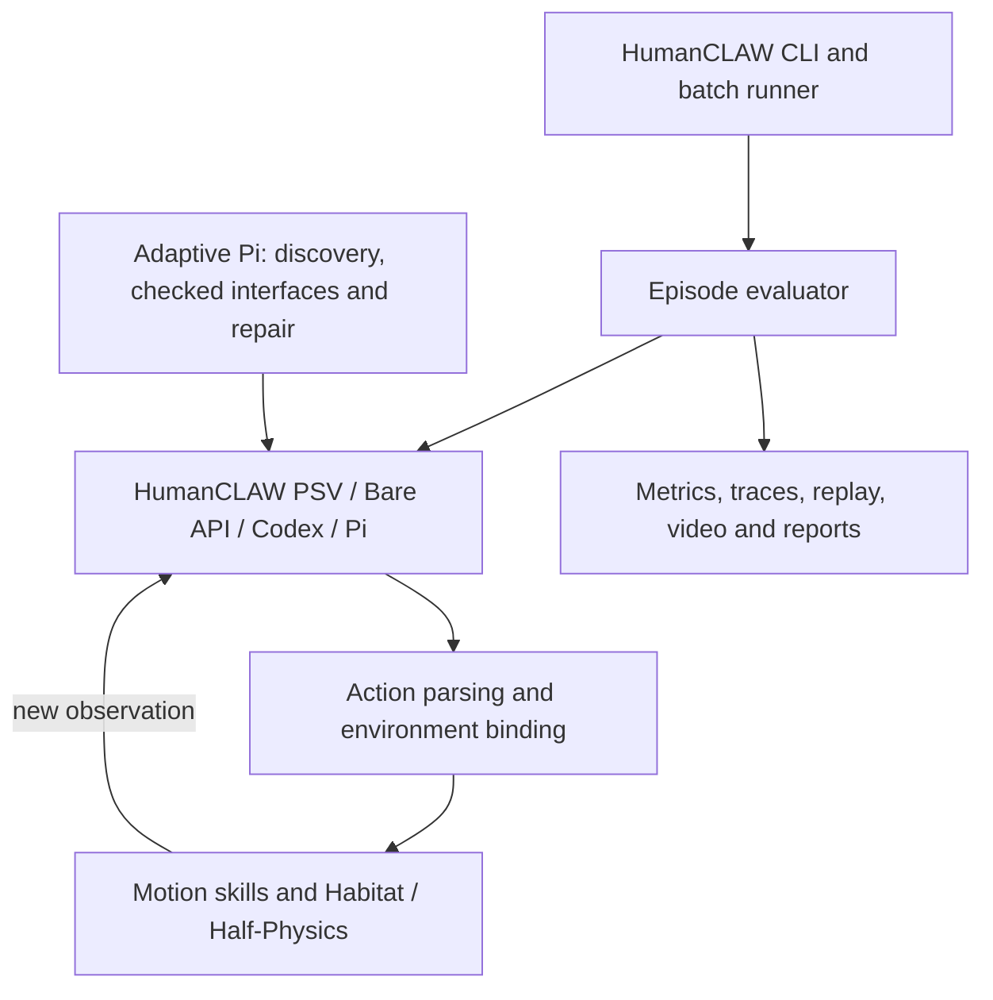

# HumanCLAW harness and evaluation stack

[`humanclaw/`](humanclaw/) contains the **complete tracked source tree** of the
HumanCLAW `harness-improving` branch at
`f7defc43cb295bda7142112a6a40a39aac2e1a45`. It includes the HumanCLAW benchmark,
environment bindings, evaluation pipeline, harness improvements, tools, tests,
resources, configurations, and committed documentation/evidence.

The source is kept together so its package names, resource paths, scripts, and
internal links continue to resolve. There is no separate extracted
`efe_adaptive` package. Run HumanCLAW commands from `harnesses/humanclaw/`.

## Architecture



The evaluator owns the episode and connects the selected agent to the environment.
The original HumanCLAW path converts a chosen skill into motion and returns the
resulting observation. Codex/Pi use the shared environment tools. Adaptive Pi
adds checked task-local tools/policies and can also start from public HTTP/MCP
documentation without a prewritten target binding. These paths and their tests
are all included.

| Area | Code and documentation inside `humanclaw/` |
| --- | --- |
| CLI, batching, and rollout | `src/humanclaw_bench/main.py`, `evaluation/`; [evaluation architecture](humanclaw/docs/ARCHITECTURE.md) |
| HumanCLAW planner and action parsing | `src/humanclaw_bench/agent/` |
| Environment, motion, and assets | `src/humanclaw_bench/envs/`, `motion/`, `resources/`, `patches/`; [asset setup](humanclaw/docs/ASSETS.md) |
| Codex/Pi integration and HumanCLAW binding | `src/humanclaw_bench/harnesses/`, including `adaptive/bindings.py`; [native harness guide](humanclaw/docs/NATIVE_HARNESSES.md) |
| Adaptive Pi SDK and interface repair | `harnesses/pi-adaptive/`, `src/humanclaw_bench/harnesses/adaptive/`; [interface discovery guide](humanclaw/docs/AUTONOMOUS_INTERFACE_LOCAL.md) |
| Tracking, metrics, replay, and reports | `src/humanclaw_bench/experiments/`, `evaluation/metrics/`; [experiment pipeline](humanclaw/docs/EXPERIMENTS.md) |
| LIBERO integration | `src/humanclaw_bench/libero/`; [LIBERO guide](humanclaw/docs/LIBERO_IMPLEMENTATION.md) |
| Repair campaigns and server jobs | `tools/`, `configs/`; [action repair](humanclaw/docs/ACTION_REPAIR_RUNBOOK.md), [pilot](humanclaw/docs/ADAPTIVE_PILOT.md), [Klone deployment](humanclaw/docs/KLONE_EXPERIMENTS.md) |

For a human or agent review, start with the HumanCLAW [README](humanclaw/README.md),
then the [evaluation architecture](humanclaw/docs/ARCHITECTURE.md),
[native harness guide](humanclaw/docs/NATIVE_HARNESSES.md), and
[adaptive interface guide](humanclaw/docs/AUTONOMOUS_INTERFACE_LOCAL.md).
The original `tests/` and Pi `test/` directories provide the regression coverage.

## Verify migration completeness

The import contains **15,125 files, 98,975,187 bytes (94.4 MiB)**. The expected
source tree is recorded in [humanclaw-source.json](humanclaw-source.json).
From the Embodied First Exam repository root, run:

```sh
git rev-parse HEAD:harnesses/humanclaw
```

The result must equal `f60d71a04c79411089fc5e606322b96f61cad8dd` for this import.
Matching the Git tree verifies every tracked path, file content, and executable
mode, not just the file count. The source commit is recorded for provenance;
its private Git history is not part of the import.

Untracked/ignored files were never part of this branch snapshot: local `.env`
secrets, installed dependencies, external datasets/checkpoints, and server-only
outputs remain external. Already committed reports and evidence **are included**.

## Install and validate

Use the original [installation guide](humanclaw/README.md#install) for a full
Linux/GPU rollout. For local unit tests, from the repository root:

```sh
python3.13 -m venv /tmp/humanclaw-check
/tmp/humanclaw-check/bin/python -m pip install -e './harnesses/humanclaw[test,adaptive,libero]' torch packaging
cd harnesses/humanclaw
npm --prefix harnesses/pi-adaptive ci --ignore-scripts
/tmp/humanclaw-check/bin/python -m pytest -q -ra
npm --prefix harnesses/pi-adaptive run check
npm --prefix harnesses/pi-adaptive test
/tmp/humanclaw-check/bin/python -m humanclaw_bench --help
```

Migration validation on macOS with Python 3.13 and Node.js 26: **586 Python tests
passed, 4 skipped; 10 TypeScript tests and type checking passed**. The skips were
the optional RoboRSI integration, ffmpeg-dependent video test, and two native
Codex/Pi tests requiring an explicit host configuration. CLI startup also passed.
No real GPU rollout, paid model trial, or server job was run for this migration.

The virtual environment is outside the snapshot because some original release
checks scan its directory tree. Adaptive program tests require `sandbox-exec`
on macOS or usable `bubblewrap` on Linux. Optional native Codex/Pi smoke tests
require an explicit `HUMANCLAW_NATIVE_CHECK_CONFIG`.

The imported server scripts and configurations retain their original deployment
paths and frozen-cohort branch checks. Review these before using them on another
machine; this migration does not submit jobs or restart the existing pilot.
GPU rollouts still require the original external datasets, checkpoints, patched
Habitat-Sim, and a configured model provider.

## Relationship to Embodied First Exam

This is a complete HumanCLAW source import under its own directory. It does not
register HumanCLAW as a Harbor dataset/task, convert its evaluator to the EFE
verifier contract, or change the existing EFE tasks, runners, root dependencies,
or CI configuration. Those are separate integration changes, not prerequisites
for preserving the complete branch here.

HumanCLAW's [Apache-2.0 license](humanclaw/LICENSE) and [NOTICE](humanclaw/NOTICE)
are preserved. The existing repository keeps its root MIT license.
