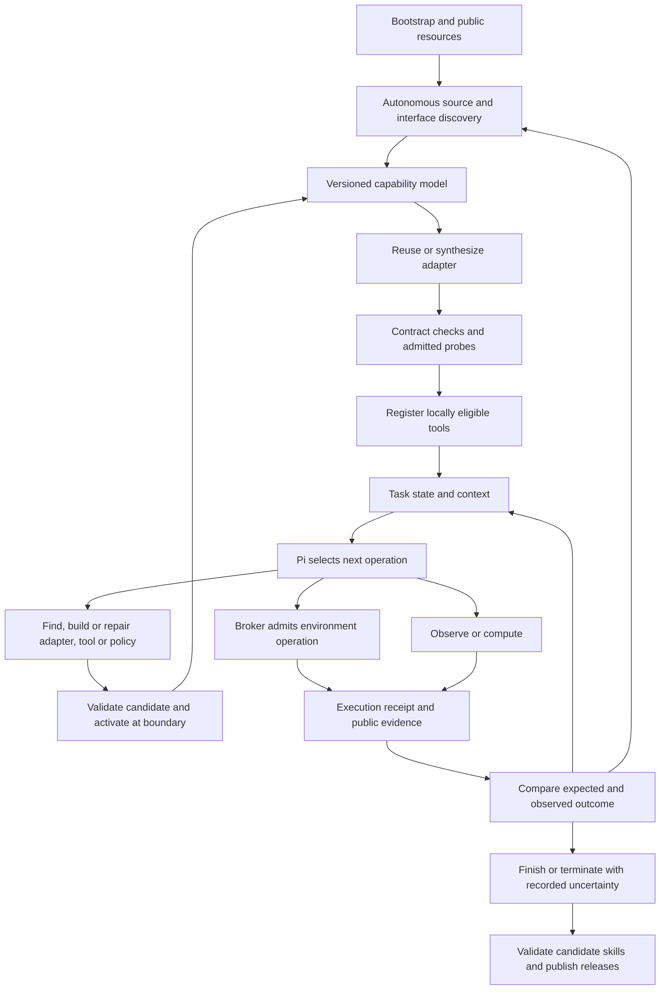

# Pi-based adaptive harness: implementation plan

[Architecture and validation strategy](../harness-comparison-20261019/DESIGN_AND_NEXT_STEPS.md) · [Pi harness design](../../PI_EMBODIED.md) · [Integration contracts](../../NATIVE_HARNESSES.md)

## Objective and selected design

**Design confirmed on 2026-10-25: 1A + 2A + 3A, refined by V-A + P-A + R-A + S-A.
Autonomous Interface Adaptation confirmed on 2026-10-26.** Build a general Pi-based
harness that reads public environment documentation, clients and interfaces,
discovers tools and constraints, and autonomously reuses, generates, validates and
repairs the bindings needed to interact. A handwritten binding, capability manifest
or parameter mapping for each benchmark is not an integration prerequisite.
The harness also constructs missing task tools, adapts from execution evidence,
and publishes validated capabilities for later tasks. HumanCLAW, RoboDojo and
RoboCasa365 are initial validation environments; the same mechanism must handle
previously unseen public interfaces without human adapter edits after reveal.

This document specifies the new target architecture and its implementation gates.
The task-local pilot implementation and its current validation/deployment status are documented in
[ADAPTIVE_PILOT.md](../../ADAPTIVE_PILOT.md). A registered catalog and an injectable
binding are pilot building blocks, not evidence that autonomous interface adaptation
is implemented. The cold-start and cross-task gates below remain to be demonstrated.
The [current execution plan](#current-execution-plan--2026-10-26) below turns these
requirements into the next delivery sequence from the existing pilot; the
[acceptance record](#acceptance-record-and-separate-outcomes) defines what each
new trial must demonstrate.

| Decision | Required behavior |
|---|---|
| **1A: Autonomous Discovery** | Progressively read permitted public documentation, clients, schemas, examples and dependencies, and query interfaces to establish the execution-critical contract. Reuse or synthesize missing bindings and register locally checked tools. Discover more capabilities as needed; registry enumeration alone does not satisfy discovery. |
| **Autonomous Interface Adaptation** | Treat an environment binding as a versioned runtime artifact that the harness discovers, constructs, verifies and repairs. Developers supply generic infrastructure and minimal bootstrap access, not a required adapter for each benchmark. |
| **2A: automatic validated skill releases** | Develop and use temporary tools within an episode under the execution contract. Automatically validate reusable candidates and publish passing versions for subsequent tasks without a routine human approval step. |
| **3A: tool and task-policy self-repair** | The first complete implementation repairs adapters, tools and skills and adjusts task strategies, reasoning, observation and verification policies. Validate changes and activate them at a decision boundary with no physical operation in flight. The execution kernel and environment constraints remain stable. |
| **V-A: typed validation with conditional independent review** | Use contract, numerical and fresh behavior checks appropriate to the candidate's effects. Add a separate model review for critical policy changes or conflicting evidence; review cannot replace an outcome check. |
| **P-A: publication within the validated scope** | Automatically publish immutable versions after the type-specific evidence gate passes. Unpublished candidates remain in their originating task or explicitly permitted validation jobs; ordinary subsequent tasks use published snapshots. |
| **R-A: attributed, layered rollback** | Immediately quarantine confirmed defects. Diagnose ordinary failures and quarantine repeated attributable failures within a matching scope. Reconcile uncertain execution separately. |
| **S-A: compatibility filtering and hybrid retrieval** | Filter required conditions first, combine lexical and semantic recall, rank by scope, goal, evidence and cost, and load bounded summaries and bodies. |

Higher reasoning has **no proportion cap and no additional elapsed-time cutoff**.
The environment's normal episode, action and resource limits still apply.

## Architecture and ownership

Retain the owned Pi SDK session as the agent runtime. Keep Python responsible for
environment connections, execution and provider metering; keep the Pi-side
orchestration responsible for capability interpretation, task state, context and
adaptive decisions. Logical modules do not imply separate agents or a model call
per module. Reuse deterministic bookkeeping and numerical checks where possible.

The supplied `BootstrapSpec` contains the task, a reachable environment or public
resource entry, authorized access and resource limits. Generic MCP/HTTP/Python,
file/resource access and managed program facilities are implemented once. Discovery
must work before any benchmark-specific tools have been registered: inspect public
documents, clients, examples and schemas, then reuse an available client or generate
the missing binding. Neither a human-authored action list nor a benchmark-specific
lifecycle mapping is required at startup.

A binding is an `AdapterArtifact` produced by the harness, translating transport,
observations, action semantics, budgets and lifecycle. A `Task Skill` selects how
to solve a task using those interfaces. They have different claims and validation
scopes; a working API call does not establish manipulation success. Existing
handwritten bindings may remain pilot baselines or test fixtures, but cannot be a
hidden fallback in autonomous-adaptation acceptance. If public access or required
semantics are missing, report the unresolved requirement; do not fabricate support
or count a human-written repair as autonomous adaptation.

| Module / proposed home | Responsibility | Reuse or refactor |
|---|---|---|
| **Pi Runtime Bridge** — existing `runner.ts`, `hooks.ts` | Session/model construction, hook composition, native events and settlement | Retain the SDK and session persistence. Remove the fixed `humanclaw` connection/tool prefix from the general profile. Install bridge hooks once; call versioned policy objects behind them. |
| **Environment Discovery** — proposed `discovery.ts` | Locate and read public documentation, clients, schemas, examples and dependencies; maintain discovery questions, evidence and adapter requirements | Use MCP `listTools()` as one source, not the discovery implementation. Add managed source/resource access, targeted probes, provenance and invalidation; begin from an empty benchmark-specific registry. |
| **Capability / Tool Registry** — proposed `capabilities.ts`, `tool-registry.ts` | Canonical tool identities, schemas, effects, dependencies, readiness and request-time exposure | Refactor `action-contract.ts`; remove the exactly-eight-tools requirement and universal sitting assessment. Separate registered tools from tools exposed in a request. |
| **Execution Broker / Managed Transports** — shared Python module to extract | Admission, resource ownership, durable intent/result records, budgets, generated-adapter loading and uncertain execution | Extract the HumanCLAW owner-thread boundary and LIBERO durable protocol. Execute validated adapter mappings through generic managed transports; keep discovered semantics in versioned artifacts, not handwritten per-benchmark kernel branches. |
| **Evidence / Task State** — proposed `state.ts`, `evidence.ts` | Observation references, entities, subgoal dependencies, hypotheses, provenance and failed approaches | Split state from `controller.ts`. Extend the recorder's artifact handling; do not use the projected chat as the source of truth. |
| **Decision / Outcome Policy** — proposed `policy.ts`, `outcomes.ts` | Select effort and next operation; compare expected and observed outcomes; choose recovery or completion | Split reasoning, completion and recovery from `Controller`; replace fixed target, phase and completion assumptions with task-derived policies. |
| **Context Builder** — existing `context.ts` | Select relevant evidence, recent exchanges, tool schemas and skill interfaces for the next request | Retain immutable native logs, dependency pairing and overflow handling. Replace HumanCLAW-only observation parsing and mandatory-image assumptions. |
| **Workspace / Skill Lifecycle** — proposed `workspace.ts`, `skills.ts`, `validation.ts`, `retrieval.ts` | Synthesize adapters and temporary programs, manage scientific dependencies/resources, orchestrate typed validation, repair and publish reusable artifacts | Reuse Pi coding facilities through managed entry points. Add persistent task artifacts, binary observation access, content-addressed releases and SQLite indexes. Adapter synthesis and local verification are needed during initial discovery, before cross-task learning. |
| **Transport / Audit** — existing Python services and recorder | Actual provider attempts, effective settings, usage, causal events and version identities | Consolidate reusable behavior from `harnesses/services.py` and `libero/service.py`; preserve their tested metering semantics rather than creating a third proxy. |

Source anchors: [runner](../../../harnesses/pi-adaptive/src/runner.ts),
[task state](../../../src/humanclaw_bench/harnesses/adaptive/state.py),
[broker](../../../src/humanclaw_bench/harnesses/adaptive/broker.py),
[context](../../../harnesses/pi-adaptive/src/context.ts),
[HumanCLAW bridge](../../../src/humanclaw_bench/harnesses/environment.py),
[LIBERO protocol](../../../src/humanclaw_bench/libero/protocol.py),
[LIBERO service](../../../src/humanclaw_bench/libero/service.py).

Borrow Codex's separation of tool registration, readiness and exposure, progressive
tool/skill loading, and workspace-based programming/repair. Use its tool and skill
mechanisms as implementation references. Do not embed its App Server inside each
Pi decision or infer that skill loading already implements continual learning.

Autonomous Interface Adaptation is a first-class workflow across Discovery,
Workspace/Validation, Registry and Broker, not a tenth service or a separate model
on every step. The same Pi decision loop owns its discovery and repair decisions.

## Shared data contracts

These are proposed logical records; version their serialized schemas before
implementation. Preserve original backend payloads alongside normalized fields.

| Record | Required information and invariant |
|---|---|
| **BootstrapSpec** | Public task and endpoint/resource entry, authorized resource roots and access handles, available generic transports, resource/episode limits and initial snapshot identity. It contains no required human-authored benchmark action catalog, semantic map or task solution. |
| **DiscoveryRecord** | Open question, inspected source/reference and hash/version, query or admitted probe, returned evidence, inferred/declared/verified claims, unresolved fields, next discovery/adaptation step and cost. Enumerating known registry entries is a separate operation. |
| **WorkspaceManifest / ResourceHandle** | Task-scoped source/program/output paths, runtime and dependency identities, setup provenance and resource references. A public resource retains content hash, MIME/codec, dtype/shape where applicable, units/frames, observation/time association and calibration references when provided. Missing metadata is explicit; a preview never replaces numerical data. |
| **AdapterArtifact** | Immutable binding code or declarative mapping, parent and source/client/protocol/dependency hashes, schemas, units/frames, action/observation/effect/budget/lifecycle mappings, transport requirements, supported scope, checks/report references and local/publication eligibility. Preserve native payloads and uncertainty; do not package a task solution as a protocol binding. |
| **ModelCapabilities** | Actual model/deployment, provider API, supported effort mapping, context/output/image limits and transport constraints. Rename the current meaning of `profile.capabilities`; do not populate it from robot documentation. |
| **EnvironmentCapabilities** | Native actions, units/ranges, absolute/delta semantics, control timing, frames/quaternion conventions, gripper semantics, sensors/calibration/proprioception, observation effects, termination, feedback availability, reset and resource constraints. Each claim has source, verification state, version and applicability. |
| **ToolDescriptor** | Stable namespaced identity, implementation/schema hash, origin (`environment`, `generated`, `third_party`, `skill`), dependencies, readiness, input/output schema, effects and resource claims. Tool availability does not imply permission or semantic correctness. |
| **ObservationRecord** | Observation ID, capture time, associated environment state/execution reference, available sensor channels, frame/calibration version, units, artifact references and source. Computation can reference old observations without pretending they are current. |
| **TaskState / EvidenceClaim** | Task-derived subgoals and dependencies, entities and relations, held-object hypotheses, confidence, supporting/contradicting observations, failed approaches and expected changes. Distinguish measured results from model-reported interpretations and unobservable conditions. |
| **DecisionRecord** | Decision ID, frozen evidence/capability/policy/tool versions, operation intent, expected outcome, validation method, reasoning selection and budget allocation. This metadata is separate from the native tool's arguments. |
| **ExecutionRequest / Receipt** | Request/execution/parent IDs, argument fingerprint, tool version, evidence basis, admitted effects and limits; returned status, known executed work, observation references, actual control steps/time, errors and termination. A failed network response is not proof that execution did not happen. |
| **SkillManifest / PolicyRevision** | Versioned implementation or rule set, inputs, required capabilities, preconditions, expected effects, checks, recovery limits, dependencies, validation evidence, costs and known failures. Record activation, supersession and rollback decisions. |
| **ValidationProtocol** | Immutable protocol ID/version; candidate types/effects; mandatory checks and oracle provenance; local and publication gates; tolerances, condition groups, budgets and review triggers. Candidate code and mutable task policies cannot alter it. |
| **ValidationJob / Report** | Freeze candidate/parent/artifact hashes, dependencies, scope, environment, protocol, sample panel and checker versions. Record every check and attempt as `pass`, `fail` or `inconclusive`, with evidence, review findings, execution IDs and costs. |
| **ReleaseDecision** | Separate `local_eligible` from `publish_eligible`; identify the exact candidate, report set, validated scope and protocol, with reasons for approval, rejection or provisional status. A publication is not automatic replacement of its parent. |
| **SkillHealthEvent / RetrievalRecord** | Scope-specific eligibility, suspicion/quarantine, failure signature, attribution and rollback target; query/snapshot/index versions, compatibility decisions, ranking reasons, loaded artifacts and retrieval costs. Preserve the evidence behind each change. |

`RuntimePolicy` holds kernel rules, retry ownership, minimum validation requirements
and experiment-mode settings.
It is separate from the discovered environment model and from replaceable task
policies. The model may propose a capability claim or policy revision; deterministic
schema, identity, budget and execution checks remain enforced outside that proposal.

Track model requests, computational calls, observations, admitted physical
operations, control steps, simulated time and wall time separately. Do not use an
observation number as the universal action budget. Do not manufacture unsupported
depth, contact or success feedback: current HumanCLAW exposes ego RGB and action
outcomes, whereas other bindings may provide additional declared observations.

## Autonomous Interface Adaptation and progressive discovery — 1A

`Bootstrap → Source / Interface Discovery → Capability Declaration → Adapter
Reuse or Synthesis → Contract Verification → Tool Registration → Execution Feedback
→ Rediscovery / Repair` is required behavior, not an optional manual integration path.

1. **Discover from sources.** Starting with `BootstrapSpec`, use generic resource
   tools to read public documentation, client code, examples, schemas and allowed
   references. Inspect existing dependencies and query supported introspection
   interfaces when their effects are understood. A `discover` operation resolves
   a question or produces new evidence and a next step; `list`/`lookup` only return
   registered information. Do not require MCP or a complete machine-readable spec.
2. **Construct the capability declaration.** Extract native inputs/outputs,
   action semantics, observations, calibration, effects, limits and lifecycle.
   Label claims `declared`, `verified`, `inferred`, `unknown` or `unsupported`, with
   sources and scope. Source text is evidence, not authority to change runtime
   permissions. Collect only the contract needed for the next operation.
3. **Reuse or synthesize the binding.** Inspect an environment-shipped public
   client or an eligible published adapter before writing new code. Generate any
   missing encoding/decoding, parameter mapping, resource access, error handling,
   budget and lifecycle translation as an `AdapterArtifact`. Reuse is valid
   adaptation when the harness discovers and checks the client itself; it must
   not depend on a developer supplying a robot-specific mapping after reveal.
4. **Verify and admit scoped use.** Check syntax, dependencies, schemas, public
   examples/reference results, dimensions, units/frames and declared effects with
   independent checks. Use permitted read probes first. A bounded behavioral
   validation call can be admitted after its critical contract and effects are
   established; permission to run that probe is not a verified capability claim.
   Record its actual outcome before upgrading readiness. Missing critical semantics
   block the affected operation. Local use does not wait for publication panels.
5. **Register and execute.** Activate the locally eligible version at a settled
   boundary, register its scoped tool descriptors and expose relevant schemas on
   demand. The registry records the actual exposed catalog/hash for each request.
   Execution uses the generated adapter through the same broker and managed
   transports as validation; no benchmark-specific dispatch code is added to the core.
6. **Learn from interface feedback.** An unexpected schema, frame mismatch,
   dependency error or contradicted behavior reopens the relevant discovery
   question. Invalidate dependent claims, construct and check a new adapter version,
   then switch only when execution is settled. A timeout first triggers execution
   reconciliation, not speculative adapter replacement or action replay.
7. **Retain and reuse with scope.** Cache source and adapter identities within the
   task; recheck instance-dependent calibration, permissions and lifecycle state.
   Ordinary later tasks may reuse only eligible published artifacts in their pinned
   snapshot, with compatibility checks. Cached unpublished adapters are not a route
   around P-A. Cold-start evaluation omits target-specific adapters entirely.

### Bootstrap execution and Scientific Workspace

Generic source-reading and managed transport primitives must exist before any
generated adapter is active. The broker admits a discovered operation descriptor
with its endpoint/interface, payload mapping, effect, permissions and budget; the
trusted transport performs dispatch under that identity. Generated code prepares
or decodes payloads without receiving unrestricted actuator access. Protocol and
mapping validation therefore do not require a handwritten endpoint implementation
inside the kernel. Unknown effects prohibit speculative live probes; inspect
public sources or report the unresolved requirement instead.

Provide a task-persistent workspace, permitted dependency discovery/setup and
versioned scientific runtimes such as NumPy/SciPy or equivalent available tools.
The stdlib-only pilot is not the target programming capability. Store public
images, depth arrays and calibration as addressable binary resources; let programs
read numerical data with frame, unit, time and source metadata while the Context
Builder selects images and summaries for the model. Loading resources, installing
dependencies and executing an environment client all retain effect/accounting
boundaries. A reset or privileged sensor cannot be created by installing a package.

For EFE, the agent should discover the public standard protocol/client and the
task's actual `/spec`, then construct only the missing mappings. Native FK/IK or
an action type is reused only when declared and checked for the current service;
no RoboDojo/RoboCasa365 action layout or protocol-version capability is assumed.
HumanCLAW and a non-EFE held-out interface follow this same source-to-adapter flow.

Explicit environment constraints take precedence over inferred convenience.
Discovery cannot expand observation permissions, enable forbidden reset, read
private evaluator state or redefine success. Task-local discovery, dependency
setup and validation consume the episode's time and resources and do not restart
its clock.

## Execution and feedback loop

For each decision:

1. Ingest receipts and public observations; update state while preserving
   contradictions and the distinction between pre-action and post-action claims.
   Missing interface facts or invalidated adapter assumptions return to autonomous
   discovery and scoped verification before dependent execution.
2. Select reasoning effort, relevant skills, observation needs and verification
   depth from current uncertainty, prior prediction error and remaining resources.
3. Build the request with stable instructions plus selected evidence and tools.
   Freeze its basis and version identities. Retries of this finalized request use
   the same decision identity and selected effort.
4. Let Pi choose observation, computation, environment execution, tool construction,
   repair or completion. Record the expected result separately from native arguments.
5. Validate the operation and dispatch through the appropriate execution path.
   Persist physical execution intent before sending the action; retain the exact
   submitted parameters and applied/acknowledged values where available.
6. Reconcile the receipt and new evidence. Tool success, subgoal progress, grasp
   stability, episode termination and benchmark success are distinct outcomes.
7. Update task state, capability confidence and decision policy. Continue, repair,
   reacquire evidence or end; do not repeat an uncertain physical action.

### Execution kernel and effect-aware admission

- Classify effects explicitly: reading stored data, workspace mutation, live
  observation, advancing simulated time and physical actuation may overlap.
  Names such as `observe`, `python` or `shell` do not establish their effects.
- Serialize conflicting environment operations by resource/instance. Independent
  pure computations may run concurrently. A script that calls the robot must
  submit those child operations through the same broker and retain parent links.
- Admit a bounded trajectory chunk as one operation when the native contract
  supports it. Execute its control steps at the declared rate; observe again at
  relevant contact, uncertainty or segment boundaries. Do not require a model
  request for every controller tick or treat one script as unlimited action budget.
- Check physical decisions against their frozen observation/state basis. Do not
  silently relabel stale decisions. Pure computation over older evidence remains
  valid computation; its output carries the original evidence/calibration version.
- Use durable `accepted/running/completed/rejected/failed/indeterminate` records.
  Duplicates with matching fingerprints return known results; conflicts fail.
  A local journal alone cannot guarantee exactly-once execution by an arbitrary
  remote backend. Reconcile using backend status and observations when supported.
- Preserve simulator owner-thread execution. Existing synchronous `drain()` calls
  can block before an outer deadline is checked; add backend-aware duration limits,
  progress/status handling and cancellation confirmation where supported. A client
  timeout or cancelled Future does not establish that the robot stopped.
- Give each retry class one owner across provider, Pi and transport layers.
  Separate transient requests, empty responses, malformed inputs, stale decisions,
  tool faults and uncertain execution. Respect the overall deadline and record
  actual attempts; do not add another uncoordinated retry loop.
- Enforce broker access structurally for generated programs: expose the managed
  client and restrict direct access to raw actuator endpoints/private state through
  the deployment boundary. A separate cwd or prompt instruction is insufficient.

The current LIBERO journal is a reuse source, not a completed general kernel: its
fixed terminal tool, per-tool observation increment, universal freshness check and
tool-call budget still require effect-aware refactoring. Unknown backend recovery
semantics remain unknown; do not synthesize cancellation or reset support.

### Outcome-driven adaptation and completion

Start with interpretable policies and recorded decisions. Adjust the next normal
decision instead of requiring a separate planner/verifier model on every step.

| Evidence or discrepancy | Candidate response |
|---|---|
| Occlusion, ambiguous identity or insufficient geometry | Reobserve, change view if available, retrieve earlier evidence, or compare hypotheses with higher reasoning |
| Predicted and measured geometry disagree | Check calibration, units, frame transforms and model/tool implementation |
| IK residual, joint-limit or reachability problem | Change pose/approach or repair the solver; do not equate repeated high effort with a numerical fix |
| Unexpected blockage or contact | Shorten the next segment, inspect available feedback and revise waypoints |
| Object fails to follow the gripper | Reassess grasp stability and gripper semantics; retain failed-attempt evidence |
| Schema, dependency or program failure | Repair the affected tool/adapter, validate it and activate a new version |
| Contradictory completion evidence | Seek a task-relevant check or recover when feasible; allow honest uncertain/incomplete termination |

Higher reasoning has **no proportion quota or additional elapsed-time cutoff**.
Return to ordinary effort when its trigger resolves; retain normal episode/action
limits and verify the provider settings actually delivered. Do not equate Pi and
Codex effort labels or assume identical provider capabilities.

Completion predicates come from the public task and available evidence, with
uncertainty retained. An object correctly placed behind a closed door need not
remain visible. A native terminal signal ends execution according to its contract;
an agent completion claim does not supply a hidden benchmark verdict.

### Context, state and Pi hook lifecycle

Retain full native messages and append-only audit events. Build a request-only
projection containing the task, relevant current observations, selected earlier
evidence, active subgoals, relevant capability/skill interfaces and recent complete
exchanges. RGB-D arrays and program bodies can live as retrievable artifacts;
their existence does not require repeating them in every model request.

Preserve tool-call/result dependencies and provider reasoning/signatures. Label
historical views and calibration versions accurately. Require the current evidence
needed for the selected operation, rather than a HumanCLAW image after every tool.
Choose a single context/image-budget owner; use provider-aware admission estimates
and actual usage for accounting. Native compaction may be disabled only once the
owned projector handles overflow without dropping mandatory evidence. Record tool
catalog changes and their cache impact as well as visual/text retention choices.

Compose existing Pi hooks. Keep the owned prompt/event/settlement protocol; Pi's
full `runRpcMode` requires an `AgentSessionRuntime`, not a bare `AgentSession`.
Existing active-tool selection only exposes registered tools. Dynamic registration
does not guarantee atomic replacement during execution; freeze implementations
for admitted work and switch versions between decisions with no physical work in
flight. Full resource reload belongs at a settled/idle boundary with hooks and
tool exposure rechecked, not repeated wrapping of the agent's hook properties.

## Autonomous tools, self-repair and skill releases — 2A / 3A

### Task-local construction and policy representation

Search environment capabilities and matching published skills first, then available
dependencies and permitted external sources, then implement a missing tool when
useful. Compare setup cost and expected benefit within the actual episode budget.
Use Pi's managed read/write/edit/execute facilities. Temporary programs use stable
execution entry points; expose a dedicated tool only when reuse justifies its
schema cost. Do not import unrelated machine-wide resources into an episode.

Represent task policies as versioned structured rules: evidence predicates,
applicability, trigger, chosen reasoning/observation/verification/recovery action,
and expected outcome. Rules may reference versioned functions for computation.
Record missing evidence as unknown rather than treating a predicate as true.
Use the existing outcome categories to seed interpretable rules, then allow
validated changes to triggers, actions and parameters within runtime constraints.
These rules do not add a high-effort quota or an extra elapsed-time cutoff.

Every repair candidate identifies its parent, diagnosis, affected capabilities,
artifact/dependency hashes, claimed scope, intended effect and proposed checks.
A candidate can change adapters, tools, skills and task policies, including
reasoning selection, observation cadence and verification methods. It cannot
change the broker, mandatory checks, budget enforcement, audit record, environment
permissions or evaluator criteria. New methods of gathering or interpreting
completion evidence still satisfy the fixed minimum evidence requirements.

### Automatic validation — V-A

Implement `ValidationProtocol → ValidationJob → ValidationReport → ReleaseDecision`
inside the workspace/skill lifecycle, with the stable runtime enforcing protocol,
resource and execution boundaries. This is a logical workflow, not an additional
mandatory model call for each stage.

1. **Freeze the candidate and job.** Pin implementation, parent, dependencies,
   scope, protocol, environment, checkers, condition groups, sample-selection rule
   and budget. A changed implementation starts a new job; reused unaffected evidence
   requires an explicit dependency justification.
2. **Check the contract.** Validate syntax/schema, dependencies, parameter meanings,
   declared effects, required capabilities and the managed broker path. Test the
   actual deployment boundary for effectful programs; source inspection alone
   cannot prove that a program is confined.
3. **Check behavior using an appropriate oracle.** Use the type-specific checks
   below. Record raw inputs/results and every failed or inconclusive check.
4. **Review when triggered.** Critical policy changes and contradictory evidence
   receive a separate model review with independent context. Resolve findings
   through evidence or additional checks; an unresolved required finding is
   inconclusive, and model agreement never overrides a failed mandatory check.
5. **Decide local and publication eligibility separately.** A deterministic gate
   reads the frozen protocol and complete report. It may authorize source-task
   use while leaving publication provisional. Activate only at a decision boundary
   with no physical operation in flight; admitted executions retain their versions.

| Candidate effects | Required evidence and its limits |
|---|---|
| Pure computation or conversion | Known-answer public cases, independent references or mathematical consistency checks, relevant normal/boundary/invalid-input cases, and regressions for repaired defects. Invalid inputs pass when handled as specified. Numeric tolerances belong to the frozen protocol. |
| Interface adapter | Source-backed encoding/decoding and semantic-mapping checks, public reference cases, preserved native payloads, dependencies, effect classification and permitted endpoint probes. Validate observation, actuation, budget, termination and recovery mappings only within their claimed scope. Apply the actuation checks below to effectful paths; an accepted API call is not proof of task completion. |
| Environment actuation | Contract, units/frames, resource and broker checks, followed by fresh permitted execution and public postcondition evidence. A permitted simulator can supply this evidence; its availability, reset or cloning must not be assumed. |
| Task policy | Decision-contract and representative rule checks, completion-evidence requirements and recovery/termination behavior. Fresh execution establishes behavioral performance; stored transcript replay only checks interface, evidence and context handling. |
| Composite skill | Applicable constituent checks plus state transfer, ordering, preconditions, postconditions and failure recovery across steps. A computational wrapper around robot calls remains effectful. |

The stable validator assembles required checks from generic invariants, discovered
public contracts and allowed fixtures. Candidate-authored tests are supplementary.
An oracle must be grounded in a reference, mathematical property or public outcome
evidence independent of the candidate's asserted verdict. A candidate's own
success flag, a zero exit status or another model's agreement is insufficient.
If an essential outcome cannot be judged, retain `inconclusive`; a smaller
independently verifiable component can be considered as a separate candidate.

Mandatory independent-review triggers are changes to completion interpretation,
reduction of observation/verification coverage, changes to recovery execution,
and conflicts between checkers or between declared behavior and observed evidence.
The reviewer receives the public contract, candidate, tests and evidence, without
inheriting the author's conclusion. Its findings are advisory until checked.
Ordinary candidates with adequate evidence use programmatic validation directly.

Keep authoring data, publication-validation panels and final evaluation data
separate. Select publication samples using the frozen sampling rule after freezing
the candidate. Do not reuse an exposed validation panel as untouched final evidence.
A failed candidate revised using those results must rerun affected checks and use
fresh behavioral validation for the changed behavior. Never select only favorable
runs, remove failed evidence or narrow scope after seeing results without creating
and validating a new candidate.

Source-task use requires applicable local checks, explicit preconditions and
bounded execution under the ordinary task budget; it does not require first
collecting a publication-sized sample. Effectiveness may remain provisional while
new outcomes are gathered. Missing critical contract or execution evidence blocks
the affected operation. Live checks do not grant extra resets or task attempts.
For a new adapter, distinguish passing pre-dispatch checks, admission of a bounded
validation probe, and verification from its returned evidence. This avoids requiring
an already working benchmark binding or a completed task before first connection.

### Scoped skill publication — P-A

Maintain separate episode workspaces, candidate records and immutable published
releases. Candidates can run in their originating task after local checks, or in
explicitly permitted validation jobs. They are not a cross-task trial pool:
ordinary later tasks retrieve published snapshots only.

Capture useful methods together with failures, then parameterize episode-specific
coordinates and assumptions. Each manifest contains required/optional capability
predicates, inputs/outputs, effects, preconditions, observable postconditions,
robot/interface/dependency compatibility, units/frames, supported parameter range,
recovery behavior, validation coverage, known failures and cost.

The following are versioned engineering defaults for publication, not statistical
reliability guarantees or task-local activation quotas:

| Type | Default publication gate |
|---|---|
| Pure computation skill | At least **24 distinct cases**, covering applicable normal, boundary and invalid-input conditions; all mandatory checks and specified numerical tolerances pass, including defect regressions. Repeated copies of one case do not increase coverage. |
| Environment-action skill | A predeclared panel of at least **12 independent trials across at least 3 condition groups**. Postcondition success fraction is at least **11/12** (11 successes for the minimum 12-trial panel); all mandatory contract/regression checks pass and no confirmed hard defect remains. Larger panels use the same minimum fraction, rounded up to a whole success count. |
| Replacement task policy | At least **12 paired trials** of candidate and parent under matching permitted starting conditions. Candidate success count is no lower overall or within each predeclared critical condition group; mandatory checks pass and complete cost changes are reported. Missing valid paired evidence leaves replacement provisional. |

For a new behavior strategy with no parent, apply the environment-action gate to
its declared observable effect. Publish only that scope; do not claim superiority
over another strategy or automatically replace it. Purely computational strategies
use the computational gate. Critical condition groups and public success predicates
are fixed before validation, based on claimed scope rather than benchmark names.
A parent-unavailable replacement cannot be relabeled as a new strategy to bypass
comparison; a separately scoped non-replacement release makes no replacement claim.

Adapter artifacts use these same effect-based publication gates. A conversion-only
adapter uses the computational gate. A non-mutating observation/status/resource
adapter meets computational/codec coverage plus permitted live read checks for its
claimed transport behavior. An adapter that dispatches environment actions, including
observations that advance simulation or mutate task state, also meets the action
gate for its declared interface/control postconditions.
It need not solve a manipulation task to prove faithful protocol translation, and
translation evidence cannot publish a grasping or planning skill. Composite scopes
meet all applicable gates. These cross-task gates never become a prerequisite for
source-task adapter generation, admitted verification probes or locally checked use.

Define independence in the protocol. Frames, repeated verdicts, duplicate inputs
and retries inside one trial do not constitute independent trials. A panel keeps
all admitted attempts, failures and inconclusive results; unknown results cannot
be counted as successes or silently removed from the denominator. Unresolved
critical checks or physical execution block publication. Infrastructure failures
before admission remain in the report and cost ledger but are not behavior evidence.
Do not extend a failed panel until it happens to pass; a new panel follows a
recorded protocol decision, retaining previous results and costs.

Passing candidates receive immutable implementation, manifest, scope and evidence
identities without routine human approval. Expansion of scope requires a new
candidate and relevant fresh validation. Publication does not imply default use,
automatic supersession or a silent change to a running task's snapshot. A narrowed
applicability decision is recorded as a scope restriction; it does not rewrite the
published manifest or erase the evidence that motivated it.

After an episode ends, library validation uses a separately predefined budget and
counts toward cumulative cost. It uses saved public evidence or an explicitly
permitted validation environment, cannot resume the ended evaluation episode and
cannot create benchmark resets or attempts. Without sufficient evidence/resources,
the candidate remains provisional. Normal future tasks do not supply hidden
candidate trials.

### Failure attribution and rollback — R-A

Track execution state separately from skill health. Health decisions are specific
to a version, dependency/capability fingerprint and affected scope; record
`eligible → suspect → quarantined` events without changing immutable artifacts.

| Evidence | Required response |
|---|---|
| Execution is indeterminate | Suspend new conflicting operations, reconcile status/receipts or permitted observations. A timeout is not an attributed skill failure and does not justify repeating an action. |
| Preconditions no longer hold | Suspend that use and update capabilities or the task plan. Do not automatically classify the implementation as defective. |
| One confirmed implementation defect or attributable mandatory-contract violation | Immediately quarantine the affected version/scope from new admission and initiate repair. Running work retains its version and follows supported reconciliation/stop handling. |
| First ordinary outcome failure | Mark suspicion, suspend mechanical repetition and perform a bounded diagnosis using saved evidence where possible. Distinguish observation error, changed conditions and implementation faults. |
| Two same-signature, attributable failures among the most recent up to five independent comparable uses | Quarantine the affected scope and create a repair candidate. The condition can trigger before five uses if two attributable failures already exist. |

The **2-of-5** rule is an operational heuristic, not proof of causality. The window
uses the same version, compatible dependency/condition group and independent
execution opportunities. Retries in one recovery chain count as one opportunity.
Do not treat unknown outcomes, unmatched conditions or unsupported model guesses
as attributed defects. Keep them in the audit and diagnostic queue even when they
do not enter the defect window. Record scope, failure signature, attribution
evidence, execution IDs, comparison window and costs for each health decision.

Before rollback, choose the most recent validated version still compatible with
current interfaces, dependencies, units/frames and preconditions. Check affected
dependents as well. If no compatible version exists, suspend the skill and return
to discovery, construction or replanning. Switch references only at a settled
decision boundary; reobserve and reconcile physical state separately. A repair is
a new candidate/version and must pass the relevant gate; it cannot clear its own
failure history or reactivate a quarantined version by changing metadata.

In a fixed evaluation cohort, local evidence may disable a skill within that task,
select a compatible version already in its snapshot, or trigger permitted local
repair. A global revocation learned from earlier tasks that changes later tasks'
starting capabilities changes the protocol: suspend or separate the cohort and
report it, rather than silently treating the starts as identical. Continual-learning
runs record such health updates in the next selected snapshot.

### Compatible hybrid retrieval — S-A

`retrieval.ts` queries published skills through the registry; it never bypasses
execution admission. Record every filter, rank and exposure decision.

1. **Build the query** from subgoal/expected effect, evidence, current capabilities,
   interface/dependency versions, allowed effects, budget and recent failures.
2. **Filter the selected snapshot.** Pin the starting health and condition-specific
   evidence/ranking state as well as release membership. Overlay only the current
   task's evidence during fixed evaluation; earlier evaluated tasks cannot alter
   later tasks' initial ranking. Local candidate tools use a separate task registry,
   not published-snapshot membership. Exclude locally disabled or snapshot-quarantined
   scopes. Evaluate required capabilities, permissions, units/frames and dependencies
   as `true / false / unknown`. False excludes; unknown goes to a discovery/setup
   list, not the executable shortlist. A validated adapter chain may satisfy a
   requirement, with its own versions and costs included.
3. **Recall candidates** using lexical search over goals, effects, interfaces and
   failure tags, plus semantic search over the same public summaries. Fuse rankings
   with a deterministic, versioned rank-fusion policy and deduplicate identical
   immutable skill versions. Keep distinct compatible versions until scope-aware
   ranking; a family label alone cannot remove the better-matching old version.
   Semantic similarity never overrides compatibility.
4. **Rank transparently:** verified scope fit, then expected-effect relevance, then
   supporting successes/failures and sample size in matching conditions, then
   expected invocation/setup/verification cost. Keep low-sample evidence uncertain;
   a recent success or a new version does not erase failures or automatically win.
   Record component reasons and use stable IDs for deterministic ties.
5. **Expose at most 8 summary cards and initially load at most 3 bodies** per decision.
   Cards include match reasons, scope, evidence limits, unmet conditions and costs.
   Pi selects through its normal decision; no mandatory extra model-reranking call.
   Further loading is an explicit, budgeted decision.
6. **Recheck live preconditions at invocation.** If no executable match remains,
   abstain and discover or construct a tool. Cache reusable retrieval work by query,
   snapshot, capability, dependency and index versions; invalidate affected entries
   when goals, calibration, capabilities or failure diagnoses change. A cache hit
   never establishes fresh physical preconditions.

Pin lexical tokenizer/index settings, embedding model/version and rank-fusion
configuration. Use only permitted embedding services or local dependencies and
account for their cost. If semantic retrieval is unavailable, record an explicit
lexical-only degraded mode; do not silently compare it as the same S-A configuration.
Queries with unresolved requirements remain discoverable without being authorized.

### Persistence and publication transaction

Use content-addressed files for code, manifests and evidence, and SQLite for candidate
metadata, job/report references, immutable release records, health events, snapshot
membership and search indexes. Lexical retrieval uses FTS5; semantic vectors retain
their embedding version. A separate vector service is not required for the first
implementation. SQLite transaction and FTS behavior follow the
[SQLite transaction](https://sqlite.org/lang_transaction.html) and
[FTS5](https://www.sqlite.org/fts5.html) contracts.

The library service owns writes. Store and verify artifact hashes before committing
a release transaction that references them, the passing report, scope and dependencies.
Publish the release and its registry/search metadata as one visible committed unit;
large derived indexes may be rebuilt, but an unready index is not reported ready.
A crash before commit leaves a candidate, never a partially published release.
On restart reconcile orphaned artifacts, missing references and interrupted jobs
without replaying physical work. Preserve append-only decision/failure events;
index recovery does not erase the underlying evidence or rewrite frozen snapshots.

## Implementation milestones and acceptance gates

M0–M4 constitute the first complete implementation, including autonomous interface
adaptation, task-policy self-repair and automatic releases. M2 has two delivery
gates so discovery cannot be marked complete merely by enumerating injected tools.
M1 supplies the managed-program foundations needed by M2; M3 extends them with
feedback-driven repair rather than postponing initial adapter synthesis until then.
Run minimal real-environment interactions during M1–M3; M5 provides systematic
heterogeneous and held-out evaluation. Existing handwritten adapters are explicit
baselines/test fixtures, never the implementation of an autonomous acceptance gate.

| Milestone | Concrete work and dependencies | Acceptance before proceeding |
|---|---|---|
| **M0 — contracts and runtime structure** | Define BootstrapSpec, DiscoveryRecord, AdapterArtifact, capability/tool/decision/receipt records, policy rules, validation records and scope health. Split responsibilities behind stable Pi hooks. | Explicit source and authority boundaries; separate probe admission, local eligibility and publication eligibility. Bootstrap requires no human-authored benchmark map. No fixed action catalog, Sit classifier or observation-as-action counter. |
| **M1 — generic access, workspace and execution** | Implement generic managed MCP/HTTP/Python/resource access, public-source reading, task-persistent scientific workspace, dependency setup, binary resource handles, durable broker and generic lifecycle/status transport. Consolidate metering. Depends on M0. | Sources and RGB-D/calibration resources are accessible without a target binding; numerical dependencies can run. Generated programs have no actuator bypass. Duplicates, errors, unknown execution and read-only reconciliation are distinguished; budgets and accounting remain correct. Verify container/runtime compatibility on an actual target deployment. |
| **M2a — autonomous discovery, registry and evidence** | Read docs/client/spec/examples from BootstrapSpec, follow allowed references, form discovery questions and versioned claims, invalidate stale facts and build evidence-aware context. Define S-A compatibility contracts. Depends on M1. | With an empty target-tool registry, discover tools and semantics from public resources without a human catalog. Both introspectable interfaces and documentation/client-only interfaces work. Missing permission/effects stay unresolved; depth and nonvisual channels are preserved when available. |
| **M2b — autonomous binding synthesis and first interaction** | Reuse public clients or synthesize AdapterArtifact; implement V-A local interface checks, bounded probe admission, tool registration and lifecycle translation. Depends on M2a and M1 runtime. | An unseen interface yields a valid observation and, where offered, a bounded action with a verifiable receipt. No source edit, handwritten adapter injection or human field mapping after reveal. Local activation precedes publication-sized evidence; native actions and capabilities come from discovered sources. |
| **M3 — task-local adaptation and repair** | Extend the M2 loop with adapter/interface-drift repair, numerical tools, structured task-policy changes, full V-A conditional review and R-A activation/rollback. Depends on M2b. | Diagnose changed schemas/units and repair the affected adapter with traceable evidence; handle misleading predictions without automatic effort escalation for every unknown. Reconcile unknown execution first. No self-approval, in-flight replacement or weakened constraints. Demonstrate real feedback in the initial target environments. |
| **M4 — adapter and skill releases** | Apply P-A gates by claimed effects to reusable adapters and skills; implement content-addressed storage, SQLite publication, S-A retrieval, quarantine and snapshots. Depends on M3. | Preserve 24-case, 12-trial/3-group/11-of-12 and 12-pair defaults where applicable; scoped adapter translation evidence does not imply task-solving skill. Demonstrate automatic release, 8-card/3-body retrieval, 2-of-5 quarantine and restart consistency. Unpublished adapter caches cannot enter ordinary later tasks. |
| **M5 — autonomous cross-benchmark evaluation** | Run HumanCLAW, RoboDojo and RoboCasa365 plus an untouched interface family through the same bootstrap-to-adapter mechanism. Compare cold and eligible warm starts after protocol checks. | No per-benchmark handwritten binding, manifest or task helper is added after reveal. Record discovered action/observation/lifecycle semantics, first valid interaction and task outcome separately. Report zero-human-edit adaptation, costs and regressions; three familiar environments alone do not establish generalization. |

### Current execution plan — 2026-10-26

This is the active implementation sequence for Autonomous Discovery and Interface
Adaptation on `harness-improving`. It extends the pilot in place; it does not create
a second decision runtime or a collection of handwritten benchmark adapters.
The M0–M2b local path and M3 repair mechanics below are now implemented. See the
[local runbook](../../AUTONOMOUS_INTERFACE_LOCAL.md) and
[validation results](LOCAL_IMPLEMENTATION_RESULTS.md). Target-environment
deployment/repair validation and M4/M5 release/evaluation gates remain pending.
The current delivery target is a working, reusable bootstrap-to-binding path for
future benchmarks. Local end-to-end checks are sufficient for this pass; broader
evaluation and release infrastructure are subsequent work.

Current implementation boundaries:

| Area | Local implementation | Remaining gate |
|---|---|---|
| `bootstrap.py`, `discovery.py`, `transports.py`, service/runtime | Empty target registry and no initial observation; public Internet search/read, docs/client/schema/resource reading, HTTP/MCP access and a separate registry. Existing supplied environment bridges are explicit baselines. | Verify target deployment and additional public interfaces; no silent handwritten fallback. |
| `workspace.py`, `sandbox.py`, `programs.py` | Persistent task sources/programs/resources/outputs, pinned dependency reuse/wheel setup, numerical RGB-D handles, selected RGB previews and broker-mediated effects. | Validate Linux target runtime and broader scientific workloads in a new cohort. |
| `adapters.py`, `lifecycle.py`, `pi-adaptive/src/adaptation.ts` | Immutable source-derived bindings, independent examples/review, bounded probes, scoped registration, invalidation, child repair/compatible-parent reuse and receipt reconciliation. Cached reports/proposals retain the 0515 progress guard. | Autonomous drift repair against real target feedback; M4 publication remains separate. |
| `state.py`, `broker.py`, `pi-adaptive/src/context.ts` | Source/dependency/validation evidence works before the first observation; pending artifacts/reports survive projection; code, dependency and capability identities are frozen per request. | Broader evaluation of long tasks and failure recovery; no automatic world restoration. |

The 0515 candidate-loop repair is locally validated and not deployed to the
running pilot. The existing 24-task cohort retains its frozen source and runtime.
The new implementation and validation are local only; any later server evaluation
must use a separate frozen cohort. Do not update running or queued pilot tasks.

Execute the work in this dependency order:

1. **M0 — bootstrap and artifact contracts.** Add versioned serialized schemas for
   BootstrapSpec, DiscoveryRecord, WorkspaceManifest/ResourceHandle and
   AdapterArtifact alongside the existing execution/validation records. Refactor
   session startup so a task, public entry/resources, authorized access handles,
   generic transports and ordinary limits are sufficient. Initial observations,
   action names, argument mappings, robot dimensions and lifecycle rules are
   discovered values, not required bootstrap fields. Reuse the pinned Pi runtime,
   metering, broker and execution settlement mechanisms.
2. **M1 — generic access and Scientific Workspace.** Add host-managed operations
   for source/resource reading, client inspection, dependency inspection/setup
   and program execution; they must work with an empty target-tool registry.
   Retain source URI/path, exact content/version, followed references and read
   costs. Inspect an installed or environment-shipped client and its dependencies
   before choosing reuse or generation. Create task-persistent source, program,
   resource and output storage with a recorded runtime/dependency manifest. Reuse
   suitable packages or install permitted pinned dependencies into the task
   environment, including NumPy/SciPy when needed; do not mutate a shared running
   experiment's environment. Client imports, initialization and transport calls
   retain declared effects and managed dispatch. Setup consumes the ordinary task
   clock and resources; it adds no separate reasoning quota or deadline.
3. **M1 — numerical observation resources.** Add resource retrieval and decoding
   before a target binding exists. Preserve original RGB/depth bytes or arrays,
   dtype/shape, encoding, invalid-value convention, units, timestamps, frames and
   camera calibration associations when publicly supplied. Programs consume
   resource handles and arrays; the model receives selected previews/summaries.
   Validate decoding against independent known samples and check dimensions,
   depth scale, RGB/depth alignment and calibration conventions. For a derived
   geometry tool, use independently specified numerical cases, including unit
   conversion, invalid depth and a documented camera transform. Missing depth or
   calibration stays explicit; RGB-only environments remain valid RGB-only cases.
4. **M2a — Autonomous Discovery.** Implement the source-reading decision loop and
   its DiscoveryRecord store, using generic access from M1. Start with a concrete
   interface question, inspect docs/client/schema/examples/dependencies, follow
   permitted references and extract sourced capability claims. Distinguish
   registry `list`/`lookup` from active `discover`. Support both introspectable
   schemas and docs/client-only interfaces. Resolve only the semantics needed for
   the next operation, recording unknowns and invalidating claims when their
   sources change. Cache inspected identities; repeated listing or reworded
   diagnoses do not count as progress. Exit this gate with enough public evidence
   for an observation and any required bounded action/lifecycle contract, or a
   specific unresolved requirement; an empty registry is not completion.
5. **M2b — Binding Synthesis and first interaction.** Discover and reuse a suitable
   public client, or generate the missing adapter in the Scientific Workspace.
   Record schemas, codecs, units/frames, action timing, resource access,
   initialization/status/termination mappings, dependency identities and source
   lineage in AdapterArtifact. Run syntax/import/schema/codec checks and
   independent reference cases; establish effects and permissions before live
   probes. Route permitted reads and necessary bounded action probes through the
   broker, inspect actual receipts/results, then register only the locally
   verified artifact scope at a settled boundary. Obtain a valid public observation
   and, where the interface offers the required action, a bounded action with a
   verifiable receipt. Record registration and the exact request-time tool catalog.
   Local interface use must not wait for the M4 publication-sized task panel.
6. **M3 — feedback-driven binding repair.** Exercise changed fields, dimensions,
   units, codecs, dependency versions and lifecycle behavior. Link the failure to
   affected discovery claims, invalidate dependent mappings, reuse or generate a
   corrected child artifact, repeat affected checks and activate at a settled
   boundary. Reconcile uncertain execution before changing versions or retrying
   an action. Keep task-policy repair separate from interface repair. M4 publication
   and M5 systematic evaluation retain their gates above; working source-task
   adaptation is a prerequisite, not a substitute for those gates.

The candidate progress rule must distinguish the evidence needed by each artifact.
Before the first binding/observation exists, a newly read public source, changed
schema/dependency identity, independent validation finding or admitted probe result
can justify a binding proposal or correction. Requiring a new environment image at
that stage would make bootstrap impossible. Task-policy revisions after activation
still require new relevant execution evidence. Rewording a diagnosis, repeating an
unchanged discovery result, or resubmitting the same implementation/evidence cannot
open another proposal cycle or repeat an expensive review. Keep the pending
artifact, report and next valid transition in durable context; complete validation,
correct a failed parent, or abandon it with a recorded reason and next task step.

Proposed code ownership: extend `adaptive/service.py` with generic managed entry
points; keep source/resource/workspace/adapter loading on the Python host alongside
`broker.py`, `sandbox.py` and `lifecycle.py`; implement Pi-side discovery decisions
and request-time tool selection behind `runner.ts`. New modules may separate these
responsibilities, but must not duplicate provider transports or put benchmark-name
dispatch branches into the core.

### Local verification sequence for the next slice

First verify the contracts with deterministic fixtures and scripted Pi SDK runs.
Then run autonomous model-driven trials against the same public fixture surfaces;
a scripted call sequence alone cannot establish autonomous discovery or synthesis.
Keep a separate untouched interface family for acceptance after freezing the
generic runtime, initial policy and permitted artifact snapshot.

| Gate fixture | Input and required demonstration |
|---|---|
| **D1 — schema/introspection path** | Empty target registry plus minimal BootstrapSpec and ordinary public schema/resources. Read them, generate sourced claims and register a checked adapter through the first valid interaction. No prefilled semantic manifest. |
| **D2 — docs/client path** | No MCP catalog or complete machine-readable schema; provide ordinary public documentation, examples and client source/package. Inspect dependencies, reuse or generate the adapter, validate and interact without human mapping or code edits. |
| **D3 — Scientific Workspace / RGB-D** | Retrieve original public numerical resources, use an available or task-installed scientific dependency and verify decoding/geometry against independent samples. Include different depth units, invalid values, calibration conventions, and a depth-absent variant with explicit unsupported capability. |
| **D4 — interface drift and uncertainty** | Change a public field, unit or protocol version; require autonomous rediscovery, affected validation and a new adapter identity. Separately inject an uncertain dispatch and verify receipt reconciliation without duplicate actuation. |
| **D5 — adaptation progress** | Reproduce discovery/proposal repetition with no new evidence, and a failed validation with a justified correction. Prevent candidate/report proliferation while allowing new source evidence before the first observation and preserving normal task continuation after adaptation. |
| **D6 — unresolved public contract** | Remove required access or supply conflicting critical semantics. Keep affected operations unavailable, report the precise gap and retain costs. Do not inject a handwritten adapter or label abstention as successful adaptation. |

Save bootstrap/source/dependency identities, discovery records, adapter versions,
all validation/probe outcomes, registration events, receipts and metered usage for
each case. Passing positive development cases and correctly handling negative
cases qualifies the local slice for a separately frozen real-environment smoke
run. It does not establish broad generalization or task-solving improvement.
After local verification, schedule minimal real interactions during M1–M3 in a
new cohort; leave the current HumanCLAW pilot untouched.

### Acceptance record and separate outcomes

Each trial must record these separate fields and their evidence:

| Field | Decision rule |
|---|---|
| `adaptation_status` | `pass`, `fail` or `inconclusive`. Pass requires the minimal bootstrap, zero human adapter/mapping edits after reveal, traceable public-source discovery, a reused/generated immutable adapter with passing applicable local checks, registration and independently checked public interaction evidence. A model's statement or a tool response without an error is insufficient. |
| `interaction_scope` | Record valid observation, bounded action/receipt and lifecycle operations separately. An action-capable test requires its declared action gate; a genuinely read-only interface can pass only its predeclared read-only scope. Missing action support cannot silently weaken the test. |
| `task_outcome` | Record independent benchmark success/failure when scored, or `not_run`/`unscorable` with a reason. Adapter success does not imply task success; task outcome never substitutes for missing interface-validation evidence. The evaluator's private evidence remains outside agent inputs. |
| `human_interventions` and `adapter_origin` | Record any intervention and whether a public client was reused, an adapter generated, or an explicit baseline supplied. A human-authored target mapping/repair after reveal ends the autonomous claim for that trial. |
| `failure_stage` and costs | Attribute discovery, dependency setup, synthesis, validation, registration, transport and task-execution failures separately. Retain all model usage, setup/compute/probe costs, usage coverage and elapsed times, including unsuccessful and inconclusive attempts. |

Report zero-human-edit adaptation rate over all scheduled comparable trials,
plus valid-observation and bounded-action/receipt rates for their declared scopes.
Report task success over the predeclared task panel and, secondarily, conditional
on successful adaptation; unattempted tasks are not silently dropped from the
panel. Keep failed/inconclusive adaptations and human-assisted recoveries visible.
Report cold and eligible warm starts separately, with time/token cost to first
valid observation, first valid action and full task completion, as well as
discovery/build/validation phase costs. Freeze the denominator and acceptance
scopes before running the held-out interface, and never count a new task on the
same known protocol as evidence of unseen-interface adaptation.

For M1–M4, use meaningful contract scenarios: interrupted dispatch, changed tool
schema, unavailable depth, opposite gripper conventions, an observation call that
advances time, nonvisual tool results, multiple dependent subgoals, and a completed
placement that becomes occluded. Test generated-program attempts to bypass the
broker at the real deployment boundary. A configured working directory is not
evidence that bypass is prevented.

Autonomous Interface Adaptation has these additional acceptance scenarios:

| Scenario | Required result |
|---|---|
| Empty target-tool registry; only a task, public endpoint/docs and generic infrastructure are supplied | Read the sources, discover the contract, reuse or generate a binding, validate/register it and obtain real public evidence without human code or semantic-map edits. Returning an empty catalog is not discovery success. |
| Interface provides a schema, or alternatively only public docs and a Python client | Support both discovery paths. Reusing a client is logged with provenance; a pre-injected handwritten binding cannot substitute for the second path. |
| New endpoint names, action ordering, units or gripper conventions | Infer only from public evidence, validate affected mappings and repair/version the adapter. Do not use benchmark-name branches or silently trust the old cache. |
| RGB-D/calibration available, or depth explicitly absent | Programs retrieve original arrays and metadata through managed resource handles when available; absent depth remains unsupported. Image-only rendering of depth is insufficient numerical access. |
| Native IK exists, or no IK interface is offered | Discover and reuse the native capability when applicable; otherwise discover permitted dependencies or construct a solver. Never invent an endpoint or import privileged robot state. |
| Observation advances physics, or the first request starts a budget clock | Preserve discovered effects and native timing; source inspection/probes do not grant free actions, resets or an extra clock. |
| New adapter passes local contract checks but lacks publication-sized evidence | Permit only the scoped source-task use/probes justified by those checks. Keep capability claims provisional where appropriate; do not require 12 task successes to establish the first connection. |
| Dispatch times out and the backend has limited status support | Use supported reconciliation without duplicate actuation. Missing operation tracking stays unknown; unresolved execution is reported rather than fabricated as success. |
| Required public source/access is unavailable or contradictory | Record the specific unresolved requirement and stop dependent work. Do not silently obtain a human-authored adapter or count the run as autonomous adaptation. |
| Another task has an unpublished adapter, or a published adapter's identity/preconditions changed | Respect the pinned snapshot and P-A; rediscover or revalidate affected facts. A local cache is not cross-task release eligibility. |

For the held-out test, freeze the generic runtime, initial policy and permitted
published snapshot before revealing the interface. Provide only BootstrapSpec and
the environment's ordinary public materials; no developer-written target manifest,
schema conversion or adapter is injected afterwards. A familiar EFE protocol on a
new task measures protocol reuse; include a distinct interface family to measure
adaptation beyond EFE. Environment-authored public clients are allowed inputs and
their reuse must be reported. Human intervention ends the zero-human-edit claim for
that trial, even if a subsequent assisted run succeeds.

Saved-transcript replay checks contracts, evidence lineage and context integrity;
it cannot establish that a changed action policy would succeed on the unchanged
recorded future observations. Performance claims require fresh controlled runs.

The selected evolution mechanisms require these additional acceptance scenarios:

| Scenario | Required result |
|---|---|
| Candidate edits its test oracle or lowers the protocol threshold | Mandatory checks still run against the pinned independent protocol; no local/publication approval from the candidate's own verdict. |
| Model review approves a candidate that fails a mandatory check | Gate rejects or remains provisional; review cannot override the check. Critical policy changes trigger the separate review, ordinary passing tools do not. |
| Numerical repair has sufficient local evidence but fewer than 24 publication cases | Source-task use can proceed under local checks; publication remains provisional. |
| Minimum action panel has 11 successes and 1 ordinary behavioral failure | Publication can pass only with 3 condition groups, all mandatory checks and no unresolved critical item. The failure remains in the evidence. 10 successes, duplicate trials or one missing condition group cannot pass. |
| Overall policy score improves but a predeclared critical group regresses | Replacement fails its gate; aggregate success cannot conceal subgroup regression. Report paired costs and scope. |
| Candidate changes implementation or widens scope after passing | New identity/job and affected fresh validation are required; previous evidence is reused only with justified unchanged dependencies. |
| Timeout followed by a confirmed committed result | Reconcile without replay, do not record an attributed defect solely from the timeout, and do not switch implementations while execution is unresolved. |
| One hard defect, two attributable comparable failures, and unrelated failures | Hard defect quarantines immediately; two same-signature failures within the up-to-five window quarantine that scope; unrelated, unknown or unsupported attributions remain separate audit evidence. |
| Highest semantic match lacks a required capability | Place it in discovery or reject it; never execute it solely on relevance. A verified adapter chain may establish compatibility; stale cached preconditions must be rechecked. |
| Candidate is unpublished, out of scope, or locally quarantined | Exclude it from ordinary executable retrieval. Keep at most 8 summary cards and initially 3 bodies, with rank/filter reasons and index versions recorded. |
| Crash occurs between artifact creation and release commit | Restart exposes no partial release; reconcile orphaned files/jobs and rebuild derived indexes without replaying physical work. |
| Earlier evaluation task causes a global revocation | Do not silently alter later fixed-snapshot starts; suspend/separate the cohort and disclose the protocol change. |

## Evaluation, release accounting and adoption

Keep two explicit experiment modes:

- **Fixed-snapshot evaluation:** freeze the initial published adapter/skill catalog,
  generic policy/kernel/model versions and allowed task-local adaptation mechanism
  for the entire comparison cohort, including initial health, condition-specific
  evidence/ranking state and retrieval configuration. Each task starts from that
  snapshot; permitted
  local construction/repair is recorded and discarded from the next task's input.
  Candidates may be validated and released separately, but releases do not enter
  the active fixed evaluation cohort.
- **Continual-learning evaluation:** validated releases become eligible for later
  tasks. Record task order, the exact snapshot selected at each task start, all
  releases/failures and cumulative construction/validation costs. Do not present
  this as the same fixed-capability comparison or leak held-out task answers through
  skill or policy updates.

Define a controlled reference configuration of the new core, then enable discovery,
context selection, adaptive decisions, tool construction, policy repair and skill
reuse separately where feasible. Keep public environment capabilities and starting
conditions matched. New sensors or preinstalled solvers change the agent's
capabilities and must be reported separately from orchestration.

Measure autonomous adaptation separately from task competence: cold-start versus
eligible warm-start conditions, zero-human-edit adaptation rate, valid observation
and bounded-action/receipt rate, time and cost to first valid interaction, public
source/probe coverage, mapping errors, repair outcomes and explicit abstentions.
Record human interventions and whether a public client was reused or an adapter
generated. Protocol success cannot be reported as task success; failed or unfinished
adaptations remain in the all-task denominator. Fresh benchmark-specific caches may
not silently warm a cold-start or fixed-snapshot trial.

Report all-episode and per-benchmark success, rescued/lost tasks, task order and
snapshot identity, model/compute/physical/control-step counts, total and uncached
input, output/reasoning, actual effort, wall/simulated time, mean/median/p95 latency,
discovery/build/validation time, tool/policy failures, uncertain execution and
usage coverage. Preserve original usage without double-counting nested spans or
cached/reasoning subsets. Common-success efficiency is secondary.

For evolution specifically, report local/publication decisions by candidate type,
validation coverage and inconclusive counts, publication scope and later regressions,
attribution/quarantine/rollback outcomes, retrieval compatibility errors and abstentions,
and review/embedding/index/setup costs. Evaluate novel scope on fresh tasks; neither
passing the engineering gates nor an increasing skill count establishes generalization.

Pin the runtime, source, schemas, capabilities, policy and skill identities.
Evaluate regressions and repeated paired runs before claiming causal gains;
predeclare adoption criteria and quality/cost trade-offs. Keep development tasks
separate from an untouched final panel, including interfaces or task families not
used to tune discovery and adaptation. No implementation, rollout or performance
result is asserted by this document.
