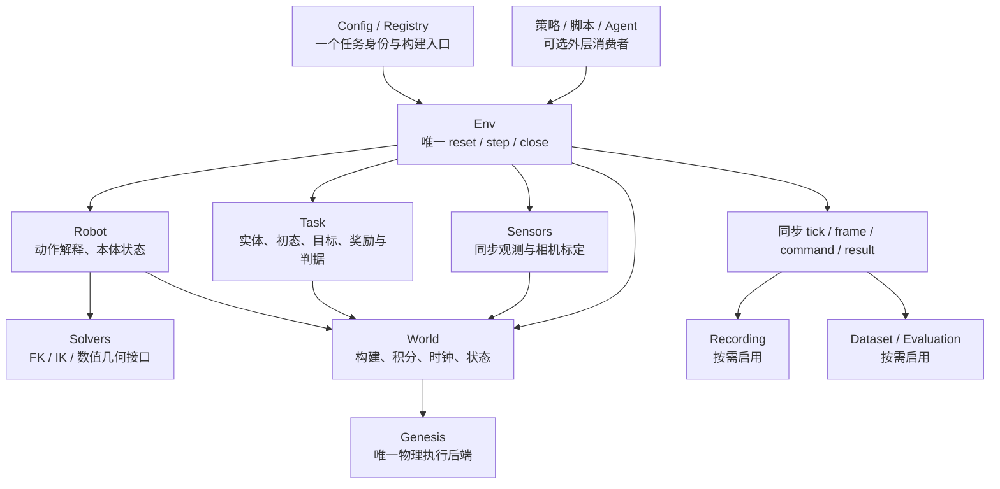

# 仅 Genesis 的 base 整理：MuJoCo 使用盘点与全量脚本归属

> 2026-09-23 目录已重排：本文保留移动前的分析、数量和旧路径名称，源码链接已指向新位置；当前结构及逐文件映射见 [目录重排记录](structure_move_20260923_zh.md)。

日期：2026-09-22（America/Chicago）。以当前工作树为准，包含未提交、新增及被 Git 忽略的项目脚本；文件清单快照时间为 `2026-09-23 03:31:27 UTC`。

## 1. 本轮结论与执行范围

**按用户最新方向，目标应收敛为一套 Genesis 物理运行核心；现有 demo、历史回放及多后端兼容不再是保留旧实现的理由。** 这一方向覆盖上一份审计中“多引擎并存可保留”的建议。

- 本轮完成分析、脚本分类和文档整理；没有撤销物理实现、卸载依赖、重录 demo 或新建一套运行框架。
- 后续整理应以“选出实现、合并重复机制、删除旧入口”为主；不应在当前任务 runner 之外，再叠加另一套并行 runtime。
- “所有 MuJoCo 实现撤销”在项目代码层同时覆盖物理推进、FK/IK、碰撞查询、模型编译、渲染及状态恢复；不是只删 `mj_step()`。
- 但 **Genesis 本身的第三方包依赖必须单独处理**：本地 Genesis 1.2.1 依赖 `mujoco`，并用它解析模型；撤销项目自写实现不能自动使环境彻底无 MuJoCo 包。
- 对旧任务不承诺原能力自动保留：例如删除 Orbits/Slotted 的 MuJoCo 动态链后，剩余 Genesis 静态预览不能算已经迁移完成。

本报告的配套清单：

1. [全量代码脚本清单](script_inventory_zh.md)：992 个非 `runs/` 文件逐项列出“路径、简介、功能入口、建议处置”，并按标准模块和剩余类别分组。
2. [MuJoCo 全量依赖清单](mujoco_dependencies_zh.md)：82 个维护区直接依赖、257 个间接静态依赖及来源位置。
3. [运行脚本及源码复本清单](script_snapshots_inventory_zh.md)：16,735 个运行目录代码文件，按 2,001 种内容去重说明，每个路径仍单独列出。
4. [第一轮模块化审计](simulator_modularity_audit_zh.md)：已从 `modules/` 移入本目录，保留当时的现状分析；后续取舍以本报告为准。

## 2. MuJoCo 是什么，为什么不能把所有同名字符串一起删除

### 2.1 你的理解基本正确：它是另一套物理引擎

MuJoCo 是通用物理引擎，提供 C/C++ 库和 Python 接口；其 `mj_step` 推进仿真，也提供模型编译、运动学、碰撞和渲染功能。因此，本仓库直接调用它时，可能在跑第二套动力学，也可能只把它当计算库使用。[MuJoCo 官方概述](https://mujoco.readthedocs.io/en/stable/overview.html)

对“只用 Genesis”的项目边界，建议逐项区分：

- **第二套物理执行：撤销。** `mujoco.mj_step/mj_step1/mj_step2`、MuJoCo model/data 驱动器和专属 checkpoint 不进入目标 base。
- **项目直接借用 MuJoCo 的 FK/IK/几何计算：同样撤销依赖。** 必要算法改为 Genesis 机器人能力或与动力学引擎解耦的数值实现；旧解法不必逐个复现。
- **MuJoCo 渲染、回放和模型打包支线：撤销对应分支。** 保留录制这一职责，缩减为 Genesis 的真实需求。
- **MJCF/XML 模型格式：不能直接等同于第二套模拟器。** 本仓库的 `gs.morphs.MJCF(...)` 是向 Genesis 加载模型；Fiber 生成 `<mujoco>` XML 也不等于它用 MuJoCo 推进物理。Genesis 官方入门同时展示 URDF/MJCF 加载。[Genesis 官方入门](https://genesis-world.readthedocs.io/en/latest/user_guide/getting_started/hello_genesis.html)
- **参考资产、相机来源、历史说明：不是执行。** 比如 `mujoco_menagerie` 资产来源和坐标说明，应与代码依赖分别记录。

### 2.2 本地 Genesis 1.2.1 仍有 MuJoCo 库依赖

这不是推测，已检查本地安装：

- `[genesis_world-1.2.1.dist-info/METADATA](../../../.venv-gs121-nyx/lib/python3.11/site-packages/genesis_world-1.2.1.dist-info/METADATA)` 声明 `Requires-Dist: mujoco>=3.2.5`。
- `[genesis/utils/mjcf.py](../../../.venv-gs121-nyx/lib/python3.11/site-packages/genesis/utils/mjcf.py)` 直接 `import mujoco`，并调用 `MjModel.from_xml_string`。
- `[rigid_entity.py](../../../.venv-gs121-nyx/lib/python3.11/site-packages/genesis/engine/entities/rigid_entity/rigid_entity.py)` 在模块层导入上述 MJCF 工具；因此，仅把项目模型改成 URDF，也不能据此承诺可以直接卸载 `mujoco`。

应分别验收两层目标：

1. **项目架构只用 Genesis：** 项目自己的 World 只由 Genesis 积分；项目代码不再直接调用 MuJoCo；原有 MuJoCo 支线及其注册入口撤销。这是本报告分类和减法建议采用的目标。
2. **整个 Python 环境完全不含 MuJoCo：** 还需处理所选 Genesis 版本的安装依赖和内部解析路径，属于第三方引擎依赖改造；不能通过删项目中的几个文件完成。

此处没有把第一层当成第二层已获例外，也没有自动更换或修改第三方引擎；明确记录这个边界，是为了让后续实施的验收标准真实可达。

## 3. 全仓库哪里用了 MuJoCo

### 3.1 数量与口径

- 当前维护区共有 **662 个代码文件**：`topogym/` 500、`tests/` 132、`demos/environment_bootstrap/` 19、`scripts/` 5、`bash_scripts/` 4、根目录安装脚本 2。
- 其中 **82 个文件直接导入 MuJoCo**：`topogym/` 60、`tests/` 21、`scripts/` 1。
- **257 个其他维护区文件存在静态导入可达路径**。这包含延迟导入和包初始化边，是改造影响面，不是“257 个文件都在运行 MuJoCo”的结论。
- **19 个维护区文件有直接物理推进调用**：任务代码 10、测试 8、标定工具 1。没有直接 `mj_step` 的文件也可能调用上层执行器，不能只撤销这 19 个。
- `assets/` 另有 **2 个直接依赖源码副本**；`runs/` 有 **3,958 个直接依赖文件 / 266 种内容**。它们没有从完整清单中省略。
- `legacy/`、`reports/` 的本轮 AST 扫描未发现直接 MuJoCo import；这不代表其动态或外部依赖已全部证明无 MuJoCo。

所有具体脚本、用途、API、import 行号和传递路径见 [MuJoCo 全量依赖清单](mujoco_dependencies_zh.md)，以下解释对模块整理最重要的部分。

### 3.2 真正推进第二套物理的项目代码

- **Claws 家族：** `[family_physics.py](../../../topogym/redundants/mujoco/tasks/interlocked_claws/family_physics.py)`、`[family_robot.py](../../../topogym/redundants/mujoco/tasks/interlocked_claws/family_robot.py)` 直接推进 MuJoCo；相关 `family_balanced_robot`、归档和回放依赖同一模型链。`physical.py` 的 Genesis 路径应单独判断，不能因同属一个任务而一起算作 MuJoCo。
- **Orbits：** `[dynamics.py](../../../topogym/redundants/mujoco/tasks/orbits/dynamics.py)`、`[robot_runtime.py](../../../topogym/redundants/mujoco/tasks/orbits/robot_runtime.py)` 直接积分；`robot_dynamics` 构建模型，rope route、robot pickup、连续控制、审计和回放围绕 MuJoCo 状态组织。Genesis `scene.py` 主要是静态检查，不能替代动态链。
- **Slotted Post Ring：** `[probe.py](../../../topogym/redundants/mujoco/tasks/slotted_post_ring/probe.py)`、`[fixture.py](../../../topogym/redundants/mujoco/tasks/slotted_post_ring/fixture.py)`、`[fem_probe.py](../../../topogym/redundants/mujoco/tasks/slotted_post_ring/fem_probe.py)`、`[fem_fixture.py](../../../topogym/redundants/mujoco/tasks/slotted_post_ring/fem_fixture.py)`、`[robot.py](../../../topogym/redundants/mujoco/tasks/slotted_post_ring/robot.py)`、`[robot_sequence.py](../../../topogym/redundants/mujoco/tasks/slotted_post_ring/robot_sequence.py)` 直接积分；`physics.py/fem.py` 构建模型，其他脚本依赖这些模型和保存状态。
- **Robotiq 标定：** `[scripts/calibrate_robotiq_model.py](../../../scripts/calibrate_robotiq_model.py)` 使用 MuJoCo 仿真生成空载开口表；它不是实机标定，也不是纯 XML 读取。若保留这项工具，需要换成 Genesis 标定或明确验证过的模型映射。

这几条动态执行链应退出目标 base。纯几何、任务目标和必要资产可单独提取；不以保住旧录像为迁移要求。

### 3.3 Genesis 执行任务中，仍存在的 MuJoCo 计算依赖

- **Cast Coil：** `robot_plan.py` 用 MuJoCo FK 配合 SciPy 求 IK；其 `Kinematics` 又被 Claws 和 Slotted 引用，是跨任务依赖中心。
- **Cast Keyhole：** `robot_motion.py` 用 MuJoCo 求双臂位姿和间隙，变体路线继续依赖它。
- **Buzz Wire：** `robot_plan.py` 用 MuJoCo 进行单臂 IK/碰撞审计，family/supported/home 规划继续调用；不能只删 import 而保留旧 planner 入口。
- **Horseshoe：** `robot_motion.py`、`robot_clearance.py`、`physical_extraction.py` 使用 MuJoCo 运动学/碰撞；Genesis `physical_motion` 的存在并不代表上游规划无依赖。
- **Hedgehog：** `inverse_window.py`、`variant_validation.py` 使用 MuJoCo 模型；`family_geometry/family_runtime/inverse_runtime` 读取其几何类型。后两者的实际执行可以在 Genesis 内，不能按文件名误判为 MuJoCo 积分器。
- **Knot：** `control.py`、`family_preflight.py`、`home_start.py`、`robot_clearance.py` 使用 MuJoCo FK/IK 或模型几何；绳的 Genesis FEM+IPC 与这些规划依赖是两层不同职责。
- **Rope Threading：** `ik_plan.py`、`feedback_ik_plan.py`、`feedback_paths.py`、`reference_preflight.py`、`robot_mesh_guard.py` 直接依赖 MuJoCo，还间接使用 Knot 的求解器。
- **Blanket：** `bimanual_kinematics.py` 用 MuJoCo 双臂 FK/IK 与碰撞检查，布本身由 Genesis PBD 推进。
- **Lock：** `inverse_variants.py` 的 `ArmIK` 使用 MuJoCo 的运动学和雅可比；基础 Genesis 锁执行器与反向设计变体链应分开处理。
- **公共 Robot 端口：** `agent_bridge/panda_contract.py` 用 MuJoCo 编译模型并读取参数，应改由统一机器人描述或 Genesis 模型提供。

上述算法不能原样成为“只用 Genesis 的 Solvers”。应保留问题定义、坐标/限位约定和真正需要的求解策略，撤销旧库实现后合并为一个机器人求解入口；不需要为每个旧 demo 重做一个相同 planner。

### 3.4 公共媒体、模型和测试支线

- `[recording/adapters/mujoco.py](../../../topogym/redundants/mujoco/recording/adapters/mujoco.py)`：专属渲染/恢复，撤销；共享录制合同和 Genesis binding 保留。
- `[world/mujoco_presentation.py](../../../topogym/redundants/mujoco/world/mujoco_presentation.py)`：虽然不直接 import MuJoCo，但专门构造该后端 XML，仍应撤销。
- `[recording/signatures.py](../../../topogym/world/signatures.py)`：保留 `genesis_signature`，撤销 `mujoco_signature`，不是整文件盲删。
- `[recording/sources.py](../../../topogym/recording/sources.py)`：拆出必要的资产依赖发现，撤销项目自己调用 MuJoCo 编译模型的做法；保留 Genesis 所需的模型来源记录。
- Claws、Orbits、Slotted 的录制 adapter：撤销 MuJoCo 分支；Claws 文件里已有 Genesis binding，不应因同文件含另一后端就丢掉可用公共接入。
- 21 项直接依赖测试：重写仍需保留的机器人/相机/录制契约检查；撤销只服务退役 MuJoCo 动态链的检查，而不是让失效测试长期 skip。
- `[requirements/uv-topogym-buzz-wire.txt](../../../requirements/uv-topogym-buzz-wire.txt)` 显式 pin `mujoco==3.13.0`；撤销项目级需求时应一并整理。Genesis 的间接依赖另算，不能以 `pip freeze` 中仍出现该包判定项目仍有第二套物理执行。

## 4. 标准模块与现有脚本的对应关系

**完整逐脚本 list 在 [全量代码脚本清单](script_inventory_zh.md)。** 本节是学习地图，说明每个模块从哪里读起、抽出什么，不重复抄写近千条目录。

### 4.1 Config / Registry

- 先读 `core/config.py`、`generation/episode_spec.py`、`generation/variant_rng.py`、`generation/variant_episode.py`、`tasks/catalog.py`。
- 对照 `agent_bridge/registry.py`、`agent_rollout/suite.py`，识别“任务卡清单”“adapter 工厂”“固定评测实例”三个不同身份体系。
- **合并目标：** 一个任务注册描述、一套展开实例和加载协议；任务变体采样仍属于任务逻辑，不能把所有 family 分支塞进公共 registry。
- 逐项清单：[Config / Registry](script_inventory_zh.md#m-config)。

### 4.2 Env

- 先读 `runtime/episode_runner.py`、`agent_bridge/protocol.py`、`adapters.py`、`robot_adapter.py`、`fem_robot_adapter.py`。
- 再读各任务的 `execution/runner/robot_runtime/variant_runtime`，识别被重复实现的初始化、积分、计数、观测和终止流程。
- `agent_bridge/session.py` 管 agent 分段会话；`agent_rollout/episode.py` 管进程；它们不应成为基础 Env 的必要依赖。
- **合并目标：** 本地 Env 独占 `reset/step/close`；原有协议/worker 做外层适配；从任务执行器提取机制，保留任务控制策略。
- 逐项清单：[Env 及当前混合执行器](script_inventory_zh.md#m-env)。

### 4.3 World

- 先读 `world/tabletop.py`、`core/manifest.py`、`world/rope.py`、`world/rope_backends/{pbd,fem_ipc}.py`、`world/genesis_ipc_vertex_constraints.py`。
- `lab_layout/nyx_lab` 是场景呈现；`rope_threading/table_contact.py`、`deformation_damping.py` 等是任务中寄宿的引擎扩展，需要决定是否真有复用需求。
- **合并目标：** 唯一 Genesis World 和物理时钟；任务只声明实体与特殊约束。PBD/FEM/IPC 是 Genesis 内部不同物理能力，保留它们不违背“一个模拟器”。
- 逐项清单：[World](script_inventory_zh.md#m-world)；该组仍列有待撤销 MuJoCo 实现，用于交代当前代码去向，不表示建议保留。

### 4.4 Robot

- 先读 `robot/{assets,factory,franka,aloha,gripper,grasp_constraints}.py`。
- `agent_bridge/{aloha_contract,panda_contract}.py` 中的动作单位/校验应归入机器人接口；`primitives` 中抓持约束和附件机制可归 Robot，完整抓放策略应放在上层。
- **合并目标：** 统一动作解释、具名 TCP、关节映射和本体状态；Robot 设置目标，Env 推进物理。
- 逐项清单：[Robot](script_inventory_zh.md#m-robot)。

### 4.5 Solvers

- 先看 `planning/rope_crossings.py`、`tasks/_rigid_geometry.py` 等无在线场景的算法，再看任务内 `Kinematics/BoundedAlohaIK` 的输入、坐标和残差约定。
- `robot_plan/robot_motion/control` 往往同时包含通用运动学和任务路线；不要整文件移动到 `solvers/` 后就宣称分层完成。
- **合并目标：** 必要 FK/IK/数值几何一个公共接口；依赖 Genesis 或独立数值模型；任务专有路线、解法和候选搜索留策略层。
- 逐项清单：[Solvers](script_inventory_zh.md#m-solver)。

### 4.6 Sensors

- 先读 `world/{aloha_cameras,nyx,presentation,lighting,materials,textures}.py`、`agent_bridge/camera_info.py`、`recording/cameras.py`。
- `world/tabletop.py` 当前还承担相机创建；recording、bridge、data 分别取帧，需要统一观测出口。
- **合并目标：** 一个相机/传感器集合，输出同 tick 的观测和标定；记录、数据、agent 共用它，编码留在消费者侧。
- 逐项清单：[Sensors](script_inventory_zh.md#m-sensor)。

### 4.7 Task

- 每项任务保留必要 `geometry/scene`、初态、变体、指令、目标和失败判据；`scene.py` 是任务实体声明，不代表任务应该自己拥有整个世界。
- 任务内 `generation/variants/families` 和 `verification/evaluator/certificate` 可有各自算法，但应消费和返回相同公共契约。
- **合并目标：** 一个任务定义可以被同一 Env 构建和执行；复杂任务不因需要 FEM、拓扑或抓持而再建一套 reset/step。
- 逐项清单：[Task](script_inventory_zh.md#m-task)。

### 4.8 Recording

- 先读 `recording/{contracts,config,session,timeline,encoding,validation,archive}.py` 和 `adapters/genesis.py`。
- 保留 task recording adapter 中必要的状态适配；`utils/recording`、`compatibility*`、各任务重复 archive 的兼容价值应按新目标重新评估。
- **减法目标：** 单一 Genesis 录制入口、一个状态合同和一个发布流程；旧 demo 专用恢复、目录修补、拼图或第三方后端分支不进入 base。
- 逐项清单：[Recording](script_inventory_zh.md#m-recording)。

### 4.9 Dataset / Evaluation

- 先读 `data/{h5_schema,episode_dataset_writer}.py`、`supervision/*`、`generation.EpisodeResult`、`agent_rollout/{initial,evaluate}.py`。
- 任务成功条件留在 Task；通用稳定诊断、资格汇总、数据写入和跨试验统计是消费者。
- **合并目标：** 统一消费真实 action、观测、时间和 result；不再各自包装 `scene.step`，也不把视频完成等同于任务成功。
- 逐项清单：[Dataset / Evaluation](script_inventory_zh.md#m-data)。

### 4.10 策略 / 脚本 / Agent

- `primitives` 的完整动作、任务 expert controller、`agent_bridge` 传输/策略解释以及 `agent_rollout` 的预算、模型和试验编排放在 base 上方。
- **依赖方向：** 它们可以调用 Env，Env/World/Robot 不应为了运行本地任务而依赖模型 API、trial budget、HTTP 或 agent 文件队列。
- 逐项清单：[上层消费者](script_inventory_zh.md#m-policy)；必要包入口和底层工具见 [公共支撑](script_inventory_zh.md#m-utility)。

## 5. 不能作为标准 base 模块保留的剩余脚本

不能归入 base，不等于没有功能；这里是对运行层级和保留价值的判断。每项脚本的名字、简介和功能均已在对应 list 展开。

- **专用实验与临时检查：** 当前 81 个归类项，包括 task `probe/physics_suite/startup_study`、部分解法探索和 `demos/environment_bootstrap`。从中提取必要算法或最小回归，剩余不作为正式任务入口。[逐项 list](script_inventory_zh.md#m-experiment)
- **测试与基准：** 当前 138 个归类项，包括 132 个 `tests/` 文件、Shell 检查和其他基准。它们应验证新模块契约，而不是靠维护旧 demo 的形状继续决定架构。[逐项 list](script_inventory_zh.md#m-test)
- **安装、资源、外部训练：** 5 个归类项作为项目工具独立于模拟器核心；OpenPI 是可选训练接入，不能放到 Env 的依赖链。[逐项 list](script_inventory_zh.md#m-setup)
- **HTML/显示与汇报工具：** 维护区 14 个归类项，以及 `reports/` 的 21 个代码文件；包括 review 页、viewer、deck、转码和打包程序。它们不参与任务物理定义，列为退出 base/清理候选。[展示工具](script_inventory_zh.md#m-presentation)、[reports](script_inventory_zh.md#m-report)
- **legacy：** 295 个代码文件全部列出，包括 88 个旧包实现、36 个旧 demo、36 个旧测试、25 个 Shell、97 个历史 run 文件和13 个历史汇报文件。仅当抽出的算法有明确当前用途时迁入公共实现，不恢复旧任务全集。[逐项 list](script_inventory_zh.md#m-legacy)
- **assets 中的实现副本：** 14 个 Buzz Wire 冻结规划脚本；其中 2 个直接依赖 MuJoCo。资产应主要是模型/配置数据，不应靠藏在资产目录中的另一套 Python 实现运行。[逐项 list](script_inventory_zh.md#m-assetcopy)
- **runs：** 16,735 个脚本/界面/原生源文件，2,001 种内容；8,082 个路径与维护区某文件内容完全一致。它们是产物、快照或独立实验，不能当作另一份主源码。[全部路径及介绍](script_snapshots_inventory_zh.md)

有一项应特别撤销：`[fiber_bundling/snapshot_trial.py](../../../topogym/redundants/experiments/fiber_bundling/snapshot_trial.py)` 会修改 package `__path__`，从 `baseline/source` 动态执行旧源码。这不只是“保存证据”，还让运行产物成为可执行代码来源；目标 base 应运行明确的源码版本，不能继续通过 runs 暗中切换实现。

## 6. 目标依赖图：保留原 base 的职责，只留 Genesis

- `tick/frame/command/result` 是共享数据契约，不要求再造一个庞大“事件平台”。
- World 只由 Genesis 积分；FK/IK 求解不应隐式推进在线世界。
- Task/Robot/Sensors 依赖公共接口；任务目标无需知道录制输出路径和 agent 预算。
- Recording/Dataset 读取同一观测流，不反向导入具体任务来决定通用生命周期。
- 场景 build 前声明必要实体/约束；reset 后的初始化、落稳和计数按公共规则组织；step 明确报告实际物理步数。
- 一个 action 可以覆盖多个 Genesis tick，但所有推进都经过同一个 owner；相机和录像不额外推进物理。
- 保持这些边界比顶层恰好有多少个目录更重要；不为图里的每个方框新增一个空包。

## 7. 按减法推进，而不是再造一套平行框架

### 第一步：冻结保留范围

- 选定一个最小 Genesis 机器人/刚体场景作基线，外加后续验证软体扩展所需的一项任务；不先要求 13 个任务都恢复旧 demo。
- 为目标 base 确定唯一配置入口、机器人描述、任务定义和状态结果合同。
- MuJoCo 支线、旧兼容入口、历史模板展示、run 内执行源码退出保留名单。

### 第二步：先撤销第二后端，再提取必要算法

- 撤销 Orbits/Slotted/Claws 对应的 MuJoCo 动态分支、独立 renderer/restore 和注册入口。
- 从仍保留的 Genesis 任务中撤销 MuJoCo FK/IK/模型查询，合并为公共机器人求解；算法不再需要时直接删掉。
- 删除项目显式依赖项和失效测试；第三方 Genesis 库依赖按第 2.2 节单独记录。
- 对混合文件按函数职责拆除，不把纯几何或现有 Genesis binding 误删。

### 第三步：把现有运行循环收敛成一个

- 从 `GenesisAdapter`、Rigid/FEM adapter 和保留任务 runner 提取动作/物理/检查顺序。
- 让 Robot、探针、录制和数据停止各自接管 `scene.step`。
- 将任务策略从 Env 机制中剥离；将 agent 会话和进程管理放在上层。
- 同一任务通过 demo 或 agent 运行时，都调用这一条 Env 路径；完成后撤销旧重复入口。

### 第四步：合并和清理外围

- 相机 creation/observe/calibration 收敛；数据和视频共用观测，旧兼容 recorder 和 task archive 只保留必要职责。
- 批量审查 legacy、reports、assets 源码副本和 runs；不因历史 MP4 需要某个 renderer 就继续保留该 renderer。
- 更新任务清单、CLI、测试和文档，不能保留指向已撤销实现的“可用”注册项。
- 通用代码不再从某个任务内部导入运动学或日志类，任务源码不再从运行产物读取并执行 Python。

### 整理完成的判定

- 在不启用 agent、视频、HDF5 的情况下，可以按名称创建、reset、step、close 一个本地 Genesis 环境。
- 换任务只增加必要 Task 内容和配置；不会再复制整个环境循环。
- project-owned Python 不再直接 import/调用 MuJoCo；模型格式和第三方引擎库依赖在清单中独立说明。
- 一个动作、仿真时钟、观测 tick 和结果能对账；render/observe 不推进物理。
- 当前保留任务都有准确能力声明；不支持的状态恢复/软体/批量能力明确缺失，不用静态预览替代。
- 测试验证新 base 的契约及物理基本行为，不以恢复全部旧 demo 为通过条件。

## 8. 全量清单的范围、生成方式与限制

- 扫描使用 `rg --files --hidden --no-ignore`，包含维护区、legacy、reports、assets、demos、runs；随后按扩展名和内容分析代码。
- 包含 Python、Shell、JavaScript/CJS、HTML/CSS、C/C++/CUDA/头文件；包括 `__init__.py`，没有只列入口脚本。此快照共 **17,727** 个代码文件；`.html/.css` 作为界面代码一并纳入，是代码脚本范围的保守扩展。
- 不把 `.git`、`.venv*`、`.external`、`.cache`、pytest/ruff/Nyx/字节码缓存内的第三方实现当成本仓库自写脚本；本地 Genesis 依赖另做了有针对性的源码检查。
- YAML/JSON/XML/URDF、网格、媒体、日志、文档和压缩包不是本页“代码脚本”；MuJoCo 相关 requirements 和模型格式仍在主报告说明。未解包旧 ZIP 或从日志内抽取代码片段另算脚本。
- 主清单每文件一个主要归属；实际混合职责不能通过自动搬整个文件解决。测试、实验、历史代码单列，不强塞进 Env/Task。
- Python 用 AST 读取 imports、定义和 API 调用；目录中大量重复代码按 SHA-256 分组，不执行脚本。简介以源码文档、公开符号和已检查调用链为依据；详细列表是职责索引，不替代后续逐函数改造审查。
- 间接依赖采用项目内 import 图的反向广度遍历，给出一条最短层数路径；条件导入是保守包含，动态生成模块名、脚本子进程和运行时路径改写不能由它完全覆盖。
- 本次只验证目录覆盖、引用、分类数量和文档迁移；没有用旧视频做验收，也没有重跑 13 个任务或执行 runs 中的实验。
- 清单核对结果：17,727 个代码路径全部收录，遗漏 0、重复归类 0；本目录 18,567 处本地链接均可解析，模块导航锚点有效；82 个直接依赖及 257 个间接依赖的静态路径已复核。

完整目录入口见 [dev-logs 索引](README.md)。