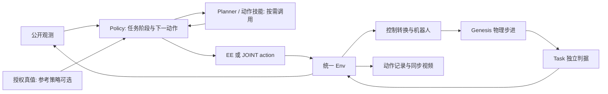
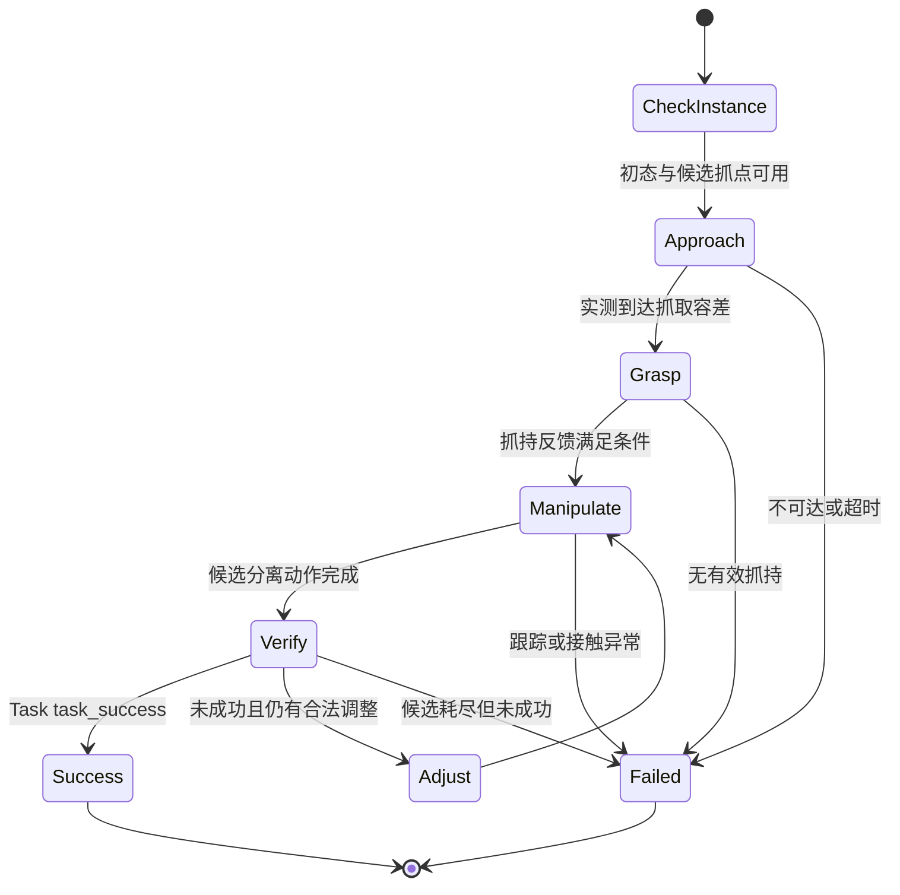

# 机器人 Policy 的代码结构：RoboWits、ACT/ALOHA、Ravens 与 TopoGym

核对日期：2026-09-24。本文为源码分析与后续设计建议；只新增说明和文档索引，不修改 simulator、任务建模或策略代码，不运行测试或 GPU。

**当前 TopoGym 已有 policy 可用的动作执行接口，但还没有在活动 `planning/` 中形成一套完成解谜任务的统一参考 policy。已有的几何路线、机器人求解器和局部抓取流程，是可以组成它的部件。** 下一步主要是把“读状态 → 决定下一动作 → 根据实际结果调整 → 完成任务”补齐，而不是再造环境。

阅读定位：第 1 节解释术语，第 2～4 节看外部项目的实际函数，第 5 节逐脚本对照我们的实现，第 6～8 节给出适合当前仓库的代码形态与开发顺序。

## 1. 完整 Policy 指什么，和 Planner 有什么区别

不存在所有机器人项目必须遵循的一套类名或目录名。可比较的是职责和输入输出。对本项目，可以采用下面的术语：

| 名称 | 负责什么 | 输入 → 输出 | 不等于什么 |
|---|---|---|---|
| Policy / 策略 | 决定机器人此刻做什么 | 观测、任务条件、内部记忆 → 下一动作、更新后的记忆 | 不一定是神经网络，也不一定调用搜索算法 |
| Oracle / 参考策略 | 利用已知解法或额外真值生成参考行为 | 公开观测及明确授权的真值 → 动作 | 不代表一定成功，更不代表所有 seed 都已证明可解 |
| Planner / 规划器 | 为一个目标寻找候选路径或动作序列 | 起点、目标、模型和约束 → 路径、轨迹或失败原因 | 找到物体几何路线，不等于机器人已执行成功 |
| Motion primitive / 动作技能 | 执行可重复的局部行为，如接近、闭爪、抬升 | 技能参数及实际反馈 → 下一控制命令、技能进度 | 完成一次抓取，不等于完成整个 Task |
| Controller / 控制器 | 把命令落实为执行器控制 | 关节/末端目标、当前状态 → 关节控制目标等 | 不决定先抓哪件、如何解谜 |
| Task evaluator / 任务判据 | 根据真实状态判断任务是否完成 | 物理状态、判据历史 → success / failure / metrics | 不依赖 policy 自称成功 |
| Rollout runner / 运行入口 | 串起一次执行并保存证据 | Env、policy、预算和输出路径 → 轨迹、报告、录像 | 不拥有第二套物理步进循环 |

从代码看，有内部记忆的策略可概括为：

```text
(action_t, memory_next) = policy(observation_t, allowed_context_t, memory_t)
```

其中 `memory` 可以只是当前阶段和轨迹游标，也可以是模型的动作队列。反馈策略会根据每次测量决定是否换阶段；开环脚本则可以只根据初态生成轨迹，再按时间执行。两者都属于 policy。“完整”意味着有清楚的初始化、动作产生、任务范围和结束处理，不要求每个脚本都实现通用搜索、视觉感知或自动重试。

本项目希望实例可复用、问题可追踪，因此建议参考 policy 采用**参数化解法 + 必要的反馈检查**。这是针对我们的工程建议，不是声称外部项目全部如此实现。



## 2. RoboWits：先区分环境接口和真正的策略

### 2.1 本次实际读到什么

公开说明的正式评测路径是 LeRobot 学习策略，包含 ACT、Pi0 等，并不说明每个 Task 都配有手写 oracle。其环境公开 EE/JOINT 观察和四种动作模式。这里用它参考**策略与环境的对接方式**，不把它未经核实地描述成完整 oracle 库。[RoboWits README](https://github.com/UMass-Embodied-AGI/RoboWits/blob/main/README.md)

| 已核对的脚本 / 函数 | 输入 → 行为 / 输出 | 对我们意味着什么 |
|---|---|---|
| `scripts/robowits/examples/run_env.py::run_env(args, task, dataset_dir)` | 创建环境并 reset；将初始 `agent_pos` 作为保持命令，循环 step、保存图像 | 有运行和录像示例，不等于有解任务策略 |
| `scripts/robowits/eval/eval.sh` | checkpoint 路径、控制/观察模式、任务列表 → 调用 `lerobot-eval` | 环境执行与策略模型来自不同组件 |
| `gs_gym/envs/robowits/06_dominos.py::DominosEnv` | 声明实体、摆放分组、任务说明；检查实际物体状态 | Task 定义“什么算完成”，没有在该脚本里实现完整机器人动作生成 |

对应源码：[运行示例](https://github.com/UMass-Embodied-AGI/RoboWits/blob/main/scripts/robowits/examples/run_env.py)、[评测入口](https://github.com/UMass-Embodied-AGI/RoboWits/blob/main/scripts/robowits/eval/eval.sh)、[Dominos Task](https://github.com/UMass-Embodied-AGI/RoboWits/blob/main/gs_gym/envs/robowits/06_dominos.py)。

Dominos 的 `_add_custom_entities()` 建场景，`_check_success()` 判断红块与目标区域的实际覆盖，`get_reward()` 计算进度。**这些函数不会输出“机械臂下一步移动到哪里”。** 因而不能从一个 Task 有终态函数推断它也有 solution。

### 2.2 对接时不能只匹配控制模式名字

RoboWits README 中的双臂 `EE_ABS` 是 14 维向量，朝向采用轴角；TopoGym 当前采用按 `left/right` 分组的字典和单位 `wxyz` 四元数。关节数量和夹爪命令语义也应分别核对。模式都叫 `EE_ABS`，并不意味着 action 可以原样复制。

本次部分 RoboWits 底层及其内嵌 LeRobot 文件未能通过网页读取，因此**不对其完整内部推理函数链或全仓是否存在其他 oracle 作断言**。以下用明确读到完整源码的 ACT 和 Ravens 展示参考策略实现。

## 3. ACT/ALOHA：一个很具体的双臂脚本策略

参考的是 ACT 原作者仓库中的仿真脚本策略，区别于训练后的 ACT 网络。该仿真使用 MuJoCo；这里只分析策略组织方式，TopoGym 继续使用 Genesis。

### 3.1 策略如何产生动作

[`scripted_policy.py`](https://github.com/tonyzhaozh/act/blob/main/scripted_policy.py) 提供以下实际类和函数：

| 类 / 函数 | 输入 → 输出 | 作用 |
|---|---|---|
| `BasePolicy.__init__(inject_noise=False)` | 噪声设置 → 策略游标和左右轨迹容器 | 建立策略自身的记忆 |
| `PickAndTransferPolicy.generate_trajectory(ts_first)` | 初始双臂位姿、物体真值 → 两条 waypoint 序列 | 规定抓取与双臂交接过程 |
| `InsertionPolicy.generate_trajectory(ts_first)` | 初始 peg/socket 真值 → 双臂轨迹 | 规定双臂抓取与插接过程 |
| `BasePolicy.interpolate(...)` | 相邻 waypoint、当前步号 → 位姿和夹爪目标 | 从稀疏节点产生每步命令 |
| `BasePolicy.__call__(ts)` | 当前 timestep → 双臂 16 维 EE 命令 | 首步建轨迹，此后按内部计数推进 |

每个 waypoint 记录时间、位置、四元数和夹爪值。这里的主体是**初态驱动的开环轨迹**，并非每步都根据抓取是否成功重新规划；它也没有通用避障搜索。对我们的启发是：第一版参考 policy 可以很小，只要完整覆盖任务动作，不必先建设庞大的 planner 框架。

### 3.2 动作到底在哪里被执行

[`ee_sim_env.py::BimanualViperXEETask.before_step`](https://github.com/tonyzhaozh/act/blob/main/ee_sim_env.py) 将双臂命令拆开，设置 mocap 位姿及夹爪控制；其夹爪输入为归一化开合值。TopoGym 则在 `compile_action()` 中把 TCP 目标转换为手部目标，经 Genesis IK 得到关节目标，然后真实积分。两边末端执行机制不同，迁移需要重新验证可达、跟踪和接触；不能复制动作数组就声称等价。

TopoGym 还要求 EE 四元数单位化，插值应正确处理旋转；不能直接沿用参考脚本中四元数分量的线性插值结果。

### 3.3 谁负责 rollout 与保存

[`record_sim_episodes.py::main`](https://github.com/tonyzhaozh/act/blob/main/record_sim_episodes.py) 在外层循环调用 policy 和 `env.step`；先运行 EE 策略，再把测得的关节轨迹放到关节控制环境重放，检查重放结果并写数据。它把**策略、环境执行、数据收集**区分开了。

我们可以借鉴职责划分，但不需要照搬“两套环境先生成再重放”的组织方式：当前公共 Env 已支持末端与关节控制，正式录像可以直接来自同一次物理执行。

## 4. Ravens：Oracle 很短，因为 Env 接收的是高级动作

### 4.1 Oracle、技能、Env、采集入口的真实调用链

| 文件 / 函数 | 输入 → 输出 | 所在层 |
|---|---|---|
| `ravens/tasks/task.py::Task.oracle(env)` / `_discrete_oracle(env)` | Task 目标和环境 → 带 `act` 的 oracle 对象 | 参考策略构造 |
| 上述 oracle 的 `act(obs, info)` | 目标、物体真值、理想图像/分割 → `pose0` 抓取位姿与 `pose1` 放置位姿 | 高级动作生成 |
| `ravens/tasks/primitives.py::PickPlace.__call__` | 两个位姿及运动/夹具接口 → 接近、接触、抓取、抬起、放下、释放；返回超时状态 | 完整动作技能 |
| `ravens/environments/environment.py::Environment.step` | 一个抓放动作 → 执行技能、等待稳定、计算任务结果和观测 | 环境编排 |
| `ravens/demos.py::main` | task、seed 与收集数量 → 重复运行 oracle；筛选完成的轨迹存入数据集 | 采集入口 |

源码：[oracle 与目标评估](https://github.com/google-research/ravens/blob/master/ravens/tasks/task.py)、[抓放技能](https://github.com/google-research/ravens/blob/master/ravens/tasks/primitives.py)、[环境步进](https://github.com/google-research/ravens/blob/master/ravens/environments/environment.py)、[轨迹采集](https://github.com/google-research/ravens/blob/master/ravens/demos.py)。

这里的 oracle 用真值选择尚未完成的物体与目标，再决定抓放位姿；机器人怎么下降、接触、激活夹具和退出，交给技能层。因此 oracle 函数短，并不意味着完整系统只需要两个目标点。

Ravens 也有连续版本：[`tasks/planners.py::PickPlacePlanner`](https://github.com/google-research/ravens/blob/master/ravens/tasks/planners.py) 将起点、抓取和放置位姿展开为中间路径及吸附命令。这个具体 planner 主要做路径展开与插值，不能仅因名称是 planner 就推断它包含通用碰撞搜索。

### 4.2 与我们的关键区别：action 的时间尺度

```text
Ravens 默认离散抓放：
oracle.act → {抓取位姿, 放置位姿}
           → 一次 env.step 内执行整套抓放技能

TopoGym 当前接口：
policy.act → {本次末端/关节目标, 夹爪目标}
           → 一次 step 最多推进 10 个物理 tick
           → policy 根据新观测决定下一个目标
```

在默认配置下，我们一次 action 最多覆盖 25 ms 模拟时间。接近、闭爪、抬升、过孔等行为，需要策略连续提交多次 action。把一个遥远的最终目标直接传给 `EE_ABS`，不会自动完成这些技能，也不会自动规划绕障路线。

我们要保留当前逐动作观测、逐 tick 历史的语义。需要高级技能时，可以在 policy 一侧把技能展开为动作；不必把“整套抓放完成后才返回”塞入现有 `step()`。

Ravens 使用 PyBullet 和吸附夹具，其物理操作不能原样搬入我们的双指夹爪系统。更适合借鉴的是**目标选择、动作技能与外层采集分工**。

## 5. TopoGym 当前有什么：按实际脚本逐层对照

### 5.1 执行侧已经存在的能力

下表描述源码能力，不等于新增了一轮测试通过记录。

| 当前脚本 / 函数 | 输入 → 输出 | 在完整 policy 系统中的位置 |
|---|---|---|
| [simulator/interaction.py](../../../topogym/simulator/interaction.py)：`Interaction.step/observe` | 合法 action → 五元组；查询 → 当前公开观测 | 操作方入口，普通与特权句柄都没有 reset |
| [robot/control.py](../../../topogym/robot/control.py)：`action_spec`、`compile_action` | Robot 描述、模式、action → 规格 / 绝对关节目标 | 模式与单位转换，EE 模式调用 IK |
| [robot/joint_position.py](../../../topogym/robot/joint_position.py)：`validate_action`、`apply_action`、`observe` | 控制目标 → 合法性检查与关节控制；读机器人 → 实测字典 | 执行器与本体状态，不负责选择解法 |
| [solvers/genesis_kinematics.py](../../../topogym/solvers/genesis_kinematics.py)：`GenesisIKSolver.solve_checked` | 手部目标位姿、可动关节索引、初值等 → 经 FK 残差检查的候选关节解 | 单点运动学求解，不检查完整抓取或避障路径 |
| 同文件：`GenesisFKSolver.solve` | 全机器人 qpos → 各 link 世界位姿 | 候选姿态查询，不推进物理 |
| [simulator/env.py](../../../topogym/simulator/env.py)：`Env.step` | action → 转换、控制、逐 tick 积分、Task 更新、checkpoint、输出 | 唯一环境执行路径 |
| [sensors/observation.py](../../../topogym/sensors/observation.py)：`SensorSuite.sample` | 当前保存状态 → `state/robot/task/rgb/cameras` | 公开观察；当前 Task 公开 `observe()` 通常为空字典 |
| [simulator/privileged.py](../../../topogym/simulator/privileged.py)：`get` | 白名单查询名 → 当前 world/robot/task/diagnostics 或历史元数据 | 参考策略和调试可用的真值读取 |
| [tasks/base.py](../../../topogym/tasks/base.py)：`update` → 各任务 `evaluate_state` | 实际世界状态、dt → 成功/失败、稳定时间、指标 | 环境独立裁决；7 项 Task 仍未完成成功判据 |
| [recording/session.py](../../../topogym/recording/session.py)：`append`、`finish` | SensorFrame、最终结果 → 多视角 MP4 与帧映射 | 录像消费者，不移动机器人 |
| [data/episode_dataset_writer.py](../../../topogym/data/episode_dataset_writer.py)：`append` | Transition → JSONL/HDF5 | 保存原始动作、前后观察与结果 |

**现有 EE 接口保证的是命令解释和运动学检查，不是“这一步一定安全、夹得住、不会掉落”。** 两臂目标各自 IK 成功也不证明双臂之间无碰撞；没有在 `compile_action` 里自动建立带物体碰撞、限速和换抓的完整路径。

### 5.2 `planning/motions/cast_coil.py` 为什么还不是完整策略

当前 [Coil 参考运动文件](../../../topogym/planning/motions/cast_coil.py) 的核心接口：

| 函数 | 输入 → 输出 | 实际覆盖 |
|---|---|---|
| `variant_route(kind, parameters=None)` | 家族与参数 → `RigidMotionSegment` / `ScrewMotion` 列表 | 物体相对几何运动 |
| `prototype_route(assembly)` | 建模 assembly → 滑动、转动、抽出运动段 | 一个几何候选路线 |
| `ScrewMotion.pose(u)` | 路径进度 → 旋转矩阵和平移 | 参数化运动求值 |
| `sample_route(motions, boxes, displacement_m)` | 运动段、几何、采样尺度 → 位姿和阶段名样本 | 几何采样，不发送机器人命令 |

它尚未回答：

1. 左右臂分别抓哪个位置、什么朝向，夹爪能否伸进去？
2. 从 home 到抓点的路径是什么？夹持是否建立、是否滑动？
3. 物体参考坐标如何转成机器人 TCP 世界坐标？
4. 参考轨迹上每个时刻机器人是否可达、是否碰撞，速度是否可执行？
5. 实际物体没有跟上轨迹时，等待、调整、失败还是重试？
6. Task 是否真的 solved，而非几何游标走到了末尾？

还有一个目标方向差异：当前 [Cast Coil Task](../../../topogym/tasks/cast_coil.py) 默认为 `objective="assemble"`，从分离零件开始；上述保留路线以抽出结束。反向几何路线可以作为装配候选，但抓取、接近和真实动力学不会因为数组反转就自动成立。

[evaluation/motion_certificate.py::certify_motion](../../../topogym/evaluation/motion_certificate.py) 检查声明几何运动区间的间隙下界。它不是双臂机器人完整执行证明，不能用几何证书替代 Task 的物理成功记录。

### 5.3 最接近 policy 的已有实现：抓取测试辅助脚本

[tests/scene_preset_pickup.py](../../../tests/scene_preset_pickup.py) 已有相当一部分可借鉴的实现：

| 函数 / 类 | 输入 → 输出 | 已有内容与边界 |
|---|---|---|
| `grip_target(env)` | Buzz/Lock 当前布局与物体位姿 → 工具名、世界抓点 | 只支持这两个任务，访问 Task 内部布局 |
| `RobotObstacleQuery(env, tool).clearance(qpos)` | 候选 qpos → 机器人与静态障碍 / 两臂之间最小间距 | 使用实际加载的碰撞网格；排除了被抓工具，不等于完整带物体碰撞检查 |
| `plan_pickup(env)` | 当前 home、工具抓点、模型 → 接近和抬升关节命令序列及余量报告 | 搜索若干抓取朝向，做 IK、关节限位余量和障碍检查 |
| `schedule_joint_commands(commands, interval_s, max_skip)` | 关节命令序列、控制间隔 → 重采样序列 | 限制命令的相邻关节变化速度；不保证实测速度或动力学一定相同 |
| `execute_pickup(env, evidence, plan, release=False)` | 环境、报告对象、计划 → 真实 step 与报告 | 接近、闭爪、双侧接触确认、抬升；可选放回起始支撑 |

这里已检查两侧指垫接触、抓点相对手部漂移和物体抬升，明显超过“仅计算一个 IK”。但它仍不属于完整解谜 policy：

- 范围是抓取、抬升、可选放回，没有走完 Buzz 的线路或 Lock 的解谜过程。
- 直接使用 `env._robot`、`env._world`、`env._task`，尚不是只依赖公共输入的策略。
- 规划、执行、断言和报告混在测试辅助文件中，没有统一的 `act(...)` 生命周期。
- 内部采样把任何 `terminated/truncated` 都当成阶段异常；若直接改作完整成功 rollout，需要区分成功终止、失败终止和超时。
- 该文件属于正在进行的场景工作，本轮只分析，后续复用需协调提取，不能覆盖另一会话的实现。

### 5.4 旧 agent rollout 不应算作当前已有参考策略

`agents/deferred/rollout/agents.py` 的 `ReplayAgent/CommandAgent/CodexAgent` 主要处理决策传输、进程或模型会话；[episode.py](../../../topogym/agents/deferred/rollout/episode.py) 仍引用旧的 `topogym.agent_bridge.session` 等入口。它们既不包含当前各 Task 的完整解法，也不是本轮已对齐公共 Interaction 的运行入口。

因此，不需要为建设本地参考 policy 恢复整套旧 agent pipeline。普通 Python 策略足以开始。

## 6. 三类参考实现和我们的差别

| 对比点 | RoboWits 已核对路径 | ACT 仿真脚本策略 | Ravens oracle | TopoGym 当前 |
|---|---|---|---|---|
| 下一动作由谁产生 | 正式评测加载学习策略 | 每任务脚本与双臂轨迹游标 | 真值、目标关系与 oracle | 由外部调用者产生；活动 planning 尚无完整任务 policy |
| 策略接口 | 本文未读取其内嵌推理实现 | `policy(ts)` | `agent.act(obs, info)` | Env 操作接口已有，统一参考策略协议待补 |
| action 粒度 | EE/关节控制命令 | 双臂 EE 位姿及夹爪命令 | 默认一次抓放；另有连续版本 | 单次 EE/关节命令，默认最多 10 tick |
| 技能在哪里 | 本文不作未核实推断 | 左右轨迹定义 | `primitives.py` | 部分散落在抓取测试辅助脚本 |
| 真值使用 | 本文不作统一断言 | 脚本读初态物体真值 | oracle 读目标与环境真值 | `privileged.get` 已有，但语义化抓取/规划上下文不完整 |
| 路径是否就是成功 | 否 | 还要看实际执行结果 | 还要看实际任务结果 | 同样必须由 Task 实测确认 |
| rollout 与证据 | LeRobot 评测入口 | 单独收集脚本 | 单独 demos 入口 | 通用 Env、录制和数据组件已有，完整参考解运行入口待补 |

最大差距在**决策和技能层**，而非 `make/step` 函数数量。外部项目的完整策略也未必复杂；关键是它包含覆盖整个任务的动作产生规则，并且有真实执行与结果检验。

## 7. 适合 TopoGym 的最小代码形态

本节是建议，**下列新文件、类型和策略方法尚未实现**。保留当前 simulator API；不新增平行 Env、不复制物理和视频循环。

### 7.1 优先沿用既有 planning 规划，避免再开一套同义目录

```text
topogym/
├── planning/
│   ├── reference.py              拟增：小型 ReferencePolicy / Decision 合同
│   ├── solutions/
│   │   └── cast_keyhole.py        拟增：第一个完整任务参考策略
│   ├── motions/cast_coil.py       已有：纯几何参考运动
│   └── skills.py                 后续确有复用时提取接近、夹持、跟踪
├── solvers/                      已有：FK/IK/碰撞；按需要补只读规划查询
├── simulator/                    已有：保持 Env / Interaction 生命周期
├── tasks/                        已有：Task 目标与判据，不塞入策略控制循环
├── recording/                    已有：消费 SensorFrame
└── data/                         已有：消费 Transition
scripts/
└── rollout_reference.py          拟增：选择策略、管理 episode、挂接日志/录像
```

`reference.py` 与 `solutions/` 沿用此前开发计划中的位置。若未来统一改名为 `policies/`，应整体迁移一次，不同时保留两套相同角色的注册和 runner。`skills.py` 也不应提前堆放没有调用方的抽象。

### 7.2 策略输入与输出合同

| 拟定方法 | 输入 | 输出与副作用 |
|---|---|---|
| `begin(obs, info, context)` | 初始观测、episode 身份、动作规格、实例参数及允许的静态规划资料 | 清空策略自身阶段、游标和随机流；不 reset 环境 |
| `act(obs, info, oracle=None)` | 当前公开观测和结果；可选的授权真值快照 | `Decision(action, phase, diagnostics, stop_reason)`；只更新策略自身记忆 |

`action` 必须符合现有 `Interaction.action_spec`。`phase/diagnostics` 是策略解释，供日志显示；`stop_reason` 可以表示规划失败或候选轨迹耗尽，**不能把 Task 的 `task_success` 改成 True**。没有可用动作时明确停止；有意等待才提交保持动作 `{}`。

策略无需拿到 Env 本体。完整 owner 由 runner 保存；参考策略需要真值时，由 runner 将明确选择的只读字段交给 `oracle`。当前 `get` 与 rewind 位于同一个特权句柄上，不能声称已经有独立的“只读特权句柄”；传入快照可以减少策略对权限对象的依赖。

动作格式示意如下，变量值由策略计算，并非已经求得的任务解：

```python
# ALOHA / EE_ABS；另一条臂可以在同一个 action 中同时给目标。
action = {
    "left": {
        "position_world_m": target_position,
        "orientation_wxyz": target_unit_quaternion,
        "gripper_position_m": native_finger_target,
    }
}
```

单臂使用 `arm` 分组；Panda + Robotiq 当前夹爪字段为 `gripper_position_rad`。不把归一化开合量、夹爪总宽度和原生关节坐标混用。省略另一臂意味着保持已有目标，不意味着自动回 home。

### 7.3 一个任务策略应该保存哪些阶段

以下是 Keyhole 参考策略的候选阶段设计，不是已找到的解法：



任意阶段如果 Task 已成功，runner 应立即按结果结束，不要求策略机械地走完剩余阶段。各阶段保留目标误差、抓持状态、阶段持续模拟时间和失败原因；策略内部阶段不充当成功判据。

“从物体路线得到机器人动作”还有一个必须显式处理的转换：若假定抓持期间 TCP 相对物体固定，则目标满足 `T_world_tcp = T_world_object × T_object_tcp`。其中抓持变换来自抓点设计或测量；滑动、换抓、软体变形后该假设要重新检查。现有 `variant_route` 并未完成这项转换。

### 7.4 外层 runner 如何调用，哪些现成组件直接复用

下面是**设计伪代码**：`build_reference_policy`、`choose_oracle_fields` 和 `write_summary` 尚未实现；Env 调用名称是现有的。为突出边界省略资源清理和异常落盘，不能作为生产 runner 原样运行。

```python
env = topogym.make(task_id, variation_id=variation_id, seed=seed, enable_privileged=True,
                   control_mode="EE_ABS", observation_mode="EE")
obs, info = env.reset()                # 仅管理方拥有 reset
operator = env.interaction(privileged=False)
policy = build_reference_policy(task_id, variation_id)
policy.begin(obs, info, context)

while True:
    oracle = choose_oracle_fields(env.privileged)  # 传只读数值，不给 Env 本体
    decision = policy.act(obs, info, oracle=oracle)
    if decision.action is None:
        break                            # 记录停止原因，不推断成功
    obs, reward, terminated, truncated, info = operator.step(decision.action)
    write_summary(decision, obs, info)
    if terminated or truncated:
        break

success = bool(info["goal_evaluation_complete"] and info["task_success"])
```

实际实现时：

- 需要覆盖任务参数时，创建 Env 与构造 policy 使用同一份已解析实例配置。
- reset 后先保存初始 SensorFrame，确保录像包括 home 起点。
- 用 `env.add_transition_sink(dataset.append)`、`env.add_frame_sink(recording.append)` 接现有写入器；有回溯的开发记录还需连接 lifecycle 通知。
- 通过 `finish(result)` 写入明确结果，异常时保存失败阶段并关闭资源，不把残缺产物标为成功。
- 使用 Nyx + compact_lab、848×480、30 fps，双臂 4 路、单臂 3 路。视频时间对应实际模拟时间，不把每次 policy 调用当一帧 30 fps。
- 默认一次 step 为最多 25 ms，默认 10000 tick 预算只有 25 s；长任务需要管理方在创建时明确设置足够的 `max_physics_steps`。策略按模拟时间处理等待和超时。

### 7.5 要补的不是“让 oracle 任意访问私有对象”

当前 `get("world")` 能提供实测位姿等，但不包含完整的抓点语义、规划用碰撞几何及全部机器人描述；`get("task")` 也不会返回 Task 内部所有 `layout`。因此现有抓取测试不能简单把 `env` 参数改名为 `operator` 就完成迁移。

首个固定实例可以由 runner 显式提供所需静态抓点/几何参数，再用白名单真值更新位姿。需要通用碰撞规划时，应把模型查询职责收敛进共享 solver，以只读查询或脱离活动 World 的数值表示供规划器使用；不能让策略通过 `set_qpos/scene.step` 在活动环境中试探候选。

策略随机性也要单独管理：使用声明并记录的 policy 随机流，不消费或重设环境全局随机源。环境 seed、策略配置和策略版本共同决定复验条件。

开发时若使用 rewind，**Env checkpoint 不包含外部 policy 的记忆**。回溯后必须同步恢复或重新初始化策略阶段、轨迹游标、动作队列和策略随机流；不能直接让旧策略游标在回溯后的世界里继续跑。正式成功见证应采用独立、连续、无 rewind 的执行。

## 8. 最小开发顺序与完成标准

| 顺序 | 建议工作 | 具体落点 | 通过后能说明什么 |
|---|---|---|---|
| 1 | 固定一个刚体实例，核对初态未 solved、判据正反例和操作预算 | 当前 Task / 配置；场景改动与另一会话协调 | 有明确待解决问题及可用裁判 |
| 2 | 建立一个参数化参考策略和小型调用合同 | 拟增 `planning/reference.py`、`planning/solutions/cast_keyhole.py` | 可以持续产生合法动作，明确阶段和失败原因 |
| 3 | 完成接近、抓持、实际解谜、结果检查 | 复用公共 solvers；协调提取必要抓取支持 | 不止局部抓取，而是完整机器人候选解 |
| 4 | 接通统一 runner、摘要、动作证据及录像 | 拟增 `scripts/rollout_reference.py`，复用 recording/data | 每个动作、物理状态和视频来源可对账 |
| 5 | 从同配置初态复验；成功与失败都保留原因 | 独立运行目录、实例/源码/资产身份 | 获得该具体实例可复验的成功见证 |
| 6 | 扩展同解法家族的摆位和参数适配 | 同一个参数化 policy，必要时新增解法分支 | 减少逐 seed 手工开发，而非跳过实例资格检查 |

这里建议先选 Keyhole，是因为它已有刚体分离判据，**不是因为当前已经具备完整 Keyhole 机器人解法**。其判据仍需按之前计划复核；若场景版本变化，应使用稳定后的版本重新验证。基础实例视频可以作为开发证据，正式展示仍遵循既定 Keyhole 变体收录规则，不自动新增 baseline 展示目录。

最小完成条件：管理方创建并初始化环境，policy 从 home 连续提交公共 action；Task 根据真实状态成功；全过程有可复验动作记录、具体判据指标和同步录像。没有 reward 训练也能完成这件事。`reward` 字段继续保留，当前实现仍是成功 1、其他 0；零奖励占位是此前计划内容，并非本轮已修改。

**可解性范围必须写清楚**：真值 oracle 成功说明该实例存在获准操作下的机器人解，不说明 RGB-only 策略也一定能解；一个实例成功不自动覆盖所有 seed；规划失败则只说明该算法/预算没找到解，不证明任务无解。后续家族复用规则见[成功、控制与可解性计划](task_success_control_and_solvability_plan_20260924_zh.md)。

## 9. 核对范围与版本说明

外部分析使用查询时公开的 `main/master` 页面，未锁定提交 SHA；它们是本文解释所依据的源码页面，不是本地移植或运行验证。RoboWits 的已读取部分与未读取部分已在第 2 节分开说明。文中策略合同、状态机和目录草案是 TopoGym 设计建议，并非复制外部实现。

本地重点文件阅读快照如下；哈希仅用于区分本文分析时的源码与后续修改，取 SHA-256 前 12 位：

| 文件 | 哈希前缀 |
|---|---|
| `simulator/env.py` | `37c46705b64a` |
| `simulator/interaction.py` | `d6123bd1dc7e` |
| `robot/control.py` | `8a861af755bc` |
| `solvers/genesis_kinematics.py` | `aacddd2f3a2a` |
| `planning/motions/cast_coil.py` | `8bbc12aafe2d` |
| `tests/scene_preset_pickup.py`（仓库根目录下） | `e070f04ec89f` |
| `tasks/base.py` | `02327ed25123` |
| `tasks/cast_keyhole.py` | `cffdd991b7cd` |

其余本地路径以 `topogym/` 包目录为根。完整 simulator 函数与输入输出仍以[模块索引](../modules/README.md)为入口；本文专门补充 policy、planner、技能和 rollout 之间的区别。
