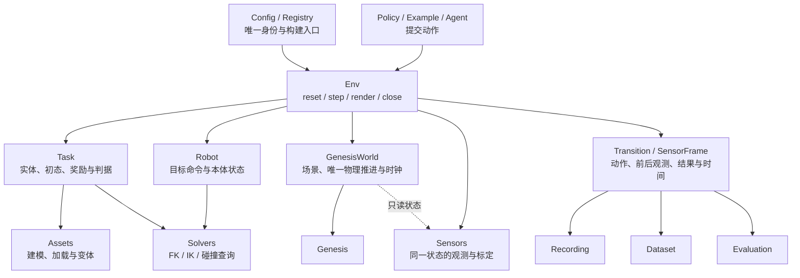
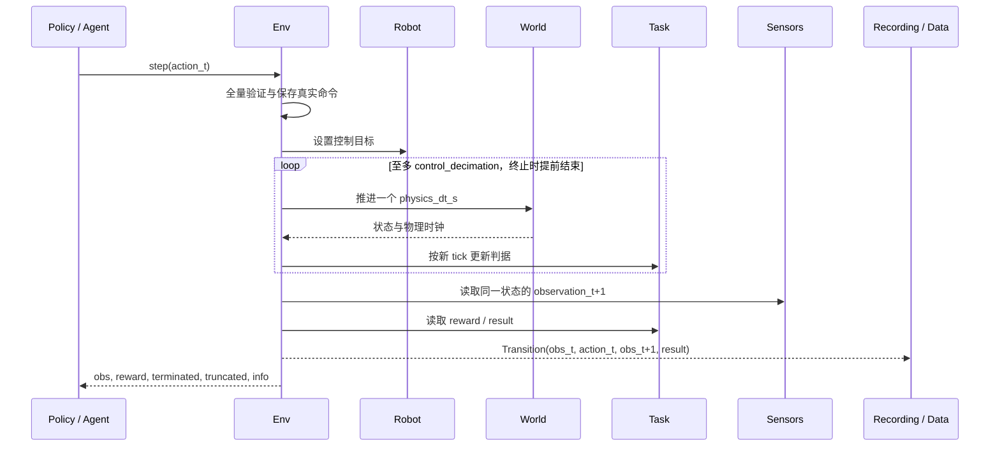

# Genesis 单后端模拟器整理与功能收敛计划

> 最新计划补充：[全部任务统一迁入 Genesis Simulator](simulator_structure_followup_plan_zh.md)，第一整体里程碑覆盖 13 项基础任务；统一任务变体、两类 Robot、Genesis 软体、完整历史回溯与 planning 命名。本页原分阶段范围以该后续计划为准。

> 后续状态：用户已授权实施，并要求先 simulator、任意已有状态 reset、agent/API 延期、测试只写不跑及删除 redundants。当前实现与未支持能力见[核心重构记录](simulator_core_consolidation_20260923_zh.md)，实际测试脚本见[逐文件说明](simulator_test_scripts_zh.md)。下文保留原计划作为历史依据；其中新接口实验、物理 checkpoint 不纳入首期等安排已被最新要求覆盖，不作为当前代码或测试结果。

日期：2026-09-23。状态：**待实施的计划**。本轮只新增计划与测试文档，不修改源码、import、配置或运行环境，不执行删除。

依据：[目录移动记录](structure_move_20260923_zh.md)、[Genesis-only 整理报告](genesis_only_codebase_review_zh.md)、[命名语义审计](simulator_naming_audit_zh.md)。配套验收方案：[模拟器测试与交付计划](simulator_validation_plan_zh.md)。

## 1. 这轮重构要交付什么

目标是把当前“按功能摆放的多套任务实现”收敛成**一套可以安装、按名称创建、重置、接收动作、推进物理并返回结果的 Genesis 模拟器**。

1. 只有一个公共 Env 生命周期；脚本、策略与 agent 通过它运行。
2. 只有 World 调用 Genesis 物理积分；Robot、Sensors、Recording、Data 不拥有自己的物理循环。
3. 每个 `tasks/<task_id>.py` 只保留任务实体声明、初态、目标、奖励和成功/失败逻辑。
4. 配置、机器人、求解器、资产、录制、数据按职责复用；新增任务不复制环境、相机和导出流程。
5. 相同术语对应同一份行为合同；单位、时间粒度、状态和身份也一起统一。
6. 项目维护的活动代码不再直接调用 MuJoCo。Genesis 自身的第三方依赖与模型文件格式单独记录。
7. 所有对外声明可用的任务和能力有实际测试证据；未迁移的项目不再出现在“可运行任务”列表里。

这里的“标准”是采用通行的环境生命周期和明确的模块边界，不是照抄另一仓库的目录，也不是宣称行业存在唯一的文件命名标准。建议公共 Env 直接遵循 Gymnasium 的 `reset/step/render/close`、动作/观测空间及终止/截断接口，避免再维护一套平行的返回协议。[Gymnasium Env](https://gymnasium.farama.org/api/env/)

**实施范围包含源码包之外的活动配置、CLI、安装声明和测试。** 仅修改 `topogym/` 而留下旧工厂路径、脚本入口和配置引用，不能算重构完成。历史 MP4、旧专家策略和旧 schema 不作为保留重复实现的理由；本计划也不以恢复 13 项任务的全部旧 demo 为前提。

## 2. 当前起点：目录已经移动，运行合同尚未成立

| 已核对的现状 | 对实施顺序的影响 |
|---|---|
| `tasks/` 的 13 个文件仍主要是原 `Scene/SceneBuilder`；例如 `tasks/cast_coil.py` 还保留旧相对导入 | 不能只改类名就宣布统一 Task 已完成；需按函数拆职责 |
| `config/registry.py` 仍加载旧 `topogym.tasks.<id>.agent_adapter`；`envs/episode_runner.py` 仍引用旧 generation/planning | 先建立最小活动 import 闭包；不要机械恢复全部旧入口 |
| task catalog 有 13 项，但 agent 工厂覆盖范围不同 | 目录存在、任务有定义、环境能运行、策略能成功要分别记录 |
| Robot 控制方法和任务 runner 都可能推进物理 | 必须先收敛时钟，再合并外围，否则会继续重复推进 |
| Recording、DatasetWriter、StepProbe 都包装 `scene.step` | 不能只做 Adapter → Binding 的改名；要更换输入边界 |
| DatasetWriter 用下一帧测得的 EEF 位姿生成 `actions` | 需要重订数据合同，真实提交命令不能靠观测反推 |
| 当前根目录没有 `pyproject.toml` / `setup.py` | 正式安装和包资源定位是交付内容，不能只验证仓库内导入 |

具体证据：[ALOHA 控制器](../../../topogym/robot/aloha.py)、[录制绑定](../../../topogym/recording/adapters/genesis.py)、[数据写入器](../../../topogym/data/episode_dataset_writer.py)、[PBD 诊断](../../../topogym/evaluation/diagnostics/pbd_probe.py)。这些是本次重读源码确认的问题，不是对名称的推测。

## 3. 冻结首期范围和迁移顺序

### 3.1 先建立 base，再证明可替换和可扩展

| 顺序 | 推荐实例 | 验证目的 | 首期不要求的内容 |
|---|---|---|---|
| 基础物理夹具 | 桌面、自由方块；再加配置 home 的机器人 | 重力、接触、时钟、控制和 reset/close；夹具放 tests，不注册成正式任务 | 任务成功策略、复杂造型、展示录制 |
| 第一个正式 Task | **Cast Coil + ALOHA**，固定实例、关节位置命令 | 最小机器人刚体闭环；现有 adapter 明确无抓持辅助，可绕过旧 MuJoCo 路线规划 | 复现装配成功 demo、旧专家策略 |
| 第二个刚体 Task | **Cast Keyhole + 同一 ALOHA**，固定实例 | 证明更换 Task 不新增 Env/runner；检验同类几何判据和碰撞查询复用 | 恢复旧辅助抓持和预抓取起点；不得直接沿用旧 adapter |
| 首个软体 Task | **Blanket Flatten，固定的程序化 PBD 初态** | 同一个 Env 能承载粒子状态、软体接触及声明的机器人交互 | 完整展平策略、复杂历史初态、FEM/IPC |

选择理由：Cast Coil 的现有建场景与动作路径已经使用 Genesis；Blanket PBD 比 Knot 的 CUDA/uipc/private API 组合更适合先检验公共接口。Keyhole 的旧 adapter 含辅助抓持和状态文件初始化，第二阶段只提取 Task/几何职责，不能以原样接入旧 adapter 充数。

Blanket 首期优先选现有程序化简单初态（如 `suspended_irregular_folds_v1`），在保留的 **ALOHA 配置**中固定生成规则与种子；不能直接载入默认 Panda 的 preview 配置而悄悄扩大机器人范围。**不直接选当前 `blanket_flatten_aloha_full.yaml`**：它通过 `initial_state_recording.path` 读取历史 `runs/.../physical_trace.npz`，不符合独立安装后的基线要求。

### 3.2 13 个现有任务都要有明确去向

| 分组 | task_id | 计划去向 |
|---|---|---|
| 首批刚体 | `cast_coil`、`cast_keyhole` | 先成为正式可运行任务，验证同一 Env |
| 首批软体 | `blanket_flatten` | PBD 能力通过真实测试后启用 |
| 后续任务 | `buzz_wire_3d`、`horseshoe_ring`、`lock_picking`、`hedgehog_in_cage`、`fiber_bundling` | 按所需控制、抓持、几何和材料能力逐项迁移；未通过前不注册为 available |
| 高耦合软体 | `rope_threading`、`knot_untying` | 在 PBD 与公共抓持合同稳定后迁移；FEM/IPC 单列设备、版本和验收要求 |
| 含第二后端支线 | `interlocked_claws`、`orbits`、`slotted_post_ring` | 撤销其 MuJoCo 动态/恢复/渲染支线；现有 Genesis 场景和纯几何按用途评估，不能整项误判为全是 MuJoCo |

首期冻结：Genesis、ALOHA、单环境、关节位置控制；RGB/视频/HDF5/agent 是可选能力。Panda、末端位姿控制、FEM、批量环境、物理 checkpoint 不因有旧代码就默认标为支持。

**两个交付边界：**

- **base 可运行：** 可安装，真实物理、机器人控制、两个刚体 Task 共用 Env；PBD 扩展单独通过门槛。
- **整个活动项目整理完成：** 其余任务逐一迁移或明确退出活动清单，活动代码和默认测试没有旧执行入口。不能用“base 已完成”掩盖剩余活动支线未处理。

## 4. 最终模块和依赖图

### 4.1 目标目录

以下是目标，不是当前已实现路径。保留现有 `robot/`、`envs/` 等名称，不为单复数再做一轮无收益移动。

```text
topogym/
├── __init__.py                 只导出少量公共 API，不初始化物理设备
├── config/                     配置解析、规格、唯一任务注册信息
│   └── profiles/               发行所需的默认配置资源
├── envs/                       一个 Env 实现及公共 transition 合同
├── world/                      Genesis 生命周期、场景构建、时钟、状态
│   └── physics/                按物理机制组织的 PBD/FEM/接触支持
├── robot/                      RobotSpec、本体状态、控制器、显式抓持
├── solvers/                    FK/IK、碰撞查询和数值几何求解
├── sensors/                    相机创建、标定、同状态观测
├── tasks/                      base.py + 每个已保留任务一个定义文件
├── assets/                     模型生成、加载、变体规则和资源清单
├── policies/                   策略、规划及使用 Env 的 episode runner
├── recording/                  采样计划、编码、状态重渲染、产物发布
├── data/                       transition 序列化和明确命名的训练格式导出
├── evaluation/                 跨任务诊断、数值质量和离线评估
├── agents/                     可选客户端、会话、预算和进程管理
└── utils/                      无任务/引擎依赖的数学、随机、哈希和 I/O

tests/                          按公共合同与实际能力分层
examples/                       少量统一 API 使用示例
pyproject.toml                  安装、可选依赖、测试配置
redundants/                     若仍需审阅则放包外；不发行、不参与运行
```

- `envs/adapters/<task>`、`envs/execution/<task>`、`recording/task_adapters/<task>` 不作为最终固定扩展点保留。
- 功能目录内仍可有任务专属算法，例如 `assets/generators/cast_coil.py`；“通用”不等于强迫不同几何算法共享一个实现。
- 包内 `assets/` 是生成/加载代码与资源入口。根目录现有模型素材要逐项纳入包资源，或通过显式资源目录和清单安装；不依赖 `Path(__file__).parents[n]` 猜仓库根。
- 小型公共接口放所属模块，避免新增一层无所不包的 `core/Manager/Runtime` 框架。`utils/` 也不能成为无法分类代码的第二个隔离区。
- 13 个任务文件不是硬性必须同时发行：未迁移任务先退出活动注册和安装内容，待通过合同测试再进入。

### 4.2 调用关系



这是运行职责图，不表示每条边都必须成为 Python 顶层 import。依赖约束如下：

| 模块 | 可以承担/依赖 | 不能承担/反向依赖 |
|---|---|---|
| Config / Registry | 静态规格、任务描述、延迟工厂引用 | import 时初始化 GPU、建场景；第二套任务身份表 |
| Env | 装配 World/Robot/Task/Sensors，调度生命周期 | 具体任务分支、专家路线、编码器实现 |
| World | Genesis、实体句柄、状态、数值物理机制 | agent、视频、某个任务的成功策略 |
| Task | 资产声明、初态、几何/物理谓词；调用公共算法 | `scene.step`、相机循环、录制、agent、独立机器人控制器 |
| Robot / Solvers | 机器人描述、控制目标、约束和数值求解 | 推进时钟；从某任务导入专用 FK/IK 充当公共实现 |
| Sensors | World 只读状态、Robot 安装位姿、渲染接口 | 推进物理、操控机器人、决定任务成功 |
| Recording / Data | Env 产出的记录及通用资源/状态编码接口 | agents、具体任务导入、重建第二条物理执行循环 |
| Evaluation | 只读状态、结果和算法 | 替代 Task 定义成功；劫持 `scene.step` |
| Policy / Agent | 公共 Env 或 EnvClient | 直接取得 scene 并积分，绕过动作验证 |
| Utils | NumPy 等基础数值/I/O 能力 | Task、Env、Genesis 初始化和业务身份枚举 |

## 5. 先冻结行为合同，再做命名和函数合并

### 5.1 一个公共入口、一种返回形式

目标 API 示意，**目前不可作为可运行示例复制执行**：

```python
from topogym import make_env

env = make_env("cast_coil", config="aloha_rigid", render_mode=None)
try:
    obs, info = env.reset(seed=0)
    for action in joint_target_sequence:
        obs, reward, terminated, truncated, info = env.step(action)
        if terminated or truncated:
            break
finally:
    env.close()
```

1. `make_env` 唯一负责配置解析与构建；CLI 和 agent 服务也调用它。
2. `Env` 实现动作/观测空间和上述返回形式；不另造公共 `StepResult` 再套一层兼容接口。内部 `Transition` 是输出记录，不是第二套 Env。
3. 第一版一进程使用固定的 Genesis 设备/精度配置；不支持运行途中切换设备。引擎全局初始化由 World 所属的公共生命周期代码管理，Task 不调用 `gs.init()`。
4. 非法动作完整验证后才允许修改任何目标；双臂命令不得先应用左臂、再因右臂错误失败。
5. 成功或任务失败产生 `terminated`；时间预算产生 `truncated`。同 tick 按安全/任务失败、成功、时限的顺序确定原因。基础设施错误单独抛出并记录，不能伪造为任务失败。结束后要求 reset，不继续偷偷推进。
6. 核心 import/create/reset/step/close 不依赖 agent 服务、视频编码器或 h5py。可选依赖按使用功能延迟加载。

Task 的最小构建顺序也必须统一：Task 解析实例并输出资产、实体和初态声明 → World 添加公共场景、Robot 与任务实体 → World 统一 build 一次 → Task 绑定必要句柄并初始化判据。只有 reset 初始化阶段允许通过受控接口写初态；运行判据读取状态，不直接改变物理。Task 不再自行创建完整 scene 或调用场景 finalize。

### 5.2 只有一个时钟

```text
physics_dt_s       = 一次 GenesisWorld 物理推进的外部时间增量
control_decimation = 一个正常完整 Env.step 包含的物理推进次数上限
solver_substeps    = Genesis 内部求解细分，不再次乘入外部时间

N 个没有提前终止的完整 Env.step 后：
control_step = N
physics_step = N × control_decimation
sim_time_s   = physics_step × physics_dt_s

若第 i 个动作提前终止，实际完成 n_i 个物理步：
physics_step = Σ n_i
action_duration_s[i] = n_i × physics_dt_s
```

- Env 决定推进时机；World 是活动代码中唯一实际调用 `scene.step()` 的模块。
- 首版正常控制步完成固定 decimation，不引入用户可变 `steps=` 动作参数；成功/失败或安全终止在首次触发 tick 锁存并停止剩余推进，返回真实持续时间和状态。数值异常中断也必须记录实际完成的步数和错误，不能伪造完整一步。
- Robot 只提交目标；FK/IK、observe、render、export 和 evaluate 都不能推进物理。
- 稳定时间使用物理时间累计。建议 Task 逐物理 tick 更新判据状态，控制步末读取 reward/result；重复读取不再增加计数。
- reset 所需 settle/warmup 统一由 World 执行，记录 `reset_physics_steps` 和实际耗时；返回初始观测时新 episode 的三个计数归零。准备过程不冒充 episode 动作或录制帧。
- 普通在线 episode 默认从机器人配置的 home 开始；演示的 home → 接近 → 操作是 episode 内真实动作，不能藏在 reset settle 中。

### 5.3 一条动作、观测与数据链



- `ActionSpec` 明确命令类型、关节顺序、单位、坐标系和四元数顺序。首版用关节位置目标 rad；夹爪公开字段建议用完整开口宽度 `gripper_width_m`，由机器人映射到自身关节。
- 当前 ALOHA 单指轨道位移、Panda 半开口宽度不能仅替换字段名。转换关系必须经过机器人模型和实际测量测试；无法按宽度表达的机构用明确的关节动作规格。
- 状态与目标分列，如 `joint_position_rad` 与 `joint_position_target_rad`。`action` 永远保存 Env 实际接受的命令；训练需要的下一帧 EEF 标签放在专用 exporter，不能继续冒名为原始动作。
- `SensorFrame` 的时刻、原始图像、标定和本体状态一致；同一物理状态只采样一次，多个消费者共用不可变快照。必须复制/冻结会被后续 GPU 或 NumPy 写入覆盖的缓冲。
- `source_state_id` / 缓存键须区分 episode 与状态版本，不能只用步数或时间；reset、restore 等不积分的状态写入同样更新版本并使缓存失效。
- 无图像消费者时只采集所需本体/状态观测；开启录制不强制所有任务一直渲染。
- 高频视频可以在 World 物理步后的明确采样点读取传感器；不能让 recorder 增加物理步。重复视频帧记录相同 `source_state_id`，不伪造新状态。
- 输出失败保留已发生的真实步数，产物标 incomplete，默认中止该次执行并报告输出错误；不能回写 Task 为失败或成功，也不声称回滚了物理。

### 5.4 reset、close 与恢复

1. reset 必须复位控制目标、抓持约束、Task 稳定窗口、传感缓存、结果、订阅状态与 episode 身份。
2. 首版允许 reset 通过销毁并重建自身 scene 实现，尤其是新 seed/拓扑；不能以“新起一个进程”代替 Env.reset 合同。
3. 经测试证明状态完整覆盖后，才加入更快的原地 reset。Genesis `Scene.reset()` 不会自动清理项目自己的计数器和 hook。
4. `Env.close()` 清理自身 scene、输出句柄与订阅；重复调用安全。不能任意调用会销毁全部场景的 `gs.destroy()` 来关闭单个 Env。
5. `RenderState` 只用于画面重建；`SimulationCheckpoint` 必须覆盖续跑所需的状态并通过后续轨迹对照，才能声明支持。
6. 当前公共录制绑定主要恢复位姿/qpos，且可能清零速度；现有 `replay.resume` 是续做渲染作业。首版物理 checkpoint 明确不支持，不进行虚假改名。
7. make/reset 中途失败也必须释放已分配资源。物理异常或强制输出失败后 Env 进入 faulted，拒绝继续 step，只允许 reset/close；不能让上层误以为上一步从未发生。

### 5.5 身份和能力声明

| 字段 | 唯一语义 |
|---|---|
| `task_id` | 稳定任务类型；采用现有 catalog 的 snake_case ID，修复 `staged_lock` 与 `lock_picking` 不一致 |
| `instance_id` | 生成规则版本、参数、资源版本和 seed 所确定的实例 |
| `episode_id` | 一次 reset 开始的交互回合 |
| `execution_id` | 一次真实物理执行；重渲染沿用它，不增加成功次数 |
| `run_id` | 输出作业身份；执行/重渲染/导出不能共用它来推断物理身份 |
| `control_step / physics_step / sim_time_s` | episode 的控制次数、物理次数和仿真时间 |
| `video_frame_index / target_video_time_s` | 输出采样序号和媒体时间，不当作物理步数 |

身份、物理版本和资源清单进入 episode 元数据；不要将随机 UUID/墙钟时间混入 agent 的观测向量。需要可复现的 `info` 保留确定性的任务/时钟信息，执行身份通过只读 episode 元数据及输出记录传递。

Registry 只维护一份任务描述及工厂来源，catalog 从它生成。至少分清 `available / pending / retired`，并声明计算设备、机器人、控制类型、物理模型、观测、reset、批量和恢复能力。文档中“有旧任务文件”不等于 available；单次短程运行也不等于已有完成策略。

## 6. 重复功能的具体合并与撤销表

每一行都按“检查行为 → 提取必要实现 → 接入公共合同 → 测试 → 撤销旧活动入口”执行。不能仅在公共函数外面再包一层，然后继续保留旧运行路径。

| 候选组与现有位置 | 复用/拆分方向 | 最终退出的重复职责 |
|---|---|---|
| `config/catalog.py`、`registry.py`、`task_specs/`、`episode_spec.py` | 注册身份和可用性合一；任务说明从 Task/规格生成；输入 config 与结果类型分离 | agent registry、演示 registry、录制特判各自维护任务名单 |
| `envs/adapters/base.py`、`rigid_robot.py`、`fem_robot.py` 与任务 adapters | 动作校验归 Robot/ActionSpec；生命周期归 Env；抓持归 Robot；目标归 Task | 每任务 `create/step/observe/evaluate` 全套环境实现 |
| `envs/execution/`、`episode_runner.py`、任务控制循环 | 纯策略进入 policies；公共 EpisodeRunner 只调用 Env；物理支持进入 World | 任务 runner 建机器人、推进 scene、抓图、导出一条龙 |
| `world/tabletop.py`、`world/scenes/`、任务 SceneBuilder | 提取公共场景生命周期/布局；实体内容由 Task 提供 | 多处 gs.init/build、固定 cameras、记录器安装 |
| `robot/aloha.py`、`franka.py`、抓持附件 | 保留本体映射、控制增益和状态；统一只提交目标；辅助约束显式配置 | Robot.step、控制函数的 `steps=`、隐式辅助抓持 |
| `solvers/kinematics/<task>/` | 用机器人描述统一 FK/IK 接口，优先复用 Genesis 查询；必要纯算法保留并比较解和误差 | 因任务不同而重复建 MuJoCo 模型和同一机器人求解器 |
| `solvers/collision/`、`geometry/`、`validation/` | 碰撞查询、拓扑/可达性计算各自明确输入输出；路线搜索归规划/策略 | 检查函数偷偷执行机器人，或每个 Task 复制共同数学 |
| `assets/generators/`、`variants/`、`loaders/` | 保留不同形状算法；复用网格、URDF 写入、资源解析和随机流 | geometry 文件里混入 scene/robot/recording；从 runs 执行源码 |
| `world/physics/*/runtime_memory.py`、`world/rope.py` 等 | 比较副作用和版本条件，按物理机制组织；必要修正采用 World 固定顺序的前/后物理 hook | task/recorder 任意 monkey-patch `scene.step`；按任务重复打引擎补丁 |
| `sensors/cameras.py`、`camera_info.py`、`aloha_cameras.py`、`nyx.py` | 一个创建/采样/标定入口，保留必要渲染格式转换 | 各任务、agent、recorder 独立拍同一状态 |
| `sensors/materials.py`、`lighting.py`、`presentation.py`、`hud.py` | 灯光/材质/布景归 World 可视化设置；HUD 归媒体表现 | Sensors 包揽整个展示系统 |
| `recording/session.py`、`timeline.py`、`encoding.py`、`validation.py` | 保留同步、编码和完整性检查，输入改为共享 Frame/Transition | 录制模块自主推物理和自行取图 |
| `recording/adapters/genesis.py`、`task_adapters/`、`tasks/` | 必要状态编解码按实体/物理模型合并；重建调用唯一工厂；来源清单复用 assets | 13 套任务录制入口、独立 renderer/restore、旧演示归档流程 |
| `recording/archive.py`、`agent_media.py` | 保留发布事务；只消费 Task/Evaluation 报告；JSON/哈希转 utils | Orbits/Slotted 特判、recording 导入 agents 或具体任务 |
| `data/episode_dataset_writer.py`、`data/exporters/` | `append(transition)` 写原始命令与前后观测；训练标签转换独立命名 | scene.step 包装、下一帧姿态冒充 action |
| `evaluation/tasks/`、`diagnostics/` | 成功/失败语义回 Task；公共算法、物理质量和离线证据留 evaluation | 媒体资格替代任务成功；StepProbe 自有循环 |
| `agents/bridge/`、`rollout/` | 会话、客户端、预算和进程留上层，接同一 Env | agent 独有本地环境工厂、第二套时钟和截图 |
| `utils/` 与散落的 sha/digest/array 等 | 仅合并输入、dtype、单位、容差、副作用一致的实现 | 为相似名字而强行合并不等价算法 |

每组比较至少记录：输入/输出、单位/坐标系、状态依赖、副作用、调用者、异常、真实使用需求。相同职责允许有不同算法实现，但必须由同一个明确接口选择，不能再复制外围生命周期。

## 7. 命名整改：一套词汇，一份合同

以下为目标词典。以所属模块、对象角色和行为作区分，不进行无差别字符串替换。

| 当前混用 | 收敛后的用法 | 先要完成的行为改造 |
|---|---|---|
| TaskAdapter / GenesisAdapter / 各任务 Adapter | `Env` + `Task` + `Robot` | 拆分生命周期、动作、抓持和判据；补全 reset/close |
| VisualAdapter | `RgbOnlyObservationView`；完整包装 Env 后才称 ObservationWrapper | 只做观测过滤，保留所承诺接口 |
| GenesisBinding | 必要时 `GenesisRecordingBinding` 或按职责拆为 RenderState 编解码 | 不持有自主积分/采样权；不假装能续跑物理 |
| task recording adapter | 删除一对一任务接入层；保留明确的 codec/资源处理函数 | 分解混合职责，不能整组改叫 codec |
| Environment / Session / Trial / Episode | 本地 `Env`；远程 `EnvClient`；`AgentSession`、`AgentTrial`、`EpisodeProcess` | 进程、预算、客户端不得承担本地模拟生命周期 |
| World / Scene / TaskScene | `GenesisWorld` 是项目物理封装；Genesis `Scene` 是引擎对象；句柄集合按用途命名 | Task 不能再用 Scene 的身份包办运行 |
| backend / renderer / device | `physics_engine=genesis`、`compute_backend`、`render_backend`、`device` | PBD/FEM 为物理模型配置，不是第二模拟引擎 |
| controller / planner / solver | Controller 目标→控制；MotionPlanner 起终点→路径；IKSolver 位姿→关节解 | 求解/规划不得隐含执行；策略选择目标 |
| EntityManifest / source / manifest | 运行句柄为 `EntityRegistry`；磁盘资源为 `AssetManifest`；输出清单限定为 ArchiveManifest | 运行对象与可序列化清单分离 |
| EpisodeKey / variant / family / preset | `TaskInstanceKey`；`variant_id`、`family_id`、用途明确的 `*_profile` | 身份与配置选择分离，避免重新生成仍沿用同一实例身份 |
| contract / protocol / spec / config | Spec 为描述；Config 为输入参数；Protocol 为调用接口；契约文档说明约束 | 不再并排维护内容相同的四份对象 |
| gripper / qpos / pose | 按公开动作合同命名单位、关节顺序和坐标系 | 数值转换与序列化版本迁移一起做 |
| step / tick / frame / time | `control_step`、`physics_step`、`sim_time_s`、`video_frame_index` | 切断隐藏推进；删除仅由帧号推导的假物理时间 |
| success / passed / status / ready | `task_success`、`terminated`、`truncated`、`validation_passed`、`recording_status`、`trial_status` | 任务、数据质量、媒体和 agent 生命周期分别表示 |
| snapshot / state / checkpoint / resume | `RenderState`、`SimulationCheckpoint`、`resume_render_job` | 按实际恢复能力命名；首版不发布未实现的 checkpoint |
| validate / verify / audit / review | 输入约束用 validate；数值/物理检查给出被检对象；人工 review 不冒充自动成功 | 输出必须有范围和失败原因，不能统一成含糊的 passed |
| runtime / execution / support / common | 文件名按实际内容，如 episode_runner、history_limiter、joint_controller | 先拆职责，不能把混合文件改个更泛的名字 |

改名同时处理：公开 import、工厂字符串、配置键、CLI、序列化字段、文档和测试。活动系统不长期保留新旧双名；有实际历史数据转换需求时提供离线转换工具，不引入运行时兼容森林。退役实现不值得再投入批量改名。

## 8. 按依赖推进的实施阶段

每阶段应拆成可审查的小变更；同一能力的“替换实现、调用者迁移、旧入口退役、相应测试”一起交付。已有工作树改动先按当前内容建清单，不能用 Git HEAD 覆盖用户修改。

| 阶段 | 具体工作及交付 | 退出门槛 | 对应测试 |
|---|---|---|---|
| **P0 冻结合同与去留** | 建立首批任务/能力表；动作、时间、身份、结果词典；逐组比较现有行为，确定唯一实现来源；旧测试分类 | 每个保留功能有唯一归属、迁入和退出清单；没有“先全部兼容再说” | A01、C01–C06 的规格确定 |
| **P1 撤销第二后端，恢复可安装核心** | 退役 MuJoCo 动态/renderer/restore/注册和不需要的模型查询；从混合文件提取必要几何；修复最小 import 闭包；增加 packaging/资源入口 | 核心可安装导入，默认注册准确；剩余未迁移源码隔离、不发行；无活动直接 MuJoCo 依赖 | A01–A05、PK00 |
| **P2 唯一 World/Env/Robot + Cast Coil** | 收敛 Genesis 初始化/销毁、reset/step/close；拆 Robot.step；固定动作规格；Task 定义和稳定判据归位 | 不启用相机/agent/视频/HDF5，真实机器人刚体 episode 可连续 reset/step/close | C01–C06、G01–G04、R01、T01–T03 |
| **P3 第二 Task 与必要 Solver/抓持** | 接入 Keyhole 的实体/初态/判据；公共碰撞、FK/IK 按实际需求合并；默认无隐式 assist；需要时显式单测 | 两任务共享同一 Env 和构建入口；Task 切换不新增运行循环 | R02–R04、K01–K03、T04 |
| **P4 软体扩展** | 接 Blanket 简单 PBD；粒子观测和判据归位；摩擦/修正放 World 明确 hook；解除历史 run 初态依赖 | 同一 Env 支持刚体与 PBD；真实变形、接触和 reset 通过；需要 GPU 时有实际设备证据 | S01–S03、C04、T01–T04 |
| **P5 观测、数据、录制** | 合并 Sensors；Transition 真动作日志；去除 recording/data/probe 的 step 包装；接共享编码与归档 | 多消费者共用同状态观测；开关输出不改变物理；MP4/HDF5 可读回且动作对齐 | O01–O03、D01–D04、V01–V04 |
| **P6 全活动项目收尾与上层接入** | 其余任务逐项迁移/退役；agent 接公共 Env；清理旧命名、脚本、配置、测试和源码复本依赖；完成 CLI/wheel/文档 | 所有 available 项通过相应能力门；包内无待审 redundants 或旧执行通道；仓库外完整运行 | A01–A05、K01–K03、AG01、PK01–PK03 |

说明：P1 的“可安装”不是 P2 的“实际可运行”；P4 未测不能声称支持软体；P6 不能仅靠隔离所有未迁移代码就把仍声称 available 的任务算完成。基础测试随每阶段落地，不能等 P6 再补。

### 8.1 MuJoCo 和隔离区的处置规则

1. 从现有依赖清单出发，区分引擎调用、FK/IK/模型查询、纯模型格式、纯几何和第三方依赖。
2. 保留需求若已由 Genesis 提供，不另造替代求解器；无人使用的支线直接退役。
3. 活动 package、脚本、测试、动态 import、注册配置均纳入检查。不能只清理 `redundants/mujoco/` 就宣布完成。
4. 需要继续审阅的代码放包外 `redundants/`，无活动引用且不进入 wheel；明确已退役者后续删除。隔离只是迁移状态，不是长期架构模块。
5. 不从 `runs/`、legacy、资产源码副本中读取并执行 Python。确有价值的算法必须成为普通受测试源码。
6. Genesis 1.2.1 本身声明依赖 MuJoCo；本项目不直接使用 MuJoCo，不等于整个虚拟环境完全不安装它。前者是本轮验收要求，后者不是擅自卸载第三方依赖能解决的问题。

### 8.2 后续任务的准入清单

每迁入一个任务只交付必要增量：

- 一个 Task 定义、实例配置和必要资产/算法；不带专属 Env、recording adapter 或完整 runner。
- 明确使用的公共 Robot、ActionSpec、World 物理模型、Sensors。
- 成功/失败/未完成判据的正反例；初态可由包资源和 seed 重建。
- 通过公共合同测试及真实物理短程测试；若宣称某个策略可完成任务，再补完整执行证据。
- Registry 能力声明与实测一致；公共模块无需添加 `if task_id == ...` 特判。
- 旧入口、旧配置路径和与新合同矛盾的旧测试在同一迁移中退出活动集合。

## 9. 最终验收和学习入口

整理后的使用者应能依次理解并操作：

1. 在 Config/Registry 找到可用任务和能力。
2. 通过 `make_env` 构建，调用 `reset/step/close` 完成无外部服务的真实物理运行。
3. 在 Robot/Task/Sensors 分别找到动作含义、目标语义和观测定义。
4. 按需打开录制/数据；动作、前后观测、时间和结果可以对账。
5. 只新增 Task 与必要资源就接入第二个任务；软体差异留在声明的物理模型和算法里。
6. 从安装包而不是仓库工作目录运行；没有 `PYTHONPATH`、历史 runs 或旧脚本依赖。

最终给出的证据应是：**可安装包 + 公共 API 示例 + 准确能力表 + 实际 Genesis 测试报告 + 无旧活动入口的依赖检查**。测试层次、具体断言、容差与运行条件详见[配套测试计划](simulator_validation_plan_zh.md)。
