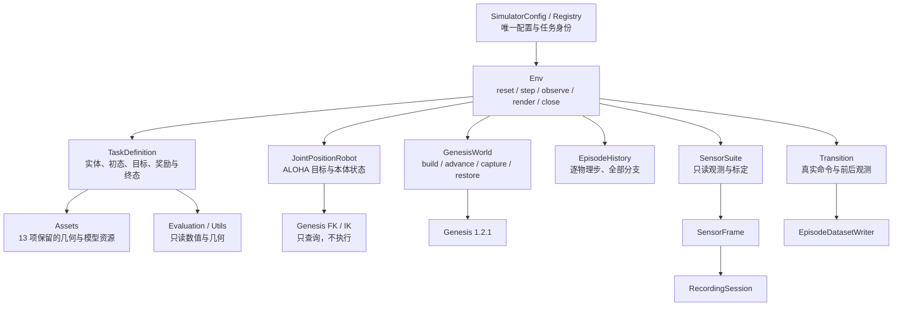
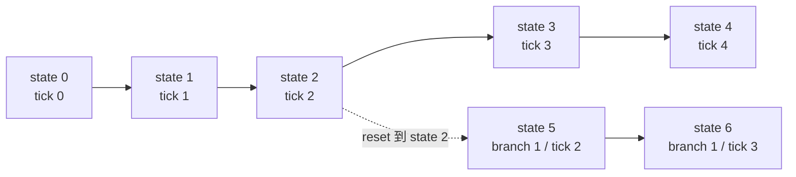

# 模拟器核心重构记录：Genesis、历史 reset 与待执行测试

> 后续计划见[全部任务统一迁入 Genesis Simulator](simulator_structure_followup_plan_zh.md)。第一整体里程碑覆盖 13 项基础任务，包含 task_variations、现有 ALOHA 双臂与 Panda+Robotiq 单臂、Sensors/Camera、PBD/FEM/IPC、完整回溯与 planning 命名整改；该计划不改变本页已实施范围，也不代表已执行测试。

日期：2026-09-23。范围：项目当前活动模拟器源码、测试与配置入口；保留原工作树已有修改，没有用 Git HEAD 覆盖工作区，也没有提交或运行测试。

**本轮完成代码整理和测试编写，不把未经执行的实现称为已经可运行或物理验收通过。** 此记录优先于此前计划中的 agent 接入、仅支持新初态 reset 和本轮执行测试等安排。

入口：[当前全量脚本清单](script_inventory_zh.md) · [逐测试脚本说明](simulator_test_scripts_zh.md) · [历史源码副本清单](script_snapshots_inventory_zh.md)。

## 1. 按这次五项要求落实的内容

| 要求 | 本轮处理 |
|---|---|
| 先 simulator，不搭 agent/API | Env 不依赖 agent；旧 bridge/rollout/API/相关测试放 `agents/deferred/`，不启用、不发行；未新建服务器、client、rollout 或 API 使用实验 |
| reset 可回当前 episode 任意已有 state | 每个成功完成的物理步都保存 state；reset 按 state_id 恢复 World、Robot、Task、随机流和时钟，新分支不删除旧状态 |
| 测试先写不跑 | 新写 13 个测试脚本和 1 个夹具文件；没有 pytest、collect、模拟、渲染、数据采集或 import smoke 执行 |
| 更新全部脚本 list | 按模块重建主清单，agent 延期脚本单列；遍历项目其他目录，历史运行/报告/资产源码副本放完整附录 |
| 清除 redundants 与直接 MuJoCo 路径 | `topogym/redundants/` 全部删除；活动 Python 无直接 MuJoCo 导入，第二引擎 runner/renderer/restore/IK 支线撤销；模型 XML 格式与第三方依赖独立说明 |

## 2. 当前模块组成

- **Config：** `SimulatorConfig` 明确计算设备、精度、physics_dt、solver_substeps、control_decimation、时限、RGB 和资源位置；仅由 Registry 列任务状态。
- **Env：** 一个类串联完整生命周期；双臂动作全量校验后才应用；控制步内逐物理 tick 更新 Task 并保存状态。
- **World：** 唯一实际 `scene.step()` 位于 `GenesisWorld.advance()`；公共桌面与实体一次 build，关闭只销毁自身场景。
- **Robot：** ALOHA 控制器只设置目标/读本体，不拥有 settle 或 step 循环；home 后的可选准备推进由 Env/World 统一完成。
- **Task：** 每个任务一个文件，使用 EntitySpec/TaskSpec；不创建完整 Scene、机器人、相机或录制器。
- **Sensors：** 同一 state 的图像与标定只采样一次；缓存同时区分 episode、branch、state，恢复时失效。
- **Observation：** 始终含 World 的刚体/粒子/接触/时间和 Robot 本体状态，Task 可补测量；RGB 按配置开启。关闭图像也能读取任务物体的物理状态，不需要 agent 或私有 World 访问。
- **Recording/Data：** 被动消费共享帧与真实 Transition，不再包装 `scene.step`；任务成功与产物完整性分开。
- **Solvers/Evaluation/Utils：** Genesis FK/IK、保留的碰撞/几何算法、只读质量测量以及纯数值支持各归职责；公共数组复制集中到 `utils/arrays.py`。

目录不再保留 `envs/adapters/<task>`、`envs/execution/<task>`、`recording/task_adapters/<task>` 和 `recording/tasks/<task>` 四套任务接入结构。公共模块也不通过更名掩盖旧循环，而是移除了相应活动入口。

## 3. 回溯式 reset 的确切语义

### 3.1 两种 reset

- **新 episode：** `reset(seed=...)` 创建新实例/场景、机器人 home、Task 初始判据与 state 0，释放上一 episode 的历史。
- **当前 episode 回溯：** `reset(state_id=...)` 选择当前历史中的状态，恢复后建立新 branch；不重新生成几何，不把场景摆回相似外观代替物理状态恢复。
- 同时传 seed 和 state_id 会拒绝；未知或错误类型的 state_id 在修改世界之前拒绝。
- 保存粒度为**每次成功完成的 Genesis 外部物理步**，不是只在控制动作结束时保存；Genesis 内部求解器 substep 不作为独立公开历史点。
- 一个控制动作可能跨多个物理步；从中间 tick 继续时，下一次 step 是新动作，不能再用 `control_step × decimation` 推断当前时间。
- `max_physics_steps` 固定 episode 的物理时间上限，逐 tick 检查；回退后只能运行剩余物理时间，不因新发一次动作把终止时间延后。

### 3.2 恢复什么

| 所属 | 保存/恢复内容 |
|---|---|
| World | Genesis 原生 SimState、控制/接触/约束/PBD 等补充数值缓存、原生求解时钟、episode 物理时钟、待应用输入和支持范围内的相关 Python 缓存 |
| Robot | 当前左右臂控制目标；物理控制缓冲由 World 恢复，Robot 不重新发送命令覆盖它 |
| Task | 稳定时间、连续达标标志、最近物理步、成功/失败锁存、指标和 RNG；Blanket 另有漂移参考 |
| 环境与随机流 | 控制步、terminated/truncated、Env/World/Task RNG，以及 Python/NumPy/Torch 随机状态 |
| Sensors | 不复用原缓存；按恢复后的 state 重新读取/渲染；旧观测数组不可被后续写入覆盖 |

Genesis 原生 reset 会清理部分控制/接触缓存，因此代码先恢复 SimState，再补回保存的缓冲。补充捕获绑定 **Genesis 1.2.1** 的内部结构；实际续跑正确性必须等待真实测试，不能仅凭源码声称已证明。

### 3.3 历史分支保留

- 新 state_id 单调分配，不覆盖原有 state 3/4；它们仍可被选中。
- state 元数据保存 parent_state_id；输出包含 branch_parent_state_id，使数据可以追溯回退来源。
- 一段视频只属于一个 episode/branch；跨分支必须新建 recording session。Env 提供解绑消费者的方法，不让已关闭 session 留作下一步回调。
- 终态也按原状态恢复；要继续动作需选择更早的非终态，不能通过 reset 偷偷消除失败。
- 引擎或必要输出错误使 Env 进入 faulted，拒绝继续 step；仅允许 reset/close。已经发生的物理步不会被隐瞒。

### 3.4 当前恢复能力的边界

- 同进程、同一个已 build 场景、单环境、非梯度 rigid/PBD + LegacyCoupler；当前不提供跨进程保存/加载协议。
- 同时只允许一个活动 Env，避免全局 Genesis 配置和随机流相互干扰。
- FEM/IPC、发射器、外部 force field 等不完整捕获的情况明确拒绝，不回退为仅恢复位姿。
- 历史数值缓存放 CPU 内存，相邻完全相同的数组共享存储；**变化历史仍随步数增长，不自动淘汰**。长程内存开销尚未实测。
- 渲染器积累和随机采样缓存不作为物理续跑状态；不承诺历史 RGB 逐像素重现。

## 4. 当前 Task 清单，不混淆“实现”和“可用性已验证”

所有条目都标记 `validation=not_run_user_requested`。`implemented` 表示已写入公共接口，不代表已经运行成功。

| task_id | 当前状态 | 保留/限制 |
|---|---|---|
| cast_coil | implemented，未测试 | Genesis 自由刚体装配，相对目标姿态、释放与静稳判据 |
| cast_keyhole | implemented，未测试 | Genesis 自由刚体，保守的世界 AABB 全分离与静稳；可能晚报成功，不能等同旧精细间隙策略 |
| horseshoe_ring | implemented，未测试 | 马蹄/链眼拓扑、目标环分离、真实桌面接触、目标环释放和静稳 |
| hedgehog_in_cage | implemented，未测试 | 资产实体、保守分离、落桌释放和静稳 |
| interlocked_claws | implemented，未测试 | Genesis 双刚体，全分离与短暂静稳，允许保留抓持 |
| blanket_flatten | implemented，未测试 | 程序化 PBD 初态、材料覆盖/伸长/高度/速度/漂移；不等同旧完整展平 demo 资格 |
| buzz_wire_3d | pending | 连续穿环/触壁进度和原 Panda 控制尚未迁入可恢复合同 |
| lock_picking | pending | 被动旋转盘、接触过载锁存、插入/回退/释放判据与原 Panda 控制尚未迁入 |
| fiber_bundling | pending | 原本是 Genesis 多节被动关节刚体缆束，不是 PBD；锚固、细线 guard 与完整穿环历史谓词尚未迁入 |
| rope_threading | pending | FEM/IPC 约束、接触和相关历史状态未完整支持 |
| knot_untying | pending | FEM/IPC、约束/内存机制及结拓扑状态未完整支持 |
| orbits | pending | 原 Genesis 路径只有冻结、关闭碰撞的预览；第二引擎撤销后真实 Genesis 绳动力学尚待实现 |
| slotted_post_ring | pending | 原 Genesis 路径只有冻结预览；绳动力学、端点耦合及完整 FEM 状态尚待实现 |

上述 7 项原来的 Scene/独立运行入口已退出，未伪造空壳 Task；其基础 geometry 仍归资产目录保留。Registry 对 pending 项给出明确原因，不把它们列为可创建的环境。

Blanket 需单独注意：旧实现依赖任务专用桌面摩擦修正；本轮保留 Genesis 默认 PBD 碰撞/变形，未把旧 step 包装直接搬回。专用摩擦和完整软体接触/释放资格仍需公共物理机制与后续验证，因此当前不能宣称恢复了旧版完整机器人展平行为。

## 5. 命名、输入与输出合同

- `Env` 只表示本地生命周期；延期 HTTP Environment/Session 不混入核心。
- `GenesisWorld` 持有场景与时钟；运行句柄用 `EntityRegistry`，不是磁盘资产 manifest。
- `TaskDefinition` 声明任务；`EntitySpec/TaskSpec` 声明构建内容；没有每任务 Adapter。
- `physics_dt_s` 是一次外部物理步的时间，`solver_substeps` 是内部求解细分，`control_decimation` 是一个正常完整动作的步数上限。
- `max_physics_steps` 是物理步上限，`control_step` 只记录该分支接受命令的次数；两者不共用含糊的 episode step 名称。
- `joint_position_rad` 是 6 个臂关节目标；`gripper_position_m` 是 ALOHA 原生单指轨道位移，未把未经验证的宽度映射包装成统一开口宽度。
- action 保存实际被接受的命令；测得的关节/末端位置与目标分开，不再将下一帧 EEF 位姿称为原始 action。
- `task_success`、terminated/truncated、recording_status 和数据完整性分别表示，不统一成含糊的 passed。
- `episode_id/branch_id/state_id` 区分回合、执行分支和具体状态；state_id 不能用视频帧号替代。
- 两份 `CompoundCollision` 分别明确为 `BoxCompoundCollision` 和 `ConvexCompoundCollision`，按实际几何输入放在 solvers；运动描述统一为 `RigidMotionSegment`，evaluation 只保留一份连续运动证书算法。
- 相机声明和实时帧共用 `pinhole_intrinsics`；数组转换/复制共用 `to_numpy`，不再由任务各自解释单位和内存所有权。

## 6. 删除与延期范围

1. 删除 redundants，包括原第二后端与字节码隔离内容，没有重新创建项目内隔离副本。
2. 撤销旧 Env adapters/execution、任务 runner、机器人自有 step、MuJoCo FK/IK/查询及旧逐任务 renderer/restore。
   未接入当前 ALOHA 合同、仍依赖旧离线标定路径的 Robotiq 开口控制器也已撤销；纯机器人模型组装与数值几何可独立保留。
3. 撤销旧录制适配/归档特判、step 包装型数据/诊断、下一帧位姿冒充 action 的数据导出。
4. 撤销旧任务 demo 入口、依赖旧行为的测试和失效工具；agent/API 相关既有测试单独收录 deferred，未启用。
5. 13 项纯资产建模仍保留；模板、必要网格/纹理进入包资源，机器人支持显式 asset_root 或 `TOPOGYM_ASSET_ROOT`。
   Nyx 的外部视觉资源统一使用 `TOPOGYM_VISUAL_ASSET_ROOT` 或用户缓存 `topogym/visuals/nyx`；资源准备脚本与加载器使用同一约定，本轮未下载或启动 Nyx。
6. 新增基础 packaging 声明，排除 agents/deferred；依赖安装脚本只安装，不再自动启动 smoke、测试或 agent 安装。
7. 项目原有历史 runs/legacy/reports 中的源码副本在清单附录中如实记录，未宣称所有历史文件都被抹去；活动核心不从这些目录执行源码。

项目维护的活动 Python 已无直接 MuJoCo 导入；Genesis 的依赖安装仍可能带入 MuJoCo，ALOHA/Fiber 的 MJCF XML 标签及资产来源名称也仍可能出现。它们不表示 TopoGym 继续直接调用 MuJoCo 作为第二模拟器。

## 7. 本轮检查与停止位置

只做了静态源码/AST/路径检查和文档生成，修复了移动后的失效导入、旧 utils 导出、旧桌面 preset 强制时钟/相机限制及若干状态/数据边界。

- 最终检查的 133 份 Python 源码没有 AST 语法错误、找不到文件的项目 import 路径或直接 MuJoCo 导入；另对包内 import 符号做了静态核对。静态可解析不等于实际 import 或运行成功。
- 全仓清单覆盖 17,205 个脚本路径：133 个当前脚本、59 个延期脚本、17,013 个历史源码路径；历史附录按 2,303 份内容分组保留全部路径。
- 所有清单路径无重复、文件存在且 SHA 与扫描结果一致。历史目录仍有 3,960 个包含直接 MuJoCo 导入的源码副本，明确列作历史材料，不进入活动核心。

**没有运行任何新旧测试、pytest collect、项目 import smoke、Genesis 物理、GPU、渲染、录制、API、agent 或完整 demo；没有安装依赖或改动虚拟环境。** 新增测试的作用、依赖和局限请看[逐脚本说明](simulator_test_scripts_zh.md)。

当前应评审的是模块职责、历史 reset 合同、Task 保留范围和测试内容。测试执行等待用户明确指示；真实运行结果出来后才能决定哪些能力提升为已验证，以及哪些物理/缓存细节需要进一步修正。
