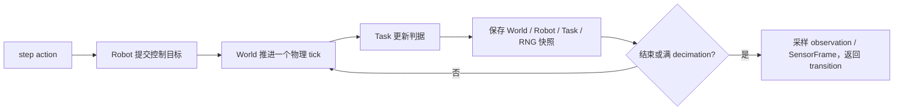

# Simulator 核心接口、状态历史与相机验收缺口

日期：2026-09-24。本轮审查源码、历史 JUnit 与实际录像报告，并用 `pytest --collect-only -q -o addopts= tests` 收集清单；未执行新的测试用例，未调整 simulator 代码或相机参数。

后续要求更新：用户已指定普通 `reset(seed=...)` 与特权 `rewind_to(...)` 分离，回溯后旧未来不可访问，G2 必做。最新[开发与测试计划](simulator_public_api_and_validation_plan_20260924_zh.md)取代下文的目标分支语义；下文关于旧分支保留的描述仍是审计当时实现，不是新要求。

## 1. 目前能确认什么

- 13 项基础 Task 和 2 项公共机制已有 Nyx + compact_lab 的真实 GPU 短程通过证据，见[统一结果](../../../runs/test_results/base_acceptance_final/README.md)。基础任务主连续段只有 0.075 秒物理时间；另有回溯、续跑和 seed 重建。
- 这证明基础场景接入、短程 step 和所选恢复点可用，不等于全部接口、相机 schema、长时物理稳定性、资源生命周期均已验收。
- 当前目标仍是本地、Genesis、一个活动 Env、两类机器人、13 项基础设置。agent/网络 API、planner、任务可解证明不作为本阶段前置条件。
- “标准 simulator”不能仅由 pytest 绿色数量定义。以下以用户已要求的生命周期、任意已保存 tick 回溯、compact_lab + Nyx、双臂四相机/单臂三相机为具体验收合同；Gymnasium 全兼容、并行环境等需独立声明，不能默认为已经支持。

## 2. 现有测试到底还缺多少运行记录

按当前参数化 node ID 与 `runs/test_results/**/*.xml` 的通过记录逐项匹配：

| 统计 | 数量 | 含义 |
|---|---:|---|
| 当前可收集测试 | 162 | 显式取消默认 marker 排除后收集，未执行 |
| 找到历史通过记录 | 136 | 跨批次匹配；不等于当前源码刚整体通过 136 项 |
| 没有保存的通过记录 | 26 | 不能从“没有记录”推导为绝对从未运行；验收时按缺证据处理 |

26 项分布如下；前四行共 25 项，最后 1 项为可后置的可选存储功能。

| 脚本 | 用例数 | 要验证什么 |
|---|---:|---|
| `tests/integration/test_genesis_robot.py` | 6 | 两类机器人的命令原子性、控制目标与物理状态联合恢复、FK/IK 查询无副作用 |
| `tests/integration/test_genesis_seed_reset.py` | 2 | ALOHA/Panda 的 seed A→B→A 初态重建 |
| `tests/integration/test_genesis_world_history.py` | 6 | 自由落体/真实接触、接触前后续跑、只读与时钟、随机流恢复、空间哈希、非法 checkpoint 和关闭边界 |
| `tests/integration/test_task_lifecycle.py` | 11 | 8 刚体/关节链任务、1 PBD 变形、2 渲染/恢复检查；部分与已通过的全任务短程测试重合 |
| `tests/recording_data/test_dataset_transitions.py` 中 HDF5 读回 | 1 | 数组、原始 action、分支和单位的 HDF5 读回；不阻止无 HDF5 的 Env 使用 |

注意：这些旧 integration 脚本大多没有接入 `RuntimeEvidence` 和真实录像流程；运行前须补齐该支持，或把独立断言合入现有验收入口后明确映射覆盖。不能为消除计数而重复跑同义测试，也不能把同名函数的旧结果当成当前实现重新通过。

## 3. reset 回到的状态来自哪里

实现位置：[Env.step / _save_state / _restore](../../../topogym/env.py)、[EpisodeHistory](../../../topogym/episode.py)、[World checkpoint](../../../topogym/world/state.py)。

### 3.1 三种时间粒度

- 默认 `physics_dt_s=0.0025`：一次 World 外部物理 tick 为 2.5 ms。
- 默认 `control_decimation=10`：一次 `Env.step(action)` 正常推进 10 tick，即 25 ms；提前结束按实际 tick 数计时。
- `solver_substeps=4` 是每 tick 内的数值积分细分，不另计四份可选择的 EpisodeState，也不能再把公开时间乘 4。

`Env.step()` 在每次成功 `World.advance()` 和 Task 更新之后保存快照，不只保存 action 的终点。没有后台按现实时间自行推进的线程；仿真时间按 `physics_step × physics_dt_s` 计算。

因此默认首个控制动作内的 0.0025、0.005、0.0075 秒等 tick 都可回溯。小于 tick 的求解器内部时刻、两个 tick 之间的任意浮点时间，以及未成功提交的故障中间态不在这个合同内。

### 3.2 ID、时间与分支不能混用

`StateInfo` 记录 episode_id、branch_id、state_id、parent_state_id、control_step、physics_step、sim_time_s。state_id 是 episode 内递增标识，不是时间索引；恢复会新建分支，并给分支起点分配新 ID，旧未来仍保留。

下面是默认配置、没有提前终止的示例：

| 操作后 | state_id | physics_step | sim_time_s | branch_id |
|---|---:|---:|---:|---:|
| 首次 reset | 0 | 0 | 0 | 0 |
| 第一次 step | 10 | 10 | 0.025 | 0 |
| reset(state_id=4) | 11 | 4 | 0.010 | 1 |
| 再执行一次 step | 21 | 14 | 0.035 | 1 |

恢复控制动作中间 tick 后，下一个 step 是新的控制动作，默认再推进 10 tick；不会自动补完旧动作剩余的 6 tick。空 action 沿用恢复的控制目标。按时间查找时必须同时指定分支，并从 state_history 选择真实 state_id，不能直接把 `t/dt` 当成 state_id。

### 3.3 reset 各种用法的边界

- `reset(state_id=0)`：恢复当前 episode 的初始快照，保留历史并创建分支。若配置了 reset 准备步，state 0 是准备完成后的初态；默认准备步为 0。
- `reset(state_id=k)`：恢复当前 episode 的已保存状态。包含控制目标、任务判据状态与 RNG，不只是物体位置。
- `reset(seed=last_seed)`：在相同配置/资产下重建可复现初态，开始新 episode，释放旧历史；不等于恢复原 episode 的 checkpoint。
- `reset()`：生成新 seed，开始新 episode；不能把它理解为自动复用 last_seed。
- `close()` 或重新创建 episode 后，旧进程内历史失效。当前不是可跨进程、跨版本导入的通用 checkpoint 文件格式。
- 公共接口目前只接受 episode 内整数 ID，没有 `reset(time_s=...)` 或带 episode 身份的状态句柄。旧 episode 的整数可能在新 episode 中重用；使用者必须绑定 episode_id 理解它，不能声称裸整数能识别跨 episode 误用。
- 保存物理 tick 不等于每 tick 保存 RGB 或 MP4 帧。图像按 observe/render 需求采样，视频再按采样频率编码；不能从视频帧数推导可恢复状态数。
- 历史无隐式淘汰，符合保留所有 tick 的目标，但长时容量/速度尚未验收；后续不得用悄悄丢弃早期状态来通过内存测试。

## 4. 入口和相机 schema 尚未完整落实

### 4.1 公共入口

- 当前实际入口是 `Env(SimulatorConfig(task_id=...))`，通过 registry 选择 Task；`topogym/__init__.py` 只有包说明，没有公开 `topogym.make()`。
- `reset/step/observe/render/close/state_history/action_spec/support_report` 已有实现。缺少正式的公共 observation schema 查询接口；返回五元组不能直接当成 Gymnasium 完整兼容，当前没有 `action_space/observation_space`。
- 可以增加很薄的 `make(task_id, ...) -> Env` 公共入口并复用现有构建链，不新增第二套 Env。它属于 simulator 本地 API，与延期的 agent/网络 API 无关。
- `enable_rgb` 当前默认 False；默认 render_backend 是 Nyx，不等于默认生成图像。目标标准视觉 preset 应明确开启 RGB；显式无图像运行仍可保留。

### 4.2 当前相机与要求之间的实际差异

| 项目 | 实际行为 | 要求/缺口 |
|---|---|---|
| 背景与 renderer | RGB 使用 compact_lab + Nyx，真实相机类型已测试 | 已验证，但后续相机整改仍要回归 |
| ALOHA | 8 路：base_camera、oblique、topdown、front、overhead、worms_eye、wrist、wrist_right | 应只把指定 4 路纳入默认标准 observation |
| Panda＋Robotiq | 5 路：base_camera、oblique、topdown、front、wrist | 应落实 2 个外部视角＋1 个腕部视角的三路合同 |
| 观测筛选 | ALOHA YAML 声明 observation_cameras，但 Python 未消费该列表；SensorSuite 遍历全部 world.cameras | 不能把配置声明当成运行行为 |
| 分辨率与取景 | 双臂四路为 640×360；额外斜视 512×512 整桌远景；单臂腕部 256×256 | 未落实新的近景验收与清晰度要求 |
| 标定 | 已输出理想针孔 K 和外参，有 mock 数学检查 | 未做真实 Nyx 像素投影、手眼安装和动态腕部跟随的完整实测验收 |

依据：[相机声明](../../../topogym/config/profiles/camera_configs/aloha_observation.yaml)、[基础相机配置](../../../topogym/config/profiles/env_configs/world_tabletop_v1.yaml)、[运行时采样](../../../topogym/sensors/observation.py)。配置里“不作为 policy observation”的注释也没有在当前运行路径中形成过滤。

目标建议沿用已经约定的角色：

- ALOHA：`cam_high / cam_low / cam_left_wrist / cam_right_wrist`，两路外部观察加左右腕相机。
- Panda＋Robotiq：`agentview / front_oblique / wrist`，两个不同方向的外部观察加腕相机。
- 其他调试机位按需显式开启，不混入默认 observation；正式录像与数据消费同一组 SensorFrame。
- 先用 1280×720 作为新视觉 preset 的候选输出，结合操作区大小确定距离/FOV，检查目标像素覆盖、关键孔槽/绳索可分辨性和遮挡；这是假设待实测，不是分辨率提高后自动通过的保证。
- 机位在 reset 构造前由公共配置确定并记录；腕部保持固定安装外参。检查 home 和进入操作区后的位姿，不能要求腕相机在 home 时就完整看到整桌，也不能用移动任务物体来凑取景。

DROID 官方采用两台可调外部相机和一台腕部相机，并不存在可以直接照搬到所有任务的唯一固定距离；应参考视角功能和工作区覆盖。[DROID 项目说明](https://droid-dataset.github.io/)。RoboWits 当前 README 列出的默认 RGB 为 ego、wrist_right、wrist_left；它适合参考接口组织，但不能替代用户明确要求的 ALOHA 四视角。[RoboWits README](https://github.com/UMass-Embodied-AGI/RoboWits/blob/main/README.md)。

## 5. 除补跑现有用例，还需要八组验收工作

下表是能力分组，**不是“另有 8 个 pytest 函数”**。其中一些可扩展现有脚本；参数化任务/机器人/物理类型后才有准确用例数。

| 组 | 当前缺口与下一步 | 验收条件 |
|---|---|---|
| G1 公共入口与接口合同 | 补 make、公共配置/能力/observation schema，明确 RGB preset 与 unsupported 能力 | 13 个任务按名称创建；未知 ID/非法配置清楚失败；reset/step/close 和返回结构一致，不触发 agent 依赖 |
| G2 生命周期与时间边界 | 已有不少 mock 与短程检查，需加强真实引擎的终止、截断、故障、反复 close/reset | 提前结束只推进应有 tick；故障后的可恢复范围明确；只读无物理副作用；正确区分 Task 结束和引擎故障 |
| G3 历史回溯深测 | 补跑 World 历史独立用例；多分支、多接触阶段与中途 tick 的后续轨迹对照 | 恢复 World/控制目标/Task/RNG/约束；旧分支仍可选；时间/状态身份无歧义；恢复后同输入的轨迹符合预定容差 |
| G4 机器人与物理正确性 | 补跑机器人/FK/IK/重力/接触，增加有效位移及交互夹具 | 两类机器人、双臂隔离、夹爪单位/目标与实测、接触力、刚柔接触可核对；IK 不能只检查返回有限数值，还需可达残差与不可达结果 |
| G5 长时与资源 | 现有主段 0.075 秒不足；连续运行、多 seed、多次 reset/close、状态存储增长尚无合格证据 | 首轮建议 13 基础任务各至少 5 秒真实连续段，再对代表刚体/关节链/PBD/FEM 延长；统计 CPU/GPU/句柄/历史增长，区分保留历史的正常增长和跨 episode 泄漏 |
| G6 相机 schema 与视觉 | 实现严格 4/3 视角、近景配置、实际标定和腕部跟随 | 相机 ID/数量/尺寸/外参、像素投影、遮挡、目标像素覆盖、背景/材质符合预先规定；提供所有标准视角的原始 PNG 与可观看连续视频 |
| G7 观测与输出一致性 | 真实 RGB 关闭/开启、视频开关、数据消费者的物理对照未覆盖；IPC 接触观测仍有限 | 相同 seed/动作的物理轨迹与时间符合容差；消费者共用相同 state_id/帧；断写与关闭清楚报告；明确 world.contacts 目前仅为刚体接触，不能冒充完整 FEM 接触 API |
| G8 安装与资源闭包 | 未见非 editable wheel、仓库外完整运行的验收 | 干净环境安装，离开源码目录运行 make/reset/step/render/close；配置、机器人、Nyx HDRI/纹理及 FEM 依赖可显式定位，缺依赖给出清楚错误 |

G5 的时长只是首轮建议，不是任何 simulator 的普适认证标准；不能为完成长视频而重复帧。新增真实物理测试应继续生成详细报告、实际动作/状态证据、相机参数及真实视频。观测/编码测试则比较编码前原始帧，避免用有损视频像素作为状态一致性依据。

普通物理抓取/接触测试属于 G4。自动 assist 的建立/释放/回溯尚未接入；若暂不公开该能力，应准确标 unsupported，不将其伪装成已完成。七项任务完整 solved 判据、策略、跨进程 checkpoint、批量环境、深度/分割相机、HDF5 和 agent 接入分别列范围，不都塞入基础 Env 完成条件。

## 6. 推荐的实施顺序

1. 先收口 G1、G6：公共入口与可查询 schema，真正生效的双臂四视角/单臂三视角、近景和分辨率 preset。当前视觉要求的缺口需要改实现，补跑旧测试不能消除。
2. 对现有缺证据的 25 项核心用例做覆盖映射，补报告/录像，并完成 G2–G4；把重合用例合并管理，保留其独立断言。
3. 在最终相机 preset 上完成 G5–G7：有实际时长的运行、完整 tick 历史、输出开关对照和资源生命周期。相机变更后重跑受影响的视觉与观测合同。
4. G8 独立安装验收，重新生成当前版本的能力清单和一份完整结果索引。历史 136 项通过记录只能作为基线，不能替代最终代码的必要回归。

完成判定是：声明的能力都有实现、稳定的合同和对应证据，未声明能力明确隔离；不是单纯把现有 162 项测试跑绿。
