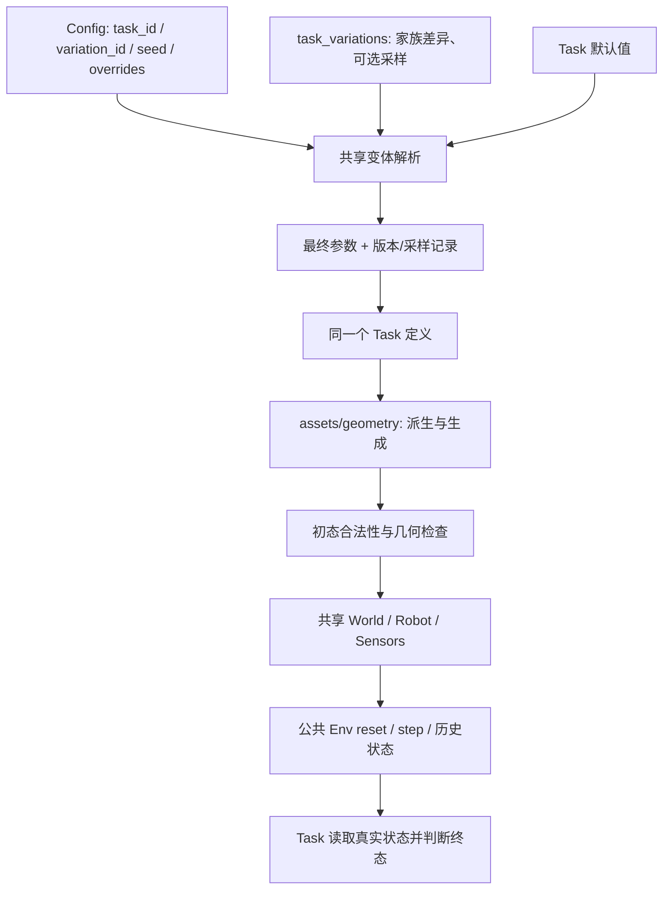

# 已删 26 个脚本的后续用途复核与 Task Variation 设计说明

> 后续更新：用户已授权恢复 `assets/textures.py`、`world/physics/fem.py`，并已接回 Blanket 纹理调用，见[恢复记录与基础运行计划](simulator_base_task_runtime_plan_zh.md)。本页正文保留复核当时的状态与建议。

日期：2026-09-23。**本轮只新增这份说明；没有恢复、删除或修改代码，也没有运行测试、项目导入、仿真或 rollout。** 以下“恢复”“迁移”“补齐”均为建议，尚未执行。

## 1. 先回答问题：上次的删除依据不够充分

上次确实把“没有接入当前运行链”过多地当成了“可以删除”。项目正在迁移，部分调用方本身尚未接好；按当下调用图删除被调用模块，会把未完成接入误判为冗余。**没有破坏现有 import，只能说明静态连接未断，不能说明任务能力没有丢失。**

这次重新读取了删除前备份中的全部 26 个脚本，并对照当前 Task、World、几何生成、变体解析及历史调用，结论是：

1. **布料纹理是漏接的已有功能。** 不仅旧 Cloth Fold 使用过，同一个 Blanket Flatten 的历史场景也直接调用 `fabric_weave`。应保留并接回共享资产/表面链。
2. **FEM 支持必须建设。** 删除的 `fem.py` 只是两个基础函数，但它们属于四项 FEM 任务仍需的能力；应作为后续实现起点保留，而不是以“当前被运行资格检查挡住”为由撤销。
3. **四份变体文件不是空壳。** 它们没有当前解析器要求的 `VARIATIONS`，却保留了缩放、参数推导、几何重建和变化界计算。应保留算法，再统一变体入口。
4. 其余脚本需要分别判断：有些支撑物理检查、抓持和任务判据；有些属于可选策略或离线工具；还有少数主要服务当前 13 项之外的旧任务。**不能把 26 份全部按原样恢复，也不能把它们全部认定为无用。**

本次复核以删除前的 `/tmp/topogym_before_unused_cleanup_20260923.tar` 为原件；附录记录每个文件的内容哈希。该备份目前存在，但只是临时恢复来源，不等同于正式版本归档。当前代码清单仍如实记录“文件已删除”，本说明纠正的是处置判断。

## 2. 布料到底有没有用过 `assets/textures.py`

### 2.1 当前版本：没有接入纹理

当前 [BlanketFlattenTask](../../../topogym/tasks/blanket_flatten.py) 的 `declare()` 只给实体传入：

```python
surface={"color": tuple(cfg["color"])}
```

它没有调用 `fabric_weave`，也没有声明 diffuse 纹理资源。不过 [blanket_flatten 几何模块](../../../topogym/assets/geometry/blanket_flatten.py) 的 `write_obj()` 仍写出 UV。因此，生成网格已有纹理坐标，表面纹理这段接线却缺失了。

另外，当前注册名是 **Blanket Flatten（展平被子）**，判据是覆盖率、平整度、拉伸、速度与稳定时间；历史 **Cloth Fold（折叠布料）** 是另一份任务。这里分别核对，避免把两者的目标混为一谈。

### 2.2 历史版本：确实使用过，包括同一个 Blanket 任务

- [Blanket 的历史 `source_snapshot/scene.py`](../../../runs/environment_bootstrap/blanket_flatten/gathered_robot_v9/source_snapshot/scene.py) 第 90—97 行：调用 `textures.fabric_weave(..., pattern="grid", seed=layout.seed)`，随后将结果交给 `materials.plastic(..., texture=texture)`，创建 PBD Blanket 实体。
- [历史 `cloth_fold.py`](../../../legacy/topogym/tasks_legacy/deformation/cloth_fold.py) 的 `_cloth_surface()`：调用同一纹理函数，并传入 `corner_colors`、`corner_size_m`，实现彩色角点标记。
- 旧纹理文件经前几轮移动后成为 `assets/textures.py`；删除前原件中的 `fabric_weave()` 仍包含织纹、条纹/格纹、角点着色、指定 seed 的噪声和可选 PNG 导出。

这些调用是源码证据，不是本轮渲染验证。它们足以说明“过去确实使用”，不代表旧画面或旧物理结果能直接由新框架复现。

### 2.3 应如何处理

**建议恢复共享 `assets/textures.py`，并补回调用，不应归为冗余。**

| 部分 | 应承担的职责 |
|---|---|
| `assets/textures.py` | 纯图像生成：输入尺寸、颜色、图案和随机源，输出像素或纹理资产 |
| `assets/geometry/blanket_flatten.py` | 布面几何、材料坐标与 UV；确定纹理如何贴在布上 |
| `tasks/blanket_flatten.py` | 选择该实例的布料外观参数，通过实体声明引用资源 |
| `world/visuals/` | 将通用表面声明转换成实际 Genesis 表面 |
| `sensors/` | 从同一物理状态取得带纹理的图像 |

纹理不决定 PBD 能否积分，也不会自动改变摩擦或弹性；但它影响布面折叠的可辨识性、彩色角点语义，以及后续基于图像的 rollout。能以纯色运行，不等于原有观察能力已经迁移完整。共享织纹函数也不应复制到每个任务的 geometry 中。

## 3. `world/physics/fem.py` 以后需要吗

### 3.1 需要 FEM 能力，旧文件是一个小起点

删除前只有 19 行，实际包含：

- `material(parameters)`：校验 `MaterialSpec("fem_elastic", ...)`，构造 `gs.materials.FEM.Elastic`。
- `read_vertices(entity)`：读取 FEM 实体状态的顶点位置与速度，转换为独立 NumPy 数组。

它没有创建第二种引擎，也不是 MuJoCo 包装。**建议恢复并发展这一模块，与 `physics/pbd.py` 按物理机制对应。** 文件名不是强制标准，但这种职责划分适合当前项目；没有理由为了少一个文件把所有 FEM 细节塞进 `genesis_world.py`。

### 3.2 哪些当前任务明确需要

| Task | 当前源码已声明的 FEM 内容 | 仍需补齐的专属部分 |
|---|---|---|
| [Rope Threading](../../../topogym/tasks/rope_threading.py) | FEM 绳与 IPC 刚体环/支架 | 材料方向与穿环次序、抓持/释放、直绳参考构形 |
| [Knot Untying](../../../topogym/tasks/knot_untying.py) | FEM 绳、不同初始结型 | 解结判据、自由尾/抓区、释放后的稳定状态 |
| [Orbits](../../../topogym/tasks/orbits.py) | FEM cord、刚体 handle/夹具 | 绳端到把手的动态耦合、完整脱离判据 |
| [Slotted Post Ring](../../../topogym/tasks/slotted_post_ring.py) | FEM cord、活动环/珠/盘 | 绳端到盘的连接、同一绳体上的末端止挡、珠绳接触 |

当前 Blanket 使用 PBD Cloth；Fiber 目前声明为刚体关节链。不能因为物体外观像绳/纤维，就将全部任务都当成同一种 FEM 模型。

### 3.3 为什么“恢复 fem.py”仍不足以让四项任务运行

当前 [GenesisWorld](../../../topogym/world/genesis_world.py) 只接通 rigid/PBD 构造选项；FEM 实体分支调用 [IPC 缺口检查](../../../topogym/world/physics/ipc.py)，而非构造 FEM 材料。状态恢复也只允许已接入的求解器与耦合方式。这个阻塞在删除 `fem.py` 之前就存在。

需要补齐的链条是：

```text
Task 的 FEM 实体/材料/约束声明
    ↓
World 配置 FEM 与 IPC，调用 physics/fem.py 创建材料和实体
    ↓
参考构形、体网格/材料坐标、刚柔耦合与抓区初始化
    ↓
World 唯一物理步进 → 顶点/速度/接触/约束状态读取
    ↓
Task 终态判据 + 公共物理诊断 + Sensors
    ↓
完整快照：World / FEM / IPC / 约束 / Task
    ↓
reset(state_id) 恢复任意保存状态，并能从该状态继续积分
```

旧 `read_vertices()` 只是读观测，不是完整 checkpoint。恢复位置和速度本身也不能证明 IPC 内部缓存、约束目标及材料状态完整恢复。不能恢复这两个函数后就删除能力阻塞、把四项任务标为可运行。

历史中更完整的 [FEM/IPC 绳后端源码快照](../../../runs/environment-solvability/rope_threading/full_ik_v3_20260921_attempt_1/implementation/topogym/world/rope_backends/fem_ipc.py) 还包含材料/接触配置、参考直绳声明等内容，可供迁移参考。本轮只读，没有把运行产物作为当前可执行依赖。

## 4. 全部 26 个文件逐项复核

路径均相对 `topogym/`；表中是删除前内容及未来建议，**不是当前文件已恢复的清单**。

### 4.1 物理、观察、诊断和状态来源：9 个

| 编号 | 已删文件 | 后续用途与限制 | 建议 |
|---:|---|---|---|
| 1 | `assets/textures.py` | Blanket 已有织纹/格纹，Cloth Fold 的彩色角点；服务视觉观测，不替代物理材料 | **恢复共享实现并补回布料调用** |
| 2 | `world/physics/fem.py` | 四项任务的 FEM 材料创建、位置/速度读取；仅两个函数，没有 IPC 快照 | **恢复为共享 FEM 实现起点，继续补全** |
| 3 | `world/physics/constraints.py` | `active_grasps` 从求解器读取焊接，`release_grasps` 按登记逆序删除并核对释放；支持刚体 assist 生命周期 | **保留并迁入统一约束管理**；旧文件没有获取抓持、软体抓区或回溯实现，不能宣称是完整 assist |
| 4 | `evaluation/geometry_metrics.py` | 绳弯曲、四面体有向体积、扫掠包围盒、环间隙界、平面穿越和事件消去；关联 FEM 有效性与穿环判据 | **保留算法，按数学/评价职责归并**；点到折线距离不是精确段间距离，平面穿越也不是完整 solved 判断 |
| 5 | `evaluation/particle_metrics.py` | PBD 采样间距、最大实测位移、越界/非有限粒子；支持软体部署检查 | **保留并统一诊断调用**；间距实现为平方级开销，不能无条件每 tick 使用，也不能把 PBD 粒径规则直接套给 FEM 顶点 |
| 6 | `evaluation/surface_collision.py` | 独立 ipctk 表面自交、线性扫掠碰撞与距离查询；补充软体未穿透的验收证据 | **保留为可选验证实现**；不是另一条物理引擎路径，也不能保证未采样的非线性运动；子进程、开销与回溯后的前帧缓存需整理 |
| 7 | `robot/collision_geometry.py` | 提取当前机器人碰撞网格，委托公共网格距离查询；支持初态净空与路径检查 | **保留并接入机器人/碰撞查询**；要区分 Genesis 实体与共享 Robot 控制器，不能靠一个距离值证明完整路径安全 |
| 8 | `evaluation/stability.py` | 控制跟随误差、目标误差、间隙等阈值决定；可供参考策略中止或物理诊断 | **保留有用指标，合并重复决定结构**；旧代码缺测量时会跳过检查，不能直接当成验收通过；与 Task 的终态稳定窗口不是同一语义 |
| 9 | `world/signatures.py` | 对实际构建的几何、惯量、关节与 dt 求签名；用于跨运行比较“是否同一个物理模型” | **保留内容身份思路，归并到构建记录/数据来源**；单一 Genesis 仍需要复现信息，旧签名偏刚体且字段不完整，不是任意状态快照 |

物理健康与接触有效性这些能力是完成部署所需的检查，但不意味着必须沿用每个旧函数。尤其需要区分：**同一进程的状态身份、资产文件哈希、完整构建配置、物理模型签名是不同层次**。当前 `instance_id`、资产哈希和 World 身份已经覆盖一部分；未证明旧签名完全冗余，也不应恢复一套平行状态系统。

### 4.2 变体生成、参考运动和任务评价：8 个

| 编号 | 已删文件 | 实际内容与后续用途 | 建议 |
|---:|---|---|---|
| 10 | `tasks/task_variations/buzz_wire_3d.py` | `scaled_layout` 同步缩放导线、工具、底座/支架、控制点与采样覆盖参数，校验 scale 范围 | **保留**；算法归入对应 geometry，variation 文件声明紧凑尺寸等选择；不能只改单个外观尺寸 |
| 11 | `tasks/task_variations/cast_keyhole.py` | `geometry_from_record` 从分层轮廓记录重建网格/凸分块；另含轮廓、位姿和哈希打包 | **保留重建逻辑**并并入 geometry；哈希归公共 utils，旧 `UNIT=.003` 与 `*_mm` 命名需明确真实单位；它不是完整的 F1/F2/F3 生成器 |
| 12 | `tasks/task_variations/horseshoe_ring.py` | `derive`、`validate_parameters` 给出尺度/位姿/路线/外观扰动与锚点邻域；`body_change_bound` 计算对应构型变化界 | **保留**；参数派生可由 variation 委托，几何变化界归共享计算；消除旧 `generation` 字段协议和原地修改输入 |
| 13 | `tasks/task_variations/lock_picking.py` | `infer_geometry` 从参考动作推导槽角与转子限位 | **保留**；属按可行参考运动反推几何的生成算法，应放 geometry；参数名 `seed` 实际指几何模板，应与随机 seed 区分 |
| 14 | `solvers/geometry/lock_picking.py` | `certificate`、`analytic_route_check` 给出同轴模型内的区间证书和回退次数下界 | **保留**以支持有限角度家族的有效性/难度检查；不等于任意六自由度接触路径证明，不能直接当最终物理判据 |
| 15 | `planning/motions/lock_picking.py` | `motion_variant` 生成进入、联动、回退、再进入的参考动作序列，为反推几何提供输入 | **保留纯参考算法**；通过公共 Env 执行时另做动作转换，不恢复旧循环 |
| 16 | `evaluation/lock_picking.py` | `measured_retreat_cycles` 从实测帧统计 D2→D1→D2 回退事件 | **保留并对齐新观测合同**；旧实现依赖 `grasp_weld` 字段，真实接触抓持不能因此被跳过，最终成功也不能仅由次数决定 |
| 17 | `planning/motions/horseshoe_ring.py` | `fold_transforms`、`interpolate` 给出折链参考位姿及姿态插值，可用于候选路线/构型验证 | **保留为参考工具**，后续核对新关节/接触模型；直接摆放到参考位姿不算机器人完成任务 |

这里四份 variation 脚本及 Lock 的“参考运动 → 几何推导 → 区间检查 → 实测事件”各部分，在当前简化 Task 尚未接好时会一起失去调用方。这种成组未接入应标为迁移缺口，不能逐文件得出“用不到”。

### 4.3 上层策略、离线工具和其他旧任务：9 个

| 编号 | 已删文件 | 用途与当前范围关系 | 建议 |
|---:|---|---|---|
| 18 | `planning/grasp_sites.py` | Blanket 的可见边界候选、遮挡角点替代、细化抓点与粗略可达范围；有助于后续脚本策略完成任务 | **保留供参考规划接入**；依赖真实材料坐标，属于有特权状态的策略，不能伪称只看 RGB 的感知；Env 基础步进不依赖它 |
| 19 | `planning/subgoal.py` | 高层 `PlannedSubgoal` 数据结构 | **暂存设计参考，无需原样恢复为核心依赖**；等参考策略确需时统一，不能因为将来有 agent 就认定这套旧结构必需 |
| 20 | `planning/waypoint.py` | 混合弧线/螺旋初态几何与 `WaypointTarget/Plan/EpisodePlan` | **拆分保留可用数学，旧执行协议待定**；几何归 utils/geometry，策略路径归 planning，不能让它再次拥有第二套 episode |
| 21 | `recording/media.py` | 图片序列编码、抽帧和多视角拼图 | **保留为可选媒体后处理**；标准逐步 rollout 已有共享帧/session，拼图不是部署前置条件；编码部分可与公共 encoding 合并 |
| 22 | `data/importers/rope_threading.py` | 多阶段来源轨迹合并，输出 `reference_motion.npz` 与抓持事件摘要 | **保留离线迁移参考**，适合 scripts；与仍在的“首帧几何 JSON 提取”不重复；来源轨迹不是新的 Genesis 成功证据 |
| 23 | `sensors/camera_rigs.py` | ALOHA 相机组随机器人安装变换、来源内参比较和元数据 | **固定视角创建无需原样恢复**，现有 YAML/cameras 已覆盖一部分；若保留可变安装位姿，应把变换/来源记录迁入共享 Sensors，不能认定完全等价 |
| 24 | `assets/geometry/braid.py` | 旧多绳 Untangle 的 braid-word 采样和几何；不属于当前 13 项中某个已声明初态的直接依赖 | **保留研究来源即可，暂不接回核心**；不能把文字中“逆序解法”直接认定为最优动作数证明 |
| 25 | `utils/geometry/closed_band.py` | 闭合软带的平行传输标架、管网格、投影交叉与链接数 | **按实际数学需求挑选复用**；Slotted 的刚体环不等于旧闭合软带任务，当前 13 项无需因此恢复整个模块 |
| 26 | `utils/geometry/rope_crossings.py` | 不同绳之间的俯视交叉、材料顺序和上下关系翻转 | **保留拓扑工具参考，按需迁移**；`find_crossings` 面向不同绳，不能直接取代单根 Knot 的自交/解结判据 |

“保留参考”指下一步让原件有可追溯的迁移记录，不是重新建立一个可运行的冗余框架；本轮没有做恢复动作。后三项目前缺少直接需求证据，不能仅因名称含 rope 就声称它们是当前全部任务部署的必需依赖。

## 5. 一个统一的 variation 脚本应该包含什么

### 5.1 变体的核心是“同一任务规则下的实例差异”

这里的“标准”指本项目采用一致合同，不是要求所有 simulator 都使用某个固定 Python 类或相同行数。

- `task_id`：任务规则与 Task 实现，例如 `knot_untying`。
- `variation_id`：可解释的家族/配置差异，例如 `figure_eight`。
- `seed`：该家族内部的随机实例；静态家族可以完全不采样。
- `resolved_parameters`：应用默认值、家族差异、采样和显式覆盖后，真正用于构建的参数。

**参数字典完全可以是一份完整的静态变体声明。** 前提是它引用的生成器已经能生成该构型，Task 能接受参数，物理和判据能力状态也如实声明。算法已经放在 geometry 里时，没有必要再在 variation 文件复制几百行。

### 5.2 按需求增加内容，不强制每个文件都有这些层

| 内容 | 何时需要 | 应放的位置 |
|---|---|---|
| 具名差异 `VARIATIONS` | 有非 base 家族时 | `tasks/task_variations/<task_id>.py` |
| 说明、单位、参数域和版本 | 为了可解释与复现；可以用文档/共享规格表达 | 变体声明及共享解析合同，不混进 Task 未接受的 kwargs |
| 确定性采样 | 一个家族覆盖多组尺寸/初态时 | 变体模块的纯采样函数，由共享入口传入随机流 |
| 参数依赖与合法性检查 | 例如环孔必须容纳绳、厚度与间隙联动 | 共享参数校验与 geometry 的物理尺寸校验 |
| 几何派生、网格与纹理生成 | 需要改变实际模型时 | `assets/geometry/<task_id>.py`、公共 textures/utils |
| 几何证书、净空、拓扑检查 | 排除无效初态或声明特定难度时 | `solvers/`、`utils/geometry/`、`evaluation/` |
| Genesis 构造、材料和抓持约束 | 所有需要物理执行的实例 | World/physics 与 Robot 公共路径 |
| reward、成功/失败、历史判据 | 所有任务 | Task 读取真实状态；变体可传显式目标参数，不自建判据循环 |
| 策略与参考动作 | 确有参考求解需要时 | planning；通过公共 Env 执行 |

variation 不应自己创建 Scene、推进物理、控制机器人、录视频、导出 rollout，或注册另一套 Env。若某“变体”改变了操作对象、目标语义、动作或观测合同，需要明确是否应成为另一 Task，不能通过隐蔽覆盖悄悄改变任务。

### 5.3 当前 Knot 文件为何短，Coil 为何长

| 当前文件 | 实际情况 | 判断 |
|---|---|---|
| [knot_untying.py](../../../topogym/tasks/task_variations/knot_untying.py) | `VARIATIONS` 选择 family/handedness；`KnotLayout.centerline()` 在 geometry 内实现不同曲线，生成器另做几何检查 | 声明层的分工合理；缺 FEM/IPC 和完整解结判据，与文件行数无关 |
| [blanket_flatten.py](../../../topogym/tasks/task_variations/blanket_flatten.py) | 只改变 `fold_count`：three_folds=3、five_folds=5 | 是有效的简单参数差异，但未覆盖旧的卷折、聚拢/扭结及物理预备初态；five_folds 当前还与 base 默认值相同 |
| [cast_coil.py](../../../topogym/tasks/task_variations/cast_coil.py) | 有 `KINDS`、`FAMILY_PARAMETERS`、`PRESETS`、`family_parameter()`、`create_template()`；没有 `VARIATIONS` | 是遗留派生算法集合，**不是更完整的统一 variation 接入**；当前解析器只会给 Coil 列出 base |

Coil 的 `assets/geometry/cast_coil.py` 和 `planning/motions/cast_coil.py` 仍反向导入变体模块里的 `family_parameter`。这是尚未整理干净的依赖关系。另一方面，当前 `CastCoilTask.declare()` 只把 `scale` 传给基础资产生成，并没有把这些家族算法接入 `variation_id`。算法存在、被某工具调用、被公共 Env 按名字使用，是三种不同状态。

### 5.4 当前解析器还有哪些缺口

以 [task_variations/__init__.py](../../../topogym/tasks/task_variations/__init__.py) 为准：

- 它只认识每文件的 `VARIATIONS`；没有该变量的派生工具不会成为具名运行变体。
- `resolve_variation(..., seed)` 目前没有使用 `seed`。Blanket 几何自己使用 Task seed，Knot 静态家族本来就无需随机；但是共享的家族内部采样尚未实现。
- 当前覆盖只对一层嵌套字典做 `update`，不是完整递归合并；Task 默认值合并也主要在顶层。以后增加嵌套材质/外观参数需要明确规则。
- 没有统一的变体版本、候选采样失败原因、几何资格与物理资格分离记录。
- 删除四个文件没有移除解析器当时已经公开的变体名，但确实移除了后续接入所需的派生实现。前者不能作为后者无害的证明。

## 6. 我建议如何写这部分，先供你审阅

### 6.1 静态变体继续保持简单

例如 Knot 仍可以保留现在这种写法：

```python
VARIATIONS = {
    "figure_eight": {"geometry": {"family": "figure_eight"}},
    "double_overhand": {"geometry": {"family": "double_overhand"}},
    "left_overhand": {
        "geometry": {"family": "overhand_trefoil", "handedness": "left"}
    },
}
```

实际结型曲线和尺寸检查继续在 `assets/geometry/knot_untying.py`。这段声明不复制求解器、不切换终态判断，也不承诺能运行。当前 Knot 的运行阻塞仍由唯一任务能力声明报告。

### 6.2 有采样需求时增加纯函数，共享入口统一调用

建议以后只在需要的文件增加类似 `sample_parameters(variation_id, rng)` 的纯函数，返回 Task 参数差异；这里是**拟议签名，当前尚未实现**。

- 共享入口利用现有 `VariantRng` 派生带任务/变体/参数名称的随机流，避免增加纹理随机数后连几何都改变。
- 函数只做采样或委托纯派生计算，不写文件、不接触 Genesis、不读取旧 runs 中的可执行脚本。
- 校验有限值、正值、单位和耦合约束；需要重采样时限定次数并记录失败原因，不能无限尝试。
- 采样结果、最终参数、生成版本、资源版本应进入构建记录。仅有 seed 不能抵消算法版本变化，也不能证明不同设备物理轨迹逐位相同。
- 静态变体不必实现空采样函数；无有用变体的任务只暴露 base，也不需要为了目录整齐造空文件。

建议的统一流程：



参数优先级建议明确为“Task 默认值 → 家族固定差异 → 该家族允许范围内的 seed 采样 → 合法的显式覆盖”，最后统一校验。覆盖若改变家族定义轴，例如请求 figure_eight 却覆盖成另一结型，应拒绝冲突，或明确记为自定义实例，不能继续用错误的家族标签。

历史回溯 `reset(state_id)` 恢复已有实例和运行状态，不重新选变体、不重新采样。新 episode 的 `reset(seed=...)` 才按固定 Task/variation/版本重新构建。

### 6.3 四份已删文件和 Coil 的具体安排

| 文件 | 保留的知识/算法 | 目标组织方式与仍缺内容 |
|---|---|---|
| Buzz Wire variation | `scaled_layout` | 在 geometry 中保留一致缩放；variation 声明尺寸/曲线路径家族，接通几何合法性和 Task 的穿越历史判据 |
| Cast Keyhole variation | 分层轮廓记录到模型的重建 | 算法并入 geometry；再把保留的 F1/F2/F3 来源规格转成明确参数或静态资源，不能从这 39 行就声称已恢复完整家族 |
| Horseshoe variation | 家族/锚点邻域采样、参数校验、构型变化界 | variation 保留纯参数差异；几何/变化界去对应计算模块；参考运动单独保留，不能通过摆位代替执行 |
| Lock variation | 从动作顺序推导槽角和限位 | variation 声明家族要求；参考动作在 planning，反推几何在 assets，区间检查在 solvers，实测事件在 Task/evaluation |
| Coil variation | 家族尺度参数、截面缩放/切角模板算法 | 几何算法移出 variation，消除 geometry→task_variations 反向导入；为 Task 增加实际接受并使用的家族参数，再暴露 `VARIATIONS` |

先保住上述实现再做归并。不会再因为它们没有立即被 `VARIATIONS` 解析器识别就删除，也不应为了让列表出现名字而登记尚未能生成正确实体的家族。

## 7. 对“全部任务完成部署”的影响与后续顺序

需要区分三个结果：

1. **Simulator 可以运行一个 episode**：配置、实体、物理、动作、观测和 reset 能工作。
2. **Task 有正确的成功/失败语义**：判据来自实测状态，回溯后内部历史也一致。
3. **某策略能够成功完成 Task**：参考运动、抓点规划或以后 agent 的能力；它不能替代前两项，但相应工具也不应在尚未接入时被误删。

据此，建议后续顺序为：

1. 为本次识别出的待迁移代码保留可追溯原件；四份 variation、纹理、FEM/约束、诊断优先。已有清晰职责的功能放回对应模块，不建立另一套 Env。
2. 补共享能力链：FEM/IPC 创建与完整回溯、刚柔耦合、可恢复抓持、布料纹理及观测。保留未完成标记，不能靠删去缺口模块降低验收目标。
3. 逐 Task 补几何参数接线与实测终态。Lock 的限位和回退、Rope 的材料顺序、Knot 的解结、Orbits/Slotted 的连接与脱离等都不能由“模型生成成功”代替。
4. 建立统一 variation 合同，将已有家族按“参数可解析 / 几何有效 / 物理可运行 / 判据完整 / 是否验证”分别记录。Blanket 的简单折数和物理预备后的复杂初态应分清，后者仍由共享 World 执行预备过程。
5. 等基础支持接好，再把纯参考规划接入公共 Env 完成脚本策略验证；agent/API 继续后置。所需测试可以随后编写，但仍等待用户明确指示后运行。

**本次只纠正审查结论和说明变体设计。代码仍处于上次删除后的状态；四份变体脚本本轮没有自动恢复，现存三份变体脚本也没有改动。**

## 附录：删除前原件的校验索引

下列哈希来自本轮直接读取删除前 tar 备份，不是从当前缺失路径猜测。可用于以后恢复时核对来源；文件内容未经本轮执行验证。

| 删除前路径 | SHA-256 |
|---|---|
| `topogym/evaluation/geometry_metrics.py` | `f9d23a7c0697fee8f730a35cfe983e1cbe0849fdd9ae7cbdb0d4327c74d4214d` |
| `topogym/evaluation/lock_picking.py` | `d526d9621f2ca6c46f0f0810d78a2a820677a52323137ad771c9851be5902507` |
| `topogym/evaluation/particle_metrics.py` | `221537836c7ba0f3333ce16acb2706ff990fad31738886eac077570fe347ac13` |
| `topogym/evaluation/stability.py` | `6a7b8c960f6ee634d327869601c641055b4fcd26a3188410c0a5a076f6f97a5e` |
| `topogym/evaluation/surface_collision.py` | `7c6c5bec2b972e2c55e887d37e5abaf464967116fa241c657f7a5b8a4fa9c384` |
| `topogym/world/signatures.py` | `3793c5dd3010a1351cf722d8628b78609735b8fe52585b5d9396850847ff85dc` |
| `topogym/planning/subgoal.py` | `2622bc4fded3cf8d5f17ab0ed4d8dcb858597615db1c7449cf14d77fa4a3a490` |
| `topogym/planning/waypoint.py` | `41a44b3b33d13d4718aa8172a5cbf037fac48bed21b9e971e9c71728224c3441` |
| `topogym/planning/grasp_sites.py` | `badd9958b99987bc81fc1303e85f5f1c7ba117bfbd6d65e18158194b7167df83` |
| `topogym/planning/motions/horseshoe_ring.py` | `46b7fc489ccc6e30a4dbaae6536c8e134d84e40de273d3be8ded302c9f8d31ae` |
| `topogym/planning/motions/lock_picking.py` | `bcfa371d297433a5fd449068554e1c833d15a7ec2fd19d4685e7633304a572c7` |
| `topogym/assets/geometry/braid.py` | `72294d3e08609192047e00737b226d682c4f9fe9172c9018984e5755534ff312` |
| `topogym/assets/textures.py` | `a70e214f1aae913fa60221ef9222fcbdc2bfe2f5d0aab3515a438bf4eead3c1f` |
| `topogym/data/importers/rope_threading.py` | `28b599e481954e4eeb4640cb3a6d4fa1681f82dd035ffd210441d686a1e57a22` |
| `topogym/recording/media.py` | `19dd3094c5be107cfde005d161271846cd9c1bc03a9dee236dbe0707276ab358` |
| `topogym/robot/collision_geometry.py` | `38ac809824c95b50e88c7d88170a3e7b12b1b2d5a828355278f8e7d0a2559faa` |
| `topogym/sensors/camera_rigs.py` | `845468c7001f01e6bddf38e00afa7855d8e7de9ea110affc37b1c4db450f504f` |
| `topogym/solvers/geometry/lock_picking.py` | `45dee54c55f64ffd15e541b7e24802ee59f8d6dbb362e16034892106109a87c2` |
| `topogym/utils/geometry/closed_band.py` | `0a52f55d4f04447a8a66d29943dcd0e415cacbf08003aa0cba8dab3a5e124d87` |
| `topogym/utils/geometry/rope_crossings.py` | `414d47f1f58100b2adf41eddb95871a5e06ecf268715ca9b879f2589b2717204` |
| `topogym/world/physics/constraints.py` | `50612dd88a43da28210fae27433404e05c9812df2df891ec43dd9133da90666c` |
| `topogym/world/physics/fem.py` | `c809bb4d67ca9124b4833fbbd23762341a158ddbc23a8b4b3f2ec7d5855920a7` |
| `topogym/tasks/task_variations/buzz_wire_3d.py` | `8481590847e20e712e50f2557e8a35a022225919224b80dd35cb01de5db0bb9d` |
| `topogym/tasks/task_variations/cast_keyhole.py` | `fdf1272a43c9bccfc85de3b14d1621517659fddfa08022ad05c940005ee0440e` |
| `topogym/tasks/task_variations/horseshoe_ring.py` | `aea00daf8a03c4c3166a48512c645106121d9dac97fca9035ee40daf8810f97d` |
| `topogym/tasks/task_variations/lock_picking.py` | `8a246f9f3d5a835e4d0c541df925c1274b02d2536ec4d3323297456b91062ed4` |
