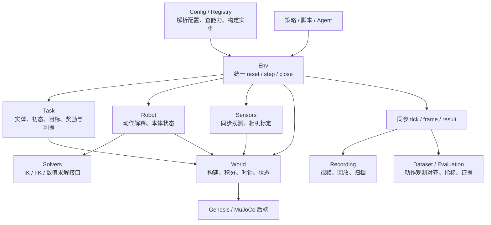
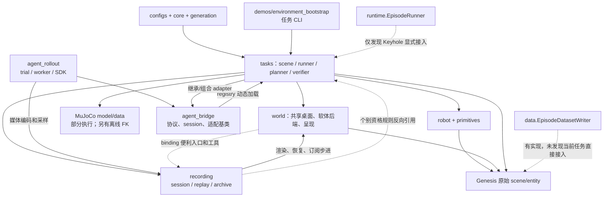
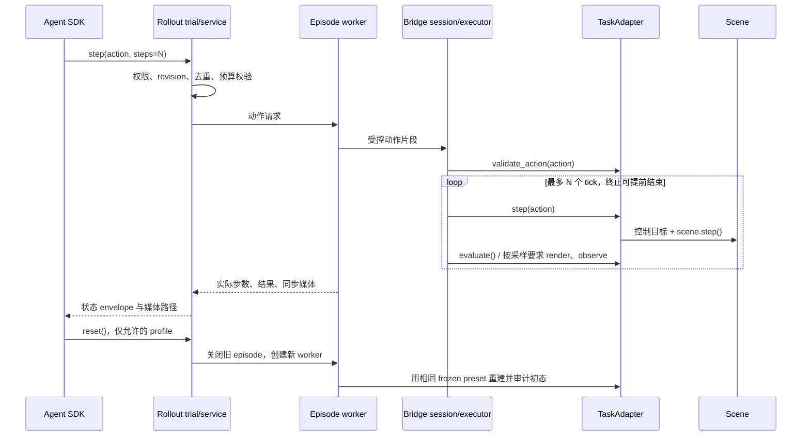
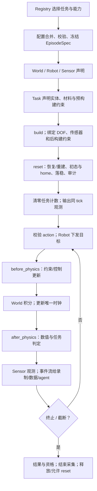

# TopoGym 模拟器模块化审计：对照 RoboWits 的职责划分

> 2026-09-23 目录已重排：本文保留移动前的分析、数量和旧路径名称，源码链接已指向新位置；当前结构及逐文件映射见 [目录重排记录](structure_move_20260923_zh.md)。

> 本文保留第一轮现状审计；其中多后端并存、兼容历史 demo 的建议已被用户最新的“仅 Genesis、先做减法”方向覆盖，后续取舍以 [Genesis-only 减法分析](genesis_only_codebase_review_zh.md) 为准。

审计日期：2026-09-22。对象为仓库当前工作树中的 `topogym/`，辅以 `configs/`、运行入口和测试；Git HEAD 为 `cb60f01`，**包含尚未提交的修改和新增文件**，不是该 commit 的独立审计。本文只新增架构分析，不改变任务实现。

RoboWits 侧依据用户提供的模块说明，未另行核验其源码、任务数量或版本。下文“标准流程”指从该说明抽取、适合本仓库的职责约定，不表示机器人模拟器必须采用相同目录、继承体系或物理引擎。

## 0. 先看结论

**TopoGym 已有较多共享能力，但当前更接近“任务执行器集合 + 共享基础库 + agent 交互平台”，还没有让全部任务遵循同一生命周期的模拟器核心。**

1. **不是缺少 `world`、`robot` 或录制模块。** 已有共享桌面 builder、机器人控制器、PBD/FEM 绳后端、统一录制与回放。应补运行时接口和接入覆盖，不能重新建一套同名功能。
2. **主要缺口是统一 Env/World 生命周期。** 没有全任务可用的 `make → reset → step → close` 本地环境接口；`runtime.EpisodeRunner` 只是完整 episode 的协议，没有承接物理步进。
3. **已有统一的 agent 协议，但覆盖和语义不同。** `TaskAdapter` 规定单 tick 交互，SDK 提供分段 `step` 和同预设 `reset`；它们不是 Gym 五元组环境，也没有覆盖全部任务。
4. **任务仍承担不少本应共享的执行机制。** 物理推进、状态采样、IK、初始化、稳定窗口、报告组装、发布归档分散在任务执行器中；同一任务还可能有几套不同用途的入口。
5. **录制已有实质进展，原材料中的判断需要修正。** 当前 13 个任务均有 `recording_adapter.py`；录制静态审计通过、例外为零。但这不等于所有历史发布入口都已使用公共 `archive()`，也不等于支持完整物理 checkpoint。
6. **确有边界混杂和重复机制的证据。** 其他任务引用 Cast Coil 的运动学实现、Rope Threading 引用 Knot 的控制与诊断；多个模块包裹 `scene.step`；公共录制模块反向引用具体任务的资格判定。
7. **不应把任务专有几何、多物理后端、不同成功条件一并“统一掉”。** 应统一调用契约、时间与状态语义、结果结构；保留任务判据、物理模型和控制策略的差异。

| 当前工作树中的覆盖事实 | 数量/情况 | 应如何理解 |
| --- | --- | --- |
| 任务 catalog | 13 项 | 是任务卡清单，不是 13 个可直接 `make()` 的 Env |
| 含共享桌面 builder 调用的任务包 | 13/13 | 某些只是静态检查入口，不能推出所有物理执行都走该 builder |
| agent registry 内的真实任务 | 8/13，另有 `counter` 测试任务 | 注册存在不代表完整物理资格或 frozen suite 已接通 |
| 任务录制适配器文件 | 13/13 | 不代表统一归档、软体通用恢复或任务成功 |
| 内置 frozen suite preparer | Cast Coil + `counter` | 其他任务可扩展，但不是自动获得同等覆盖 |
| 任务侧直接使用 `EpisodeRunContext` | 仅 Cast Keyhole 的 `variant_runner.py` | 是该接口接入线索，不宣称排除了所有动态或结构化协议实现 |
| 任务侧直接引用 HDF5 writer/helper | 未发现 | 模块存在，但未形成当前任务的数据采集主链 |

快速阅读：职责地图见第 1–3 节；逐任务覆盖见第 4 节；具体问题与代码证据见第 6 节；建议接口和迁移顺序见第 8–9 节。

## 1. 参照架构：一个模块各自应该负责什么

用户材料列出的七块核心能力是 World、Robot、Solvers、Sensors、Env/Task、Registry、Config。录制与数据导出应作为独立消费者补在旁边；类型契约、评测和诊断是贯穿这些模块的能力，不必为了凑数量各建一个顶层包。



箭头表示调用或依赖方向。任务可以通过声明式 builder 或后端扩展添加特殊实体，但不应每次重新实现整个环境运行循环。

| 职责 | 对外最小约定 | 不宜混入的职责 |
| --- | --- | --- |
| World | 构建阶段、物理推进、时钟、实体查询、按能力保存/恢复状态、释放 | 具体任务成功判定、MP4 编码 |
| Robot | 机器人描述、关节映射、动作校验与下发、本体观测、home 初始化 | 未声明地推进若干步、决定任务成功 |
| Solvers | 指定坐标系和单位的 FK/IK，返回解、误差和失败原因 | 隐式移动在线场景、夹带任务解法 |
| Sensors | 同一 tick 的观测包、相机内外参、模态与批量维度 | 物理积分、资格判定、正式发布 |
| Env/Task | Env 管生命周期；Task 填实体/初态/目标/评测钩子 | Task 自建一套媒体、注册、时钟机制 |
| Registry | 任务发现、能力查询、实例工厂 | 将“任务卡存在”视为“所有功能可运行” |
| Config | 合并、校验、冻结、版本和来源记录 | 运行中悄悄改变物理参数 |
| Recording | 订阅帧、时间映射、编码、按声明回放、事务归档 | 规划 home 到抓取的动作、代替 evaluator 宣布成功 |
| Dataset/Evaluation | 记录真实动作和观测、统一结果与资格证据 | 将视频完成或离线 IK 通过等同任务成功 |

有三点不能机械照搬参考实现：

- **一个动作不必只对应一个物理步。** 可以是固定 `control_decimation` 或明确声明的持续步数，但必须区分动作次数、积分步数、引擎内部 substeps 和仿真时间。
- **相机 build 后不一定完全只读。** 腕部相机需更新跟随位姿；关键是更新和 render 不推进物理、不改变冻结的相机定义，并能关联到正确 tick。
- **软体状态、部分 reset、跨后端恢复均需能力声明。** 不能因某个刚体场景能恢复 pose，就承诺整个模拟器能精确续算。

## 2. 现有模块清单及职责

下表按实际源码而非目录名称推断职责。“已有”仅表示存在实现，不表示全部任务都已接入。

| 当前模块 | 已有能力和接口 | 实际交互/边界情况 |
| --- | --- | --- |
| [`core`](structure_move_files_20260923_zh.md) | `save_resolved_config`、Hydra 配置来源；`EntityManifest.add/get` | world 用 manifest 共享 Genesis 实体句柄；没有统一 Env 或总配置 schema |
| [`world`](../../../topogym/world/) | `StandardTabletopSceneBuilder.create/finalize`、桌面坐标、机器人安装、相机、Nyx 外观、MuJoCo 实验室呈现 | 已封装共享场景构造，但 `TabletopBaseScene.scene` 仍暴露原始引擎；同时容纳构建、物理辅助和视觉职责 |
| [`world/rope_backends`](../../../topogym/world/rope_backends/) | `rope_backend`；PBD/FEM+IPC 的材料、场景选项、节点访问、预声明及后绑定约束 | 这是已存在的物理后端抽象，应继续保留；它不是无引擎依赖的 IK solver |
| [`robot`](../../../topogym/robot/) | 资产、Franka/ALOHA 控制器、PD、home、夹爪映射、抓持约束、`initialize_robot_controller` | 共享机器人基础较完整；控制器可自行 `step`，动作和状态 API 随机器人不同 |
| [`primitives`](structure_move_files_20260923_zh.md) | pick/place、插入、拖动、PBD pinch、FEM attachment、接触工具 | 属于动作和抓持机制；并非所有任务执行器都使用同一个 primitive 调度协议 |
| [`planning`](structure_move_files_20260923_zh.md) | `EpisodePlan`、subgoal、waypoint、弧线/螺旋路径、绳交叉几何 | 有通用规划数据和几何算法，没有统一机器人 IK/FK 服务 |
| [`generation`](structure_move_files_20260923_zh.md) | `EpisodeSpec/Result`、`VariantRng`、布局随机化、变体 episode 构建、braid | 多任务使用其中一部分；各任务生成/重载入口仍不同，frozen dataclass 中的 dict 不等于深层不可变 |
| [`runtime`](structure_move_files_20260923_zh.md) | `EpisodeRunOptions/Context`、`EpisodeRunner.run(context)` 协议 | 是“执行整段任务”的契约；不拥有 reset/step、时钟、传感器调度或通用实现 |
| [`tasks`](../../../topogym/tasks/) | 13 类任务的几何、场景、变体、控制、验收、agent/recording adapter | 是当前物理执行的主要组织中心；任务代码不仅包含目标定义，还承担大量运行机制 |
| [`recording`](../../../topogym/recording/) | `prepare → session/replay → validate → archive`；`RecordingBinding`、状态来源、帧时间线、编码、归档事务 | 已有实质公共流程；Genesis/MuJoCo binding 与任务专属恢复适配器并存；部分任务仍保留自有 archive 路径 |
| [`agent_bridge`](structure_move_files_20260923_zh.md) | `TaskAdapter`、`GenesisAdapter`、Rigid/FEM adapter、动作校验、连续 session、传输、预算 | 定义了 agent 单 tick 协议，并承载抓持/跟踪失败等模拟逻辑；不是单纯网络桥 |
| [`agent_rollout`](structure_move_files_20260923_zh.md) | 冻结 suite、独立 episode worker、SDK、trial/reset、权限、预算、结果汇总、媒体 | 是实验和 agent 会话编排层；建立在 bridge 之上，不应再次实现物理环境核心 |
| [`supervision`](structure_move_files_20260923_zh.md) | 刚体/绳稳定性、粒子诊断、step 探针与基准 | 可复用诊断与任务内 diagnostics/verifier 同时存在；部分探针依赖包裹 `scene.step` |
| [`data`](../../../topogym/data/) / [`utils`](../../../topogym/utils/) | HDF5 schema/writer；HUD、demo 路径、Franka 初始化兼容入口、录制转发 | HDF5 writer 仍有独立取帧和 step 包装；`utils.recording` 主要是转发，不能视为第二套独立编码实现 |

包外配置也属于架构：`configs/task_cards` 描述任务，`task_variants` 描述变体，`env_configs/robot_control_configs` 描述世界和机器人，`camera_configs/presentation_configs` 描述视觉，`recording_profiles/recording_policies` 描述录制和收录规则。

## 3. 当前模块如何交互

### 3.1 总体依赖图



虚线表达局部接入、待收敛依赖或未形成主链的能力，不表示这些调用一定会失败。尤其 `tasks → agent_bridge` 与 registry 的反向动态加载是组合结构，不能仅凭图中的环断言 Python 导入循环；问题是模拟逻辑和传输职责尚未分开。

### 3.2 共享 Genesis 场景的典型构造链

以 [`cast_coil/scene.py::build_scene`](../../../topogym/tasks/cast_coil.py#L37) 为例：

1. 任务读取模板/配置并生成资产。
2. 任务决定刚体求解选项，调用 `StandardTabletopSceneBuilder.create()`。
3. builder 构造 `gs.Scene`、桌面/背景基础、机器人、相机和 manifest。
4. 任务直接用 `base.scene.add_entity(...)` 加入零件，登记到 manifest。
5. `builder.finalize()` 准备呈现并 `scene.build(n_envs=...)`。
6. 返回任务自己的 `CoilScene`，后续由任务 demo 或 agent adapter 初始化控制器、执行和判定。

这是**已统一场景底座、尚未统一完整环境生命周期**的例子。普通任务仍需接触 Genesis options/materials/entity；特殊物理声明可以合理留在后端扩展，但应避免每个 runner 重复 reset、调度、采样和关闭流程。

### 3.3 Agent 链已有明确单 tick 契约



依据：[`TaskAdapter`](../../../topogym/envs/protocol.py)、[`GenesisAdapter.step`](../../../topogym/envs/adapters/base.py#L82)、[`env_sdk.py`](../../../topogym/agents/rollout/env_sdk.py)、[`tool_runtime.py`](../../../topogym/agents/rollout/tool_runtime.py)、[`episode.py`](../../../topogym/agents/rollout/episode.py)。

这里 `reset()` 是**恢复同一冻结初态的新物理 episode**，不是 `reset(seed=...)` 任意重采样，也不是 solver checkpoint 回滚。SDK 返回带 revision/预算/媒体信息的 envelope，不是 `(obs, reward, terminated, truncated, info)`。

### 3.4 任务原生执行和录制是另外两条链

- **机器人 demo 链：** 任务 `robot_demo/runner/execution` 初始化控制器、执行任务策略、推进物理、收集接触/轨迹、运行 verifier；录制 session 包围这一过程。Franka 的部分动作方法默认会内部推进，ALOHA 的多数目标设置默认 `steps=0`，任务显式组织后续步进。
- **MuJoCo 执行链：** 例如 Orbits 的 `Probe.move()` 直接 `mj_step`；Slotted FEM 的执行器使用 `mj_step1/mj_step2` 和任务自己的数值审计。Genesis 静态检查场景不是它们的统一动态 World。
- **录制/回放链：** 任务提供 `RecordingBinding` 或来源 manifest；公共模块统一时间线、取帧、编码和验证。回放 `restore → render` 不积分。资格证据来自任务，正式发布应调用公共 archive。

所以“agent 已有统一 step”和“所有 demo 都遵循统一 Env”是两件事；“录像统一”也不能代替执行器统一。

## 4. 逐任务覆盖：哪里一致，哪里分叉

下表只列源码中可辨识的路径，不给任务成功率或物理资格评分。全部任务都有共享桌面入口和录制 adapter；表中“agent”专指当前 bridge 注册表。MuJoCo 只用于离线 FK 的任务，不因此算第二套物理执行后端。

| 任务 | 代表性执行实现 | agent | 接入差异/需关注的边界 |
| --- | --- | --- | --- |
| `cast_coil` | Genesis 刚体；[`robot_demo`](../../../topogym/policies/tasks/cast_coil/robot_demo.py) | 有 | 有内置 frozen preparer；agent 用 `GenesisAdapter` 回调；离线 MuJoCo `Kinematics` 被其他任务引用；旧 archive 仍在 |
| `cast_keyhole` | Genesis；[`robot_execution`](../../../topogym/envs/execution/cast_keyhole/robot_execution.py)、[`variant_runtime`](../../../topogym/envs/execution/cast_keyhole/variant_runtime.py) | 有 | [`variant_runner`](../../../topogym/envs/execution/cast_keyhole/variant_runner.py) 接 `EpisodeRunContext`；多个 family/variant/archive 入口，各入口职责并未完全收敛 |
| `hedgehog_in_cage` | Genesis；[`extract`](../../../topogym/policies/tasks/hedgehog_in_cage/extract.py)、[`family_runtime`](../../../topogym/envs/execution/hedgehog_in_cage/family_runtime.py)、inverse runtime | 有 | 多家族共用部分 runtime，但自有资格/发布流程；wood 外观被 Buzz Wire 跨任务引用 |
| `horseshoe_ring` | Genesis；[`physical_motion`](../../../topogym/envs/execution/horseshoe_ring/physical_motion.py)、[`gravity_demo`](../../../topogym/redundants/experiments/horseshoe_ring/gravity_demo.py) | 有 | 任务控制、重力保持验收等合理专有逻辑与发布机制并存；还从 Cast Coil 兼容文件取共享抓持工具 |
| `interlocked_claws` | [`physical`](../../../topogym/policies/tasks/interlocked_claws/physical.py) 为 Genesis；[`family_physics`](../../../topogym/redundants/mujoco/tasks/interlocked_claws/family_physics.py) 为 MuJoCo | 有 | 不同执行后端/家族路径并存；agent 接入不能证明 MuJoCo 家族自动接入；引用 Cast Coil 的运动学类 |
| `lock_picking` | Genesis；[`runner`](../../../topogym/envs/execution/lock_picking/runner.py) | 有 | scene guard、runner 各自包裹 step；有专属 evaluator/certificate，适合提取结果接口而保留锁机构判据 |
| `buzz_wire_3d` | Genesis；[`robot_runtime`](../../../topogym/envs/execution/buzz_wire_3d/robot_runtime.py)、[`physics`](../../../topogym/world/physics/buzz_wire_3d/physics.py) | 有 | 机器人路径和 fixture 路径不同，home/supported/family 规划较多；部分旧归档入口仍存在 |
| `knot_untying` | Genesis FEM+IPC；[`physics_probe`](../../../topogym/redundants/experiments/knot_untying/physics_probe.py)、robot probe | 有 | 共享 rope backend；专有接触/拓扑检查合理；控制、诊断和工具类被 Rope Threading 直接引用 |
| `rope_threading` | Genesis FEM+IPC；[`physics_probe`](../../../topogym/redundants/experiments/rope_threading/physics_probe.py)、feedback/reference 控制 | 无 | 有共享物理底座和录制；任务 reset/执行/诊断仍走专属路径，依赖 Knot 包内部功能 |
| `fiber_bundling` | Genesis 线束模型；[`robot_sequence`](../../../topogym/envs/execution/fiber_bundling/robot_sequence.py)、[`ik_search`](../../../topogym/redundants/experiments/fiber_bundling/ik_search.py) | 无 | 自行组织 IK、接触禁区、稳定性与穿环验收；有 recorder binding，不代表已有统一 robot action 接口 |
| `blanket_flatten` | Genesis PBD cloth；[`execution`](../../../topogym/envs/execution/blanket_flatten/execution.py)、[`bimanual_full`](../../../topogym/policies/tasks/blanket_flatten/bimanual_full.py) | 无 | 单臂、双臂和虚拟手执行路径；`Execution` 接管 scene.step；布粒子回放是任务专用能力 |
| `orbits` | MuJoCo；[`dynamics.Probe`](../../../topogym/redundants/mujoco/tasks/orbits/dynamics.py)、robot runtime | 无 | [`scene.py`](../../../topogym/tasks/orbits.py) 的共享 Genesis 入口是静态检查；动态执行、局部完整 checkpoint 属于 MuJoCo 任务链 |
| `slotted_post_ring` | MuJoCo；[`fixture`](../../../topogym/redundants/mujoco/tasks/slotted_post_ring/fixture.py)、[`fem_fixture`](../../../topogym/redundants/mujoco/tasks/slotted_post_ring/fem_fixture.py) | 无 | [`scene.py`](../../../topogym/tasks/slotted_post_ring.py) 是 Genesis 静态检查；FEM 状态/约束恢复和四面体分离判据有专属 adapter |

共同的任务目录并不等于共同调用流程。反过来，不同物理模型也不必有相同文件名；应以是否满足统一接口、时间语义和证据契约衡量模块化。

## 5. 对照功能矩阵：已有、部分具备、尚未形成统一能力

| 能力 | TopoGym 当前情况 | 与参照架构的差距 |
| --- | --- | --- |
| 列出任务/能力 | catalog 13 项，bridge registry 8 项真实任务，suite preparer 另行选择 | 缺单一任务描述记录和 `list_tasks(capability=...)`；不同名单含义容易混淆 |
| 字符串工厂建环境 | `factory_for` 可按名建 agent adapter；任务 CLI/build_scene 也可构建 | 没有覆盖全部任务的本地 `make(task, variant, backend, ...)` 环境入口 |
| 世界构建 | 共享 Genesis builder、绳后端、MuJoCo presentation | 缺统一运行时 World；构建能力不等于 reset/state/clock/close 能力 |
| reset | 机器人 home；任务初始化；rollout 同预设 worker 重建 | 缺全任务 Env reset 契约、通用局部 reset 与初始化审计接口 |
| step | bridge 规定单 tick；任务 runner/controller 各自推进 | 缺共同 step 调度器、时间单位与 Gym 映射 |
| 机器人动作与状态 | Franka/ALOHA 控制器、action contract、agent adapter 已有 | 缺统一 `ActionSpec/RobotState` 和控制模式声明；不能假设四种动作模式都已实现 |
| FK/IK | Genesis 内置 IK；任务内 MuJoCo/SciPy 求解 | 无统一 solver 接口；求解器依赖、TCP 与坐标变换散在任务/控制器 |
| 传感器 | 相机配置、挂载、NyxCamera、recording camera 工具、PNG 观测 | 无统一 SensorSuite/ObservationSpec；RGB tensor、PNG、路径和本体观测各有出口 |
| 奖励/成功/终止/超时 | 各任务 verifier；bridge verdict；trial limits；EpisodeResult | 没有统一 reward 输出或五元组；成功、失败、资格、预算终止需明确映射 |
| 语言描述 | agent `describe/agent_spec`、task card、variant instruction | 来源多；并非所有任务都以同一 `TaskSpec.instruction` 对外 |
| 固定评测与复现 | frozen suite、源码/资产 hash、命名 RNG、部分任务完整实例重载 | 共享机制已存在；preparer/初态审计覆盖不完整，不应宣称只要有 seed 就全任务可复现 |
| 视频录制/回放 | 公共 session/replay/validate/archive、逐帧时间映射 | 基础已具备；待统一所有发布入口，与 Sensors、Dataset 共用观测出口 |
| 状态存取 | 任务轨迹、录制恢复、simulator 只读 state、Orbits checkpoint | 四种不同能力，尚无统一的状态类型/覆盖声明及后端恢复接口 |
| 参数化变体 | 配置化、家族、reject、manifest、hash | 方向正确；任务工厂签名和产物 schema 仍不统一，不需要改成“一变体一 Python 文件” |
| 数据集导出 | HDF5 writer/schema 已有 | 当前任务未见直接接入；偏单臂字段及派生动作语义，不能直接覆盖双臂/新任务 |
| 向量化 | builder 接受 `n_envs`，有 batch renderer 分支 | 控制器常取第一个环境、若干任务和录制拒绝 batch；没有完整向量化 Env/partial reset |
| close/资源释放 | worker 清理、部分 adapter.close、录制上下文清理 | 不应说“完全没有 close”；缺所有运行入口共用的生命周期与所有权约定 |

## 6. 具体模块化问题及证据

本节区分**源码事实**与**由此推导的风险**。风险不是本次实际重现的运行故障。

### 6.1 缺统一环境核心，三个层面的“运行接口”不能互换

- **事实：** [`runtime/episode_runner.py`](../../../topogym/envs/episode_runner.py) 只定义 `run(context) → EpisodeResult`；[`agent_bridge/protocol.py`](../../../topogym/envs/protocol.py) 定义 step/observe/render/evaluate；[`agent_rollout/env_sdk.py`](../../../topogym/agents/rollout/env_sdk.py) 提供远端调用。当前源码未发现 Gym Env、`action_space`、`observation_space` 的统一实现。
- **影响：** 新接一个任务时，开发者仍要决定到底写 demo runner、bridge adapter 还是 suite preparer；通用训练脚本不能直接把 task card 名称交给同一个环境工厂。
- **建议：** 在 `runtime` 中建立本地 Env 核心，bridge 包装它、rollout 管 trial，EpisodeRunner 调它跑完整 episode。Gym wrapper 按需提供，不要求 agent API 改成五元组。

### 6.2 世界层有 builder，没有覆盖各后端的运行对象

- **事实：** [`TabletopBaseScene`](../../../topogym/world/tabletop.py#L76) 存放 scene、manifest、cameras 等；`finalize()` 调原始 `scene.build()`。任务继续直接访问 scene/entity/solver。Orbits 与 Slotted 动态链直接持有 MuJoCo model/data。
- **影响：** 统一初始化、状态恢复、时钟、关闭和 capability 查询缺少落点。新后端不只换一个构造函数，还要分别修改 runner、recording 和 agent 接入。
- **建议：** 保留 builder，增加 World runtime protocol 及 Genesis/MuJoCo adapter。`world/rope_backends` 的 pre-build/post-build 声明是可复用先例。

### 6.3 物理时钟由多处管理，步进包装形成隐式顺序

- **事实：** [`robot/franka.py`](../../../topogym/robot/franka.py#L114) 和 [`robot/aloha.py`](../../../topogym/robot/aloha.py#L45) 都能内部推进；Franka 的 open/close 等默认采用 `steps_per_action`，ALOHA 目标设置通常默认不推进。
- **事实：** 录制 [`GenesisBinding.subscribe`](../../../topogym/recording/adapters/genesis.py#L39)、[`EpisodeDatasetWriter.__enter__`](../../../topogym/data/episode_dataset_writer.py#L131)、[`StepProbe`](../../../topogym/evaluation/diagnostics/pbd_probe.py#L88)、[`TabletopParticleFriction`](../../../topogym/world/rope.py)、[`FEM _FollowSync`](../../../topogym/world/rope_backends/fem_ipc.py#L73)、Blanket [`Execution`](../../../topogym/envs/execution/blanket_flatten/execution.py#L16)、Lock 的 scene/runner 都存在 step 包装。
- **风险：** 回调先后、采样时刻、包装撤销顺序依赖安装顺序；重新组合这些模块时，可能漏回调、时序不一致或恢复旧 wrapper。录制的独占检查只能约束录制 owner，并不能定义所有模块的全局顺序。
- **建议：** Env/stepper 独占积分，提供有序的 `before_physics`、`after_physics`、`observation_ready`、`episode_end` 钩子。保留控制器便利移动函数时，应委托同一个 stepper。

### 6.4 通用运动学和诊断仍寄宿在任务包中

| 具体依赖 | 判断 | 合理归属 |
| --- | --- | --- |
| Claws `family_robot/family_balanced_robot`、Slotted `robot/robot_sequence` 引用 [`cast_coil.robot_plan.Kinematics`](../../../topogym/solvers/kinematics/cast_coil/robot_plan.py#L32) | 真正的跨任务实现依赖；该文件同时导入 Coil 几何、验证、FCL 等 | 通用运动学放 `robot/kinematics` 或 `solvers`，Coil 路径/碰撞对象留任务内 |
| Rope Threading 引用 [`knot_untying.control.BoundedAlohaIK`](../../../topogym/solvers/kinematics/knot_untying/control.py#L16) | 可复用机器人求解与测量坐标变换位于 Knot 包；与上一种 Kinematics 返回语义也不同 | 统一 solver result、seed/限位/TCP/frame 约定，允许多种求解策略 |
| Rope Threading 引用 Knot `FemDiagnostics/SurfaceCCD/NativeRigidSurfaceCCD/SolverLog/RobotGraspActions` | FEM 诊断/抓持基础和任务阈值边界混在一起 | 通用机制移 `supervision/primitives`；任务阈值、接触对象和拓扑判据保留 |
| Buzz Wire 引用 Hedgehog [`appearance.wood_visual`](../../../topogym/assets/generators/hedgehog_in_cage/appearance.py) | 外观工具可共享，不必绑定 Hedgehog | 共享材料/呈现工具 |
| Horseshoe/Claws 从 [`cast_coil.robot_grasp`](../../../topogym/robot/grasping/cast_coil/robot_grasp.py) 导入工具 | **只是转发到 `robot.grasp_constraints`，不是两套约束实现** | 调用者改用公共路径即可 |

还存在不同 TCP 定义：ALOHA controller 的 `grasp_center_pos()`、Coil 的 `PAD_CENTER`、Knot 的末端控制各有约定。它们未必数值错误，可能对应不同实体点；应以具名 frame/TCP 描述公开，避免把不同点误当同一末端位置。

### 6.5 Sensor 能力被拆在 world、recording、bridge、data 多处

- **事实：** world 建相机、NyxCamera 提供 RGB；recording binding 返回数组；GenesisAdapter 将图像编码为 PNG；data writer 自己 `_grab_rgb()` 并组本体状态。
- **事实：** [`NyxCamera.render`](../../../topogym/sensors/nyx.py#L168) 明确拒绝 depth/segmentation/normal；录制/agent 的通用出口主要消费 RGB。不能把引擎可提供其他模态等同于全仓库已支持统一多模态观测。
- **风险：** 相机名、单位、图像格式、是否带 batch 维度、观测时间和本体字段需在每条链分别对齐；新增观测模态可能修改多层。
- **建议：** 提炼 SensorSuite，输出同 tick 的 `ObservationFrame`。recording 消费数组，bridge 负责传输编码，dataset 负责数据格式；render 的缓存或编码不能推进世界。

### 6.6 录制统一不等于归档统一；公共模块也有反向任务依赖

- **已完成：** `recording` 有合同、会话、回放、验证、来源哈希和事务发布；本次 `python -m topogym.recording audit` 返回 `passed=true`、`remaining_entries=0`。
- **仍分叉：** [`hedgehog_in_cage/family_archive.py`](../../../topogym/recording/tasks/hedgehog_in_cage/family_archive.py)、[`cast_keyhole/variant_archive.py`](../../../topogym/recording/tasks/cast_keyhole/variant_archive.py) 自行复制证据/视频并更新 catalog，仍含 `runs/demos/...` 旧发布路径；Coil/Buzz 的旧 `robot_archive.py` 也保留独立发布实现。入口存在不说明目前正式视频一定由它们生成。
- **反向依赖：** [`recording/archive.py::external_eligibility`](../../../topogym/recording/archive.py#L74) 包含 Orbits 规则，并直接导入 Slotted 的 `qualification_passed`。此外 [`world/tabletop.py`](../../../topogym/world/tabletop.py#L84) 提供 recording binding 便利方法，MuJoCo presentation 从 recording 借配置/hash 工具。
- **建议：** 任务提供资格验证回调和证据描述，公共 archive 只负责政策执行与事务。通用 hash/config 工具下沉到 core；world 与 recording 的绑定在组合入口完成。旧 archive 保留为明确的兼容转发或停止新发布，不需要立即删除历史验收代码。

静态审计检测已列举的 writer/ffmpeg 等调用和 shared entry 标记；它**不检查所有发布事务、状态字段覆盖或物理有效性**。因此审计通过与本节问题并不矛盾。

### 6.7 注册、变体生成和配置冻结尚未成为一条公共链

- **事实：** [`tasks/catalog.py`](../../../topogym/config/catalog.py) 负责卡片及 baseline manifest；[`agent_bridge/registry.py`](../../../topogym/config/registry.py) 另列 adapter；[`agent_rollout/suite.py`](../../../topogym/config/agent_suite.py) 通过 preparer 冻结输入。
- **事实：** Coil/Hedgehog/Claws/Lock/Keyhole/Horseshoe 的部分生成路径使用 `build_variant_episode`，但 `sample/generate/materialize/load_instance` 的参数和产物位置仍不同；Fiber 使用 `sample_parameters/generate_candidate`。公共 `randomize_task_cfg` 没有发现当前任务侧直接调用。
- **事实：** Hydra/OmegaConf 已支持组合，recording.prepare 冻结其副本，rollout 用 hash 锁定 preset；不能说“完全没有冻结配置”。但没有贯穿所有运行入口的解析、校验、冻结关口，`EpisodeSpec` 的 frozen dataclass 也不深冻嵌套 Mapping。
- **建议：** 同一 TaskRegistration 声明 builder、generator、loader、agent/recording/state 能力；先生成可变草案，校验并冻结完整 EpisodeSpec，再构建。参数化结构继续保留，各任务有界采样与 reject 条件作为插件。

### 6.8 “状态”有四种含义，目前不能混用

| 当前接口/产物 | 实际用途 | 不等于什么 |
| --- | --- | --- |
| rollout `get_state(fields)` | 只读、权限过滤的公开 simulator 状态 | 完整 solver checkpoint；任意 set_state 权限 |
| frozen preset + 初态审计 | 以同一构建输入重建新 episode | 任意时刻精确续算、跨硬件位级相同 |
| recording state + `restore` | 把测得状态还原成画面，不积分 | 恢复所有速度/接触历史/控制器后继续动力学 |
| Orbits `save_checkpoint/restore` | 任务专有 MuJoCo integration state 及一致性检查 | 所有任务、所有后端都支持同样的 checkpoint |

依据：[`initial.py`](../../../topogym/evaluation/agents/initial.py)、[`recording/adapters/genesis.py`](../../../topogym/recording/adapters/genesis.py)、[`recording/adapters/mujoco.py`](../../../topogym/redundants/mujoco/recording/adapters/mujoco.py)、[`orbits/dynamics.py`](../../../topogym/redundants/mujoco/tasks/orbits/dynamics.py#L278)。

建议分别命名 `ObservationState`、`EpisodePreset`、`RenderState`、`PhysicsCheckpoint`，声明实体/字段覆盖、engine/model/schema 版本、恢复用途。物理续算还需覆盖控制器目标、任务评测计数、RNG、约束及必要的 solver 状态；不能只改接口名字便声称完成。

软体也不能一概写成“不支持回放”：Orbits/Slotted 有任务专属 binding，Blanket 会从 NPZ 恢复粒子和机器人，但其 `scene_report` 保留 `render_state_complete=False`、`physics_resume_supported=False`。应尊重实际能力声明，不能把“有 adapter”提升为通用软体恢复保证。

### 6.9 评测实现需要统一结果结构，不应强行统一判定算法

- **事实：** `EpisodeResult` 使用 `success/fail/timeout/error/ongoing`；bridge verdict 使用 `running/succeeded/failed`；recording 又区分录制完成度、`task_result.status`、execution kind、assistance、物理资格与证据。任务 verifier 还常返回 `passed/complete/invalid_reasons` 等字段。
- **风险：** 每次接入需要手工映射；一个局部 `passed` 可能仅代表几何、IK 或解码通过。公共层若只读取布尔值，就可能丢失资格范围。
- **建议：** 统一 `StepResult/TaskOutcome/Qualification`，显式区分任务终止、时间/预算截断、基础设施错误、物理资格、导出资格。稳定保持计时器和数值检查可共享；拓扑、穿环、释放、间隙等任务判据保留。

### 6.10 数据导出存在，但与新执行链脱节

- **事实：** [`EpisodeDatasetWriter`](../../../topogym/data/episode_dataset_writer.py) 自行包装 step、取相机、本体采样；当前任务包未发现直接使用它或 `dataset_writer_or_null`。
- **事实：** `_proprio()` 依赖单臂式 `controller.hand_pos()/arm_joint_count` 等字段，不能直接接 `AlohaDualArmController.state()`。schema 仍主要是 front/wrist、单末端和单 gripper 字段。
- **事实：** `_write()` 将下一帧测得的末端 pose 作为行为克隆标签；这是派生标签，不是完整记录输入的关节命令/动作请求。当前 schema 文档已说明其绝对位姿含义。
- **建议：** 数据层消费与 recorder 相同的 ObservationFrame 和 CommandEvent，同时保存原始 action、实际步数、测得状态、派生训练标签及生成规则。按 robot/sensor schema 组织字段，避免把双臂硬压进单臂列。

### 6.11 批量、清理和资源所有权仅部分具备

- builder 的 `n_envs` 和 batch renderer 是基础能力；ALOHA/Franka 中多处 `reshape(...)[0]`、录制 `prepare` 对 `n_envs != 0` 的拒绝，说明端到端向量化尚未打通。
- rollout worker 已尝试 `adapter.close()`、`scene.destroy()` 并可终止进程；但 TaskAdapter 基础协议未包含 close/reset，任务 CLI 的清理结构也不统一。
- 应声明 `supports_batch/partial_reset/checkpoint`，未实现时早报错；所有资源由明确的 Env/worker owner 关闭。批量化是否优先取决于训练目标，不能只透传 `n_envs` 就宣称支持。

## 7. 哪些不是冗余，哪些应该收敛

| 现象 | 判断与处理 |
| --- | --- |
| Genesis + MuJoCo 并存 | 合理。软体、接触和运行环境不同；统一后端能力接口，不强制同一引擎 |
| `world/rope_backends` 与 IK/FK | 不重复。前者是材料/约束/节点接口，后者是机器人运动学 |
| 每个任务的 geometry/verifier/planner | 大部分应保留。任务判据和策略不能抽成一个充满 task_id 分支的公共类 |
| 每个任务的 recording adapter | 合理扩展点。状态字段/模型约束不同，需要适配；不能再写自己的取帧、编码和正式发布循环 |
| `agent_bridge` 与 `agent_rollout` | 职责可互补：单 episode 交互与跨 episode 试验管理；应下沉 bridge 内可复用物理逻辑，而非简单合并两个目录 |
| `utils.recording` 与 `recording` | 当前主要是兼容转发，不是两套 writer；统一调用路径后逐步收敛即可 |
| `robot.factory` 与 `utils.franka` | 初始化机制重叠，后者可委托前者，属于小型接口收敛 |
| 任务内重复 hash/save、发布/copy/catalog、step 包装、通用 IK | 是优先收敛对象；分别归 core、recording、runtime、robot/solvers |
| family/inverse/robot/fixture 多套运行入口 | 先按用途登记，不能仅按文件名删除；共享执行机制，策略、物理模型和证据范围可不同 |
| 任务文件数量多或单文件很长 | 只能作为检查线索；必须证明职责混合/重复机制，不能单凭行数判断模块化失败 |

当前保护任务和活跃运行继续遵守仓库 AGENTS.md。架构建议不授权删除它们的代码、输入、队列、状态或历史证据。

## 8. 建议的目标接口和统一流程

### 8.1 先补契约，再决定是否新建目录

下列是**建议接口，尚未实现**。可在现有 `runtime/world/robot/core` 中落地，不必先搬动所有文件。

| 契约 | 建议接口/字段 | 现有实现如何接入 |
| --- | --- | --- |
| `TaskRegistration` | `id, factory, variants, backends, robots, capabilities`；`list_tasks/make` | 合并 catalog/adapter/preparer 的可执行能力描述，保留卡片内容 |
| `ResolvedEpisodeSpec` | 任务/变体身份、展开配置、资产 hash、模型/代码版本、seed 与 RNG 版本 | 复用 generation 和 frozen suite；统一校验、冻结/载入接口 |
| `WorldRuntime` | `build/advance/clock/read_state/close`，可选 `reset/checkpoint/restore` | 包装 Genesis/MuJoCo；支持特殊后端 pre-build/after-build 扩展 |
| `RobotRuntime` | `action_spec/validate/apply/read_state/reset_home` | 复用现有控制器；`apply` 只改目标，由 stepper 积分 |
| `KinematicsSolver` | `fk(q, frame)`、`ik(target, seed, limits) → IKResult` | 提取通用 IK/FK；明确 q、TCP、frame、误差、收敛状态；在线场景句柄不进入纯求解接口 |
| `SensorSuite` | `spec/observe(tick)/close → ObservationFrame` | 包装 Nyx/Genesis/MuJoCo，公开 modality/dtype/shape/标定和时间戳 |
| `TaskLogic` | `declare_entities/sample_initial_state/bind/evaluate/instruction`，可选 reward | 保留各任务 geometry、约束声明、目标和资格逻辑 |
| `EnvRuntime` | `reset(spec/options)`、`step(action, duration)`、`observe/close` | 拥有时钟、钩子、计数、终止和资源生命周期；可外包 worker 重建 |
| `StepResult` | obs、action_steps、physics_steps、sim_time、reward 可选、terminated、truncated、outcome | bridge/Gym/EpisodeRunner 做各自协议映射，保持同一语义 |
| `Qualification` | scope、执行种类、辅助/重建声明、checks、证据 hash、资格 | 与任务是否成功、视频是否完整分别保存 |
| `Frame/Command/Event` 流 | tick、episode/execution ID、真实命令、测得状态、帧、阶段、结果 | recording/data/agent 共用，避免各自包装引擎和重采样 |

求解器可以使用独立 MuJoCo/Pinocchio 模型，重点是与**在线动力学场景**解耦；不必为了“纯数值”禁止成熟运动学库。任务的碰撞约束、路径选择和启发式策略仍在 planning/task 插件中。

### 8.2 建场景、reset、step 的统一顺序



流程约束：

1. **构建与 episode 重置分开。** 实体拓扑变化或后端不能安全恢复时可重建；不得假装 pose 写回就是完整 reset。固定实体如何变换遵守对应引擎能力。
2. **初始化次数与任务执行步数分开。** 可以记录落稳过程，但明确哪些 tick 属于初始化，哪些属于受评测动作；计数不能由各消费者各算一份。
3. **新完整机器人 demo 从机器人默认 home 开始记录。** home 到任务起点由任务控制器连续执行并验收；录制模块只观察。ALOHA 当前配置用 `home.left/right`，Franka 用 `home.qpos`，统一接口应归一化这些字段，不擅自覆盖任务配置。
4. **观测、评测和 render 不积分。** 一个 action 覆盖多 tick 时，逐物理 tick 做必要安全检查，按显式采样周期发观测，返回实际完成步数。
5. **任务成功与资格分别出结果。** `success` 不自动意味着 physics/export/formal-demo qualified；外力、辅助抓持、预抓取和回放身份保持显式。
6. **reset 与 checkpoint 分权。** 给 agent 的 reset 策略可继续是 same_preset；内部诊断 checkpoint 不自动变成 agent 可写状态权限。
7. **关闭有唯一 owner。** 正常结束、异常、录制失败、worker 退出都按约定释放资源，保持错误及部分产物可审计。

### 8.3 新任务应该只新增什么

- 任务实体/资产描述，以及确有必要的后端特有约束构建扩展。
- 有界变体生成、初态/布局和拒绝条件；序列化为公共 EpisodeSpec。
- 任务描述、目标/失败/进度判据和可选 reward；统一返回结构。
- 专有 planner/controller 策略或 expert demo；通过公共机器人与 stepper 执行。
- 只有公共状态适配器覆盖不了时，新增任务 state/recording adapter，并声明恢复范围。
- 一条注册记录，列出支持的机器人、后端、观测、agent/reset/batch/checkpoint/recording 能力。

这样新增任务无需再设计自己的视频 writer、时间线、reset 管理、通用关节映射、发布事务或 agent 传输协议。

## 9. 迁移优先级与验收条件

优先级表示依赖顺序，不表示本次已实施；避免一次性重写所有任务或改变已验收物理模型。

| 顺序 | 具体工作 | 可检查的完成条件 |
| --- | --- | --- |
| P0：统一身份和语义 | TaskRegistration、能力表、Action/Observation/Outcome/State 类型；区分录制与物理状态 | 13 项任务均能查到准确能力；未支持的操作早报错；相同字段没有两种含义 |
| P1：运行核心纵向试点 | 在现有 runtime 增加 Env/stepper/World 接口，先包 Cast Coil | 同一实例的 demo 和 agent 经过同一 step 链；动作次数、积分步数、仿真时间可对账；observing 不推进物理 |
| P1：关闭公共边界缺口 | 归档回调去除具体任务 import；旧发布入口委托公共事务；抽离通用 hash | 新正式发布均有公共 manifest/transaction；公共录制无需因新增任务而添加 task_id 分支 |
| P2：验证异质后端 | 对一个软体任务、一个 MuJoCo 任务做接入试点 | 同样满足 reset/step/close 契约；特殊材料/约束与任务判据保留；资格范围不被扩大 |
| P2：统一机器人/传感器 | 抽离共享运动学与诊断，SensorSuite 取代各出口独立取帧 | 同 tick 的 recorder/dataset/agent 观测来源一致；TCP/单位/shape 可检查；无无意任务间依赖 |
| P3：变体和数据接通 | 全任务 generator/loader/preparer，真实动作事件接 HDF5/后续导出 | 固定实例可重载并审计；双臂数据无需任务专属字段补丁；原始动作和派生标签可区分 |
| P4：训练扩展 | Gym wrapper、按任务定义 reward、vector env/partial reset | 通过协议一致性检查；batch 的动作/观测和计数按环境独立，单环境路径不被静默广播 |

迁移时做最有价值的对照：固定配置/资产/种子，对比初态、实际控制命令、步数与时间、关键状态、成功/失败原因、资格报告和帧映射。先验证“包装现有执行”不改变语义，再逐项搬迁内部实现；跨 GPU 的位级一致不要在未验证前承诺。

## 10. 本次审计依据与验证范围

本次读取了共享模块、13 项任务的主要构建/适配路径及代表执行器；用 AST/文本扫描补充导入关系和接口调用覆盖。对“未发现”的结论限定于当前源码静态搜索，动态插件和外部调用者不在证明范围内。

已执行：

```bash
# 当前工作树的录制依赖审计
.venv-gs121-nyx/bin/python -m topogym.recording audit
# 结果：passed=true，remaining_entries=0，compatibility_writer_entries=0

# 已有静态迁移回归
.venv-gs121-nyx/bin/python -m unittest tests.check_recording_migration -q
# 结果：2 tests，OK

# 可复查的接口和接入搜索；无匹配本身不证明运行能力不存在
rg -n 'gymnasium|gym\.Env|action_space|observation_space' topogym
rg -n 'EpisodeRunContext|EpisodeDatasetWriter|dataset_writer_or_null' topogym
rg -n 'scene\.step\s*=|n_envs|envs_idx' topogym
```

没有为了写文档重跑全部 GPU/物理任务、评测模型、录制视频或验证历史 demo 成功率。本文的“已实现”是代码层事实；物理资格以各任务独立证据为准。

相关文档：[现有模块索引](../modules/README.md)、[agent rollout 调用链](../modules/agent_rollout_pipeline_zh.md)、[adapter 架构](../modules/agent_adapter_architecture_zh.md)、[共享录制用法与限制](../modules/recording_module_usage_zh.md)、[当前任务进度](../../progress/current_zh.md)。
