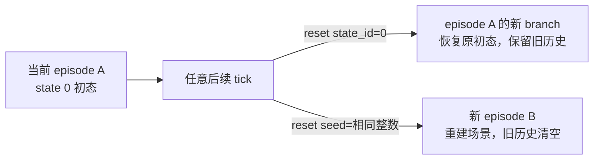
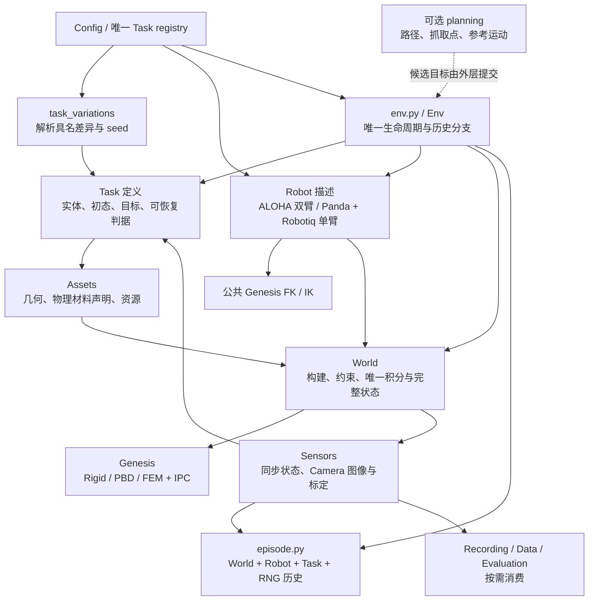

# 后续整理计划：全部任务统一迁入 Genesis Simulator

日期：2026-09-23。状态：**已按 5.1 开始实施，目录与 13 项任务定义已接入；当前有 9 项生命周期代码路径、4 项 FEM/IPC 阻塞。全部尚未运行验证。** 具体已落地功能和逐脚本缺口见[本轮实施记录](simulator_task_integration_20260923_zh.md)。

用户最新允许“任务未完成也先整合，再列出模块缺口”；这一阶段交付边界覆盖本计划原 4.4 / 7.2 中要求全部物理能力一次补齐的门槛。以下分析数字和去向表保留规划时背景，当前路径以脚本清单和实施记录为准。

依据本轮重新读取的工作区源码及 RoboWits 示例，补充[核心重构记录](simulator_core_consolidation_20260923_zh.md)和[原收敛计划](simulator_consolidation_plan_zh.md)。现存文件仍以[全量脚本清单](script_inventory_zh.md)为准，本页第 5.1 节是实施目标，是否落地以本轮记录为准。

**本次修订的第一整体里程碑：13 项基础任务全部进入同一套 Genesis Env、Robot、World、observation 与历史 reset 合同，同时完成目录和命名整理。** 规划时的“6 项 implemented / 7 项 pending”只是当时进度，不能作为这一里程碑的交付终点。实施可按依赖分步推进；测试仍只编写，实际可用性等用户指示后验证。

## 1. 对四个问题的直接回答

1. **任务变体归 `tasks/task_variations/`，基础任务保持每项一个文件。** 借鉴 RoboWits 的“基础任务 + 独立变体文件 + 共享环境机制”，不再把家族选择、参数派生、参考解法和几何生成混放在 assets。变体可以改变实体、初态和目标参数，但不能拥有另一个运行循环。
2. **Robot 覆盖仓库现有的两套机器人：ALOHA 双臂、Panda + Robotiq 单臂。** 用户所说的“Robotiq 单臂”，在仓库模型中是 Panda 机械臂搭配 Robotiq 2F-85 夹爪；Robotiq 在此是夹爪名称。目录明确为 `robot/aloha/`、`robot/panda_robotiq/`，共享控制器与 Genesis FK/IK。现有 `assets/robot.py` 已有两类模型组装代码，本次补齐第二套组合的公共控制、观测和状态恢复接入，不扩展第三套机器人。
3. **需要恢复 Genesis PBD、FEM 和 IPC 支持，但职责横跨 Assets 与 World。** Assets 提供软体网格、参考构型和物理材料声明；World 负责 Genesis 材料实例化、求解配置、耦合、约束和状态恢复。IPC 是接触/耦合机制，不是一种外观或独立材料。旧实现有可复用内容，也有必须拆掉的 step 包装和全局补丁。
4. **`policies` 与 `planners` 不等义；现存这批内容更适合叫 `planning/`。** 当前文件主要产生路径、子目标、抓取点和参考运动，尚不是完整的 observation → action 策略。计划统一用 `planning/`，不再并存 policies/planners 两个含义重合的目录；`planning/motions/<task_id>.py` 只表示确需保留的参考运动。

上述四点明确了主要模块归属，**还不能自动补齐全部任务能力**。剩余工作包括关节/link/软体观测、可恢复的任务历史判据、软体约束与双向接触、FEM/IPC 完整 checkpoint、同 seed 重建，以及两项原 MuJoCo 动态模型的重建。这些全部纳入第一里程碑，不以旧 demo、专家策略或 agent 能否成功为前置条件。

### 1.1 RoboWits 实际借鉴什么

本轮只读核对的上游版本为 `9cc30aedbbebea86b975c0d66ea9ac227ca38535`，抽查了 Align Blocks、Retrieve Cube、Dominos 的 mutation 文件及共享基类，没有声称审查所有变体行为。

- [Dominos 基础任务](https://github.com/UMass-Embodied-AGI/RoboWits/blob/9cc30aedbbebea86b975c0d66ea9ac227ca38535/gs_gym/envs/robowits/06_dominos.py)继承公共 RoboWitsEnv；[Dominos 变体](https://github.com/UMass-Embodied-AGI/RoboWits/blob/9cc30aedbbebea86b975c0d66ea9ac227ca38535/gs_gym/envs/robowits/mutation/06_01.py)继承基础任务并覆盖 placement_groups 和实体构造。变体有注册名，通过同一个 task registry 注册。
- 抽查的 [Align Blocks 变体](https://github.com/UMass-Embodied-AGI/RoboWits/blob/9cc30aedbbebea86b975c0d66ea9ac227ca38535/gs_gym/envs/robowits/mutation/01_01.py)和 [Retrieve Cube 变体](https://github.com/UMass-Embodied-AGI/RoboWits/blob/9cc30aedbbebea86b975c0d66ea9ac227ca38535/gs_gym/envs/robowits/mutation/02_01.py)也是这一组织方式；这些文件直接调用 Genesis 创建实体，并非只有静态配置。
- 对我们采用的是“只写差异、共用生命周期”的原则。保留已建立的 Task/World 分工：变体解析成 Task 参数/实体声明，Genesis 创建仍由 World 完成。无需为了模仿类名，把 Task 改成新的 Env 子类。
- 这是参考项目的工程约定，不是全行业唯一目录标准；我们额外要求的任意历史 state 回溯仍需自己实现，不能从 mutation 目录整洁推导出已经支持。

### 1.2 基础任务、变体、实例分别是什么

| 名称 | 唯一含义 | 拟定位置 |
|---|---|---|
| task_id | 任务目标与判据，例如 cast_coil | `tasks/cast_coil.py`，身份由 `config/registry.py` 管理 |
| variation_id | 同一目标下具名的构型/难度/摆放/材料参数差异 | `tasks/task_variations/cast_coil.py`；内容很多时可用同级 `cast_coil_<variation>.py`，不建任务子包 |
| seed | 在已选变体内采样实例的随机输入 | 公共 reset/config；不是变体名称 |
| instance_id | 解析后的参数、模型/资源版本、机器人及 seed 等形成的实例标识 | episode 元数据；明确影响初态的输入，避免不同模型共用旧哈希 |
| geometry | 从明确参数构建形状和网格的算法 | `assets/geometry/<task_id>.py`；不负责选择变体或决定任务成功 |
| reference motion | 一个候选运动/几何见证，不是成功记录 | `planning/motions/<task_id>.py` |

具体约束：

1. 在现有配置入口增加明确的 variation 选择与机器人选择，先解析“基础参数 + 变体差异 + 显式覆盖”，校验后构建 TaskSpec；不新增 variant registry、scene registry 和第二套 Env 工厂。
2. 变体模块只负责差异与采样规则，复用同一基础 Task 的判据和状态合同。若目标规则有差异，显式给出可检查的参数/Task 扩展；若已是另一种任务目标，应成为独立 task_id，不能藏进 seed 或 geometry。
3. 反向设计脚本按功能拆分：参数派生归 task_variations；网格运算归 assets；纯数值求解归 solvers；用来证明可解性的候选路径归 planning。不能整文件一搬就把另一套 solver 塞进 task_variations。
4. 全部现存变体源码都要归类和去重。第一里程碑要求 13 项基础实例接入；既有变体也必须走同一构建路径，但不以恢复所有历史变体的成功轨迹为条件，尚未迁妥的变体不能列为可选的受支持项。

### 1.3 两类机器人如何共用一个 Robot 合同

- **范围固定为现有两套组合。** [assets/robot.py](../../../topogym/assets/robot.py)中的 `build_tabletop_aloha()` 与 `build_robotiq_panda()` 是模型组装依据；后者把 Robotiq 2F-85 装在 Panda 上。旧计划的 `robot/franka/` 指的就是这套单臂组合，现改为 `robot/panda_robotiq/`，与双臂 `robot/aloha/` 并列。
- `robot/aloha/description.py`：双臂、关节组、限位、末端坐标系、夹爪和 home。`robot/panda_robotiq/description.py`：Panda 七轴单臂 + Robotiq 2F-85 的完整组合描述，包括工具安装、home、关节组和末端坐标系。
- **型号内容集中到两个子目录。** `robot/panda_robotiq/gripper.py` 保存 Robotiq 2F-85 驱动与被动关节关系、指垫坐标系、单位换算和物理限位；撤销此前另设 `robot/grippers/` 的提案。当前只有这一套单臂组合使用它，先与组合放在一起。ALOHA 自身夹爪的特有数据随 ALOHA 描述保存；有独立逻辑时再在 `aloha/` 内拆文件，不为目录对称生成空脚本。
- 公共 `robot/joint_position.py` 按描述解释动作，不写 left/right 专用分支。单臂与双臂使用同一动作合同、不同关节组；arm 关节 rad、prismatic 关节 m，夹爪原生坐标与完整开口宽度严格区分。
- 根层 `description.py`、`joint_position.py` 及必要的公共抓持语义为两套机器人共用，不分别复制进两个型号目录。型号文件提供数据和确属机构差异的计算，不再拥有各自的 Env、IK、相机循环或录制代码。已有 `grasp_constraints.py` 中直接查询/删除 Genesis weld 的底层操作迁入 `world/physics/constraints.py`；Robot 层仅保留实际需要的公共抓持请求与语义，没有剩余职责则不保留空文件。
- `assets/robot.py` 保留模型解析、网格资源定位和装配；模型关节/工具身份由 Robot 描述提供，不在那里另建一份控制配置。读取 MJCF/XML 不等于运行 MuJoCo，必须单独核对 Genesis 是否实现模型中的被动联动、等式和接触语义。
- 控制目标、夹爪联动/抓持状态、控制器内部状态进入 checkpoint；FK/IK 共用 `solvers/genesis_kinematics.py`。初始化相机、桌面安装与工作区也按机器人描述解析，不让单臂任务继续依赖 ALOHA 默认值。
- 每项 Task 声明实际支持的机器人组合及所需能力，不承诺 13 × 2 任意互换；Panda+Robotiq 首先满足 Buzz/Lock 等既有单臂任务，不以新增每任务控制器解决差异。模型资源已存在与公共运行接口已接入分别记录：当前活动控制器仍只接 ALOHA，第二套组合是本次待接入项。

### 1.4 PBD / FEM / IPC 的复用边界

已经找到以下**源码证据**；它们证明有实现可参考，不等于新框架中的物理和恢复已经验证。

| 现有来源 | 可以提取的内容 | 不能原样带回的内容 |
|---|---|---|
| [legacy Cloth Fold](../../../legacy/topogym/tasks_legacy/deformation/cloth_fold.py)，以及 cloth_unpleat / cloth_unroll | `gs.materials.PBD.Cloth` 的建模/材料使用、布面初态与抓取点计算 | 任务私有 Scene、物理循环和手工接触更新 |
| [旧迁移记录](../../../legacy/docs/develop/physics/rope_backend_migration_zh.md) | PBD 绳与 FEM/IPC 迁移时的材料/接触问题和参数来源 | 历史通过标签不能作为新代码测试结果 |
| [PBD rope 源码快照](../../../runs/environment-stability/knot_untying/families_20260919/figure_eight/robot_v11_home_support_reanchor/implementation/topogym/world/rope_backends/pbd.py)及同一快照的 [rope.py](../../../runs/environment-stability/knot_untying/families_20260919/figure_eight/robot_v11_home_support_reanchor/implementation/topogym/world/rope.py) | PBD.Elastic、管网格、材料坐标、端点粒子选择、固定与跟随声明 | 把 reference-rest 差异当作 PBD/FEM 可完全互换；旧目录/协议层无条件保留 |
| [FEM/IPC rope 源码快照](../../../runs/environment-stability/knot_untying/families_20260919/figure_eight/robot_v11_home_support_reanchor/implementation/topogym/world/rope_backends/fem_ipc.py) | FEM.Elastic、IPC options、直线参考构型、锚点与 link 跟随目标算法 | `_FollowSync` 包装 `scene.step`；静态物体专用接触设置直接应用到可动滑珠/端片 |
| [IPC 顶点约束源码快照](../../../runs/environment-stability/knot_untying/families_20260919/figure_eight/robot_v11_home_support_reanchor/implementation/topogym/world/genesis_ipc_vertex_constraints.py) | 顶点 pin/follow、约束目标和参考构型处理的实际实现 | 模块级注册状态与替换引擎类的全局 install/reset 机制未经审查直接恢复 |

legacy 的部分任务仍引用已不存在于活动包中的 `world.rope_backends`。所以“参考 legacy”在实施上意味着从这些记录/快照中**提取必要实现并落入当前功能模块**，不是在运行时 import legacy 或从 runs 动态加载 Python。提取时保留来源、版本和哈希，解决其依赖，撤销旧平行入口。

分工与必须补的工作：

- **Assets：** 提供表面/体积网格、材料坐标、无应力参考构型与初始变形的区别，以及有单位的材料参数。PBD 布、PBD 弹性体、FEM 弹性体使用各自明确参数，不能静默互换。
- **World：** 将声明转成 Genesis 原生材料与求解配置；统一 rigid/PBD/FEM 观测和约束生命周期。先核实当前安装版本提供的接口，必要兼容代码集中在机制模块并锁定版本。
- **接触与抓持：** 明确哪些是固定锚点、有限强度跟随约束、真实摩擦抓持、辅助抓持，以及刚体/软体是否双向反馈。旧 `ipc_only` 静态器具设置、`needs_coup=False` 或受约束跟随，都不能直接当作完整机器人接触资格。
- **唯一推进顺序：** Env 接受动作 → Robot 更新控制目标 → World 同步约束目标并积分 → 同 tick 的状态/观测与 Task 判据 → checkpoint/消费者；具体 pre/post 操作由 World 调用，不再替换 scene.step。求解器内部必须使用的回调同样由 World 管理。
- **完整回溯：** FEM/IPC 原生对象、接触/求解缓存、材料状态、约束启停与目标、Python 包装层、机器人与 Task 历史都需逐项核对。能确定性重建的缓存可以重建，但必须验证续跑一致；只恢复顶点不能声称完成。
- **计算条件：** 旧 FEM/IPC 实现明确要求 CUDA/libuipc。新 capability 要记录设备、精度、依赖和材料组合；不能为“CPU 上看起来也能创建”而自动改用 PBD。这里仍是 Genesis 的接触组件，不恢复 MuJoCo 执行路径。

### 1.5 policies、planning、solver 和 controller 的命名

| 名称 | 输入 → 输出 | 是否拥有物理推进 |
|---|---|---|
| policy | observation / 内部记忆 → action，包含学习策略或规则策略 | 否；本轮 agent/策略接入延期 |
| planner / planning | 起点、目标、约束 → 路径/轨迹/子目标，可能失败 | 否 |
| reference motion | 给定参数/时间 → 候选位姿序列；未必进行了搜索规划 | 否 |
| solver | 一个明确数值问题 → 解/失败，例如 IK、距离或角区间 | 否 |
| Robot controller | 目标 → 当前控制输入，保存控制状态 | 否；World 积分 |

当前 [policies/README](../../../topogym/policies/README.md)已将其解释为“无物理副作用的规划”，因此目录改为 `planning/` 更符合已有内容。具体去向：`subgoal.py` → `planning/subgoal.py`；`waypoint.py` 的计划数据结构 → `planning/waypoint.py`，通用弧线/螺旋采样 → `utils/geometry/`；`cloth_grasp_sites.py` → `planning/grasp_sites.py`；`rigid_motion.py` 的通用变换、插值与 `RigidMotionSegment` → `utils/geometry/rigid_motion.py`，确属某任务的折叠/螺旋参考动作才归 `planning/motions/<task_id>.py`。这样 solvers 无需反向依赖上层 planner。

`planning/` 是可选的纯算法层；没有 planner 或成功脚本，环境也必须可以创建、reset、接受合法动作并给出真实 observation。基础实例构造不得依赖在线规划或一次成功 rollout。

### 1.6 Sensors 包括相机，而且应集中管理相机逻辑

**相机是 sensor，因此相机创建、安装/跟随、采样与标定脚本应归 `sensors/`。** 当前目录已经有下面四个功能脚本；旧图将它们折叠成一行，容易让人误以为只有 observation。本次计划展开目录，并收拢散落在 World 中的相机专属逻辑。

| 当前脚本/逻辑 | 拟定归属与职责 |
|---|---|
| [sensors/observation.py](../../../topogym/sensors/observation.py) | 保留：聚合 World/Robot/Task 读数与相机图像，按 episode/branch/state 缓存并输出同步观测 |
| [sensors/cameras.py](../../../topogym/sensors/cameras.py) | 保留并集中相机创建、外部/腕部安装、跟随位姿更新、公共取帧接口；接收 World 已管理的 Scene/实体句柄，不新建独立场景 |
| [sensors/camera_info.py](../../../topogym/sensors/camera_info.py) | 保留：内参、外参、分辨率/FOV、光学坐标约定及元数据；仿真内参与真实硬件标定分别标明 |
| [sensors/aloha_cameras.py](../../../topogym/sensors/aloha_cameras.py) | 其中通用相机组装配归 `sensors/camera_rigs.py`；ALOHA 的位姿和相机参数归配置，支持现有单臂组合的相机组也走同一装配逻辑 |
| [world/tabletop.py](../../../topogym/world/tabletop.py)中的相机构建与 [visuals/presentation.py](../../../topogym/world/visuals/presentation.py)中的预览相机创建 | 改为调用同一个 sensors 相机构建入口；World 仍协调 Scene build/close 时序与资源生命周期 |
| [world/visuals/nyx.py](../../../topogym/world/visuals/nyx.py)中的相机参数转换、传感器创建、RGB 读取与 NyxCamera | 相机专属部分归 `sensors/renderers/nyx.py`；灯光、环境贴图和场景表面处理按职责留 World/Assets，不把整份混合文件搬进 Sensors |

具体边界：

- `config/profiles/camera_configs/` 保存两套机器人实际使用的相机布局与参数。Robot 描述提供安装 link、工具坐标系和配置引用；相机算法不再按任务复制。单臂相机组沿用其已有外部/腕部需求，不默认套用双臂四相机布局。
- Camera 的创建/绑定由公共 Sensors 函数承担，World 在 Genesis 要求的构建阶段调用；关闭与 reset 仍服从统一 Env/World 生命周期，Sensors 不拥有自己的 scene.step。
- RGB 及相机内外参必须指向同一源状态；回溯后更新腕部外参并失效旧缓存。Recording 编码视频，Data 导出观测；两者都复用 Sensors 输出，不自行创建另一组相机或重算不同的标定。
- 是否提供 depth、segmentation 等按实际 renderer 能力声明；当前公共 SensorFrame 只定义 RGB 与相机元数据，本轮不因列出 Sensors 目录就宣称其他通道已经接入。
- 不启用 RGB 时仍能获得机器人与世界状态 observation，不强制初始化相机或可选渲染依赖。

### 1.7 公共 Env 放哪里：撤去 envs 目录，保留编排与物理分层

RoboWits 的 `envs/robowits/` 放具体任务环境，对应我们 `tasks/` 承担的任务定义部分；我们当前的 `envs/` 则只有公共生命周期和回合记录。这两种目录含义确实不同，但不意味着 Env 的职责应并入物理 World。

**建议将唯一公共入口展平为 `topogym/env.py`，回合记录集中到 `topogym/episode.py`；`world/` 继续表示物理世界实现。** 这样减少目录层级，又不会让 GenesisWorld 接管任务成功、机器人控制状态和数据消费者。

| 层 | 负责什么 | 状态边界 |
|---|---|---|
| `env.py` / Env | 构造并协调 Task、Robot、World、Sensors；reset/step/close；终止/截断及消费者通知 | 一个完整 episode 的编排 |
| `episode.py` | StateInfo、EpisodeState、EpisodeHistory 与动作前后 Transition 记录；历史索引、分支、父状态关系 | 聚合 World、Robot、Task、随机流和回合身份；不操作引擎 |
| `world/genesis_world.py` | Genesis Scene 构建、唯一物理积分、物理观测、捕获/恢复与关闭 | 当前物理世界及其引擎状态 |
| `world/state.py` | WorldState、原生物理缓冲与随机状态读写支持 | 完整 episode checkpoint 的物理组成部分，不拥有 Task 判据或回合历史 |

源码依据是当前 [Env](../../../topogym/envs/env.py)同时持有 `_world/_robot/_task/_sensors`，而 [EpisodeState](../../../topogym/envs/history.py)也同时记录 world、robot、task 和 RNG。`reset(state_id=...)` 因此不能简化为 `GenesisWorld` 的一次 set_state；否则可能恢复了物体位置，却保留未来分支的任务成功标记或控制目标。

实施时的完整路径去向：

- `envs/env.py` → `env.py`，保留唯一 Env 类，调整导入。
- `envs/history.py` 与 `envs/types.py` → `episode.py`，聚合现有回合历史和 Transition 数据定义，不新增第二套类型。
- 撤销旧 `envs/__init__.py` 和目录，调用点及测试改用新路径；不留兼容转发包。
- `world/` 不导入上层 Env/EpisodeHistory，也不按 task_id 分派任务逻辑。Env 调用 World 的物理状态能力，再协调 Robot、Task 与 Sensors 恢复完整回合。
- 这里只修改代码归属建议；`reset(state_id=0)`、任意历史 state 回溯和同 seed 新 episode 的合同保持第 3 节定义。

也可以将整个 simulator 核心统称为 world，但那需要重新定义当前 World 的含义；本计划选择以上边界清楚、改动更集中的布局。目录名不要求逐字照搬参考项目，模块职责和依赖必须一致且可解释。

## 2. assets 现在到底是什么情况

### 2.1 文件事实

`assets/` 当前有 **42 个 Python 文件**：`generators/` 32 个、`variants/` 6 个、`loaders/` 2 个，以及 `robot.py`、`textures.py`。另有 1 个旧 manifest JSON 和 12 个包内资源文件。下表排除缓存；“资源”包含 JSON、OBJ、PNG，不能与脚本数量混算。

| task_id | 几何/建模脚本 | variants 脚本 | loaders 脚本 | 包内资源文件 | 当前 Task |
|---|---:|---:|---:|---:|---|
| blanket_flatten | 2 | 0 | 0 | 0 | implemented，未测试 |
| buzz_wire_3d | 5 | 1 | 0 | 0 | pending |
| cast_coil | 2 | 1 | 0 | 1 | implemented，未测试 |
| cast_keyhole | 1 | 1 | 0 | 2 | implemented，未测试 |
| fiber_bundling | 4 | 0 | 0 | 0 | pending |
| hedgehog_in_cage | 4 | 0 | 0 | 4 | implemented，未测试 |
| horseshoe_ring | 1 | 2 | 0 | 1 | implemented，未测试 |
| interlocked_claws | 2 | 0 | 0 | 3 | implemented，未测试 |
| knot_untying | 2 | 0 | 0 | 0 | pending |
| lock_picking | 4 | 1 | 0 | 0 | pending |
| orbits | 1 | 0 | 0 | 0 | pending |
| rope_threading | 2 | 0 | 2 | 1 | pending |
| slotted_post_ring | 1 | 0 | 0 | 0 | pending |

表中建模脚本共 31 个，另外 1 个为通用 `generators/braid.py`。Lock Picking 的 manifest 单列，不是上表的模型资源。

- `loaders/` 看得到三个任务目录，但 **`cast_keyhole/` 与 `interlocked_claws/` 已没有非缓存文件**；只有 Rope Threading 留下两个脚本。这是目录清理遗漏，不表示另外十项任务都缺加载器。
- `variants/` 的 Fiber、Hedgehog、Claws、Knot 目录也没有非缓存文件。下一轮清掉空目录及废弃缓存，不保留空的能力占位。
- [唯一的 source_manifest.json](../../../topogym/assets/manifests/lock_picking/source_manifest.json)记录旧 Python 源文件的复制位置与 SHA，里面的 destination 还是旧任务路径。**它不是资产依赖清单，也不是每个任务必须实现的 manifest。** 这份记录应退出运行资产目录，必要历史信息并入已有迁移记录。
- 不少任务直接程序化生成资产，因此没有静态资源文件很正常；同样，模板 JSON 可以由公共读取函数加载，不需要每个任务各写一个 loader。

### 2.2 数量不同背后的职责问题

以下已经能从源码确认，不能只靠改目录名解决：

- [Rope geometry](../../../topogym/assets/generators/rope_threading/geometry.py)从 Knot 的 geometry 导入通用 `minimum_nonlocal_distance`。这个计算应归 `utils/geometry/`。
- [Buzz appearance](../../../topogym/assets/generators/buzz_wire_3d/appearance.py)从 Hedgehog appearance 导入 `wood_visual`。公共木材外观应归共享材质模块。
- [Coil appearance](../../../topogym/assets/generators/cast_coil/appearance.py)实际修改尺寸、切角和碰撞构型，应按几何变体归类，不能继续称为纯 appearance。
- Rope 的 [reference.py](../../../topogym/assets/loaders/rope_threading/reference.py)负责离线提取外部几何；[reference_motion.py](../../../topogym/assets/loaders/rope_threading/reference_motion.py)读取的是历史运动数据。二者不能都当作运行时模型 loader。
- 四份 `prepare_assets.py` 主要是独立 CLI 包装；不需要因此保留四个任务子包。
- [Lock certificate](../../../topogym/solvers/geometry/lock_picking/certificate.py)同时有离线几何证书和实测回退事件统计，后者应归 evaluation。

因此，下一轮的整齐程度用“一个职责只有一个清楚入口”衡量；不会要求所有任务同时拥有 geometry、loader、manifest、variant、appearance 五套脚本。

## 3. reset：回到原初态与按同 seed 重建

### 3.1 当前代码的行为

依据：[Env.reset / _restore](../../../topogym/envs/env.py)、[EpisodeHistory](../../../topogym/envs/history.py)、[GenesisWorld](../../../topogym/world/genesis_world.py)。下面是源码语义说明，未执行调用。

| 调用 | 初态/历史行为 | episode 与 branch | 注意事项 |
|---|---|---|---|
| `env.reset(state_id=0)` | 恢复当前 episode 首次就绪时保存的 World、Robot、Task、时钟和随机状态 | episode 不变，新建 branch；旧未来仍保留 | 物理上回到初态，但返回的新 state_id 不一定是 0，因为分支起点有新身份 |
| `env.reset(state_id=k)` | 恢复当前 episode 任意已保存 tick | 同上 | 终态按原样恢复；state_id 不是视频帧号，也不是 Genesis 内部 substep |
| `env.reset(seed=last_seed)` | 销毁旧场景，重新生成资产、构建实体并初始化；旧历史清空 | 新 episode，branch 0，初始 state_id 0 | 是重新创建同 seed 的实例，不是读取旧快照 |
| `env.reset()` | 选择新 seed，走新 episode 路径 | 新 episode，清空历史 | 当前无参语义不是“重复上一次 seed” |

`last_seed` 是调用者保存的整数，可以从 `env.episode_metadata["seed"]` 读取；当前没有名为 `last_seed` 的额外 reset 参数。

“最初状态”具体是：**场景 build、机器人 home、可选 `reset_physics_steps` 准备推进和任务初始检查完成后，对外第一次 reset 返回的状态。** 如果配置了准备推进，state 0 对应准备后的就绪态，而不是准备前的网格摆放。准备期间的内部状态没有记入 episode 历史。

进入新 episode 后，旧 episode 的 state_id 不再可用。整数 state_id 在新 episode 会从 0 重新分配，因此长期记录应同时携带 episode_id，不能单凭数字跨回合引用。



### 3.2 同 seed 重建仍需补的内容

- 当前 Env/Task/World 都有局部 RNG；但是 `GenesisWorld.from_tabletop()` 只在引擎尚未初始化时调用带 seed 的 `gs.init()`，没有在每次新 episode 构建之前统一重置 Python、NumPy、Torch 及实际使用到的引擎随机状态。
- [world/state.py](../../../topogym/world/state.py)保存/恢复随机流用于历史回溯；这不等于新 episode 的 seed 路径已经统一了所有随机源。
- 同 seed 也必须结合相同 Task 参数、机器人描述、材料、配置、资产/生成器版本、设备和精度。仅 instance_id 相同不能证明引擎初态相同。

下一轮统一新 episode 的随机入口：构建资产前分配具名随机流，生成器显式接收 RNG/seed，排查第三方采样的全局随机依赖；将资源哈希与解析后的物理配置写进 episode 元数据。对不能直接重置的引擎随机源先核对实现，不以调用一次 `np.random.seed` 宣称问题已解决。

目标合同为：同一受支持配置下，同 seed 重建得到相同的几何实例和容差内一致的物理初态；episode_id、临时路径等运行身份允许不同。不承诺跨设备轨迹逐位相同或 RGB 逐像素相同。

**现在若要恢复“刚才那一次环境的原初态”，应选择 `reset(state_id=0)`。** 下一轮保留这两个已有调用，不再添加 `rewind/reset_initial/restart` 等含义重叠的入口。

## 4. 七项为什么没接上，以及如何接上

### 4.1 先纠正上一轮的表述

上一轮的限制包括只实现 ALOHA 关节控制、World 仅接 rigid/PBD、checkpoint 明确拒绝 FEM/IPC。这些是**当前代码的范围选择和未完成工作**，不能直接等同于引擎做不到。

当前 [World.read_state](../../../topogym/world/genesis_world.py)主要提供实体根位姿、速度、粒子和接触，没有统一提供任务中各被动关节及细分 link 的状态；[Robot](../../../topogym/robot/joint_position.py)仍是 ALOHA 专用实现。仅把七项 Scene 换个名字接到 TaskDefinition 上，会漏掉判据和恢复状态。

下面是源码迁移缺口，不是本轮仿真实验的失败结论。由于遵守“测试先不跑”，没有新增物理失败证据。

### 4.2 可以优先完成的三项

| 任务 | 已有内容 | 当前具体缺口 | 下一步如何接入 |
|---|---|---|---|
| **Buzz Wire 3D** | Genesis 刚体导线、套环和支架；几何与家族构造仍在 assets | 旧实现的 Panda/Robotiq 尚未接公共 Robot；沿导线的累计进度、穿套连续性、终端阶段、被动能量参考等状态没有进入新 Task checkpoint | 写单文件 Task；把弧长/交叉数学放 utils，阶段与历史变量留 Task；共用 Robot、接触观测和回溯。不恢复旧 runner 或完整路线规划作为前置要求 |
| **Lock Picking** | 带孔锁盘、自由钥匙、被动关节和物理限位几何 | 需要读每个盘的关节状态；接触过载锁存、最大力/穿透历史、插入深度、必要回退及释放停稳状态尚未迁入；同样缺公共 Panda/Robotiq 接入 | World 增加关节/link 观测，Task 保存自己的阶段/锁存；限位由模型和 World 构建，接触力来自 World；公共控制器操作机器人，不由 Task 推进物理 |
| **Fiber Bundling** | Genesis 可加载的 MJCF 多节被动关节缆束、固定端和环架几何 | 缺多 link 位置/速度观测、锚固装配、细线禁碰规则、全束穿环的材料顺序与历史判据 | 先接固定基础实例；统一关节/link 观测和约束声明，Task 只保留整束通过与禁碰语义；不等待全部密度变体和成功策略 |

补充说明：

- **Fiber 是多节被动刚体关节缆束，不是 PBD/FEM。** 不能把它排在 FEM 状态恢复完成之后。其 MJCF 文件格式可以继续交给 Genesis 加载，不需要直接调用 MuJoCo。
- Buzz 与 Lock 的原机器人不同不应成为永久阻塞。建议将原有 Panda/Robotiq 作为公共 Robot 描述接入同一关节控制实现；ALOHA 继续保留。不能硬把所有机械臂都当成 6 自由度，也不能把 Robotiq 的旋转驱动关节强行标成 ALOHA 的单指平移米数。
- 如以后决定所有任务都用 ALOHA，应显式修改任务工作区配置并重新验证接触与可达性；不能为接入方便默默缩放机构或改变任务。
- 三项接入的首个目标是实体真实运动、合法观测、正确判据和任意历史 tick 恢复，不要求先找出完整成功策略。

### 4.3 需要补公共软体机制的四项

| 任务 | 已有内容 | 当前具体缺口 | 下一步如何接入 |
|---|---|---|---|
| **Rope Threading** | 保留参考几何；旧项目有 Genesis FEM/IPC 运行经验 | 当前 EntitySpec/World 创建分支没有 FEM，checkpoint 排除 IPC；材料参考态、耦合约束、接触状态、抓持绑定和材料顺序判据尚未统一 | 先补公共 FEM/IPC 实体与完整状态恢复，再做固定三环 Task；穿越数学共享，目标顺序与累计事件归 Task |
| **Knot Untying** | 保留结型几何；旧项目有 FEM/IPC、自接触与抓持实现 | 与 Rope 共享的软体/约束恢复缺口；另需保存结拓扑判据、材料坐标、抓持和稳定阶段的状态 | 复用同一公共软体机制；结型区别只进入几何参数和 Task 判据，不新增 Knot runtime/memory/step 循环 |
| **Orbits** | 器具、绳形和来源几何保留 | 原 Genesis Scene 的保留基础是静态预览；原完整动态路线依赖第二引擎的一维柔绳及端点连接，不能把 renderer 换成 Genesis 就视为迁移 | 用 Genesis 重建可动绳、木柄/端点连接和碰撞模型；优先评估与其他绳任务共享 FEM/IPC 机制，材料选择须明确；绕数不能单独替代完整解脱判据 |
| **Slotted Post Ring** | 柱、孔、滑珠、端片与绳形保留 | 原动态及后续体积 FEM 工作也依赖 MuJoCo；Genesis 静态几何不包含等价的绳材料、端点耦合、滑珠接触和完整恢复 | 在公共 Genesis 体积软体/约束基础上重建，保留穿孔与滑珠的物理关系；不默默降为 PBD 绳或固定网格来冒充已完成 |

这四项的困难在于恢复**会影响下一步演化的完整状态**：除了顶点位置/速度，还需逐项核对材料参考信息、约束启用状态、接触与求解缓存，以及 Genesis 包装层和实际 IPC 原生对象的状态。

下一步先核对本地 Genesis 1.2.1/IPC 源码是否提供完整读写或原生 checkpoint/recover，再实现公共保存恢复；不能只放宽 `_check_checkpoint_support()` 的 allowlist。若确有无法恢复的原生状态，应列出具体字段/接口缺口；在解决前保持 pending，不把“仅摆回相似形状”称为满足 reset。

Orbits/Slotted 从另一物理模型迁到 Genesis 还需要重新定义材料和接触参数，不能继承旧后端的成功/稳定标签。这与普通文件移动的工作量不同。

### 4.4 第一里程碑覆盖全部 13 项，而非只补文件名

| task_id | Genesis 物理模型目标 | 纳入本次统一迁移的工作 |
|---|---|---|
| cast_coil | rigid | 基础几何与变体分离，公共碰撞/运动数学，统一资产与初态合同 |
| cast_keyhole | rigid | 基础任务和具名变体共用构建入口，不复制环境/判据流程 |
| horseshoe_ring | rigid | 参数派生与拓扑校验分层，统一几何、抓持声明和回溯 |
| hedgehog_in_cage | rigid | 家族构型归几何，通用距离/木材表面提取，统一初态与判据 |
| interlocked_claws | rigid | 基型差异归 task_variations，共享网格查询；保留分离并停稳的目标 |
| blanket_flatten | PBD cloth | 共享布网格与材料、抓持/释放语义及粒子状态恢复；初态家族不带私有准备循环 |
| buzz_wire_3d | rigid | Panda+Robotiq、穿套累计进度与接触观测、可恢复阶段 |
| lock_picking | rigid articulated | Panda+Robotiq、被动盘角度、过载/回退/释放历史与完整关节状态 |
| fiber_bundling | rigid articulated | 被动多节缆束、锚点、全 link 观测与全束穿环判据；不因名字带 fiber 改成 PBD |
| rope_threading | FEM + IPC | 体积/参考构型、约束、穿孔接触、材料坐标与完整 checkpoint |
| knot_untying | FEM + IPC | 共用 Rope 的物理机制，补结型/抓持/解结判据与历史恢复 |
| orbits | 计划采用 FEM + IPC 绳 | 将旧静态预览重建为动态绳/端点/木柄耦合；材料与接触需重新确认 |
| slotted_post_ring | FEM + IPC | Genesis 体积软体、端点连接、可动滑珠/孔道接触与完整恢复 |

前六项也要按新合同整改，不因已有 implemented 标签免于清理。后七项不能仅写 Task 类、静态渲染或放宽 capability 检查就计为完成。Orbits 的 FEM/IPC 是本计划选定的实现方向，尚不是已证实与旧模型等价的结论。

**四点之外的关键依赖是共同能力，应该一次解决后服务多项任务。** 其中 IPC 原生状态读写和可动刚软耦合仍有接口核实工作；若发现具体缺口，应在该公共层解决并如实报告阻塞。可以交付阶段进度，但不能把受影响任务永久 pending 后宣布“全部任务迁入”已完成。

## 5. 统一目录与命名规则

### 5.1 拟定的目录形态

下面展示目标核心布局；省略常规 `__init__.py` 和未改变的辅助文件。任务专用文件按实际需要建立，不生成没有用途的空文件。`robot/aloha/`、`robot/panda_robotiq/` 是现有两套机器人组合的描述目录，`tasks/task_variations/` 是用户明确要求的功能目录，都不违反“不在公共模块按 task_id 建子包”的规则。

```text
topogym/
├── env.py                          唯一 reset / step / close 编排入口
├── episode.py                      回合历史、分支、聚合状态与 Transition 记录
├── config/
│   ├── simulator.py                唯一配置；task / variation / robot / physics
│   └── registry.py                 唯一任务身份、实现与能力入口
├── tasks/
│   ├── base.py
│   ├── cast_coil.py
│   ├── <task_id>.py                 13 项基础任务各一个定义文件
│   └── task_variations/
│       ├── cast_coil.py
│       └── <task_id>.py             有变体才建；只描述差异与采样规则
├── assets/
│   ├── library.py                   公共资源定位、资产构建结果与校验
│   ├── robot.py                     机器人模型组装；不控制关节
│   ├── materials.py                 物理材料声明：Rigid / PBD / FEM，含单位
│   ├── textures.py                  通用纹理生成
│   ├── geometry/
│   │   ├── braid.py                 按通用构型命名
│   │   ├── cloth.py                 共享布网格与材料坐标，确有复用才提取
│   │   ├── tube.py                  共享绳管、参考构型与体积网格输入
│   │   ├── cast_coil.py
│   │   ├── fiber_bundling.py
│   │   └── <task_id>.py             13 项基础几何统一入口
│   ├── appearance/
│   │   ├── surfaces.py             视觉表面；如 wood_visual，不含物理材料
│   │   └── <task_id>.py             确有专属材质布局时才建立
│   ├── importers/
│   │   └── rope_threading.py        外部来源几何的离线转换
│   └── resources/
│       ├── catalog.json            静态文件位置、来源与哈希；不是 Task registry
│       ├── templates/<task_id>.json
│       ├── meshes/interlocked_claws_piece_0.obj
│       ├── meshes/interlocked_claws_piece_1.obj
│       └── textures/<resource_name>.png
├── solvers/
│   ├── genesis_kinematics.py
│   ├── collision/
│   │   ├── box_compounds.py
│   │   ├── convex_compounds.py
│   │   └── triangle_meshes.py       通用网格碰撞/距离
│   └── geometry/lock_picking.py     确属专用的角区间求解
├── world/
│   ├── genesis_world.py             物理构建、积分、观测和物理状态恢复
│   ├── state.py                     物理快照与缓冲，不管理完整 episode
│   └── physics/
│       ├── pbd.py                   Genesis PBD 建立、观测与恢复支持
│       ├── fem.py                   Genesis FEM 建立、观测与恢复支持
│       ├── ipc.py                   IPC 耦合、原生状态与必要的版本兼容
│       └── constraints.py           锚固、跟随、释放及约束状态
├── robot/
│   ├── description.py               共享模型描述合同
│   ├── joint_position.py            通用关节控制，按关节组描述工作
│   ├── grasp_constraints.py         仅有公共抓持请求职责时保留；底层操作归 World
│   ├── aloha/
│   │   └── description.py          双臂与自身夹爪描述
│   └── panda_robotiq/
│       ├── description.py          现有 Panda + Robotiq 单臂组合描述
│       └── gripper.py              2F-85 联动、单位和工具坐标系
├── sensors/
│   ├── observation.py              同状态的本体/世界读数与 RGB 观测
│   ├── cameras.py                  相机创建、安装/跟随与公共取帧接口
│   ├── camera_info.py              内外参、光学坐标系与标定元数据
│   ├── camera_rigs.py              共用相机组装配；型号差异来自配置
│   └── renderers/nyx.py            现有可选 Nyx 相机实现；不推进物理
├── planning/
│   ├── subgoal.py
│   ├── waypoint.py
│   ├── grasp_sites.py
│   └── motions/<task_id>.py         必要的纯参考运动，无运行循环
├── recording/                       可选；消费公共观测
├── evaluation/
│   └── <task_id>.py                 仅任务专用的离线实测评价
├── data/
│   └── importers/rope_threading.py  外部参考轨迹格式转换
├── agents/deferred/                 既有 agent/API 工作暂存，不参加核心构建
└── utils/geometry/                 曲线、距离、拓扑等通用数学
```

- 任务代码的标准形态是 `assets/geometry/cast_coil.py`、`solvers/geometry/lock_picking.py`，不用 `.../cast_coil/geometry.py`。
- 公共算法应直接按算法命名，例如 `triangle_meshes.py`；不为了保留原任务名而给共享碰撞查询叫 `interlocked_claws.py`。
- `assets/library.py` 只管理资源位置与统一构建结果，不新增一套与 `config/registry.py` 平行的任务注册机制。
- 物理 `materials`、视觉 `surfaces`、任务 `variations`、纯算法 `planning` 各有单一含义；不再把 IPC 叫作 material，也不把 PBD/FEM 叫作与 Genesis 平行的 simulator backend。
- 包内资源也按 templates/meshes/textures 分类并在文件名中消除冲突。生成出来的 episode 工作目录及上游机器人模型内部相对路径单独处理，不为追求源码布局而破坏模型引用。
- 默认清除没有文件的任务子目录和失效缓存；不增加兼容转发模块、不恢复 redundants、不把当前脚本复制进另一套任务包。



箭头表示调用/数据关系，不是要求 Python 模块互相 import；Task 判据只读取状态数据，World 不反向依赖具体 Task。规划器、录像和数据关闭时，13 项基础环境仍须具有完整生命周期。

### 5.2 资产构建合同

每个基础 geometry 文件采用一致的构建输入：**输出目录、解析后的几何参数、显式 RNG/seed**。返回统一资产结果，至少包含资源角色到路径的映射、单位/坐标系、几何参数、内容哈希和数值诊断。

Task 从这个结果中声明 `EntitySpec`，并定义初态与判据；World 创建 Genesis 实体。geometry 不返回 Scene、Robot 控制器或 recorder，也不初始化引擎。保留并扩展现有 `TaskSpec/EntitySpec`，增加明确的软体参考数据与约束声明，不再平行造另一套环境规格。`assets/materials.py` 的声明不持有 Genesis 对象，Task 仍可在不启动引擎时解析配置。

FEM 构建结果还应记录体积离散方式、参考构型与初态的映射；World 构建后保存稳定的实体、link、关节、粒子/顶点及约束角色索引，供观测、Task 和回溯共用。不能在每个任务里重新猜测节点编号，或把新生成的顶点顺序当作不变身份。

资产 metadata 的含义分开：

| 名称 | 含义 | 保存位置 |
|---|---|---|
| resource catalog | 包内静态素材及真实来源、许可证信息、哈希 | `assets/resources/catalog.json`；未知来源明确缺失，不编造 |
| asset build metadata | 本次几何参数、seed、生成器/资源版本与输出哈希 | 构建结果及 episode 工作目录 |
| episode history | 可用于物理回溯的引擎、机器人与任务状态 | Env/World 的历史管理，不放 assets |
| source migration record | 旧代码从哪里迁到哪里 | 已有开发日志，不伪装成资产 manifest |

## 6. 现存 assets / solvers 的具体去向

下列路径相对于 `topogym/`。采用“移动并修正导入＋确有依据的合并/拆分”，不会把历史调用入口一并复活。

### 6.1 assets 的 42 个脚本全部有去向

- **13 份基础 geometry：** 对应第 2 节表中的全部任务，`assets/generators/<task_id>/geometry.py` → `assets/geometry/<task_id>.py`。

| 其余现存脚本 | 拟定去向与处理 |
|---|---|
| `generators/braid.py` | `assets/geometry/braid.py`，保留通用编织构型 |
| `generators/blanket_flatten/gathered_geometry.py` | 褶皱形状计算合入 `assets/geometry/blanket_flatten.py`；初态族选择归 task_variations；准备运动候选归 planning，实际推进归 Env/World |
| `generators/buzz_wire_3d/{family_geometry,templates,supports}.py` | 合入 `assets/geometry/buzz_wire_3d.py` 的构型、线路基型和支架函数；真正通用曲线数学提到 utils |
| `generators/buzz_wire_3d/appearance.py` | `assets/appearance/buzz_wire_3d.py`，剥离运行时 renderer 操作，共享木材调用公共材质 |
| `generators/cast_coil/appearance.py` | 几何参数派生合入 `tasks/task_variations/cast_coil.py`，纯网格构造归 geometry，不再按外观命名 |
| `generators/fiber_bundling/{anchored_geometry,ring_mount}.py` | 合入 `assets/geometry/fiber_bundling.py` 的锚固和环架构造 |
| `generators/hedgehog_in_cage/family_geometry.py` | 专属构型归 `assets/geometry/hedgehog_in_cage.py`；网格布尔/体素分块、扫掠距离按职责拆到通用 math/solver |
| `generators/hedgehog_in_cage/appearance.py` | `wood_visual` 归 `assets/appearance/surfaces.py`；无专属剩余逻辑就不建同名占位脚本 |
| `generators/interlocked_claws/family_models.py` | 合入 `assets/geometry/interlocked_claws.py` 的家族构型，不保留第二个装配入口 |
| `generators/lock_picking/{appearance,rotor_limits,rotor_ring}.py` | 几何限位合入 `assets/geometry/lock_picking.py`；专属着色归 `assets/appearance/lock_picking.py`，消除当前相互导入 |
| `generators/{fiber_bundling,hedgehog_in_cage,knot_untying,rope_threading}/prepare_assets.py` | 删除四份重复 CLI 包装；只有确需离线准备工具时才增加一个公共脚本，调用同一构建合同 |
| `variants/buzz_wire_3d/compact.py` | 参数差异归 `tasks/task_variations/buzz_wire_3d.py`，实体网格算法仍归 assets/geometry |
| `variants/cast_coil/inverse_design.py` | 参数派生归 `tasks/task_variations/cast_coil.py`，数值反解归 solver；参考动作与 ScrewMotion 归 `planning/motions/cast_coil.py`，共享运动数学归 utils |
| `variants/cast_keyhole/inverse_variants.py` | 参数差异归 `tasks/task_variations/cast_keyhole.py`；重复哈希/JSON 函数改用 utils |
| `variants/horseshoe_ring/variant_generator.py` | 参数派生归 `tasks/task_variations/horseshoe_ring.py`；构型算法归 assets/geometry |
| `variants/horseshoe_ring/shape_neighborhood.py` | 数值距离界归通用几何；任务拓扑对应关系校验并入 `tasks/task_variations/horseshoe_ring.py` |
| `variants/lock_picking/inverse_variants.py` | 参数派生归 `tasks/task_variations/lock_picking.py`，路线分析复用专用 geometry solver；参考运动归 planning |
| `loaders/rope_threading/reference.py` | 离线提取归 `assets/importers/rope_threading.py`；`REFERENCE` 定位由公共资源目录接管，不让运行时建模 import 离线工具 |
| `loaders/rope_threading/reference_motion.py` | `data/importers/rope_threading.py`，清楚标注外部参考轨迹，不是新仿真证据 |
| `robot.py`、`textures.py` | 保留路径；统一资源定位和随机输入，删除失效入口 |

这里共覆盖 13 份基础 geometry 和其余 29 份脚本。最终文件数可能减少，但以职责和重复减少为验收依据，不预设每任务相同文件数。

原 `family_geometry` / `family_models` 中的家族名称、采样范围和差异选择也归 task_variations；几何文件只保留实际构造函数。既有 YAML/JSON 变体配置统一指向这份定义，不在资源、config、Task 三处各保留一套默认参数。

另外，现有 `world/visuals/materials.py` 实际是视觉表面工厂，需一并消除命名歧义：角色外观数据收敛到 `assets/appearance/surfaces.py`；Genesis surface 实例化与 renderer 检查保留在 World 的明确表面构建函数中，不再复制第二份默认调色/粗糙度表。

### 6.2 solvers 的 7 个脚本

| 当前路径 | 拟定处理 |
|---|---|
| `solvers/__init__.py` | 保留必要导出 |
| `solvers/genesis_kinematics.py` | 保留共享 Genesis FK/IK，不按任务复制 |
| `solvers/collision/box_compounds.py` | 保留按算法命名 |
| `solvers/collision/convex_compounds.py` | 保留按算法命名 |
| `solvers/collision/blanket_flatten/robot_clearance.py` | 纯三角网格距离查询归 `solvers/collision/triangle_meshes.py`；机器人几何读取归 Robot/World 的只读出口，不让求解器绑定某任务 |
| `solvers/collision/interlocked_claws/collision.py` | 通用 FCL BVH 两体查询归同一个 `triangle_meshes.py`，输入改为明确的网格数组和变换，不依赖 ClawAssembly |
| `solvers/geometry/lock_picking/certificate.py` | 角区间/图搜索证书 → `solvers/geometry/lock_picking.py`；实测回退事件统计 → `evaluation/lock_picking.py` |

合并网格查询时，必须区分“相交布尔值”“无交时的距离”和“接触深度”。旧 Claw 查询用 `-1` 作为相交标记，不是穿透 1 米；不能把它直接并进带符号间隙合同。盒/凸体 SAT、三角表面查询和实测物理接触也不强行视为等价。

## 7. 下一轮实施顺序

### 7.1 第一整体里程碑内部的实施步骤

下面 A–F 都属于“全部基础任务迁入标准框架”这一里程碑。顺序反映依赖，不是把软体任务推到另一个不确定的后续项目。

| 步骤 | 实际工作 | 本步骤完成条件 |
|---|---|---|
| A：统一声明与目录 | 按第 5、6 节归类；公共 envs 展平为 env.py/episode.py；建立 task_variations 和两套 Robot 型号目录；现有 policies 按内容归 planning/utils；统一资源、材料、约束声明与 seed 输入；同步修正导入和资源定位 | 旧脚本全部有去向；不出现每任务 Env、Robot、solver、recorder 子框架；无兼容壳和空占位 |
| B：公共机器人与观测 | ALOHA 双臂 / Panda+Robotiq 单臂描述与联动、共享关节控制/FK/IK；增加关节/link/接触/粒子观测与状态保存；按第 1.6 节集中相机创建、布局与标定 | 现有两套机器人共用动作语义与生命周期；合法 Task–Robot 配对、相机与工作区来源明确，相机没有独立运行循环 |
| C：公共软体与完整回溯 | 从旧 Genesis 代码提取 PBD/FEM/IPC、参考构型、约束目标和接触支持；替换 step 包装；核对并实现原生 checkpoint/恢复；补齐同 seed 重建 | 有字段级状态清单及读写/重建路径，准备好真实续跑测试；不只放开 allowlist，不声称已运行通过 |
| D：全部 Task 接入 | 现有六项按新合同收口；Buzz/Lock/Fiber 迁入关节与历史判据；Rope/Knot 接公共软体；Orbits/Slotted 重建 Genesis 动态模型 | 13 个真实 Task 实现均进入唯一 registry/Env，基础实例不依赖 planner、agent、旧 demo 或 runs 源码 |
| E：差异收口与目录清理 | 迁移既有变体声明和调用；删除重复实现/失效入口/空目录；清除直接 MuJoCo 执行依赖，核对模型格式语义 | 公共模块按职责组织；变体不复制生命周期；不把静态预览或未实现变体登记为动态能力 |
| F：测试编写与文档交付 | 补齐第 8 节测试；全项目脚本遍历和 inventory 刷新；更新模块图、能力表、来源记录、逐测试说明 | 13 项实现清单、完整脚本清单与代码一致；明确“测试已写、尚未运行”，等待用户测试指示 |

步骤 B 与 C 的接口核对可以交错进行；原生 IPC 状态恢复和动态刚软耦合应尽早核实，避免等 13 个文件搬完才发现合同无法满足。D 中可先完成已有物理基础的任务，但最终必须覆盖全部 13 项。

### 7.2 第一里程碑的交付门槛

1. **代码交付：** 13 项基础任务都有实际动态构建、初态、真实观测、可恢复判据和完整状态处理；仅有文件/注册名不算接入。普通创建不依赖 API、agent、规划策略、视频或 HDF5。
2. **统一交互：** Env 拥有 reset/step/close 编排；World 唯一推进 Genesis；Robot 管控制；Task 管目标；Sensors 同步取数；Recording/Data 只消费。
3. **统一回溯：** 当前 episode 任意已保存 state，包括 state 0、接触中、约束启停前后和旧分支状态，都有恢复路径；不是仅恢复外形。新 seed 路径按第 3 节修复。
4. **唯一执行引擎：** 活动项目源码无直接 MuJoCo import/调用，无旧后端 fallback；MJCF 文件、第三方传递依赖、历史源码分别列明，不混淆成新运行路径。
5. **目录与命名：** assets/solvers/world/planning 不按任务建子包；型号目录与 task_variations 的作用明确；Task、variation、instance、physical material、surface、planner、solver 各只有确定含义。
6. **记录可信：** 实现完成与测试验证分开。实际执行前始终标 `validation=not_run_user_requested`；某项完整状态能力尚缺时，第一里程碑仍未完成，报告具体缺口而不是移走验收条件。

第一里程碑完成后，下一步是**经用户指示执行 simulator 验证**。全部基础任务生命周期、物理和回溯通过后，才能说整体 simulator 经过验证；更多变体的完整成功、规划器效果、agent/API/rollout 等另行开展。当前这一轮只修订文档，代码仍是 6 implemented / 7 pending。

## 8. 测试计划补充：只编写，不运行

与[现有 13 个测试脚本](simulator_test_scripts_zh.md)结合，下一轮补充以下内容；此表不是已新增的测试文件清单。

| 拟修改/新增脚本 | 应验证的行为 |
|---|---|
| 扩展 `architecture/test_module_boundaries.py` | 禁止公共模块中的 task_id 子目录；允许两套 Robot 型号目录和 task_variations；World 不反向导入 Env/回合历史；禁止 Task/变体持有物理循环、规划/观测推进物理、动态加载历史 runs；核心构建不依赖 agent |
| 新增 `unit/test_asset_library.py` | 13 项 geometry 的统一输入输出；资源定位、缺失/哈希错误、单位和稳定角色名；软体参考构型/材料坐标映射有效，不要求每任务有 loader/manifest |
| 新增 `unit/test_task_variations.py` | task/variation/seed 身份区分；变体与默认参数覆盖、非法选择拒绝、采样复现；变体最终仍产生同一 TaskSpec，不能悄悄改变任务目标或物理模型 |
| 新增 `unit/test_material_specs.py` | Rigid/PBD/FEM 参数单位、合法范围及不兼容组合；物理材料与表面外观分离；IPC capability 不被写成另一种 material |
| 扩展 `unit/test_configuration.py` 与 `unit/test_task_definitions.py` | 13 项基础 Task 全量覆盖，合法 Robot/材料/变体组合，拒绝未知参数；最终不能动态过滤 implemented 项来掩盖遗留 pending |
| 扩展 `contracts/test_episode_rewind.py` | 初始快照回溯后返回新 branch、保留旧未来；状态 0 不含准备步的未保存中间态；新 episode 切断旧历史 |
| 新增 `integration/test_genesis_seed_reset.py` | 在引擎已初始化的情况下，seed A → 执行动作 → seed B → seed A，比较几何哈希、物理初态、控制/约束/Task 状态及短程续跑；不比较随机 episode_id 和临时目录 |
| 扩展 `integration/test_task_lifecycle.py` | 固定列出全部 13 项基础任务，按所需设备分组验证真实动态响应、观察不积分、reset/step/close 和回溯续跑；核对物体/关节/粒子/判据，不能用静态网格或 skip 充当通过 |
| 扩展 `integration/test_genesis_robot.py` | ALOHA 双臂与现有 Panda+Robotiq 单臂组合的同一控制合同、限位、夹爪原生单位/联动、FK/IK、控制目标与运动续跑；两套组合均有实际用例 |
| 扩展 `recording_data/test_snapshot_isolation.py` 及 `integration/test_task_lifecycle.py` 的相机用例 | 两套机器人的外部/腕部相机装配、内外参一致、取帧不积分、同 tick 同源、回溯后位姿/缓存刷新；关闭 RGB 仍有状态观测；可选渲染能力按实际条件单独验证 |
| 新增 `integration/test_genesis_articulations.py` | 被动关节、link 观测、固定端/约束状态恢复后的连续运动 |
| 新增 `integration/test_genesis_deformable_history.py` | PBD/FEM/IPC 材料、接触、约束启停前后历史点恢复与继续积分；接触中/释放后均覆盖，同时核对原生与包装状态 |
| 新增 `integration/test_genesis_coupling.py` | 固定锚点、有限强度跟随、可动刚体与软体的反馈；滑珠/端片不能误设为静态，辅助抓持不能伪装成真实摩擦抓持 |
| 扩展 `unit/test_task_state.py` | Buzz 累计穿套进度、Lock 过载/回退、Fiber 全束通过、绳/结阶段等历史判据；回退后不能携带未来成功记录 |
| 扩展 `unit/test_collision_certificates.py` | 通用三角网格查询的碰撞布尔、距离和接触深度各自含义；保持与 SAT 算法的能力区别 |

获准运行后的依赖顺序是：静态边界与纯数据 → Env 合同 → 真实刚体/两类 Robot → PBD 与 FEM/IPC 小夹具及恢复 → 13 项任务参数化生命周期 → 已迁入变体的代表检查。设备/依赖不足时明确报告未验收，不静默降级材料或跳过后汇报全通过。

**测试基础环境不要求完整解题策略。** 使用短小、明确的控制输入验证动态、接触、观测与回溯；Task 成功/失败判据用有因果依据的状态序列和必要物理夹具验证。完整成功 demo 或学习策略效果属于另一个验证问题。

文档/源码静态检查可以用于整理过程；不会执行 pytest、collect、项目 import smoke、仿真、渲染、API 或 agent 实验。尤其同 seed 初态复现和软体续跑，只有得到用户测试指示并完成真实测试后，才能提升为已验证能力。
