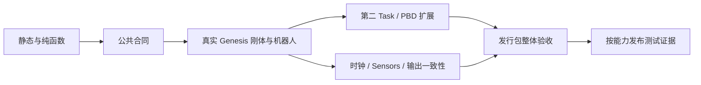

# 重构后模拟器的测试与交付计划

> 后续状态：核心测试已编写，用户要求等明确指示再运行；当前没有测试通过结果。实际文件和功能见[逐测试脚本说明](simulator_test_scripts_zh.md)，支持范围见[核心重构记录](simulator_core_consolidation_20260923_zh.md)。下文是原验收设计，安装/API/agent 实验本阶段延期，原测试文件和硬件记录不代表当前运行结果。

日期：2026-09-23。状态：**测试设计，尚未实施/通过**。本轮没有运行物理仿真或修改测试代码。

配套：[Genesis 单后端模拟器整理与功能收敛计划](simulator_consolidation_plan_zh.md)。以下测试编号同时作为该计划 P0–P6 的验收索引。

## 1. 什么才能证明它已经是一个整体模拟器

最终应由一条真实、可重复的链路证明：

```text
安装发行包
  → 从仓库外按 task_id 创建
  → reset(seed) 得到合法初态
  → 公共 Env 接收机器人动作
  → Genesis 产生实际动力学变化
  → 返回对齐的观测、奖励和结束原因
  → 换一个 Task 仍用同一路径
  → 按需录制/写数据且不改变物理
  → reset 再运行，close 释放资源
```

不能用以下结果替代它：AST 能解析、目录符合树形图、mock Env 通过、旧视频能播放、静态软体能渲染、某个旧任务脚本单独能跑。

验收分为三类，报告中分别列出：

1. **核心必过：** 安装、架构边界、Env 合同、真实刚体、机器人、时钟、多任务替换。
2. **声明能力必过：** PBD/FEM、RGB、视频、数据、agent、抓持辅助等；注册为 supported 的能力不能只 skip。
3. **任务/策略附加证明：** 短程物理运行证明任务可运行；完整成功轨迹证明某个实例的某个策略成功。两者不能相互替代。

## 2. 当前测试条件与旧测试如何处理

### 2.1 本次只读核对结果

- 现有 `tests/` 主要是 `check_*.py` 等脚本，包含旧目录导入；例如 `check_project_layout.py` 仍导入 `topogym.tasks.catalog`。
- `check_aloha_shared.py` 直接依赖 MuJoCo，还把控制器内部 `scene.step` 作为预期行为。迁移时必须修改此类旧断言，不能只修 import。
- 当前根目录缺少正式 Python packaging 声明；因此“仓库内能执行”尚不能证明发行安装可用。
- 本地 `.venv-gs121-nyx` 元数据为 Python 3.11.15、Genesis 1.2.1、Torch 2.12.0+cu126；**本次环境的 `nvidia-smi` 无法与驱动通信**。这只说明当前未获得 GPU 测试条件，不断言其他机器没有 GPU。
- Genesis 自身依赖 MuJoCo。因此检查项目不再调用 MuJoCo时，应扫描项目活动源码/入口及实际调用来源，不能简单断言整个进程从未加载该第三方库。

### 2.2 旧测试逐项归类

| 类别 | 处理方式 | 例子 |
|---|---|---|
| 有价值的数学/时间/格式不变量 | 迁入对应层，保留意图并更新输入合同 | 网格有效性、相机标定、录制时间轴、文件完整性 |
| 针对将合并公共行为的检查 | 改成参数化公共合同测试 | reset、非法动作、抓持释放、Task 判据 |
| 固化错误架构或旧命名的断言 | 随行为迁移重写 | Robot 自行 step、旧 adapter 工厂路径、旧 gripper 单位 |
| 第二后端专属、旧展示和废弃入口 | 随功能退役退出默认测试及活动源码 | MuJoCo renderer、旧视频目录排列、历史 run 源码加载 |
| 依赖硬件或完整长程策略 | 单独分层，记录运行条件与证据 | FEM/IPC、复杂结型、整段任务成功 |

不要通过“全部旧检查必须仍通过”迫使新模块继续维持重复入口，也不要把旧检查批量标 skip 当作测试迁移完成。

## 3. 目录、执行层次与证据

目标测试目录如下，不为每个旧文件机械新增一个测试：

```text
tests/
├── architecture/       依赖方向、注册、命名、退役代码隔离
├── unit/               配置、纯数值、种子、序列化 schema
├── contracts/          Env / Robot / Task / Sensor 合同
├── integration/        真实 Genesis 刚体、机器人、软体
├── recording_data/     真实帧、MP4 解码和数据读回
├── tasks/              各任务判据与必要完整执行
├── agents/             客户端、进程和统一 Env 接入
├── packaging/          wheel、资源、仓库外运行
└── fixtures/           小型固定资源，不依赖历史 runs
```



共同要求：

- 使用实际引擎的测试记录 Genesis/驱动/设备/精度/求解参数、配置、seed、资产和代码版本。
- 物理结论必须来自实际状态和接触/粒子等数据；视频只作为辅助证据。
- 每个失败报告实际命令、前后状态、步数和原因；不只输出一个 passed/failed。
- 不要求不同 GPU/CPU 逐位一致；配置相同、平台相同的重放用预先固定的数值容差判断。
- 性能单独记录首次编译/构建与预热后运行；不能把 JIT 编译时间混进每步延迟。
- 所有测试资源来自夹具或显式安装的资产清单，不能依赖某人的旧工作目录。

## 4. 测试用例与可判定的通过条件

### 4.1 A：架构、命名和依赖

| ID | 要证明的行为 | 主要断言 |
|---|---|---|
| A01 | 活动依赖方向成立 | 公共模块不导入具体任务实现；Task 不导入 recording/agents；recording/data 不反向导入 agents；核心不引用 redundants/legacy/runs 源码；覆盖动态工厂字符串 |
| A02 | 项目直接 MuJoCo 路径退出 | 活动源码、CLI、配置工厂、测试无项目维护的 MuJoCo import/调用；wheel 不含退役后端；纯模型格式与第三方传递依赖单列，不误报为本项目第二引擎 |
| A03 | 只有一个可用任务身份来源 | task_id、工厂、配置、结果身份一致；catalog 派生自同一注册描述；pending/retired 明确拒绝创建并解释原因 |
| A04 | 公开名称有唯一含义 | ActionSpec、输出 schema 和配置字段无互相矛盾的单位/状态定义；旧动作别名不得静默接受；`backend` 等模糊公共字段完成迁移 |
| A05 | 安装资源和构建入口闭合 | available 工厂实际可加载；配置资源可解析；不依赖旧 task 子包、仓库 parents[n] 或 runpy 执行产物源码 |

静态 import 检查之外，要执行已注册工厂的实际装配测试。不要仅搜索名称出现次数就宣布架构统一；比如引擎内部的 `step`、普通 Python Adapter 单词或文档里的 MuJoCo 不是违规本身。

### 4.2 C：Env 合同和生命周期

| ID | 用例 | 主要断言 |
|---|---|---|
| C01 | 正确/错误 task_id 与配置 | 同一 make_env 入口；未知任务、未知字段和不支持能力在明确阶段失败；配置解析不初始化物理设备 |
| C02 | reset / step 的公开结果 | reset 返回 `(obs, info)`；step 返回五项；动作/观测属于声明空间；reward 有限；返回值不是不同任务各自的任意结构 |
| C03 | 非法动作与原子性 | NaN、Inf、越限、错维度、缺字段、错误/过期 schema 或单位标签拒绝；目标、物理步、Task 状态均不改变；双臂后一臂错误不能让前一臂已生效 |
| C04 | 连续 reset 与 seed | 同 seed 重建同实例；新 seed 改变声明的随机量；不泄漏前回合抓持、控制目标、稳定计数、图像缓存和终止结果；reset settle 元数据可核对 |
| C05 | 成功/失败/截断 | 成功与任务失败都可 terminated，但 task_success 不同；时限为 truncated；明确“到达目标与时限同 tick”的优先规则并固定测试；已结束后拒绝继续 step |
| C06 | close、异常和部分构建 | 重复 close 安全；make/reset 中途失败释放已有资源；物理/必要输出异常进入 faulted，后续 step 被拒绝，reset/close 可清理；不因关闭一个对象销毁无关 scene |

同 tick 按安全/任务失败、成功、时限的顺序确定原因；时限仅在尚无任务终态时截断。固定单位的裸数值无法自动识别所有使用者误用，例如误把度数当弧度而数值仍在限位内；单位正确性应通过 ActionSpec 与已知输入到实际关节/开口的转换测试证明，不承诺猜测调用者意图。

公共 API 实现完成后运行官方 `gymnasium.utils.env_checker.check_env`，验证空间、reset/step/render 等协议；它不能证明接触物理、时钟或任务成功。种子相关检查不得因观测混入随机运行 ID 而失真。[Gymnasium 环境检查](https://gymnasium.farama.org/api/utils/#environment-checking)

### 4.3 G：真正的 Genesis 刚体

| ID | 用例 | 主要断言 |
|---|---|---|
| G01 | 方块自由落体 | 接触前的位置/速度符合重力方向和时间；误差随离散步长满足预定容差；不能只检查位置“发生变化” |
| G02 | 方块落桌并承载 | 桌面接触真实发生；不会穿透落走；稳定后姿态/速度有限；接触深度与残余速度低于夹具门槛 |
| G03 | 无外围完整生命周期 | 不启用相机/agent/视频/HDF5，真实创建、动作推进、连续 reset/close 通过；没有遗留进程、打开文件或逐回合累积订阅 |
| G04 | 固定种子和动作重放 | 同配置、同设备重复执行，实例参数一致，物理状态序列在容差内一致；报告非确定性范围，不能只比较最终 success |

CPU 刚体作为优先基础通道；先确认锁定 Genesis 版本和所选模型实际支持。若只能在 GPU 运行，应在支持矩阵中如实说明，不能以 CPU mock 取代真实物理门槛。

### 4.4 R：机器人、求解和抓持

| ID | 用例 | 主要断言 |
|---|---|---|
| R01 | ALOHA home 与小幅关节动作 | 初态来自配置 home；提交目标本身不推进物理；Env.step 后实际关节逐步跟踪目标，误差达到既定门槛；不能 set_qpos 瞬移代替运行控制 |
| R02 | FK/IK 与不可达目标 | FK 对照 Genesis 链接位姿；若公开 IK，则可达目标的执行后误差合格，不可达明确失败；求解前后世界状态和时钟不变 |
| R03 | 双臂与夹爪单位 | 左右命令隔离；公开开口宽度与实测机构关系正确；目标与测量分开；越限拒绝或明确的投影规则不能静默混用 |
| R04 | 抓持与辅助模式 | 普通接触不自动创建焊接/附件；声明的 assist 必须显式启用；建立、释放、reset 清除逐项检查；普通摩擦抓持与辅助抓持的结果分开标记 |

首版不提供 IK、Panda 或某种 assist 时，不为凑测试量实现它们；对应能力标 unsupported。旧 MuJoCo FK/IK 测试退出后，保留能力必须有新的 Genesis/纯算法数值证据，不能留空白。

### 4.5 T：时钟、观察副作用和入口一致

| ID | 用例 | 主要断言 |
|---|---|---|
| T01 | 正常步和提前终止 | 无提前终止时 N 次动作对应 N×decimation 个物理步；中途达到终态立即停止剩余推进，记录实际步数和持续时间；solver_substeps 不重复乘入时间 |
| T02 | 重复只读调用 | 连续 observe/render/evaluate/export/validate 不改变物理状态、时钟、控制目标和稳定判据；同 tick 多查一次不能更快成功 |
| T03 | 唯一推进和 hook 顺序 | 运行时统计真实 scene.step 次数，与 World 时钟一致；Robot/recording/data/probe 不安装 step 包装；必要数值 hook 顺序固定且每步只执行一次 |
| T04 | 相同动作从不同上层入口运行 | P3/P4 比较直接 Python 循环与公共 EpisodeRunner；P6 接入后再增加 agent 客户端变体；固定动作序列经同一 Env 产生一致步数、状态和结果，不比较自适应策略随机输出 |

时钟例子：`physics_dt_s=0.001`、`control_decimation=10`、`solver_substeps=4`，连续 100 个完整动作应为 **1000 个外部物理步、1.0 秒**；不是 4000 个外部步或 4 秒。若最后一步只执行 3 个物理步，则总数与时间按实际累计修正。

reset 的准备推进单列 `reset_physics_steps`；返回初始观测之后 episode 计数从零开始。不能用视频补帧或机器人内部 settle 隐藏额外动作。

### 4.6 K：任务语义与可替换性

| ID | 用例 | 主要断言 |
|---|---|---|
| K01 | Cast Coil / Keyhole 切换 | 两者通过同一工厂、Env 类和生命周期运行；只替换任务定义/配置/资源；无需新 adapter、专属 recorder 或 Env 内 task_id 分支 |
| K02 | 成功、失败、未完成正反例 | 纯判据用可解释状态夹具验证边界；真实物理验证状态读入/稳定时间；视频完整或数据质量不能改写 task_success |
| K03 | 能力表和实例真实性 | 每个 available 任务通过其能力组合；实例 seed、资源、生成版本可复现；短程运行/几何可行/完整任务成功分别记录 |

纯状态夹具可以测试成功谓词，但不能拿手工摆成成功态的 reset 宣称机器人已完成任务。若发布成功 demo 或成功策略，需要从声明起点连续真实执行的独立证据。

### 4.7 S：软体扩展

| ID | 用例 | 主要断言 |
|---|---|---|
| S01 | ALOHA 配置下的简单 Blanket PBD | 程序化初态可重建；粒子位置/速度有限；重力下真实变形并与桌面接触；无未声明的逐帧位置重写 |
| S02 | 机器人与软体交互 | 声明的接触/抓持作用真实生效；释放后不继续跟随；reset 清掉约束；相同 Env 与动作协议，不新增软体专属运行循环 |
| S03 | 软体状态与数值支持 | 粒子观测和时钟对齐；摩擦/内存等必要 hook 有明确版本、调用顺序和作用范围；重复 reset 不泄漏 hook 或历史内存 |

若后续保留 FEM/IPC，再增加对应真实接触、约束建立/释放、求解收敛和恢复测试。PBD 通过不意味着 FEM 通过，软体渲染成功不意味着物理有效。当前缺 GPU 条件时报告“未执行/未验收”，该能力不能升为 supported。

### 4.8 O：Sensors 与共享状态

| ID | 用例 | 主要断言 |
|---|---|---|
| O01 | 图像与标定 | RGB shape/dtype、分辨率、内参、`T_world_from_camera_cv` 正确；已知点投影和机器人安装相机位置一致；未实现的 depth 不写入 supported |
| O02 | 一次采样、多消费者 | 相同 source_state_id 下 agent/video/data 获得相同原始图像哈希、标定和时间；比较编码前原始帧，不比较有损 MP4 像素 |
| O03 | 缓存与状态写入 | 后续物理步不会覆盖已保存快照；reset 区分 episode；同一 tick 恢复两个不同 RenderState 时，不推进时钟但更新图像/本体观测，不能返回旧缓存 |

只读调用允许更新缓存，不允许改变物理或任务状态。渲染配置或恢复写入也可能改变可见内容，因此缓存键不只依赖物理步号。

### 4.9 D：原始动作与数据

| ID | 用例 | 主要断言 |
|---|---|---|
| D01 | 原始 transition 读回 | T 个动作有 T 条 transition，以及可还原的 T+1 个观测边界；每项包含真实命令、前后观测、reward、结束信号、步数和实际持续时间 |
| D02 | 目标未达到/夹爪被阻挡 | action 保留原始提交目标；next observation 是实际测量值；二者可以不同；不能从下一帧 EEF 位姿反推 action |
| D03 | 缺帧、断写和跨回合 | 非单调时间、重复/缺失 transition、错误 episode join 能识别；中断产物 incomplete；reset 不拼接两个 episode 为一条轨迹 |
| D04 | schema 与派生标签 | 关节/单位/坐标系/版本可读；旧训练标签明确为派生字段或 exporter 输出；旧 gripper/action schema 不静默混读 |

终态观测不能靠复制前一帧补齐；结束之后也不能伪造一条空 action。HDF5 是一种可选存储格式，不是 Env 运行协议。

### 4.10 V：录制、输出非侵入和恢复边界

| ID | 用例 | 主要断言 |
|---|---|---|
| V01 | MP4 与时间轴 | 真实 Genesis 短片完整解码；各相机同步；帧来源时间单调；帧数/时长符合采样边界约定；尾帧、重复帧有明确来源 |
| V02 | 输出开关对照 | 同 seed/动作，分别无输出、仅视频、仅 HDF5、两者同时；物理步数和任务结果一致，物理轨迹在预定容差内一致 |
| V03 | 资源关闭与发布 | 编码/写入失败不伪装 Task 失败或成功；句柄释放、产物 incomplete；只有完整性校验通过后才发布正式产物 |
| V04 | 重渲染与物理恢复 | RenderState 重建画面时积分次数为零；以它申请 physics resume 明确拒绝；将来真正 checkpoint 必须通过恢复后相同动作的轨迹对照 |

建议采样规则固定为目标时间 `j/fps ∈ [0, T)`，正时长 T 对应 `ceil(T×fps)` 帧，编码时长与物理记录范围最多相差一个视频帧间隔。若沿用另一规则，必须在合同中写清首尾是否包含，并据此测试，不能默认“MP4 时长恰好等于物理时长”。

V02 比较普通、正确输出情况下的物理轨迹；输出故障中止执行按 V03 验证，不把异常中断误判为正常对照不一致。

### 4.11 AG / PK：上层接入和可安装交付

| ID | 用例 | 主要断言 |
|---|---|---|
| AG01 | agent 可拔除且可接入 | 不安装/启动 agent SDK 和服务也能运行本地 Env；接入时 client 的动作、reset、结束结果与本地 API 一致；预算和网络重试不重复提交物理动作 |
| PK00 | 初步安装和资源闭包 | P1 构建非 editable wheel，在仓库外 import 公共包、读取注册描述和解析资源；不依赖 PYTHONPATH；此时不宣称生命周期可运行 |
| PK01 | wheel 仓库外运行 | 非 editable 安装；从临时目录 import/make/reset/step/close；无需 PYTHONPATH；配置、资产、生成器和默认机器人可定位 |
| PK02 | 最小依赖及可选功能 | 未启用 RGB/video/HDF5/agent 时，不初始化其组件；缺对应可选依赖只影响该功能，报告明确；第三方传递依赖按实际安装清单记录 |
| PK03 | CLI / Python API / 资源清单 | CLI 调用同一构建入口；同配置同动作可核对；大型外部资产通过显式路径/版本清单安装并校验；不隐式读取仓库 runs 或用户路径 |

若首版只支持一个活动 Env，能力声明和错误必须明确；不能因为没有多环境支持而省略 close/reset 的资源清理。进程重复尝试不得造成一个 action 被远程服务执行两次。

## 5. 物理容差和测试规模怎么确定

统一算法接口不意味着所有机器人/材料使用一个误差阈值。P0/P1 建立夹具规格，首次真实基线测量用于检查规格可行性，之后固定门槛；不能看到失败后随意放宽。

| 指标 | 设定依据与证据 |
|---|---|
| 自由落体误差 | 重力解析解、dt、积分方法及接触前窗口；记录最大/均方误差 |
| 接触和静稳 | 夹具尺寸、接触容差、允许穿透和末段速度；不照抄任务里散落的 1 mm |
| 关节/末端跟踪 | 机器人规格、目标幅度、控制增益和允许响应时间；测量实际达到误差 |
| FK/IK | 同一坐标系和关节模型；平移误差与旋转角误差分列；不能用矩阵逐元素差代替角度含义 |
| 轨迹一致性 | 同平台同配置的初态及逐步状态；给绝对/相对容差，另记录跨设备差异 |
| 布料稳定性 | 粒子有限性、伸长/面积/接触等可解释指标；具体限值由材料与网格确定 |
| 时间一致 | 步数为精确整数；时间用步数×dt 计算并用浮点容差比对；视频容差按采样周期 |
| 资源和性能 | 首轮编译/缓存单列；预热后连续多次 reset/close 不出现持续增长；记录内存平台值和允许波动 |

建议首轮 smoke 用小分辨率、短动作序列和少量 seed；完整任务策略、复杂材质和长程稳定测试放慢速通道。减少测试时间应靠缩小夹具，不能靠静态预览或 mock 取代物理。

## 6. CI 与实际执行流程

### 6.1 运行条件分层

| 通道 | 运行内容 | 缺条件时怎么报告 |
|---|---|---|
| 普通开发/PR | A、纯数值、schema、无场景合同与资源解析 | 不应依赖 GPU；这些失败阻止合并对应改动 |
| 真实刚体通道 | C/G/R/T/K，锁定 CPU 或已声明的设备 | 无引擎/资产就是该通道未通过，不能给核心整体绿色 |
| 图像/输出通道 | O/D/V，真实 RGB、编码器、HDF5 | 缺依赖时该能力未验收；不能把 no-render 结果算进去 |
| GPU 软体通道 | S；后续按声明加入 FEM/IPC | 缺驱动或 uipc 显示 blocked/not-run；不得算 supported |
| 发行通道 | PK + 核心真实物理 + 对外能力矩阵 | 有声明能力未测则不发布该能力；生成安装和证据清单 |

尚未配置 CI 时可以先用相同命令在明确设备上运行并留报告；最终应固化为 CI 作业或受控的硬件测试通道。重仿真任务不与其他作业争用同一 GPU，以免误判内存/时序问题。

### 6.2 未来命令示意

以下命令要等测试迁移、pytest markers 和 packaging 声明完成后才能执行，**不是对当前仓库可用命令的承诺**：

```bash
python -m pytest tests/architecture tests/unit
python -m pytest -m "genesis and rigid and not render"
python -m pytest -m "genesis and pbd"
python -m pytest tests/recording_data -m genesis
python -m build
```

发行测试由独立脚本/CI 创建干净环境，安装刚构建的 wheel 与锁定依赖，再切到仓库外临时目录运行公共 API smoke。不能用 editable 安装、预先配置的源码 PYTHONPATH 或工作区的根 assets 掩盖打包遗漏。

每次执行先打印 preflight：Python/Genesis/设备/驱动、可选组件、资源版本及要运行的能力。测试报告至少分为 `passed / failed / not_run / blocked`；测试框架的 skip 必须映射为明确的未验证原因。

## 7. 每阶段验收与最终报告

| 重构阶段 | 最低证据 |
|---|---|
| P0 合同 | 测试清单与容差制定方式；旧检查的保留/改写/退役分类 |
| P1 安装与撤销后端 | A01–A05、PK00；wheel 导入与资源 smoke；项目活动代码直接 MuJoCo 路径为零 |
| P2 第一个 Task | C/G、R01、T01–T03；真实 Cast Coil + ALOHA 无外围 episode |
| P3 第二 Task | K01–K03；必要的 R02–R04；相同 Env 和公共 runner 证据 |
| P4 PBD | S01–S03；同一 Env、连续 reset 与准确能力声明 |
| P5 输出 | O/D/V；命令与前后观测读回；四种输出开关的物理对照 |
| P6 完成活动项目 | 所有 available 项参数化合同通过；AG01（若保留）；PK01–PK03；无旧活动入口 |

未来正式报告应包含以下表格，每行附本次实际测试产物路径，不能先填“通过”：

| 能力 | task/robot/device/profile | 结果 | 关键指标 | 证据 |
|---|---|---|---|---|
| 安装与核心 Env | 待执行 | 未执行 | 待测 | 待生成 |
| 刚体与 ALOHA | 待执行 | 未执行 | 待测 | 待生成 |
| 多 Task 共用 Env | 待执行 | 未执行 | 待测 | 待生成 |
| PBD | 待执行 | 未执行 | 待测 | 待生成 |
| Sensors / 视频 / 数据 | 待执行 | 未执行 | 待测 | 待生成 |
| 其他声明能力 | 按最终保留范围 | 未执行/不支持 | 按合同 | 待生成 |

交付至少保存：构建 wheel 哈希、代码/配置/资源版本、依赖清单、测试用例结果、真实命令与状态轨迹摘要、时钟对账、数据读回和媒体完整性结果。完整成功 demo 可以补充任务能力证据，但不替代这些基础验收。

**最终结论的边界必须明确：哪些核心行为通过、哪些能力通过、哪些任务只完成短程接入、哪些策略已成功、哪些能力尚未验证。** 只有相应条件真实通过，才能把“按标准模块摆好了目录”升级为“整理后的项目可以作为整体模拟器运行”。
