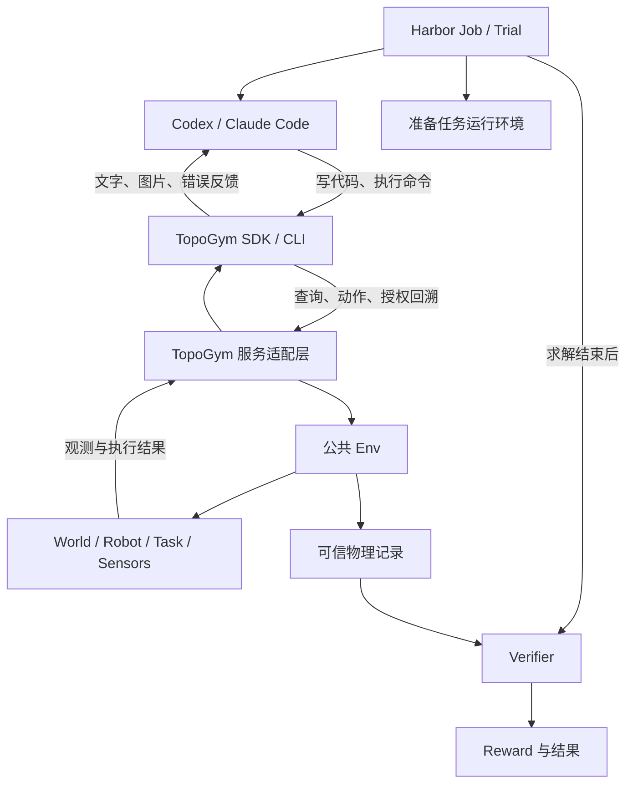

# Harbor 与 TopoGym coding agent pipeline 学习指南

> 2026-09-24 接口更新：本文的 agent/网络方案尚未启用；其中旧 `reset(state_id=...)`、操作方 reset、旧未来可访问等约定已失效。当前管理方可 `reset(seed=...)`；普通/特权操作方均无 reset，特权仅在当前 episode 内 `rewind_to` 并作废旧未来。实现集中于 `topogym/simulator/`，以[当前本地接口](simulator_api_zh.md)和[实施报告](../dev-logs/simulator_public_api_implementation_20260924_zh.md)为准。

> 2026-09-25 目录设计：Docker镜像、runner脚本与现有模块的具体对应见[Docker交付与Harbor runner目录设计](harbor_docker_delivery_and_runner_layout_zh.md)。该方案运行时生成标准Harbor任务包，源码中不维护第二套Task/Env；尚未实现。

> 最新开发依据：[共享镜像与 Harbor pipeline 开发计划](harbor_shared_image_pipeline_plan_20260925_zh.md)。采用共享 TopoGym 镜像、自动生成 `harbor_tasks/` 和共用 segment 服务；脚本清单、使用方法、目录变化与验收步骤以该计划为准。

日期：2026-09-23。用途：理解概念、模块分工和后续接入方法。

本文中的 Harbor 指 [harbor-framework/harbor](https://github.com/harbor-framework/harbor)，即用于运行和评测 agent 的框架。

**阅读约定：**“Harbor 提供”描述官方文档中的能力；“建议”描述适合 TopoGym 的方案；“当前”描述本次查看的仓库状态。本文没有实现 Harbor 集成、启动模型或验证物理运行。示意接口不能直接当作现有 SDK 使用。

## 1. 这里的 coding agent pipeline 指什么

你提出的需求是：搭好的接口能与 simulator 交互，并接到 Codex 或 Claude Code，配置 API key 和 model name 后启动求解。

这里的 pipeline 包含一次求解从准备到结束的完整过程：

```text
准备任务和环境
    → 启动 coding agent
    → agent 读说明、写代码、调用 simulator、查看反馈、继续修改
    → 独立验收
    → 保存结果、对话、工具调用及仿真记录
```

“对接层”是其中连接 coding agent 与 simulator 的部分。只有 API 可调用，还不代表任务配置、agent 启动、超时、验收和结果管理已经完成。

截图里的 “strictly follow Harbor” 可以理解为要求这套完整流程遵循 Harbor 的组织方式。**这是对需求的解释；截图本身没有明确说必须使用 Harbor runner。** 建议后续直接以 Harbor runner 和标准任务包为基础，把特殊处理集中在 TopoGym 适配部分，这样更容易证明遵循了约定。

Harbor 的核心概念包括 Task、Agent、Sandbox、Verifier、Trial、Job 和 Trajectory。[官方概念说明](https://docs.harborframework.com/core-concepts)

## 2. 先区分模型、coding agent 和 Harbor

| 层次 | 负责什么 | 本项目中的例子 |
|---|---|---|
| 模型 | 接收上下文，生成文本或工具调用请求 | 通过 API 使用的、所选 agent 支持的模型 |
| Coding agent | 组织模型调用，提供文件编辑、命令执行等工具，并持续处理反馈 | Codex、Claude Code |
| Harbor | 准备任务运行环境、调用 agent 集成、组织多次运行和验收 | 一组 TopoGym 任务的评测作业 |
| TopoGym 接口 | 把 agent 的请求转换为允许的仿真操作，返回观测和执行结果 | 后续 SDK、CLI 或工具服务 |
| Simulator | 维护世界、机器人、物理时钟、任务状态和传感器 | TopoGym Env 与 Genesis |

API key 决定模型服务的认证，model name 决定调用的模型；`agent` 决定使用哪套工具和求解程序。实验应分别记录 agent 名称/版本和模型标识。

Harbor 已有 `codex` 和 `claude-code` 集成，使用 `-a` 选择 agent、`-m` 选择 model。模型标识和其他参数必须符合所选集成与服务的要求，不能据此假设任意 agent 与任意模型可以自由组合。[预集成 agents](https://docs.harborframework.com/core-concepts/agents/pre-integrated-agents)

如果直接调用模型 API，再自行编写“读反馈—生成代码—执行—重试”的循环，就需要自己维护一套 agent。对于当前希望使用 Codex/Claude Code 的目标，建议先复用 Harbor 已有集成。

## 3. Harbor 概念如何映射到 TopoGym

| Harbor 概念 | 官方含义的简述 | TopoGym 建议映射 |
|---|---|---|
| Task | 任务说明、运行环境和 verifier 的组合 | 一个明确的机器人任务实例及其交互规则 |
| Dataset | 一组 Task | 按指定版本冻结的评测实例集合 |
| Agent | 执行任务的程序 | Codex 或 Claude Code |
| Sandbox | 执行代码的隔离环境 | 能运行 agent、客户端及所需依赖的容器/运行环境 |
| Verifier | 检查完成情况并产生 reward | 读取可信物理证据，按任务判据验收 |
| Trial | 一个 agent 对一个任务的一次尝试 | 一次独立求解会话 |
| Job | 一组 Trial | 多任务、多模型、多个重复尝试的评测作业 |
| Trajectory | 求解时的对话和动作历史 | agent 消息和工具调用；另关联仿真数据 |

以上官方定义见 [Core concepts](https://docs.harborframework.com/core-concepts)；右列属于本项目设计建议。

例如，假设准备 10 个冻结实例，用 2 种 agent/model 配置各独立运行 3 次，则计划产生 `10 × 2 × 3 = 60` 个 Trial。一次 Trial 内的物理回溯不自动增加这个数量；基础设施失败后重跑也应另记原因，避免混入独立实验重复。

注意两个同名概念：

- **Harbor Task 与 TopoGym TaskDefinition：**前者是完整评测任务包；后者描述仿真实体、初态和判据。同一个 TaskDefinition 可以生成多个 Harbor 评测实例。
- **Harbor Sandbox/Environment 与 TopoGym Env：**前者运行程序；后者管理机器人仿真。通常不需要为了接入 Harbor，让 TopoGym Env 继承 Harbor 的 `BaseEnvironment`。

## 4. 建议的模块关系



这里的“服务适配层”是建议方案，尚未接入当前核心。采用独立服务的一个原因是保持仿真状态：agent 可以先执行 `inspect.py`，再执行 `try_grasp.py`，最后执行 `adjust.py`，这些程序都操作同一个持续存在的 Env。

如果每个脚本都重新创建 Env，agent 很容易每次面对不同的世界，交互就断开了。建议由 Trial 管理一个物理 worker，脚本只作为客户端。

| 部分 | 建议沿用的职责 | TopoGym 需要补的部分 |
|---|---|---|
| Harbor | Job/Trial、任务包装、agent 集成、验收调用、结果组织 | 配置与版本固定 |
| Coding agent | 模型工具循环、代码编辑与执行 | 提供任务目标、接口文档和反馈材料 |
| 适配层 | 项目自有 | 会话身份、请求校验、权限、序列化、图像发布 |
| Env | 现有公共入口 | 按实际能力开放接口，不建立第二套物理推进路径 |
| 物理验收 | 复用任务判据和可信记录 | 映射到 Harbor verifier 的输出约定 |

Harbor 支持 installed agent 和 external agent：前者在任务环境中运行 CLI，后者的 agent 循环在 Harbor 一侧运行，通过环境接口操作任务。只有确实需要新增 agent 时才考虑自定义类；增加一个 TopoGym SDK 并不必然需要新增 agent 类。[Custom agents](https://docs.harborframework.com/core-concepts/agents/custom-agents)

## 5. 一次求解具体怎样发生

以下用 Blanket Flatten 作教学场景，不表示该任务的完整求解或验收已通过。

1. **实验准备：**确定布料实例、机器人、初始状态、观测模式和回溯规则，记录配置及资产版本。
2. **Harbor 建立 Trial：**准备 agent 工作区与依赖；TopoGym 的启动配置创建物理 worker，等待服务就绪。
3. **Agent 读任务说明：**知道目标、动作格式、相机信息、可调用接口和限制。
4. **Agent 观察：**运行客户端查询，取得图片和该模式允许的状态。
5. **Agent 写代码并执行：**例如编写一个小幅接近动作，把命令通过 SDK 交给 worker。
6. **Simulator 推进：**Env 校验动作、推进物理、更新任务状态，返回观测和执行信息。
7. **Agent 根据反馈继续：**检查图像、处理错误、修改参数，必要时按规则回溯，然后再执行。
8. **求解结束：**agent 主动结束、达到限制或出现故障；先保存完整证据，再释放所需资源。
9. **Verifier 验收：**按可信物理结果判断，写出 reward；Harbor 收集结果和日志。

一个示意交互片段可能是：

```text
Agent：运行 observe_scene.py
客户端：返回三路图片及当前 state_id
Agent：查看图片，写 approach.py，运行
客户端：返回动作执行结果及新的图片
Agent：发现抓取位置偏移，修改 approach.py，继续执行
Agent：请求结束
Verifier：检查物理证据，给出成功、未完成或验收异常
```

反馈循环由 agent 自主运行。Harbor 不必替 agent 决定每次机械臂动作。

图片必须通过所选 agent 实际支持的读图机制进入模型输入。仅返回 PNG 路径、打印文件名，不能证明模型看到了像素；接入测试应核查这条链路。

## 6. Simulator 接口应该提供哪些能力

下表区分当前本地 Python Env 的入口与后续公开接口建议。当前源码可见并不等于所有任务和后端均已运行验证。

| 能力 | 当前核心可见入口 | 后续 agent 接口应明确的合同 |
|---|---|---|
| 初始化 | `Env.reset(seed=...)` | 由任务配置确定实例；是否允许 agent 新建 episode |
| 执行动作 | `Env.step(action)`、`action_spec` | 单位、维度、合法范围、实际执行量和终止原因 |
| 观测 | `Env.observe()` | 按实验模式过滤后的字段 |
| 图像 | `Env.render()`，需启用 RGB | 相机、图像传输、对应状态身份 |
| 回溯 | `Env.reset(state_id=...)` | 可恢复范围、权限、额度与分支记录 |
| 状态目录 | `Env.state_history` | 哪些历史元信息可对 agent 公开 |
| 结束 | `Env.close()` | worker 由生命周期管理方关闭；agent 可请求结束 |

依据：[当前 Env 源码](../../../topogym/simulator/env.py)。`describe`、`get_pose`、远程 `finish` 等名称若出现在旧文档或方案中，不能据此认为当前新 Env 已有同名远程 API。

建议接口还携带 `trial_id / episode_id / branch_id / state_id / request_id`，用于关联记录和防止旧请求作用于新状态。这些字段组合是适配层设计建议。

对有副作用的动作，应明确超时后如何查询执行状态、重复请求如何去重。客户端收到超时不代表机械臂没有运动，不能无条件重发动作。

机器人单位、坐标和动作校验继续来自公共模块；适配层不直接调用另一条 Genesis 积分路径。录像也继续使用[共享 recording 模块](recording_module_usage_zh.md)。

## 7. Trial、episode、回溯分支分别是什么

这是接入时最容易影响实验含义的地方。

| 操作 | 建议是否新建 Trial | 当前 Env 的含义或建议计量方式 |
|---|---|---|
| Agent 再写一个 Python 文件执行 | 否 | 继续同一求解会话，worker 状态保持 |
| `reset(state_id=...)` | 否 | 当前 episode 内恢复保存状态并建立新分支，保留旧分支历史 |
| `reset(seed=...)` | 默认否，须由实验规则授权 | 当前 Env 新建 episode 并释放旧 episode 的内存历史 |
| 同一实例独立重复一次实验 | 是 | 新 agent 会话与独立预算 |
| 切换 agent/model 做对照 | 是 | 作为独立配置运行并记录 |

前两种 reset 的核心语义见 [Env](../../../topogym/simulator/env.py)；它们如何映射 Trial 是本项目建议。

新建 episode 前，需要把旧 episode 必须保留的记录写入持久存储。当前 episode 内可回溯所有已保存状态，不代表可以跨已经释放的 episode 调用 state_id。

建议 Trial 的 token、墙钟、累计物理执行量和回溯次数持续累加。物理时钟回到过去，不应退还已经花掉的预算；最终分支只有 100 tick，也不代表整个搜索过程只执行了 100 tick。

固定实例也不能仅靠“再给一次相同 seed”来保证。应保留解析配置、资产/源码身份，并核查重建状态。回溯保存状态与重新构建初态是两种不同操作。

## 8. Harbor 任务包长什么样

Harbor 采用任务目录约定。下面是结合 TopoGym 的建议目录，其中 `client/` 和 `instance.json` 是我们添加的支持文件，不是 Harbor 的固定字段。[任务格式](https://docs.harborframework.com/core-concepts/tasks/overview)

```text
topogym-example-task/
├── instruction.md              # 目标、接口用法、观测和回溯规则
├── task.toml                   # Harbor 任务与运行配置
├── environment/
│   ├── Dockerfile              # 或所选运行后端支持的环境定义
│   ├── client/                 # 拟提供给 agent 的客户端和文档
│   └── instance.json           # 拟冻结的实例信息，按权限分发
├── tests/
│   └── test.sh                 # Verifier 入口
└── solution/
    └── solve.sh                # 按需提供参考解，用于校准任务
```

目录树表达职责，不是可直接运行的任务模板；还需要服务启动、依赖、资源、访问边界和证据传递配置。

`instruction.md` 应回答：要完成什么、在哪里工作、如何查看图片、如何构造合法动作、如何处理错误、允许什么 reset、何时结束。任务公开文档应足以操作接口，但不泄漏参考解或私有判据信息。

`task.toml` 管理任务配置；官方支持 agent/verifier 超时及环境设置。具体字段按选定 Harbor 版本核对，避免照搬其他版本的配置。[配置说明](https://docs.harborframework.com/core-concepts/tasks/configuration)

参考解用于验证任务和验收链路是否合理，不应交给受测 agent。当任务还没有有效成功判据或参考验证时，可以开展接口 smoke，但不能宣称完成了正式评测。

## 9. “API key + model name 即可启动”如何实现

这是完成工程封装后的使用体验。维护者先准备好任务包、运行环境、TopoGym worker、客户端和 verifier；使用者再选择 agent/model 并提供认证。

Harbor 的命令形状如下。**仅为占位示例：本仓库当前没有本示例任务包；执行前需完成接入，并替换路径和模型标识。** API key 由运行环境提供，不写入任务文件。

```bash
# 运行环境已配置所需模型服务凭据。
harbor run -p /path/to/prepared-topogym-task \
  -a codex -m '<supported-model-id>'

# 同一任务包选择另一种 agent；模型标识须符合对应集成。
harbor run -p /path/to/prepared-topogym-task \
  -a claude-code -m '<supported-model-id>'
```

`-p / -a / -m` 的含义与本地任务运行方式见 [Run a job](https://docs.harborframework.com/core-concepts/jobs/run-a-job)；agent 参数与认证要求参见[对应集成](https://docs.harborframework.com/core-concepts/agents/pre-integrated-agents)。这些命令未在本轮执行。

第一次部署仍需验证 GPU、驱动、Genesis、渲染、网络连通与 agent 依赖。Harbor 能准备运行环境，不代表任意后端都已满足 TopoGym 的物理和渲染要求。

建议先用一个 Trial、一个 worker 和一个已具备所需能力的任务验证。当前 Env 限制每进程仅有一个活动环境，扩展 Harbor 并发时要按进程/容器隔离，并控制 GPU 显存占用。

## 10. 成功判据与日志怎样组织

Harbor 的 verifier 入口为 `tests/test.sh`，输出数值 reward 到 `/logs/verifier/reward.txt` 或 `/logs/verifier/reward.json`。这是 agent 执行之后的独立验收步骤；也支持单独的 verifier 环境。[Verifier 文档](https://docs.harborframework.com/core-concepts/tasks/verifier)

TopoGym 的建议做法是：在物理执行中维护任务判据和证据，结束后由 verifier 校核并映射 reward。不要直接把 agent 可修改的 `success.json` 当作权威结果，也不要无条件把最后一个 `step` 的数值 reward 当作最终成功标签。

应分别记录：

| 信息 | 用途 |
|---|---|
| 任务是否完成、判据是否完整 | 判断 reward 是否有意义 |
| 物理失败、预算耗尽、agent 主动结束 | 解释正常结束原因 |
| 服务故障、模型请求异常、verifier 异常 | 区分基础设施错误与任务未完成 |
| Agent 对话、工具调用和真实 usage | 分析求解策略和成本 |
| 物理动作、观测、状态/分支、视频 | 核查实际发生的运动 |

当前任务判据的完成标记与结果结构见 [TaskDefinition / TaskResult](../../../topogym/tasks/base.py)。判据未完成时必须保留该事实，不能用 agent 自述替代判定。

Harbor 的 ATIF 是 agent 交互轨迹格式，包含消息、工具调用、反馈及可选用量等指标。它不替代 Genesis 状态快照，也不能单独用来证明物理回溯正确。[ATIF 文档](https://docs.harborframework.com/core-concepts/agents/atif)

建议用 Trial、episode、branch、state 和 request 身份，把 ATIF 与物理记录关联起来。shell 一次运行脚本可能产生很多次 simulator 调用，因此两种日志的步数不一定一一对应。

记录 token usage 与强制执行 token 上限也不同。严格预算需要另外确认所选集成的请求控制与计量能力；不能因为日志里有 token 字段，就认为已经阻止超预算调用。未知用量应标为未知。

## 11. 哪些规则由 TopoGym 决定

以下是项目实验设计，不是 Harbor 自动给出的机器人规则：

- **观测权限：**RGB 条件是否允许机器人本体状态、数值 reward、接触信息；完整状态模式具体开放哪些字段。
- **回溯权限：**只能回初态，还是允许任意已保存状态；次数如何计量。
- **物理时间：**建议查询和模型思考期间不推进仿真，仅动作推进物理；这与墙钟超时分别计量。
- **任务冻结：**固定变体、配置和资产身份，不让 agent 在评测中更换更容易的实例。
- **资源与结束顺序：**先保存证据、完成需要存活服务参与的验收，再清理 worker；异常也要回收资源。

如果要比较严格 RGB 与完整 simulator 信息，权限必须由服务端和工作区访问边界执行。仅在 prompt 中写“不要看状态”，同时让 agent 读取全部模拟器对象或私有日志，不能构成有效对照。

这也是建议提供受控客户端的原因：agent 自主写代码，物理执行与可见信息仍遵守统一合同。

## 12. 当前仓库状态与后续接入顺序

截至本次阅读，当前核心提供统一 [Env](../../../topogym/simulator/env.py)，agent/API/rollout 旧实现保存在 [agents/deferred](../../../topogym/agents/README.md)，不作为当前活动接口。旧代码依赖已经退出的路径，不能直接视为新核心的可用客户端。

[旧 pipeline 文档](agent_rollout_pipeline_zh.md)记录的是此前实现，并明确尚未提供 Harbor task package、runner adapter 或 ATIF 导出。它可以帮助理解历史问题；当前接口语义以公共 Env 和[核心整理说明](../dev-logs/simulator_simplification_20260923_zh.md)为准。尤其不要把旧方案中“重建 worker”的 reset 与当前 `reset(state_id=...)` 混为一谈。

建议后续按以下顺序接入；这是学习用路线，不表示本轮开始实施：

| 阶段 | 交付内容 | 验收重点 |
|---|---|---|
| 1. 明确实验合同 | 任务实例、模式、动作、回溯、预算和判据定义 | 各 agent 运行同一规则 |
| 2. 验证 simulator 基础 | 公共 Env 的真实初始化、动作、观测与所需回溯 | 有物理证据，操作能力与任务成功分开 |
| 3. 提供客户端/worker | 持续状态、图像反馈、权限、错误与请求去重 | 多个脚本连续操作同一世界 |
| 4. 建立一个 Harbor 任务包 | 环境定义、说明、verifier 和启动配置 | 可由 Harbor runner 驱动完整生命周期 |
| 5. 接入一种 coding agent | 复用内置集成 | agent 确实看图、写代码、执行并利用反馈 |
| 6. 校核结果与日志 | reward、ATIF、物理数据、异常退出证据 | 可区分未完成、异常和判据缺失 |
| 7. 扩展对照实验 | 第二种 agent、固定实例集与独立重复 | 重现性、预算、公平性和资源管理 |

最小接入的完成标准是：一次真实 agent Trial 能通过统一接口持续交互，由独立 verifier 给出有效结果，并保存足够的 agent 与物理记录。结果可以是任务失败；接口连通与 agent 成功解题是不同验收项。

## 13. 阅读官方资料的顺序

1. [Core concepts](https://docs.harborframework.com/core-concepts)：先理解 Task、Trial、Job 的边界。
2. [任务格式](https://docs.harborframework.com/core-concepts/tasks/overview)：理解需要准备哪些文件。
3. [预集成 agents](https://docs.harborframework.com/core-concepts/agents/pre-integrated-agents)：了解可以直接复用什么。
4. [运行 Job](https://docs.harborframework.com/core-concepts/jobs/run-a-job)：理解启动、重复与并发配置。
5. [Verifier](https://docs.harborframework.com/core-concepts/tasks/verifier)：理解结果如何产生。
6. [ATIF](https://docs.harborframework.com/core-concepts/agents/atif)：理解如何保存与比较 agent 行为。
7. [Custom agents](https://docs.harborframework.com/core-concepts/agents/custom-agents)：确实需要新增 agent 时再读。

读完后可以自查三个问题：模型 API、agent 和 Harbor 分别负责什么？agent 执行第二个脚本时仿真状态由谁保持？一次物理回溯会改变哪些状态，又有哪些实验预算不能回退？
