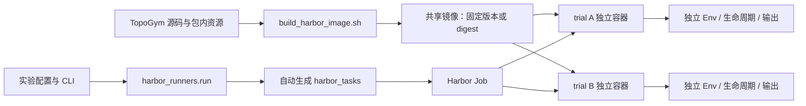
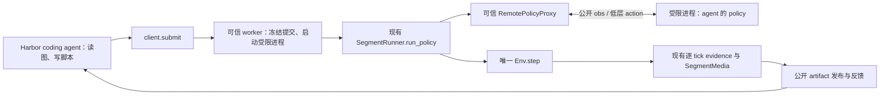

# TopoGym 共享镜像与 Harbor segment rollout 开发计划

创建日期：2026-09-25；最近修订：**2026-09-27，共享 token 预算初版实施与本地测试**。状态：**A–E 已实现；F 的双额度核心、observed 网关、Codex/Claude/OpenCode 接入、强制停止及方块 CLI 已实现并初步测试，真实 Docker/GPU/API 验收 pending；strict provider 能力未开放。** 基础镜像与既有 API 闭环不能作为新预算验收证据。新增实现范围及手动命令见 [usage README](../../../topogym/agents/usage/README.md)。

**2026-09-27 用户最新范围：** 下一阶段在 `topogym/agents/usage/` 开发所有 agent 共用的 input/output 计量与 budget 控制，正式默认目标为 input **50M**、output **20M**，独立配置和判断；超限由管理端强制停止并返回失败。源码 review、检测粒度、observed/strict 边界和逐文件修改范围见[专项工程计划 §1–§9](harbor_token_budget_design_20260927_zh.md)。在既有 simulator 成败接入和功能测试之外，增加每 trial input **3M**、output **1M** 的真实 `cube_pick_place` 抓起／放回案例；复用现有 Task、策略样板与成功判据，独立验收真实模型、物理结果和预算结果。案例、测试矩阵与手动 CLI 交付合同见[专项计划 §10](harbor_token_budget_design_20260927_zh.md#10-新增真实方块抓取案例input-3m--output-1m)。下文“本轮基础接入”仍指 A–E；原先延期的 F 已纳入当前后续工程交付计划。

采用用户确认的方案：**统一维护 TopoGym 运行镜像，实验 runner 负责选择任务与参数，Harbor 管理独立 trials。** 运行时生成的 Harbor 任务目录统一命名为 `harbor_tasks/`，不再使用含义模糊的 `inputs/`；也不把这些目录叫作 TopoGym 的源码 `tasks/`。

本轮锁定 **Harbor 0.23.0 / Python 3.12**，共享仿真镜像使用 Python 3.11。采用原生 TaskConfig schema 1.4、healthcheck、BaseAgent、verifier collect 和 artifacts；没有修改 Harbor 核心。任务配置、发现和启动顺序已用该版本原生对象验证；实际 Docker 生命周期和新的预算停止链路分别记录验收范围。

本轮最终 [CPU 报告](../../../runs/test_results/harbor_pipeline_cpu_20260926/summary.json)：**34 项 Harbor/runner 合同 + 73 项服务与相邻回归 = 107 项通过**。wheel 内容与 Compose 静态合并也已检查。P2–P6 的实际容器、GPU、模型视觉、跨 agent 与生产任务评分资格仍按下文分开验收，不能用 CPU 数量替代。

本次修订已将正文统一到现有 `simulator/rollout_simulation/`、`SegmentRunner.run_policy()` 和 `rollout_<编号>/`，不再依赖拟建的 planner 执行器。明确 task 生成与实验 runner 的职责、容器内媒体与宿主归档的关系，并保留跨进程 policy 代理、公开 artifact 发布和通用 agent/profile。**本轮优先交付不依赖 token 监控的完整 rollout；agent-neutral 用量模块独立列为后续工作，不阻塞本轮验收。** 通用取消、超时和异常收尾仍是本轮必需能力。§10 给出逐功能测试与分层验收计划。

§4.3.1 使用原生 healthcheck 保证初态先于 agent run；[本地提交协议 v1](harbor_rollout_protocol_v1_draft_20260926_zh.md)已经落地。§10.7 区分开发者 CPU 检查与用户 GPU/API 验收；对应命令已在 §9 和 runner README 交付。实时 token 限额仍为后续独立工作。

## 1. 最终使用方式与术语

开发完成后，用户通过一个入口选择 task、难度、seed、agent 和模型；runner 自动生成任务定义、调用 Harbor、收集产物。无需手工创建每个 task 或 trial 的文件夹。

```bash
.venv-harbor/bin/python -m harbor_runners.run run \
  --config configs/harbor/cast_coil_sweep.yaml \
  --task cast_coil \
  --difficulty easy medium hard \
  --seeds 0 1 \
  --attempts 3 \
  --concurrency 1 \
  --agent-profile configs/harbor/agents/profiles/codex.yaml \
  --model "<模型名>" \
  --run-id coil_sweep_01 \
  --image "<已构建的共享镜像引用>"
```

本例有 3 个难度 × 2 个 seed = **6 个 Harbor tasks**；每个尝试 3 次，共 **18 个 trials**，首轮按 GPU 资源保守设并发 1。共享镜像在同一主机复用，不为每次尝试重新复制完整源码、安装环境或构建任务镜像。

这里用 Codex profile 举例，不限定 agent。profile 固定 agent 类型、版本、凭据变量名及能力接入方式，日常使用时可只更换 API key 和 model。密钥提供方式见 §9.3。**`off` 表示本轮不监控或保证 token 上限**，不影响读图、提交动作段、验收和归档；外层 trial 超时仍须配置。后续启用 token 限额时按 §7.2 检查来源与停止能力，不能静默忽略用户设置的上限。

| 名称 | 本计划中的含义 | 创建者 |
|---|---|---|
| TopoGym task | `topogym/tasks/cast_coil/` 等任务实现 | 源码维护者 |
| Harbor task | 固定 task、规范 variation、seed、评测要求和镜像身份的一份实验题目定义 | `harbor_runners/task_generator.py` 自动生成 |
| Job | 一次提交给 Harbor 的任务集合与运行设置 | runner 调用 Harbor 后创建 |
| Trial | agent 对一个固定 Harbor task 的一次完整尝试 | Harbor 根据 task 集合和 `-k` 展开 |
| 初态段 `segment_0` | reset 完成后的初始 RGB 与公开清单，无 agent policy | 环境／管理方发布 |
| 动作段 `segment_N`，N ≥ 1 | trial 内一次 policy 调用，`act(obs)` 返回 None 或环境终止时结束 | agent 或参考策略提交，现有 SegmentRunner 调度 |

`-k` 不改变 simulator seed；不同 seed 由 runner 显式展开成不同 task。一个 trial 可以包含很多 segment，segment 边界不重新创建 Env，也不重新启动一个 Harbor Job。Harbor 的 `-p`、`-k`、`-n` 和输出参数遵循 [官方 Job 文档](https://docs.harborframework.com/core-concepts/jobs/run-a-job)。

### 1.1 Agent 接入范围：内置与自定义都支持

**`instruction.md` 不限于 Harbor 内置 agent。** Harbor 读取其文本，通过适配器的 `run(instruction, environment, context)` 交给 agent；自定义适配器同样接收 instruction，并负责把它带入自己的工作循环。它不意味着 Harbor 自动把原文件放进容器，也不会自动给模型增加 shell、读图或 simulator 工具。参见 [官方 instruction 合同](https://docs.harborframework.com/core-concepts/tasks/instruction)。

runner 接受 Harbor 内置名称，也接受自定义适配器；当前官方接口允许 `-a module.path:ClassName`，该模块需在 Harbor 所在的 Python 环境中可导入。CLI 在任务容器内运行可使用 `BaseInstalledAgent`；模型／工具循环在 Harbor 侧运行可使用 `BaseAgent`，通过环境接口操作容器。具体参数由 P0 锁定版本确认，见 [官方自定义 agent 接口](https://docs.harborframework.com/core-concepts/agents/custom-agents)。

因此，目标是“**配置一次兼容的 agent profile，之后提供凭据和模型即可启动**”。API key 标识服务访问权限，model 指定模型，agent 则是使用模型和工具的程序，三者不是同一件事。新 agent 若已有 Harbor adapter 可直接选用；没有 adapter 时先实现官方接口，不能仅凭一个模型 API 地址自动获得完整 coding agent。

### 1.2 哪些部分依赖具体 agent

| 部分 | 是否只能用于 Harbor 内置 agent | 本项目的接入要求 |
|---|---|---|
| instruction 模板、task 生成、共享镜像、worker/client、segment 与 verifier | 否 | 对内置／自定义适配器复用同一套任务和协议，不按 agent 复制任务 |
| `-a codex` 等已注册短名称 | 短名称依赖 Harbor 注册表 | 名称交给 Harbor 解析；自定义模块走 import path，不另维护阻止外部接入的白名单 |
| CLI 安装、启动参数、model/provider 语法 | 依赖所选 adapter，不是内置专属能力 | 优先复用原生 adapter；外部 agent 补自己的安装／运行适配，固定版本并验收 |
| API key 自动转发 | 仅在相应 adapter 明确支持时成立 | 已支持的转发机制直接复用；其他 agent 显式声明凭据映射与运行时注入，不假设全量环境继承 |
| RGB／视频读取 | 不按内置或自定义划分 | 验证 agent＋模型能读取 PNG；MP4 不可直接读取时使用公共录制层导出的关键帧 |
| 运行后 token 统计 | 依赖 adapter 的实际报告 | 可用时核对；缺失为 unknown，不能填 0 或视为实时监控 |
| 实时 usage 与预算停止（后续） | 依赖用量来源及取消能力 | 独立的 agent-neutral 账本／预算模块，来源可插拔；本轮普通运行不要求安装或实现该模块 |

这里没有需要永久限制为“仅 Harbor 内置 agent”的核心模块。旧计划中的 `codex_budget.py` 是 Codex 专用接入；本版将用量来源、统一账本和预算策略拆成后续独立模块，不把 Codex 或 Claude Code 的专用监听器列为本轮前置。支持某个 agent 的普通运行，也不自动意味着支持它的 `observed` 或 `strict` 预算模式。

### 1.3 Profile 与能力预检

当前 profile 字段是 `name` 或 `import_path`、`model`、`kwargs`、`required_env`、`optional_env` 和可选 `env_mapping`。后者将本机凭据变量名映射为 agent 要求的标准变量名，例如 `OPENROUTER_META_SPARK_API_KEY → OPENROUTER_API_KEY`，只冻结名称引用。固定 CLI 版本可放 `kwargs.version`，默认示例未固定 CLI，不能与 Harbor 版本锁混同。通过 `--agent-profile` 与 `--model` 选择组合；自定义 profile 使用相同 schema，名称交给 Harbor Factory 解析。usage source 为后续可选扩展。

`preflight.py` 当前检查冻结输入、Harbor 版本、adapter 可导入、凭据变量、Docker/Compose、镜像 ID，以及镜像内无 GPU 的 SimulatorConfig/catalog 探针。权限、录制、取消和视觉消费的实测分别走 isolation/scripted/api 验收，不由静态 profile 冒充通过。**“Harbor 已收录”不足以免除 TopoGym 的视觉和权限验收；要求限额时必须通过 usage 模块的 agent/provider 能力校验。**

2026-09-27 GPU 接入修正：Harbor 0.23.0 的 Docker backend 未声明通用 GPU 分配能力，填写 `[environment].gpus > 0` 会在容器启动前被拒绝。任务生成器省略该字段，由 Compose 的 `deploy.resources.reservations.devices` 独立申请 GPU；实际数量、设备 ID 仍冻结在实验配置，task metadata 记录分配方式与数量，不降级 CPU。用户的 isolation 已通过；scripted 首次运行因此错误失败，修正后 38 项 runner CPU 测试通过，GPU 重试命令及证据边界见 [runner README](../../../harbor_runners/README.md#harbor-0230-docker-gpu-声明修正2026-09-27)。

同日 `harbor_scripted_02` 已启动容器，但 worker 在 reset 加载机器人时因资产路径未配置而退出，未进入 agent 执行。共享镜像现设置 `TOPOGYM_ASSET_ROOT=/opt/topogym/assets`，并在构建时检查安装包对 Robotiq/ALOHA 资产的解析；需要重建镜像后继续 GPU 验收，不能把后续 HealthcheckError 或 Mean=0 计作模型失败。详见 [runner README](../../../harbor_runners/README.md)。

`harbor_scripted_03` 的 v2 镜像越过资产加载后，在 Nyx 初始化 Vulkan 时退出（134，非 OOM）。同镜像 GPU 对照探针确认默认 runc 缺 NVIDIA Vulkan ICD，显式 nvidia runtime 则创建 Vulkan instance 成功。GPU Compose 已补 `runtime: nvidia`，保留驱动能力与指定设备，不改宿主默认 runtime；无需重建镜像。补跑 `harbor_scripted_04` 已通过：v2 镜像、GPU 0、2 分 24 秒，1 trial／0 异常，初态与两段执行、媒体、可信证据、归档和本次容器清理均完成；这仅是 pipeline smoke，真实 API、模型读图、GPU 错误路径及谜题成功仍需单独验收。报告在 `runs/test_results/harbor_scripted_04/report.json`，录像在 `task_rollouts/harbor_scripted_04/cube_transfer/rollout_0001/`。

### 1.4 为什么保留 `harbor_runners/`，生成模块叫什么

`harbor_task_generator/` 适合只负责生成 Harbor task 定义的组件。本计划的一键实验入口还负责预检、启动 Harbor、连接 trial 生命周期、归档和汇总，因此目录继续叫 `harbor_runners/`，将原计划的 `tasks.py` 明确命名为 `task_generator.py`。这是本轮实现采用的模块命名，不迁移现有 TopoGym `tasks/` 源码。

流程为：用户配置 → 展开 task/variation/seed → 生成并冻结 `harbor_tasks/` → Harbor 按 attempts 展开 trials → 运行、收集和报告。生成器不为每个 attempt 再生成一份 task；Harbor 执行期间也不改写任务定义。runner 的 `prepare` 子命令（验收脚本的 `--prepare-only`）只完成生成与静态校验，完整入口则继续执行后续步骤。

## 2. 已实现的 simulator 基础与本轮接入缺口

| 当前资源 | 用法与边界 |
|---|---|
| [simulator/api.py](../../../topogym/simulator/api.py)、[SimulatorConfig](../../../topogym/simulator/config.py) | 复用 `make/reset`、variation、seed、控制时序与 Env 既有 episode 时限；不新增第二个 Env 工厂 |
| [config/registry.py](../../../topogym/config/registry.py) | 查询合法任务、变体、短别名与能力缺口；难度映射到规范 variation，不维护另一份几何参数表 |
| [SegmentRunner](../../../topogym/simulator/rollout_simulation/segment.py)、[policy 调度](../../../topogym/simulator/rollout_simulation/policy.py) | 已有 `run_policy`、初态发布、多段连续、幂等、终态与异常收尾；公开导入仍为 `from topogym.simulator import SegmentRunner` |
| [policy 观测投影](../../../topogym/simulator/rollout_simulation/policy_observation.py)、[Interaction](../../../topogym/simulator/interaction.py) | policy 默认 `limited`，只接收公开观测；不持有 Env／Interaction。已有普通 Interaction 与 limited policy 视图并不相同，桥接时不能混用 |
| [segment evidence](../../../topogym/simulator/rollout_simulation/evidence.py)、[ArtifactStore](../../../topogym/simulator/rollout_simulation/artifacts.py) | 已有逐控制步／tick 日志、私有证据、artifact ID 和哈希读取；Harbor 需补跨进程交付与公开目录映射 |
| [SegmentMedia](../../../topogym/recording/segment.py)、[RecordingSession](../../../topogym/recording/session.py) | 已有首末 PNG、多视角与合成 MP4、frame map、展示补帧和解码检查；worker 不另写录像循环 |
| [变体部署记录](../tasks/variation_deployment_implementation_20260925_zh.md) | 已有安装包内的变体资源；存在占位项，资源可构建不代表已证明完整可解 |
| [planning/base.py](../../../topogym/planning/base.py)、[方块样板](../../../topogym/planning/examples/cube_pick_place.py) | 已有 `act(obs)` 合同、ActionSequencePolicy 和参考策略；planning 提供策略，不拥有 segment 调度或证据层 |
| [agents/README.md](../../../topogym/agents/README.md) | 活动 rollout 接入已实现，`deferred/` 仍非运行入口；没有恢复旧执行循环 |
| [pyproject.toml](../../../pyproject.toml) | 当前排除整个 `topogym.agents*`；新增 rollout 包时必须调整打包规则，继续排除 `deferred/` |

物理仍只有 Genesis 路径，RGB 沿用 Nyx + compact_lab。`unlimited` 必须由管理方同时启用 Env privileged 并选择状态字段，不能随 agent 名称自动放开。现有 `run_policy(policy=...)` 是本地可信 Python 调用，**不是可以直接接收 agent 源码的隔离服务**；本工程新增的进程代理见 §4.4。

### 2.1 已有验收可以支持什么

- [2026-09-26 实施记录](../dev-logs/scripted_policy_execution_implementation_20260926_zh.md)及[汇总](../../../task_rollouts/scripted_policy_pick_place_20260926/validation_summary.json)记录 189 项 CPU 检查通过、9 项真实用例符合各自预期；包括 7 次任务成功、1 次空抓负例和 1 次 limited 短闭环。不同阶段的重叠测试数不相加。
- 两段搬运共 515 tick，段 1 末态与段 2 初态及三视角 PNG 一致。完整搬运使用物体真值和显式 `.025 / 1 / 40` 时序；limited 用例只证明默认 `.0025 / 10 / 4` 时序下短反馈链有效，不证明普通视觉 agent 已会抓取。
- 后续 [terminal 接入](../dev-logs/task_terminal_integration_20260926_zh.md)修改了 Env、公开反馈、policy 的任务说明和 World 接触采集。本轮静态核对的 simulator／recording／sensors／world 共 46 个文件与其最终 CPU 回归快照一致，但不全等于上述方块真实运行快照。该 terminal 快照记录 199 项回归通过，真实 CUDA/Nyx 验收当时受硬件预检阻塞。
- 上一次本会话对当前工作区的 segment／policy／观测／录制相关回归为 57 项通过；本次只做文档和源码身份核对，不重复声明新的物理通过。之前的驱动不可访问是当时检查结果，正式 launch 必须重新检查宿主与容器 GPU，不能写成永久环境属性。

**结论：可以开始 Harbor 工程及无 GPU 的连接测试；进入真实联调时，用将要交付的镜像重新验收短闭环。** 不等待全部任务解法、assist 或所有生产判据完成。完整历史 checkpoint 和逐 tick 证据仍有内存／墙钟成本，初次串行跑短例；任务正式评分资格另行检查。

### 2.2 接入层还需交付的部分

本轮开发 worker/client 通信、隔离策略进程及代理、公开产物发布、容器生命周期、可信 verifier、凭据、通用取消及报告；只为 token 追踪预留可选接入与状态字段。公共 simulator 不新增单段动作数、token、仿真时间或墙钟额度；外层保留 Harbor trial 超时，模型用量账本和预算策略后续独立实现。传输大小限制和进程通信超时是接入层资源约束，不改变低层 action 的含义，也不偷偷插入保持步。

**现有方块脚本已经能执行 policy、连续生成 segment 和录像，不为接入 Harbor 重写这些能力。** 最小缺口是常驻会话保持 Env、接收 agent 后续新写的脚本、把结果位置返回给 agent。worker/client 是薄连接；protocol、公开发布、verifier 可以先是小函数，不以拆出独立文件或建立通用 RPC 框架作为进度指标。可信脚本可先验证这条连接；执行任意模型生成 Python 并声称满足权限／评分要求前，再完成隔离验收。

### 2.3 已有权限与正式评测隔离的区别

| 能力 | 当前已有 | 本计划补充 |
|---|---|---|
| policy 权限 | limited/unlimited 观测投影、特权字段授权、episode 绑定、动作检查 | 把固定权限落实到 CLI／提交、文件和进程；agent 不能在请求中提权 |
| Python 执行隔离 | 当前 run_policy 在管理进程直接调用 policy；这是本地 API 边界 | 受限执行进程及相应 OS 权限，保护 Env、管理证据和凭据；独立进程本身不等于完整隔离 |
| 取消 | 已有 terminal、异常和段收尾 | 从外部中止卡死的 act／模型调用方、唤醒等待、保留可取得产物；不另造物理循环 |
| 可信验收 | 已有 Task 判据、执行证据和公开结果 | 保护证据，薄封装为 Harbor reward；区别 Task 成功、流程通过和 unscored |

阶段 B0 的可信连接样例不授予正式隔离／评分资格；阶段 B1/P2 必须实际验证这些边界，再进行真实 API 评测。Docker 提供 trial 外部边界，但不会自动限制同一容器内同权限脚本访问 worker 的文件。

## 3. 本轮实现后的项目目录

以下对应当前实际文件。task.toml、Compose 和 test.sh 由 task_generator.py 的结构化数据生成，不另建三套模板文件；小型能力预检合并在 resolve/preflight 中。共享模块已位于 `topogym/agents/usage/`，observed 初版已实现；新增／修改文件清单见[专项计划 §9](harbor_token_budget_design_20260927_zh.md#9-拟修改文件清单)。

```text
topogym/
├── docker/Dockerfile.topogym           # 唯一共享运行镜像；本轮无外层 runner 镜像
├── .dockerignore
├── requirements/harbor-runner.lock     # Harbor + host runner 依赖版本
├── scripts/
│   ├── setup_harbor_runner.sh
│   ├── build_harbor_image.sh
│   └── test_harbor_pipeline.py         # isolation / scripted / api / sweep
├── harbor_runners/
│   ├── run.py                         # prepare / preflight / launch / run / collect / agents
│   ├── config.py                      # YAML 校验、catalog、难度/seed 展开
│   ├── task_generator.py              # task.toml/Compose/test.sh 由结构化数据生成
│   ├── preflight.py
│   ├── hooks.py                       # 停止后保留容器、恢复下载、验证后清理
│   ├── collect.py                     # 校验哈希、原子归档、失败恢复索引
│   ├── rollout_output_report.py                      # 流程、任务、预算状态分开统计
│   ├── usage_bridge.py                # off / observed 双额度接入；strict provider 待验证
│   ├── agents/{resolve,credentials,scripted}.py
│   └── templates/instruction.md       # 全任务共用操作说明
├── configs/harbor/
│   ├── smoke_scripted.yaml / smoke_api.yaml / cast_coil_sweep.yaml
│   ├── agents/profiles/{codex,claude_code}.yaml
│   └── agents/templates/{template_custom,template_env_http}.yaml
├── topogym/
│   ├── simulator/rollout_simulation/   # 复用原核心，未重写 act/step 循环
│   ├── planning/                      # 复用原策略/动作库
│   ├── tasks/ / sensors/ / recording/ # 复用
│   └── agents/
│       ├── deferred/                  # 仍排除在发行包、共享镜像外
│       └── rollout/
│           ├── worker.py / client.py / protocol.py
│           ├── policy_process.py / public_artifacts.py / verify.py
├── tests/harbor/test_runner.py         # Python 3.12，无 simulator/模型依赖
├── tests/contracts/test_rollout_service.py # 真实执行核心 + CPU 测试 world + 独立进程
├── runs/harbor/<run-id>/               # prepare 后自动生成
│   ├── experiment.resolved.json / job.json / manifest.json
│   ├── harbor_tasks/<instance>/
│   │   ├── instruction.md / task.toml
│   │   ├── environment/{docker-compose.yaml,instance.json}
│   │   └── tests/test.sh
│   ├── image.resolved.json            # preflight 记录 Docker image ID
│   ├── jobs/job/<trial>/              # Harbor 自建配置、agent/verifier 日志、result
│   └── rollout_index.json / summary.json / cleanup.json
└── task_rollouts/<run-id>/<task>/rollout_0001/ # collect 后自动分配
    ├── segment_1.mp4 / segment_2.mp4
    ├── segments/ / rgb/ / views/ / recording/ / private/
    ├── config.json / source_manifest.json / asset_manifest.json
    ├── instance.json / submissions/ / session_final.json
    └── publication.json / verification.json / archive_manifest.json
```

runner 和 simulator 安装入口已加入 pyproject.toml。宿主 runner 采用独立 requirements 锁定文件，setup 脚本以 --no-deps 安装本项目，避免拉取 GPU 仿真依赖；共享镜像另外安装仿真依赖。公共 topogym 导入不加载 Harbor。

## 4. 镜像与运行环境怎么组织

### 4.1 共享的是镜像，每个 trial 的 Env 仍独立

首版选本机 Docker 后端。先保持**一个共享镜像、每个 trial 一个独立主容器**；容器内运行管理 worker、客户端和策略进程。installed agent CLI 同样在容器内，按权限与 worker 分开；external agent 的循环在 Harbor 侧，通过适配器访问本 trial 的受限操作环境。两种形态都使用同一个 segment 服务。以后需要拆成 worker 服务容器时，可以继续复用同一镜像与协议，不改变 task/segment 的定义。



这借鉴了 ORBIT-Q 将共享镜像构建、任务定义与实验 runner 分开维护的做法；其自定义 verifier 和量子任务逻辑不照搬。参见 [ORBIT-Q README](https://github.com/sxzgroup/ORBIT-Q#repository-map) 与 [共享 Dockerfile](https://github.com/sxzgroup/ORBIT-Q/blob/main/images/framework/Dockerfile)。

### 4.2 镜像内容与构建上下文

`docker/Dockerfile.topogym` 安装物理、Nyx、视频与 rollout 所需依赖，构建并安装 TopoGym wheel，包含新 rollout 模块、客户端和随包资产。agent CLI 可以由 Harbor 安装；交付时固定已验收的 CLI 版本，不把 API key 写入镜像。

构建入口从仓库根目录提供上下文，核心调用形态为：

```bash
docker build -f docker/Dockerfile.topogym \
  -t "<共享镜像标签>" .
```

Dockerfile 通过明确的 `COPY` 和 wheel 构建选取文件。共享镜像不包含 `runs/`、历史录像、`.git/`、本地虚拟环境、`agents/deferred/`，也不依赖 `/home/jianwen/...`。不能仅凭 `pip install .` 宣称 CUDA/Nyx/ffmpeg 及全部资产已可用，要通过安装后的隔离验收。

首个验收使用现有方块测试场景，本轮镜像已显式打包 `tests/fixtures/cube_transfer.py`；未打包无关的全部 tests，由可信 smoke 启动分支临时注册；它们目前不是正常安装包中的生产任务。保持一份源码，不复制到各 `harbor_tasks/`，不假设容器能访问宿主的 tests 目录。验收镜像记录所含 fixture 哈希；正式任务运行不启用测试注册。

Nyx 外部资源须在构建或受控启动准备中按固定身份取得并校验，不依赖本机 `.external/nyx-assets` 已有缓存。使用冻结初态资源的任务还须包含该资源及哈希；沿用现有 reset 导入，不能在 Harbor 启动时临时修改几何或生成另一份初态。

新增源码需要安装进共享镜像时重建镜像；只改变 difficulty、seed、尝试次数或 instruction 时无需重建。资产和依赖变化也改变镜像身份。preflight 记录实际 Docker image ID；运行中记录实际安装源码和资产哈希，不用 Git HEAD 代替未提交源码身份。

### 4.3 每个 task 不放 Dockerfile

生成的 `task.toml` 引用共享镜像：

```toml
# 配置片段，完整 schema 由选定 Harbor 版本验证
[environment]
docker_image = "<共享镜像的版本化引用>"

[agent]
user = "agent"

[verifier]
user = "root"
```

Harbor 原生支持预构建镜像，[environment 文档](https://docs.harborframework.com/core-concepts/tasks/environment)说明可以省去任务 Dockerfile。我们仍保留 `environment/`，存放很小的 `instance.json` 和 Compose 启动配置，不放 TopoGym 源码。

task_generator.py 生成的 Compose 配置覆盖 Harbor `main` 服务的启动命令、实例文件只读挂载等；**没有 `build:`，不按任务构建镜像**。Harbor 默认保活命令不能被误认为会自动运行镜像原先的 `CMD`，所以生成配置明确启动 worker 并等待健康检查。该覆盖方式遵循 [Harbor Compose 合并规则](https://docs.harborframework.com/core-concepts/tasks/multi-container)。

### 4.3.1 初态先于 agent run：使用原生 healthcheck

**无需修改 Harbor 核心或逐个修改 agent adapter。** 2026-09-26 核对的上游 [Trial 实现](https://github.com/harbor-framework/harbor/blob/main/src/harbor/trial/trial.py)在 `_prepare()` 中依次设置环境、调用 `agent_environment.run_healthcheck()`、执行 agent setup；后续才进入 agent run。官方 task schema 提供 [`[environment.healthcheck]`](https://docs.harborframework.com/core-concepts/tasks/configuration)。本轮已锁定 0.23.0，并直接测试其 Trial._prepare 顺序；不据此假设旧版本也支持。

我们提供两个配置：Compose 的 `main.command` 明确启动 worker 并挂载只读实例；task.toml 用原生健康检查等待 worker 发布初态。镜像预装客户端，所以探针不依赖尚未安装的 coding agent CLI。

```toml
# 已实现的配置片段；字段为 Harbor 原生，命令为本项目 CLI。
# 示例时间只用于启动探针，不是 segment 或 token 预算。
[environment.healthcheck]
command = "chmod go-w /logs/verifier && runuser -u agent -- topogym-rollout ready --check-initial"
interval_sec = 2
timeout_sec = 5
start_period_sec = 300
start_interval_sec = 2
retries = 10
```

共享镜像需提供 `runuser` 和 agent 用户。探针以实际 agent 身份检查：worker 可达、当前 episode 已创建、session/spec/初态清单已发布、所选 RGB 与 artifact 路径映射完整且可读。它只查询，不重新 reset、不推进物理。不能仅检查端口或一个残留 ready 文件；每个 trial 使用新输出目录与身份，worker 存活状态也须确认。

顺序为：`环境启动 → worker make/reset → SegmentRunner 发布 segment_0 → 公开路径就绪 → Harbor healthcheck 返回 0 → agent setup → adapter.run(instruction, environment, context)`。健康检查失败则 trial 初始化失败，不进入 agent.run，也不让 agent 消耗模型调用去排查 simulator 初始化。后续 worker 故障仍由运行期状态和取消处理，启动健康检查不是永久可用保证。

这里用的是 Harbor 的 task healthcheck，不把 Dockerfile 的 HEALTHCHECK 或容器进程存活直接等同于初态 ready。[原生检查实现](https://github.com/harbor-framework/harbor/blob/main/src/harbor/environments/base.py)按命令退出码、启动宽限期和重试判断；单次 command 超时与总初始化预算分别配置、测试。若选定版本不支持该门禁，P0 应更换兼容版本或明确使用官方扩展点，不能静默跳过，更不能把修改 Harbor 主调度器作为默认方案。

### 4.4 进程、文件与权限

- worker 是可信管理进程，唯一持有 Env 和 SegmentRunner，读取冻结配置并 `make/reset`。现有 simulator/evidence 写私有证据；管理 socket、实例配置及后续可选的权威用量账本只对管理方开放。
- agent 通过 client 提交脚本内容或授权 workspace 文件。worker 固化提交内容、入口与参数并计算 `submission_hash`，防止校验后原文件被改写；agent 给出的路径不能成为任意宿主文件读取入口。
- `policy_process.py` 在受限进程加载 agent 源码；worker **只构造我们维护的 `RemotePolicyProxy`**，将代理作为 `policy` 传给现有 `runner.run_policy()`。代理将 `initialize(context)`、`act(obs)`、`on_segment_end(obs, result)` 转发给子进程，返回值交由现有执行器检查。worker 不 import／exec agent 模块，也不重新实现 act/step 循环。
- 消息传输复用本地 schema、dtype/shape 和单位；使用受控数据编码，不反序列化任意 Python 对象。trial、episode、提交哈希和调用序号匹配后才接受返回 action。代理只转发 run_policy 已投影的 limited 观测，不把普通 Interaction 或管理 Env 暴露给子进程。
- 策略进程只需要本地计算，不继承 API key 或直接请求模型的通道。coding agent 的模型调用仍由所选 adapter 管理；每个 40 Hz 控制步不发一次模型请求。installed CLI 或 external adapter 的容器操作使用受限用户。
- agent 可写 `/workspace/`，只读 `/rollout/` 中发布的公开 RGB、视频和反馈；用量模块后续启用时另发布预算快照。底层完整输出放 `/trial/rollout/`，其中 report/config/private 不整体挂载给 agent。保护源码／数据、socket 与进程的访问边界需实际验证，不能只依赖 Python 对象隐藏字段。



首版统一使用 passive `act(obs)` 形式；可选初始化／通知沿用现有合同。示例脚本导出 `create_policy()`，由受限进程调用并获得 policy 对象；这个加载约定由我们新增，**不是 simulator 已提供的源码加载 API**。已有 direct Interaction 接口保留给本地调用，不在首版网络协议中再开放一套任意 step 入口。

取消必须在管理通道独立接收，不能等阻塞的 submit 返回。代理等待期间可由监督器终止策略子进程并打断 IPC 等待，使 run_policy 走既有异常收尾；simulator 的段原因与外层 `trial_timeout`／`agent_exit` 分别记录，后续预算模块也复用该通道传递 `budget_exhausted`。`run_policy` 当前执行期间持有调度锁，不能假定从另一个线程调用 `runner.close()` 就能即时停止。若卡在物理引擎调用中，超过外层收尾宽限期后由进程监督器处理，并明确标记不完整证据，不承诺强杀后仍有完整末帧。

如果所选 agent 在此权限模型下不能工作，报告兼容性缺口；不静默放开管理权限。进程代理、公开媒体发布和可控取消本轮已有实现与 CPU 合同测试；真实权限和 GPU 故障仍需容器验收。

### 4.5 任务定义、agent 可见目录与宿主归档的区别

**`runs/harbor/<run-id>/harbor_tasks/` 是环境创建与评测的说明，不是沙箱根目录。** 沙箱文件系统来自共享镜像，以及显式上传／挂载的小配置和运行中产生的文件；共享镜像已经安装 TopoGym。Harbor 不会自动让 agent 访问整个宿主项目或宿主 `task_rollouts/`。

| 位置 | 职责与可见性 |
|---|---|
| 宿主 `runs/harbor/<run-id>/harbor_tasks/` | 生成器写入并冻结；Harbor 读取 instruction、环境与 verifier 配置 |
| trial 容器 `/trial/rollout/` | worker／现有录制层产生完整记录和私有证据，仅管理方可访问 |
| trial 容器 `/rollout/` | 发布层提供本 trial 的公开 RGB、视频和反馈，agent 在运行中读取 |
| 宿主 `task_rollouts/<实验>/<任务>/rollout_<编号>/` | collect 在 teardown 前导出并校验的正式归档，通过 trial 索引查找 |

具体闭环是：Env 执行动作 → 共用录制层写媒体 → 发布层完成清单 → agent 读取 `/rollout/` → 提交下一段。agent 不负责录制、编码或转存，但要遵守客户端的完成状态和公开路径，不能读取还在写入的视频。宿主归档无需先完成，agent 就能开始下一段；若将来需要宿主实时查看，可增加明确的输出同步，不改变 agent 的路径合同。

## 5. 当前脚本责任

| 文件 | 本轮实际职责 |
|---|---|
| harbor_runners/run.py | prepare/run/launch/preflight/collect/agents；调用原生 Harbor CLI；Ctrl-C 交给 Harbor 收尾 |
| config.py / task_generator.py | 读取唯一 variation catalog、展开组合、规范 variation ID、冻结轻量 task 与 JobConfig；不复制任务源码 |
| preflight.py | 凭据变量、Harbor 版本、Docker/Compose、image ID、镜像内 SimulatorConfig/catalog 检查 |
| agents/resolve.py / credentials.py | 官方 Factory 解析内置/自定义 adapter；凭据引用及本层输出/日志脱敏 |
| agents/scripted.py | 无模型、读取初态→段 1→读取新结果→段 2→读取末帧的正式链路 smoke |
| hooks.py | 原生 keep_containers 保留停止后的 trial；失败下载恢复；所有归档完整后清理本 run 标签下的停止容器/网络 |
| collect.py / rollout_output_report.py | 验证封存哈希，移动到 task_rollouts，记录索引，分开统计流程/任务/未评分/预算状态 |
| usage_bridge.py | off 兼容；observed 双额度与 agent 能力校验；strict provider 尚未开放 |
| topogym/agents/rollout/worker.py | 常驻唯一 Env、初态发布、唯一 owner 线程调用现有 run_policy、独立管理取消 |
| client.py / protocol.py | ready/status/submit/result，单文件源码冻结和回执；JSON/RGB 数组传输不使用 pickle |
| policy_process.py | 可信代理、单独 UID、精简环境、seccomp、进程组取消；生产不回退到同进程执行 |
| public_artifacts.py | 只发布授权 artifact 和已封存 segment；路径/哈希映射，完成标记最后发布 |
| verify.py | root 管理收尾、可信证据、二元 reward 与详细报告、归档哈希；不采信 agent 自报成功 |
| scripts/test_harbor_pipeline.py | isolation/scripted/api/sweep 分层验收，明确 API 调用门禁与输出报告 |

## 6. 生成的 Harbor task 长什么样

每个实验启动前，runner 自动生成一份 task 定义集合；生成后冻结到本次 run，执行中不改写。

```text
runs/harbor/<run-id>/harbor_tasks/
└── cast-coil-medium-s2-<短配置哈希>/
    ├── instruction.md
    ├── task.toml
    ├── environment/
    │   ├── docker-compose.yaml
    │   └── instance.json
    └── tests/
        └── test.sh
```

| 文件 | 内容与读取者 |
|---|---|
| `instruction.md` | 任务目标、policy/action 合同、CLI 示例、输入输出路径与错误处理；先读 session/spec/初态清单和 artifact 路径并打开 PNG，再提交动作段。内部 wire JSON 可引用镜像内协议文档，无需全文放入每份 instruction |
| `task.toml` | Harbor 读取镜像、资源、超时、agent/verifier 用户等官方字段；自定义实验信息放合法 metadata 中 |
| `environment/docker-compose.yaml` | Harbor Docker 后端读取；启动本实例 worker，明确挂载 instance、权限与健康检查 |
| `environment/instance.json` | TopoGym 自定义配置，由 worker 读取；Harbor 不解释 difficulty、观测权限或 simulator 参数 |
| `tests/test.sh` | Harbor verifier 调用，转发到镜像内统一 `verify.py`，写 `/logs/verifier/reward.txt` |

`instance.json` 当前冻结 simulator 输入（含 seed、规范 variation 与显式参数）、观测权限、profile、评估类型和 instruction；生产实例还记录同一 catalog 的 model revision/difficulty/hash。默认 SimulatorConfig 和任务专属参数在共享镜像内验证与解析；reset 后的 config、source/asset manifest、Task 状态及 episode 身份进入管理证据，不能在 prepare 冒充已构建。外层超时在 task.toml，尝试/并发/agent 在 job.json。

各次 attempt 共享这份只读配置，但 trial ID、episode ID、worker、临时目录与输出均独立。Harbor 根据合法子目录发现 tasks；我们的生成器负责确保它们通过指定版本的 schema 校验。

不默认生成 `solution/solve.sh`。只有某个精确 variation、seed 范围与控制合同已有当前验收过的参考解时才启用 oracle 包装。无模型流程测试由 `scripted.py` 完成，不能以历史 demo 替代当前可解证明。

### 6.1 首版提交协议与 instruction 的分工

详细字段和源码映射见 [rollout 本地提交协议 v1 草案](harbor_rollout_protocol_v1_draft_20260926_zh.md)。只增加连接已有 run_policy 所需的提交身份、源码冻结、状态与路径信息，不再定义一套 simulator 参数或 action 语言。

- agent 通过 `topogym-rollout submit FILE --request-id ID --wait` 提交；CLI 读取文件，将 `api_version/operation/request_id/episode_id/policy{source_utf8,filename,factory,parameters}` 发给本 trial worker。`factory` 固定 create_policy，参数默认空对象。CLI 文件路径不是 worker 的任意文件读取授权。
- worker 冻结源码并计算 submission_hash，按管理配置提供 mode/profile/state_fields。第一版每次只执行一份提交；同 ID 重试查询原状态，不重复物理动作。
- 回执包含 request_status、segment_id、result_path、artifacts_manifest、error。result_path 指向现有核心段 JSON，保留 complete/incomplete、reason、feedback、media 等语义；不把 finished 或 CLI 退出 0 解释为解题成功。
- instruction 介绍 task 目标、观测／动作规格、policy 工厂和 act 合同、CLI 用法、产物读取与继续／停止规则。详细 wire schema 随镜像安装并由 CLI help 引用，不要求 agent 手写消息。
- 公开“log”首版复用段结果、反馈和接入回执；完整逐 tick 真值与 policy 详情继续保存在管理目录。此前交互示例的 `/rollout/logs/segment_1.jsonl` 不是当前已有接口，也不列为 v1 必需产物。

协议 v1 与本次 run 的模板／镜像一起冻结。未来兼容增加返回字段；破坏语义则升级版本，不改写历史任务或结果。

## 7. 一次 trial 的完整运行

1. Harbor 按 task 配置从共享镜像创建独立容器；Compose command 启动 worker、只读加载实例配置。agent 不负责启动或 reset 环境。
2. worker 使用现有 registry/config 解析器创建并 reset Env，创建 SegmentRunner，复用它生成的 `segment_0`。公开发布层将授权 RGB、清单、session/spec 映射到 `/rollout/`。**Harbor 原生 healthcheck 确认初态可读后，才继续 agent setup/run**；初始化不通过不进入模型循环。
3. Harbor 通过所选 adapter 运行 agent，提供 instruction、模型与运行时凭据，接通通用取消。本轮 token 模式为 off；后续仅在显式启用且能力验收通过时连接用量模块。installed CLI 和 external 循环都遵守同一操作权限与生命周期合同。
4. agent 读取 `/rollout/segments/segment_0.json`，经 `/rollout/public_artifacts.json` 把 artifact ID 对应到初态 PNG 并打开，写第一段动作脚本 `/workspace/segment_1.py`，调用客户端 `submit`。编号由管理方分配，脚本文件名只是示例；不存在 agent 编写的 `segment_0.py`。
5. worker 固化提交并启动受限策略进程，将可信代理传给 `run_policy`。现有执行器先投影观测，再反复调用代理的 `act(obs)`，通过唯一 Env.step 执行动作。`act` 返回 None 表示 `policy_done`；终态或异常按原合同结束。本地不新增段额度。
6. 媒体写完并校验后，原子发布 `segments/segment_1.json`、`segment_1.mp4`、末态 RGB、公开结果。agent 读取后生成 `segment_2`，如此继续。写代码、读取文件期间仿真不会自行推进。
7. 成功、环境失败、外层超时、agent 退出或异常触发终止；禁止后续动作，保存可信终态，先完成录制再释放 Env。后续启用预算模块时，预算耗尽复用同一终止流程。
8. Harbor 调用 verifier。按 §7.4 的冻结评估类型判断 reward；保留 pipeline 状态、Task 真值、评分资格、预算及证据完整性。初始化、证据损坏和基础设施错误单列，不混入正常解题失败率。
9. 生命周期收集逻辑在销毁容器前导出完整证据与日志，建立 Harbor trial 与 `task_rollouts` 的关联；最后完成 Harbor 清理和汇总。

agent 提交的 Python script 只实现动作决策。`act(obs)` 返回 mapping 执行一个控制步，返回 None 结束当前段；`{}` 仍会推进一个保持步。`policy_done` 和 `evidence_complete` 都不表示 `task_success`。一个 trial 内保持同一个 coding-agent 会话，各段策略进程按提交创建；跨段需要的信息通过公开产物或显式参数传递，不假设 Python 对象自动续存。

客户端返回视频路径不代表所选 agent 能直接理解 MP4。每个拟支持的 agent／模型组合都要验证图像读取能力；需要时由公共媒体层导出确定规则的关键帧，instruction 指向这些 PNG 与视频。external agent 还需通过环境文件接口取得图像并传给模型，不能把容器路径直接当作宿主文件路径。不能把“目录里有视频”当作已经接通视觉输入。

### 7.1 `segment_0` 是环境初态，动作从 1 开始

| 项目 | 初态段 `segment_0` | 动作段 `segment_N`，N ≥ 1 |
|---|---|---|
| 产生者 | 已有 SegmentRunner 在 reset 后记录 | 已有执行器调度 policy 后记录 |
| policy | 无 agent 脚本 | 冻结脚本、参数与提交哈希 |
| 必需公开产物 | `segments/segment_0.json`、`rgb/segment_0/<camera>.png` | 段清单、动作视频、初末 RGB；失败段标明缺失／不完整 |
| 已有关键字段 | `segment_id=0`、`episode_id`、`state_ref`、`rgb`、`simulated_duration_s=0` | `start_state_ref/end_state_ref`、`reason`、`evidence_complete`、`feedback`、`media` 等 |
| 计数 | 初态，不计为动作段 | 由管理方顺序分配；失败段不回收编号，无新增段额度 |

首版直接使用现有初态 PNG 和清单，**不要求 `segment_0.mp4`**。旧稿中的 `kind=initial/action`、`policy=null` 和静帧预览字段不是当前 simulator schema，不能把它们作为已存在字段解析。以后若需要静态视频预览，单独扩展公共媒体层并标注物理时长为 0，不作为本次 Harbor 接入的前置任务。

**不默认加一段“物理稳定过程”来凑视频。** 当前 [SimulatorConfig](../../../topogym/simulator/config.py) 的 `reset_physics_steps` 默认是 0；若实验确需初始化物理步，应先显式冻结该配置并记录初始化范围。reset 内的稳定步骤是否能被完整录制还需实现和验证，不能把 reset 后的静态 RGB 冒充那段过程的录像。

`segment_1` 的起始 state_ref 必须等于初态清单的 state_ref，此后正常连续动作段沿用前段终态。参考策略也遵守同一编号。Harbor attempt、归档 `rollout_<编号>` 与段号是三个不同身份，索引分别记录；本版不新增 `max_segments`。

### 7.2 agent-neutral 用量模块：独立设计，F 阶段交付

**A–E 的基础接入不以实时 token 追踪为完成条件；F 阶段必须交付计量、预算强停及结果合同。** 当前已提供 observed 初版，旧 off 示例保持兼容；F 的真实部署验收尚未完成。observed 默认 input 50,000,000 / output 20,000,000；真实抓取例使用 3,000,000 / 1,000,000。每 trial 累计与版本化运行中更新已实现，所有来源共用账本与取消入口。

`agent-neutral` 指统一事件、统计口径、账本、预算判断及报告不依赖 agent 类型；**不表示所有 agent／provider 自动提供相同的实时 usage 数据**。来源可来自受信的 adapter 事件、provider 响应或可控 API gateway。CLI 日志和 provider 协议的差异只放在可插拔来源中；gateway 也须验证流量确实经过它、认证兼容、流式响应和子请求覆盖，不能预先承诺适配所有 agent。

#### 7.2.1 本轮行为与后续模式

| 模式 | 行为与报告 | 交付范围／启动条件 |
|---|---|---|
| `off` | 不运行用量监听与限额器；`budget_qualified=null`。未知 input/output 为 null，不能写 0 或“预算通过” | 保持兼容，不要求 usage source |
| `posthoc` | 结束后按已确认口径核对可获得的用量；不提供运行中停止，也不授予实时限额资格 | 后续选项，实际实现并声明来源后才可选择 |
| `observed` | 收到可信更新确认超限后触发取消；记录延迟、最终确认用量和超出量 | 初版与本地测试已完成，真实三种 agent 组合仍待验收 |
| `strict` | 在模型请求入口预留／约束输入输出额度，控制并发请求占用 | 核心已测试；实际 provider 缺少已验证输入上界，暂时拒绝启动 |

本轮 `preflight` 必须验证：`off` 同时指定任何 token limit 为配置冲突；选择尚未实现的模式或来源在创建 trial／调用模型前拒绝。**不能把用户显式要求的限额静默降级为 off/posthoc。** observed 初版已实现；posthoc 与 strict provider 仍不开放。

Harbor 若自带最终 token 统计，可以原样保留并注明 `source`、统计时点及覆盖范围；这不改变 `off` 的状态。不能把最终 AgentContext 统计当作通用实时限额器，监控也不能靠 agent 自己定期读文件。`off` 下仍须配置外层 trial 超时，但墙钟超时不等于 token 上限。原 20M 总量示例由本次用户指定的独立 input 50M / output 20M 目标覆盖，不能合并成可互借的总额度；开发与验收完成前仍不得声称已启用。

#### 7.2.2 模块与接入合同

后续独立模块按用户指定放 `topogym/agents/usage/`，核心不导入 Harbor、simulator 或具体 agent。只依赖标准事件与时钟／持久化抽象，可用合成事件、独立程序或其他实验框架单独运行和测试。`harbor_runners/usage_bridge.py` 已扩展配置与能力校验；usage adapter 负责绑定 trial、接收快照、调用取消入口，不重复实现统计。`harbor_runners/supervisor.py` 负责实际停止，provider 请求/usage 差异集中在 usage 的 gateway/sources。

| 合同／模块 | 职责 |
|---|---|
| `UsageSource` | 提供事件、健康与覆盖声明；agent-specific 或 provider-specific 解析器可作为插件接入，不要求在核心包列出全部 agent |
| `UsageEvent` | 携带 trial、source、request／event 身份与序号、发生／采集时间、input/output 计数、增量或累计语义；包含可选 cache/reasoning 细分及口径版本 |
| `ledger.py` / `UsageSnapshot` | 唯一权威账本；跨重复、乱序、最终补报去重，记录子调用／重试覆盖、最新确认累计量和 unknown/partial 状态 |
| `budget.py` / `StopRequest` | 按独立 input/output limit 判断，输出带 trial、原因和快照引用的停止请求；不持有 Env，不直接杀进程 |
| `usage_bridge.py` | 将快照交给报告与公开发布层，将停止请求交给 trial 监督器；来源健康异常按冻结配置处理 |

输入／输出累计发生在每个 trial 的模型请求上，与物理 tick 或 segment 数量无关。缓存输入、推理输出是否已计入 provider 总量必须按来源口径说明，不能重复相加；重试和子 agent 调用按真实覆盖记录。两个来源同时报告同一请求时明确权威来源或关联去重，无法确认完整覆盖则不能标为完整账本。agent 可改写的文件不能直接作为可信用量来源。

启用模块后，管理方原子发布只读 `/rollout/budget.json`，包含已确认累计量、限额、更新时间和覆盖状态，让 agent 在后续交互时了解开销；权威账本不开放写入。这个文件用于告知，真正停止由管理方主动执行。`off` 下不要求生成该文件，instruction 明示追踪已禁用，agent 不应等待一个不存在的快照。

#### 7.2.3 后续超限停止与本轮取消共用

本轮已需处理 trial 超时、人工／管理取消、agent 退出和策略进程故障，因此 §4.4 的取消通道不能一起延期。后续 `StopRequest(reason=budget_exhausted)` 只接入同一通道：锁定终止原因、拒绝新动作、取消模型调用方和策略进程、收尾、verifier、归档。installed CLI 与 external 循环的具体取消实现由各自接入验证，共用预算模块不感知这些差别。

`observed` 只能保证确认事件后的停止动作，不能精确停在第 N 个 token。正在执行的 Env.step 可能先完成；停止确认后不再进入下一步，底层卡死则按宽限期处理并标记不完整。已发给模型服务端的请求可能继续完成并返回最终 usage，账本继续补齐。停止原因不被迟到的成功覆盖，限额评测 reward=0，不默认按基础设施故障自动重试。

需要预算停止的实验必须选择已验收的 observed 或 strict；用量中断时按冻结规则停止并报告 `usage_unavailable`。限额包含端点：已确认用量大于限额为 `budget_exceeded`，下一请求无法容纳为 `budget_exhausted`；恰好等于且不再调用模型不自动改判失败，详见专项计划 §5。off 的 pipeline／任务评测可以通过自身条件，但**不具备 token 限额评测资格**；若实验预先要求该资格，应在启动前拒绝，而不是运行后声称满足。

### 7.3 Artifact ID 到 agent 可读目录

现有 simulator 的 `initial.rgb` 和段结果 `media` 返回 **artifact_id／sha256／size_bytes**，不是可供 CLI 直接打开的完整文件路径。`public_artifacts.py` 在 worker 存活时通过 `read_artifact(artifact_id)` 读取授权媒体，校验哈希后写入只读 `/rollout/`，发布接入层 `/rollout/public_artifacts.json`，将逻辑 ID、episode／segment、相对路径和哈希对应起来。

底层初态／段结果保留原 schema；接入清单明确使用自己的 schema version，不无声改变 simulator 文件含义。初态相机选择也受冻结的 observation_profile 约束。状态查询复用现有 policy 观测投影，不能直接把 Env.observe 或普通 Interaction 的 task 数据发给 limited agent。详细 Task metrics、私有日志和源码位置不进入公开视图。

同一段的媒体全部写完后再原子发布 complete 清单；若失败，只发布明确标记的可用前缀及陈旧末帧身份。worker 保存 artifact ID 到归档相对路径的管理索引，collect 在 teardown 前导出；容器消失后不再依赖进程内 ArtifactStore 查找媒体。运行时公开副本是临时交付数据，最终归档每份视频只保留一个正式副本。

### 7.4 Verifier 区分流程测试与任务评测

实例字段 `evaluation` 固定为 `pipeline_smoke` 或 `task_success`。前者要求两段物理执行、录像、状态/RGB 边界连续；EE_DELTA smoke 还从私有 tick 数据检查 TCP 先上后下。这只验证交互链，不能记为方块任务成功。后者 reward=1 要求证据完整、流程无失败、Task 提供 available 且 task_success=true。

`verification.json` 分开记录 pipeline_passed、task_success、evaluation_status、scoring_eligible、evidence_complete、smoke_motion 和 off 用量状态；unavailable 的 task_success 为 null、scoring_eligible=false，不能混入普通任务失败率。Harbor 异常也会使汇总层 pipeline_passed=false。正式任务的物理质量、判据完整性与模型视觉消费资格仍须分别验收。

## 8. 实际运行前后，目录怎样变化

1. 运行前只有源码、共享模板和 YAML 配置；镜像构建一次。
2. prepare 自动创建 runs/harbor/<run-id>/harbor_tasks/<instance>/，以及 experiment.resolved.json、job.json、manifest.json。没有复制 TopoGym 源码。文件哈希与只读 task 文件防止运行中静默修改。
3. launch/preflight 记录 image.resolved.json；Harbor 在 jobs/job/ 下为每次尝试创建 trial。worker 在各自容器创建唯一 Env，初态和随后每段结果逐次发布到 /rollout；完整记录在仅管理方可读的 /trial/rollout。
4. verifier 收尾并封存，Harbor 原生 collect hook/artifacts 在停止容器前下载。采用 keep_containers 保留停止后的可写层，不能把原生 best-effort 下载失败后立即删容器当作可靠归档。
5. collect 校验完整文件集合、大小与 SHA-256 后，原子移至 task_rollouts/<run-id>/<task_id>/rollout_NNNN/。Job 只留下索引指针；核心自身 recording 工作布局保持原样。失败下载不删除唯一容器副本，collect --recover 可从停止容器重试，不重新调用 agent 或模拟。
6. 所有 trial 归档完整后，只清理本 run 标签下已停止的容器和网络，镜像保留。存在运行中容器或任何未完整归档时保留并记录 cleanup.json，不执行强制删除。

实际目录见 §3 与 [runner README](../../../harbor_runners/README.md)。publication.json 中 path 是容器内公开路径，archive_relative 对应正式归档。不同尝试独立分配 rollout 编号；不能从录像恢复已退出 Env。

## 9. 实际使用步骤

这些命令现在有对应实现，全部从仓库根目录执行。按顺序先无模型、后 API；真实测试结果尚待用户机器提供。完整参数、报告位置、失败恢复、另一 agent 和目录变化见 [runner README](../../../harbor_runners/README.md)。

### 9.1 安装并构建共享镜像

```bash
bash scripts/setup_harbor_runner.sh
bash scripts/build_harbor_image.sh topogym-rollout:v1
```

### 9.2 容器权限与无模型 GPU smoke

```bash
.venv-harbor/bin/python scripts/test_harbor_pipeline.py \
  --case isolation --image topogym-rollout:v1 --run-id harbor_isolation_01
.venv-harbor/bin/python scripts/test_harbor_pipeline.py \
  --case scripted --image topogym-rollout:v1 --gpu-devices 0 \
  --attempts 1 --concurrency 1 --seed 0 --timeout-sec 1800 \
  --run-id harbor_scripted_01
```

Harbor 0.23.0 的 Docker 资源配置只处理 CPU/内存；生成器在 Compose 中显式加入 NVIDIA device reservation，不能只依赖 task.toml 的 gpus。首轮并发 1，同一指定 GPU 不会自动在 trials 之间做显存调度。

### 9.3 提供凭据并运行 API smoke

```bash
read -rs -p 'OPENAI_API_KEY: ' OPENAI_API_KEY
export OPENAI_API_KEY
TOPOGYM_MODEL='<模型名>'
.venv-harbor/bin/python scripts/test_harbor_pipeline.py \
  --case api --allow-api --image topogym-rollout:v1 --gpu-devices 0 \
  --agent-profile configs/harbor/agents/profiles/codex.yaml --model "$TOPOGYM_MODEL" \
  --attempts 1 --concurrency 1 --seed 0 --timeout-sec 1800 \
  --run-id harbor_api_01
```

profile 声明 required_env/optional_env 的变量名，job.json 只保存 `${变量名}` 引用，经原生 agent.env 运行时注入；worker 和 policy 不需要 key。可换 claude_code.yaml 或自定义 import_path profile；每个 adapter 的 endpoint 变量、模型语法和 CLI 安装仍按其官方接口。

当前启动健康检查与 CLI 参数已在锁定版本源码验证；真实 GPU scripted（harbor_scripted_04）和 OpenCode/OpenRouter API smoke（harbor_openrouter_api_01）均已通过。自动 smoke 的产物通过也不能单独证明模型把 PNG 作为视觉输入；需检查 trajectory，验收报告不伪称该项已自动验证。

### 9.4 prepare/launch/sweep/收集

```bash
.venv-harbor/bin/python -m harbor_runners.run prepare \
  --config configs/harbor/cast_coil_sweep.yaml \
  --task cast_coil --difficulty easy medium hard --seeds 0 1 \
  --attempts 3 --concurrency 1 \
  --agent-profile configs/harbor/agents/profiles/opencode_openrouter.yaml \
  --model openrouter/meta/muse-spark-1.3-contributor \
  --image topogym-rollout:v2 --gpu-devices 0 --run-id coil_sweep_01
.venv-harbor/bin/python -m harbor_runners.run launch \
  --run-dir runs/harbor/coil_sweep_01
.venv-harbor/bin/python -m harbor_runners.rollout_output_report \
  --run runs/harbor/coil_sweep_01
```

prepare 不需要 Docker/API key；launch 才要求启动前置。run 子命令合并这两步。内部实际调用 `harbor run --config <冻结的job.json>`，task、agent、尝试、并发和输出位置均由该配置交给原生 Harbor。6 个 task × 3 次尝试得到 18 个 trials。已存在 run-id 不覆盖；失败下载使用 `collect --run-dir ... --recover`，不能把重启当作原 episode 续跑。

### 9.5 后续 Docker 一键交付

当前首版先把共享运行镜像和宿主 runner 验收清楚。如果之后要求“测试方无需安装 Harbor Python”，再新增 `docker/Dockerfile.runner` 与 `scripts/run_harbor.sh`，把相同 runner 和锁定 Harbor 放进启动镜像。

这将是两个职责明确的镜像：runner 镜像调度实验，共享 TopoGym 镜像执行 trial。需要验证 Docker daemon 连接、容器内外路径映射和输出挂载；外层容器看到的路径不能直接假设为宿主 Docker 可用路径。API key 在运行时注入；测试方仍需要兼容 Docker/GPU 宿主。该包装不改变任何 task、segment 或录像合同，也不要求先实现嵌套 Docker daemon。

## 10. 测试与验收顺序

下列为分层验收要求；本轮已执行 CPU 合同和相邻回归，真实 Docker/GPU/API 尚待执行。已有本地验收作为基础，不能代替容器内、跨进程和真实 API 验收。报告绑定源码、fixture、依赖／镜像、agent 版本、模型、观测权限和时序配置；与旧快照不同的实现须完成相关回归。**执行人按 §10.7 划分：我完成无 GPU 开发检查，用户运行交付后的 GPU／真实模型验收命令。**

P0–P6 属于 A–E 基础功能验收，token 模式为 off；P7 属于当前后续 F 阶段，新增共享预算及真实方块例，单独报告资格。基础 CPU 用例集中在 tests/harbor/test_runner.py 与 tests/contracts/test_rollout_service.py；下方矩阵保留验收场景分类，不把拟定测试名当作已创建文件。

| 层级 | 测试方式 | 必须证明 | 模型费用 |
|---|---|---|---|
| P0：版本与环境 | Harbor 版本锁、最小 task、共享镜像、用户及生命周期探针 | 原生 schema／CLI／healthcheck 可用，初态 ready 先于 agent setup/run；失败门禁不调用 agent；GPU/Nyx 资格另验 | 无 |
| P1：生成与桥接 | unit/contract、隔离安装、fake worker／代理，含真实子进程 | task 数与冻结、凭据与脱敏、passive policy IPC、limited 白名单、异常／取消、公开 artifact 映射；无 usage 模块仍可运行 | 无 |
| P2：无模型 Harbor 闭环 | Harbor 启动 scripted agent，真实 worker／client、Genesis＋Nyx、两段短 policy | 复用同一个 Env，段边界连续、媒体可读、verifier 与 teardown 前归档；必须经过正式进程边界 | 无 |
| P3：真实 API 两段 smoke | 选定一个已配置 agent＋图像模型；1 task、seed 0、1 attempt、并发 1、有限 trial 超时 | 真实模型请求、读图、生成脚本、执行、读新反馈、生成第二段和最终收尾都有证据；off 状态明确 | 有；本轮不保证 token 限额 |
| P4：错误与停止 | 确定性故障注入，验证外层超时／管理取消；必要时真实 API 中止 | 认证／API 错误、脚本错误／卡死、worker 故障、取消分类与不完整产物正确；不依赖 usage 模块 | 注入无；真实检查有 |
| P5：重复与跨 agent | 同 agent 三次独立 trial；第二种真实 agent；一个自定义 import-path adapter | 同 seed 初态可比，产物隔离，公共 task／simulator 协议不按 agent 改写；分别报告能力 | 无模型 adapter 无；真实调用有 |
| P6：任务与 sweep | 具备评分资格的实例，先参考策略正负例，再真实 agent 和多配置 | pipeline 与任务成功分开；难度／seed／attempt 展开正确，再据资源实测增加并发 | 按配置 |
| P7：共享用量与预算（F 阶段） | 合成来源、provider 协议、bridge/supervisor、独立小额度强停及 3M/1M 真实方块抓取 | agent-neutral 统计与决策、缺失与中断、超限取消、物理成败和真实数据覆盖；独立记录 observed/strict 资格 | 合成/参考策略无；真实调用有 |

### 10.1 第一条真实 API 测试具体做什么

首个 `pipeline_smoke` 使用方块测试场景，目标为“末端小幅抬起，再返回初始位置”，不要求廉价模型立即完成抓取。移动幅度、容差与场景固定在 P2 的真实校准结果中，默认 limited、标准 RGB，不能把已有 unlimited 搬运解法的成功算作视觉能力通过。

1. runner 预检 profile／key、off 配置与外层超时，Harbor 启动 trial；worker 发布初态和规格，agent 读取初态图片。
2. agent 自己编写第一个 `create_policy()`／`act(obs)` 脚本，经 client 提交；受限进程运行，公共执行器生成第一段媒体。
3. agent 取得并读取第一段的新图像与公开反馈，之后才生成第二段脚本。可用冻结的入口模板和动作格式示例，但不提前给出两段完整答案。
4. 第二段返回后 agent 完成本测试会话；verifier 检查真实抬起／返回和两轮交互证据。流程允许原方块 Task 仍未终止，不能为 smoke 修改它的 task_success；真实 terminal 的正负例另验。
5. collect 完成归档，输出 `pipeline_passed`、`simulator_task_success`、`budget_status=not_enforced`、`budget_qualified=null` 及 artifact 路径。相同 agent 连续三次完成，再换第二种 agent 验证可复用接入。

同一 trial 不在每个 segment 重启 coding agent；每段 policy 的 act 循环不访问模型 API。本轮真实 smoke 采用 off 与有限的外层 trial 超时，证明普通 API 闭环；不等待用量模块，也不授予实时预算资格。需要 token 上限的真实实验留到 P7，先完成相关来源与取消验收。

### 10.2 “跑通”必须有的证据

| 检查点 | 证据与通过标准 |
|---|---|
| 真正由 Harbor 启动 | Job/trial 配置、agent adapter／版本、镜像与 worker 关联；不是宿主直接调用模型的独立脚本 |
| API 接通 | 实际调用记录、模型身份、可获得的 request 身份；Harbor 原有 usage 可附带保存，缺少 usage 不阻塞 off；不保存 key |
| 图像输入 | 图像工具或模型输入记录能关联发布的 PNG 哈希；仅 cat 路径或文件清单不够。需要视觉理解验证时，加一个只能从图像识别的小问题 |
| 第二轮使用新反馈 | 段 1 complete 发布 → 图像读取 → 第二段源码冻结／提交的顺序与身份；两段事先全部提交不符合本测试 |
| 状态连续 | 初态→段 1→段 2 同 episode，边界 state_ref／PNG 可比，段间等待不推进物理 |
| 录像与日志 | 实际低层控制和 tick 记录、可解码视频、初末 RGB、frame map；失败时明确最后可用图像是否对应最新状态 |
| 验收与归档 | 数值 reward 和独立资格报告正确，Harbor trial 完成；清理后归档可读、哈希可核对 |

视觉内容是否影响决策不能仅靠一次“打开图片”证明；工具输入证据验证传输链，图像问答或受控视觉变化才验证理解，报告分别标记。无法取得必要轨迹／图像输入证据的 adapter 标为该项未验证，不能凭最终脚本猜测读图已成功。

### 10.3 本轮错误、取消及隔离检查

| 场景 | 预期结果 |
|---|---|
| 缺 key／无效 key／API 超时或限流 | 缺 key 启动前失败；服务错误有独立原因和有界重试；保留已有初态与日志，不依赖统一用量账本 |
| 脚本语法错误／非法 action | 未执行动作不产生虚假 tick；已执行前缀保留；policy 错误不冒充 Task 终止失败 |
| policy 无限循环／子进程崩溃／agent 退出 | 监督器取消受限进程，代理唤醒，正常收尾或明确 incomplete；不靠 simulator 新增段预算 |
| worker／GPU 故障 | 保留可取得的历史产物和故障阶段，不把旧末帧当作当前状态；不自动重放不确定动作 |
| 外层 trial 超时／管理取消 | agent 与策略进程收到终止，后续提交拒绝；记录实际停止边界，保留 verifier／归档或标明 incomplete |
| 未安装用量模块／agent 不提供 usage | off 下正常完成；报告 disabled/not_enforced，未知计数为 null；不能凭空生成预算通过结论 |
| off 与显式 token limit 冲突／选择未实现的模式 | prepare/launch 在创建 trial 与调用模型前拒绝，指出配置原因，不自动降级 |
| 私有访问／伪造结果 | policy／agent 不能取得 Env、reset、更改 frozen instance、读管理证据或写 verifier reward；不接受客户端声明的成功 |
| artifact 未完成／收集失败 | 不发布完整标记、不先销毁容器；报告缺失路径和恢复线索，不把整个 pipeline 标为 passed |

本轮先用确定性进程故障与超时验证通用取消，不依赖模拟 token 超限。预算状态机及真实限额测试留到 §10.6 的后续模块，单独记录通过范围。

### 10.4 任务评分、重复与复现

使用现有参考搬运策略验证真实成功及空抓失败到 reward 的映射，完整记录其 unlimited 权限和显式时序；首个 agent 只做 limited 短闭环时单独报告。生产任务进入正式 benchmark 前，核验当前 terminal revision 与评分资格，不能继承旧解法／旧判据的成功标签。

重复运行检查同 seed 初态可比，`-k` 不换 seed；Job、trial、episode、rollout 输出与预算相互隔离。一个自定义 import-path adapter 也接收同一 instruction，合同阶段可无模型实现；第二种真实 agent 仍要单独做 API 和视觉验收。增加并发前测量 GPU、历史 checkpoint 内存、录像 I/O 和墙钟成本，首轮不以多 GPU／多 trial 并发作为启动条件。

测试计划中的 GPU/RGB/真实 agent 检查采用独立标记与显式命令；默认单元测试不触发 GPU、网络或付费调用。Docker/Python/Harbor 版本探针不等于物理或模型验收。

### 10.5 本轮逐功能测试清单

下列保留完整验收矩阵；当前用例合并于 tests/harbor/test_runner.py 和 tests/contracts/test_rollout_service.py，表中原拟文件名是功能分类；现有 simulator 测试继续验证本地核心，这里覆盖接入后新增的边界。冻结的任务数、可见媒体、状态连续性、失败原因等是断言对象，不测试内部函数调用次数来代替行为验证。

| 功能与测试文件（相对 `tests/`） | 场景与关键断言 | 层级／环境 |
|---|---|---|
| 初态就绪顺序：`contracts/test_harbor_readiness.py` | 故意延迟初态和媒体发布，确认 `agent.setup/run` 尚未调用；只写 ready 文件但 worker 不可达、缺 PNG、无读权限、过期 episode 均不得通过。健康检查失败即初始化失败，不进入 agent；已有初态不得再次 reset | P0/P1 我做 fake／无 GPU 检查；用户 GPU 验真实初始化 |
| 参数展开与冻结：`unit/test_harbor_task_generation.py` | 3 难度 × 2 seed 生成 6 份合法 task，attempts=3 的 Job 对应 18 trials；attempt 不改变 seed、不复制 task。固定输入可复现 manifest；非法 variation、重复 slug、占用 run-id 明确拒绝。修改已准备的 instruction/instance 后 launch 校验哈希失败，运行结果不写回 task 定义 | P1；临时目录、锁定 Harbor schema；无 Docker/API |
| 包安装与共享镜像：`integration/test_harbor_pipeline.py` | wheel／镜像不挂载宿主项目也能导入客户端与 SegmentRunner，找到所需模板、资产与 smoke fixture；任务环境只需小配置及共享镜像。单独验证 Nyx/CUDA、初态 PNG、用户权限；缺资源明确失败 | P0；安装检查无 GPU，真实 RGB 检查单独标记 |
| agent/profile 与凭据：`unit/test_harbor_agent_contract.py` | 内置名和自定义 import path 共用 instruction／协议；missing key 在 launch 前失败，prepare-only 可离线。用假 key 检查目标进程变量映射、脱敏及配置／日志无明文；策略进程、worker、verifier 不获得非必需凭据。声明读图不等于已验收读图 | P1；fake adapter；真实认证／读图另在 P3/P5 |
| token 功能可缺省：`unit/test_harbor_optional_usage.py` | 在未安装 `topogym.agents.usage`／来源插件的环境中，runner import、prepare、无模型 launch、verify/report 都可用；最终 input/output unknown，不填 0。off+limit、未支持模式或需要 token 资格的实验提前拒绝，不创建 trial 或调用模型 | P1；缺模块的隔离安装＋fake 环境；P2 再验真实闭环 |
| 跨进程 policy：`contracts/test_rollout_policy_process.py` | 工厂参数、初始化、act、结束通知跨真实子进程传递；mapping／None／空 mapping 的行为符合本地合同。错误 shape、伪造 episode、脚本异常、死循环、IPC 断开有明确结果；取消能唤醒等待。agent 源码不能在正式 worker 中加载 | P1；真实受限子进程＋fake Env；容器权限另在 P2 |
| 状态与幂等：`contracts/test_rollout_protocol.py` | v1 内容冻结后 workspace 改动不影响执行；未知版本／越权配置拒绝。segment_0 由环境产生，动作从 1 开始；前末等于后初，无隐式 reset。同 ID 重试不执行两次；冲突、旧 episode、terminal 后动作拒绝。wait 超时后能查询原请求，不重放；核心结果语义保留 | P1 的 fake 核心＋P2 真实两段 |
| 媒体交付：`contracts/test_rollout_public_artifacts.py` | artifact ID 映射的路径、字节和哈希一致，只发布授权相机与反馈。故意延迟视频写入，complete 清单出现前不能把它当作完整产物；完成后 agent 用户可读 PNG/MP4。私有文件、路径穿越和指向未授权文件的链接被拒绝；失败段明确标记可用前缀 | P1 的可控 artifact store；P2 检查真实媒体和 OS 权限 |
| 录像与多段连续：现有 `recording_data/test_segment_recording.py` ＋ `integration/test_harbor_pipeline.py` | 真实 Nyx 产物可完整解码，frame map 与 tick／控制步对应，段边界三视角 RGB 和状态连续；agent 读取的图像属于该 trial／segment。继续调用共用录制层，无另一套 writer；segment_0 无需 MP4 | P2；GPU；不调用模型 |
| verifier：`contracts/test_rollout_verifier.py` | 分别输入成功、明确失败、仅 policy_done、smoke 通过但 Task 未成功、unavailable、损坏证据。数值 reward 与详细报告一致；unknown 不算普通失败；off 不阻塞普通评分，也不产生 token 限额资格；不接受 agent 自报成功 | P1；可信证据夹具；P2/P6 再验真实正负例 |
| 取消与权限：`contracts/test_rollout_protocol.py`、`contracts/test_rollout_policy_process.py` ＋ `integration/test_harbor_pipeline.py` | policy 卡死、agent 退出、管理取消和 trial 超时可停止后续动作并收尾；管理取消不排队等待 submit。受限用户不能访问管理 socket、私有证据或修改冻结配置／reward。模拟引擎卡死时报告 incomplete，不伪造末帧 | P1 确定性故障；P2/P4 容器监督与权限实测 |
| 收集与报告：`unit/test_harbor_collect_report.py` | teardown 前导出，哈希校验后原子归档；模拟下载中断、磁盘写入失败，不能误报 pipeline_passed 或先丢弃唯一产物。重试收集幂等；容器删除后正式视频仍可读；Job 目录只存索引，无重复长期 MP4；并发／重试身份不串档 | P1 fake 环境；P2 验证真实生命周期与归档 |
| Harbor/API 全链路：`integration/test_harbor_pipeline.py` | Harbor 确实建立 Job/trial；初态 ready 后才启动模型。模型看图并写段 1，读取新反馈后再写段 2；记录图片哈希和事件先后。相同 seed 三次尝试隔离，再换第二种 agent；自定义 adapter 使用同一任务包 | P2 无模型基线；P3/P5 真实 GPU/API |

无 GPU 的测试不得用空 PNG 或空视频证明媒体成功；这类夹具只能验证协议或错误路径。真实视觉验收必须取得可解码且对应真实状态的产物。真实 API 用例若不可取得读图轨迹，结果标为“该能力未验证”，不能以最终脚本正确替代。

在 `tests/conftest.py` 注册分层标记并设置显式启用门禁：`harbor_docker`、`harbor_gpu`、`harbor_api`，后续再加 `harbor_usage`。没有启用时跳过相应集成用例，收集测试阶段也不初始化 GPU 或模型；API key 存在不等于允许默认测试发起调用。P0/P1 先行，P2 真正通过后才进入 P3；具体 pytest 启用参数随测试实现写入 runner README。

每次集成验收将配置、版本／哈希、命令、通过／失败／跳过项和脱敏错误保存在 `runs/test_results/<harbor验收批次>/`，引用实际 `runs/harbor/` Job 与 `task_rollouts/` 录像。测试报告分别给出“生成器通过”“容器桥接通过”“真实模型闭环通过”，不合并成一个缺少范围的成功结论。

### 10.6 F 阶段共享用量模块与方块案例的测试清单

这些测试属于 P7／阶段 F；作为当前后续工程交付验收，不追溯改变 P0–P6 的既有结果。详细测试矩阵和文件范围见[专项计划 §8–§10](harbor_token_budget_design_20260927_zh.md)。当前仅有 off 的配置拒绝检查通过，以下新增预算能力仍待实现与验收。

| 测试文件 | 必须覆盖 |
|---|---|
| `tests/usage/test_ledger.py` | 增量/累计一致，重复/乱序/恢复/迟到事件去重；请求预留与结算、真实重试/子调用和 trial 隔离，cache/reasoning 不重复；缺失保留 unknown/partial |
| `tests/usage/test_budget.py` | input/output 独立边界、请求准入、并发额度、运行中调参、幂等失败终态；核心只产生 StopRequest，不导入 Harbor/仿真 |
| `tests/usage/test_sources.py`、`test_gateway.py`、`test_imports.py` | 各协议口径、流式/断流/缺失 usage、预留/输出限制、临时凭据与路由覆盖、独立轻量导入 |
| `tests/harbor/test_usage_bridge.py`、`test_supervisor.py` | 共同账本和实际停止通道；agent 无输出/工具阻塞/进程树取消、worker 原因锁存、归档和 sibling trial 隔离 |
| `tests/contracts/test_rollout_service.py` | 真实执行核心的预算取消与 finish/timeout 竞态、阻塞 policy 强停、reward=0、可信快照及完整/部分证据 |
| `tests/harbor/test_pick_cube_budget.py` | fixture/config/API 门禁与 3M/1M 参数、任务/预算失败分类、实际 Task 未成功时不能把 pipeline 通过当抓取成功 |
| `scripts/test_harbor_pipeline.py` 新 budget-input / budget-output cases | 两项额度独立真实小限额验收；记录最终 receipt、检测/停止延迟和超出量，区分 strict 提前拒绝与 observed 超限 |
| `scripts/test_harbor_pipeline.py` 新 pick-cube-scripted / pick-cube cases | 先无模型 Harbor 参考抓取，再真实 agent + GPU 在每 trial 3M input / 1M output 下抓起/原位放回；保留三视角视频和 Task 判据证据 |

还需一个不启动 Harbor、Env 或真实 agent 的独立驱动，用合成来源运行账本与预算模块，证明其可独立使用。合成事件通过只能证明内部语义；真实来源、子调用覆盖与 API 停止能力各自验收，不能互相替代。

新增方块例复用现有 `tests/fixtures/cube_pick_place.py` 与 `planning/examples/cube_pick_place.py`，配置为 `evaluation: task_success`，首版显式 unlimited/world，与已有参考基线相同；模型视觉能力另外验收。当前 Harbor 只接 `cube_transfer`，需补充 fixture 校验/注册及镜像打包，不更改旧搬运成功阈值。3M/1M 案例不要求用完额度，也不代替确定性超限负例；物理失败、预算失败、基础设施失败及“故障被正确处理”分开报告。具体判据、文件改动和完整手动命令见[专项计划 §10](harbor_token_budget_design_20260927_zh.md#10-新增真实方块抓取案例input-3m--output-1m)。

### 10.7 谁执行测试，以及 GPU CLI 何时交付

“我”指本接入工程的开发方；“用户”指在自己的 GPU 主机上执行验收的人。以下是**开发后的责任分工，不是已经通过的结果**。本轮已执行 CPU 测试（真实 Env/SegmentRunner 搭配测试 world）和原生 Harbor schema/生命周期合同检查；没有执行真实 Docker、GPU 或模型实验。

| 执行人 | 测试范围 | 环境与通过条件 |
|---|---|---|
| 我 | 任务展开／冻结、schema、CLI/help/模板一致性、凭据映射与脱敏、v1 输入输出、off 可缺省 | CPU／临时目录／fake adapter；本轮实现时实际运行，给出报告，不需要用户手动检查 JSON |
| 我 | ready 门禁时序与失败、持续会话状态、同 ID 幂等、源码冻结、旧 episode、busy、wait 超时、已有结果不改写 | fake 环境和真实本地进程；可验证调用顺序，不把 fake PNG 当作真实渲染通过 |
| 我 | policy IPC、观测数组／数值合同、脚本错误／死循环取消、公开字段过滤、verifier、收集失败与报告 | 无 GPU 合同／单元测试；仅对所修改边界运行有意义的相关回归 |
| 我 | Harbor 锁定版本解析、隔离安装、无 GPU Docker 启动／用户／healthcheck 探针 | 有可用 Docker 和镜像时执行；若当前执行环境缺能力，明确记录 pending，并随交付给出补验命令，不称作已通过。此类 Docker 检查本身不需要 GPU |
| 用户 | 宿主与容器 CUDA/Nyx、共享镜像真实依赖／资产、reset 与 segment_0 初态 | GPU；客户端以 agent 身份能读取真实 RGB，ready 时间先于 agent.run；初始化失败阻止运行 |
| 用户 | 无模型 scripted 两段完整 Harbor 闭环 | GPU，无模型 key；同 episode、连续状态、可解码媒体、逐 tick 日志、verifier 和容器清理后的归档均可核对 |
| 用户 | 真实物理中断、异常收尾、参考策略正负例、评分资格与 seed／attempt 隔离 | GPU；失败边界和不完整证据如实报告，不能只观察到进程退出 |
| 用户 | 真实 agent/API 两段闭环、第二种 agent、重复与小 sweep | GPU＋用户在运行时提供 key/model；实际读图、写策略、读取新反馈后再提交。token off 与有限 trial 超时明确记录 |
| 我／用户，F 阶段 | P7 共享 token 模块、小额度强停及 3M/1M 真实方块例 | 我先做合成事件/CPU/进程测试，可用时执行 Docker；需 GPU/API 的验收在具备条件的环境执行，缺条件时交付完整手动 CLI，由用户运行后我复核报告与视频 |

开发完成后，我需要先交付 CPU 验证结果，再提供与实际 `--help` 一致、从仓库根目录可运行的完整命令，按以下顺序拆开：

1. 安装／镜像构建与版本身份检查，以及 GPU 宿主／容器预检。
2. 单实例初态／ready 验证。
3. 无模型 scripted 两段 Harbor rollout、媒体与状态检查。
4. 取消／失败／验收正负例。
5. 第一种真实 agent 的 API smoke，再做重复、第二种 agent 与小 sweep。
6. F 阶段新增：本地方块参考基线 → 无模型 Harbor 方块例 → input/output 独立小额度停止 → 3M/1M 真实 agent 抓取 → 重复/跨 agent 验收。当前已有本地参考命令与尚待开发的 Harbor 预算命令分开列在专项计划 §10.4；发布前检查 `--help` 和 prepare-only，不能把拟议参数当已实现功能。

GPU 验收入口已实现为 `scripts/test_harbor_pipeline.py`，共用正式 runner/config，不另建物理脚本。命令须写明镜像、task/variation、seed、次数、并发、超时、GPU 选择方式、run-id、配置／fixture 身份，以及报告和录像位置；真实 API 命令只引用凭据环境变量名。本轮已交付实际参数与命令，见 §9 和 runner README；代码存在不代表真实 GPU 已通过。

用户运行后，我根据 `runs/test_results/<批次>/` 报告、`runs/harbor/` trial 信息和 `task_rollouts/` 实际产物核对结果、修复问题；不要求用户自行判读大量日志。阶段状态分别记录 implemented、cpu_validated、gpu_pending/validated、api_pending/validated；缺 GPU 或尚未运行用户命令属于待验收，不能写成全部完成。

## 11. 分阶段交付与完成标准

| 阶段 | 交付内容 | 完成标准 |
|---|---|---|
| A：结构与版本 | 版本锁、实验／profile schema、镜像脚本、安装规则、task 生成器、凭据与能力预检、off 状态与可选扩展点 | prepare-only 输出可检查且冻结；内置与自定义选择不受白名单限制；源码不重复；缺用量模块可运行，未支持模式提前拒绝 |
| B0：最小可信连接 | 薄 worker/client、v1 请求回执、初态规格／公开路径；调用现有 run_policy 和受信 fixture | 我完成 CPU 连接／幂等／就绪测试；不重写仿真或录制；仅证明连接，不授予正式隔离与评分资格 |
| B1：正式执行边界 | 受限 policy_process／RemotePolicyProxy、管理权限与通用取消；复用同一协议 | 我完成 P1；正式 worker 不加载 agent 源码，不重复 act/step／录像循环；隔离缺口明确记录 |
| C：无模型 Harbor 闭环 | task 模板、verifier、scripted agent、镜像内 fixture、生命周期收集与 report、GPU CLI | 用户按交付 CLI 验 P2：真实两段、终态／异常、验收和归档；未运行则保持 gpu_pending |
| D：真实 API 与通用取消 | 凭据注入、视觉反馈、外层超时与管理取消；token 模式 off | P3/P4 通过：agent 读初态、写段 1、读新反馈、写段 2；取消与失败收尾可核验，不依赖实时 usage |
| E：复用与交付 | 第二种真实 agent、自定义 adapter、重复、小 sweep、镜像身份与复现说明 | P5/P6 逐项通过；结果按 pipeline／Task／预算资格分开；按需补外层 runner 镜像 |
| F：共享用量与预算控制（当前后续计划） | `topogym/agents/usage/` 事件/来源/账本/双额度/网关，Harbor supervisor/bridge，失败结果与配置；正式 50M/20M、方块例 3M/1M | P7 功能测试、input/output 独立强停、实际 simulator 成败接入及真实方块例；逐组合声明 observed/strict，交付源码/报告/录像与可执行手动 CLI；任务失败不能计成功 |

**A–E 为基础 Harbor pipeline；2026-09-27 的讨论将 F 明确纳入下一阶段工程交付，当前仍为计划状态。** F 的文件清单、阶段、测试与 CLI 以专项计划为准；不以空目录、模拟统计或历史无预算运行冒充真实能力。代码与 CPU 检查完成后交付 GPU/API CLI，实测后才宣称对应资格。3M/1M 下模型未抓成功的试验应如实记录失败，不能通过增加预算或更改 Task 判据包装成通过。

本计划完成实施后，日常实验只修改实验配置或传 CLI 参数。需要人工维护的是一份镜像构建定义、一套共用模板与 runner、TopoGym 已有任务实现；每次运行新增的是轻量 Harbor task 定义、独立 trial 日志和真实 rollout 产物。

参考边界：Harbor 提供任务格式、环境与 agent 抽象、调度和 verifier；现有 TopoGym 提供 Env、policy/segment 调度、观测与证据；ORBIT-Q 提供共享镜像和实验入口分离的工程参考。基础 Harbor 接入及真实运行的最新状态见 runner README；F 阶段共享用量及预算仍须单独实施、测试和交付，不由已有 simulator 或无预算运行的资格代替。
