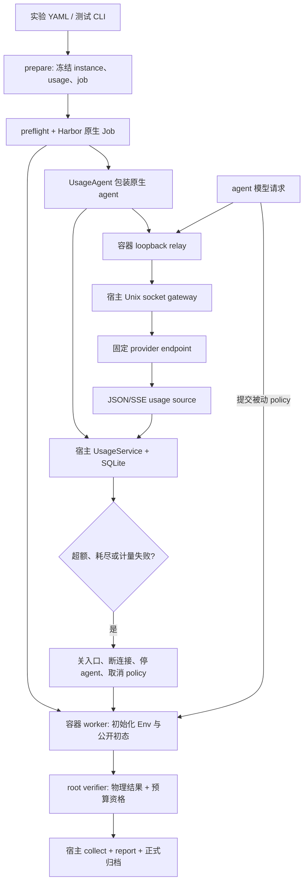

# Harbor token budget：项目目录、逐文件实现与 GPU 验收手册

> 2026-09-28 接口更新：任务文字统一放在各 rollout YAML 的 instruction，生成 instruction.md；spec/context/profile 格式为 v2，policy obs 不再包含 task.instruction。旧文中的 observation_profile.task_instruction 已移除。当前用法见 [Harbor runner](../../../harbor_runners/README.md)。

> 历史快照：下文保留改造前实现和命令。2026-09-28 已改为固定 OpenCode、完整 model-name 与统一 key；agent profile、agent_urls.yaml 和旧实验路径已迁移。当前 CLI 以 [runner 使用手册](../../../harbor_runners/README.md)为准，测试状态见[最新实施记录](opencode_model_key_implementation_20260928_zh.md)。下文“继续适用”等表述仅描述当时版本。

源码核对日期：2026-09-28。工程根目录：`/home/jianwen/topogym`。

本文保留初版实现的代码说明及真实测试入口；2026-09-28 模块化重构的当前状态见下一段。原始设计见[预算工程计划](harbor_token_budget_design_20260927_zh.md)，简明用法见[usage README](../../../topogym/agents/usage/README.md)。本文的 CLI 使用当前 `harbor_runners` 与 `topogym.agents.rollout`，不使用 `agents/deferred` 中的旧入口。

[共享 pipeline 与 agent 适配子模块重构](usage_pipeline_agent_adapters_plan_20260928_zh.md) 已落地，当前目录/模块接口见其第 2–5 节，实施证据与 OpenRouter GPU/API 命令见第 10 节。本地结果为 170 项 usage/Harbor + 26 项 rollout 合同通过。本文第 1–6 节描述初版快照：原 wrapper 的 `_routing/_provider`、内置 URL、单 gateway 和仅收尾 JSONL 已被独立 adapters、中央 YAML、共享多 route pipeline 与实时 publisher 替换；以重构文档为准。第 7 节双额度 CLI 继续适用。

## 1. 当前实现到了哪一步

本文的模型 gateway 是 token 预算开发新增的实现选择，原有 Harbor rollout 不以它为前提。`usage.mode: off` 使用原生 agent；agent 自行调用模型，通过 `topogym-rollout` CLI 向本地 worker 提交 policy。只有当前预算包装路径才创建 gateway，接收 agent 原本的模型请求并转发给 provider；没有另设向 agent 主动请求答案的模型调用循环。

共享核心在 `topogym/agents/usage/`，不依赖 agent 名称、模型 SDK、Harbor 或 simulator；它提供两份独立的 token 账本额度、请求准入、事件计量、动态调额与失败状态。Harbor 的接入层负责把模型请求经过网关、将计量结果交给核心、停止 agent/policy，并让最终评分失败。

**目前完成的是通用核心和三个具体入口的 observed 接线，并没有完成任意 agent 的自动接入。** GPT、Claude 等是模型/模型系列；Codex CLI、Claude Code、OpenCode 是调用模型并执行工具的 agent 程序。OpenCode 在本项目中是一个可选 agent 工具，目前这条预算接线使用 OpenRouter。

| 层次 | 已实现 | 尚未证明或尚不支持 |
|---|---|---|
| 通用计量 | input/output 分账、SQLite 事务、去重、并发预留、调额、失败锁定 | 不自行对任意模型运行 tokenizer |
| usage 协议 | Responses、Messages、Chat Completions 的 JSON/SSE receipt 归一化 | WebSocket、后台生成、服务端托管工具等未开放路径 |
| Harbor agent 入口 | Codex CLI、Claude Code、OpenCode 的路由和停止生命周期 | 其他 agent 的预算运行在准备阶段拒绝，需另加适配 |
| observed | 每个可解析的 usage 事件到达后同步计量和判定 | 无法保证服务端零超额，无法从普通文本 chunk 精确推导 token |
| strict | 已实现并测试双额度原子预留核心 | 当前实际 provider 接入全部拒绝 strict，缺少经验证的输入消费上界 |
| 本地验收 | 126 项宿主测试 + 26 项 rollout/方块合同测试通过 | 不是真实 Genesis/Nyx GPU 或付费模型测试 |
| 实际验收 | 已提供抓方块正例及 input/output 强停负例入口 | Docker、GPU、真实 provider 的组合测试仍待运行 |

默认限额为 **input 50,000,000 / output 20,000,000**，单位是 token 数，不是金额。抓方块配置显式改为 **3,000,000 / 1,000,000**。这些额度按 **trial** 计算；一次 trial 内所有经过同一网关的模型请求、工具循环、重试和子 agent 请求共同消耗额度。不同 attempts 是独立 trial，不共享一个 job 总额度。网关并不自动重建子 agent 的父子调用树。

旧实验配置的 `usage.mode: off` 继续关闭预算；核心默认值不代表所有实验已经自动启用预算。输入和输出不能互相借用：input 用完，即使 output 还有很多也不能继续发请求。

## 2. 开发后的项目目录

### 2.1 整体目录

下面保留当前根目录的所有条目，展开活动模块与本轮相关部分。大型资产、历史资料、虚拟环境和运行产物的内部文件折叠展示；它们并非本轮新建或修改。`[新]`、`[改]` 指本轮 usage 开发范围，不能把工作区其他会话的改动归入本轮。

```text
/home/jianwen/topogym/
├── AGENTS.md / CLAUDE.md              项目协作规则
├── README.md                         项目说明
├── pyproject.toml / ruff.toml         安装、CLI、静态检查配置
├── env_setup_gs121.sh                 simulator 环境安装入口
├── .dockerignore                     [改] 镜像构建上下文白名单
├── .gitignore / .gitattributes
├── topogym/                          可安装的主 Python 包
│   ├── README.md
│   ├── __init__.py                   [改] simulator 公共导出改为惰性加载
│   ├── agents/                       agent 对接；详见下一棵树
│   ├── assets/                       资产生成、资源与材料描述
│   ├── config/                       任务注册与场景配置解析
│   ├── simulator/                    唯一 Env、历史、权限、rollout_simulation
│   ├── tasks/                        各 Task 声明和成功/失败判据
│   ├── world/                        Genesis 物理、状态、实验室与视觉装配
│   ├── robot/                        机器人与动作执行
│   ├── solvers/                      IK/FK 等计算
│   ├── sensors/                      观测、Nyx RGB、相机
│   ├── planning/                     参考策略；examples/cube_pick_place.py 被复用
│   ├── recording/                    公共录制与录像封存
│   ├── data/                         状态、动作、轨迹数据
│   ├── evaluation/                   共享评估计算
│   └── utils/                        IO、数组、几何、快照等
├── harbor_runners/                   宿主 Harbor 编排；详见下一棵树
├── configs/
│   ├── harbor/                       当前 Harbor 实验和 agent profile
│   ├── agent_rollout/                旧 agent 配置，非本文入口
│   ├── camera_configs/ / common_configs/ / env_configs/
│   ├── hydra/ / prefab_configs/ / presentation_configs/
│   ├── recording/ / recording_policies/ / recording_profiles/
│   ├── robot_control_configs/ / run_configs/
│   ├── task_cards/ / task_configs/ / task_variants/
│   └── *.yaml / *.md                 各任务和历史实验配置、说明
├── docker/Dockerfile.topogym          [改] 共用 simulator/agent 镜像
├── requirements/                     包含 harbor-runner.lock
├── scripts/                          构建、准备与验收 CLI
├── tests/
│   ├── usage/                        [新] 计量、网关、relay 测试
│   ├── harbor/                       runner 与新增预算接线测试
│   ├── contracts/                    rollout 合同；本轮增加预算联动测试
│   ├── fixtures/                     cube_pick_place、cube_transfer 等测试 Task
│   ├── architecture/ / integration/ / unit/ / recording_data/
│   ├── conftest.py / README.md
│   └── *_evidence.py 等               公共验收证据与诊断工具
├── docs/
│   ├── README.md / progress/ / debug_logs/
│   └── develop/                      工程计划、模块用法与实施记录
├── assets/                           网格、纹理、机器人等资源
├── demos/                            已归档的任务视频
├── bash_scripts/                     其他批处理入口
├── legacy/                           历史源码，不是当前运行依赖
├── reports/                          汇报与历史报告
├── runs/                             测试报告、冻结任务、Harbor 原生产物
├── task_rollouts/                     simulator 正式 rollout 归档
├── outputs/ / build/ / topogym.egg-info/
├── .secrets/                         私有凭据；不展开内容
├── .venv-harbor/                      宿主编排环境，Python 3.12
├── .venv-gs121/ / .venv-gs121-nyx/     simulator 本地环境
├── .git/ / .claude/ / .external/
├── .cache/ / .pytest_cache/ / .ruff_cache/ / __nyx_cache__/
├── MUJOCO_LOG.TXT                     既有文件；不代表当前采用 MuJoCo
└── TopoGym_变体规划清单.docx
```

### 2.2 本轮涉及的代码与配置，展开到文件

```text
topogym/agents/
├── __init__.py
├── README.md                         [改] 新模块导航
├── deferred/                         历史 agent 工作，未接入本轮预算
├── usage/                            [新]
│   ├── __init__.py
│   ├── types.py
│   ├── budget.py
│   ├── store.py
│   ├── ledger.py
│   ├── service.py
│   ├── gateway.py
│   ├── relay.py
│   ├── README.md
│   └── sources/
│       ├── __init__.py
│       ├── common.py
│       ├── openai_responses.py
│       ├── anthropic_messages.py
│       └── chat_completions.py
└── rollout/
    ├── __init__.py
    ├── client.py                     复用公开 CLI 与 socket 客户端
    ├── public_artifacts.py           复用公共产物发布
    ├── protocol.py                   [改] root budget_stop / budget_status
    ├── worker.py                     [改] 预算终态、取消、最终 usage
    ├── policy_process.py             [改] policy 进程取消和幂等关闭
    └── verify.py                     [改] 预算失败强制 reward=0

harbor_runners/
├── __init__.py                       固定 Harbor 版本 0.23.0
├── README.md                         [改]
├── config.py                         [改]
├── task_generator.py                 [改]
├── preflight.py                      [改]
├── run.py                            [改]
├── collect.py                        [改]
├── rollout_output_report.py                         [改]
├── hooks.py                          复用恢复/清理逻辑
├── usage_bridge.py                   [改] off-only 占位变成配置/能力桥接
├── supervisor.py                     [新]
├── templates/instruction.md          [改]
└── agents/
    ├── __init__.py
    ├── credentials.py                复用私有凭据读取与脱敏
    ├── resolve.py                    复用 Harbor 原生 agent 解析
    ├── scripted.py                   [改] 增加 pick-cube 场景
    └── usage_adapter.py              [新]

configs/harbor/
├── pick_cube_budget.yaml             [新] 真实抓方块，3M / 1M
├── smoke_scripted.yaml / smoke_api.yaml / cast_coil_sweep.yaml
├── credentials.env.example
└── agents/
    ├── README.md                    profile 字段合同与第三方接入说明
    ├── profiles/
    │   ├── codex.yaml
    │   ├── claude_code.yaml
    │   └── opencode_openrouter.yaml
    └── templates/
        ├── template_custom.yaml       自定义 Harbor 类；占位值须填写
        └── template_env_http.yaml     通用 gateway 绑定模板；占位值须填写

scripts/
├── create_harbor_agent_profile.py     参数化生成、校验 profile 的宿主 CLI
├── test_harbor_pipeline.py            [改] 抓方块正例与两种预算负例
├── setup_harbor_runner.sh             复用，准备宿主环境
├── build_harbor_image.sh              复用，构建共用镜像
└── test_scripted_policy_rollout.py     复用，可独立核对 GPU 参考策略

tests/
├── usage/
│   ├── test_imports.py / test_ledger.py / test_sources.py
│   └── test_gateway.py / test_relay.py
├── harbor/
│   ├── test_runner.py / test_credentials.py              既有回归
│   ├── test_usage_bridge.py / test_usage_lifecycle.py    [新]
│   └── test_supervisor.py / test_pick_cube_budget.py     [新]
├── contracts/
│   ├── test_rollout_service.py                          [改]
│   └── test_cube_pick_place_policy.py / test_cube_transfer_task.py
└── fixtures/
    └── cube_pick_place.py / cube_transfer.py             复用，没有放宽判据
```

目录名 `usage` 表示统计与预算机制；`rollout` 表示 agent 提交策略并驱动既有 simulator；`harbor_runners` 表示宿主编排。没有新增第二套物理循环，没有修改 Harbor 安装包，也没有复制任务源码到每个 Harbor task。

## 3. 一次任务怎样经过计量、停止和评分



1. `prepare()` 解析 agent/profile，校验预算能力，生成只读任务配置与哈希清单。预算模式将原生 agent 包装成 `UsageAgent`。
2. 容器 worker 建立唯一 Env，原生 healthcheck 等初始观测可用。安装 agent 的 setup 阶段可联网；预算 trial 的 agent/verifier 运行阶段配置 `no-network`。
3. 宿主持有真实 API key；容器 agent 只取得 trial 临时 token 和 loopback 地址。relay 把请求转到宿主的 Unix socket 网关。策略进程使用另一 UID，不持有模型凭据。
4. 网关在发送前准入；收到 provider usage 后先入账和判定，再转发相应响应。计数来自 provider receipt，不是从 agent 的文字日志猜测，也不把多份日志重复累加。
5. 预算失败锁定之后，网关关闭请求入口并取消上游连接。supervisor 停止该 trial 的 agent UID 进程，调用 root admin socket 取消排队/运行中的 policy。无法确认停止时升级停止该 trial 容器。
6. 能正常收尾时保留 worker 完成媒体封存，由 verifier 给 0 分；不能收尾时记录基础设施/证据不完整失败。已经发生的物理成功可保留为事实，但不能覆盖预算失败。

### 3.1 “检测粒度”具体指什么

| 环节 | 当前粒度/参数 | 正确理解 |
|---|---|---|
| provider 计量可见性 | 对方提供 usage 的每个 JSON/SSE 事件 | 对方只在末尾提供 usage，就只能在末尾知道精确用量 |
| receipt 入账与预算判断 | 每事件同步 SQLite 事务 | 不等到 agent 完成，不依赖轮询才计算 |
| 宿主监控、调额传播 | 默认 `watchdog_interval_ms: 100`，可设 1–1000 | usage service 和 adapter 监控各有调度；不是端到端 100ms 保证 |
| 容器公开 budget 文件 | relay 默认每 100ms 刷新 | 供观察，文件写入不是预算判定的权威入口 |
| relay 检测宿主失联 | 连续失败约 1s，另加连接超时/调度 | 本地紧急取消，不能等价于精确 1s SLA |
| 停止宽限 | `stop_grace_ms: 1000`，可设 1–10000 | 用于停止确认；root 命令、容器停止、封存有各自超时 |

网关会压低普通生成请求的最大输出 token；调用方不指定时先用 8192，再受剩余额度限制。`/responses/compact` 没有可用输出 cap，不能套用同一保证。**关闭 HTTP 连接不能证明服务端立即停止生成或计费。** 因此 observed 可以记录实际 overshoot 并强停本地任务，但不是“永远不超过额度”的严格保证。

## 4. 逐个脚本的代码逻辑

下文说明本轮新增/修改文件的关键函数、数据流和失败行为；未修改但被调用的文件单独标明“复用”。链接可直接进入源码。

### 4.1 通用 usage 核心

#### `types.py`：规范数据，避免把未知或非法值当作零

[源码](../../../topogym/agents/usage/types.py)。`BudgetPolicy` 定义 input/output 限额和 observed/strict 模式。`UsageEvent` 定义 `request_id`、`event_id`、`sequence`、`source`、两种 token、累计/增量语义、`final` 和附加明细。`token_count()` 只接受非负整数；`True`、浮点数、字符串均拒绝。

`None` 表示未知；例如流开始只拿到 input，就让 output 保持未知。`BudgetStopped` 携带终态快照，`CapacityUnavailable` 表示额度暂时被其他在途请求预留，并非永久预算失败。

#### `budget.py`：独立判断两维预算，并锁定第一次失败

[源码](../../../topogym/agents/usage/budget.py)。`check()` 对 input/output 分别比较，**已用量大于限额**才形成 `budget_exceeded`。正好等于限额允许当前请求完成；之后申请新请求没有容量，则为 `budget_exhausted`。

`stop()` 生成唯一 `stop_id`，保存失败原因、维度、判定 wall time/monotonic time、当时额度、用量和 policy revision，并关闭准入。后续成功回执、普通结束、提高额度，都不能覆盖首次失败。

#### `store.py`：持久化、事务和原子文件发布

[源码](../../../topogym/agents/usage/store.py)。SQLite 有 `scope`、`requests`、`events`、`audit` 四张表，分别存 trial、请求、去重事件和审计记录。事务使用 `BEGIN IMMEDIATE`、`synchronous=FULL`，把并发准入和更新串行化；数据库是权威状态。

`atomic_json()` 通过临时文件、fsync 和替换发布完整快照，避免读到半份 JSON。`export_events()` 在收尾阶段把数据库审计记录导出为 `events.jsonl`；运行中的完整审计在 SQLite，不能把 JSONL 文件当作持续刷新的实时流。

#### `ledger.py`：请求生命周期与完整计量

[源码](../../../topogym/agents/usage/ledger.py)。`UsageLedger` 重新打开已有数据库时不重置余额；trial identity 必须匹配。主要方法如下：

| 方法 | 输入与动作 | 关键边界 |
|---|---|---|
| `admit()` | 新上游尝试 ID、来源、模型、input/output 上界；事务内占用容量 | strict 必须给可信 input 上界；observed 的未知 input 不构成输入上界保证 |
| `mark_sent()` | 把预留请求标为已发送 | 已关闭或重复发送均拒绝 |
| `release_unsent()` | 释放确实尚未发送的请求 | 已发出但没有 receipt 的请求不能释放成“零消费” |
| `record()` | 接收 `UsageEvent`、去重、更新请求及 trial 累计值 | 累计取差值，增量严格检查连续序号；来源冲突、回退、缺失结算失败 |
| `snapshot()` | 输出额度、confirmed usage、预留、剩余、按模型汇总和终态 | 部分已知用量只是下界，必须同时看 `usage_complete` |
| `update_limits()` | 期望 revision、操作者、原因、新双额度 | 拒绝过期 revision；下调到已用量以下立即失败；失败不复活 |
| `finalize()` | 关闭准入并检查所有请求结算 | Harbor 使用 `require_requests=True`，没有模型 receipt 也不能预算通过 |

计算关系为 `remaining = limit - confirmed_usage - pending_reservation`；pending 为尚未完成请求的 `max(0, reservation - confirmed)` 之和。每次实际发到上游的重试使用新的 request ID，同一 receipt 重复到达使用相同 event ID 去重。

累计例子：同一请求先报告 output=2，再报告 output=5，最终累计是 5，不是 7。相同事件 ID 内容发生变化属于 `usage_conflict`。最终事件仍缺 input 或 output 属于 `usage_incomplete`。迟到最终回执可以补齐账目，但不能消除已经产生的失败。

strict 并发例子：额度 100/40，请求 A 预留 60/30；此时 B 想预留 50/20，属于暂时容量不足。A 最终实际用 40/10 后，B 才能进入。这个核心能力已实现，**当前 Harbor provider 接线仍不能启用 strict**。

#### `service.py`：计量立即判定，监控独立运行

[源码](../../../topogym/agents/usage/service.py)。`UsageService` 持有 ledger、停止事件和后台线程。`record()` 同步更新账本，有失败立即设置 `stopped`，不等待快照落盘。`refresh()` 发布 `snapshot.json`；后台线程检测热更新和异常。恢复时发现未结算请求会失败，避免跨进程重启漏账。`close()` 停线程、刷新最终快照并导出审计。

#### `sources/common.py`：规范来源事件身份

[源码](../../../topogym/agents/usage/sources/common.py)。`ReceiptSource` 保存请求内的累计维度，生成事件序号和基于规范化内容的事件身份。重复 payload 返回相同事件，支持账本去重；只报告一个维度时保留另一维度已知值。provider 的请求 ID/时间可作为明细保留，并不替代网关的上游尝试 ID。

#### 三个 usage source：把不同协议转换为同一事件

| 文件 | 解析逻辑 | 简单例子 |
|---|---|---|
| [openai_responses.py](../../../topogym/agents/usage/sources/openai_responses.py) | 从 response 读取 input/output；completed/incomplete/failed 等终态或非流响应完成结算；compact 使用同类归一化 | input=100、其中 cached=80，input 总数仍为 100；output=20、其中 reasoning=12，output 仍为 20 |
| [anthropic_messages.py](../../../topogym/agents/usage/sources/anthropic_messages.py) | 合并 message_start/message_delta，message_stop 终结；输入为普通 input + cache creation + cache read | 三项为 10、20、30 时 input=60；output 累计从 1 变 9 时最终为 9 |
| [chat_completions.py](../../../topogym/agents/usage/sources/chat_completions.py) | prompt_tokens → input，completion_tokens → output；忽略无 usage 的内容 chunk，处理流末 usage 和非流响应 | 返回很多文本 chunk 但无最终 usage，不能按文本长度猜数后判预算通过 |

这些文件只负责协议归一化，不停止容器。缓存/推理明细保留但不重复计入协议已经包含的总数；这也不是按 provider 价格折算后的费用。

#### `gateway.py`：模型请求的统一入口

[源码](../../../topogym/agents/usage/gateway.py)。`Gateway` 使用标准库 HTTP server；本地测试可用 TCP，Harbor 使用每 trial 独立 Unix socket。上游地址由宿主 profile 选定，请求方不能在请求里任意指定目的地。

处理顺序是：校验临时凭据和入口状态 → 校验协议/请求参数 → 限制输出 cap → `admit()` → `mark_sent()` → 发请求 → 解析并记录 JSON/SSE usage → 转发响应。SSE 按完整事件帧处理，不将每个网络数据包或文本片段当作 token。

已支持的主要路径是 `/responses`、`/responses/compact`、`/messages`、`/chat/completions`，并处理相应 `/v1` 前缀。流式 Chat 请求会开启 `stream_options.include_usage`。`GET /budget` 在鉴权后读取当前快照。

错误行为包括：错误临时凭据 401；暂时预留不足 429；预算停止拒绝后续请求；有效凭据访问未支持的模型端点、缺 usage、上游异常等按可信计量无法完成处理并失败。后台生成、`n != 1`、托管工具、chunked 请求等尚未开放。`cancel()` 关闭在途实际 socket；`close()` 有限等待处理线程收尾并移除 socket。

#### `relay.py`：容器连接宿主，并监测宿主失联

[源码](../../../topogym/agents/usage/relay.py)。容器内 loopback TCP server 将原始流量转发到只读挂载目录中的 Unix socket。只读挂载限制文件修改，不妨碍连接既有 socket。relay 不持有真实 provider key。

`watch_budget()` 轮询宿主 `GET /budget`，将快照原子发布为 `/rollout/budget.json`。持续失联会触发 `emergency_stop()`：写入计量不可用失败、通过 root 管理 socket 取消 worker，并终止 agent/policy UID 的进程。该机制是宿主监控失效后的容器侧补充。

#### 包初始化与顶层惰性导入

[usage/__init__.py](../../../topogym/agents/usage/__init__.py) 导出 `BudgetPolicy`、`UsageEvent`、`UsageLedger` 和异常；[sources/__init__.py](../../../topogym/agents/usage/sources/__init__.py) 组织协议来源。[topogym/__init__.py](../../../topogym/__init__.py) 对 simulator 公共接口惰性导入，因此宿主仅导入 usage 不会加载 NumPy/Genesis。核心新增代码只用标准库，没有为计量额外添加模型 SDK。

### 4.2 Harbor 配置、agent 接入与强制停止

#### `usage_bridge.py`：预算配置与能力门禁

[源码](../../../harbor_runners/usage_bridge.py)。`validate_usage()` 将 YAML 规范化：只支持 trial scope、计量不可用即失败、独立双额度、监控间隔和停止宽限。`off` 下不能悄悄接受一组实际不执行的限额。

`require_capabilities()` 要求已适配的 agent、显式 model、允许的原生参数；当前拒绝 strict 和未适配 agent。OpenCode 限制为 `openrouter/` 模型前缀。`wrap_agent()` 生成 `UsageAgent` 的原生 Harbor 配置，不把真实 key 放进 agent env。`socket_directory()` 用 run 绝对路径的哈希产生短 `/tmp/topogym-usage-...` 路径，避免 Unix socket 路径长度限制。

#### `agents/usage_adapter.py`：原生 agent 外围的生命周期包装

[源码](../../../harbor_runners/agents/usage_adapter.py)。`UsageAgent` 通过 Harbor factory 创建原生 agent，继续复用其安装、执行和日志解析能力。

- `setup()` 用不可用临时 key 和 loopback 占位地址完成原生安装；真实模型凭据不交给容器安装程序。
- `_routing()` 为 Codex 设置 Responses 地址，为 Claude Code 设置 Messages 地址，为 OpenCode 覆盖 OpenRouter 配置并限制 enabled providers。
- `_new_delegate()` 收窄环境变量来源，避免原生 adapter 从宿主环境带入其他 key/OAuth 配置。
- `run()` 检查原生 `NO_NETWORK` 阶段，创建每 trial ledger/gateway，启动容器 relay；随后并行等待原生 agent 结束或预算监控触发。
- 触发失败时先取消模型连接，再 `stop_trial()`，保存 `stop.json`；最后 finalize 账本并发布可信 usage。
- 正常可收尾的预算失败不通过抛异常跳过 verifier，而是让 verifier 正常执行并输出 0 分。其他运行异常保留异常语义。
- `populate_context_post_run()` 可以让原生 adapter 解析日志，但最终 input/output 用权威快照覆盖，避免重复计量。

`RunEnvironment.exec()` 在停止后拒绝启动新 agent 工作，覆盖原生 adapter 的清理阶段又发起命令这一边界。取消、relay 退出、gateway 关闭和事件导出都在有限等待的收尾流程中执行。

#### `supervisor.py`：停止当前 trial 并记录证据

[源码](../../../harbor_runners/supervisor.py)。`publish_usage()` 用 root 身份原子写入 `/trial/rollout/usage_final.json` 和公开 budget 文件；需要时调用 root `budget_stop`。`stop_trial()` 同时执行两件事：扫描并强制终止该容器 agent UID 的进程；通知 worker 取消 policy 和排队提交。

随后读取 `budget_status` 确认执行已停止，记录 `cancel_sent_at`、`agent_stopped_at`、`worker_stopped_at` 及 monotonic 时间。确认失败则停止该 trial 的 environment，并标记证据可能不完整。停止计算与等待视频封存分开处理，不用“视频还在编码”推断 policy 仍在执行。`stop_process_group()` 是本地测试用的进程组停止辅助函数，不替代容器内 UID 管理。

#### 配置到任务生成的三个文件

| 文件 | 本轮逻辑与结果 |
|---|---|
| [config.py](../../../harbor_runners/config.py) | 将 usage 纳入实验校验；接受 `cube_pick_place` fixture，要求 fixture 与 task_id 匹配；其余 simulator 参数仍走既有解析 |
| [task_generator.py](../../../harbor_runners/task_generator.py) | `prepare()` 冻结 `instance.json`、`usage.json`、instruction、task.toml、Compose 和 job.json；预算任务挂载 socket 目录、去掉 NET_RAW、设置 agent/verifier no-network；保留 setup 安装阶段；生成 manifest，任务定义只读 |
| [preflight.py](../../../harbor_runners/preflight.py) | 检查冻结哈希、Harbor 0.23.0、凭据、能力、Docker/Compose/镜像；预算路径要求本机 Linux Docker；镜像探针检查 usage 与 fixture 身份。探针不代表 GPU 物理或真实 provider 已通过 |

`task_generator.py` 的 GPU 分配通过 Compose 的 NVIDIA runtime/device requests，不能静默改成 CPU。每个 task 只挂载小配置和 socket，不挂载整个源码目录。原生 Job 禁用自动 retry；`attempts` 是计划中的独立重复试验。

#### `run.py`：宿主启动、状态查询与调额 CLI

[源码](../../../harbor_runners/run.py)。`prepare/run` 增加 `--usage-mode`、`--input-token-limit`、`--output-token-limit`；`apply_usage_args()` 合并参数并拒绝 off + limits。`launch()` 检查并创建 socket 目录，启动原生 Harbor 子进程，最后进行收集、汇总和清理。

`usage-status --trial-dir` 从 SQLite 查询权威状态；`usage-update` 将新限额、revision、当前宿主用户名和原因写入受信事务。修改公开 JSON 或已经冻结的 YAML 不会成为有效运行中调额。

通用 `run` 的零退出主要表示 pipeline 完整；具体任务是否完成应读 verification。本文的 `--case pick-cube` 进一步要求真实 `task_success=true`，不会把 pipeline 完整当作抓方块成功。

#### `collect.py` 与 `rollout_output_report.py`：归档不能掩盖预算失败

[collect.py](../../../harbor_runners/collect.py) 检查封存、文件哈希和 Harbor 导出，将有效 rollout 收到 `task_rollouts/`，支持中断后的恢复。预算 trial 必须有宿主权威快照；不合格时即使缺少容器最终导出也保留失败，不凭旧 reward 变成成功。宿主 `stop.json` 的内容写入 `rollout_index.json` 的 `stop_timings`；它不是自动新增到 simulator 归档中的文件。

[rollout_output_report.py](../../../harbor_runners/rollout_output_report.py) 保留旧 `success_rate` 的可评分任务分母，并新增 `budget_success_rate`：分母为所有计划中的正式 task trials，分子为 pipeline 完整、预算合格且 reward=1 的任务。预算失败、未收集 trial 都不能从新指标分母消失。`confirmed_usage` 只是已确认用量之和，须同时读 `usage_failed_trials`、`missing_trials` 和不完整状态。

#### scripted、instruction 和既有辅助文件

| 文件 | 用途 |
|---|---|
| [agents/scripted.py](../../../harbor_runners/agents/scripted.py) | 新增 `pick-cube` 场景，提交只负责 `act(obs)` 的参考 policy，等待完成并检查 RGB；不调用模型，所以 budget off |
| [templates/instruction.md](../../../harbor_runners/templates/instruction.md) | 给 agent 公开 rollout 操作合同和预算信息，说明通过 CLI 提交策略；失败判定仍由可信管理侧执行 |
| [agents/resolve.py](../../../harbor_runners/agents/resolve.py)，复用 | profile → Harbor 原生 agent 配置；不是新的计量实现 |
| [agents/credentials.py](../../../harbor_runners/agents/credentials.py)，复用 | 读取私有 dotenv，现有环境变量优先，禁止宽权限凭据文件；对宿主日志做字面 secret 脱敏 |
| [hooks.py](../../../harbor_runners/hooks.py)，复用 | 根据当前 run 身份恢复导出、清理已可安全收集的资源；不清理其他 run 的容器 |
| `__init__.py`、`agents/__init__.py`，复用 | 包初始化、固定版本等，不承担第二套任务执行 |

### 4.3 Rollout 如何接受预算失败

| 文件 | 关键代码逻辑 | 例子 |
|---|---|---|
| [protocol.py](../../../topogym/agents/rollout/protocol.py) | 新增并校验 root 管理操作 `budget_stop`、`budget_status`；普通 agent 提交接口不能伪造预算管理消息 | agent 可以 submit policy，不能把预算改成无限 |
| [worker.py](../../../topogym/agents/rollout/worker.py) | `RolloutSession.cancel()` 锁定预算原因，拒绝新提交、取消排队/活动 policy；`budget_status()` 区分执行停止与媒体收尾；`finish()` 将可信 usage 放入 session_final | 先发生 budget_stop，后收到 agent_finished，也仍按预算失败结束 |
| [policy_process.py](../../../topogym/agents/rollout/policy_process.py) | 取消事件与关闭锁保证重复 cancel/close 安全；杀 policy 进程组并回收；处理管道关闭异常 | `act()` 长时间阻塞时不等其自行返回才停止 |
| [verify.py](../../../topogym/agents/rollout/verify.py) | 读取最终可信 usage 覆盖较早 session 快照；只有 closed、complete、qualified、无失败才通过预算；失败强制 `reward=0`、`pipeline_passed=false`、`outcome=failed` | 方块已经放稳但后续模型请求超额，`task_success` 可保留 true，最终仍失败 |

`worker.py` 从 `/etc/topogym/usage.json` 读冻结设置；只有受信管理侧可写 `/trial`。`verify.py` 延用公共产物哈希核对和 archive seal，停止失败不会绕过证据完整性检查。[client.py](../../../topogym/agents/rollout/client.py) 与 [public_artifacts.py](../../../topogym/agents/rollout/public_artifacts.py) 的既有 CLI/socket 和公开产物功能继续复用。

### 4.4 方块用例、镜像与验收脚本

#### `configs/harbor/pick_cube_budget.yaml`

[配置](../../../configs/harbor/pick_cube_budget.yaml) 默认 OpenCode/OpenRouter profile、observed 3M/1M、单 attempt、单并发、1 GPU、1800s agent timeout。CLI 可以换为 Codex/Claude Code，且必须提供实际 model ID。

该用例注册测试 fixture `cube_pick_place`，使用 `panda_robotiq`、`EE_ABS`、CUDA、Nyx RGB、seed 0、`physics_dt_s=0.025`、`solver_substeps=40`、`control_decimation=1`、最多 1000 物理步。它开放 world 观测并允许复用 `CubePickPlacePolicy`，验证真实动作、计量和停止链路；**不宣称验证视觉推理能力**。

复用的 [cube_pick_place.py](../../../tests/fixtures/cube_pick_place.py) 与 [cube_transfer.py](../../../tests/fixtures/cube_transfer.py) 检查实际抓起、至少抬高 5cm 并保持 0.2s、放回、松爪、撤离和稳定。抓放用例的目标是原位，仍需放置误差不大于 2cm、桌面间隙不大于 3mm、线速度不大于 1cm/s、角速度不大于 0.1rad/s、夹爪撤离至少 5cm并稳定 0.5s；不是只看到机器人动了就成功。既有 transfer 的 15cm 搬运要求没有被改小。

#### `scripts/test_harbor_pipeline.py`

[源码](../../../scripts/test_harbor_pipeline.py)。脚本先创建 `runs/test_results/<run-id>/report.json`，记录源码身份，再生成冻结任务并记录 manifest 哈希；之后运行真实 Harbor 或只准备。付费用例必须显式 `--allow-api`；`--prepare-only` 不启动 Docker/GPU/API。

| case | 行为 | 测试通过条件 |
|---|---|---|
| `isolation` | Docker 内检查 UID、私有文件、policy 网络禁用和阻塞 policy 取消 | 隔离断言通过；无需 GPU、无需模型；并非全部模型出站隔离的实际验收 |
| `pick-cube-scripted` | 用参考 policy 真实抓放，强制 budget off | 归档齐全、pipeline 通过、task_success=true、reward=1 |
| `pick-cube` | 真实模型操作相同抓放任务 | 上述物理条件全部满足，且 budget_qualified=true |
| `budget-input` | 默认 input=1、output=1M | 目标 input 维度预算失败、reward=0、完整归档和 agent/worker 停止时间 |
| `budget-output` | 默认 input=3M、output=1024；提示持续调用直到预算结束 | 目标 output 维度预算失败、reward=0、完整归档和 agent/worker 停止时间 |
| `scripted` / `invalid` / `cancel` / `api` / `sweep` | 保留原有 pipeline、非法动作、取消、模型 smoke、批量任务入口 | 各用例原有断言；不能替代真实抓方块和预算双负例 |

负例预期原因接受 `budget_exceeded` 或 `budget_exhausted`。只有测试预期全部满足，脚本才返回 0 并记 `expectation_met=true`；**trial 自身仍是 failed，reward 仍为 0**。provider 拒绝参数、自然提前退出、普通超时或基础设施错误，都不能冒充预算负例通过。

#### 构建及复用的测试入口

| 文件 | 本轮关系 |
|---|---|
| [docker/Dockerfile.topogym](../../../docker/Dockerfile.topogym) | 增加 cube_pick_place fixture；`topogym/` 整包复制已包含新 usage；agent 共用一个镜像，不为不同模型复制 simulator |
| [.dockerignore](../../../.dockerignore) | 将新增 fixture 纳入构建上下文允许项；不把宿主凭据或运行目录带入镜像 |
| [scripts/setup_harbor_runner.sh](../../../scripts/setup_harbor_runner.sh)，复用 | 用 uv 建 Python 3.12 宿主环境，安装 `harbor-runner.lock` 和项目 editable 包；宿主编排不需 Genesis/GPU |
| [scripts/build_harbor_image.sh](../../../scripts/build_harbor_image.sh)，复用 | 按共用 Dockerfile build 给定 tag，并打印 image ID |
| [scripts/test_scripted_policy_rollout.py](../../../scripts/test_scripted_policy_rollout.py)，复用 | 不经过模型和 Harbor，可独立验证 GPU 参考策略；结果不等于 Harbor 预算验收 |
| [topogym/planning/examples/cube_pick_place.py](../../../topogym/planning/examples/cube_pick_place.py)，复用 | 被动参考 policy，复用既有 `act(obs)` 调度，没有为预算增加另一套抓放实现 |

### 4.5 每个测试文件验证什么

| 测试文件 | 核心覆盖 |
|---|---|
| [usage/test_imports.py](../../../tests/usage/test_imports.py) | usage 导入不加载 simulator/NumPy/Harbor |
| [usage/test_ledger.py](../../../tests/usage/test_ledger.py) | 两维边界、重复/乱序/冲突、未知值、并发预留、重启、热更新、失败不可复活 |
| [usage/test_sources.py](../../../tests/usage/test_sources.py) | 三种协议，缓存/推理口径，部分累计、最终缺失、重复事件 |
| [usage/test_gateway.py](../../../tests/usage/test_gateway.py) | 本地 fake provider 的真实 HTTP/流式连接、输出 cap、错误/缺 usage、断连和关闭 |
| [usage/test_relay.py](../../../tests/usage/test_relay.py) | 通过真实 Unix gateway 查询 budget、公开文件刷新、宿主失联回调 |
| [harbor/test_usage_bridge.py](../../../tests/harbor/test_usage_bridge.py) | 配置与能力拒绝、三种 agent 路由、环境凭据隔离、生成配置和失败汇总 |
| [harbor/test_usage_lifecycle.py](../../../tests/harbor/test_usage_lifecycle.py) | 包装层正常/超额生命周期、真实 Unix gateway、取消后不再启动 agent 工作；模拟容器环境 |
| [harbor/test_supervisor.py](../../../tests/harbor/test_supervisor.py) | 真实本地父子进程组停止；模拟 environment 下只停止所属 trial、停止时间和升级路径 |
| [harbor/test_pick_cube_budget.py](../../../tests/harbor/test_pick_cube_budget.py) | 3M/1M 配置、付费开关、prepare-only、未 solved 的任务不能冒充通过 |
| [contracts/test_rollout_service.py](../../../tests/contracts/test_rollout_service.py) | root budget_stop、真实 policy 子进程取消、失败不被迟到物理成功覆盖；保留既有合同回归 |
| [contracts/test_cube_pick_place_policy.py](../../../tests/contracts/test_cube_pick_place_policy.py) | 抓放参考策略合同回归 |
| [contracts/test_cube_transfer_task.py](../../../tests/contracts/test_cube_transfer_task.py) | 搬运任务判据回归，防止为了测试通过放宽原有目标 |
| [harbor/test_runner.py](../../../tests/harbor/test_runner.py)、[test_credentials.py](../../../tests/harbor/test_credentials.py) | 既有 runner 生成/收集/报告及私有凭据回归 |

## 5. 不调用模型也能运行的核心示例

### 5.1 两次请求：去重、累计与超额

以下代码只在临时目录建立 SQLite。它展示 provider 已给出计量之后的行为，不会真的生成 token；正式网关负责将实际 usage 转成同样的事件。

```bash
cd /home/jianwen/topogym
.venv-harbor/bin/python - <<'PY'
from pathlib import Path
from tempfile import TemporaryDirectory
from topogym.agents.usage import BudgetPolicy, UsageEvent, UsageLedger

with TemporaryDirectory() as directory:
    ledger = UsageLedger(Path(directory) / 'ledger.sqlite',
                         scope_id='demo', policy=BudgetPolicy(10, 10))
    ledger.admit('r1', source='demo', output_bound=5, model='demo-model')
    ledger.mark_sent('r1')
    first = UsageEvent('r1', 'e0', 0, 'demo', input_tokens=6, output_tokens=2)
    ledger.record(first)
    ledger.record(first)  # 重复收到同一事件，不重复收费
    snapshot = ledger.record(UsageEvent('r1', 'e1', 1, 'demo',
        input_tokens=6, output_tokens=3, final=True))
    assert (snapshot['input_tokens'], snapshot['output_tokens']) == (6, 3)

    # observed 尚无第二次请求的精确 input；响应回来才能确认。
    ledger.admit('r2', source='demo', output_bound=5, model='demo-model')
    ledger.mark_sent('r2')
    snapshot = ledger.record(UsageEvent('r2', 'e0', 0, 'demo',
        input_tokens=5, output_tokens=2, final=True))
    assert (snapshot['input_tokens'], snapshot['output_tokens']) == (11, 5)
    assert snapshot['failure_reason'] == 'budget_exceeded'
    assert snapshot['stop']['dimensions'] == ['input_tokens']
    assert snapshot['overshoot']['input_tokens'] == 1
    assert ledger.finalize(require_requests=True)['budget_qualified'] is False
    print('input=11, output=5; input 超额 1；trial 失败且不再接受新请求')
PY
```

### 5.2 普通实验启用默认额度

在新的 Harbor 实验 YAML 中设置下面这一段即可使用 50M/20M；不是要求去修改已经冻结的 run 文件。抓方块 YAML 自身已显式覆盖成 3M/1M。

```yaml
usage:
  mode: observed
  scope: trial
  limits:
    input_tokens: 50000000
    output_tokens: 20000000
  on_usage_unavailable: fail
  watchdog_interval_ms: 100
  stop_grace_ms: 1000
```

省略 `limits` 也会应用上述默认双额度；运行中变更用第 7.8 节的 `usage-update`，不要编辑公开 budget 文件。

## 6. 已执行的初步测试及证据范围

上一轮实际报告位于 [runs/test_results/harbor_usage_20260927/report.json](../../../runs/test_results/harbor_usage_20260927/report.json)：宿主 126 passed，rollout/方块合同 26 passed，两组均 0 skipped，共 **152 passed**。2026-09-28 整理本文时，重新核对报告记录的 56 个源码/测试/配置文件 SHA-256，均与报告一致；这次文档更新没有重新宣称运行真实 GPU/API 测试。

报告中的 100 次同步 receipt/SQLite 事务耗时为 median 2.87ms、P99 6.77ms、max 6.89ms；单个最终事件接收至失败决定为约 0.225ms。这是本地样本，**不含 provider 回报延迟、Docker 调度、agent/policy 停止和 GPU 收尾**，不能据此宣称端到端毫秒级强停。

复跑本地检查的命令如下。第一组需要可用的本地 TCP/Unix socket 和子进程；第二组使用确定性 CPU world 和真实控制/子进程代码，无付费请求、不启动真实 GPU 物理。

```bash
cd /home/jianwen/topogym
.venv-harbor/bin/python -m pytest --confcutdir=tests/usage tests/usage tests/harbor -q
.venv-gs121-nyx/bin/python -m pytest \
  tests/contracts/test_rollout_service.py \
  tests/contracts/test_cube_pick_place_policy.py \
  tests/contracts/test_cube_transfer_task.py -q
```

上轮沙箱探针不能访问 Docker socket/NVIDIA 驱动，所以尚无真实组合验收记录；这不等于宿主机器一定没有 GPU。后续以用户在实际 GPU 环境执行下面 CLI 后产生的报告为准。

既有 [runner README](../../../harbor_runners/README.md) 记录过另一阶段的 GPU 两段运动和 OpenCode API smoke；这些是原先 pipeline 的证据，不能替代本轮新增预算网关、抓方块和强停链路的验收。

## 7. 用户在实际 GPU 环境运行的完整 CLI

### 7.1 环境与镜像

需要本机 Linux Docker、Compose v2、可用 NVIDIA 驱动/Container Toolkit，以及构建/安装时的网络。预算 Unix socket 方案不支持远程 Docker daemon。容器不会自动退回 CPU 或其他渲染器；GPU/Nyx 不可用就应明确失败。

```bash
cd /home/jianwen/topogym
bash scripts/setup_harbor_runner.sh
docker info
docker compose version
nvidia-smi
bash scripts/build_harbor_image.sh topogym-rollout:usage-v1
```

已有 `.venv-harbor` 可跳过 setup；镜像必须包含这次 usage 代码和新 fixture，因此先重建 `usage-v1`。宿主 `.venv-harbor` 只负责编排；真实仿真在镜像里，不要求宿主先安装 Genesis。下面统一使用 GPU 0，可按实际机器修改。

在同一个 shell 中设置本次命令的公共变量。每次重跑更新 TAG，避免覆盖已有冻结任务；profile/model 两项按第 7.4 节选择，先不用设置即可执行无模型测试。

```bash
export TOPOGYM_USAGE_TAG="$(date -u +%Y%m%dT%H%M%SZ)"
export TOPOGYM_USAGE_GPU=0
export TOPOGYM_USAGE_RUN="pick_cube_budget_${TOPOGYM_USAGE_TAG}"
```

### 7.2 容器隔离测试：无需 GPU、无需模型

```bash
.venv-harbor/bin/python scripts/test_harbor_pipeline.py \
  --case isolation --image topogym-rollout:usage-v1 \
  --run-id "usage_isolation_${TOPOGYM_USAGE_TAG:?Set the run tag}"
```

预期 CLI 返回 0，报告为 passed；该阶段核对 policy 权限和取消能力，不计模型 tokens。

### 7.3 真实 GPU 抓方块：先验证物理与归档

```bash
.venv-harbor/bin/python scripts/test_harbor_pipeline.py \
  --case pick-cube-scripted --image topogym-rollout:usage-v1 \
  --gpu-devices "${TOPOGYM_USAGE_GPU:?Set GPU device}" \
  --attempts 1 --concurrency 1 --seed 0 --timeout-sec 1800 \
  --run-id "pick_cube_scripted_${TOPOGYM_USAGE_TAG:?Set the run tag}"
```

预期真实抬起、持稳、原位放回、松爪、撤离并稳定；`task_success=true`、reward=1、完整多视角录像。该 case 自动将预算设为 off；它隔离验证 GPU/策略/Harbor 流程，不代表预算计量通过。

如果需要单独定位参考策略的物理问题，可选执行以下既有本地入口。这需要已安装 `.venv-gs121-nyx`，不经过 Docker、Harbor 或模型，不替代上面的容器验收：

```bash
CUDA_VISIBLE_DEVICES="${TOPOGYM_USAGE_GPU:?Set GPU device}" \
  .venv-gs121-nyx/bin/python scripts/test_scripted_policy_rollout.py \
  --case pick_place --seed 0 --physics-dt 0.025 \
  --control-decimation 1 --solver-substeps 40 \
  --experiment "pick_cube_reference_${TOPOGYM_USAGE_TAG:?Set the run tag}"
```

### 7.4 选择 agent/model 与凭据

三个已接线入口可运行同一套命令。**每个组合需独立实际验收；其中一个通过不代表另外两个自动通过。** 不知道 OpenCode 也可以直接选 Codex 或 Claude Code。

| agent | `TOPOGYM_USAGE_PROFILE` | 必须存在的宿主环境变量/私有 dotenv 条目 | model 写法 |
|---|---|---|---|
| Codex CLI | `configs/harbor/agents/profiles/codex.yaml` | `OPENAI_API_KEY` | 所选账号可用、该原生 adapter 接受的模型 ID |
| Claude Code | `configs/harbor/agents/profiles/claude_code.yaml` | `ANTHROPIC_API_KEY` | 所选账号可用的 Anthropic 模型 ID |
| OpenCode | `configs/harbor/agents/profiles/opencode_openrouter.yaml` | `OPENROUTER_META_SPARK_API_KEY`，profile 映射为 `OPENROUTER_API_KEY` | `openrouter/<实际 OpenRouter 模型 ID>` |

这里沿用既有私有 `.secrets/harbor.env`；若使用该文件，权限必须为 600。也可让对应变量已经存在于宿主 shell。无需将 key 放进 YAML、CLI 参数或 Docker build。dotenv 读取不执行 shell，已有环境变量优先。需要其他凭据文件时，在测试脚本命令后加 `--env-file /实际私有路径/harbor.env`。

本次按用户选择填入 OpenCode + Muse Spark 1.3 Contributor，模型 ID 来源见[重构文档第 4.4 节](usage_pipeline_agent_adapters_plan_20260928_zh.md#44-cli启动前设置与运行中修改)。这一步只是设置变量，不调用 API：

```bash
export TOPOGYM_USAGE_PROFILE='configs/harbor/agents/profiles/opencode_openrouter.yaml'
export TOPOGYM_USAGE_MODEL='openrouter/meta/muse-spark-1.3-contributor'
```

切换 agent 时同时替换 profile、model 和对应 key，再生成新的 TAG。已有 profile 的可选 API base URL 只在宿主使用；任意 OAuth/订阅登录、Bedrock 或原生路由覆盖不在当前预算能力范围。

### 7.5 只准备：检查配置，不启动 Docker/GPU/API

```bash
.venv-harbor/bin/python scripts/test_harbor_pipeline.py \
  --case pick-cube --image topogym-rollout:usage-v1 \
  --agent-profile "${TOPOGYM_USAGE_PROFILE:?Choose an agent profile}" \
  --model "${TOPOGYM_USAGE_MODEL:?Set an actual model ID}" \
  --usage-mode observed --input-token-limit 3000000 --output-token-limit 1000000 \
  --gpu-devices "${TOPOGYM_USAGE_GPU:?Set GPU device}" \
  --attempts 1 --concurrency 1 --seed 0 --timeout-sec 1800 \
  --run-id "pick_cube_prepare_${TOPOGYM_USAGE_TAG:?Set the run tag}" --prepare-only
```

预期 `status=prepared_only`，生成 `runs/harbor/pick_cube_prepare_<TAG>/`。这一步能验证本地配置/原生模型 schema，不能验证模型在账号中确实可用，也不测试 Docker、凭据认证或 GPU。

### 7.6 正例：真实模型 + GPU 抓方块，3M / 1M

以下命令会调用付费模型并运行 GPU。与 prepare-only 使用不同 run-id，避免碰到冻结目录。

```bash
.venv-harbor/bin/python scripts/test_harbor_pipeline.py \
  --case pick-cube --image topogym-rollout:usage-v1 \
  --agent-profile "${TOPOGYM_USAGE_PROFILE:?Choose an agent profile}" \
  --model "${TOPOGYM_USAGE_MODEL:?Set an actual model ID}" \
  --usage-mode observed --input-token-limit 3000000 --output-token-limit 1000000 \
  --gpu-devices "${TOPOGYM_USAGE_GPU:?Set GPU device}" \
  --attempts 1 --concurrency 1 --seed 0 --timeout-sec 1800 \
  --run-id "${TOPOGYM_USAGE_RUN:?Set the run ID}" --allow-api
```

通过要求：所有计划 trial 有完整归档，真实 `task_success=true`、reward=1、`budget_qualified=true`，报告 `expectation_met=true`。**3M/1M 是上限，不要求消耗到这个数量**，正常提前完成就结束。

### 7.7 两个强停负例：分别触发 input 和 output

input 只给 1 token，用于快速触发输入维度失败：

```bash
.venv-harbor/bin/python scripts/test_harbor_pipeline.py \
  --case budget-input --image topogym-rollout:usage-v1 \
  --agent-profile "${TOPOGYM_USAGE_PROFILE:?Choose an agent profile}" \
  --model "${TOPOGYM_USAGE_MODEL:?Set an actual model ID}" \
  --usage-mode observed --input-token-limit 1 --output-token-limit 1000000 \
  --gpu-devices "${TOPOGYM_USAGE_GPU:?Set GPU device}" \
  --attempts 1 --concurrency 1 --seed 0 --timeout-sec 1800 \
  --run-id "budget_input_${TOPOGYM_USAGE_TAG:?Set the run tag}" --allow-api
```

output 先使用 1024 token；用例提示 agent 持续工具调用，直到预算结束：

```bash
.venv-harbor/bin/python scripts/test_harbor_pipeline.py \
  --case budget-output --image topogym-rollout:usage-v1 \
  --agent-profile "${TOPOGYM_USAGE_PROFILE:?Choose an agent profile}" \
  --model "${TOPOGYM_USAGE_MODEL:?Set an actual model ID}" \
  --usage-mode observed --input-token-limit 3000000 --output-token-limit 1024 \
  --gpu-devices "${TOPOGYM_USAGE_GPU:?Set GPU device}" \
  --attempts 1 --concurrency 1 --seed 0 --timeout-sec 1800 \
  --run-id "budget_output_${TOPOGYM_USAGE_TAG:?Set the run tag}" --allow-api
```

负例返回 0 表示“失败路径符合预期”，不是 trial 成功。检查报告中的 `expected_failure`、`expectation_met=true`、`trial_outcome=failed`，以及 index 中的 `stop.dimensions`、reward=0、agent/worker 停止时间。首次 input receipt 超额不证明抓取已执行；GPU 抓取能力由正例验证。

不同模型可能要求更高的最小输出/思考额度，也可能自然提前退出。1024 是待实际标定的初始值；provider 拒绝 cap 或 agent 提前结束时该测试应失败。需要调整时只改 output 上限、换新 run-id 再测，保留原失败报告；不能把普通 API 错误解释成预算通过。

### 7.8 运行中看用量、修改额度

在另一终端进入项目目录，把 `TOPOGYM_USAGE_RUN` 设为上面正在运行的实际 run-id。两个终端不会自动共享新设置的 shell 变量。先列出实际 trial 目录；ledger 要到 agent run 阶段才创建：

```bash
cd /home/jianwen/topogym
export TOPOGYM_USAGE_RUN='pick_cube_budget_替换为实际TAG'
.venv-harbor/bin/python - <<'PY'
import os
from pathlib import Path
root = Path('runs/harbor') / os.environ['TOPOGYM_USAGE_RUN'] / 'jobs/job'
for ledger in sorted(root.glob('*/usage/ledger.sqlite')):
    print(ledger.parent.parent)
PY
```

复制其中一个 trial 目录，不是整个 jobs/job 目录：

```bash
export TOPOGYM_USAGE_TRIAL='runs/harbor/实际run-id/jobs/job/实际trial-name'
.venv-harbor/bin/python -m harbor_runners.run usage-status \
  --trial-dir "${TOPOGYM_USAGE_TRIAL:?Set the actual trial directory}"
```

关注 `input_tokens`、`output_tokens`、`pending_reservation`、`remaining`、`usage_complete`、`policy_revision`、`stop`。不完整时显示的已确认数字不一定是最终消费。

可选的调额示例：先读当前 revision，下面假设仍为 1，将运行中额度提高到 5M/2M。此操作会改变本次试验条件；需要验证原始 3M/1M 正例时，不在该次正例里调额。

```bash
.venv-harbor/bin/python -m harbor_runners.run usage-update \
  --trial-dir "${TOPOGYM_USAGE_TRIAL:?Set the actual trial directory}" \
  --input-token-limit 5000000 --output-token-limit 2000000 \
  --revision 1 --reason 'manual budget adjustment during acceptance'
```

成功后 revision 增加；后续修改使用新的 revision。降低到已用量以下会立即形成预算失败，监控再执行取消；提高限额不能复活已失败 trial，已经成功 finalize 的 trial 也不能再调额。

### 7.9 查看汇总与恢复收集

以下用主正例 run-id，替换变量可查看负例。`rollout_output_report.py` 读取已完成收集的 index，不重新运行模型。

```bash
.venv-harbor/bin/python -m json.tool \
  "runs/test_results/${TOPOGYM_USAGE_RUN:?Set an actual run ID}/report.json"
.venv-harbor/bin/python -m harbor_runners.rollout_output_report \
  --run "runs/harbor/${TOPOGYM_USAGE_RUN:?Set an actual run ID}"
```

只有当任务已结束且导出/收集曾中断时，再尝试恢复，不要和正在运行的 launch 同时操作：

```bash
.venv-harbor/bin/python -m harbor_runners.run collect \
  --run-dir "runs/harbor/${TOPOGYM_USAGE_RUN:?Set an actual run ID}" --recover
```

恢复不会再调用模型；它不能制造丢失的证据。预算失败 trial 的 `collect` 仍可能返回非零，即使负例验收脚本返回了 0，这是 pipeline 失败与“预期失败测试通过”的区别。

单次组合通过之后，可在新 run-id 下把 `--attempts 1` 改为 `--attempts 3` 做顺序重复，保留 `--concurrency 1`。三次各有独立 3M/1M 额度，最坏总消费不能当作只有一份额度。切换 seed、模型、agent 版本或并发时，分别记录为新试验。

## 8. 结果目录与如何判读

下面是运行后可能生成的结构，`<...>` 是实际生成的身份，不是固定字面路径；失败阶段不同可能缺少某些产物。

```text
runs/test_results/<run-id>/
└── report.json                       验收状态、源码身份、冻结 manifest 哈希、预期结果

runs/harbor/<run-id>/
├── experiment.resolved.json          解析后的实验设置
├── job.json / manifest.json          原生 Job 与冻结输入哈希
├── image.resolved.json               实际镜像身份，preflight 后生成
├── harbor_tasks/<instance>/
│   ├── instruction.md / task.toml
│   ├── tests/test.sh
│   └── environment/
│       └── instance.json / usage.json / docker-compose.yaml
├── jobs/job/<trial>/
│   ├── result.json                   Harbor 原生结果/异常
│   ├── agent/ / verifier/            原生日志与评分导出
│   ├── usage/
│   │   ├── ledger.sqlite             实时、持久化的权威账本
│   │   ├── snapshot.json             最近发布/最终快照
│   │   ├── events.jsonl              收尾导出的审计事件
│   │   └── stop.json                 失败停止时间，触发相应路径才存在
│   └── artifacts/
│       └── topogym-rollout.archived.json  成功收集后指向正式归档
├── rollout_index.json                trial 对应归档、预算/评分、stop_timings
├── summary.json                      task/pipeline/预算分别汇总
└── cleanup.json                      清理或保留资源的记录

task_rollouts/<run-id>/cube_pick_place/rollout_0001/
├── instance.json / report.json       simulator 配置和运行报告
├── segments/                         初态 segment_0 与后续执行结果
├── private/                          管理侧物理/控制证据
├── ...                               公共录制、RGB、策略源码及其他原有产物
├── session_final.json                worker 最终状态
├── usage_final.json                  可信最终用量与预算状态
├── usage_events.jsonl                复制进入封存的用量审计
├── verification.json                 task_success、reward、预算资格等
└── archive_manifest.json             封存文件哈希
```

运行中的容器 agent 可读 `/rollout/budget.json`；私有 `/trial/rollout/usage_final.json` 由 root 写入。宿主的原始 ledger/stop 文件仍在 `runs/harbor`，不自动全部复制到 `task_rollouts`。视频实际相对路径以归档中的 segment/media 描述和 manifest 为准，不假设单一固定 MP4 文件名。

| 观察到的结果 | 含义 |
|---|---|
| pipeline=true、task_success=true、budget_qualified=true、reward=1 | 预算内真实完成；是模型抓方块正例的目标 |
| pipeline=true、task_success=false、budget_qualified=true、reward=0 | 正常跑完但方块任务未完成；正例失败 |
| task_success=true、budget_qualified=false、reward=0 | 物理曾成功，但预算或计量失败，最终任务仍失败 |
| usage_complete=false 或 failure_reason=usage_unavailable/incomplete | 用量缺失，不能按 0 消费或预算通过解释 |
| index status=incomplete / missing_trials>0 | 证据或 trial 缺失，不应只看剩余成功样本计算通过率 |
| 负例 report passed、trial_outcome=failed | 强停测试符合预期，原任务仍失败 |

停止延迟可结合 ledger audit 中接收/判定时间与 `stop_timings` 观察，但样本统计需区分“receipt 到决定”“决定到取消”“取消到执行停止”“停止到封存”四段。当前报告中的本地 SQLite 数据没有覆盖后面三段真实 Docker/GPU 时间。

## 9. 后续扩展边界

下一阶段若继续推进“所有 agent 共用”，优先补齐通用配置式接入合同：如何强制模型请求经过受控入口、使用什么 usage 协议、是否覆盖重试/子 agent、如何取消执行、最终如何获得完整用量。能使用现有三个协议的 agent 可复用 sources 和 ledger，但仍要验证路由与停止；采用新协议的 agent 需要新增 source。

当前没有开放任意外部 agent、订阅/OAuth、Bedrock、WebSocket、后台任务、服务端托管工具或远程 Docker 的预算保证。严格零超额还要求可信输入上界、完整输出上界及对应 provider 行为证明；仅缩短 watchdog 间隔不能实现这一点。本轮文档和本地检查不把这些待开发/待验收项标为完成。

## 10. Segment 视频与逐步历史（2026-09-28 改造）

本节描述新生成任务的 v2 segment 合同。之前成功的 `usage_muse_prepare_20260928T173447980566784Z` 使用旧结构；它的归档和冻结 instruction 不改写，也不能作为本次新结构的 GPU/API 验收。新任务需重新构建镜像并使用新的 run-id。

### 10.1 目录与数据权限

容器内 agent 可读的是 `/rollout`；完整管理证据在 root 私有的 `/trial/rollout`，结束后收集到宿主 `task_rollouts/<run-id>/<task>/rollout_N/`。不把整个宿主归档挂载给 agent。

```text
/rollout/
├── session.json / spec.json / budget.json
├── history.json                         累计已发布 segment 的索引
├── public_artifacts.json                描述符、校验和、公开文件路径
└── segments/
    ├── segment_0/
    │   ├── result.json                  摘要、结束原因、起止状态、媒体/日志索引
    │   ├── videos/<camera>.mp4          授权相机；combined 为其拼接
    │   ├── steps.jsonl                 初始状态一条 + 每个已保存物理 tick 一条
    │   ├── events.jsonl                动作请求、完成、失败、段结束
    │   └── frame_map.jsonl             视频帧 → 物理 tick/state_id/仿真时间
    └── segment_1/ ...                   后续段使用同一结构
```

宿主归档保留相同的 `segments/segment_N/` 布局，并保留 `private/physics_states.jsonl`、`private/control_steps.jsonl` 等完整管理证据。每段还有共享录制模块的 `recording_manifest.json` 和 `validation.json`，作为管理证据，不是 agent 历史入口。原来的固定起止 PNG、顶层 `segment_N.mp4`、`views/` 和独立 `recording/` 视频副本不再由新 SegmentRunner 生成。`save_rgb` 工具函数仍可供其他独立调用方使用。

`result.json` 不内嵌逐步日志。它的 `logs.steps` / `logs.events`、`media.videos` / `media.frame_map` 是带哈希的文件描述符，公开版本还提供 `path`。`status=complete` 表示记录封存完成，不等于物理任务成功；应检查 `feedback.task_success`。已取消/失败但成功封存的历史也保留，并通过 reason、完整性字段标明状态。

limited 的每条 step 记录包含时间/状态标识、control_step、physics_step、机器人实测关节/末端/夹爪、当前动作及动作编号。字段投影复用在线 policy 的机器人测量白名单，不发布物体状态、控制器内部目标、私有 task 指标。unlimited 是当前配置中的 privileged 模式，只增加 `state_fields` 显式授权的 `world` / `robot` / `task`，放在行内的 `privileged` 字段下。大型已授权数组作为 JSON 数值写出，不暴露私有 NPZ 路径。普通 in-process interaction 仍不能读取包含 privileged 状态的日志 artifact。

`frame_map.jsonl` 只公开帧号、来源状态/时间等关联信息，不公开每帧相机位姿；显式授权的固定相机标定仍从 `spec.json` 获取。视频帧数与仿真步数通常不同；按 source_state_id 与 step 日志关联，不能直接用视频帧号作为 step。段间共享的边界状态会分别作为前段末态和后段 initial 行，`kind=initial` 表示它不是新执行的一步。

### 10.2 初始 segment 与运行方式

Harbor instance 新增 `initial_observation_steps`，默认 5，单位为 control step，合法范围 0–1000。通用 `harbor_runners.run prepare/run` 和 `scripts/test_harbor_pipeline.py` 均支持 `--initial-observation-steps`。数值 0 产生初态单帧视频并保留零步日志，不静默推进物理。独立 Python `SegmentRunner` 默认仍为 0，调用方可显式传入步数及经过验证的 initial_profile。

segment_0 保持当前控制目标，复用同一 Env.step、状态历史与共享 RecordingSession；从 reset 后初态开始录制。推进会改变物理状态，计入同一 episode 的时间和步数上限；不会 reset。segment_1 从 segment_0 末态继续。若初始化期间达到终止/时间限制，发布 terminal 状态，拒绝后续 policy。零步策略同样有一条初始日志和一帧视频；纯物理 enable_rgb=false 时只提供结果和日志。

每段运行时先在管理目录写入过滤后的日志，结束时封存；校验/复制完授权文件，再发布 result 与 history 索引，下一段仍能读取所有先前历史。记录写入失败会停止当前执行、标记证据不完整，不能产生成功评分。预算取消仍沿用既有独立取消路径，保留可封存的已执行历史。

### 10.3 Agent instruction 与读取命令

抓方块专属文字在 [pick_cube_budget.yaml](../../../configs/harbor/pick_cube_budget.yaml)，与 [通用 instruction 模板](../../../harbor_runners/templates/instruction.md) 合并生成每次实验的 `harbor_tasks/cube-pick-place-seed0/instruction.md`。模板现在明确要求看初始视频，以及每段完成后的结果、视频和 step 日志。

在 agent 容器中可直接执行：

```bash
topogym-rollout history
topogym-rollout logs --segment 0 --kind steps --start 0 --limit 20
topogym-rollout video --segment 0 --camera combined
topogym-rollout frames --segment 0 --camera combined --output /workspace/segment_0_frames

# 完成第一段后读取。next_start 非 null 时可用它继续分页。
topogym-rollout logs --segment 1 --kind steps --start 0 --limit 20
topogym-rollout logs --segment 1 --kind events --start 0 --limit 20
topogym-rollout logs --segment 1 --kind frames --start 0 --limit 20
topogym-rollout frames --segment 1 --camera combined --output /workspace/segment_1_frames
```

`frames` 默认选取含首末帧的最多 6 张均匀采样帧，也可用 `--frame-index 0 1` 指定最多 20 个合法帧号。输出目录必须是新的，并且在 `/rollout` 之外。抽帧复用已存在的 MP4，不推进仿真；返回 PNG 路径及状态对应信息，并写 `frames.json`。instruction 明确要求再用 image/read 工具打开 PNG，让图像实际进入模型输入。读取文件名或执行抽帧本身不等于模型看到了画面。所有历史可按需读取，不自动把全部历史重复塞进每次模型请求。

### 10.4 代码分工与检查

| 文件 | 本次行为 |
|---|---|
| `simulator/rollout_simulation/segment.py` | segment_0 执行、每 tick 调用历史记录、封存视频/日志描述符 |
| `simulator/rollout_simulation/history.py` | 逐 tick 白名单投影、控制事件、日志持久化及失败传播 |
| `simulator/rollout_simulation/policy_observation.py` | 在线观察和历史共用机器人测量投影；启动前解析 profile |
| `simulator/rollout_simulation/artifacts.py` | 含特权字段的 artifact 需要相应权限 |
| `recording/segment.py` | 共享录制器直接输出 canonical 视频；边界帧哈希；取消固定 PNG |
| `agents/rollout/public_artifacts.py` | 按授权发布视频/日志，持续维护 history；不导出原始私有证据 |
| `agents/rollout/history.py`、`client.py` | 历史查询、分页、视频路径、按需抽帧、初始健康检查 |
| `agents/rollout/worker.py`、`verify.py` | initial profile、提前终止处理；用状态和原始像素哈希验证连续性 |
| `harbor_runners/config.py`、`run.py` | 初始步数配置与 CLI |
| `harbor_runners/task_generator.py`、`preflight.py` | 冻结 rollout 源码哈希，检查宿主/镜像版本一致，阻止旧镜像混用 |
| `harbor_runners/agents/scripted.py`、`scripts/test_harbor_pipeline.py` | 无模型 GPU 测试读取视频/step 日志；新路径与 CLI 接入 |

CPU 测试采用独立源码快照，**169 项 simulator/recording + 104 项 Harbor，共 273 项通过**；默认筛选排除 1 项测试。[报告与源码身份](../../../runs/test_results/segment_history_v2_20260928/report.json)记录实际验证版本。覆盖 limited/unlimited、多段留存、每 tick 完整性、真实 ffmpeg 编解码及抽帧、无 RGB/零步、初始化终止、日志故障、预算取消与 Harbor 准备流程；这些不替代真实 CUDA/Nyx 或模型观看视频的验收。并行会话的 world checkpoint / Cast Coil 修改单独记录，测试结果不声称整个持续变化的工作区都已通过。

`runs/harbor/segment_history_v2_prepare_20260928` 已由用户完成真实 GPU/API 运行，随后复核通过。参数为 Muse Spark、observed、3M/1M、初始 5 步、GPU 0、seed 0，实际 [instruction.md](../../../runs/harbor/segment_history_v2_prepare_20260928/harbor_tasks/cube-pick-place-seed0/instruction.md) 保持冻结。

本次 reward=1、0 exceptions；初始 5 步 + 正式 453 步，8 个视频完整解码、公开每 tick 日志与私有物理记录一致、跨段状态和原始图像哈希连续。Agent 工具记录证明读取了 steps/events，并打开初始段 2 帧和正式段 2 帧；图像工具会缩放拼接帧，不等于模型逐帧观看了全部视频。20 次模型请求累计 input=444,149、output=5,940，其中一次 Gemini 标题请求也计入 trial。逐请求、SQLite、导出快照、verifier 和 Harbor 计数对账一致。

详细文件导航、45 项只读复核、逐请求 CSV、视频链接及后续负例 CLI 见 [本次运行复核](../../../runs/test_results/segment_history_v2_prepare_20260928/review_zh.md)。本次是 unlimited + 允许参考 policy 的正例；真实超额强停、运行中调额和 limited GPU/API 仍未由此证明。provider 每请求只有一条最终 usage，实际确认计数粒度为请求结束，100 ms watchdog 不代表逐 token 的 provider usage。

### 10.5 用户实际 GPU/API 验收命令

先构建新镜像（旧 usage-v1 镜像不具有本节功能）：

```bash
cd /home/jianwen/topogym
bash scripts/build_harbor_image.sh topogym-rollout:history-v2
```

先执行无需模型/API 的真实抓放、视频/日志读取检查：

```bash
.venv-harbor/bin/python scripts/test_harbor_pipeline.py \
  --case pick-cube-scripted --image topogym-rollout:history-v2 \
  --initial-observation-steps 5 \
  --gpu-devices 0 --attempts 1 --concurrency 1 --seed 0 \
  --run-id "history_scripted_$(date -u +%Y%m%dT%H%M%S%NZ)"
```

再执行同一个 OpenRouter Muse 模型，预算为 input 3M / output 1M：

```bash
.venv-harbor/bin/python scripts/test_harbor_pipeline.py \
  --case pick-cube --image topogym-rollout:history-v2 \
  --env-file /home/jianwen/topogym/.secrets/harbor.env \
  --agent-profile configs/harbor/agents/profiles/opencode_openrouter.yaml \
  --model openrouter/meta/muse-spark-1.3-contributor \
  --usage-mode observed --input-token-limit 3000000 --output-token-limit 1000000 \
  --initial-observation-steps 5 \
  --gpu-devices 0 --attempts 1 --concurrency 1 --seed 0 \
  --run-id "history_muse_$(date -u +%Y%m%dT%H%M%S%NZ)" --allow-api
```

只想先检查生成的 instruction 时，将最后的 `--allow-api` 换成 `--prepare-only`，并使用新的 run-id。任务成功和“模型实际看过视频”分别验收：后者应检查 agent 日志中的 video/frames 调用，以及抽出的图像是否经读图工具进入模型输入。该抓放任务仍授权复用 CubePickPlacePolicy 和 world 观测，不属于仅视觉决策测试。

## 11. 为什么 launch 命令很短，以及参数在哪里调整

`prepare` 将实验 YAML、agent profile、CLI 覆盖值和 runner 默认值解析后保存为一次实验；`launch --run-dir ...` 读取已经准备好的实验。`run` 则连续执行 prepare 和 launch。`scripts/test_harbor_pipeline.py` 还负责选择测试 case、设置验收条件、生成报告，其 `--prepare-only` 停在准备阶段。

因此，短 launch 命令不代表预算、模型或 GPU 被省略为默认值。`segment_history_v2_prepare_20260928` 已显式冻结为 input 3M/output 1M、OpenCode + Muse、history-v2 镜像、GPU 0、seed 0、初始 5 个控制步。当前源 YAML 的 image 仍为 usage-v1，该次 prepare 用 CLI 覆盖成了 history-v2；launch 读取冻结值，不会重新加载源 YAML。

普通参数的优先级为 CLI 覆盖 > 源 YAML/profile > runner 默认。尚未在 simulator JSON 中展开的字段，例如 precision、reset_physics_steps，由实际镜像内的 SimulatorConfig 补齐。凭据另有规则：启动时加载 env 文件，已有 shell 环境变量优先；凭据值不写进冻结配置。

### 11.1 配置文件和职责

| 位置 | 用途、修改生效时机 |
|---|---|
| `configs/harbor/pick_cube_budget.yaml` | 抓方块实验模板；改后重新 prepare |
| `configs/harbor/agents/profiles/opencode_openrouter.yaml` | agent 类型、原生 kwargs、凭据变量名及 usage adapter/路由；改后重新 prepare |
| `configs/harbor/agent_urls.yaml` | provider URL、协议、凭据变量名；observed prepare 解析后冻结 |
| `harbor_runners/templates/instruction.md` | agent 的通用操作说明，与 instance.instruction 合并；重新 prepare |
| `.secrets/harbor.env` | 真正 API key；启动时加载，不是预算配置 |
| `runs/harbor/<run-id>/experiment.resolved.json` | 该实验实际选定的整体参数；只读查看 |
| 同目录 `job.json` | 转换后的 Harbor 原生 Job 配置；不手工改 |
| 同目录 `harbor_tasks/<task>/environment/{instance,usage}.json` | worker 收到的实例/预算配置；不手工改 |
| 同目录 `agent_urls.resolved.json` / `usage_binding.resolved.json` | 已选 endpoint 与适配绑定；observed 的启动依据 |
| 同目录 `jobs/job/<trial>/usage/ledger.sqlite` | 运行中的当前预算 revision、累计用量、停止状态；通过 usage CLI 调整 |

冻结文件有 manifest 哈希，直接编辑会使校验失败。更改源模板也不会改变已准备或正在运行的实验。改变实验参数应准备新的 run-id；已经创建 Job 的 run-dir 不能用 launch 再跑一次。

### 11.2 可在 prepare 前调整：实验、agent 与预算

下表“本次值”指 `segment_history_v2_prepare_20260928` 准备时的值；若运行中调额，当前限额以 ledger 的 policy/revision 为准。

| 配置 | 本次值 | 调整方式/约束 |
|---|---|---|
| `image` | `topogym-rollout:history-v2` | YAML 或 prepare/run 的 `--image`；实现变更需匹配的新镜像 |
| `agent` / `agent_profile` | OpenCode | profile YAML 或 `--agent-profile`；原生 name 与自定义 import_path 二选一 |
| `agent.model` | `openrouter/meta/muse-spark-1.3-contributor` | `--model` 或 profile；模型 ID 由选定 adapter/provider 解释 |
| `agent.kwargs` | `{}` | profile 中填写该原生 Harbor agent 支持的参数；不能任意新增未知选项或放入密钥 |
| `agent.required_env/optional_env/env_mapping` | 项目 OpenRouter key 变量映射 | profile 只写变量名；实际值来自启动环境 |
| `agent.usage_adapter` | opencode / gateway / primary→openrouter | profile 配置；必须满足对应 adapter 的能力合同 |
| `attempts` | 1 | YAML 或 `--attempts`，正整数；每个 attempt 是独立 trial/预算，不是自动失败重试 |
| `concurrency` | 1 | YAML 或 `--concurrency`，正整数；不会自动把固定 GPU 0 分配成多张卡 |
| `gpus / gpu_devices` | 1 / `["0"]` | YAML；`--gpu-devices 0` 同时确定数量。分配适用于每个 trial |
| `timeout_sec` | 1800 秒 | YAML；测试脚本支持 `--timeout-sec`，通用 prepare/run 未提供此 flag。它设置 agent 阶段的时间限制，初始化/封存另有耗时 |
| `usage.mode` | observed | YAML 或 `--usage-mode`；off 不执行预算；strict 当前内置 gateway adapter 会拒绝，因为没有可信输入上界 |
| `usage.limits.input_tokens` | 3,000,000 | 非负整数；prepare/run/test CLI 的 `--input-token-limit` |
| `usage.limits.output_tokens` | 1,000,000 | 非负整数；`--output-token-limit` |
| `usage.watchdog_interval_ms` | 100 | YAML，1–1000 ms；用于跨进程额度更新/健康状态轮询。usage 事件抵达后的判断不等待此间隔，也不会每隔 100 ms 向 provider 另发查询请求 |
| `usage.stop_grace_ms` | 1000 | YAML，1–10000 ms；停止流程的等待窗口，不是实际停止延迟的硬保证 |
| `agent_urls_file` | 内置统一 YAML 路径 | 可在实验 YAML 指向另一份合法表；相对路径基于该 YAML 所在目录 |
| endpoint `url/protocol/credential_env/url_env` | OpenRouter、chat_completions | 统一表中改；支持的协议需与 adapter 匹配；observed 的 URL 环境变量覆盖在 prepare 时解析并冻结 |

三种预算情况要区分：省略 usage 时为 off；启用 observed 但省略 limits 时，核心默认 input **50M** / output **20M**；本抓方块模板显式填写 **3M/1M**。多次 attempt 的预算独立，例如 3 次各 3M/1M，不是三次共用一份额度。

### 11.3 可在 prepare 前调整：任务、观察权限与仿真

| 配置 | 本次值 | 调整方式/约束 |
|---|---|---|
| `instances` / `name` | 一个 cube-pick-place-seed0 | YAML 可列多个实例；名称唯一 |
| `simulator.task_id / variation_id` | cube_pick_place / base | YAML；通用 CLI 支持 `--task/--difficulty`，需是合法注册任务/变体 |
| `fixture` | cube_pick_place | 仅支持当前已接入的测试 fixture；普通注册任务省略 |
| `instruction` | 抓起、持稳、放回、松爪、撤离 | YAML 的 instance 文字；与模板合并。改变文字不会自动改变物理成功判据 |
| `evaluation` | task_success | YAML：task_success 或 pipeline_smoke；后者只检查测试链路，不代表物理任务解决 |
| `initial_observation_steps` | 5 | YAML 或 `--initial-observation-steps`，0–1000 个控制步 |
| `mode` | unlimited | YAML：limited/unlimited；当前 privileged 的配置名是 unlimited |
| `state_fields` | `[world]` | unlimited 下可选 robot/world/task；limited 必须为空，且 enable_privileged=false |
| `observation_profile.rgb_camera_ids` | 未指定，采用可用相机 | YAML：选择现有相机的子集，同时限制 policy RGB 和 segment 视频 |
| `observation_profile.calibration_camera_ids` | 未指定，不公开标定 | YAML：仅可授权选定 RGB 中的固定相机，不公开随动 wrist 外参 |
| `observation_profile.task_instruction` | 未显式设置 | YAML 可设置传给 policy 的 instruction；与外层 agent instruction 属于不同入口 |
| `simulator.robot_id` | panda_robotiq | YAML：auto/aloha/panda_robotiq；具体任务/策略仍须兼容。当前 cube fixture 使用 Panda 的结构 |
| `simulator.seed` | 0 | YAML；通用 CLI `--seeds`，测试脚本 `--seed`；整数 [0, 2³²) |
| `simulator.control_mode` | EE_ABS | YAML：JOINT_ABS/JOINT_DELTA/EE_ABS/EE_DELTA；policy 必须匹配 |
| `simulator.observation_mode` | SimulatorConfig 默认 JOINT | YAML：JOINT/EE；不等于 control_mode |
| `simulator.enable_privileged` | true | 与 mode/state_fields 联合校验 |
| `simulator.enable_rgb` | true | false 为显式无视频实验，step 日志仍保留 |
| `simulator.compute_backend` | cuda | cpu/cuda；当前 Nyx RGB 要求 CUDA，CPU 必须关闭 RGB |
| `simulator.precision` | SimulatorConfig 默认 `"64"` | YAML：`"32"` / `"64"` 字符串 |
| `simulator.physics_dt_s` | 0.025 s | 有限正数，Env 物理 tick 的时间 |
| `simulator.control_decimation` | 1 | 正整数，每个控制动作最多推进多少个物理 tick；提前终止可少于该值 |
| `simulator.solver_substeps` | 40 | 正整数，求解器内部积分细分；不会产生每个内部 substep 一条的公开历史 |
| `simulator.max_physics_steps` | 1000 | 正整数，同一 episode 上限，包含 segment_0 的初始观察步 |
| `simulator.reset_physics_steps` | SimulatorConfig 默认 0 | 非负整数，reset 阶段设置；与有记录的 segment_0 不同，通常保持 0 |
| `simulator.task_parameters` | 未指定，采用 task 默认 | YAML 中的任务参数；cube 可调整 size_m、mass_kg、start_xy、jitter_m、stable_duration_s 等实际支持字段。pick-place 的目标是原位，继承的 target_xy 被该 fixture 重置为起点 |

当前控制周期为 0.025×1=0.025 秒；初始 5 步为最多 0.125 秒；1000 个物理 tick 对应最多 25 秒仿真时间，任务可能提前终止。这与 1800 秒的 agent 墙钟时限不同。逐步日志记录每个 Env 物理 tick，视频固定 30 fps，用 frame_map 关联二者。

### 11.4 当前固定规则及未开放的配置

| 项目 | 当前约束 |
|---|---|
| `usage.scope` | 只接受 trial；没有 job/全实验共享预算选项 |
| `usage.on_usage_unavailable` | 只接受 fail；不允许把缺失 usage 当作零继续成功 |
| 预算失败评分 | 强制失败/reward=0，没有“超额但仍成功”的选项 |
| usage source | 当前可执行接入为 gateway；不能直接配置成日志监听路径 |
| 预算 OpenCode 路由 | 目前只接受 openrouter 模型/协议组合；改成其他 provider 需要适配和验证 |
| 录制 fps | SegmentMedia 当前写死 30；未暴露 YAML/CLI 参数 |
| 分辨率/场景相机姿态 | 由共享场景/相机配置定义；Harbor instance 无 width/height/pose 选项，只能选择已定义相机 |
| 每段历史日志粒度 | initial 行 + 每个已保存物理 tick；没有降采样配置，limited 限字段、不丢历史步骤 |
| 渲染后端 | render_backend 虽在配置里，目前只接受 nyx |
| 环境资源 | 生成器当前固定 4 CPU、16384 MB 内存、2 GB shm、512 PID 上限；未开放实验 YAML 参数 |
| 验证器与健康检查 | 生成器固定 verifier 120 秒、collect hook 60 秒及健康检查参数；需改实现后重新 prepare |
| Harbor 自动重试 | max_retries=0；attempts 是显式重复试验 |
| reset/并行 policy | agent 无 reset；一个 episode 内一次只执行一个 policy submission |
| 每段最大步数 | 未提供独立 segment 步数上限；policy 返回 None 结束，或由 episode/时间/预算终止 |
| 物理成功阈值 | cube 的抬高 5 cm、持稳 0.2 s、撤离 5 cm 等部分阈值在 fixture 实现里，未全部参数化；仅改 instruction 无效 |
| 存储/沙箱路径 | agent 使用 /rollout，管理方使用 /trial/rollout；宿主 asset_root/work_dir、任意 Docker 配置不能从 instance 注入 |

已发布历史的读取参数则可随时改变：logs 的 start/limit（limit 1–1000）、frames 的相机/帧号/输出目录（默认最多 6 帧，显式最多 20 帧）。这些只改变查询/抽帧，不改变原视频、仿真或权限。policy 的 `submit --params` 是另一个入口，参数传给 create_policy，不会覆盖实例/预算配置。

### 11.5 运行中修改和新实验示例

本系统当前只为输入/输出额度提供热更新接口：`harbor_runners.run usage-status` 查看当前 ledger/revision，`usage-update` 同时提交两个额度、当前 revision 和原因，具体命令见 7.8。降低到已消费量以下会触发预算失败；提高额度不会撤销已经触发的停止，也不会复活 trial。模型、GPU、权限、物理参数、初始步数等未提供运行中修改接口。

例如，准备一个 input 5M / output 2M 的新实验，不影响正在运行的 3M/1M 实验：

```bash
cd /home/jianwen/topogym
.venv-harbor/bin/python -m harbor_runners.run prepare \
  --config configs/harbor/pick_cube_budget.yaml \
  --image topogym-rollout:history-v2 \
  --agent-profile configs/harbor/agents/profiles/opencode_openrouter.yaml \
  --model openrouter/meta/muse-spark-1.3-contributor \
  --usage-mode observed --input-token-limit 5000000 --output-token-limit 2000000 \
  --initial-observation-steps 5 --gpu-devices 0 \
  --attempts 1 --concurrency 1 \
  --run-id "history_config_$(date -u +%Y%m%dT%H%M%S%NZ)"
```

该命令只准备任务，输出 Frozen run 的实际目录；随后用 launch 指向那个目录。想一次完成准备和启动，可把 prepare 改成 run。通用 `harbor_runners.run run/launch` 本身就是明确启动命令，不使用测试脚本专属的 `--allow-api` 开关。

launch 本身支持的是 `--run-dir`，配合全局 `--root` 和 `--env-file`；不能在 launch 后追加 `--model` 或 `--input-token-limit` 来覆盖冻结实验。

### 11.6 Profile 目录整理与第三方扩展

三个具体 profile 位于 `configs/harbor/agents/profiles/`；template_custom.yaml、template_env_http.yaml 是占位模板，进一步分到 `agents/templates/`。仍按一个 profile 一个文件管理，不合并为巨型 YAML。统一字段合同和参数化生成 CLI 见 [agents/README.md](../../../configs/harbor/agents/README.md)。

现有 `--agent-profile` 接受仓库内外的任意文件路径：已有 agent 的新配置只需 YAML；Harbor 未注册的实现需由部署方安装 Python 包并以 import_path 引用；通用 env_http 能满足绑定合同时，不必修改公共计数核心。新增 harness 是否具备预算能力还要单独校验和验收，不能只因 profile 加载成功就认定支持。

新增宿主脚本 `scripts/create_harbor_agent_profile.py`，支持文件名、name/import_path、model、kwargs、环境变量声明、usage adapter/routes/bindings 参数。先复用现有校验再发布 YAML，拒绝覆盖；返回 runtime_verified=false，明确不替代真实验收。不改运行时 Python、不重建镜像、不修改已经冻结的 run。未来表单可复用 create_profile 函数；本次未增加 Web 服务或自动安装第三方包。

验证采用独立源码快照：83 项相关回归通过，仓库外临时 profile 经 prepare CLI 加载并正确冻结，旧 run 的冻结输入及相关运行时代码哈希未变。[验证报告](../../../runs/test_results/agent_profiles_layout_20260928/report.json)记录快照与结果；未启动模型或 GPU。

后续参数化创建器和模板分离的独立快照验证共 **107 项通过**，宿主 CLI 的创建 → prepare 也已实际执行（没有启动模型/GPU）。新增错误拒绝、JSON 类型、多路由、同名保护等检查，见 [创建器报告](../../../runs/test_results/agent_profile_creator_20260928/report.json)。

## 12. Muse Spark：Fiber Bundling medium，input 1M / output 0.3M

### 12.1 本次范围与配置

本节已同步固定 OpenCode 的新入口。此前的 `agents/profiles/` 和 `agents/templates/` 已退役，任务配置迁至 `configs/harbor/experiments/`；部署默认值在 `defaults.yaml`，provider URL/协议在 `providers.yaml`。当前完整 CLI 集中维护在 [runner 手册的 Fiber 流程](../../../harbor_runners/README.md#fiber-medium)。

新增 [fiber_bundling_medium.yaml](../../../configs/harbor/experiments/fiber_bundling_medium.yaml)，让 agent 按常规任务目标求解，不复用抓方块 fixture 或解法。任务完成判断是二值 solved / not solved；Harbor 的 reward=1/0 是结果编码，没有另外一套连续评分。整个 trial 还必须满足预算和执行证据要求：即使物理目标达成，预算失败也会使 trial reward=0。

**2026-09-28 terminal 更新，开发状态不放入 agent 提示：**[Fiber 实现](../../../topogym/tasks/fiber_bundling/common.py) 的 `terminal_v3_fiber_contacts` 已启用 `goal_complete=True`，同时接入逐子步夹爪—细芯禁碰与覆盖历史。接触覆盖完整时正常返回 `evaluation_status=available`；满足全材料顺序穿环、前护套清出、弯折和确认窗口后输出 `task_success=true`。覆盖缺失仍为 unavailable/null，不能据此证明 agent 没完成物理目标。旧镜像的 `terminal_v2` 仍可能保持成功开关关闭，需重建镜像使用本次实现。

本配置继续使用 `evaluation=task_success`。实现完整性、真实接触机制验证、阈值标定和机器人完整成功分别记录，不能把启用开关或单元测试视作已经解出任务；具体终态定义及本次验证见 [Fiber 说明](../tasks/fiber_bundling_zh.md#当前自动终态)。

| 参数 | 本次值与含义 |
| --- | --- |
| agent / model | 固定 OpenCode 1.18.33 / `openrouter/meta/muse-spark-1.3-contributor`；通过 --model-name 传入，主/辅助模型同名 |
| provider / 凭据 | 中央 providers.yaml 的 openrouter；`.secrets/harbor.env` 中的 TOPOGYM_MODEL_API_KEY，或本次交互/stdin 输入 |
| task / variation | fiber_bundling / fiber_bundling_medium；8 芯，环内半径 13.5 mm |
| input / output limit | 1,000,000 / 300,000；trial 内所有 segment 和模型请求累计，含 harness 辅助模型请求 |
| enforcement | observed；收到 provider usage 后计数/判断，watchdog 100 ms，停止宽限 1000 ms；不是逐 token 的严格预扣，因此可能有在途超量 |
| attempts / concurrency / GPU / seed | 1 / 1 / GPU 0 / seed 0 |
| observations | unlimited + world，沿用抓方块正例的特权观察；不是 limited 视觉测试 |
| simulator | panda_robotiq、EE_ABS、CUDA + Nyx；physics dt 0.0025 s，4 substeps，control decimation 10 |
| episode 时间上限 | max_physics_steps=80000，对应仿真时间上限 200 s；一次 control step 为 0.025 s，初始视频推进 5 control steps |
| agent 时间上限 | timeout_sec=7200，即 agent 阶段最多 2 小时；容器准备/收尾另计，与 200 s 仿真时间不同 |

任务 instruction 按常规求解方式书写：操作粗护套、固定后端不穿环、所有细丝按自身 tip→root 材料顺序穿越、检查各 segment 视频和逐步日志，连续编写 policy 直至完成目标或任务结束。已移除关于 goal_complete=False、判定未开放以及“只做探索”的提示；也不提示“可能无解”。现有 spec/feedback 中的真实判定状态不伪造、不屏蔽。agent 汇报完成仍需提供视频、逐步日志和反馈证据；一句 solved 不会覆盖 verifier 的结果。

迁移前的 Fiber 配置曾在独立源码快照中通过 prepare、SimulatorConfig 与 55 项相关回归，旧命令的 Bash 语法及上次 pick 归档封存哈希也已检查。[验证报告](../../../runs/test_results/fiber_medium_cli_20260928/report.json)记录了源码哈希和范围。并行会话随后修改的 Cast Keyhole/registry 文件不计入此次快照验收。这份旧报告不能代替固定 OpenCode 新入口的验收；本轮迁移检查未构建镜像、未执行 Docker preflight、未调用模型或启动 GPU。

### 12.2 新入口与迁移要求

构建、prepare、launch 与实时账本命令统一见 [runner 手册 §4.1](../../../harbor_runners/README.md#fiber-medium)，避免维护两套 CLI。

- 选择 `--experiment fiber_bundling_medium`，或 `--config configs/harbor/experiments/fiber_bundling_medium.yaml`。
- 使用 `--model-name openrouter/meta/muse-spark-1.3-contributor`；`--model` 仍是兼容别名。
- 删除旧 `--agent-profile` 与 `--usage-mode`；生产入口固定 OpenCode + observed。
- input/output limit 参数不变，继续为 1000000 / 300000；prepare 不读取 key。本实验不采用其他方块试验的 30k/10k 额度。
- launch 使用统一 TOPOGYM_MODEL_API_KEY，旧 provider 专属变量名不会自动映射。2026-09-28 本机迁移已将已有 OpenRouter key 补到统一变量，保留原有条目；密钥值没有进入配置、文档或测试快照。
- 新接线将主模型与 small_model 固定为同一 Muse 模型，其他模型请求在访问上游前拒绝。旧 pick 归档中的 Gemini 调用属于旧版行为，不代表新 run 仍会调用 Gemini。
- 使用含当前 OpenCode 接线和 Fiber terminal_v3 的镜像，并以新 run-id 重新 prepare。旧冻结 run 不会因修改 defaults、provider 或 instruction 自动迁移。

常规 instruction 的[迁移前验证记录](../../../runs/test_results/fiber_instruction_20260928/report.json)保留；当前实验同样保留正常求解目标与视频/逐步日志要求，不向 agent 提示可能无解。

固定 OpenCode 后的[本轮检查报告](../../../runs/test_results/fiber_opencode_migration_20260928/report.json)：独立快照中的新 prepare CLI 成功，79 项相关回归通过；冻结结果确认单 trial、OpenCode 1.18.33、Muse 主/辅助模型、统一 key 变量以及 1M/0.3M 额度，未执行 Docker/GPU/远端模型请求。

### 12.3 查看本次结果与 token 账本

launch 返回后，在同一终端查看：

```bash
.venv-harbor/bin/python -m json.tool "${TOPOGYM_FIBER_RUN:?请先设置本轮目录}/summary.json"
.venv-harbor/bin/python -m json.tool "${TOPOGYM_FIBER_RUN}/rollout_index.json"

while IFS= read -r -d '' ledger; do
  trial_dir="${ledger%/usage/ledger.sqlite}"
  .venv-harbor/bin/python -m harbor_runners.run usage-status --trial-dir "$trial_dir"
done < <(find "${TOPOGYM_FIBER_RUN}/jobs/job" -type f -path '*/usage/ledger.sqlite' -print0)
```

usage-status 这一段也可以在运行期间的另一个 Bash 终端执行，但需先在那个终端设置实际 TOPOGYM_FIBER_RUN；trial 尚未创建账本时没有输出，不表示 token 为零。

- `experiment.resolved.json` / `harbor_tasks/*/environment/instance.json`：实际模型、预算、变体、权限与仿真输入。
- `jobs/job/<trial>/usage/ledger.sqlite`：权威账本；usage-status 显示累计输入/输出、limit、pending、stop、budget_qualified。`usage/stop.json` 仅在触发停止时出现。
- `jobs/job/<trial>/agent/`：原生 agent 过程；`jobs/job/<trial>/artifacts/worker.log`：仿真 worker 日志（按实际 Harbor 归档路径查看）。
- `rollout_index.json` 的 trials → archive：该 trial 实际归档位置。正常收集后位于 `task_rollouts/<run-id>/fiber_bundling/rollout_0001/`。
- 归档的 `verification.json` / `session_final.json`：正式评分、失败原因、诊断与预算状态；`segments/segment_N/result.json`、`steps.jsonl`、`videos/combined.mp4`：每段摘要、逐 tick 日志和视频。具体日志相对路径以 segment result 的 descriptors 为准。

Fiber 的 reward=0 仍须结合 evaluation_status、failure_reason、预算、视频和 metrics 解读：它可能表示明确任务失败、尚未达到目标、接触覆盖不可用或预算/证据检查失败，不能仅凭 Harbor Mean=0 判定模型没有完成任何有效动作。

### 12.4 上次 pick-cube 的已归档结果

上次 `segment_history_v2_prepare_20260928` 的[完整归档](../../../task_rollouts/segment_history_v2_prepare_20260928/cube_pick_place/rollout_0001/)仍在；[verification.json](../../../task_rollouts/segment_history_v2_prepare_20260928/cube_pick_place/rollout_0001/verification.json)记录 task_success=true、reward=1、budget_qualified=true，input=444149、output=5940。

- [segment_0 初始视频](../../../task_rollouts/segment_history_v2_prepare_20260928/cube_pick_place/rollout_0001/segments/segment_0/videos/combined.mp4)。
- [segment_1 完整操作视频](../../../task_rollouts/segment_history_v2_prepare_20260928/cube_pick_place/rollout_0001/segments/segment_1/videos/combined.mp4)。
- [segment_1 结果及逐步证据目录](../../../task_rollouts/segment_history_v2_prepare_20260928/cube_pick_place/rollout_0001/segments/segment_1/)。
