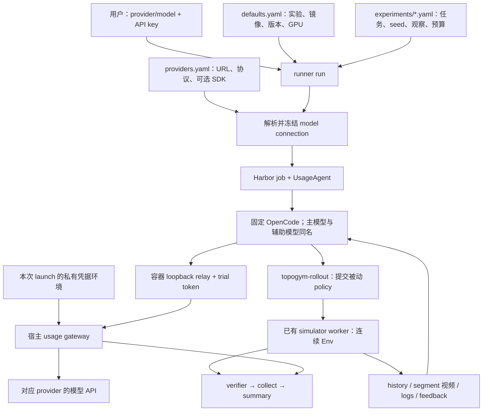

# 固定 OpenCode：实施记录、测试与运行入口

日期：2026-09-28。按[已确认的改造计划](opencode_model_key_rollout_plan_20260928_zh.md)实施，并把具体实验统一移到 `configs/harbor/experiments/`。

**已实现：部署完成后，用户只提供完整 model-name 和该 provider 的 API key，即可启动默认 rollout。** 正式 harness 固定 OpenCode 1.18.33；默认实验、镜像、GPU 与 provider 接入由项目配置提供。“完整”是 `provider_id/model_id`，并非仅模型品牌或简称。

**改造交付时完成本地功能验收，真实 Docker/GPU/模型组合当时受会话 Docker 组权限阻塞。** 该阶段没有发起付费模型请求。后续用户刷新会话组权限并执行了新版本 Muse Spark 实验；真实 input 预算强停的核对结果见第 6 节，不等同于抓方块成功。

[完整 run 参数与默认值](../../../harbor_runners/README.md#2-run-全参数)；[Muse Spark、1 trial、input 30k / output 10k 的部署到结果 CLI](../../../harbor_runners/README.md#3-muse-spark完整流程1-trialinput-30k--output-10k)。

## 1. 实际接线



- 输入按第一个斜杠拆分。例如 `openrouter/meta/muse-spark-1.3-contributor` 的 provider 为 openrouter，上游模型 ID 原样保留为 `meta/muse-spark-1.3-contributor`。
- 默认注册 OpenRouter Chat Completions、Anthropic Messages、OpenAI Responses。未知 provider 在 prepare 阶段失败；不猜 URL，也不自动把某服务的 key 换到另一服务。
- 真实 key 只传给宿主 Harbor 子进程及其 gateway；OpenCode 得到 loopback 地址和随机 trial token。每次 launch 构造独立环境，不修改父进程 `os.environ`。
- 配置冻结模型名、URL、协议、SDK、OpenCode 版本和路由表 SHA。重载 providers.yaml 不改变已准备好的 run。
- 主模型与 small_model 都指向输入模型。网关校验每个请求的 API model ID，其他模型请求在访问上游之前被拒绝。
- 沿用现有 simulator 单 Env、连续状态、策略权限、history/segment 与归档合同；不修改任务物理与成功判据。

## 2. 主要代码变化

| 文件 | 实现 |
| --- | --- |
| [run.py](../../../harbor_runners/run.py) | model/key CLI、默认实验、自动 run-id、stdin/隐藏输入 key、prepare/run/launch 的公共解析 |
| [config.py](../../../harbor_runners/config.py) | 部署 defaults → 实验 YAML → 显式 CLI 覆盖；旧 profile 配置报迁移错误 |
| [endpoints.py](../../../harbor_runners/endpoints.py) | 完整 model-name、provider/协议校验、无密钥 connection 与路由冻结 |
| [agents/opencode.py](../../../harbor_runners/agents/opencode.py) | 唯一正式 harness 绑定；主/辅助模型固定、inline config、过滤环境来源 |
| [agents/credentials.py](../../../harbor_runners/agents/credentials.py) | 统一 TOPOGYM_MODEL_API_KEY、字面 dotenv、独立子进程环境与日志脱敏 |
| [usage_bridge.py](../../../harbor_runners/usage_bridge.py) | 固定 observed OpenCode wrapper；拒绝没有已验证输入上界的 strict |
| [agents/usage_adapter.py](../../../harbor_runners/agents/usage_adapter.py) | 固定 OpenCode delegate，保留 gateway、relay、强停和收尾生命周期 |
| [task_generator.py](../../../harbor_runners/task_generator.py)、[preflight.py](../../../harbor_runners/preflight.py) | schema 2 冻结文件、唯一模型连接、运行前核验；Scripted 仅内部验收入口 |
| [usage/gateway.py](../../../topogym/agents/usage/gateway.py)、[pipeline.py](../../../topogym/agents/usage/pipeline.py) | 请求模型约束；保留协议解析、独立 input/output 账本、动态调额 |
| [rollout_output_report.py](../../../harbor_runners/rollout_output_report.py) | summary 增加模型、provider 和 OpenCode 版本；保留旧结果读取 |
| [test_harbor_pipeline.py](../../../scripts/test_harbor_pipeline.py) | 新参数、experiment 路径、固定 harness；保留隔离/真实 GPU/API 正负例入口 |

删除旧 `agents/resolve.py`、profile creator、`configs/harbor/agents/`、`agent_urls.yaml` 和 usage 内多 harness adapters。保留共享 provider 协议与账本核心；这些是模型服务协议处理，不是 Codex/Claude Code harness。

为兼容既有证据归档，生成文件仍保留 `agent_urls.resolved.json`、`usage_binding.resolved.json` 等名称，内容由单一 connection 自动生成，用户不编辑。新 run manifest 为 schema 2；旧未启动 run 不会被静默解释为新配置，应重新 prepare。旧结果继续 collect/report。

实验中去掉 agent/profile/image 和重复 GPU 默认值；镜像、版本、默认 GPU 集中在 defaults。实验仍显式记录任务语义、次数、超时、观察权限及预算。保留这些字段便于复现实验，并不要求用户每次填写。

## 3. 当前目录

下面展开本次相关目录，其余模块省略：

```text
topogym/
├── configs/harbor/
│   ├── defaults.yaml
│   ├── providers.yaml
│   ├── credentials.env.example
│   └── experiments/
│       ├── pick_cube_budget.yaml
│       ├── fiber_bundling_medium.yaml
│       ├── cast_coil_sweep.yaml
│       ├── smoke_api.yaml
│       └── smoke_scripted.yaml
├── harbor_runners/
│   ├── README.md
│   ├── run.py
│   ├── config.py
│   ├── endpoints.py
│   ├── task_generator.py
│   ├── preflight.py
│   ├── usage_bridge.py
│   ├── agents/
│   │   ├── opencode.py
│   │   ├── usage_adapter.py
│   │   ├── credentials.py
│   │   └── scripted.py
│   ├── collect.py
│   ├── rollout_output_report.py
│   ├── hooks.py
│   ├── supervisor.py
│   └── templates/instruction.md
├── docker/Dockerfile.topogym          # 既有共享镜像定义
├── topogym/agents/
│   ├── rollout/                      # 原有 simulator 接口与权限
│   └── usage/
│       ├── README.md
│       ├── config.py
│       ├── budget.py
│       ├── ledger.py
│       ├── pipeline.py
│       ├── gateway.py
│       ├── relay.py
│       ├── publisher.py
│       ├── service.py
│       ├── store.py
│       ├── types.py
│       └── sources/                  # Chat Completions / Messages / Responses
├── scripts/
│   ├── setup_harbor_runner.sh
│   ├── build_harbor_image.sh
│   └── test_harbor_pipeline.py
├── tests/
│   ├── harbor/
│   │   ├── test_model_connection.py
│   │   ├── test_endpoint_config.py
│   │   ├── test_opencode_binding.py
│   │   ├── test_opencode_cli.py
│   │   ├── test_credentials.py
│   │   └── …                         # 原有生成、采集、预算生命周期检查
│   ├── usage/                        # 协议、额度、并发、强停等
│   └── contracts/                    # rollout/方块合同
├── runs/
│   ├── harbor/<run-id>/
│   └── test_results/opencode_model_key_implementation_20260928/
└── task_rollouts/<run-id>/           # 收集的正式 rollout 归档
```

## 4. 功能测试与证据

证据目录：`runs/test_results/opencode_model_key_implementation_20260928/`。
[机器报告](../../../runs/test_results/opencode_model_key_implementation_20260928/report.json)、[源码 SHA 清单](../../../runs/test_results/opencode_model_key_implementation_20260928/source_manifest.json)、[实际 run --help](../../../runs/test_results/opencode_model_key_implementation_20260928/run_help.txt)。

| 验收层级 | 结果 | 范围 |
| --- | --- | --- |
| Harbor + usage | 198 passed | 名称解析、配置优先级、路由冻结、凭据隔离、生成/采集、账本、并发、调额、预算强停、三协议解析等 |
| 实际 OpenCode 1.18.33 CLI | 上述 198 项中 3 passed | 三个本地 HTTP provider，真实 CLI → gateway → 模拟服务；主/辅助模型名及 usage 累计正确 |
| rollout / 方块合同 | 26 passed | worker/连续状态/策略接口与既有方块任务合同；不等于真实 GPU 执行 |
| 30k / 10k CLI prepare | passed | 实际生成 1 trial、指定模型、input 30000/output 10000、GPU 0 的冻结实验 |
| Python / shell 静态检查 | passed | compileall、bash -n；文档示例与本地链接核对 |
| Docker / GPU / 真实 provider | blocked | 当前用户 Docker socket 权限不足，sudo 要求密码；未调用付费模型 |

真实 CLI 测试使用模拟的 JSON/SSE 响应，不要求真实 key；协议测试另外验证 tools/图像字段和鉴权转发。它们证明接线与字段保留，**没有证明远端账号权限、每个模型的工具/视觉质量、模型任务成功率或真实 provider 的计量兼容性**。

联合测试最初把 pytest 临时目录放在过长的报告路径下，3 项 Unix socket 测试触发 AF_UNIX path too long；诊断 XML 保留为 `harbor_usage_long_path_attempt.xml`。改用短 `/tmp` 临时目录后通过。正式运行 socket 本就使用短哈希路径，没有为测试修改生产逻辑。

最终配置回归还暴露既有进程停止测试的竞态：进程被回收时 `/proc/<pid>/stat` 可在 exists 与 read 之间消失。已修正测试，使已消失的进程按停止处理；不放宽存活进程必须停止的断言。该次诊断保留为 `harbor_usage_proc_race_attempt.xml`。

复现命令（需允许本地 TCP/Unix socket；不使用远端模型）：

```bash
cd /home/jianwen/topogym
TOPOGYM_TEST_OPENCODE=/absolute/path/to/opencode \
  .venv-harbor/bin/python -m pytest tests/harbor tests/usage \
    --confcutdir=tests/harbor -q --basetemp=/tmp/topogym-oc-tests

.venv-gs121-nyx/bin/python -m pytest \
  tests/contracts/test_rollout_service.py \
  tests/contracts/test_cube_pick_place_policy.py \
  tests/contracts/test_cube_transfer_task.py -q
```

需提供实际 1.18.33 CLI 路径；若不设置 TOPOGYM_TEST_OPENCODE，三项 CLI 测试会明确 skip。

## 5. 你要求的方块实验与剩余边界

完整部署、可选无 API 验收、启动和读取结果的命令都在 [runner 手册第 3 节](../../../harbor_runners/README.md#3-muse-spark完整流程1-trialinput-30k--output-10k)。本地已生成[该参数组合的冻结配置](../../../runs/test_results/opencode_model_key_implementation_20260928/preview_workspace/runs/harbor/muse_30k_10k_prepare/experiment.resolved.json)。

- 模型：`openrouter/meta/muse-spark-1.3-contributor`；需要相应 OpenRouter key 和访问权限。
- 任务：现有 `cube_pick_place` 集成夹具，抓起、持稳、原位放回、松爪、撤离并稳定；允许 world 观察和复用参考 policy。没有另建不同成功判据的“仅 pickup”任务。
- 一次 trial：一个实例、seed 0、attempts 1；concurrency 1。
- input 30,000 / output 10,000 是每 trial 累计额度。observed 在服务端 usage 到达后记账，在途请求可能令 input 超过阈值后才停止；这不是 strict 的消费前保证。
- 当前默认仍是方块预设 3M/1M；用户要求的额度通过显式 CLI 覆盖，不改变其他实验的预算。
- 普通 run 返回 0 表示 pipeline/采集/预算通过，任务成功须查看 `task_success` 和 reward；手册也提供必须任务成功才通过的验收命令。
- 原计划的宿主模型能力目录没有另外实现；原生 provider 使用固定 OpenCode 版本所带元数据，不复制一套按模型维护的 profile。新模型、私有 provider 或额外 SDK 仍需验证远端工具/图像/usage 合同，不能承诺任意两串 model/key 都能接入。
- 当前剩余工作是有 Docker 权限时重建镜像，并执行该版本的隔离、GPU scripted、真实 Muse Spark 30k/10k 以及真实预算负例。已有测试不替代这部分证据。

## 6. 后续真实运行：30k input 预算强停与终端摘要

用户执行 `muse_pickup_30k_10k_01` 后，核对了宿主只读 SQLite、usage JSON/JSONL、停止时间、verifier、封存归档及清理记录。审阅过程没有再次调用模型或启动仿真。

| 项目 | 实际结果 |
| --- | --- |
| 请求数 | 4；全部结算完成，停止后没有新增准入，在途请求 0 |
| input | 32,840 / 30,000；超额 2,840 |
| output | 704 / 10,000 |
| 停止原因 | budget_exceeded，维度 input_tokens |
| 判定与执行停止 | 最后一份回执到判定约 0.481 ms；判定到 agent 停止 140.012 ms，执行停止确认 255.831 ms |
| 物理执行 | 仅 segment_0 的 5 个保持步、0.125 秒；没有提交 policy |
| 评分 | task_success=false、budget_qualified=false、reward=0；Harbor exception 为空 |
| 证据与清理 | 封存文件 SHA/尺寸完整、账本和导出数值一致；清理了本 run 的 1 个容器、1 个网络 |

每次请求的 input 分别为 2,023、9,038、10,173、11,606，累计在第 4 次超过 30,000。observed 按 provider 回执事后记账，因此存在最后一次请求带来的超额。这证明 input 超额检测、agent 停止、worker 执行停止确认与 reward=0 生效；没有验证真实 output 超额强停，也没有验证正在执行的 policy 被取消，因为当时没有 policy 运行。

`harbor_runners/rollout_output_report.py` 现增加每 trial 的 episode 汇总，`run.py` 在原生 Harbor 输出和采集/清理之后自动打印；原 JSON 格式保持兼容并增加 `episodes`。旧结果可以用 `python -m harbor_runners.rollout_output_report --run <run-dir> --format text` 查看，原封存证据不变。新增回归覆盖真实数值/最终额度、物理成功但预算失败、缺失证据不得显示为零、usage off、旧 JSON CLI、launch 自动打印与 key 脱敏；相关 81 项回归通过。

[机器核对报告](../../../runs/test_results/muse_pickup_30k_10k_01_budget_review/report.json)、[终端摘要](../../../runs/test_results/muse_pickup_30k_10k_01_budget_review/terminal_summary.txt)、[初始观察录像](../../../task_rollouts/muse_pickup_30k_10k_01/cube_pick_place/rollout_0001/segments/segment_0/videos/combined.mp4)。录像只有初始保持，不是抓取演示。

摘要打印修改了纳入冻结哈希的 runner 源码。本次已同步重建 `topogym-rollout:opencode-v1`（image ID：`sha256:a46f58eedcdc0422673d1a873d7d82fde6a75ed4851291b2fee92e17715ca352`），并在无网络的临时容器里核对 54 个已安装 Python 文件与宿主源码一致。见[镜像核验结果](../../../runs/test_results/muse_pickup_30k_10k_01_budget_review/image_verification.json)。没有重跑模型或仿真；旧 run 的冻结镜像身份与封存证据保持不变。
