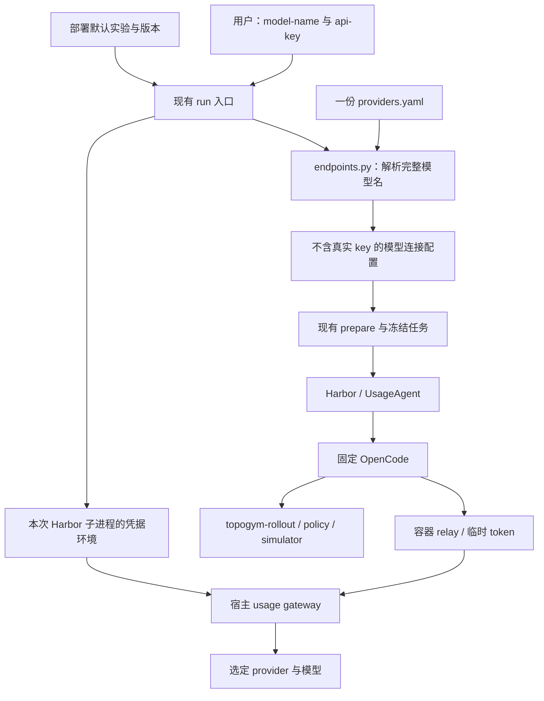

# 固定 OpenCode：只输入 model-name 与 api-key 的 rollout 改造计划

日期：2026-09-28。**代码改造现已实施，具体实验已收进 `configs/harbor/experiments/`。** 当前参数、完整 Muse Spark 30k/10k 方块命令见 [runner 手册](../../../harbor_runners/README.md)，实际修改与验收边界见[实施报告](opencode_model_key_implementation_20260928_zh.md)。

第 1–5 节保留改造前审计和设计依据，其中旧函数/行号与已删除路径不代表当前接口；第 6 节目录已按实验子目录更新。已有真实运行证据属于此前版本，本轮没有调用付费模型；新版本的真实 Docker/GPU/provider 组合仍需验收。

## 1. 目标与结论

目标：**固定 OpenCode；用户提供完整 `model-name` 和该服务的 `api-key`；系统自动配置接入，启动已选定实验的 rollout。**

建议采用一个 OpenCode 接入实现，复用现有 Harbor 调度、usage gateway 和 simulator rollout。无需再建设自适应 harness 选择器，也无需为每个模型生成 profile。

目前主要差距在入口与模型连接配置：现有 CLI 要求实验 YAML / run-id；profile 决定 harness、凭据变量与 endpoint；预算模式中的 OpenCode 被写死为 OpenRouter。底层 simulator 交互和 OpenCode 执行链已经有真实成功记录，不能把当前状态理解为“agent 还完全没有接上 simulator”。

### 1.1 用户最终看到什么

目标命令现已接入（仍需完成部署并具备相应 provider 权限）：

```bash
topogym-harbor run \
  --model-name 'openrouter/anthropic/claude-sonnet-4.6' \
  --api-key '<对应 OpenRouter key>'

topogym-harbor run \
  --model-name 'anthropic/claude-sonnet-4-6' \
  --api-key '<对应 Anthropic key>'
```

这里的 `topogym-harbor` 是本项目已有入口，见 [pyproject.toml](../../../pyproject.toml) 第 33 行；它内部仍调用原生 `harbor run --config <生成的 job.json>`。不修改第三方 Harbor CLI。

用户界面只显示两个字段：模型全名、API key。`agent-name` 也不需要：harness 恒为 OpenCode。CLI 可保留 `--model` 作为 `--model-name` 的兼容别名；不再引入另一个含义不清的 `name` 参数。

### 1.2 两项输入成立的前提

| 信息 | 谁提供 |
| --- | --- |
| `provider_id/model_id` 与对应 key | 用户 |
| 本次任务、seed、观察权限、评分方式、预算 | 已选择的实验预设；部署方维护 |
| Docker 镜像、Harbor / OpenCode 版本、GPU 分配 | 部署方预装并固定 |
| provider 的上游地址、协议，以及必要的 SDK 设置 | 系统根据 provider 查表；维护方注册特殊服务 |

“只输入两项”针对**在已配置部署上运行已选定实验**。模型和 key 不包含“要做哪个物理任务”的信息；独立 CLI 需要一个部署默认实验，界面则可使用当前已选实验。系统不能从模型名称推断任务、私有服务 URL、Azure deployment 或尚未登记的机构网关配置。

完整名称按**第一个 `/`** 拆分。例如 `openrouter/anthropic/claude-sonnet-4.6` 的 provider 是 `openrouter`，其余整个字符串才是该服务的 model ID。API key 跟这个 provider 对应，不跟 OpenCode 绑定。[OpenCode 模型命名说明](https://opencode.ai/docs/models/)

支持范围也应准确表述：OpenCode 能调用、我方 gateway 能处理该调用协议、模型具备实验所需工具/图像能力、账号有访问权限，这些条件都满足才可完成实验。不能把“OpenCode 原生支持很多 provider”直接标为“本项目已全部验收”。

## 2. 当前接线与具体阻碍

### 2.1 当前调用链

```text
用户：实验 YAML + run-id + model + profile / 凭据环境
  → run.main → config.load_config：读实验、加载 profile
  → run.main：覆盖 model 字符串
  → task_generator.prepare
      → resolve_agent：选择 Harbor agent 类
      → resolve_adapter：选择 harness adapter
      → resolve_endpoints：profile 引用中央 URL 表
      → 生成冻结任务、job.json
  → run.launch → preflight → 原生 harbor run
      → usage=observed：UsageAgent → 本地 relay → 宿主 gateway → provider
      → usage=off：原生 agent 直接访问 provider
  → OpenCode 写 policy / 调用 topogym-rollout
  → worker / policy process → simulator → 历史、视频、评分、归档
```

`run` 已经包含 prepare + launch，不缺新的调度框架。改造重点是上半段；默认模型实验继续走已有预算链路。

### 2.2 逐处代码定位

行号为本次阅读时的位置；函数名是后续定位依据。

| 当前代码 | 现状 | 对目标的影响 |
| --- | --- | --- |
| [run.py](../../../harbor_runners/run.py)，`main`，第 93 行；参数定义第 100–104 行 | `--config`、`--run-id` 必填；只有 `--model`、`--agent-profile`，没有直接 key 输入 | 用户不能仅提供 model + key 启动 |
| [run.py](../../../harbor_runners/run.py)，第 149、157 行 | 先加载并验证 YAML，再只改 `config["agent"]["model"]` | 改模型不会重新选择 provider、协议、凭据来源；基础 YAML 缺 image 时，后续 CLI image 覆盖也来不及补救 |
| [config.py](../../../harbor_runners/config.py)，`load_config` / `validate`，第 20 / 34 行 | 将 `agent_profile` 展开成复杂 `agent`；实验还必须有 image 和 instances | 实验配置和模型接入耦合；部署默认配置尚未承担这些输入 |
| 原 `harbor_runners/agents/resolve.py`（已删除），`resolve_agent`，第 5 行 | 处理 `name` / `import_path`、kwargs、required/optional env、env_mapping，再走 `AgentFactory` | 固定 OpenCode 后，这套任意 harness 配置大部分不再必要 |
| 原 `usage/adapters/registry.py`（已删除），`LEGACY` / `resolve_adapter`，第 10 / 13 行 | 默认把 `opencode` 绑定到 `openrouter`；另有 Codex、Claude Code、env_http 分支 | 路由来自 harness/profile，不是完整模型名 |
| 原 `usage/adapters/opencode.py`（已删除），第 4 行起 | 只允许 `chat_completions`、`openrouter/` 前缀，配置与 env 都写死为 OpenRouter | `anthropic/...` 在 prepare 阶段即被拒绝，不能靠换 key 修复 |
| [endpoints.py](../../../harbor_runners/endpoints.py)，原 `resolve_endpoints`，第 48 行 | 从 profile 的 routes 查原 `agent_urls.yaml`（已替换），校验凭据变量在 profile 中有声明 | 中央表虽已有三种服务，仍不会按 model-name 自动选路 |
| [agents/credentials.py](../../../harbor_runners/agents/credentials.py)，第 9 / 43 行；[run.py](../../../harbor_runners/run.py)，`launch`，第 20 行 | key 通过 dotenv / 进程环境加载；脱敏依赖 profile 声明；Harbor 子进程继承环境 | 缺少“本次输入 key → 本次 launch”的独立通道；多用户界面不能靠改全局环境传不同 key |
| [task_generator.py](../../../harbor_runners/task_generator.py)，`prepare`，第 33 行；[preflight.py](../../../harbor_runners/preflight.py)，`check`，第 16 行 | 生成和验证过程仍读 `config["agent"]`；冻结 endpoints / binding / 源码哈希 | 不能只加两个 CLI 参数而不更新配置合同、冻结与 preflight |
| [agents/usage_adapter.py](../../../harbor_runners/agents/usage_adapter.py)，`UsageAgent`，第 33 行；`_new_delegate`，第 52 行 | 接收 delegate_profile，再动态挑选 harness，绑定后创建委托 agent | 可固定为 OpenCode；其中网关、隔离、停止和结算逻辑仍有实际职责 |

最直接的限制是以下真实代码节选：

```python
# topogym/agents/usage/adapters/opencode.py
protocols = ("chat_completions",)

if not profile["model"].startswith("openrouter/"):
    raise ValueError("Budgeted OpenCode currently supports openrouter/<model> only")

overlay = {"provider": {"openrouter": {"options": {
    "baseURL": route["url"].rstrip("/") + "/v1", "apiKey": route["token"]}}},
    "enabled_providers": ["openrouter"], "autoupdate": False}
```

因此，**只删除 `startswith("openrouter/")` 检查不够**：协议白名单、provider 配置键、凭据环境变量、默认 endpoint 也必须同步改变。

相比之下，本机已安装的 Harbor `OpenCode._build_register_config_command` 已使用：

```python
provider, model_id = self.model_name.split("/", 1)
provider_config = {"models": {model_id: {}}}
```

定位：`.venv-harbor/lib/python3.12/site-packages/harbor/agents/installed/opencode.py`，第 457 行起；随后合并 job 提供的 `opencode_config`。这说明可复用现有原生 OpenCode 支持，不需要 fork 一个新 harness。官方也提供 provider 的 `baseURL` 配置能力。[OpenCode provider 配置](https://opencode.ai/docs/providers/)

### 2.3 三种“适配”不能一起删除

| 部分 | 实际职责 | 固定 OpenCode 后 |
| --- | --- | --- |
| Harbor 的原生 OpenCode agent | 安装/启动 OpenCode，解析其日志与结果 | 继续复用 |
| 我方 harness adapter，目前在 `usage/adapters/` | 将本地 gateway 的 URL / 临时 token 注入 coding agent | 收敛为一个 OpenCode 绑定函数，无需 registry 与抽象基类 |
| 我方 provider 协议实现，在 `usage/sources/` | 处理 Chat Completions / Messages / Responses 的请求、usage 回执和输出上限 | 保留；同一个 OpenCode 仍会使用不同协议 |

现有 `ProviderProtocol.prepare_request` 是相应协议的处理器，并非任意协议互转器，见 [sources/base.py](../../../topogym/agents/usage/sources/base.py) 第 47 行。例如不能把 Messages 请求简单送进 Chat Completions 路由，也不能只新增 Google URL 就认定 Gemini 原生协议已接通。

### 2.4 已经具备的基础，以及尚未证明的部分

已有 [segment history v2 真实运行复核](../../../runs/test_results/segment_history_v2_prepare_20260928/review_zh.md)：OpenCode 1.18.33，经 OpenRouter 调用 Muse Spark，完成一次抓放集成任务；1 trial、0 exceptions、reward=1；实际 input=444,149、output=5,940，usage 完整结算。它证明了 agent → policy → simulator → 历史/视频 → verifier 这条链能够工作。

该任务授权 world 信息和参考 policy，所以不是模型从零编写算法或纯视觉控制的验收；也未验证真实超额强停、运行中调额。它只支持对应运行组合的结论，不能作为所有 provider/model 已支持的证据。

另一个重要事实：这次 20 个模型请求中，有 1 个是 OpenCode 自动发出的 Gemini 标题请求。仅固定 `--model` 还不够；新方案要统一辅助模型，否则“用户只给一个模型的权限/key”仍可能遇到额外访问问题。

## 3. 建议的最小实现

### 3.1 新接线



只新增一个小的 OpenCode 绑定模块、一个部署默认文件；将现有地址表改为 provider 接入表。解析、任务生成、启动仍在原来的文件中完成。

### 3.2 第一步：将 model-name 解析为不含 key 的连接配置

修改 [endpoints.py](../../../harbor_runners/endpoints.py)，以 `resolve_model(model_name, provider_table)` 替代 profile 驱动的 `resolve_endpoints`。

1. 按第一个 `/` 拆出 provider_id 与完整 model_id。保留后面的 `/`、点号、版本号；不凭相似名称改写模型 ID，不默认换到 OpenRouter。
2. 根据 provider_id 选择上游 URL 与已实现协议；使用 OpenCode 原生 provider/model 元数据，不另建一套逐模型 profile 库。自定义服务的必要 SDK 设置由维护方登记。
3. 校验名称、URL、协议、实验需要的能力。已知不支持工具或图像的模型明确报错；元数据未知应标为待验证，不能自行宣称兼容。
4. 生成纯数据连接对象，至少包含 `full_model_name / provider_id / model_id / upstream_url / protocol / opencode_version`，以及确有需要的 SDK 覆盖和配置来源哈希。**对象不含真实 key。**

模型元数据使用部署时固定的 OpenCode 目录/缓存；冻结本次实际选中项及来源，不在无网络的 agent 阶段下载目录。缺少元数据不应变成“请用户创建 profile”：由维护方补充必要能力信息或验收新模型即可。

维护方只保留一份 `configs/harbor/providers.yaml`，替代 `agent_urls.yaml`。示意结构如下；不是当前可加载的配置：

```yaml
schema_version: 1
providers:
  openrouter:
    url: https://openrouter.ai/api/v1
    protocol: chat_completions
  anthropic:
    url: https://api.anthropic.com/v1
    protocol: messages
```

这份表是 gateway 的上游路由依据，不是要求用户再填写的 profile，也不需要为 OpenRouter 上每个模型复制一项。原生 OpenCode 已知的 provider 不必重复抄录全部 SDK 元数据；仅记录网关确实需要的信息与必要例外。

OpenAI Responses 可复用现有 `sources/openai_responses.py`，但要在确认所固定 OpenCode 版本实际发出的协议后加入并验收。若同一 provider 的不同模型使用不同协议，应根据其实际 SDK 选择结果解析并冻结；必要的少量模型例外放同一张表，不新增第二套 registry。不能把某个 `/v1` URL 当作足以识别协议的依据。

首批落地建议：保住已有 OpenRouter 路径，补 Anthropic 直连路径，证明同一种模型经不同 provider 的完整名称都能自动接入。其他已知服务按协议覆盖逐步加入；未知 provider 在启动前返回“尚未登记此 provider”，不猜 URL 或切换服务。

### 3.3 第二步：只保留一个 OpenCode 绑定实现

新增 `harbor_runners/agents/opencode.py`，从现有 OpenCode adapter 和通用 resolver 中收敛以下功能：

- 固定导入 Harbor 的 `OpenCode` 类，并校验其版本/选项；不再接受用户 `name`、`import_path`、任意 kwargs。
- 根据解析结果动态设置 `provider[provider_id]`，将 SDK 的 baseURL 指向**容器内 relay**，apiKey 设置为**trial 临时 token**。
- `enabled_providers` 只保留本次 provider；主模型和 `small_model` 都设为用户输入的完整名称；关闭自动更新。标题、压缩、子 agent 等调用还应核对最终请求模型，避免隐式使用其他模型。
- 如该 provider 的 SDK 需要特定环境变量才能启用，由此模块注入临时 token；普通用户不必知道变量名。
- 对 CLI 中的 model-name 做允许字符校验，拒绝 shell 控制字符。当前 Harbor 启动命令包含直接插入模型名的字符串，不能把新增界面的任意字符串原样传入。

为了让“使用用户指定模型”成为可执行的约束，在 gateway 转发前增加一次请求 `model` 与冻结上游模型 ID 的一致性检查。若 provider 存在登记过的 API ID 映射，冻结映射后的值；否则就是拆分出的 model_id。意外的辅助模型请求在转发前失败，错误指出实际模型与预期模型，不静默使用其他模型。

`small_model` 是 OpenCode 官方配置项；它用于标题等轻量任务。模型与 provider 配置应按固定版本验证，而不是跟随在线最新配置自动升级。[OpenCode 配置说明](https://opencode.ai/docs/config/)

URL 拼接必须分清两端：provider 表保存上游 API base；OpenCode 配置使用本地 API base。验证最终路径为正确的 `/v1/messages`、`/v1/chat/completions` 或 `/v1/responses`，避免漏掉或重复 `/v1`。同一条 relay 路由采用哪种协议，由冻结连接配置决定。

修改 `agents/usage_adapter.py` 的 `UsageAgent`：用新的连接配置替代 delegate_profile，固定创建 OpenCode 委托。保留现有 `IsolatedAgent` 环境隔离、setup、relay、gateway、stop、finalize 和 context 计数回填。继续使用现有类路径，避免为命名美观再搬一次生命周期代码。

单次模型实验固定 `primary` 一条路由即可；usage 公共核心现有共账能力无需为此重写。

### 3.4 第三步：把用户的 key 接入本次 launch

修改 `run.py` 与 `agents/credentials.py`：

```text
界面/CLI 输入 key
  → 独立的本次凭据对象
  → launch(run, credentials=...)
  → subprocess.Popen(..., env=本次专属 child_env)
  → 宿主 Harbor 子进程中的 gateway 读取真实 key
```

宿主只需统一一个内部变量，例如 `TOPOGYM_MODEL_API_KEY`；不再要求用户创建 `OPENROUTER_META_SPARK_API_KEY` 这类自定义变量和映射。`preflight` 的凭据存在性检查、`credential_resolver` 与日志脱敏也改用这次输入，不依赖 profile。

需要保持的行为：

- 显式传入 key 优先于保存的环境/凭据文件；界面请求之间使用独立子进程环境，不写服务进程的全局 `os.environ`。
- 真实 key 不进入 YAML、`job.json`、resolved 文件、命令回显或 agent 容器；OpenCode 只接触本地临时 token。
- `prepare` 可不带 key；稍后单独 `launch` 时重新提供凭据，不能把 key 存进冻结任务方便重放。
- CLI 除显式 `--api-key` 外，可在未提供时隐藏输入；界面直接传字段。显式把 key 写在命令行时，程序不能保证清除调用方的 shell 历史，因此不将这种输入方式描述为无痕。

现有日志脱敏、凭据文件权限检查保留；移除只为跨 harness 服务的 required_env / optional_env / env_mapping 配置面。

### 3.5 第四步：用部署默认值替代用户必填配置

修改 `config.py` 和 `run.py`，将装配顺序调整为：

```text
读取部署 defaults → 读取选定实验预设 → 应用高级覆盖
→ 解析 model-name → 整体验证 → prepare → preflight → launch
```

建议新增 `configs/harbor/defaults.yaml`，只保存部署层默认实验路径、镜像与 OpenCode 版本。例：维护方可选现有 `pick_cube_budget.yaml` 作为**集成验收**默认实验，预算沿用其 3M input / 1M output；正式基准应另外选定合适预设，不能静默把授权 world、允许参考 policy 的夹具当作正式测评。

实验 YAML 本身仍保存真实任务语义：`instances / simulator / observation / evaluation / usage` 等；移除其中的 agent_profile / 通用 agent 配置，公共镜像等部署信息在 defaults 中只存一份。原来的 `load_config → validate` 拆开，使合并完成后再验证。任务预设不能通过只替换 task_id 来盲目继承另一个任务的物理配置。

| 参数/配置 | 新的普通用户入口 | 内部来源或维护入口 |
| --- | --- | --- |
| model-name | 必填 | 原样拆分和路由 |
| api-key | 必填或已保存 | 本次凭据输入 |
| agent-profile / harness name / import_path | 删除 | 固定 OpenCode |
| config / 实验 YAML 路径 | 不必填 | 部署默认或界面已选实验；`--config` 可留给维护者 |
| run-id | 不必填 | 自动生成时间戳与随机后缀，继续原子创建、不覆盖旧 run；可高级覆盖 |
| root | 不必填 | 已配置工作区；不要依赖任意启动目录碰巧是项目根 |
| image / OpenCode version | 不必填 | 部署 defaults；镜像与源码身份照常核验 |
| attempts / concurrency | 不必填 | 默认各 1；批量实验可高级覆盖 |
| GPU 数量与设备 | 不必填 | 部署配置；缺少要求的 GPU 则明确失败 |
| task / difficulty / seeds | 不必填 | 实验预设；保留研究者覆盖能力 |
| timeout / 初始观察步数 | 不必填 | 预设；通用默认沿用 1800 秒 / 5 步 |
| usage-mode | 普通模型运行固定 observed | Scripted 测试可 off；strict 暂不对普通用户开放 |
| input/output 限额 | 不必填 | 实验预设；高级覆盖与已有运行中调额保留 |
| URL / 协议 / API key 环境变量名 | 不显示 | provider 表与固定 OpenCode 绑定实现 |

`strict` 目前要求请求前有已验证的 input token 上界；[usage_bridge.py](../../../harbor_runners/usage_bridge.py) 第 20 行会拒绝不具备该能力的 adapter，协议层 `PreparedRequest.input_bound` 默认也是 `None`。固定 OpenCode 不会自动补出这个能力。默认 observed 依据响应回执结算、触发停止，不承诺 input 绝不超额；这轮不把 strict 改造加入目标。

### 3.6 第五步：接回已有 prepare / preflight / collect

| 文件 | 最小修改 |
| --- | --- |
| `task_generator.py` | 直接构造固定 OpenCode 的预算 job；模型连接与实验分别装配；保留任务展开、容器网络、GPU 和冻结逻辑 |
| `usage_bridge.py` | 去掉 adapter registry / 任意 AgentFactory 分发；保留 wrapper 构造、socket 路径、协议能力和 strict 拒绝检查 |
| `usage/gateway.py` | 转发前核对本次允许的模型 ID；其余计量、协议分派和停止流程保持原职责 |
| `preflight.py` | 校验冻结模型连接、凭据、版本、镜像和源码；launch 不重读当前 provider 表选择新路由 |
| `collect.py` / `rollout_output_report.py` | 仅适配必要的新连接字段；结果展示完整模型名、provider、OpenCode 版本；旧报告仍可读取 |
| `scripts/test_harbor_pipeline.py` | 使用同一个新配置装配入口；保留 Scripted 无 API 验收和显式真实实验入口 |
| `scripts/setup_harbor_runner.sh` | 末尾现调用 `run agents`，删除该子命令时同步改为入口帮助/版本检查 |
| 镜像构建与依赖配置 | 固定 OpenCode 版本与所需 SDK；主机和容器同步当前代码，继续源码一致性检查 |

为减少改动，第一轮保留自动生成的 `agent_urls.resolved.json`、`usage_binding.resolved.json` 等文件名。它们保存上游选择、绑定身份与复现证据，不是需要用户填写的配置；不必为减少“文件数量”再重写归档合同。连接字段变化需要明确的 schema 版本，不能偷偷解释旧字段为新含义。

多个 `model-name + api-key` 组合可顺序调用同一入口，每项独立 run / 凭据环境；先复用已有 trial 并发机制，不再新增多 harness 调度层。

## 4. 哪些代码可以精简，哪些应保留

### 4.1 完成调用方迁移后删除

| 待删除/替代项 | 原因与替代 |
| --- | --- |
| `configs/harbor/agents/profiles/`、`templates/` 及对应说明 | 用户不再挑 harness/profile；provider 级差异进入唯一接入表 |
| `scripts/create_harbor_agent_profile.py` | 不再需要创建 profile 的操作与配置界面 |
| `harbor_runners/agents/resolve.py` | 通用 agent 解析收敛到固定 OpenCode 模块；Scripted 测试由测试入口显式选择 |
| `topogym/agents/usage/adapters/registry.py` 及 `codex.py`、`claude_code.py`、`env_http.py` | 没有运行时多 harness 选择需求 |
| `topogym/agents/usage/adapters/opencode.py`、`base.py`、包初始化 | OpenCode 绑定迁入 runner；仍需的标识符校验/少量数据结构放入 endpoints / 固定绑定模块，不保留只剩一个实现的抽象体系 |
| `configs/harbor/agent_urls.yaml` | 替换为 `providers.yaml`，不同时维护两个地址来源 |
| `tests/harbor/test_profile_creator.py`、`tests/usage/adapters/test_bindings.py` | 删除过时合同，改测新模型解析与 OpenCode 绑定 |
| `agents` 子命令与 profile 专用参数 | 不再向用户展示 Harbor 支持的所有 harness；可用帮助文案列出已接入 provider，无需新建管理系统 |

同时迁移 `tests/usage/test_pipeline.py`、`test_imports.py`、Harbor resolver/bridge/lifecycle 测试中的旧 registry 引用；更新 setup 脚本的 `agents` 调用。不能删完实现还让测试或部署脚本依赖它。

### 4.2 保留

- `UsageAgent` 生命周期、supervisor、usage gateway / relay / ledger / service / publisher。固定 harness 不会替代预算、隔离、停止、导出这些工作。
- `usage/sources/` 的三种协议实现。删除 `codex.py` / `claude_code.py` 不等于删除 Responses / Messages 支持。
- `topogym/agents/rollout/`、`simulator/rollout_simulation/`、recording、verifier、collect、归档和任务 catalog 冻结。保持一条现有 simulator 执行链。
- `ScriptedAgent` 和 `smoke_scripted.yaml`：用于无模型费用的基础接线验收；它不出现在普通用户可选 harness 中。
- 实验 YAML：它描述物理实验，不能把整份实验配置误当作多 harness 冗余。
- simulator/robot/camera 的 profile。这里只撤销 **agent profile**，不按文件名搜索后批量删除其他领域的 profile；`agents/deferred/` 等历史模块也不在本次清理范围。

`smoke_scripted.yaml` 也移除通用 agent 块，由验收脚本通过固定的 `ScriptedAgent` 类路径构造测试 job；不为测试夹具保留整套任意 harness resolver。

旧 frozen run 的源码哈希可能在改造后无法通过 launch 检查。已有结果保持原样；未启动的旧任务应重新 prepare，确需复现则使用对应旧源码/镜像。不要修改旧 manifest 或删除哈希检查来强行兼容。

## 5. 实施顺序与验收

### 5.1 四个连续阶段

1. **固定接入合同。** 增加完整模型名解析、provider 表、OpenCode 绑定；先使 OpenRouter 和 Anthropic 两条路径可生成正确冻结任务。
2. **完成两项输入入口。** 增加直接 key、默认实验、自动 run-id；更新凭据隔离、prepare / launch / preflight，使界面与 CLI 共用一套装配逻辑。
3. **收敛旧实现。** 迁移所有实验/测试调用方后移除 profile creator、多 harness resolver / registry / adapters；更新用户说明与部署配置。
4. **做组合验收。** 无 API 测试先通过，再按目标 provider/model 做实际 GPU/API rollout；每个新增协议组合记录独立证据。

首轮固定现有成功记录使用的 OpenCode 1.18.33 作为候选基线，先确认可重装和相应 SDK 可用，再冻结为部署版本。版本升级另做验收，不在这轮同时切换 OpenCode 配置主版本。

### 5.2 必须验证的行为

| 层级 | 验收点 |
| --- | --- |
| 本地配置 | 完整名称按首个 `/` 拆分；OpenRouter 的嵌套 model ID 不丢失；未知 provider、缺少前缀、非法字符有清楚错误；不自动换服务 |
| 本地绑定 | 不同 provider 配置键、协议、URL 路径正确；主模型与辅助模型一致；凭据进入本次子进程，两个并发用户不会串 key |
| 本地冻结 | 无真实 key；改 provider 表不影响已 prepare 的 run；不带 key 可以 prepare，带 key 才能 launch；模型、版本与来源哈希可追溯 |
| 协议集成 | 模拟服务验证流式 tool call、图像输入、usage 结算、断流/缺失 usage 与 401/403/404；意外模型在转发前被拒绝；协议不兼容不能静默算作成功 |
| 原有回归 | Scripted policy、初始 segment、历史与视频、verifier、失败停止、collect / report；usage 公共核心仍不依赖 Harbor / OpenCode |
| 真实模型运行 | 每个拟发布 provider 路径至少一个目标模型，完成读初始观察 → 写/提交 policy → 读结果 → verifier / collect；记录实际请求模型，包含标题/压缩等辅助调用 |
| 真实预算边界 | 分别触发 input/output 限额与停止，确认不再接纳模型请求并中断仍在运行的 policy；动态调额若继续提供，也需单独验收 |
| 用户入口 | 已部署环境中，不创建 profile、不改 env 文件、不传 YAML 和 run-id，只输入完整模型名与对应 key，成功产出可归档 rollout |

prepare/preflight 能验证配置和基础设施，但单靠本地检查无法证明远端 key 有权限。默认不为“探测”额外发付费生成请求；实际调用如返回认证、模型不存在、限流等错误，应按原原因明确报告，不更换模型掩盖问题。

因此目前距离目标是一次**入口、配置和 OpenCode 接入的收敛改造，加上新增 provider 的组合验收**。无需重建 simulator，也无需先实现 Codex / Claude Code / OpenCode 自适应选择系统；真实 API 兼容性不能用改完代码的进度代替。

## 6. 修改完成后的理论目录

下面展开与本次目标有关的目录。`[新增] / [修改]` 表示计划；未展开的任务、资产、模拟器主体保持原职责。`providers.yaml` 替代旧地址表；旧 `agents/profiles/` 和 `usage/adapters/` 不再出现在目标结构中。

```text
topogym/
├── pyproject.toml                     # 继续使用 topogym-harbor 入口
├── configs/harbor/
│   ├── defaults.yaml                 # [新增] 默认实验、镜像、OpenCode 固定版本
│   ├── providers.yaml                # [替代 agent_urls.yaml] provider 路由与必要例外
│   ├── credentials.env.example       # [修改] 可选的统一凭据变量示例
│   └── experiments/                 # 具体实验统一收录，和部署配置分开
│       ├── pick_cube_budget.yaml     # 仅实验语义；集成验收预设
│       ├── fiber_bundling_medium.yaml
│       ├── cast_coil_sweep.yaml
│       ├── smoke_api.yaml            # 固定 OpenCode 的 API 接线验收
│       └── smoke_scripted.yaml       # 无 API 预设；测试入口固定 ScriptedAgent
├── harbor_runners/
│   ├── __init__.py                   # Harbor 锁定版本
│   ├── README.md                     # [修改] 两字段用法与维护者入口
│   ├── run.py                        # [修改] model/key → 默认配置 → prepare/launch
│   ├── config.py                     # [修改] 合并默认值与实验后验证
│   ├── endpoints.py                  # [修改] 模型名解析、provider 路由、冻结连接
│   ├── task_generator.py             # [修改] 固定 agent；保留任务与 job 生成
│   ├── preflight.py                  # [修改] 新连接与凭据检查
│   ├── usage_bridge.py               # [精简] 固定 wrapper、能力检查、socket
│   ├── supervisor.py                 # 保留停止、状态发布
│   ├── hooks.py                      # 保留采集/清理/恢复
│   ├── collect.py                    # 保留归档；必要时适配连接字段
│   ├── rollout_output_report.py                     # [小改] 展示模型与 provider 身份
│   ├── agents/
│   │   ├── __init__.py
│   │   ├── opencode.py               # [新增] 唯一正式 harness 绑定
│   │   ├── credentials.py            # [修改] 本次凭据与日志脱敏
│   │   ├── usage_adapter.py          # [精简] UsageAgent 生命周期，固定 OpenCode
│   │   └── scripted.py               # 仅用于无 API 验收
│   └── templates/instruction.md      # 继续指引 policy/视频/历史交互
├── topogym/
│   ├── agents/
│   │   ├── rollout/                  # 保留现有 simulator 接线
│   │   │   ├── __init__.py
│   │   │   ├── client.py
│   │   │   ├── worker.py
│   │   │   ├── protocol.py
│   │   │   ├── policy_process.py
│   │   │   ├── history.py
│   │   │   ├── public_artifacts.py
│   │   │   └── verify.py
│   │   ├── usage/                    # 保留共享计量核心；移除 harness adapters
│   │   │   ├── __init__.py
│   │   │   ├── README.md
│   │   │   ├── config.py
│   │   │   ├── types.py
│   │   │   ├── budget.py
│   │   │   ├── ledger.py
│   │   │   ├── store.py
│   │   │   ├── publisher.py
│   │   │   ├── service.py
│   │   │   ├── pipeline.py
│   │   │   ├── gateway.py            # [小改] 请求模型与冻结模型一致
│   │   │   ├── relay.py
│   │   │   └── sources/
│   │   │       ├── __init__.py
│   │   │       ├── base.py
│   │   │       ├── common.py
│   │   │       ├── chat_completions.py
│   │   │       ├── anthropic_messages.py
│   │   │       └── openai_responses.py
│   │   └── deferred/…                # 不在本轮清理范围
│   ├── simulator/
│   │   ├── rollout_simulation/…      # 保留 policy、权限、segment、物理证据
│   │   └── …
│   ├── recording/…                   # 保留唯一录制链路
│   ├── config/…                      # 保留 task catalog 与模拟器配置
│   └── …                             # tasks/assets/world/robot 等
├── scripts/
│   ├── setup_harbor_runner.sh         # [小改] 固定 Harbor 环境；移除 agents 调用
│   ├── build_harbor_image.sh          # 构建与源码对应的镜像
│   ├── test_harbor_pipeline.py        # [修改] 统一新入口；显式真实验收
│   ├── test_scripted_policy_rollout.py
│   └── …                             # 不再有 create_harbor_agent_profile.py
├── docker/Dockerfile.topogym          # 按需更新固定版本/依赖准备
├── tests/
│   ├── harbor/
│   │   ├── test_model_connection.py   # [新增] 取代 profile 创建/解析合同
│   │   ├── test_opencode_binding.py   # [迁入并修改] 固定 harness 与多 provider
│   │   ├── test_opencode_cli.py       # 实际 OpenCode CLI 对接本地三协议模拟服务
│   │   ├── test_endpoint_config.py    # [修改] provider 表与冻结
│   │   ├── test_credentials.py        # [修改] 直接 key、隔离、脱敏
│   │   ├── test_runner.py             # [修改] 两项输入、默认值、自动 run-id
│   │   ├── test_usage_bridge.py       # [修改] 新固定绑定
│   │   ├── test_usage_lifecycle.py    # [修改] 保留生命周期覆盖
│   │   ├── test_supervisor.py
│   │   └── test_pick_cube_budget.py
│   ├── usage/                        # 原有核心测试；不再含 adapters/
│   │   ├── test_config.py
│   │   ├── test_gateway.py
│   │   ├── test_imports.py
│   │   ├── test_ledger.py
│   │   ├── test_pipeline.py
│   │   ├── test_publisher.py
│   │   ├── test_relay.py
│   │   └── test_sources.py
│   └── …
├── docs/develop/modules/
│   ├── opencode_model_key_rollout_plan_20260928_zh.md
│   └── …
├── task_rollouts/…                   # 已有 rollout 归档
└── runs/
    ├── harbor/<自动 run-id>/
    │   ├── experiment.resolved.json   # 合并后的实验与不含 key 的模型身份
    │   ├── job.json
    │   ├── manifest.json
    │   ├── agent_urls.resolved.json   # 保留文件名：冻结选中的上游与来源
    │   ├── usage_binding.resolved.json
    │   ├── usage_sources.resolved.json
    │   ├── rollout_sources.resolved.json
    │   ├── image.resolved.json
    │   ├── harbor_tasks/…
    │   └── jobs/job/…                 # agent、usage ledger、verifier 等证据
    └── test_results/…                 # 独立真实验收与复核记录
```

此目录的核心收敛是：**一份 provider 接入表、一个 OpenCode 绑定实现、原有一条 rollout 与计量链路。** 配置仍存在于部署和实验层，普通用户不再承担接线工作。
