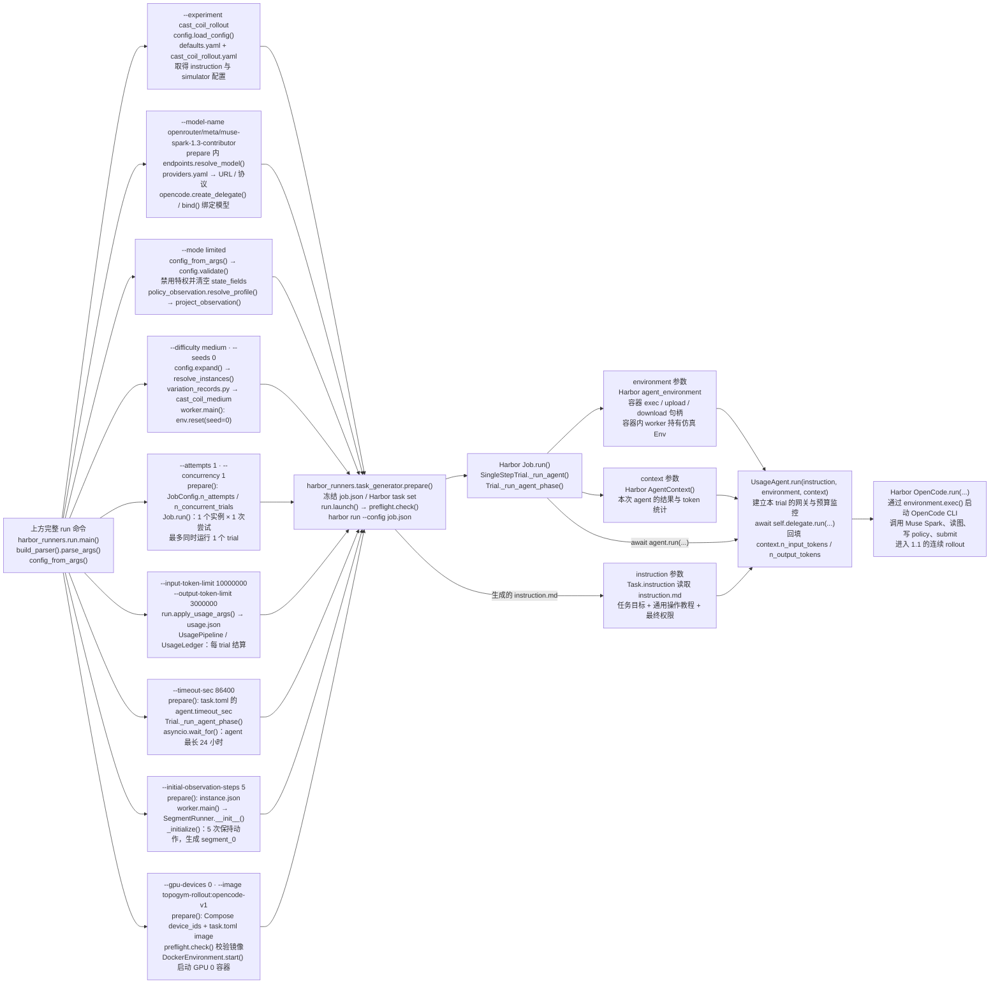
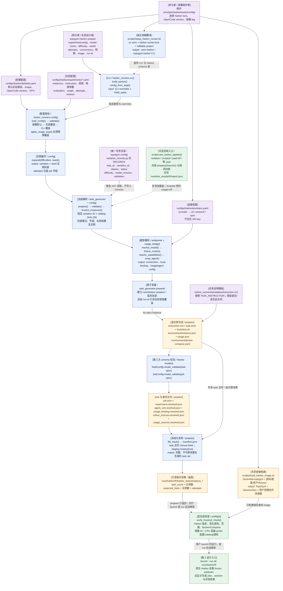

```mermaid
flowchart TB
  A["[管理方 / 本地脚本或容器 worker]<br/>Env.reset(seed)<br/>SegmentRunner(env, output_root, initial_observation_steps)"]
  B["[初始化 / simulator + config + tasks + assets]<br/>Env.reset(): load_scene_config(); Task.declare()/finalize_spec()<br/>GenesisWorld.from_tabletop()/build(); make_robot()<br/>Task.bind()/initialize(); SensorSuite(); EpisodeHistory()"]
  I["[初始段 / rollout_simulation.segment]<br/>SegmentRunner._initialize()<br/>_begin(initial=True); _step({}) × K; _end()<br/>output: segment_0，首个 policy 的真实起点"]
  C["[策略调度 / rollout_simulation.segment + policy]<br/>SegmentRunner.run_policy() → execute_policy()<br/>input: request_id, policy, submission_hash,<br/>mode, observation_profile, state_fields"]
  D["[权限与输入投影 / policy_observation]<br/>validate_profile(); build_context(); project_observation()<br/>output: readonly context / obs"]
  P["[被动策略 / planning 或用户源码]<br/>initialize(context) → None<br/>act(obs) → action 或 None"]
  Q{"act(obs) 的输出？"}
  S["[段执行 / rollout_simulation.segment]<br/>_step(segment_id, token, action, sequence)<br/>action_copy(); fingerprint(); 写 requested 事件"]
  E["[唯一环境执行 / simulator.env + robot.control]<br/>Interaction.step() → Env.step(action)<br/>compile_action() → robot.apply_action(command)"]
  W["[物理与任务 / world + tasks]<br/>GenesisWorld.advance() → scene.step()<br/>world.read_state() → Task.update(world_state, dt)<br/>output: reward, terminated；Env 判定 truncated"]
  H["[逐 tick 状态 / simulator.history]<br/>Env._save_state() → EpisodeHistory.append()<br/>output: EpisodeState checkpoint + tick_record"]
  T{"control_decimation 未完成<br/>且环境未终止？"}
  O["[观测与动作回执 / sensors + Env]<br/>Env.observe()/sensor_frame() → SensorSuite.sample()<br/>output: RGB、本体测量、Transition<br/>Env.step 返回 obs, reward, terminated, truncated, info"]
  J{"terminated / truncated？"}
  L["[公开历史 / rollout_simulation.history]<br/>SegmentHistory.tick()/event()<br/>steps.jsonl + events.jsonl<br/>按 observation profile 过滤字段"]
  V["[私有证据 / rollout_simulation.evidence]<br/>SegmentEvidence.tick()/write()/policy_event()<br/>physics_states、control_steps、history_events<br/>大数组 NPZ；policy 元信息与报告"]
  R["[录像 / recording.segment + session]<br/>SegmentMedia.append() → RecordingSession.append()<br/>SimulationTimeline.advance() → VideoWriter.append_data()<br/>各相机 + combined，30 fps"]
  F["[封段 / rollout_simulation.segment]<br/>_end(reason)<br/>media.finish(); history.finish(); ArtifactStore.add()<br/>output: sealed result + 文件大小 / SHA-256"]
  M["[媒体校验 / recording.encoding]<br/>append_final(); close(commit); probe(decode=True)<br/>videos/*.mp4 + frame_map.jsonl<br/>recording_manifest.json + validation.json"]
  N["[段结果 / 管理方证据目录]<br/>segments/segment_N/result.json<br/>report.json；private/policies/segment_N.json<br/>policy.on_segment_end(obs, result) → None"]
  X["[异常 / 取消路径]<br/>invalid_policy_output / invalid_action / policy_error<br/>env_error / observation_error / evidence_error / cancelled<br/>封存已发生的状态，并记录完整性"]
  NEXT["[外层调用方]<br/>读取结果，决定提交下一个 policy<br/>同一 Env、episode、物理时间继续"]

  A -->|"input: SimulatorConfig + seed"| B
  B -->|"output: 初态 obs/info + 当前 episode"| I
  I -->|"segment_0 已封存"| C
  C -->|"校验权限、哈希、幂等；_begin()"| D
  D -->|"首次 context；每轮 obs"| P
  P --> Q
  Q -->|"action mapping；空字典也是保持一步"| S
  Q -->|"None：本段 policy_done"| F
  S -->|"已冻结的低层 action"| E
  E -->|"joint targets；重复最多 D 个物理 tick"| W
  W -->|"WorldState + TaskResult"| H
  H --> T
  T -->|"是"| W
  T -->|"否"| O
  O --> J
  J -->|"否：新 RGB + 本体 + execution_state"| D
  J -->|"是：env_terminal / env_time_limit"| F
  H -.->|"state sink：每个已保存 tick"| L
  H -.->|"state sink：完整测量记录"| V
  S -.->|"action 请求、失败事件"| L
  S -.->|"action 请求、policy 事件"| V
  O -.->|"transition sink：动作完成回执"| L
  O -.->|"transition sink"| V
  O -.->|"frame sink：控制步结束 SensorFrame"| R
  C -.->|"每段起点记录一次 tick 和初帧"| L
  C -.->|"_begin() 创建 SegmentMedia"| R
  P -.->|"异常"| X
  E -.->|"异常"| X
  V -.->|"输出失败"| X
  R -.->|"输出失败"| X
  X --> F
  F -->|"有媒体时"| M
  F -->|"封存日志和状态汇总"| N
  M -->|"视频与帧映射描述符"| N
  N --> NEXT
  NEXT -->|"非终态且继续：新 request_id"| C
  classDef manager fill:#e8f0fe,stroke:#4169a1,color:#15263d
  classDef execution fill:#e6f4ea,stroke:#42835a,color:#173c23
  classDef artifact fill:#fff4dc,stroke:#ad8130,color:#493719
  classDef policy fill:#f0e8fa,stroke:#8655ac,color:#362148
  classDef failure fill:#fde8e8,stroke:#b95151,color:#542222
  class A,C,D,S,F,NEXT manager
  class B,I,E,W,H,O execution
  class L,V,R,M,N artifact
  class P policy
  class X failure
```

```mermaid
flowchart TB
  USER["[参与者 / 实验用户]<br/>topogym-harbor run<br/>model-name, api-key, difficulty, seeds, attempts<br/>预算、并发、时限；mode/state-fields 可覆盖实验 YAML"]
  ENTRY["[宿主 CLI / harbor_runners.run]<br/>main() → config_from_args() → prepare()<br/>input_key() / credential_environment()<br/>output: frozen run + 私有子进程凭据环境"]
  LAUNCH["[宿主启动 / run + preflight]<br/>launch() → check() / verify_frozen()<br/>Popen: harbor run --config job.json"]
  HARBOR["[第三方调度 / Harbor]<br/>Job.run(); Trial._prepare() / _run_agent_phase()<br/>instances × attempts；并发上限 concurrency"]
  DOCKER["[容器基础设施 / Docker + NVIDIA runtime]<br/>DockerEnvironment.start() → Compose up<br/>共享镜像 + 冻结配置只读挂载 + GPU<br/>Harbor egress-control sidecar 管理阶段网络"]
  WORKER["[容器 root / rollout.worker]<br/>main(): make(); reset(); SegmentRunner()<br/>RolloutSession(); serve(agent.sock/admin.sock)<br/>一个 Env、一个 episode、segment_0"]
  READY["[启动门槛 / Harbor healthcheck]<br/>topogym-rollout ready --check-initial<br/>check_initial(): 校验初段、视频、日志和 SHA-256"]
  ADAPTER["[宿主包装 agent / usage_adapter]<br/>UsageAgent.setup() / run()<br/>setup: 安装固定 OpenCode<br/>run: no-network；每 trial 创建 UsagePipeline"]
  PIPE["[宿主计量服务 / usage.pipeline + service]<br/>UsagePipeline.start(routes, credential_resolver)<br/>UsageService + GatewaySource + Gateway<br/>output: socket_path, trial token, route binding"]
  BIND["[宿主适配 / agents.opencode]<br/>create_delegate() → IsolatedOpenCode<br/>bind(connection, relay_url, trial_token)<br/>OPENCODE_CONFIG_CONTENT：model + small_model"]
  AGENT["[容器 agent UID 10001 / OpenCode CLI]<br/>OpenCode.run(instruction, environment, context)<br/>读图/读日志、调用模型、写 policy、执行工具<br/>output: policy.py、工具调用、原生日志"]
  RELAY["[容器 root / usage.relay]<br/>main(); watch_budget()<br/>localhost HTTP ↔ 只读挂载的 Unix socket<br/>budget.json 连续刷新"]
  GW["[宿主网关 / usage.gateway]<br/>Gateway.handle()<br/>验证 trial token、冻结模型、协议和端点<br/>prepare_request() → ledger.admit()/mark_sent()"]
  PROVIDER["[外部参与者 / 模型 provider]<br/>Chat Completions / Messages / Responses<br/>input: prompt、历史、图片、tools、output cap<br/>output: 模型响应 / SSE + provider usage"]
  RECEIPT["[协议计量 / usage.sources]<br/>ChatUsage / MessagesUsage / ResponsesUsage.feed()<br/>output: UsageEvent(request_id, input, output, final)"]
  LEDGER["[宿主权威账本 / usage.ledger + store]<br/>UsageService.record() → UsageLedger.record()<br/>SQLite 事务结算；budget.check()<br/>input/output 分额度，全 trial 共账"]
  BUDGET["[预算导出 / usage.publisher]<br/>UsagePublisher.publish()/finalize()<br/>usage/ledger.sqlite + events.jsonl + snapshot.json<br/>binding.json；失败时 stop.json"]
  ADMIN["[参与者 / 宿主实验管理者]<br/>usage-status / usage-update<br/>update_limits(expected_revision, limits, actor, reason)"]
  STOP["[强停管理 / supervisor + UsageAgent]<br/>cancel_requests(); stop_trial()<br/>终止 agent；admin.sock budget_stop → proxy.cancel()<br/>无法确认停止时关闭 trial 容器并标记证据缺失"]
  READ["[容器 agent / rollout.client + history]<br/>history / logs / video / frames<br/>HistoryReader.index()/page()/video()/frames()<br/>output: 历史、MP4 路径、按需 PNG 抽帧"]
  SUBMIT["[容器 agent / rollout.client]<br/>submit → call() → agent.sock<br/>source_utf8, filename, create_policy, parameters<br/>episode_id + request_id"]
  DISPATCH["[容器 root / worker + protocol]<br/>RolloutSession.dispatch() → validate_submit()<br/>哈希、幂等、串行队列；execute_next()<br/>submission.json + accepted/running receipt"]
  PROXY["[容器 policy UID 10002 / policy_process]<br/>RemotePolicyProxy → child_main() / restrict_process()<br/>JSON/array 管道 RPC；create_policy(**parameters)<br/>initialize / act / on_segment_end"]
  CORE["[容器 root + GPU / 图 1 的执行内核]<br/>SegmentRunner.run_policy(policy=proxy)<br/>Env、Task、Robot、Genesis、Nyx、recording<br/>output: 封存 segment result + logs + videos"]
  PUBLIC["[公开发布 / rollout.public_artifacts]<br/>PublicArtifacts.publish() / _export()<br/>核验权限与哈希，复制到 /rollout<br/>result 最后发布；更新 history.json / session.json"]
  LOOP{"agent 再提交一段<br/>还是结束？"}
  FINISH["[root 管理与 verifier / rollout.verify + worker]<br/>finalize() → admin finish → cancel()/finish()<br/>runner.close(); session_final.json + usage_final.json<br/>score(); seal_archive()"]
  RESULT["[第三方采集 / Harbor artifact hooks]<br/>_collect_artifacts_phased() 下载 rollout / worker.log<br/>output: trial/artifacts；root hook 已先完成封存"]
  VERIFY["[第三方正式验证 / Harbor SingleStepTrial]<br/>_run_verifier() → tests/test.sh → topogym-rollout-verify<br/>复核已封存 session；reward.txt / verification.json<br/>stop environment；保存 Harbor trial result.json"]
  COLLECT["[宿主归档 / collect + rollout_output_report + hooks]<br/>collect() / verify_archive() → summarize() → cleanup()<br/>完整归档后清理本 run 的停止容器/网络<br/>失败保留容器，collect --recover 可重试采集"]
  OUT["[产物消费者 / 用户与评测]<br/>runs/harbor/R：summary、index、trial logs、usage<br/>task_rollouts/R/task/rollout_N：完整 session 证据<br/>task_success / reward / budget_qualified 分开阅读"]

  USER --> ENTRY
  ENTRY -->|"图 3 的 frozen run；key 仅进子进程环境"| LAUNCH
  LAUNCH -->|"job.json"| HARBOR
  HARBOR -->|"task.toml + Compose + 镜像"| DOCKER
  DOCKER -->|"instance.json / usage.json"| WORKER
  WORKER -->|"初始段公开产物 + agent socket"| READY
  READY -->|"Harbor run_healthcheck() 通过"| ADAPTER
  ADAPTER -->|"trial identity、limits、冻结 route；真实 key"| PIPE
  PIPE -->|"启动容器 relay；socket_path + token"| RELAY
  RELAY -->|"ready 文件：localhost port"| BIND
  PIPE -->|"route binding + trial token"| BIND
  BIND -->|"配置 overlay + 固定版本 + instruction"| AGENT
  AGENT -->|"HTTP：trial token + 模型请求"| RELAY
  RELAY -->|"Unix socket：请求原协议透传"| GW
  PIPE -.->|"创建并持有 Gateway"| GW
  GW -->|"替换真实上游 key；限制 output cap"| PROVIDER
  PROVIDER -->|"JSON / SSE response"| GW
  GW -->|"响应数据中的 usage"| RECEIPT
  GW -->|"模型响应经 relay 返回"| RELAY
  RELAY -->|"响应 / SSE"| AGENT
  RECEIPT --> LEDGER
  LEDGER -->|"快照 / 连续审计"| BUDGET
  LEDGER -.->|"remaining 供下个请求 admission"| GW
  ADMIN -->|"原子调额；revision 检查"| LEDGER
  LEDGER -->|"超额、额度耗尽、usage 缺失或冲突"| STOP
  BUDGET -.->|"relay 查询 /budget"| RELAY
  STOP -.->|"关网关和模型 admission"| GW
  STOP -.->|"SIGKILL agent UID"| AGENT
  STOP -.->|"独立 root admin socket"| WORKER
  AGENT --> READ
  READ -->|"历史、图片与反馈进入下一轮模型上下文"| AGENT
  AGENT -->|"保存 policy.py，运行提交工具"| SUBMIT
  SUBMIT -->|"topogym.rollout.v1 消息"| DISPATCH
  DISPATCH -->|"冻结源码；创建隔离策略进程"| PROXY
  DISPATCH -->|"request/hash/profile + proxy"| CORE
  CORE -->|"context / obs"| PROXY
  PROXY -->|"action 或 None"| CORE
  CORE --> PUBLIC
  PUBLIC -->|"result_path + history + receipt"| SUBMIT
  PUBLIC -->|"已完成产物"| READ
  SUBMIT -->|"--wait 或 result 查询"| AGENT
  AGENT --> LOOP
  LOOP -->|"继续且 episode 非终态"| READ
  LOOP -->|"结束；结算 usage；Harbor root collect hook 调 finalize"| FINISH
  STOP -->|"封存可得证据，预算失败不可复活"| FINISH
  WORKER -.->|"维持同一 RolloutSession"| FINISH
  BUDGET -->|"final usage + events + binding"| FINISH
  FINISH --> RESULT
  HARBOR -.->|"_run_collect_hooks()，先封存再下载"| FINISH
  RESULT --> VERIFY
  VERIFY --> COLLECT
  COLLECT --> OUT
  classDef host fill:#e8f0fe,stroke:#4169a1,color:#15263d
  classDef runtime fill:#e6f4ea,stroke:#42835a,color:#173c23
  classDef external fill:#f0e8fa,stroke:#8655ac,color:#362148
  classDef artifact fill:#fff4dc,stroke:#ad8130,color:#493719
  classDef failure fill:#fde8e8,stroke:#b95151,color:#542222
  class ENTRY,LAUNCH,HARBOR,DOCKER,ADAPTER,PIPE,BIND,GW,RECEIPT,LEDGER,COLLECT host
  class WORKER,READY,RELAY,READ,SUBMIT,DISPATCH,CORE,PUBLIC,FINISH,VERIFY runtime
  class USER,ADMIN,PROVIDER,AGENT,PROXY external
  class BUDGET,RESULT,OUT artifact
  class STOP failure
```

# TopoGym 三条实际流程：segment、Harbor session、实验集准备

本文按 **2026-09-28 当前工作区源码**绘制。节点写出模块、关键函数和模块类型；箭头标出调用时传递的输入/输出。图后的表补充字段、文件和异常分支。第三方部分按本机安装的 Harbor 0.23.0 源码核对；OpenCode 部署配置固定为 1.18.33。

三图的连接关系是：**图 3 生成实验集 → 图 2 调度每个 trial → 图 1 在每个 trial 内执行一个或多个 segment → 图 2 验证、归档和汇总。**

速览源码：[1.1 policy ↔ Env](project_three_flows_20260928/01_segment_teaser.mmd)、[1.2 命令与参数](project_three_flows_20260928/02_cli_teaser.mmd)。1.3 直接使用目录快照。

独立 Mermaid 源码，可用于单图预览或导出：[图 1：segment](project_three_flows_20260928/01_segment.mmd)、[图 2：Harbor session](project_three_flows_20260928/02_harbor_session.mmd)、[图 3：实验集准备](project_three_flows_20260928/03_prepare_experiment.mmd)。

先统一几个代码中的实际名称：

| 用户概念 | 当前实现 | 含义 |
| --- | --- | --- |
| `harbor run --model-name --api-key ...` | 项目入口是 `topogym-harbor run ...`，等价于 `python -m harbor_runners.run run ...` | 项目完成参数解析、任务冻结、计量接入，再调用第三方 `harbor run --config job.json`；两层 CLI 的参数不能混用 |
| `--trails` / 尝试次数 | `--attempts` | 每个已展开实例重复多少次；`trial` 是一次调度执行，`attempts` 是次数参数 |
| limited / privilege mode | 实验 YAML 的 `instances[].mode: limited/unlimited` | `prepare/run --mode limited\|unlimited` 覆盖全部展开实例；同步 `simulator.enable_privileged`，limited 清空特权字段，unlimited 用 `--state-fields` 指定白名单 |
| difficulty | `--difficulty` → `simulator.variation_id` | variation ID 或当前 task 的别名，由 catalog 解析；不是统一的连续难度数值 |
| `run/` 实验目录 | `runs/harbor/<run-id>/` | 其中 `harbor_tasks/` 是生成的 task set；`jobs/` 是执行后才出现的 Harbor 结果 |
| token 计费 | `usage/` 的 input/output 计量与预算 | 当前没有基于价目表的权威美元结算；Harbor/OpenCode 原生日志可能有 `cost_usd`，它不参与本项目预算判定 |
| session | `RolloutSession`，绑定一个 Env episode | 启动时创建，执行中持续追加 segment，结束时写 `session_final.json`；没有最后再拼接多个独立 Env 的阶段 |

图例：`[类型]` 表示模块职责；实线表示调用或数据传递，虚线表示旁路记录、管理控制或对另一张图的引用。图中的 `output` 既可能是函数返回值，也可能是落盘文件，具体以箭头和产物表为准。

## 1. 三条流程：先看速览，再看实现

<a id="flow-1"></a>

### 1.1 Env ↔ scripted policy：一个连续 rollout

#### 速览

OpenCode 负责读任务、看反馈和写 policy；worker 驱动 policy 与同一个 Env 逐步交互。下面的实际方法名是 `act(obs)`，其返回值叫 `action`。

```mermaid
flowchart LR
  INIT["worker.main()<br/>make() → env.reset(seed=0)<br/>保持 5 个控制步，生成 segment_0"]
  AGENT["OpenCode + Muse Spark<br/>读 instruction.md / spec.json / 反馈<br/>写 segment_N.py"]
  RUNNER["RolloutSession.execute_next()<br/>SegmentRunner.run_policy()<br/>execute_policy()"]
  OBS["project_observation()<br/>RGB + 机器人本体 + state<br/>+ execution_state"]
  POLICY["scripted policy 子进程<br/>initialize(context)：每段一次<br/>action = act(obs)：每控制步"]
  ENV["Interaction.step(action)<br/>→ env.step(action)<br/>Genesis 推进，更新 Task 与传感器"]
  RESULT["封存 segment_N<br/>result.json + steps/events<br/>+ 视频与帧索引"]
  STOP["任务终态 / 时限 / 预算停止<br/>结束 session，验证并归档"]

  INIT -->|"初始视频与状态"| AGENT
  AGENT -->|"topogym-rollout submit policy.py --wait"| RUNNER
  RUNNER -->|"构造第一次 obs"| OBS
  RUNNER -.->|"先 initialize(context)"| POLICY
  OBS -->|"obs"| POLICY
  POLICY -->|"返回 action；runner._step() 调用"| ENV
  ENV -->|"未终止：新观测与动作执行回执"| OBS
  POLICY -->|"返回 None：结束本段"| RESULT
  ENV -->|"terminated / truncated：结束本段"| RESULT
  RESULT -->|"还可继续：同一 Env，下一段不 reset"| AGENT
  RESULT -->|"session 结束"| STOP
  AGENT -.->|"预算或墙钟耗尽时由管理方停止"| STOP
```



`env.step(action)` 由 runner 经 Interaction 调用，policy 本身没有 Env 句柄。图中未终止时返回 policy 的 obs 是投影后的观测：limited 仍包含机器人关节、TCP 位姿和夹爪状态。`None` 只结束当前 segment；下一段沿用当前状态和物理时间。一次 `act(obs)` 不等于一次模型 API 请求。

#### 详细调用图



#### 流程 explanation

管理方先 `reset()`，完成场景配置、任务资产声明、Genesis 场景构建、机器人初始化和传感器创建。随后 `SegmentRunner` 绑定这个 episode，订阅 Env 的 state、transition、frame、lifecycle 四类输出。Harbor 路径默认先执行 **5 个保持当前控制目标的真实控制步**，封存 `segment_0`；直接构造 `SegmentRunner` 的默认值则是 0。两者均创建初始段。

每次 `run_policy()` 对应一个策略提交。调度器验证模式、源码身份与 observation profile，生成只读 `context`，可选调用 `initialize(context)`，再反复调用 `act(obs)`。策略返回一个低层 action，管理方才执行一步；返回 `None` 就结束这个 segment。`{}` 表示保持当前控制目标一个控制步，仍然推进仿真。

一个控制步最多包含 `control_decimation` 个物理 tick。每个 tick 都推进 Genesis、更新 Task 判据、保存完整内存 checkpoint 和可读测量日志；控制步结束才生成新 observation、动作回执和用于录像的 SensorFrame。环境终止会提前跳出 tick 循环。`solver_substeps` 是单个物理 tick 内的求解细分，不等于一个独立公开控制步。

`_end()` 封存视频、帧映射、日志和摘要，计算 artifact 的大小与 SHA-256，最后写完成标记。`on_segment_end()` 在封段后通知 policy；回调失败被记录，不会重新执行动作。外层可以读取反馈再提交另一段；**结束 segment 不等于任务成功，也不等于 session 结束。**

#### 模块—函数—输入—输出—下一调用

以下源码链接均相对本页。`rollout_simulation` 指 `topogym/simulator/rollout_simulation/`。

| 模块 / 类型 | 函数 | input | output / 下游 |
| --- | --- | --- | --- |
| [simulator.api](../../../topogym/simulator/api.py)、[config](../../../topogym/simulator/config.py) / 管理入口 | `make()`、`SimulatorConfig` | task/robot/variation、seed、控制/物理/视觉配置 | `Env`；Harbor worker 随后调用 `reset()` |
| [config.registry](../../../topogym/config/registry.py) / 任务选择 | `task_definition()`、`resolve_variation()`、`require_task_support()` | task/variation、参数、seed | 具体 Task 类、变体参数和支持范围；生产任务与测试 fixture 共用 Env 管理入口 |
| [simulator.env](../../../topogym/simulator/env.py)、[config.scene](../../../topogym/config/scene.py) / 生命周期 | `Env.reset()`、`load_scene_config()` | seed、已验证配置 | scene config、Task、world、robot、sensors、初态 `(obs, info)` |
| [tasks.base](../../../topogym/tasks/base.py)、具体 Task、[assets.library](../../../topogym/assets/library.py) / 任务建模 | `declare()`、`finalize_spec()`、`bind()`、`initialize()`、`describe_build()` | 参数、资产目录、桌高、实体、初始世界状态 | 实体/附件/物理选项、任务运行状态、资产哈希；由 `Env.reset()` 接到 World |
| [world.genesis_world](../../../topogym/world/genesis_world.py)、[robot.joint_position](../../../topogym/robot/joint_position.py) / 引擎与执行器 | `from_tabletop()`、`add_entities()`、`build()`、`make_robot()`、`reset_home()` | scene spec、机器人配置、后端 | 构建好的唯一物理场景与机器人；任务可另声明起始控制目标/冻结初态 |
| [rollout_simulation.segment](../../../topogym/simulator/rollout_simulation/segment.py) / 段管理 | `SegmentRunner.__init__()`、`_initialize()`、`run_policy()` | 已 reset 的 Env、输出目录、初始步数、policy/request/hash/profile | `segment_0`；后续段的最终 result；`run_policy()` 调 `execute_policy()` |
| [rollout_simulation.policy](../../../topogym/simulator/rollout_simulation/policy.py) / 被动调度 | `execute_policy()` | runner、policy、模式、源码哈希、授权字段 | `initialize → act → _step` 循环；封段结果；幂等重复请求可直接取已有结果 |
| [policy_observation](../../../topogym/simulator/rollout_simulation/policy_observation.py) / 权限投影 | `resolve_profile()`、`validate_profile()`、`build_context()`、`project_observation()` | raw observation、本体、相机规格、action/timing spec、授权状态 | 只读 context/obs；相同 state identity 的 RGB 和机器人测量 |
| [planning.examples.cube_pick_place](../../../topogym/planning/examples/cube_pick_place.py) 或提交源码 / 策略 | `initialize()`、`act()`、`on_segment_end()` | context / obs / result | action 或 `None`；策略自身不持有 Env |
| [robot.control](../../../topogym/robot/control.py) / 控制转换 | `compile_action()` | robot、action、control mode | 关节控制 command；EE 控制按现有机器人 IK 路径转换，交 `apply_action()` |
| [solvers.genesis_kinematics](../../../topogym/solvers/genesis_kinematics.py) / IK | `GenesisIKSolver.solve_checked()` | 目标 hand 位姿、关节索引、初始 qpos、误差容限 | 检查后的 qpos → `compile_action()`；查询过程不作为额外物理动作 |
| [world.genesis_world](../../../topogym/world/genesis_world.py)、具体 Task / 物理与判据 | `advance()`、`read_state()`、`Task.update()` | command、物理 dt、world state | 引擎下一状态、任务 reward/terminated；Env 补充时间上限 truncated |
| [simulator.history](../../../topogym/simulator/history.py) / 当前 episode 内存历史 | `EpisodeHistory.append()`、`Env._save_state()` | world/robot/task/RNG state、StateInfo | 每 tick 一个 `EpisodeState`；可用于当前 episode 的授权回溯 |
| [sensors.observation](../../../topogym/sensors/observation.py) / 观测 | `Env.observe()/sensor_frame()` → `SensorSuite.sample()`；`proprioception()` | 当前 world/robot 与缓存 state | RGB、机器人测量和 SensorFrame；Nyx 负责 RGB，读取本身不额外推进物理 |
| [sensors.cameras](../../../topogym/sensors/cameras.py)、[camera_info](../../../topogym/sensors/camera_info.py)、[renderers.nyx](../../../topogym/sensors/renderers/nyx.py) / 相机与渲染 | `create_camera()`、`update_dynamic_camera()`、`camera_contract()`、`NyxCamera.render()` | scene 相机设置、固定/动态 pose、当前引擎状态 | RGB、内外参、固定/移动相机合同 → SensorSuite/profile；moving camera 标定不能当固定标定公开 |
| [evidence](../../../topogym/simulator/rollout_simulation/evidence.py)、[history](../../../topogym/simulator/rollout_simulation/history.py) / 记录 | `tick()`、`write()`、`event()`、`write_policy_report()` | tick、action、Transition、生命周期、profile | 私有证据与经过筛选的公开 segment 日志 |
| [recording.segment](../../../topogym/recording/segment.py)、[session](../../../topogym/recording/session.py)、[timeline](../../../topogym/recording/timeline.py)、[encoding](../../../topogym/recording/encoding.py) / 媒体 | `SegmentMedia.append()/finish()`、`RecordingSession.append()/append_final()/finish()/close()`、`SimulationTimeline.advance()`、`VideoWriter`、`probe()` | 带仿真时间与 state ID 的 SensorFrame | 多视角 MP4、横向 combined、frame map、录像 manifest 和完整解码校验 |
| [artifacts](../../../topogym/simulator/rollout_simulation/artifacts.py)、[segment_contract](../../../topogym/simulator/rollout_simulation/segment_contract.py) / 合同与索引 | `ArtifactStore.add()`、`fingerprint()`、`validate_policy_output()`、`public_info()` | 文件、动作/提交身份、policy 返回值、原始 info | artifact 描述符、身份哈希、合法性判定、可公开反馈 |
| [simulator.interaction](../../../topogym/simulator/interaction.py)、[privileged](../../../topogym/simulator/privileged.py) / episode 权限 | `Interaction.step()/observe()/get()`、`public_info()` | 绑定 episode 的访问、动作/字段 | 检查句柄有效性和特权，筛选公开 info；管理 reset 会使旧句柄失效 |
| [utils.io](../../../topogym/utils/io.py)、[snapshots](../../../topogym/utils/snapshots.py)、[variant_rng](../../../topogym/utils/variant_rng.py) / 共享支持 | `write_json_atomic()/sha256_file()/to_jsonable()/relative_file()`、`freeze()/thaw()`、`seed_process()` | 状态/文件/数组、seed | 原子文件、哈希、路径约束、不可变副本、初始化随机源，供上述模块复用 |

#### Observation、action 和 result 的字段

| 对象 | 关键字段 / 语义 |
| --- | --- |
| `context` | `schema_version, mode, action_spec, timing_spec, observation_spec, observation_profile, rgb_available` |
| `obs` | `rgb[camera]`、`robot[group]`、`state`、`execution_state`；可选固定相机 `camera_calibration`；unlimited 才有授权的 `privileged` |
| `obs.robot[group]` | 关节角、TCP 世界坐标、wxyz 姿态、实际手指位置；字段/维数由 robot/action spec 决定 |
| `obs.execution_state` | 本段控制步数、前一个 action 的执行回执、观察是否对应当前状态及错误状态；不是完整 task 内部状态或 reward 注入通道 |
| `action` | 按 `action_spec.groups` 组织的低层 mapping；控制模式为 `JOINT_ABS`、`JOINT_DELTA`、`EE_ABS`、`EE_DELTA`，具体字段以规格为准 |
| `result` | `segment_id, request_id, episode_id, branch_id, status, reason, start_state_ref, end_state_ref`；动作/tick/仿真时间计数；`feedback, media, logs` 与完整性标记 |
| `artifact descriptor` | `artifact_id, size_bytes, sha256`；公开发布层另附 `path`。`result` 仅引用日志文件，不内嵌所有 tick |

#### 本循环的完整产物表

下面路径相对 `SegmentRunner.output_root`；Harbor 中是容器私有的 `/trial/rollout/`。

| 产物 | 谁写 / 何时 | 内容与用途 |
| --- | --- | --- |
| `config.json`、`asset_manifest.json`、`source_manifest.json` | `SegmentEvidence.__init__()` | 配置、资产身份和扫描到的 simulator Python 源码哈希；该 source manifest 并非全仓快照 |
| `report.json` | `SegmentRunner._save_report()` | 所有段摘要、错误、统计、runner 状态 |
| `private/static_model.json` | `SegmentEvidence.__init__()` | episode 元信息和 timing；声明测量格式与覆盖范围 |
| `private/physics_states.jsonl` | `SegmentEvidence.tick()` | 每个已提交 tick 的可读 world/robot/task 测量、state/segment 身份 |
| `private/arrays/chunk_*.npz` | 同上，按需 | 较大的数值数组；先写块，再发布 JSONL 引用 |
| `private/control_steps.jsonl` | `write()`、`policy_event()` | 段起止、action requested/completed/failed、policy 提交/输出/通知事件 |
| `private/history_events.jsonl` | lifecycle sink | reset/rewind/close 等生命周期事件；没有发生事件时文件可为空 |
| `private/policies/segment_N.json` | `write_policy_report()`，N≥1 | submission hash、observation profile、决策次数、状态、错误；不是 policy 源文件 |
| `segments/segment_N/steps.jsonl` | `SegmentHistory.tick()` | 本段一个起点记录 + 每个已保存物理 tick；限定本体和授权 privileged 字段 |
| `segments/segment_N/events.jsonl` | `SegmentHistory.event()` | action 请求/完成/失败和段结束 |
| `segments/segment_N/videos/<camera>.mp4`、`combined.mp4` | `SegmentMedia` → `RecordingSession` → ffmpeg | 授权相机视角与横向拼图；包括初始段；关闭 RGB/无选中相机时不产视频 |
| `segments/segment_N/frame_map.jsonl` | `RecordingSession` | 视频帧索引 → source state ID、物理 tick、仿真时间；保留末帧展示补帧信息 |
| `segments/segment_N/recording_manifest.json` | `RecordingSession` | 录像状态、相机/帧数、文件身份、完成/失效记录 |
| `segments/segment_N/validation.json` | `SegmentMedia.finish()` | 完整解码及帧数、分辨率、fps 等校验结果；成功封存媒体时生成 |
| `segments/segment_N/result.json` | `SegmentRunner._end()` | 最后写入的段完成摘要；初始化中的私有文件尚非可公开结果 |
| `EpisodeHistory` 内存对象 | `Env._save_state()` | 完整可恢复引擎历史；**未自动导出为以上 JSONL/NPZ** |

录像按仿真时间映射到 30 fps。当前取帧点主要在控制步结束，不能把每 tick 的状态记录误认为每 tick 都重新渲染；媒体重复帧和末帧 padding 不增加物理执行次数。`steps` 数量应为 `saved_physics_steps + 1`，视频帧数无需与其相等。

本路径不自动创建 `EpisodeDatasetWriter` 的 HDF5/JSONL transition 数据集，也不把所有 segment 合成一条 MP4。直接脚本可另外注册 writer；本地验收脚本还会按自身逻辑生成 `run_report.json`、源码快照、`progress.json` 等，它们不属于 `SegmentRunner` 的通用保证。

<a id="flow-2"></a>

### 1.2 从 run 命令到 Harbor agent.run()

#### 速览：从这一条命令展开

假定共享镜像已按当前源码构建。下面的命令生成 Cast Coil medium、seed 0 的一个 trial；未提供 key 时按现有凭据逻辑处理，run-id 自动生成。

```bash
cd /home/jianwen/topogym

.venv-harbor/bin/python -m harbor_runners.run run \
  --experiment cast_coil_rollout \
  --model-name 'openrouter/meta/muse-spark-1.3-contributor' \
  --mode limited \
  --difficulty medium \
  --seeds 0 \
  --attempts 1 \
  --concurrency 1 \
  --input-token-limit 10000000 \
  --output-token-limit 3000000 \
  --timeout-sec 86400 \
  --initial-observation-steps 5 \
  --gpu-devices 0 \
  --image topogym-rollout:opencode-v1
```

每个参数分支直接标出解析函数、冻结位置或运行时消费者。公共部署设置由 `configs/harbor/defaults.yaml` 提供，模型路由由 `configs/harbor/providers.yaml` 提供。



图中 `instruction` 是整份任务 Markdown 的文本；`environment` 是 Harbor 的容器操作句柄，TopoGym `Env` 位于其中的 worker 进程；`context` 是 Harbor 的 `AgentContext` 结果对象。policy 的 `initialize(context)` 使用另一份结构化接口说明，与 `/rollout/spec.json` 同源，不是这里的 AgentContext。

三个参数的实际调用点是 Harbor `Trial._run_agent_phase()`：

```python
# Harbor：running_agent 在本项目里是 UsageAgent。
await asyncio.wait_for(
    running_agent.run(
        instruction=instruction,
        environment=self.agent_environment,
        context=target.agent_result,
    ),
    timeout=timeout_sec,
)
```

项目的 [`UsageAgent.run()`](../../../harbor_runners/agents/usage_adapter.py) 包装预算生命周期，再调用 OpenCode delegate 的 `run()`；原生 `harbor run --config job.json` 是调度命令，不是这个 Python 方法。`--timeout-sec` 约束 agent 墙钟；仿真时域仍由预设的 max_physics_steps / physics_dt_s 决定。

#### 详细调用图



#### 流程 explanation

用户命令先被本项目 CLI 解析，产生冻结的实验配置、Harbor task set 和 `job.json`。`launch()` 校验冻结文件、代码、Docker/Compose、共享镜像及凭据，然后以独立子进程环境启动 Harbor。**共享镜像提前构建；launch 使用镜像创建每个 trial 容器**，不是为每个 seed 再复制一套 simulator 源码构建镜像。

Harbor 对 `instances × attempts` 创建 trials，按 concurrency 调度。每个 trial 的 Compose 启动 root worker，挂载只读实例/usage 配置并申请 GPU。worker 在唯一拥有 Env 的线程中 reset、录制 `segment_0`，建立 `RolloutSession` 和两个 Unix socket。Harbor 的 healthcheck 确认初始视频、日志和哈希有效，才进入 agent setup。Harbor 的网络控制 sidecar 允许 setup 阶段联网安装固定版本 OpenCode，agent 与 verifier 阶段使用 `no-network` 策略。

`UsageAgent` 是 **在宿主运行的 Harbor 包装类**。它创建宿主 UsagePipeline、账本和网关，取得 trial token；另以 root 启动容器 localhost relay。`create_delegate()` 生成 OpenCode 适配对象，把 relay 地址和 trial token 注入 OpenCode。真正的 OpenCode CLI 以容器 `agent` 用户运行。OpenCode 发出的模型请求经 relay 的 Unix socket 到宿主网关，网关换上真实 API key 后调用 provider；模型回执同时返回 OpenCode并进入账本。

OpenCode 负责模型对话与工具编排：读取公开历史、抽视频帧并用图像工具查看、写 Python policy、调用 `topogym-rollout submit`。worker 冻结源码和参数，创建独立 `policy` 用户进程。内核通过 proxy 调用该进程的 `act(obs)`，使用图 1 的同一 Env 循环执行。被动 policy 不是 OpenCode，也不是每个 tick 都调用一次 LLM；其 `act()` 可以是普通控制算法。

每段封存后，`PublicArtifacts` 校验文件哈希和授权字段，向 `/rollout/` 发布完整文件，再更新 result、history 和 session 状态。agent 读反馈后可以继续生成下一段。正常结束时 UsagePipeline 关闭准入并结算；root verifier 请求 worker finish，得到 session 最终反馈，核验段间状态和 RGB 连续性、证据与预算后评分。Harbor 先执行原生采集 hook、下载产物，再保留/停止容器；外层 `collect()` 核验并迁移归档，`summarize()` 汇总，全部归档完整后才执行清理。

**这里存在两次 verifier 入口，顺序有意义：**当前 Harbor `SingleStepTrial` 是 `agent → collect hook → 下载 artifacts → 正式 tests/test.sh verifier → 停容器/写 trial result`。因此项目在 `task.toml.verifier.collect` 里注册 root `topogym-rollout-verify`，让第一次调用先 finish/score/seal；正式 verifier 随后对已有 `session_final.json` 再核验并写 Harbor reward。不能假定 Harbor 一定先正式测试、再采集，否则会漏掉提前封存这一参与者。

#### CLI → 配置 → 运行变量传递

| 用户输入 / 来源 | 宿主解析与冻结值 | 运行时消费者 / 作用 |
| --- | --- | --- |
| `--model-name provider/model` | `endpoints.split_model()` 按第一个 `/` 拆分，`resolve_model()` 生成 `model_connection` | `full_model_name` 交 OpenCode；`model_id` 交网关做精确请求模型检查；provider 决定 URL/protocol |
| `providers.yaml` | `url, protocol, npm`；`freeze_routes()` → `agent_urls.resolved.json`、`usage_binding.resolved.json` | `routes_from_frozen()` → UsagePipeline primary route；当前主/辅助请求固定同一个模型 |
| `--api-key` / `--api-key-stdin` / 环境 / 私有 dotenv | `credential_environment()` 构造含 `TOPOGYM_MODEL_API_KEY` 的独立子进程环境；优先级依次为本次输入、环境、dotenv | 宿主 `credential_resolver()` → `Gateway.api_key`；不写 frozen JSON、不注入 OpenCode、不进入 policy 环境 |
| 网关生成的 trial token | `Gateway.token`，每个 trial 新建 | OpenCode `options.apiKey`；网关身份校验；它不是 provider API key，也不是 token 用量额度 |
| relay ready 回执 | `{port, pid}`；容器 `/trial/usage-relay-primary.json` | `baseURL=http://127.0.0.1:<port>/v1`，写入 `OPENCODE_CONFIG_CONTENT` |
| `--difficulty` | `expand()` 设置 `variation_id`；`resolve_instances()` 查同一份 catalog 并解析别名 | 容器 `SimulatorConfig` / task registry 选择具体变体；多值生成多个实例 |
| `--seeds` | 每个实例 `simulator.seed` | 每 trial worker `env.reset(seed=...)`；不会让 agent 修改 seed |
| `--attempts` | `config.attempts` → `job.n_attempts` | 同实例独立重复；每次新容器/Env/episode/账本，seed 保持实例值 |
| `--concurrency` | `job.n_concurrent_trials` | Harbor 调度并发；不是单 session 并行执行多个 policy |
| `--gpus` / `--gpu-devices` | Compose `deploy.resources.reservations.devices` + `runtime: nvidia` | 每 trial GPU 申请。配置指定的 device IDs 会用于每个 trial，不存在项目自实现的轮流分卡器 |
| `--timeout-sec` | `task.toml agent.timeout_sec` | Harbor agent 墙钟时限；不等于仿真时间上限或 token 预算 |
| `--input-token-limit` / `--output-token-limit` | `usage.limits` → agent kwargs 与每 task 的 `environment/usage.json` | UsageLedger 每 trial 独立的双额度；不会每 segment 重置 |
| `--initial-observation-steps` | 每个 `instance.initial_observation_steps` | `SegmentRunner._initialize()` 的保持控制步数；默认 5，不是图片数量 |
| YAML `mode/state_fields/enable_privileged` | 冻结到 `instance.json` | worker/`policy_observation` 控制策略输入及公开历史的授权范围；agent 的 submit 不允许覆盖 |
| YAML `observation_profile` | 相机选择、固定标定选择、可选 instruction | `resolve_profile()`、`project_observation()`、`PublicArtifacts` 共用同一权限合同 |
| YAML `physics_dt_s/control_decimation/solver_substeps/max_physics_steps` | `instance.simulator` | Env 与 Genesis 时钟、求解精度、仿真时间限制；与 agent 墙钟独立 |
| YAML `instruction` + 模板 | 每 task 的 `instruction.md` | Harbor → OpenCode 的唯一任务说明；YAML instruction 必须非空，模板补充操作教程与最终权限。spec/context 仅描述接口，policy obs 不重复任务文字 |
| policy 提交 | `api_version, operation, episode_id, request_id, policy{source_utf8,filename,factory,parameters}` | `validate_submit()` 哈希 source/factory/parameters/API version；filename 只是诊断标签；禁止更改环境配置 |
| manager 生成 `episode_id` / `segment_id` | episode UUID；segment_0 起递增 | observation、receipt、日志、视频 frame map、result 的共同关联键 |

**权限配置的精确关系：**

| 模式 | YAML 合同 | policy / 公开历史可获得 | 当前 Harbor 协议可执行 |
| --- | --- | --- | --- |
| limited | `mode: limited`、`state_fields: []`、`enable_privileged: false` | 授权 RGB、基础本体、公开指令、状态身份、执行回执、允许的固定相机标定 | `status/result/submit_policy`；由 manager 执行低层 action |
| unlimited | `mode: unlimited`、`enable_privileged: true`；`state_fields` 从 `robot/world/task` 显式选取 | 上述内容 + 所选 privileged 测量；未选字段不会因 unlimited 自动全量公开 | 同样的提交协议，不能 reset/make/close/改 seed |

本地特权 `SegmentInteraction` 提供当前 episode 的 `get()` / `rewind_to()`，但 **Harbor 的 agent socket 没有开放 rewind 操作**，被动 policy 也没有 Env 句柄。因此这里的 unlimited 表示观测授权，不代表任意环境管理权限；图 2 的正常 session 是连续向前执行。

#### 网关计量与停止：模块、输入输出和规则

| 模块 / 类型 | 函数与 input | output / 下一调用 |
| --- | --- | --- |
| [usage_bridge](../../../harbor_runners/usage_bridge.py) / 绑定配置 | `require_capabilities(connection, usage)`、`wrap_agent()` | 固定 `UsageAgent` import path 和 kwargs；普通运行要求 observed；strict 当前明确拒绝 |
| [agents.credentials](../../../harbor_runners/agents/credentials.py) / 宿主凭据 | `load_credentials()`、`credential_environment()`、`selected_secrets()`、`redact()/redact_logs()` | 私有凭据输入、独立子进程环境、输出日志脱敏；连接文件只存凭据变量名 |
| [usage.config](../../../topogym/agents/usage/config.py) / 预算合同 | `validate_usage()`、`BudgetSettings.from_mapping()` | 校验 scope、双额度和时间参数；无显式额度时核心默认 input 50M/output 20M，实验可覆盖，方块预设为 3M/1M |
| [agents.usage_adapter](../../../harbor_runners/agents/usage_adapter.py) / 生命周期 | `UsageAgent.setup()/run()` 接收 instruction/environment/context | 安装并运行 delegate；pipeline、relay、watchdog；最终写 Harbor `context.n_input_tokens/n_output_tokens` |
| [agents.opencode](../../../harbor_runners/agents/opencode.py) / harness 适配 | `bind()`、`create_delegate()` 接收冻结连接、relay URL、trial token | `IsolatedOpenCode`；限定 provider、主模型和 small_model；关闭自动更新/模型表拉取 |
| [usage.pipeline](../../../topogym/agents/usage/pipeline.py) / 共账生命周期 | `UsagePipeline.start()/finalize()/close()` | 同一 trial 的 service/ledger/gateway；本次 OpenCode 只绑定 primary route |
| [usage.relay](../../../topogym/agents/usage/relay.py) / 容器传输与监测 | `main()`、`watch_budget()` | HTTP ↔ Unix socket 转发；公开 budget；监测失败时 `emergency_stop()` 走本地停止路径 |
| [usage.gateway](../../../topogym/agents/usage/gateway.py) / 受控模型请求 | `Gateway.handle()` 接 HTTP body/headers | 校验 token/模型/端点，准备 output cap，admit/mark_sent，上游响应经原协议透传；usage 另送协议解析器 |
| [usage.sources.base](../../../topogym/agents/usage/sources/base.py) / 请求合同 | `prepare_request(path, body, remaining)` | `PreparedRequest`；普通生成把 cap 收紧至剩余额度；缺省 8192；拒绝不支持的后台/多生成/托管工具调用 |
| [Chat](../../../topogym/agents/usage/sources/chat_completions.py)、[Messages](../../../topogym/agents/usage/sources/anthropic_messages.py)、[Responses](../../../topogym/agents/usage/sources/openai_responses.py) / 回执解析 | `feed(payload, streaming=...)` | 标准 `UsageEvent`，带 request/sequence/final 和计数；不做跨协议互转 |
| [usage.service](../../../topogym/agents/usage/service.py) / 实时决策 | `record()`、`refresh()`、`_watch()`、`notify_stop()` | usage 事件提交后立即判断停止；默认 100ms watchdog 检查管理调额与健康并刷新导出 |
| [usage.ledger](../../../topogym/agents/usage/ledger.py)、[store](../../../topogym/agents/usage/store.py)、[types](../../../topogym/agents/usage/types.py)、[budget](../../../topogym/agents/usage/budget.py) / 权威状态 | `admit()`、`mark_sent()`、`record()`、`update_limits()`、`finalize()` | SQLite 事务、预留/结算、去重与冲突判断、stop 决策、remaining/overshoot/qualification |
| [usage.publisher](../../../topogym/agents/usage/publisher.py) / 可恢复导出 | `publish()/finalize()` | `snapshot.json`、连续 `events.jsonl`；导出损坏可从账本重建，不反向当作记账输入 |
| [supervisor](../../../harbor_runners/supervisor.py) / root 控制 | `publish_usage()`、`stop_trial()` | 私有 usage_final、公开 budget、root budget_stop；终止 agent UID 与 policy 进程组；失败则停容器 |

对每个维度 `d ∈ {input_tokens, output_tokens}`：

```text
U[d] = 这个 trial 已确认的累计用量
P[d] = Σ 尚未完成请求 max(0, request.reservation[d] - request.usage[d])
remaining[d] = limit[d] - U[d] - P[d]
普通生成 output_cap = min(请求 cap 或默认 8192, max(0, remaining[output]))
```

`admit()` 在 SQLite 事务里重新检查准入，防止并发重复占用额度。只是被在途请求占用时返回 capacity unavailable；实际无剩余额度时记 `budget_exhausted`。回执使 `U[d] > limit[d]` 时立即记 `budget_exceeded`。恰好等于额度不自动等价于超额：正常完成可结算，继续申请新请求则因没有余额被拒绝。

| 上游协议 | input 口径 | output 口径 |
| --- | --- | --- |
| Chat Completions | `usage.prompt_tokens`，包含已计入总量的 cached input | `usage.completion_tokens`，reasoning 已在总量内；details 不重复加 |
| Messages | `input_tokens + cache_creation_input_tokens + cache_read_input_tokens` | `output_tokens`；流式事件合并为同一次请求累计值 |
| Responses | `usage.input_tokens`，缓存细节不重复加 | `usage.output_tokens`，reasoning 细节不重复加 |

主模型请求、标题等辅助请求、重复上下文和实际发出的重试，均进入同一 trial 账本。request ID 用于一次上游请求；它和 policy 的 request ID 是不同命名空间。usage 流式累计值按增量差结算，不把每个累计快照相加；同事件重复不重复计数，矛盾事件报 usage conflict。

当前 **observed** 以 provider 回执确认 input；input 没有已验证的预先上界，在途请求可能到回执时才发现超额。Responses `/compact` 也没有本适配器可设置的 output cap，按回执判定。缺少 usage、传输中断或未知用量会记失败，不以字符估算或 0 补齐。关闭本地连接不能证明 provider 立即停止计费。

失败决策一旦写入便锁定，调高额度不会复活已停止的 trial。`usage-update` 用 `expected_revision` 原子调额；编辑公开 `budget.json` 或冻结 YAML 不会修改权威账本。预算失败后应先停止模型准入、agent 和 policy 计算，允许管理方继续封存已有视频/证据；停止计算与完成归档是不同阶段。

#### Rollout 服务与最终 session 的组成

| 模块 / 类型 | 函数—input | output / 接收方 |
| --- | --- | --- |
| [rollout.client](../../../topogym/agents/rollout/client.py) / agent CLI | `main()`、`call()`、`wait_result()`；policy 文件、参数、episode/request ID | JSON receipt；状态 `accepted → running → publishing → finished` 或 rejected/error；等待超时不取消已接受的执行 |
| [rollout.protocol](../../../topogym/agents/rollout/protocol.py) / 传输合同 | `validate_submit()`、`send()/receive()`、`encode()/decode()` | 带长度前缀的 JSON；数组保留 dtype/shape；源码/参数受大小限制；重复 ID 不同提交报冲突 |
| [rollout.worker](../../../topogym/agents/rollout/worker.py) / session 管理 | `main()`、`RolloutSession.dispatch()/execute_next()/cancel()/finish()`、`serve()` | 串行 policy 队列、提交快照、receipt、公开 session 状态、最终 session 报告 |
| [policy_process](../../../topogym/agents/rollout/policy_process.py) / 隔离策略 | `RemotePolicyProxy`、`child_main()`、`restrict_process()` | policy UID 降权、seccomp、精简环境、stdin/stdout RPC；stdout 与 stderr 日志分离 |
| [public_artifacts](../../../topogym/agents/rollout/public_artifacts.py) / 公开发布 | `publish(result)`、`_export()` | 原子发布授权文件、`public_artifacts.json`、`history.json`、result；管理方 `publication.json` 留存映射 |
| [rollout.history](../../../topogym/agents/rollout/history.py) / 历史消费 | `HistoryReader.index()/result()/page()/video()/frames()` | 分页日志、校验后的 MP4 路径、按需 ffmpeg PNG 抽帧；PNG 还需 agent 图像工具实际读取 |
| [rollout.verify](../../../topogym/agents/rollout/verify.py) / root 评分 | `finalize()`、`score()`、`seal_archive()`；session/core/usage/instance | 连续性、媒体/日志完整性、task/预算结果、`verification.json`、完整归档清单；CLI 写 `reward.txt` |
| [collect](../../../harbor_runners/collect.py) / 宿主采集 | `collect()`、`verify_archive()`；Harbor exports + frozen run | 哈希复核、受锁保护的分配/迁移、`rollout_index.json`；usage 优先读权威 SQLite |
| [rollout_output_report](../../../harbor_runners/rollout_output_report.py)、[hooks](../../../harbor_runners/hooks.py) / 汇总与清理 | `summarize()`、`cleanup()`、`recover()` | `summary.json`、`cleanup.json`；完整归档后删除本 run 停止容器/网络，保留共享镜像 |

```text
1 run / Harbor job
  └─ expanded instances × attempts 个 trial
       ├─ 1 个主 trial 容器 + Harbor 网络控制 sidecar
       ├─ 1 个 worker / RolloutSession / Env episode
       │    └─ segment_0 → segment_1 → ... → segment_N
       ├─ 1 个 UsagePipeline / 权威 ledger，覆盖整次 trial 的所有模型请求
       └─ 1 次最终评分 + 1 份 session 归档
```

policy 每次提交可以是新进程和新对象，但其执行起点来自上一段真实终态；控制状态连续不意味着 policy 的 Python 内存自动延续。`session_final.json` 把各 request receipt、最终反馈、stop reason、evidence complete 和 usage 联系起来；`history.json` 保存段索引；视频保持逐段文件形式。

#### 运行期全部主要产物与可见性

| 位置 | 主要文件 / 目录 | 所有者与用途 |
| --- | --- | --- |
| 容器 `/rollout/` | `spec.json, session.json, history.json, public_artifacts.json, budget.json`；`segments/segment_N/{result.json,steps.jsonl,events.jsonl,frame_map.jsonl,videos/*.mp4}` | root 发布、agent 读取；无预算的 Scripted 路径不要求 budget.json |
| 容器 `/workspace/` | agent 写的 `policy.py`、参数 JSON、临时推理文件、按需抽取 PNG 与 `frames.json` | agent 工作空间；**没有配置为整目录自动归档**，提交源码另有 root 冻结副本 |
| 容器 `/trial/rollout/` | 图 1 全部核心证据；`instance.json, runtime.json, publication.json, history.json, session_final.json`；fixture 时有 `fixture_manifest.json` | root 私有权威仿真与判据证据；由 Harbor 导出整目录 |
| 同目录 `submissions/<submission_hash>/<uuid>/` | `submission.json, receipt.json, process/stderr.log`；出错时 `worker_error.txt` | 保存源码/参数、提交结果和策略日志；临时 `process/cwd` 收尾时删除 |
| 同目录 usage 附件 | `usage_final.json, usage_events.jsonl, usage_binding.json`；预算停止时 `usage_stop.json` | 宿主账本的最终快照和审计副本，供 verifier/归档引用 |
| 同目录验证文件 | `verification.json, archive_manifest.json` | root 最终评分与文件完整性清单 |
| 容器 `/trial/worker.log` | worker stdout/stderr | 管理方日志，单独导出；relay ready 文件在 `/trial/`，是传输临时状态 |
| 容器 `/trial/work/<episode_id>/` | 场景临时资产、按需物理诊断等 | Env 工作目录；当前 task artifacts 未单独配置导出整个 work 目录，不能假定归档包含全部运行时资产副本 |
| 宿主 `runs/harbor/R/jobs/job/<trial>/usage/` | `ledger.sqlite`、SQLite 辅助文件（运行时）、`pipeline.lock, events.jsonl, snapshot.json, binding.json`；强停时 `stop.json` | 权威计量及停止时间；主 key 不写其中 |
| 同 trial `agent/` | `opencode.txt, trajectory.json`（可解析时）、`opencode/xdg-data`、`opencode/xdg-state`、安装等原生日志 | Harbor/OpenCode 执行轨迹；Scripted 验收替代路径写 `scripted_reads.json` |
| 同 trial `verifier/` | `reward.txt, verification.json`、原生测试 stdout/stderr | Harbor 读取评分及验证诊断 |
| 同 trial 根与 `artifacts/` | `config.json, result.json, trial.log`、可选异常文件；`artifacts/manifest.json, worker.log, topogym-rollout/` | 原生 Harbor 元信息与导出；迁移后原 rollout 由 `topogym-rollout.archived.json` 指向正式归档 |
| 宿主 `runs/harbor/R/` | 冻结输入；执行后 `image.resolved.json, rollout_index.json, summary.json, cleanup.json`；`jobs/job/` 的原生 job 配置/日志/结果 | 本次实验入口、总表和追踪索引 |
| 宿主 `task_rollouts/R/<task_id>/rollout_0001/` 等 | `/trial/rollout/` 已封存文件的完整归档 | 正式 session 证据；编号由采集分配，不等于 attempt index 或 segment ID |

`/rollout/session.json`、`spec.json`、公开 artifact manifest 是运行期投影；其整个目录不直接导出。持久归档以 `/trial/rollout/` 中的 `session_final/runtime/publication/history` 及核心文件为准，公开绝对路径可能随容器消失，应使用归档中的相对路径。

`evaluation: task_success` 时 reward 需要任务成功、健康连续的证据链，以及启用计量时完整且合格的预算。`pipeline_smoke` 只检验链路/预定运动，不代表解谜成功。`run` 返回 0 也不能替代检查 `task_success`；汇总中的 `budget_success_rate` 以所有计划 task trials 为分母，包括未完成项。

<a id="flow-3"></a>

### 1.3 task_generator.prepare() 生成的 run 目录

#### 速览：目录 snapshot

```text
harbor_runners.task_generator.prepare(config, root, run_id)
                         │
                         ▼
runs/harbor/<run-id>/
├── experiment.resolved.json
├── job.json
├── manifest.json
├── rollout_sources.resolved.json
├── usage_sources.resolved.json
├── agent_urls.resolved.json
├── usage_binding.resolved.json
└── harbor_tasks/
    └── cast_coil-medium-seed0/
        ├── instruction.md
        ├── task.toml
        ├── tests/
        │   └── test.sh
        └── environment/
            ├── instance.json
            ├── usage.json
            └── docker-compose.yaml

                         │ run.launch() / collect() 后追加
                         ▼
runs/harbor/<run-id>/
├── image.resolved.json
├── jobs/job/
│   ├── result.json
│   └── <trial-name>/
│       ├── result.json
│       ├── agent/
│       ├── verifier/
│       └── usage/
├── rollout_index.json
├── summary.json
└── cleanup.json

task_rollouts/<run-id>/cast_coil/rollout_*/
└── … 已核验的完整 session 归档
```

#### 详细生成链路



#### 流程 explanation

部署脚本和实验准备是两项工作。`setup_harbor_runner.sh` 在宿主创建轻量 Harbor 环境；`build_harbor_image.sh` 把 simulator、依赖、配置、资产、Nyx 资源与用户权限装入共享镜像。当前 Dockerfile 提供 Node/npm 等安装条件，**固定版本的 OpenCode 由 Harbor agent setup 安装**，不能仅凭镜像 tag 就认为已经安装了某个 OpenCode 版本。

`prepare` 仅生成小型任务定义。它合并 defaults、实验 YAML 和 CLI，展开 variation/seed，使用 simulator 自己的 `variation_records.py` 解析变体和记录 catalog 身份，不建立 runner 自己的另一套任务表，也不在宿主创建 Env。指定多个 difficulty 时，当前 `expand()` 以所选配置的第一个实例为模板；仅指定 seeds 时对已有实例逐个展开。因此多种物理配置的异构实验应直接写多个完整实例，不能假定 difficulty sweep 会自动匹配各自模板。

准备器在 staging 目录生成每个 Harbor task 的说明、schema、实例配置、Compose 和 verifier 脚本，验证 Harbor 的 `TaskConfig/JobConfig`。再生成 job/连接/源码身份文件与 manifest，设任务文件只读，原子 rename 成目标 run。返回时目录要么完整，要么准备失败；已有 run-id 不被覆盖。只读权限和哈希用于冻结检查，不表示宿主所有者无法手动修改文件。

准备完成后才可 `launch`。preflight 检查版本、冻结文件、宿主源码和凭据，再校验 Docker/Compose 与镜像身份，并使用无网络 CPU 容器 probe 检查配置、catalog、fixture 和被记录的源码哈希。该 probe 不执行 `make/reset()`、GPU 物理或远程模型调用。`run` 是这些步骤的自动串联入口。

#### 生成文件：谁写、谁读

```text
runs/harbor/<run-id>/                  # prepare 生成
├── experiment.resolved.json          # 部署/实验/CLI 合并后的配置与模型连接
├── job.json                          # Harbor 原生 JobConfig
├── manifest.json                     # frozen files、Harbor 版本、实例数、计划 trial 数
├── rollout_sources.resolved.json     # rollout + rollout_simulation + recording 源码哈希
├── usage_sources.resolved.json       # usage + harbor_runners 源码哈希，预算路径
├── agent_urls.resolved.json          # 冻结 provider URL/协议/模型/凭据变量名
├── usage_binding.resolved.json       # primary route → provider；OpenCode 版本/模型
└── harbor_tasks/
    └── <instance-name>/
        ├── instruction.md           # 实验指令 + 统一 rollout 使用合同
        ├── task.toml                # 用户、时限、image、healthcheck、verifier、artifacts
        ├── tests/test.sh            # exec topogym-rollout-verify
        └── environment/
            ├── instance.json       # 本实例 simulator + mode/profile/seed/初始步数
            ├── usage.json          # 该 trial 的计量模式、限额、watchdog 配置
            └── docker-compose.yaml # root worker 命令、GPU、只读 mounts、run 标签

# preflight/launch/collect 后追加，prepare 时不存在：
# image.resolved.json、jobs/、rollout_index.json、summary.json、cleanup.json
# task_rollouts/<run-id>/<task_id>/rollout_*/ 位于 runs/ 之外
```

| 文件 / input | 生成函数 | output / 消费者 |
| --- | --- | --- |
| defaults + experiment + CLI | [run.config_from_args()](../../../harbor_runners/run.py)、[config.load_config()/validate()/expand()](../../../harbor_runners/config.py) | 标准化 config → `task_generator.prepare()` |
| `variation_records.py` | `config.resolve_instances()` | 规范 variation、catalog 元数据/hash → `instance.json` / preflight |
| providers + full model name | [endpoints.resolve_model()/freeze_routes()](../../../harbor_runners/endpoints.py) | 连接/路由/binding → preflight、UsageAgent；没有真实 key |
| instruction 模板 + instance instruction | [task_generator.prepare()](../../../harbor_runners/task_generator.py) | `instruction.md` → Harbor → OpenCode |
| instance + shared image + timeout | 同上 | `task.toml` → Harbor TaskConfig；包含 root verifier/collect hook 和初始 readiness 检查 |
| simulator/profile/usage | 同上 | 只读 JSON mounts → root worker 与 UsageAgent/计量服务 |
| GPU/labels/socket dir | 同上、`usage_bridge.socket_directory()` | Compose → Docker；本机 Unix socket 目录由 run 路径 hash 派生 |
| instances/attempts/concurrency/agent | 同上 | `job.json`：`datasets.path=harbor_tasks`、`n_attempts`、`n_concurrent_trials`、`retry.max_retries=0`、Docker 保留容器 |
| 源码文件集合 | 同上、`file_hash()` | 两份 sources manifest → 宿主和镜像内 preflight 对照；这是指定目录范围的身份校验，不是所有工程文件的完整冻结 |
| staging 中全部生成文件 | `prepare()` | `manifest.files` → `verify_frozen()`；该 manifest 不包含自身哈希 |
| frozen run | [preflight.check()](../../../harbor_runners/preflight.py) | 版本/实例/镜像检查结果与 `image.resolved.json` → `launch()` |

#### 可直接对应图 3 的命令

在项目根目录执行，一次性准备宿主环境与共享镜像：

```bash
cd /home/jianwen/topogym
bash scripts/setup_harbor_runner.sh
bash scripts/build_harbor_image.sh topogym-rollout:opencode-v1
```

单独生成一个 **limited、3 个难度 × 2 个 seed × 3 次尝试 = 18 trials** 的实验 set：

```bash
.venv-harbor/bin/python -m harbor_runners.run prepare \
  --experiment cast_coil_rollout \
  --model-name 'openrouter/meta/muse-spark-1.3-contributor' \
  --mode limited \
  --difficulty easy medium hard \
  --seeds 0 1 \
  --attempts 3 --concurrency 2 \
  --input-token-limit 30000 --output-token-limit 10000 \
  --image topogym-rollout:opencode-v1 \
  --run-id coil_flow_example_01
```

输出是 `runs/harbor/coil_flow_example_01/`，含 **6 个 task 目录**；attempts 不重复生成 18 份 task 源文件。每个 trial 独立拥有 30k input / 10k output 预算。这里的预算只是配置示例，不表示足够完成 Coil；prepare 成功也不验证远端模型权限或物理解题能力。

稍后启动同一冻结实验，在交互式终端按提示隐藏输入 provider key：

```bash
.venv-harbor/bin/python -m harbor_runners.run launch \
  --run-dir runs/harbor/coil_flow_example_01
```

`prepare/run` 现支持直接用 `--mode limited` 或 `--mode unlimited --state-fields world` 覆盖所有展开实例。limited 会清空继承的特权字段并关闭 enable_privileged；unlimited 同步开启 enable_privileged，白名单由 `--state-fields` 显式指定，省略则保留预设（Cast Coil 为空）。观察模式不会关闭 token 预算。单 trial 10M/3M 的完整 CLI 见 [runner 手册](../../../harbor_runners/README.md#34-cast-coillimited单-trialinput-10m--output-3m)。

若使用已有 unlimited 示例，可选 `--experiment fiber_bundling_rollout` 或 `cube_pick_place_rollout`。不同实例需要不同权限或物理配置时，使用 `--config your_experiment.yaml`；每个 instance 的相关字段如下，需放进完整实验配置：

```yaml
# limited 实例
mode: limited
state_fields: []
simulator:
  # 其余 task/robot/variation/seed/物理配置按实验填写
  enable_privileged: false
```

```yaml
# unlimited 实例，只授权 world
mode: unlimited
state_fields: [world]
simulator:
  # 其余 task/robot/variation/seed/物理配置按实验填写
  enable_privileged: true
```

一条命令完成图 3 + 图 2 时，把 `prepare` 改为 `run`，并提供/交互输入 key。查看汇总和恢复采集使用：

```bash
.venv-harbor/bin/python -m harbor_runners.rollout_output_report \
  --run runs/harbor/coil_flow_example_01

# 仅在已运行但采集不完整时使用；恢复采集不会重启模型/仿真
.venv-harbor/bin/python -m harbor_runners.run collect \
  --run-dir runs/harbor/coil_flow_example_01 --recover
```

#### 本文核验范围

本次阅读并对照了上述活动源码及本机 Harbor 生命周期；实际在临时输出根运行了与上述 sweep 相同的 `prepare` 参数，并通过 `verify_frozen()`：生成 6 个实例、18 个计划 trials、6 个规范化 variation/seed 配置，job 的 attempts=3、concurrency=2。核验没有读取真实 key、调用 provider、启动 Docker 或执行 GPU 仿真。因此本文说明的是当前代码的连接关系与准备产物，不新增任何真实 rollout 成功结论。

无模型集成验收的 `harbor_runners.agents.scripted.ScriptedAgent` 是替代外层 OpenCode 的测试 harness，仍通过相同 client/worker/SegmentRunner 链提交被动 policy；它和图 1 的 scripted policy 是两个层次。旧 `topogym/agents/deferred/` 不参与三条活动流程。
