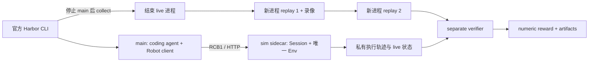

# Harbor 替换实施与验证 — 2026-09-29

（09-29 下午注：本文记录的实现已整体移入 `legacy/harbor_native_20260929/`，当前入口是 [Harbor 手册](../../rcb/README.md)。）原入口是 `topogym/benchmark/` 与官方 `harbor run`。本轮在 TopoGym 内独立实现协议/客户端/服务/回放/导出；没有对 `robot_coding_bench` 执行编辑、checkout、fetch、push，也没有导入、挂载或依赖它的实现。结束时该仓库仍干净，HEAD 为 `fa2d613a`，本地保存的 `origin/dev/qineng` 仍为 `fa59c1a6`。后者是本次研究基准，不代表已确认服务器最新提交。

## 已落地的运行链

- `wire.py`、`requests.py`、`client.py`：RCB1、64 MiB 请求/256 MiB 响应边界、完整请求预校验、2.0/2.1 请求兼容、2.2 深度/外参/时间轴。客户端动作断线后不自动重试。
- `session.py`、`robot.py`、`frames.py`、`service.py`：两类动作、限位反馈、原生夹爪单位、完整主动/被动关节测量、无状态 FK/IK、每帧媒体与本体、严格限定的 HTTP 端点。unlimited Session 可访问状态并 reset 同一个冻结实例。
- `evidence.py`、`replay.py`、`supervisor.py`、`grading.py`：记录实际执行的关节目标及 watch/hold，数值 NPZ 禁止 pickle；live 退出后才启动两个新进程；verifier 对身份、轨迹、两次结果和原始状态重新核验，缺证据失败。
- `export.py`、`catalog.py`：标准 Harbor task、self-contained 运行时、源码哈希与任务摘要、双模式、variant/seed 导出、独立 YAML/JSON 实例文件。默认生成 13 family × 2 模式 = **26 tasks**，位于 `harbor_tasks/`。46 个 integrated 变体可通过 `--all-variants` 导出；1 个不可用变体保留排除原因。
- `agents.py`：复用 Harbor 官方 agent 的薄 CodexOpenRouter / CodexChatGPT adapter，官方 Codex / Claude Code / OpenCode 也可直接选择。**不包含参考项目自己的模型 gateway、Flex SSE 重试、provider_only 或 ChatGPT 元数据规避行为**，不声称模型行为完全相同。
- `docker/Dockerfile.simulator` 与三个新 setup/build/check 脚本：基础依赖镜像、轻量 limited main、GPU sim，以及 separate verifier 的独立构建。

## 核心改动与旧文件

`SimulatorConfig.max_physics_steps=None` 只在 benchmark 明确启用，保留本地默认 10000；新增 `history_storage=disk` 与 `enable_depth`。`EpisodeHistory` 的磁盘 backing 保留全部 tick、旧 ID 不复用，rewind 丢弃未来逐条释放，避免一次载入整个未来历史。

RGB 保持 Nyx + compact_lab。深度是同一相机 rig 的 Genesis 几何 z-depth，不把 Rasterizer RGB 冒充 Nyx；透明表面可能与路径追踪 RGB 不同。媒体 clip 使用共享 recording 的 `FrameSequence` / `VideoWriter`，磁盘存储帧，避免 30 秒多路 RGB-D 堆积在 RAM。Panda 的静态名义开度表显式考虑被动四连杆；实时开度仍取实测碰撞几何。

原 `harbor_runners/`、`topogym/agents/{rollout,usage}/`、旧 configs、scripts、Dockerfile、专属测试移入 [`legacy/harbor_20260929/`](../../../legacy/harbor_20260929/README.md)，[清单](../../../legacy/harbor_20260929/manifest.json)保存 91 个原文件的 SHA-256。额外保留旧 agents README 与 .dockerignore。`pyproject.toml` 已撤销旧命令和 runner 打包；本地 Harbor venv 已更新，只有 `topogym-benchmark` 新入口。

本地 `simulator/rollout_simulation/` 与独立 SegmentRunner 测试保留。Task、几何、物理成功判据未在本轮修改。旧 runs、task_rollouts、demos、真实凭据保持原位。

## 验证结果

证据根目录为 [`runs/test_results/rcb_migration_20260929/`](../../../runs/test_results/rcb_migration_20260929/)。开始前冻结了 744 个工作区源码/配置文件及哈希；未用 Git HEAD 覆盖已有未提交改动。

| 检查 | 结果 |
| --- | --- |
| 协议、评分、Env/SegmentRunner、录制、配置、checkpoint cache | **209 passed**，1 个可选测试 deselected；[日志](../../../runs/test_results/rcb_migration_20260929/regression-final.log) |
| 原生 Harbor 导出、实例配置、adapter（独立 host venv） | **3 passed**；[日志](../../../runs/test_results/rcb_migration_20260929/harbor-host-final.log) |
| 26 个最终 task 的 Harbor schema、目录摘要、runtime 哈希及隔离结构 | **通过**；[检查结果](../../../runs/test_results/rcb_migration_20260929/task-check-final.json) |
| 官方 `harbor run ... --print-config` | 通过；[解析后的配置](../../../runs/test_results/rcb_migration_20260929/native-job-final.json) |
| limited / unlimited Compose 合并 | `docker compose config` 通过，未启动容器；[结果](../../../runs/test_results/rcb_migration_20260929/compose-check.json) |
| Panda + Cube，真实 CUDA/Nyx、动作、深度、两次新进程回放 | 通过；[报告](../../../runs/test_results/rcb_migration_20260929/gpu_smoke_04/report.json) |
| ALOHA + Cast Coil，实测深度、腕部 mount/FK、静止目标 IK、两次回放 | 通过；[报告](../../../runs/test_results/rcb_migration_20260929/gpu_aloha_01/report.json) |
| 实际本地 HTTP Robot → sim → finalize → 两次回放 → verifier | 通过；[报告](../../../runs/test_results/rcb_migration_20260929/gpu_http_final/report.json)、[reward](../../../runs/test_results/rcb_migration_20260929/gpu_http_final/verifier/reward.json) |
| 架构测试 | 3 项通过；1 项 `test_task_names_are_files_in_functional_modules` 因已有 planning/task 子目录失败。在改动前快照上复现相同失败，未修改该断言或其他会话的目录 |

以上 GPU 用例是微动作/保持的基础设施测试，**success=0 是正确结果**。它们没有证明抓放成功、13 项任务均可解、全部变体成功或模型成功。各报告绑定自己的源码快照，不能把较早快照通过追认为整个最新工作区、全部场景均通过。

最终 HTTP 用例执行了 2 个控制步 / 20 个物理 tick，`finalized=true`、`replay_consistent=1`、`deterministic=0`、`success=0`、`grader_error=0`。GPU 的约束归约存在约 `1e-11` 差异：指纹和数值回放一致性分开报告，后者固定采用 `atol=rtol=1e-9`；整数、拓扑、步骤数和成功判据保持精确。所有原始状态与原始哈希都保留，verifier 不接受被修改的原始状态文件。

早期循环导入、静态导出 TOML 混合数组以及末位浮点比较失败记录也保留，没有覆盖成成功记录。

## 实际录像

这些录像是同一微动作运行的各相机记录，只有几个帧，不能当作任务成功 demo；已用 ffprobe 计帧并用 ffmpeg 完整解码。

- 最终 HTTP Panda： [agentview](../../../runs/test_results/rcb_migration_20260929/gpu_http_final/evidence/replay-1/recording-0/videos/agentview.mp4)、[front_oblique](../../../runs/test_results/rcb_migration_20260929/gpu_http_final/evidence/replay-1/recording-0/videos/front_oblique.mp4)、[wrist](../../../runs/test_results/rcb_migration_20260929/gpu_http_final/evidence/replay-1/recording-0/videos/wrist.mp4)。
- ALOHA： [cam_high](../../../runs/test_results/rcb_migration_20260929/gpu_aloha_01/evidence/replay-1/recording-0/videos/cam_high.mp4)、[cam_low](../../../runs/test_results/rcb_migration_20260929/gpu_aloha_01/evidence/replay-1/recording-0/videos/cam_low.mp4)、[left_wrist](../../../runs/test_results/rcb_migration_20260929/gpu_aloha_01/evidence/replay-1/recording-0/videos/cam_left_wrist.mp4)、[right_wrist](../../../runs/test_results/rcb_migration_20260929/gpu_aloha_01/evidence/replay-1/recording-0/videos/cam_right_wrist.mp4)。

## 尚未验收的范围

1. **Docker 构建与实际 Harbor 容器运行**：09-29 上午补齐。修复内容是两种模式的 `tests/Dockerfile` 都把 `test.sh` 装进评分镜像，`dataset.toml` 改为 Harbor 原生清单格式。三次 `harbor run -a nop` 都是 Exceptions=0：
   - limited 单任务和 `-p 目录 -i '*-limited'`：success=0、replay_consistent=1、video_rendered=1；
   - unlimited `-i '*-unlimited'`：nop 不写轨迹，所以 missing_trajectory=1、success=0，符合预期。

   这只证明基础设施能跑通，不代表任务成功。证据见 [report.json](../../../runs/test_results/harbor_verifier_fix_20260929/report.json)。

## 09-29 下午：被完全对齐方案取代

对照 robot_coding_bench `dev/qineng@fa59c1a6` 找到约 100 处接口和功能差异，覆盖 limited 客户端、HTTP 语义、sim 生命周期、unlimited 工具、评分字段、任务格式、CI、模型接入、批量运行和分发。用户随即决定：

- 与模拟器无关的共享文件按字节原样复制。这推翻了[迁移计划](rcb_harbor_migration_plan_20260929_zh.md)第 9 行“不 vendor 对方源码”的决定。
- 本文描述的实现整体归档到 `legacy/harbor_native_20260929/`，按参考结构重建。
- 开启被动辅助抓持，做法参照 BEHAVIOR-1K。

新实现与验收记录见 `runs/test_results/harbor_rcb_parity_20260929/`。
2. **全任务 oracle / scoring qualification**：本轮没有添加占位成功 oracle；`solution/solve.sh` 明确失败。coverage 默认不将导出等同于通过。registry 仍声明 Hedgehog、Horseshoe、Claws、Knot、Lock Picking、Orbits、Rope Threading、Slotted Post Ring 的 solve qualification 缺口；具体已有规则与缺口没有被改写。
3. **长 episode / PBD / FEM 资源资格**：完整磁盘历史的合同测试、GPU tick 写入和小规模动作回放通过；没有宣称所有 PBD/FEM 长 episode 的磁盘吞吐、内存和跨进程误差均已验收。
4. **付费模型及参考项目 gateway 扩展**：未调用真实模型 API；薄 adapter 的 CLI/配置行为测试通过，不代表账户连通性或参考 gateway 的扩展行为已复现。

部署只需本地镜像与生成任务，不需要 RCB 仓库。当前原生 CLI 的模型预算口径是 wall clock + Harbor 原生用量统计，旧 input/output token 硬强停不再生效。
