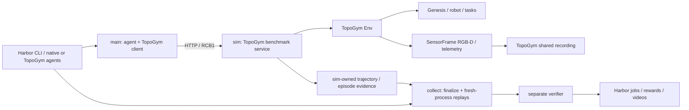

# 按 origin/dev/qineng 替换 TopoGym Harbor 体系的计划

2026-09-29 更新：用户已授权实施。主运行链已替换，实际改动、验收与剩余缺口见 [实施记录](rcb_harbor_implementation_20260929_zh.md)。下文“本次仅计划”描述保留为最初规划时的历史状态。

日期：2026-09-29。状态：源码审查与实施计划，尚未修改运行代码、构建镜像或运行实验。

用户已明确：以 `robot_coding_bench` 的 **origin/dev/qineng** 为研究基准；该仓库及远端只读。**所有实现、任务、配置、测试和实验均在 `/home/jianwen/topogym` 内完成，TopoGym 保持独立项目。**

实现方式是根据对方的协议和行为独立复现，不导入、挂载、软链接或 vendor 对方源码，不依赖兄弟仓库路径；不在 RCB 或其 worktree/fork 中添加 TopoGym 任务。正常的 Harbor 官方依赖继续使用。

> 2026-09-29 下午更新：用户改为要求“接口和功能完全一致”。与模拟器无关的共享文件（`rcb_client.py`、`rcb1.py`、`rcb_limited.py`、`harbor_agents/*`、通用脚本）按 `fa59c1a6` 字节原样复制，记录 blob 哈希，由 CI 检查防止漂移。运行时仍不依赖参考仓库路径，也仍不向 RCB 添加任务。见[实施记录末节](rcb_harbor_implementation_20260929_zh.md)。

## 1. 基线与结论

| 项目 | 实际核对结果 |
|---|---|
| RCB 路径 | `/home/jianwen/robot_coding_bench`，可访问，工作区干净 |
| 本地分支 | `dev/qineng`，HEAD `fa2d613a167eddc3e85b4d5f0d64ed47fe64e24e` |
| 采用的远端跟踪提交 | `origin/dev/qineng` = `fa59c1a6ecf5084473cf294086a6081c7bb1cd55`，提交时间 2026-09-28 22:18:22 -0500 |
| 两者关系 | 本地 HEAD 落后 74 个提交；本地分支名相同不表示内容已同步 |
| 在线核对 | HTTPS `ls-remote` 缺少 GitHub 凭据；SSH `ls-remote` 被拒绝。因此以上是本机已有的远端跟踪提交，未证明它等于此刻服务器最新 HEAD |
| 审查方式 | `git show` 与 `git archive origin/dev/qineng`，源码摘录放 `/tmp/rcb-qineng-plan-e2lbzafy`；未 checkout、pull、reset 或 push |
| 阅读范围 | 已审查该提交的 Harbor 协议、关键实现和代表任务；未逐文件阅读整个仓库。在线认证失败不影响读取本机已有提交的文件，影响的是确认服务器是否还有更新 |
| TopoGym 路径/分支 | `/home/jianwen/topogym`，`fem-ipc-migration`；存在大量已修改及未跟踪源码，不能用 HEAD 代替实际工作区 |

**推荐方案：在 TopoGym 内独立复现与该基准一致的 Harbor 任务组织、agent 接入、HTTP 协议和验证生命周期，替换现有 Harbor 编排与远程 policy 执行链。**

保留 TopoGym 的 Genesis / Nyx / Task / Env / 机器人 / 共享录制。新的 benchmark 接入也由 TopoGym 自己实现和维护；RCB 只作为只读研究资料。最终日常运行不需要旧 `topogym-harbor prepare/launch` 或定制 OpenCode adapter。

验收的“完全兼容”包括两层：

1. 可以按相同的原生 Harbor 方式运行：`harbor run -p harbor_tasks ...`，使用 Harbor 官方 agents 或 TopoGym 自己实现的 adapters。
2. limited 下由 **TopoGym 自己实现 client、RCB1 编解码和服务端**，完整满足 `rcb-limited/2.2` 的接口和语义；unlimited 下有自己的 `Session`、冻结初态、轨迹提交和独立重放。
3. 在只有 TopoGym、Harbor 及声明依赖的环境中能够构建、测试和运行；研究用 RCB 仓库不可见时仍通过全部必要检查。

不能把“端点名称相同”“简单动作能跑”或“Harbor task 能解析”当作迁移完成。

## 2. 对方体系的实际组成

### 2.1 Harbor 是编排入口，任务目录是交付单位

每个实例是一份自包含任务目录：

```text
tasks/<benchmark>-<family>-i00[-limited]/
  task.toml                  # 元数据、预算、artifacts、collect hooks
  instruction.md             # agent 的任务/API说明
  README.md
  environment/
    Dockerfile
    docker-compose.yaml      # GPU与sidecar
    ...                      # task-local client / tooling / frozen instance
  tests/
    Dockerfile
    test.sh
    grade.py
    ...                      # verifier 自己的输入
  solution/
    solve.sh
    ...                      # 仅 oracle 得到的参考解
tasks/dataset.toml            # 注册任务及目录digest
```

基础镜像安装 simulator；benchmark adapter、冻结实例、grader 放在任务目录。多个任务用 generator 复制统一模板，并通过 tooling identity 检查保证公共代码字节一致。发布任务内容变化后重新扫描 digest；运行结果放 `jobs/`，不写回任务目录。

这些机制采用 Harbor 已有的 separate verifier、sidecar artifacts 和 collect hooks，并非 RCB 自己重写 Harbor。官方说明：[任务结构](https://www.harborframework.com/docs/tasks)、[产物收集](https://www.harborframework.com/docs/run-jobs/results-and-artifacts)。本机 TopoGym 的 Harbor 0.23.0 安装源码也存在对应实现；部署时应固定并核对实际安装版本/源码。

### 2.2 两种模式必须区分

| 项目 | RCB unlimited | RCB limited 2.2 |
|---|---|---|
| simulator 所在位置 | agent 的 main 容器 | 独立 sim 容器 |
| agent 调用方式 | task-local `Session` 与低层工具 | `from rcb_client import Robot`，HTTP |
| reset | 可以反复回到冻结实例 | 无 reset，一 trial 一 episode |
| 可见内容 | 特权状态、任务实现；不能内置 oracle | RGB-D、相机标定、机器人规格、本体测量、无状态 FK/IK |
| 动作 | 关节/IK/夹爪/hold 等低层工具 | `submit` 动作数组，不上传 policy 给 sim 执行 |
| 提交物 | agent 保存 `/app/output/trajectory.npz` | sim 自己记录轨迹和证据 |
| 验证 | 全新 verifier 环境内重放 | sim 的可信 collect 流程重放，独立 verifier 判分 |

我们当前 `mode=unlimited` 仅扩展被动 policy 的状态白名单，仍无 reset，**不是 RCB unlimited**。新 `Session` 作为 Env 管理方提供冻结实例 reset；现有 `Interaction` 的 episode 绑定和无 reset 合同可以继续保留。

### 2.3 limited 2.2 的 API

| 接口 | 含义 |
|---|---|
| `GET /spec` | 动作布局/单位/限位、频率、相机、robot_spec、world、proprio_groups、预算和运动学规格 |
| `GET /status` | 步数、调用次数、时间及 done/reason |
| `POST /submit` | `joint_position` 或 `ee_pose` 的 `(T, dim)` 数组，返回执行结果与观测 |
| `POST /observe` | `seconds=0` 只读当前观测；`seconds>0` 保持命令并推进物理 |
| `POST /kinematics` | FK/IK，仅依赖请求与固定机器人模型，不依赖当前 episode 状态，不推进时钟 |

传输使用 **RCB1 二进制封装**，包含 mp4、图像数组、proprio、逐帧时间、逐帧相机外参、深度图。`depth=last/frames` 和旧的 `include_depth` 请求形式都要支持。2.2 增量包括命名的本体测量分组、移动相机安装信息、机器人规格与运动学接口。

limited 不公开物体位置、任务真值、场景物理参数、分割、seed、成功判据源码；任务说明也不能直接给出工作台/物体的世界坐标。`done/reason` 是协议允许的终态反馈。普通成功条件的自然语言描述仍须足够清晰。

用于只读研究的公共实现来自 2.2 模板，而不是旧工作区的 RoboTwin 2.0 模板；以下文件不作为 TopoGym 的依赖或复制目标：

```text
tasks/robowits-stack-cubes-i00-limited/environment/rcb_client.py
tasks/robowits-stack-cubes-i00-limited/environment/rcb1.py
tasks/robowits-stack-cubes-i00-limited/environment/sim/rcb_limited.py
```

研究 RoboWits 的 simulator 接法、RoboLab 的独立进程 finalize/replay 行为后，在 TopoGym 自己的模块里实现对应能力；不复制它们的 client、HTTP 层、grader、agent adapters 或脚本。

### 2.4 模型调用、批处理和评分

- 模型入口是 Harbor 原生 `-a codex`、`-a claude-code` 等；OpenRouter 用已有 `harbor_agents.codex_openrouter:CodexOpenRouter`，其 `llm_gateway.py` 负责路由与请求日志。另有 `codex_chatgpt.py`。不要求固定为我们的 OpenCode。
- `scripts/run_agent_batch.sh` 在原生 Harbor 外提供批量调度、lane、日志镜像、内存保护、账号失败识别、结果导出。这些是可选运行工具，单任务直接 `harbor run` 即可。
- 预算以 agent wall-clock 为准；actions、sim time、tokens、费用等记录为成本。它不等价于我们已有的 input/output 双额度强停账本。
- limited：停止 main → sim collect hook 封存、重放 → 收集 sim artifacts → separate verifier。`tests/test.sh` 先清空旧 verifier 输出，防止伪造结果残留。
- `reward.txt` 为 0/1，`reward.json` 仅数值字段。常见判分为 live success、replay success、deterministic 的组合；视频单独记录，不作为成功判据。

**文档与实现差异须保留在判断中：**此提交的协议说明写了通常的确定性要求，但 RoboWits 的 GPU grader 明确允许状态哈希不一致，仍要求 live/replay 成功；部分 task generator 也允许没有 oracle 的开发任务。不能据文档推断所有现有任务均 oracle=1，也不能复制 CPU 确定性结论到 TopoGym CUDA/FEM。

## 3. 目标架构及本地目录



开发根目录固定为 `/home/jianwen/topogym`。不创建 RCB 集成 worktree，也不改变 RCB 分支。TopoGym 如需分支管理，仅使用自身的本地分支；实验源码快照与结果放在自身 `runs/` 下，镜像先用本地 tag。RCB 提交号仅记录为协议研究基准，不成为构建输入或源码依赖。

TopoGym 的实验源码必须包含当前有效的未跟踪文件，尤其 `harbor_runners/`、`topogym/simulator/` 和现有配置。实施前制作当前工作区的本地源码清单和哈希；不能从旧 HEAD 开一个 worktree 后误以为拿到了当前实现。快照排除凭据、venv、缓存和运行产物，另外明确打包所需资产。

新增 TopoGym 文件建议如下（均相对 `/home/jianwen/topogym`）：

```text
topogym/benchmark/
  client.py                  # 独立实现 Robot / Result API，轻量客户端
  wire.py                    # 独立实现 RCB1 编解码
  service.py                 # 独立实现 HTTP 协议、验证与生命周期
  session.py                 # 连接唯一 Env 的管理方接口
  trajectory.py              # 冻结身份、canonical actions、重放
  verify.py                  # 独立评分与证据检查
  agents/                    # 有需要时自行实现 Harbor adapter / gateway
docker/Dockerfile.topogym
scripts/export_harbor_tasks.py
scripts/check_harbor_contract.py
harbor_tasks/dataset.toml
harbor_tasks/topogym-<family>-<variant>-i00/
  environment/session.py     # 由本项目源码构建/导出的任务入口
  environment/instance.json
  environment/<frozen-assets-if-needed>/
  tests/instance.json
  tests/grade.py
  solution/solve.sh
  ...标准任务文件
harbor_tasks/topogym-<family>-<variant>-i00-limited/
  environment/topogym_client.py  # 本项目自己的轻量客户端发布文件
  environment/wire.py            # 本项目自己的协议发布文件
  environment/sim/server.py
  environment/sim/finalize.sh
  environment/sim/instance.json
  tests/grade.py
  solution/solve.sh
  ...标准任务文件
```

`topogym/benchmark/` 做协议和任务适配，物理仍走唯一 Env；轻量 client 的发布不应要求安装 Genesis/CUDA。基础镜像安装固定的 simulator runtime wheel、依赖和资源，benchmark tooling 从本项目任务构建上下文安装。所有生成任务使用 TopoGym 自己的命名空间和 manifest；不加入 RCB 的 dataset。镜像远端发布不属于本次本地实施范围。

## 4. 文件级改动清单

### 4.1 退出主运行链的现有 TopoGym 文件

| 文件/目录 | 替换方式 |
|---|---|
| `harbor_runners/run.py`、`config.py`、`task_generator.py`、`templates/instruction.md` | 原生 Harbor CLI、本项目新 task exporter、task-local instruction |
| `harbor_runners/agents/opencode.py`、`usage_adapter.py`、`credentials.py`、`endpoints.py` | Harbor 官方 agents 与 TopoGym 自己实现的 adapter/配置入口；不再强制 OpenCode |
| `harbor_runners/usage_bridge.py`、`supervisor.py` | 主流程改用 Harbor 生命周期与 RCB wall-clock；旧强停逻辑不再作为评分前提 |
| `harbor_runners/collect.py`、`hooks.py`、`rollout_output_report.py`、`preflight.py` | 原生 sidecar artifacts、本项目新 finalize/结果脚本；必要诊断移成薄脚本 |
| `topogym/agents/rollout/worker.py`、`policy_process.py`、`client.py`、`protocol.py` | 本项目独立实现的兼容 HTTP server/client；agent 程序在 main 里运行，sim 只接收低层动作 |
| `topogym/agents/rollout/verify.py` | 新鲜进程的轨迹重放与独立 verifier；原来的证据完整性检查按需复用为辅助诊断 |
| `topogym/agents/rollout/history.py`、`public_artifacts.py` | RCB 响应及服务端证据；历史归档另做离线阅读，不作为运行必需接口 |
| `configs/harbor/defaults.yaml`、`providers.yaml`、`credentials.env.example` | TopoGym 新使用说明、原生 Harbor 参数/环境配置 |
| `configs/harbor/experiments/*.yaml` | 将 task/variant/robot/seed/physics 参数导出为实例；将模型/并发/预算移到 Harbor 运行配置 |
| `scripts/setup_harbor_runner.sh`、`build_harbor_image.sh`、`test_harbor_pipeline.py` | 本项目 simulator 镜像构建、setup/preflight、原生 Harbor 集成验收 |
| `docker/Dockerfile.topogym` | simulator runtime 镜像 + limited 轻量 main + separate verifier 的拆分 |
| `pyproject.toml` | 移除 `topogym-harbor`、`topogym-rollout*` entry points、`harbor_runners*` 打包；保留 simulator 导出 |
| `requirements/harbor-runner.lock` | 在 TopoGym 内固定可用 Harbor 版本，不再要求宿主安装旧 runner |
| `tests/harbor/` | 替换为本项目 task/compose/verifier/CLI 与协议兼容验收 |
| `tests/contracts/test_rollout_service.py`、`test_segment_history.py` | 前者改为 RCB 接口测试；后者拆出仍属于本地 SegmentRunner 的覆盖，再去掉旧 rollout 依赖 |
| README、scripts README、agents README、Harbor 使用文档与示意图 | 主入口统一成 TopoGym 的原生 Harbor 使用方式；历史说明标记已退役 |

`topogym/agents/usage/`、`tests/usage/` 当前不应继续绑在新主流程。完整切换采用对方 wall-clock 语义，删除现有专用接线后核对是否有独立消费者；无消费者则随旧系统删除。如果之后仍需要 input/output 硬预算，应单列可选能力，不能声称 RCB 原生已有，也不能再让它成为 `harbor run` 的必经入口。

旧产物 `runs/harbor/`、`task_rollouts/`、已验收视频和凭据文件不属于源码删除范围。旧结果按原协议解释，不能把历史 reward 追认成新 replay 验证结果。

### 4.2 保留并补齐的 TopoGym 核心

| 文件/模块 | 处理 |
|---|---|
| `simulator/env.py`、`interaction.py`、`privileged.py`、`api.py` | 保留唯一 Env 与权限语义；增加适配层需要的只读测量/生命周期能力，避免外部广泛访问 `_robot/_sensors` |
| `simulator/config.py`、`env.py`、`history.py` | benchmark 不使用当前短步数终止作为预算；增加显式可关闭时间截断的配置，保留本地默认；评估长 episode 的逐 tick 历史内存 |
| `simulator/rollout_simulation/` | 保留本地 SegmentRunner、policy 和历史用途；新的 TopoGym benchmark 主流程不依赖旧远程 policy 服务，也不要求每次请求走 `run_policy` |
| `robot/control.py`、`joint_position.py`、`description.py`、具体机器人 description/gripper | 动作布局、实际夹爪开度、完整关节测量和 drive effort；复用已有控制实现 |
| `solvers/genesis_kinematics.py` | 基于固定模型与明确 q/seed 做无状态 FK/IK；不使用当前关节作为隐含默认 seed |
| `sensors/observation.py`、`camera_info.py`、`cameras.py`、`renderers/nyx.py` | 同步 RGB-D、静态/腕部相机标定、mount、逐帧外参；扩展 SensorFrame |
| `recording/session.py`、`encoding.py`、`timeline.py` | 复用公共采样/编码，补充 RCB 精确逐帧序列的输出适配 |
| `world/state.py`、`simulator` 内新增重放/状态指纹辅助（如需要） | 冻结初态、跨进程验证身份、规范化状态比较；现有内存 checkpoint 不直接假装成可移植文件 |
| `tasks/`、`assets/`、`evaluation/` | 保留场景、资产和成功判据；从注册表枚举覆盖范围，缺失判据的任务不能发布为合格评分任务 |

## 5. 接入时必须解决的语义问题

### 5.1 动作：同时支持 joint_position 与 ee_pose

- 服务内部固定用已有 `JOINT_ABS` 执行路径。joint 数组直接转换；ee 数组先用同一机器人的 FK/IK 得到关节目标，再沿相同路径执行。不能把一次 episode 的 `SimulatorConfig.control_mode` 来回修改。
- 单 Panda 通常是 7 个关节 + 1 个夹爪命令，ALOHA 通常是左右各 6 + 1；实际列顺序从 RobotDescription 导出，不复用 RoboWits 的右臂在前 16 列，也不复用 RoboTwin 的 34 列轨迹。
- TopoGym Robotiq 的命令是原生驱动关节弧度，ALOHA 是原生 finger coordinate；两者都不能默认当成 0..1 开合比例或实测指间距离。`/spec` 公布准确单位、范围、开闭方向，适配器负责必要转换。
- `dt` 校验、linear/hold 插值、夹爪是否插值、越界裁剪和 `clipped`、IK 失败的 `plan` 反馈与保持行为都必须写进 spec 并验收。整个请求的结构/数值校验先于任何物理执行。
- 所有实际执行的关节目标、hold/watch 步和终态提前结束都记录进轨迹。回放不重新跑 agent，不重新调用模型，也不依赖重新规划出相同 IK 分支。
- 不给 limited 增加 `grasp/place/navigate` 等任务级动作。现有抓持辅助若某任务启用，作为固定 simulator 机制记录、评测时同样启用，不向协议暴露对象真值，也不能把辅助模式的成绩与无辅助混用。

### 5.2 时钟、无步数预算与内存

从每个实例的实际配置导出频率，不照抄 250 Hz 或 30 Hz。TopoGym 默认 `physics_dt_s=.0025`、`control_decimation=10` 对应 400 个物理 tick/s、40 个控制步/s；`solver_substeps=4` 是更内层求解器细分，不能把这三个数字混为一谈。

`frame_time_s` 与 `frame_step` 使用 episode 控制时钟；初态预稳定完成后归零。`observe(seconds=0)`、FK/IK 都不耗物理步。原 runner 默认初始 5 个 control steps 不应偷偷保留为一次免费观测；若实例需要预稳定，纳入被冻结的初态构建过程。

`max_physics_steps=10000` 的现有默认以及各 experiment 的短上限不能直接沿用成 RCB 步数预算。增加显式的 benchmark 配置关闭此类截断，只保留任务终态、wall-clock 和明确基础设施保护。

同时，`EpisodeHistory` 目前每个物理 tick 保留完整状态且不隐式淘汰。先测刚体/PBD/FEM 长 episode 的内存增长；如不满足预算，增加可落盘的完整历史存储，保留原来的 ID、回溯和旧未来失效语义。不能单纯把步数上限调大后交付一个必然 OOM 的服务。

### 5.3 观测：当前最大的新增能力

审查发现：

- `SensorFrame` 当前只有 RGB 和标定；`NyxCamera.render(depth=True)` 明确抛 `NotImplementedError`。
- 旧 policy 投影只允许公开固定相机标定，速度字段也未完整公开；不能原样复用它生成 2.2 响应。
- `JointPositionRobot.observe()` 已有实测关节、速度、TCP 和 finger coordinates，但尚无完整 2.2 的实测 gripper opening / joint effort 分组。
- 现有 FK/IK 已保护查询 scratch/RNG，适合复用；IK 默认初值仍可能来自当前 entity，需要为协议明确替换成固定 seed 或请求 seed。

因此需要：

1. RGB 继续用 Nyx + compact_lab；核对现有 Nyx/Genesis 的深度获取能力，优先原生 depth。若需要单独几何深度通道，必须明确标注来源，并与同一物理状态、相机、像素网格和可见表面一致，验证刚体/PBD/FEM 覆盖；不能用黑图或全零充当支持，更不能静默改 RGB renderer。
2. 从同一 SensorFrame 生成 RGB、depth、camera pose；输出 RCB 要求的 z-depth 米、无效 0、逐帧毫米压缩形式和旧 include_depth 形式。
3. 计算真实 finger 间距；effort 若采用 PD 估算，要基于真实 kp/kv/target/velocity/clamp，并标明估算定义；不是 contact force。
4. `/spec` 导出真实 robot_spec、夹爪/TCP frame、有效限位与 controller gains；没有实测/权威依据的 rated limits 不虚填。
5. wrist mount + FK 的外参必须与帧中实际相机位姿一致；统一 wxyz、world frame 和 OpenCV/GL 变换。
6. 所有回复按字段白名单构造；不能直接把 `Env.observe()`、`episode_metadata`、`action_spec.grasp_assist` 或内部异常对象序列化出去。

深度能力和 FK/IK 的协议一致性是前置验收项；没完成之前只能报告部分接口接通，不能宣称 2.2 完整兼容。

### 5.4 录制：复用现有模块，同时满足 RCB 帧轴

RCB 的 `rcb_limited.Recorder` 自带采帧与 mp4 编码；我们已有共享 `RecordingSession`。直接叠加会形成两套 writer，且现有 recorder 的时间重采样/展示补帧不一定等于 RCB 的 N 帧轴。

方案是：在 TopoGym 独立实现的 client、RCB1 和 HTTP/校验层中，接入本项目共享录制模块提供的“按给定帧列表精确编码”能力，构造协议规定的 parts。网络响应中的 mp4、frames、proprio、frame_step、frame_time_s、extrinsics、depth 共享同一个 N，不能自动补一帧但不补 metadata。

正式 replay 视频也用 `topogym.recording`；限额、帧数、首末帧、完整解码和 source-state 映射都验收。视频保存失败作为诊断/基础设施字段记录，不把视频是否存在混入物理成功判据。

### 5.5 冻结实例与独立重放

现有 `verify.score()` 检查 session/segment/evidence/budget，**不等于独立动作重放**。`private/physics_states.jsonl` 自己也标明不是 engine checkpoint。

新增 `topogym.benchmark.session.Session` 的 `make-instance / record / save_trajectory / replay / selftest`：

- 实例身份含 task、variant、seed、完全展开的 config、资源/模型/代码版本、初态构建顺序和初态指纹；seed 相同不够。
- 轨迹文件保存执行后的 canonical joint commands、时间/步计数以及实例/动作 schema 身份；高层 ee 请求另外记录为诊断。
- 初步优先“固定版本 + 冻结资源 + 确定的建场景过程”，验证初态一致再执行。确需导出初态时，设计版本化完整序列化，覆盖 controller、task、RNG、PBD/FEM/IPC；不直接把进程内指针/引擎对象 pickle 成提交格式。
- finalize 先停止接收动作、封存轨迹并退出 live simulator，释放 GPU；按 RoboLab 模式启动两个 fresh replay processes，然后原子写 `final.json`。RCB collect hooks 是 best-effort，grader 必须主动检查 required files、finalized、实例身份和重放结果。
- rigid / PBD / FEM 分别建立结果。先以严格状态一致性为资格目标；若 CUDA 不逐位确定，明确记录证据，再采用上游已有的 GPU 非逐位规则或另一个版本化判分规则。不能为通过验收把 deterministic 强写为 1。
- 两次 replay 成功、live 成功和初态一致分别保存；记录误差诊断、实际 backend 与规则版本。已有 rewind 测试不代替跨进程 replay 验收。

### 5.6 Runtime 镜像与参考解隔离

不能继续直接 `COPY topogym/`、`configs/`、`assets/` 后把整个开发树交给 unlimited agent：其中包含 planning、oracle、几何证书和参考动作资源。创建 runtime-only 打包清单；只包含 simulator 必需源码和冻结实例资源，参考解放 `solution/`。

存在一处具体依赖需要先梳理：`topogym/assets/geometry/cast_coil.py::synthesize()` 导入 `topogym.planning.motions.cast_coil` 的参考 route。因此不能简单删除全部 planning 再期待所有资产生成还能运行。优先在作者侧生成并冻结实例资产，让运行时只加载必要网格/定义；若必须拆分共享纯几何工具，在本地单独改动并验证，不覆盖其他场景开发会话的文件。

limited 的 main 只装 client，不能挂载 TopoGym 源码、sim 的 `/data`、可写 simulator cache 或 Docker socket。GPU/NVIDIA Vulkan 支持放 sim 上；不要把 RoboWits 的 CPU/Genesis 0.4.7 镜像拿来替代我们的 CUDA/Genesis 1.2.1/Nyx 依赖。

网络采用 RCB/Harbor 的 public 或 model-host allowlist；不要把我们原先依赖宿主 Unix relay 的 no-network 模式直接套到原生 agent 上。shared network namespace 时 client 会使用 localhost；compose 不添加冲突的 ports/expose。

## 6. 实施顺序与每阶段出口

| 阶段 | 工作 | 完成标准 |
|---|---|---|
| A：固定本地基线 | 在 TopoGym 内保存当前源码与资产快照；记录只读研究基准及 Harbor/engine/renderer 身份 | 来源可复现、RCB 无改动、无远端写操作 |
| B：能力探针 | Nyx RGB-D、单臂/双臂 telemetry、无状态 FK/IK、长历史内存；现有 Env canonical action 记录与 fresh replay | 明确每个难点可实现路径及缺口，特别是 depth 与 CUDA replay |
| C：第一个 unlimited task | 使用 cube fixture 做本地集成任务；runtime-only 镜像、Session、轨迹、独立 grader | 原生 Harbor oracle=1、nop=0、两次重放、伪造轨迹/判据补丁不能通过 |
| D：同实例 limited 2.2 | main/sim 拆分；自行实现 client/wire/service；submit/observe/kinematics；可信 collect | 独立协议 conformance + oracle/nop + 容器隔离 + 终止/故障归档通过 |
| E：原生 Harbor 运行方式 | Harbor 原生 agents 与 TopoGym 自己实现的 adapter；结果导出；批处理小样本 | 不依赖旧 runner 或 RCB 源码即可启动/完成/查看；失败成本完整记录 |
| F：真实任务分批迁移 | 先已验收的刚体代表，再 ALOHA/PBD，再 FEM/IPC；从 registry 展开变体和 seed | 每个 task/variant 各自报告初态、重放、oracle、判据、观测资格，不互相继承 |
| G：全量切换与清理 | 删除旧 runner、旧远程 policy/usage 主流程；更新入口、tests、文档与锁文件 | 新任务独立运行；仓库无活动旧入口；本地 simulator/recording/rewind 回归不退化 |

cube fixture 用作基础设施验证，不能计入“13 个正式任务已全部完成”。没有可用 oracle 或判据的任务可先生成开发目录，但正式 dataset 仅纳入通过资格的任务；任务迁移完成与任务本身可解需要分别报告。

对软体/FEM 不能只测一个刚体任务就全量上线；后端差异会直接影响 depth、状态指纹、持久化和重放。

## 7. TopoGym 自己的配套脚本与检查

以下均在 TopoGym 内实现，不复制或调用 RCB 脚本：

- `scripts/export_harbor_tasks.py`：从本项目冻结实例生成 unlimited/limited 任务，输出到 `harbor_tasks/`；两个模式共用同一实例和动作定义。
- `scripts/build_harbor_image.sh`：重写现有构建脚本，构建本项目 simulator/client/verifier 所需镜像并记录身份；不执行远端 push。
- `scripts/check_harbor_contract.py`：自行检查任务结构、协议字段、instruction 信息边界、镜像/资产身份、verifier 隔离、公共发布文件一致性和 dataset manifest。
- `tests/harbor/`：自行编写 wire 格式、2.x 兼容请求、live service、帧轴、FK/IK、原生 CLI 和故障边界验收。断言来自协议规范，不仅做本项目 client/server 互相通过的测试。
- `harbor_tasks/dataset.toml`、README 和配置说明：维护 TopoGym 自己的任务命名空间、实例清单与用法。
- 结果导出与重新评分：在本项目 scripts 下独立实现，读取标准 Harbor jobs/artifacts/reward；历史 TopoGym 结果单独解释。
- 批量运行：优先原生 Harbor 并发/attempts；需要额外批处理、日志保留和资源保护时，在本项目内实现并限定作用范围，不调用 RCB 的 `run_agent_batch.sh`。
- 独立性检查：构建、安装、生成任务、运行与测试时 RCB 路径不可见；检查 import、PYTHONPATH、symlink、bind mount、Docker COPY 和依赖声明，确保没有兄弟仓库代码依赖。

## 8. 目标使用方式与验收命令

下面是**迁移完成后的目标命令**；本轮未生成这些 TopoGym task，也未执行这些实验。所有路径均属于 TopoGym，`harbor` 使用验收过并固定的官方安装。

```bash
cd /home/jianwen/topogym

# 注册本地任务，运行仓库合同检查
(cd harbor_tasks && harbor add --scan .)
python scripts/check_harbor_contract.py harbor_tasks/topogym-cube-pick-place-i00 harbor_tasks/topogym-cube-pick-place-i00-limited

# 与 RCB 文档一样运行，不需要 prepare/launch
harbor run -p harbor_tasks/topogym-cube-pick-place-i00 -a oracle
harbor run -p harbor_tasks/topogym-cube-pick-place-i00 -a nop
harbor run -p harbor_tasks/topogym-cube-pick-place-i00-limited -a oracle
harbor run -p harbor_tasks/topogym-cube-pick-place-i00-limited -a nop

# 原生 agent；运行前按所选 agent 配置本地凭据
harbor run -p harbor_tasks -i 'topogym-*-limited' -a codex -m openai/gpt-6-luna \
  -n 1 -k 1 -o "$PWD/runs/harbor/jobs" --job-name topogym-limited-smoke

# 有需要时使用 TopoGym 自己实现的 adapter；以下是拟定模块名
PYTHONPATH=. harbor run -p harbor_tasks -i topogym-cube-pick-place-i00-limited \
  -a topogym.benchmark.agents.codex_openrouter:CodexOpenRouter \
  -m openrouter/openai/gpt-6-luna --env-file "$PWD/.secrets/harbor.env" \
  --ak reasoning_effort=medium --ak provider_only=openai/flex \
  -n 1 -k 1 -o "$PWD/runs/harbor/jobs" --job-name topogym-openrouter-smoke

harbor view runs/harbor/jobs
```

`-n` 是并发，`-k` 是 attempts；以固定 Harbor 安装的 `--help` 再核对。示例模型名来自所审查的 RCB 文档，不表示本轮已验证账号可用性。

limited agent 使用 TopoGym 自己的轻量客户端，保持同样的方法与协议语义，例如：

```python
from topogym_client import Robot

r = Robot()
spec = r.spec()
obs = r.get_obs(depth=True)
now = obs.meta["proprio"]["now"]
layout = spec["proprio_layout"]
q = [now[layout.index(name)] for name in spec["kinematics"]["joint_names"]]
fk = r.fk(q)
# A 按 spec.action_types 的列顺序/单位构造
# result = r.submit("joint_position", A, dt=1 / spec["control_hz"], depth="frames")
```

FK 的 q 与 action 数组不是同一个布局，尤其 gripper/mimic joints；正式 instruction 中提供准确的按名索引例子，不让 agent 猜测。

## 9. 最终验收清单

1. **协议**：TopoGym 自行实现的 client/wire/service 与独立编写的协议检查；2.0/2.1 兼容请求；非法输入不推进物理；终态 submit=409，终态 observe/kinematics 仍可读且不再推进。
2. **传感器**：RGB/depth 同像素与同状态；腕部相机 FK-mount 对齐；proprio 的位置、速度、实测开度与 effort；一个 N 帧轴；图像读取不推进物理。
3. **动作**：单/双臂列顺序、夹爪原生单位、dt/插值/裁剪、IK 无解、hold/watch、chunk 上限、成功/错误时的部分执行与轨迹一致。
4. **生命周期**：预热超时、模型进程提前结束、wall-clock 截止、sim 崩溃、GPU 丢失、collect 超时；必需证据不完整时不能因残留 reward 或 final.json 得分。
5. **隔离**：main 看不到 sim 文件/实例/真值、无共享可写 cache、不能篡改 grader；oracle 仅在 solution；main 伪造 final/reward 不影响 sim 证据。
6. **重放**：冻结初态核对、两次 fresh replay、各后端确定性/误差报告；以同一规则判 live 和 replay；nop=0、合格 oracle=1。
7. **原生使用与独立性**：不安装/调用旧 `harbor_runners` 或 RCB 源码仍能运行；Harbor 原生 agents 与本项目 adapter 均兼容；job/view/artifacts/报告齐全；所有源码和任务来自 TopoGym。
8. **核心回归**：本地 Env reset、旧句柄失效、完整 tick history、rewind 后旧未来作废、四种本地控制、统一录制不退化。
9. **覆盖**：逐 family / variant / seed 清单，标明 exported、protocol_passed、replay_passed、oracle_passed、scoring_eligible；不合并成一个含糊的“已接入”。

## 10. 主要审查依据

RCB 均指 **`fa59c1a6`** 中的文件，不是旧工作区文件：

- `AGENTS.md`、`README.md`、`CONTRIBUTING.md`、`docs/PROTOCOL.md`、`docs/LIMITED_MODE_PROTOCOL.md`。
- `tasks/robowits-stack-cubes-i00[-limited]/` 的 tooling/client/service/task/compose/grader。
- `tasks/robolab-banana-in-bowl-i00-limited/environment/sim/finalize.sh`。
- `harbor_agents/codex_openrouter.py`、`codex_chatgpt.py`、`scripts/run_agent_batch.sh`。
- `scripts/robowits_mk_limited.py`、`ci_checks/check-limited-protocol.py`、`check-tooling-identity.sh`、`run_all.sh`。

TopoGym 依据本次实际工作区：

- `harbor_runners/task_generator.py`、`run.py`、`docker/Dockerfile.topogym`、`pyproject.toml`。
- `topogym/agents/rollout/{worker,policy_process,verify}.py` 与 usage/runner 文档。
- `topogym/simulator/{env,config,history,interaction,privileged}.py`、`rollout_simulation/`。
- `topogym/sensors/{observation,camera_info}.py`、`renderers/nyx.py`。
- `topogym/robot/{control,joint_position,description}.py`、`solvers/genesis_kinematics.py`、`recording/`。
- `topogym/assets/geometry/cast_coil.py::synthesize` 的 reference-route 依赖。

本次只交付计划；没有构建/启动容器、运行 GPU/API 实验、修改远端或更换原工作区分支。
