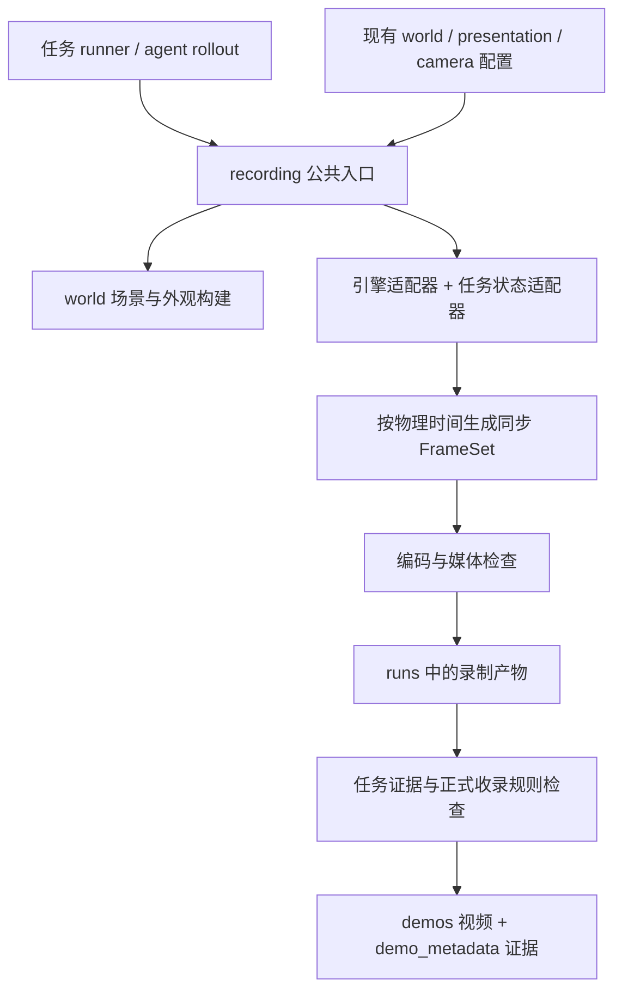

# 通用录制模块工程计划

状态：2026-09-21 已实施公共模块及代表入口，全部历史入口迁移尚未完成。实际 API、命令与迁移边界见[使用文档](recording_module_usage_zh.md)。本文以下章节保留原始目标，不能把目标条目自动视为已通过验收。

当前进展：P0/P1 的配置、在线会话、时间线、流式编码和兼容层已落地；P2 已支持 Genesis 刚体状态恢复、模型签名及续录；P3 已支持 MuJoCo 与共享无碰撞 lab，并完成 Claw 完整来源的五路重渲染；P4 已实现整组事务归档、引用更新与失败恢复，并在临时目录验收。P5 已接入 Cast Coil 在线入口、Claw family 重渲染和 rollout 公共媒体，41 个旧 writer 消费文件仅完成兼容入口替换。逐文件迁移矩阵另列 62 个未完全迁移的媒体消费文件，包含预览与历史归档。

真实 Genesis/Franka、Genesis/ALOHA 与 MuJoCo 短程检查已通过。Genesis Cast Coil 另完成一份新的完整物理执行和独立来源重渲染：13,241 步、33.1025 秒、五路各 663 帧；回放零积分，最大恢复误差约 `1.1e-16`。Claw 的历史 z=0 平面保留原样，报告桌面不兼容，未用该样本替换正式 demo；软体状态离线恢复没有宣称实现。P5 全部入口收敛和每个历史来源的正式资格验收仍为后续工作。

Cast Coil 同 CUDA 后端的半时间步资格也已通过，最终位置最大差异约 1.59 微米；使用该真实证据，在隔离目录完成五路视频、72 个证据文件及来源依赖的公共归档验收。首版的代表任务链路已形成闭环，详见使用文档中的验证记录。

目标：任务接入一次后，每次录制调用同一入口，默认使用共享实验室、兼容的桌面与机器人相机预设，统一完成同步取帧、视频编码、来源记录、验收和正式归档。执行器只负责推进任务与提供结果；已有状态可以走同一模块重渲染。

## 1. 已有基础与实际缺口

**已经有共享预设，而且 Genesis 主路径已经组合了实验室与桌面；尚没有覆盖所有任务、两种引擎与归档规则的完整录制模块。** 因此本项目以现有配置和实现为基础收敛，不重新定义一套桌面参数。

| 已核对位置 | 当前能力 | 本次需要补齐 |
| --- | --- | --- |
| [`configs/config.yaml`](../../../configs/config.yaml) | 组合共享 world、robot、recording 配置组；默认关闭录制 | 增加显式的正式 demo 录制 profile，保留普通任务运行默认行为 |
| [`world_tabletop_v1.yaml`](../../../configs/env_configs/world_tabletop_v1.yaml)、[`world_tabletop_fem_v1.yaml`](../../../configs/env_configs/world_tabletop_fem_v1.yaml) | 都引用 `nyx_lab`；定义桌面、坐标、相机、物理时序 | 录制时核对实际场景与源预设，不能为录制切换求解器或碰撞桌面 |
| [`world_tabletop_aloha_v1.yaml`](../../../configs/env_configs/world_tabletop_aloha_v1.yaml) | 继承共享桌面与 `aloha_observation` | 消除相机命名及调用入口差异 |
| [`nyx_lab.yaml`](../../../configs/presentation_configs/nyx_lab.yaml) | 默认 `compact_lab`、Nyx、灯光、材质与外部纹理引用 | 房间几何还在 Genesis 专用代码中，需要引擎无关的描述供 MuJoCo 使用 |
| [`world/presentation.py`](../../../topogym/world/presentation.py)、[`world/nyx_lab.py`](../../../topogym/world/nyx_lab.py) | 在 `scene.build()` 前创建无碰撞背景、应用外观并接入 Nyx 相机 | 统一调用生命周期、可验证的场景报告及 MuJoCo 实现 |
| [`utils/recording.py`](../../../topogym/utils/recording.py) | hook `scene.step()`，选择相机、更新腕部相机、抓帧与保存 | 目前按 `every_n_steps` 抓帧，FPS 独立指定；没有物理时间匹配检查、统一重渲染和归档 |
| [`recording/default.yaml`](../../../configs/recording/default.yaml) | FPS、分辨率、相机选择与 stride | 注释还引用已不存在的 `recording_config_from_args`；Python 默认值与 YAML 需收敛至同一来源 |
| [`world/aloha_cameras.py`](../../../topogym/world/aloha_cameras.py)、[`camera_configs/README.md`](../../../configs/camera_configs/README.md) | 上游相机姿态、安装转换与命名关系 | YAML 使用 `overhead/worms_eye/wrist/wrist_right`，部分任务使用 `cam_*`；单臂正式三视角还需独立共享配置 |
| `knot_untying/recording.py`、`interlocked_claws/recording.py`（已删除，由各自 `recording_adapter.py` 取代） | 分别已有物理时钟检查、状态重渲染与来源报告 | 通用能力已提取到公共模块；任务只保留状态读取、恢复与相机增量 |
| [`interlocked_claws/family_render.py`](../../../topogym/tasks/interlocked_claws/family_render.py) | MuJoCo 状态重渲染、多相机编码 | 自行添加背景、相机并扩大渲染桌面；不能直接视作共享 lab 的实现 |
| `lock_picking/render_physical_trace.py`（已删除，由 `lock_picking/recording_adapter.py` 取代） | 物理资产比较、状态恢复误差检查、离线恢复录制 | 验证方法已进 adapter 的 `restore()`；被动夹爪重建以 `reconstruction` 字段声明 |
| [`agent_rollout/media.py`](../../../topogym/agent_rollout/media.py) | 分段 MP4、时间映射、拼图、从 MP4 抽取模型输入 | 下沉通用编码与媒体检查，保留 rollout 的分段与公开信息契约 |

这里的“通用”指共享配置解析、时钟、编码、校验和归档。任务状态的含义以及不同引擎如何恢复它，仍由适配器负责；不能把任意 `qpos` 文件当成完整重渲染输入。

## 2. 模块边界与依赖

建议新增包 `topogym/recording/`。它是进程内 Python 模块，提供 Python API 与 CLI，不需要独立服务。



| 拟新增文件 | 职责 |
| --- | --- |
| `recording/config.py` | 组合既有配置、解析 profile、校验覆盖项、输出冻结的有效配置 |
| `recording/contracts.py` | `RecordingPlan`、`FrameSet`、`SceneSignature`、`SourceManifest`、`RecordingResult` 与适配协议 |
| `recording/session.py` | 会话生命周期、在线订阅、分段完成与异常退出处理 |
| `recording/timeline.py` | 唯一物理时钟、采样规则、端点及帧到源状态映射 |
| `recording/encoding.py` | 流式 MP4 编码、可选磁盘帧暂存、统一关闭与错误传播 |
| `recording/replay.py` | 顺序读取保存状态，调用恢复接口，再交给同一取帧与编码链路 |
| `recording/validation.py` | 完整解码、帧数/时间同步、状态恢复与场景报告检查 |
| `recording/archive.py` | 正式收录策略、真实副本、哈希清单、替换事务与引用更新 |
| `recording/adapters/genesis.py`、`mujoco.py` | 引擎时钟、渲染、动态相机和状态恢复辅助；按需导入引擎 |
| `recording/__main__.py` | `preflight / replay / validate / archive` 命令入口 |

世界几何、实验室布局和材质转换继续属于 `topogym/world/`。录制模块负责调用和检查，不复制 scene builder。包的纯配置、时间线和媒体检查可以在没有 Genesis、MuJoCo 或 GPU 的环境中导入运行。

任务只提供：任务/变体/运行身份、现有场景 builder、相机及引擎句柄、可选状态导出/恢复能力、阶段事件和任务验收结果。注册代码可以位于 `tasks/<task_id>/recording_adapter.py`，不能继续自行创建 writer、拼正式路径或复制背景参数。

## 3. 统一预设：组合已有来源

新增 `configs/recording_profiles/`，首版提供 `lab_default_v1`、`lab_franka_v1`、`lab_aloha_v1`。`lab_default_v1` 根据已声明的机器人类型选择具体 profile；未知类型要求提供明确配置，不猜测机器人安装位置。

Profile 只引用 world、presentation、camera 和 encoding 配置来源，并指定相机选择、采样与收录策略，不复制桌面尺寸、灯位和机器人坐标。解析后保存来源 ID、版本、文件哈希、全部 overrides 和展开后的配置。

配置规则：

1. 新建任务场景时，在 build 前完成 profile 解析、相机分辨率和外观配置。已指定的任务物理配置为准；profile 只能检查兼容性，不能覆盖 `dt/substeps/gravity`、桌面碰撞或机器人安装。
2. 新任务没有 world 时，由任务声明的机器人/求解器类型选择已有 world。FEM/IPC 场景继续使用对应预设，不能套回普通刚体配置。
3. 重渲染以保存的物理场景和资产为准；当前默认桌面不兼容时给出差异并停止严格正式录制。保留原场景的开发录制可以生成，但标明 `presentation_compatible=false`，不能伪装成已统一。
4. 已完成 build 的在线场景只允许绑定和检查；缺少背景时提示重新按 profile 建场景，不能在运行中替换实体或重新初始化任务。
5. 覆盖顺序明确为“共享外观/相机基线 → 任务声明的相机增量 → 显式录制外观覆盖”，每项都进报告。观测相机与展示相机单独选择；已冻结的 policy observation 不因正式视频分辨率而改变。

相机统一方案：

| 机器人 | 正式输出名 | 接入规则 |
| --- | --- | --- |
| 单臂 | `agentview / front_oblique / wrist` | 从现有已使用的配置提取共享 `franka_demo_v1`；按机器人/夹爪声明腕部 link 与局部姿态，不把 `oblique/front` 简单改名当作同一光学视角 |
| ALOHA | `cam_high / cam_low / cam_left_wrist / cam_right_wrist` | 显式映射 `overhead / worms_eye / wrist / wrist_right`；已使用 `cam_*` 的任务直接绑定，出现重复或歧义即报错 |
| 任务附加 | 保留已命名的 `detail` 等视角 | 在配置声明增量、原因和姿态；不能用附加视角替代必需观测视角 |

已有正式变体的相机叶子名称保持兼容；迁移不批量改名。ALOHA 的 YAML 与 `make_aloha_rig()` 逐步共用同一相机参数来源，同时保留已声明的垫座高度、低位俯仰和标定限制。

跨引擎 lab 的实施方式：从 `nyx_lab.py` 提取一个无引擎依赖的布局描述生成器，例如 `world/lab_layout.py`，由 Genesis 与 MuJoCo 分别消费。房间类型仍由已有 presentation 配置选择；布局带版本和参数报告，避免两套手写房间漂移。材质/灯光由后端转换，记录不支持的项。Genesis 默认 Nyx，MuJoCo 首版使用自身离屏渲染；要求实验室布局、尺度和相机语义一致，不承诺两种渲染器逐像素相同。缺少所需资产或后端时 preflight 失败，不静默改用 checker。

## 4. 统一调用方式

以下为设计示意，实际可运行签名及 builder/binding 接入见使用文档。

```python
from topogym import recording

plan = recording.prepare(cfg, preset="lab_default_v1")
task = build_scene(plan.scene_config)  # 复用任务现有 builder
binding = task.recording_binding()     # 一次接入，封装引擎与任务状态能力

with recording.session(plan, binding, identity=run_identity) as rec:
    result = execute_task(task)        # 执行器内部正常推进物理
    rec.finish(task_result=result)

# 保存状态后重渲染：同样返回 RecordingResult，不自动重新执行任务。
artifact = recording.replay(source_manifest, preset="lab_default_v1")

# 正式收录显式调用；先校验，再按同一变体的一组视频发布。
recording.archive(artifact, policy="formal_demo_v1")
```

在线默认绑定一次，在完整物理步完成后采样。优先接入现有 runner/adapter 的步进边界；无法提供回调的旧 Genesis 调用保留受控的 `scene.step` 包装作为兼容路径。包装必须可靠恢复、检测重复绑定，不能让 task 层逐循环调用编码函数。一次控制命令含多个物理步时，时钟来自实际完成的物理步。

`finish()` 提供任务结果；异常退出只完成资源回收并把产物标为 `incomplete`。录制完成与任务成功分开记录。后续相同任务和变体再录制，仅更换运行身份、源状态或允许的 profile overrides，无需重写录制循环。

## 5. 时间、状态与真实性契约

### 5.1 物理时钟与视频时长

- 每个 `FrameSet` 包含 `run_id / episode_id / frame_index / sim_time_s / physics_step / source_state_id`，所有相机共享同一状态；顺序渲染相机期间不推进物理。
- 同时保存 `target_video_time_s` 和 `source_sim_time_s`。wall clock 只计性能，agent 思考等待不增长仿真视频时长。
- 30 FPS 为新录制的目标默认值。采样以时间表驱动，不再认为 `every_n_steps=1` 自动对应 30 FPS。例如 `dt=0.01`、每步一帧且编码 30 FPS，会把约 10 秒物理过程播放成约 33 秒。
- 固定步长在线模式：对每个视频目标时刻选取第一个已完成且不早于该时刻的物理状态；误差必须小于一个物理步（另加数值容差）。支持 100 Hz → 30 FPS 这类不整除比例，不累计漂移。逐帧记录实际选择。
- 离线均匀来源默认使用源采样率；显式换 FPS 或不均匀来源可以选择最近的已保存状态，要求时间单调并报告最大偏差、重复帧和跳过的源帧。严格正式模式的偏差上限随 profile 固定，默认不超过半个输出帧周期；不满足即拒绝。
- 不插值物理状态，不补造缺失过程。源状态频率过低时默认保留源 FPS；重复画面必须有映射和计数。
- 若源记录含首尾状态，区分 `simulated_duration_s=t_last-t_first` 与 `encoded_duration_s=frame_count/fps`。完整视频与物理区间的端点差异不超过一个输出帧周期；更长的静态片头/片尾单独标记。零步初始预览不会通过完整执行验收。
- 单路取帧或编码失败则整组失败。流式编码采用有界缓冲和背压，不静默丢帧；已经完成的物理步不能因编码失败而重跑。

### 5.2 来源与状态能力

`SourceManifest` 定义统一的逻辑索引，不强迫首版把全部历史 JSONL/NPZ 转成新格式。任务 reader 声明 schema/version、源文件和资产哈希、坐标单位、模型实体映射、物理时间及字段覆盖范围；只读适配已有格式。

| 能力/字段 | 要求 |
| --- | --- |
| `render_state_complete` | 所有影响图像的动态几何、关节、可见附件和材料状态足以恢复；声明字段与误差容差 |
| `physics_resume_supported` | 独立能力；仅能重渲染不代表能恢复动力学继续执行 |
| MuJoCo 来源 | 按模型列出需要的 `qpos/qvel/time`、激活/控制、mocap、约束开关、动态模型项等；不能写死“qpos 就足够” |
| Genesis 刚体来源 | 机器人全部可见关节、刚体 pose、附件/约束和动态相机依赖；若缺被动关节，显式标为重建 |
| 绳/布/FEM 来源 | 必须有适配器证明可恢复的粒子/节点、拓扑及必要形变状态；刚体 pose 不能代替软体状态 |
| `reconstruction` | 重建了哪些字段、方法版本、误差与证据；不自动升级为完整原始状态 |

首版实现 Genesis 刚体与 MuJoCo 已验证来源的重渲染。绳/布/FEM 可以走在线录制；未通过状态恢复检查的离线能力返回明确的“不支持”，不宣称通用软体重放已经完成。

重渲染必须满足：源文件只读、物理积分步数为零、只更新恢复状态所需的运动学/可视缓存；比对恢复后的源字段误差。保存原始场景签名与渲染场景签名，核对碰撞几何、质量/惯量、关节、约束、桌面坐标和机器人安装；无碰撞房间装饰单列。不允许通过扩大碰撞桌面、移动物体、重新解 IK 或重放动作生成“原实测状态”。

历史场景若无法匹配共享桌面，首版保留并报告差异，不做隐含坐标迁移。今后若增加整体刚性坐标转换，必须单独验证物体、机器人、桌面与相机的相对关系，并保留变换矩阵及来源。

身份与性质分开记录：`capture_mode=live|rerender`、`execution_kind=robot_physics|external_force|kinematic|static`、任务 `success/failed/incomplete`、`assistance` 明细、`reconstruction` 明细和资格验证结果。重渲染沿用源 execution ID，不增加物理成功次数；成功由任务 evaluator 证据决定，录制模块不从画面推断成功。

## 6. 产物与正式归档

遵循根目录 [`AGENTS.md`](../../../AGENTS.md)。录制默认写新建的 `runs/recordings/<task>/<run_id>/`；正式发布是单独步骤。

```text
demos/<task_id>/varaition_<variant_id>/<camera>/<run_id>.mp4
runs/demo_metadata/<task_id>/<date>_<run_id>/
  archive_manifest.json
  validation.json
  resolved_config.yaml
  source_manifest.json
  frame_map.jsonl
  camera_report.json
  scene_report.json
  evidence/                   # 自包含核心来源、状态、配置及必需资产
```

- `varaition_` 使用仓库规定拼写；每个相机叶子保留一份独立 MP4，配置、JSON、图片、报告与日志都放 metadata。既有变体的附加独立视角按规则保留。
- 视频与核心证据使用真实副本。归档前解析资产依赖，消除对待清理 run 的运行时依赖；原路径仅作来源记录。
- `archive_manifest.json` 保存原始目录、task/variant/seed/版本、源 execution ID、录制范围、状态与配置来源、相机、时长、视频及证据相对路径、SHA-256、分类、帮助/重建说明、代码版本与相关未提交源码哈希。不同 seed 不自动创建新正式变体。
- 正式策略要求同一次连续机器人执行覆盖完整流程，至少三路；ALOHA 四路必需。预抓取和辅助抓持如实标明；外力、运动学、失败或静态预览不能顶替完整机器人 demo。既有特殊任务规则作为声明式归档策略消费，例如 Cast Keyhole 仅收录 F1/F2/F3 三个代表。
- 校验同时检查完整解码、有效编码参数、逐帧映射、同组同步、来源身份、任务验收、场景兼容与状态覆盖。不能只比较 MP4 时长，也不能只检查 `background=compact_lab` 字符串。
- 背景验收包括布局实体、无碰撞属性、实际 renderer、材质/资产应用报告，以及保存的首/中/末抽样图。自动检查黑帧、相机越界等；新 profile 首次启用需人工审阅画面，不能把自动报告当成完整视觉证明。
- 只有完整新副本及归档证据验证通过，才替换同一变体旧视频并更新 README/catalog 的有效引用。记录旧/新组与事务进度；同一变体加锁，目录切换失败回滚，提交标记位于 metadata，消费者只认已提交组。禁止不同运行逐相机拼接成一组。
- 发布中断时保留旧组与恢复日志；不得因失败先删除最后一份已验收视频。工作目录清理是独立操作，不由录制成功自动触发。

离线重渲染可以从已完整写出的帧/分块边界恢复，恢复前比较源、配置、资产及已完成帧哈希；不会拼接任意两个 `.part.mp4`。在线执行中断保留已完成部分，不自动恢复控制器或重复动作。

## 7. 与现有系统的迁移关系

| 消费方 | 迁移方式 | 保留的契约 |
| --- | --- | --- |
| `utils/recording.py` | 先保持旧函数签名，包装新 session/encoding；未迁移调用的旧时序显式记为 legacy，正式收录不接受未校验时间线 | 旧入口可运行，不通过一次替换悄悄改变播放速度 |
| 任务自有录制/重渲染 | 提取 state reader/restorer 和任务相机增量，逐个调用公共 API | 任务目标、控制策略、源轨迹和 evaluator 不变 |
| 任务自有 archive | 改为通用 archive + 任务声明的收录约束 | `varaition_`、代表变体选择、已有有效引用和证据性质 |
| `agent_bridge / agent_rollout` | 先复用 `FrameSet`/encoder/validator，再迁移媒体发布调用；用适配层消费已有 frames，避免重复渲染 | episode/reset/segment 身份、步数与预算、公开/私有边界、从已编码 MP4 抽取模型输入 |
| `data/episode_dataset_writer.py` | 首版不改 HDF5 schema；预留共享帧消费者接口 | 训练观测相机、分辨率、状态 schema |

Rollout 的 `segment_0` 静态初始视图、每段包含两端点和 `simulated_duration_s` 语义保留。连续完整视频按源 step/time 去掉相邻 segment 的重复端点；不得跨 reset 合成同一次执行。录制私有审计可以保存状态与相机 pose，RGB 条件的公开媒体不能因此新增隐藏状态、HUD 或来源路径。

当前 Orbits、Slotted Post Ring、Rope Threading、Knot 新结型、Buzz Wire 新家族、Blanket 复杂初态和 agent bridge/rollout 试验受仓库开发保护。迁移前重新核对活跃状态；先做公共模块与只读输入 pilot，再接入已经结束运行的入口。本计划不包含清理其输入、状态、队列或旧 runs。

## 8. 实施顺序与每步验收

建议拆成以下可独立审阅的 PR。P0 → P1 → P2 构成 Genesis 在线/重渲染闭环；P3 补齐跨引擎默认外观；P4 完成正式交付闭环；P5 完成调用入口收敛。

| 阶段 | 具体交付 | 验收与依赖 |
| --- | --- | --- |
| P0：契约与预设 | 固定 API/schema、新增 profiles、提取单臂相机配置、统一 ALOHA 参数来源、只读 `preflight`；列出任务入口和状态能力矩阵 | 原有 Hydra compose/相机检查通过；Franka、ALOHA、FEM 配置可展开；未知相机、世界不兼容、缺资产、缺状态均返回具体原因。锁定 pilot 的源文件与预期结果，不改源目录 |
| P1：在线核心 | `FrameSet`、timeline、session、流式 encoder、基础 validator、Genesis 绑定、旧 utils 兼容入口 | 无 GPU 的时钟与失败路径检查通过；空桌短动作在 Nyx 输出三/四路同步视频；渲染/编码失败不重复物理步，长录制内存不随总帧数增长。依赖 P0 |
| P2：Genesis 重渲染 | source reader 协议、刚体恢复、签名与误差报告、离线续录；选择一份已结束且可验证的完整物理来源作为 pilot | 实际状态重渲染物理步数为零，首/中/末及关键阶段恢复误差合格，完整解码通过。含被动夹爪重建的历史样本单列资格，不当作完整状态样本。依赖 P1 |
| P3：MuJoCo 与共享 lab | 提取无引擎依赖的 lab 布局、MuJoCo presentation/相机适配、状态恢复、后端差异报告 | 用已冻结且无活跃写入的 MuJoCo 来源验证原模型/桌面不被替换，时间映射一致；保存 lab 抽样图并核对尺度与相机；相同源再次渲染不新增执行成功数。依赖 P0/P1 的契约 |
| P4：归档闭环 | `formal_demo_v1`、证据复制、manifest、变体事务发布、README/catalog 更新与恢复 | 先在临时目录完整演练；拒绝缺视角/不同运行/失败结果/损坏视频/不兼容场景；注入复制和切换失败后旧正式组仍可用；源 run 不可访问时归档视频和核心证据仍完整。依赖 P2/P3 |
| P5：任务与 rollout 迁移 | 按入口矩阵迁移已结束开发的代表任务，再迁移其余正式入口及 rollout media；文档改为共享调用方法 | 一份新运行从建场景、录制/重渲染到归档全程使用公共模块；旧入口回归通过；rollout 的公开信息、预算、分段与 reset 语义检查通过；没有正式入口遗留独立编码/归档实现。依赖 P4，受活跃任务保护约束 |

第一步实施 P0：先把“哪些 preset、状态和入口受支持”做成可运行 preflight，再接入录制核心。不要把所有任务的一次性大迁移作为第一个 PR。

首版完成条件是 P0–P4 加 P5 的 Genesis、MuJoCo 各一个代表入口通过，明确发布其余入口的迁移矩阵；这只表示公共模块可用。用户提出的“每次录制都调用模块”全部完成，要求 P5 中全部正式录制入口迁移并验证完毕，不能用 pilot 完成代替整体完成。

## 9. 验证清单与完成标准

| 检查层次 | 关键用例 |
| --- | --- |
| 配置 | 现有默认组合不变；重载有效配置结果一致；profile 不覆盖物理参数；机器人/相机绑定与世界坐标合法 |
| 时间线 | 100 Hz→30 FPS、整除 FPS、稀疏/不均匀状态、非零开始时间、首尾边界、短于一帧、零步预览、重复绑定、episode/reset 分界 |
| 媒体 | 三/四路逐帧同源、完整解码、损坏 MP4、丢一视角、编码器异常、有界缓冲、奇数分辨率处理及实际尺寸报告 |
| 物理与渲染 | 打开/关闭录制的短程确定性物理夹具终态一致（按引擎容差）；恢复字段完整；重渲染不积分；碰撞签名不变；腕部相机随正确 link 更新 |
| 外观 | 房间实际存在、无新增碰撞、共享桌面关系一致、必需纹理加载、相机在房间内、抽样图可审阅 |
| 证据与发布 | 源与归档哈希、真实副本、资产依赖闭包、分类与资格拒绝路径、同组锁、失败恢复、旧组保护、正式目录只有 MP4 |
| Rollout | 静态段与行动段时间语义、重复端点处理、reset 不跨组、公开媒体不泄漏私有状态、模型抽帧来自编码后的 MP4 |

拟新增 `tests/check_recording_config.py`、`check_recording_timeline.py`、`check_recording_archive.py` 和引擎 smoke 检查；复用并按改动范围运行已有 `check_shared_presentation.py`、`check_camera_presets.py`、`check_configs_compose.py` 及 rollout 对应检查。CPU 测试验证契约，真实 GPU/离屏样本验证后端，二者不能互相替代。

完成后的日常用法应满足三个可见结果：新任务只接入一次 binding；换场景预设或再次录制只改配置与来源；正式视频的布局、时间、状态来源和验收报告都由公共模块统一生成。新增正式入口通过共享录制 API 的静态依赖检查，开发 preview 的临时例外列入迁移矩阵并注明用途。

本计划随后已获用户实施授权；当前改动与验证状态以上方进展及使用文档为准。录制与迁移不包含自动清理原始输入、状态或旧正式视频。
