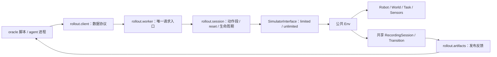

# TopoGym Rollout Pipeline 改造计划

> 2026-09-26 目录归属补充：本地段执行计划集中到 `topogym/simulator/rollout_simulation/`，负责 policy 调度、segment 生命周期、观测投影和证据／产物；见[最新计划 §6](scripted_policy_execution_plan_20260926_zh.md)。这是拟议源码整理，代码尚未迁移。本文下述顶层 rollout 的网络／agent 管理方案继续延期，后续应复用该子包，不另建段执行循环。

> 2026-09-26 policy／观测合同更新：按[scripted policy 调度计划](scripted_policy_execution_plan_20260926_zh.md)，统一 `obs → policy.act(obs) → Env.step(action)`。limited 允许配置的外部／腕部 RGB、关节位置、EE 位姿和夹爪状态；可选标定只限明确公布的固定机位，仍禁止物体真值、接触与隐藏 Task 指标。本条覆盖前稿“机器人实测状态也不可见”的约定。reward／训练 transition 与 actor obs 分开，详见新计划 §4.4；当前只更新工程计划，代码实现暂停。

> 2026-09-24 接口更新：本文的 agent/网络方案尚未启用；其中旧 `reset(state_id=...)`、操作方 reset、旧未来可访问等约定已失效。当前管理方可 `reset(seed=...)`；普通/特权操作方均无 reset，特权仅在当前 episode 内 `rewind_to` 并作废旧未来。实现集中于 `topogym/simulator/`，以[当前本地接口](simulator_api_zh.md)和[实施报告](../dev-logs/simulator_public_api_implementation_20260924_zh.md)为准。

> 2026-09-25 最新动作合同：agent/scripted policy 输出低层控制动作，使用现有 Env.step；不新增公共高层执行器及双模式。[原高层计划](simulator_high_level_actions_plan_20260925_zh.md)仅留历史记录，当前按[segment 计划](simulator_segment_execution_plan_20260925_zh.md)实施。方块搬运用低层 scripted policy 验收；单段 action 数、token 和时间预算不纳入本轮。

日期：2026-09-23。状态：**设计与文件改造计划，尚未实施代码迁移。**

本稿根据最新讨论和当前工作树整理，承接 [Simulator 交互接口合同](simulator_interaction_contract_zh.md)。本轮只修改文档，不移动/删除 `topogym/agents`，不运行 agent、仿真或模型 API 实验。

## 1. 本次确定的方向

建议将活动包命名为 **`topogym/rollout/`**，替代 `topogym/agents/`。它组织任何 policy 的交互过程，既服务 oracle 脚本，也服务 agent；使用 `rollout` 足以表达职责，不再嵌套一层同名目录。

**两种 mode 属于 simulator 层；rollout 层只负责会话、动作段、反馈产物和 policy 连接。** 任何接入公共 Task/Env 合同的任务自动具有同一套权限和交互协议，不再为每个任务写 agent adapter、独立场景或执行循环。

本稿对前一版合同作以下明确更新：

| 项目 | 本次约定 |
|---|---|
| 模式命名 | 配置与协议的规范名称为 `limited`、`unlimited`；用户所说的 privilege/privileged 指后者，不是第三种模式。新配置仅接受两个规范值，旧名称经显式迁移处理 |
| unlimited 含义 | 更多观测信息，以及已授权的历史 reset、虚拟视角；**不拥有修改物体真实状态、场景和物理规则的权限** |
| 动作长度 | policy 自行选择正整数个公共 `Env.step` 控制步；不继承旧实现的单段固定长度上限 |
| 动作段 | 一次提交可以是一个动作保持 N 步，或多个动作及其步数组成的序列；完成后形成一个 segment |
| reset | unlimited 可恢复当前 episode 任意已保存状态；不关闭物理进程重建实例，不用换 seed 或动作重放代替 |
| 结束 | 达到任务终态或环境截断即停止当前 rollout；另保留 policy 主动停止及运行错误。token budget 检测与限制后置 |
| 固定产物目录 | `agent_<policy_id>/<task_id>/rollout_id_<id>/reset_<n>/` 内保存初始 RGB、各 segment MP4 及允许公开的反馈 |

“自动 apply 到所有 tasks”指统一访问和执行机制，不表示每种任务拥有同样的数据字段，或所有任务已经有完整成功判据。没有刚体 pose 的软体应公开节点/材料坐标等真实可用信息；不能用虚假字段补齐。

## 2. 当前基础和旧目录的主要问题

当前公共 [`Env`](../../../topogym/simulator/env.py) 已负责创建/reset、动作校验、物理推进、Task 更新、逐 tick 快照、分支恢复和共享观测。新 pipeline 必须使用它。

最新 [Nyx 基础验收入口](../../../runs/test_results/base_acceptance_final/README.md)记录 13/13 项基础任务、2/2 项公共机制通过。依据是分批的短程生命周期检查，主段仅 3 个控制步、0.075 秒物理时间；不是完整任务成功或长时稳定性证明。当前渲染约定为 **Nyx + compact_lab**，详见 [Nyx 运行记录](../dev-logs/simulator_nyx_runtime_20260923_zh.md)。

旧 `agents/deferred` 有可借鉴逻辑，但不能直接改目录名后启用：

- 多份文件仍导入已经退出的 `topogym.agent_bridge`、`topogym.agent_rollout` 和任务私有 adapter。
- 同时存在 bridge Session、segment runtime、tool runtime、HTTP 服务和多个 CLI，生命周期与权限重复。
- `VisualAdapter` 的旧 privilege 只是静态知识，还硬编码相机数为三或四，与当前 unlimited 语义不同。
- 旧 reset 会结束 Episode 进程并新建同 preset 场景，无法恢复任意历史状态，且会失去进程内完整历史。
- 旧 action program 是受限 Python AST 展开器；新协议无需让 simulator 执行 policy 提交的 Python 字符串。
- 旧 `media.py` 依赖已退出录制接口，还把初始帧延长成静态 segment 0；本次直接交付初始 PNG。
- 旧预算、模型供应商和 OpenPI 工具与核心交互耦合；这些不是本阶段闭环的前置条件。

## 3. 分层与最小依赖



- **`interaction.py`** 位于 simulator 核心包，统一权限、观测投影、机器人单步和受限 reset；不依赖 rollout、模型或通信库。
- **`rollout/`** 依赖该接口，把多次公共单步组织成 segment；维护目录、协议请求和运行结果，不另有物理时钟。
- **`recording/`** 继续独占视频编码和媒体时间映射。rollout 只提交共享帧、关闭录制并发布文件。
- **Task** 提供任务定义、公开说明、目标和真实能力，不感知 policy 类型或 mode；**不为 13 个任务新增 13 个 rollout 文件**。
- **policy** 只接收客户端、公开目录和协议说明，不能取得真实 Env/Scene/Entity、私有快照或可修改共享对象。

即使先用 oracle 验证闭环，也通过同一个客户端协议执行。oracle 不享有直接导入 worker 的特例，避免验证的是另一条路径。

## 4. 预计项目目录与脚本职责

以下为目标结构；标注“新增”的文件当前不存在。

```text
topogym/
├── env.py                              整改：公开只读描述/校验/状态身份接点
├── interaction.py                      新增：SimulatorInterface 与两种 mode
├── episode.py                          保留：全部历史 tick、分支、Transition
├── config/
│   ├── simulator.py                     保留：任务/机器人/物理配置
│   └── registry.py                      整改：公开能力与说明的统一来源
├── tasks/
│   ├── base.py                          整改：公共任务说明合同
│   └── <task_id>.py                     按需补声明文本，不新增运行分支
├── world/
│   ├── genesis_world.py                 按需补只读测量接点
│   └── queries.py                       新增：实体/链接/几何只读查询
├── sensors/
│   ├── observation.py                   整改：相机版本与分组观测
│   ├── cameras.py                       整改：受控自定义虚拟视角
│   └── renderers/nyx.py                 整改：视角更新与 Nyx 生命周期
├── recording/
│   ├── session.py                       复用：每段独立 RecordingSession
│   ├── encoding.py                      复用：唯一 MP4 编码与完整解码工具
│   ├── timeline.py                      复用：物理时间到媒体时间映射
│   └── views.py                         新增：通用多视角拼屏/帧导出辅助
├── data/                               复用：内部真实 transition 证据
└── rollout/                            新目录，替代 agents
    ├── __init__.py                      小型导出；导入客户端不初始化 Genesis
    ├── __main__.py                      唯一启动入口，读配置、启动两端、收尾
    ├── protocol.py                      请求/响应结构、序列化、错误码
    ├── session.py                       单 rollout、变长 segment、reset 和终态
    ├── worker.py                        持久 simulator 进程、请求串行化/去重
    ├── client.py                        标准库客户端，也支持 CLI 单次调用
    ├── artifacts.py                     固定目录、公开反馈、原子发布与索引
    ├── sandbox.py                       policy 的进程/文件可见性边界
    └── README.md                        运行方式、模式与协议入口

examples/
└── rollout_oracle.py                    新增：走客户端的确定性闭环示例

tests/
├── contracts/test_interaction_modes.py  新增：核心两模式权限与数据投影
├── contracts/test_rollout_protocol.py   新增：协议、变长段、reset、请求身份
├── recording_data/test_rollout_artifacts.py
│                                       新增：目录、多视角、发布与泄漏检查
├── integration/test_rollout_runtime.py  新增：真实任务×两模式短程闭环
└── integration/test_rollout_isolation.py
                                        新增：真实隔离边界，缺依赖不得记为通过
```

`rollout/` 共 **8 个 Python 文件**（含 `__init__` 和 `__main__`），不再划分 bridge/runtime/tools/evaluation/provider 多套子系统。v1 不增加独立 `agents.py`、每任务 adapter、模型 SDK、dashboard、数据库或 Web 应用。

`world/queries.py` 只负责测量和后端差异，复用现有 `solvers/collision/` 算法；`interaction.py` 负责是否允许交互方看到这些结果。数值算法、权限和网络编解码不互相混放。

任务公开说明建议统一为 `task_id / instruction / goal_description / initial_scope / action_constraints / evaluation_available / capabilities`。说明必须来自当前 Task，不直接复制旧 task_specs 中的预抓取、辅助抓持和旧阈值。

## 5. 两种 mode：统一于 simulator 层

| 操作/数据 | limited | unlimited |
|---|---|---|
| 任务文字、动作 schema、单位、控制周期、机器人静态规格 | 有 | 有 |
| 预设策略相机 RGB 与本模式的 segment 视频 | 有 | 有 |
| 机器人本体：实际关节位置、当前 EE 位姿、夹爪开合 | 有，同时提供，公布单位／顺序／坐标系 | 同样提供 |
| 其他机器人字段、额外 link pose、内部控制状态 | 不自动提供 | 按已支持字段授权 |
| 相机标定 | 可选，仅明确公布的固定机位 | 按管理方授权 |
| 腕部／跟随相机标定与动态世界外参 | 无；腕部 RGB 仍提供 | 按已支持字段授权 |
| 物体位姿/速度、接触、距离、软体点状态 | 无 | 按实体和物理模型能力提供 |
| 自定义虚拟相机观察 | 无 | 有，不改变实体、灯光或物理 |
| 机器人 action | 有 | 相同 |
| 回到当前 episode 已保存 state | 无 | 有，仅服务端持有的真实历史 |
| 新建场景、改 seed/几何/机器人、任意 set_state | 无 | 无 |
| 直接修改物体 pose、粒子、关节真实位置 | 无 | 无 |
| 任意附着、外力、改摩擦/重力、直接 scene.step | 无 | 无 |

unlimited 的“更多信息”不会自动增加动作权限：机械臂仍由控制器实际驱动，不允许通过修改真实摆放位置投机达成目标。虚拟相机是观察配置；历史 reset 是环境保存状态的受控恢复，二者都不是任意写世界状态。

limited 的过滤必须覆盖 `obs`、`info`、reward、错误、公开 JSON、帧索引、图像标注和文件访问。允许列明的基础本体、动作回执与必要终态信号；不夹带物体真实位姿、腕部标定／实时世界外参、隐藏距离、粒子或内部诊断。固定相机标定默认关闭，按公开相机名单与字段显式开启；不能透传完整 SensorFrame.camera_metadata 或 Task.observe()。

actor 统一调用 `act(obs)`，控制步执行信息包含在 obs.execution_state，具体指最近一次 Env.step(action) 的执行状态及本段累计步数；控制步正常返回不代表移动到位或抓取成功。RL learner／collector 的训练 reward 和 transition 属于另行声明的管理侧数据合同，不自动注入 actor 输入，也不能将特权 critic 数据传给 limited actor。limited 不等于只有 RGB，新增本体观测也不意味着开放任意环境状态。

unlimited 返回的是可序列化的数据副本，不包含 Python 对象、缓冲区句柄、私有路径或可用于修改环境的引用。完整原生 checkpoint 不作为“更多 observation”交付。

全任务适用通过公共 `Env.action_spec`、World 状态和 Task 声明推导，不能在 rollout 中写 `if task_id == ...` 选择另一工厂。软体没有唯一刚体 pose 时返回可用字段及不支持原因；不同接触求解器的数据覆盖也需声明。

## 6. rollout、reset、segment 和 steps 的精确定义

### 6.1 名称与目录对应

| 名称 | 定义 |
|---|---|
| policy | 本次动作来源；oracle 脚本或 agent 使用同一客户端，具有稳定 `policy_id` |
| rollout | 一个 policy 对一个冻结任务实例的一次完整交互会话；mode 在开始前确定 |
| episode | 底层 Env 一次 fresh reset 创建的物理历史；v1 一个 rollout 持有一个 episode |
| reset_000 | 初次交付的起点；不是 policy 已经执行过一次 reset |
| reset_001、002… | 每次成功历史恢复后的新执行段目录；对应新 branch，旧目录保留 |
| segment_0001、0002… | 当前 reset 目录中一次动作请求的录像；每个新 reset 从 0001 编号 |
| state_id | episode 内实际保存状态的 ID；可处于任意已保存物理 tick，不等于 segment 编号 |

`reset_<n>` 沿用用户希望表达的“第几次重新开始/回溯”。恢复到中途状态时，它不是全新 episode，也不重新抽样任务。再次从最初状态尝试可用 `reset(state_id=initial_state_id)`；默认 `reset()` 也恢复该状态。

管理方若要换 seed、variation 或重新建立一个独立试验，应创建新的 `rollout_id`。limited 的外层多次独立评测也是多个 rollout，不向 limited 开放 reset。

### 6.2 policy 自行决定动作长度

本稿规定 **`steps` = 公共 `Env.step` 的控制步次数**。同时公布 `physics_dt_s`、`control_decimation`，并返回实际物理 tick 数，避免将引擎子步、控制步和视频帧混为一谈。

例如配置为 0.0025 秒/tick、每控制步最多 10 tick 时，`steps=200` 最多推进 5 秒物理时间。模型思考、保存 MP4 或 GPU 运行的墙钟耗时不属于这 5 秒。

两种提交形式最终进入同一个 segment 执行器：

```python
# 一个机器人目标保持 200 个控制步。
env.step(action, steps=200)

# 多个机器人目标组成一次 segment；不会在执行端运行 Python code 字符串。
env.run_segment(commands=[
    {"action": action_a, "steps": 80},
    {"action": action_b, "steps": 120},
])
```

- `steps` 是正整数，拒绝 bool、浮点、0 和负数。请求包含的全部命令先做静态校验，校验失败不产生部分动作。
- 不设置旧式 `max_steps_per_segment`，不把 policy 的长段偷偷截成多个决策轮；按步流式执行、编码和落盘，不展开成 N 个重复对象。
- 环境已有 horizon、终态、运行故障仍可使请求提前结束；明确返回 requested/completed 控制步与实际物理 tick。任意长度不代表可以越过环境结束条件。
- 同一 segment 内允许既定动作序列；需要根据新反馈决策时结束该段并再次提交。policy 自己可写任意程序控制客户端，但执行端不接受 Python 求值或动态导入。
- v1 继续使用当前关节目标/夹爪字段。若要末端控制，由核心增加具名控制模式，不能让 rollout 暗中切换为关节传送或任务私有 IK 执行器。

### 6.3 终态与回溯

正常循环为：初始反馈 → policy 决策 → 执行 segment → 发布完整反馈 → 再决策。`terminated` 或 `truncated` 后先完成最后一段记录，再关闭本次 rollout 的动作入口；`finish()` 可主动结束，但不能由 policy 声明成功。

**依照本次“直到达到终态”的流程，默认终态结束整个 rollout。** unlimited 的历史探索发生在终态之前；终态后只允许读取已发布结果，不能恢复后把失败记录改成继续运行。这个默认值收紧了前稿允许结束后继续回溯的建议。未来如需要“失败终态后继续探索”，应显式定义另一外层评测规则。

reset 不删除 policy 的对话、公开历史、旧分支或累计执行记录。原生 Env 回溯功能与外层终止规则分开：核心仍可供受信任测试恢复终态，正式 rollout 按上述规则收尾。

## 7. 完整 interface / protocol 草案

以下为目标协议 v1，不是当前已经可运行的 API。

### 7.1 一个协议、一个执行端

建议 v1 使用 **本地 Unix socket 上的 JSON Lines 请求/响应**，复用标准库，不同时建设 HTTP bridge、工具服务和文件轮询三种协议。客户端可由 Python 调用，也可通过 `python client.py <method> --params ...` 给代码 agent 使用；两者请求结构相同。

管理方启动一次持久 worker，创建 Env、reset 和初始反馈后才交付 endpoint。policy 通过重复调用保持同一个 Env；reset 不销毁 worker。运行 Genesis 的代码和客户端分开安装/暴露，导入客户端不加载 Genesis。

每个状态变更串行执行。传输层可独立处理心跳及请求状态读取，但不在另一线程同时访问 Scene；长 segment 不因客户端等待超时自动重做。

### 7.2 方法清单

| 方法 | 参数 | 返回要点 | mode |
|---|---|---|---|
| `describe` | 无 | 指令、动作/观测 schema、能力、步长、mode、当前公开产物入口 | 两种 |
| `observe` | 无 | 当前状态的 RGB、基础机器人本体、可选公开固定相机标定；unlimited 另含规定的额外状态 | 两种 |
| `step` | `action, steps=1` | 单动作重复的 SegmentResult | 两种 |
| `run_segment` | `commands` | 多动作序列的 SegmentResult | 两种 |
| `render` | 可选 `camera_ids` | 同一物理状态的允许视角 PNG 与身份 | 两种 |
| `list_entities` | 无 | 稳定实体/link ID、类型、可查询字段 | unlimited |
| `get_state` | `entities, fields` | 实测机器人/物体/软体状态及单位/坐标系；大数组存为只读公开数据文件 | unlimited |
| `get_pose` | `entity, link=None, frame="world"` | 实测 position、quaternion 与定义；gripper/link 通过具名 link 读取 | unlimited |
| `distance` | `a, b, kind` | 参考原点/包围盒/表面等具名距离、方法和来源 state | unlimited |
| `contacts` | 可选实体范围 | 引擎支持的接触数据及覆盖说明，不支持与无接触区分 | unlimited |
| `cameras.list` | 无 | 本 mode 可见相机；limited 不看到隐藏展示相机 | 两种 |
| `cameras.create/update/delete` | 相机 ID/规范化参数 | 自定义虚拟视角 ID、版本、快照路径 | unlimited |
| `list_states` | 可选分页游标 | 当前 episode 全部分支的状态目录，含父关系、物理 tick，不返回快照内容 | unlimited |
| `reset` | 可选 `state_id`，默认初始 state | 新 reset 目录、新 branch、恢复来源、初始反馈 | unlimited |
| `request_status` | `request_id` | 请求 accepted/running/completed/error 与已发布回执 | 两种 |
| `finish` | 可选原因文本 | stopped 结果，已完成媒体入口；任务 success 仍由 Env 决定 | 两种 |

`observe/render/query` 不推进物理，也不创建 segment。`cameras.*` 只在 segment 之间修改视角，不能修改照明/几何/物体可见性或物理相机实体。长段中途不允许另一请求插入 reset 或改相机。

距离必须区分参考原点距离、AABB 间隔、实际表面距离和有符号距离。现有算法只能给下界或碰撞见证时要如实命名；软体测量使用当前变形数据。`get_state` 不能退化为任意属性遍历，`get_pose` 也不能给无唯一刚体姿态的软体编造值。

位姿查询还必须区分实体原点、link 坐标系、夹爪工具中心和质心。公共接口固定米制世界坐标及 `wxyz` 四元数，内部将 Genesis 的实际坐标约定转换并验证；不能把实体根姿态标成 gripper pose。相机创建参数沿用前稿的位置、注视点、上方向、垂直视场角与分辨率合同，显式标明单位。

### 7.3 请求信封

```json
{
  "protocol": "topogym.rollout.v1",
  "rollout_id": "000001",
  "request_id": "req-0007",
  "expected_revision": 6,
  "method": "step",
  "params": {"action": {}, "steps": 200}
}
```

空 action 在当前 Robot 合同中表示保持既有目标，不表示冻结实际关节。客户端不发送 mode、seed、物理 dt 或可写物体状态；这些只能由管理方配置。

请求 ID 在整个 rollout 内唯一。同 ID、同内容重试返回既有结果；同 ID、不同内容拒绝。已知重试先查请求记录，不能被后续 revision 拒绝后又作为新动作执行。未知且过期的变更请求返回 `StaleRequest`。

`revision` 是外层单调版本，动作/相机变更/reset 后递增，不随物理回溯倒退。query 响应仍附带 episode/branch/state/revision，避免误将旧观测用于新状态。

### 7.4 SegmentResult 与完整/部分执行

```text
request_id, status, rollout_id, reset_index, segment_index
episode_id, branch_id, start_state_id, end_state_id, revision
requested_control_steps, completed_control_steps, completed_physics_ticks
simulated_duration_s, terminated, truncated, task_success
media_status, segment_video, camera_videos, final_observation, manifest_path
error_code（如有）
```

字段中 `task_success` 只来自真实判据；未完成判据的 Task 不能返回成功。若某控制步只完成部分物理 tick，单独记录部分步，不能把整段计为 0 步或全部完成。

任务终态提前结束是一个有效完成的较短 segment；物理故障、渲染/编码失败和 policy 停止是不同状态。媒体失败不回滚已经执行的物理，也不能要求 policy 重交同一个动作来补视频。保留部分产物和错误，停止自动推进，交给管理方处理。

建议错误码为 `PermissionDenied / UnsupportedCapability / InvalidAction / UnknownState / StaleRequest / RolloutEnded / SimulationFault / MediaFailure`。limited 的公开错误不附带隐藏坐标、原生堆栈或私有绝对路径。

### 7.5 policy 接入的最小形式

管理方只需要传入一个持续运行的 `policy_command`（argv 列表，不是 shell 拼接字符串）。oracle 和 agent 都获得：客户端脚本/包、endpoint、任务说明、公开反馈根目录，以及独立可写 scratch。

policy 可以循环看图片、读取 JSON、计算动作、调用客户端；代码在 policy 自己的进程中执行。v1 不建设模型特有 Adapter，也不在执行端接收 `{"code": "..."}`。

2026-09-26 区分：本节下例是外层提交／分析 segment 的调用方示意，不再作为段内 scripted policy 接口。段内脚本按新计划只实现 `act(obs)`，由管理方 runner 调用 step 和组织 segment；旧网络／进程接入方案仍延期。

```python
# 目标行为示例：connect/plan 为后续客户端与 policy 逻辑。
env = connect()
feedback = env.observe()
while True:
    commands = plan(feedback)
    result = env.run_segment(commands)
    feedback = result["final_observation"]
    if result["terminated"] or result["truncated"]:
        break
env.finish()
```

达到终态后 `finish()` 可幂等取得结束回执，不覆盖 evaluator 结果。agent 的模型请求、上下文管理由外部 policy 负责；后续再挂接 token usage，不要求它们成为 simulator 模块的依赖。

## 8. 固定反馈目录及发布规则

### 8.1 policy 可见目录

宿主机建议公共根为 `runs/rollouts/`。沿用用户要求的四级目录，不额外在中间插入 `episodes/` 或 `public/`：

```text
runs/rollouts/
└── agent_<policy_id>/
    └── <task_id>/
        └── rollout_id_000001/
            ├── rollout.json                 本 mode 可见的运行身份/能力/状态
            ├── feedback.json                当前反馈指针，成功发布后原子更新
            ├── reset_000/
            │   ├── initial.json             起点身份与允许的初始观测数据
            │   ├── initial/
            │   │   ├── <camera_a>.png
            │   │   └── <camera_b>.png
            │   ├── segment_0001.mp4         本段所有允许视角的同步拼屏
            │   ├── segment_0001.json        本段动作回执/媒体索引/终态
            │   ├── segment_0002.mp4
            │   ├── segment_0002.json
            │   ├── cameras/
            │   │   └── <camera_id>/
            │   │       ├── segment_0001.mp4 完整单视角，保留原分辨率
            │   │       └── segment_0002.mp4
            │   ├── observations/
            │   │   └── segment_0001/        本段末态 PNG、允许的结构化观测
            │   └── queries/
            │       └── <request_id>/        显式渲染或 unlimited 大数组查询产物
            ├── reset_001/
            │   ├── initial.json             记录 restored_from_state_id
            │   ├── initial/<camera_id>.png
            │   ├── segment_0001.mp4
            │   └── ...
            └── result.json                  最终结果；不含私有路径/隐藏观测
```

`agent_<policy_id>` 只是用户指定的目录前缀，oracle 也可取名 `agent_oracle_reference`。mode、task variation、配置版本和 seed 身份由管理方保存；公开文件只包含本 profile 允许的信息，不能因为可复现需求就向 limited 导出隐藏实例配置。

同一 task 下的 rollout ID 由管理方分配，避免不同 mode/并发运行重名覆盖。mode 在 rollout 内不可变。所有返回路径相对该 rollout 的公共根，在 policy 中挂载为固定只读 `/workspace/feedback/`；通过 `feedback.json` 定位最新 reset、segment 和观测，旧相对路径一直有效。

每段根目录的 `segment_N.mp4` 使用通用网格拼屏：支持任意声明的相机数，不固定 2×2 或三/四相机。单视角原图/视频保留供精细观察。相机名称、布局和每格来源在公开 manifest 中记录；不叠加 limited 不可见的坐标/距离/接触文字。

### 8.2 私有证据单独存放

```text
runs/rollout_private/agent_<policy_id>/<task_id>/rollout_id_000001/
├── resolved_config.json                 完整管理配置与物理身份
├── requests.jsonl                       请求与完成记录，不含模型密钥
├── transitions.jsonl                    EpisodeDatasetWriter 的真实转移
├── worker.log                           原生诊断，policy 不可见
├── recordings/reset_000/segment_0001/    RecordingSession 原始输出与 frame_map
└── work/                                生成资产和需要的原生工作文件
```

当前 Env 的完整历史主要是进程内状态和原生存储；上面的目录不宣称已提供跨进程崩溃恢复。worker 退出后不能仅凭 segment manifest 恢复任意物理 state。跨进程持久 checkpoint 不属于本阶段。

公共目录不能包含指向私有文件的软链接/硬链接。`RecordingSession.frame_map` 当前会记录相机实时位姿，原始 manifest 也可能含完整 result；**必须经 mode 投影后再发布公开索引，不能整目录复制给 limited**。同理，原始 Transition 的 world/robot/task 数据只进入私有证据。

### 8.3 从执行到 policy 下一轮可见

1. 创建/reset 完成后，保存真实起点的多相机 PNG 和允许观测，发布 `initial.json`。不制造静态 segment 0，也不为初始图补走物理。
2. 接受一个 segment 请求，固定本段的相机集合、参数版本和输出身份；分配请求记录。
3. 建立独立 `RecordingSession`，先提交段起点 SensorFrame，再逐控制步调用公共接口；每次取得同状态共享帧并流式提交，不另写 `scene.step` 或私有 camera loop。
4. `recording/views.py` 从允许视角生成拼屏；所有编码仍通过共享录制模块。Task 与 rollout 不另写 VideoWriter。
5. 完成后保存实际末态 PNG、允许状态和真实完成量；`finish` 并关闭本段录像，再进行媒体检查、哈希和路径核对。
6. 将完成的 MP4、PNG 和清洗后的 JSON 发布到公共目录，**最后**原子写 segment manifest 和 `feedback.json`。返回给 policy 时文件必须可读且视频已收尾。
7. policy 读取同一固定根目录中的最新反馈，再决定动作或 unlimited reset。reset 先结束旧记录，再创建新的 reset 目录。

无完整 manifest 的 `.part` 或失败片段不能作为下一轮正常反馈；已完成物理与媒体完成分别记账。发布中断后恢复发布应复用原请求记录，不重新模拟动作。

### 8.4 采样精度与长段资源

当前 Env 在控制步结束提供 frame sink，历史则每个物理 tick 保存。v1 的视频源帧为段起点及每个实际控制步结束帧，不宣称录下每个引擎子步；每个源状态的关联记录保留。

视频 fps 由固定录制配置决定，媒体帧与源 sim_time/state_id 映射可追溯。末态 PNG 总是单独保存，避免短段末态落在 MP4 采样栅格之外。媒体容器时长可能因帧量化不同于物理时长，两者都记录，不靠重复画面伪造更长执行。

长 segment 的图片和视频流式处理；当前“保留全部物理历史”仍会随运行增长内存/磁盘占用。不得静默丢弃状态来支持长段，资源不足时如实结束并保存部分证据。后续可优化存储，但不能恢复旧的隐式单段步数上限来冒充满足任意长度。

## 9. unlimited 的 reset 与相机实现约束

reset 请求验证 mode、rollout 状态、episode 归属和 state_id 后，直接调用当前 `Env.reset(state_id=...)`。新 `reset_index` 与 `branch_id` 分别记录目录身份和物理身份；不假定两者永远数值相同。

恢复对象包括物理/控制/约束/任务判据/RNG/时钟；旧分支未来状态仍保留，后续可恢复。控制步中间 tick 的目标也能作为来源，新 segment 从恢复后的控制目标继续，动作省略字段的行为沿用 Robot 合同。

只在 reset 成功、恢复后初始反馈有效时提交新目录身份。部分恢复或取帧失败应标记 `SimulationFault/MediaFailure`，不能显示为成功 reset 后继续执行。

自定义相机作为会话级观察配置，物理 reset 后仍保留；挂载关系根据恢复后状态更新。相机参数版本独立记录，防止相同 state_id 对应旧相机缓存。每个 segment 开始后固定集合和分辨率，满足当前 RecordingSession 的稳定视角要求。

Nyx 运行中能否动态增加 sensor 需专项验证。若必须预建，采用公共相机池支持逻辑 create/delete，明确公布容量；不能为创建视角重建场景、增加灯光或丢失历史。v1 的必需项是完成已声明范围的观察接口，不能把内部 `add_sensor` 对象交给 unlimited。

## 10. policy 执行边界与预算后置

两种模式都必须禁止绕过接口改世界。进程分离本身不足够：policy 的文件视图中只挂载客户端、任务公开说明、只读反馈和可写 scratch；不给 simulator 源码写权限、私有状态目录、GPU/引擎句柄或访问 worker 内存的途径。通信只允许已声明 RPC，不提供任意执行/反序列化 Python 对象入口。

`sandbox.py` 复用旧隔离实现的有用经验，但去掉模型品牌、用户配置目录和 token proxy 耦合。隔离机制不可用时，正式运行应明确报错；不能静默退回“靠提示词约束”后仍称 mode 权限已落实。受信任开发调试若需要绕过隔离，应独立标记，不产生正式模式资格。

本阶段不接入 token 预算代理、模型计费接口或额外总段数上限。结果可预留 `usage=null`、`budget_enforced=false`，不得写成已经计量为 0。后续预算组件只决定是否允许下一次 policy 调用/执行请求，不重新实现 simulator 或目录体系；累计使用不会随 reset 清零。

没有 token budget 机制时，停止条件为环境终态/截断、policy finish、policy 退出或基础设施错误。人工取消作为运行状态记录，不冒充 Task 物理失败。已有 Env horizon 仍有效，它与 token budget 是不同约束。

## 11. 旧 agents 文件的迁移、整改和删除清单

以下路径均相对 `topogym/agents/`。**“删除”表示未来替代完成后的目标，不是本轮已执行删除。** 实施前先核对运行进程、引用和未完成实验，保存一份有 SHA-256 与清单的源码归档到 `runs/source_archives/agents_before_rollout_<id>/`；不在新包内保留可导入的 deferred 副本。

| 原文件/目录 | 处置 | 新归属或理由 |
|---|---|---|
| `__init__.py`、`README.md` | 替换，最终移除旧包 | 新 `rollout/__init__.py`、`README.md`；不维护无效兼容导入 |
| `deferred/rollout/env_sdk.py` | 重写迁移 | `rollout/client.py`；增加变长序列、历史 state reset、统一查询，去掉旧 HTTP/profile 假设 |
| `deferred/rollout/episode.py` | 提取进程清理逻辑，主体替换 | `rollout/worker.py`；持久 Env，取消 reset 新建 Episode 的做法 |
| `deferred/rollout/tool_runtime.py` | 拆出通用请求身份/事件经验，替换 | 归入 `protocol.py`、`worker.py`、`session.py`；移除旧 Trial/adapter 工厂与内置预算 |
| `deferred/rollout/runtime.py` | 删除旧执行器，必要合同迁移 | `session.py` 与核心 `interaction.py`；去掉 VisualAdapter 静态 privilege、固定相机数和重复生命周期 |
| `deferred/rollout/isolation.py` | 整改迁移 | `rollout/sandbox.py`；从 Codex 专用调用中分离，限制 simulator 写入口 |
| `deferred/rollout/agents.py` | 提取通用命令启动逻辑后移除 | `__main__.py` 统一 policy_command；ReplayAgent 改为示例/测试客户端，模型专属逻辑归档后置 |
| `deferred/rollout/__main__.py`、`__init__.py` | 替换 | 仅保留一个 `python -m topogym.rollout` 入口 |
| `deferred/media.py` | 整改迁移 | 路径/清洗/发布放 `rollout/artifacts.py`；拼屏复用/补入 `recording/views.py`，不复制旧 writer 或静态 segment 0 |
| `deferred/bridge/session.py` | 删除重复 Session，迁移必要语义 | 新 `rollout/session.py`；执行、终态、录像均调用公共核心 |
| `deferred/bridge/client.py`、`deferred/bridge/server.py`、`deferred/bridge/local.py` | 合并替换 | 新 client/worker 单协议；不保留 HTTP、本地 bridge 和工具 runtime 三套入口 |
| `deferred/bridge/__main__.py`、`deferred/bridge/__init__.py`、`deferred/bridge/dashboard.html` | 删除旧入口/界面 | 不增加 dashboard；状态以 JSON 和可直接访问的媒体交付 |
| `deferred/bridge/package.py` | 提取公开包边界后替换 | `artifacts.py` 发布任务说明、客户端位置和反馈；不导出底层环境对象 |
| `deferred/bridge/tool_policy.py`、`deferred/action_program.py` | 移除运行依赖并归档 | 不在 simulator 端解释 Python AST；policy 在自己的进程计算并发送数据命令 |
| `deferred/configuration/agent_profiles.py` | 替换 | 两种规范 mode 放 `interaction.py`，无 rgb/rgb_privileged/simulator 混用 |
| `deferred/configuration/agent_suite.py` | 提取冻结身份/哈希经验，移除旧工厂 | 管理方 SimulatorConfig + registry；批量 suite 调度后置，不恢复每任务 adapter map |
| `deferred/configuration/task_specs/*.py` | 审核事实后归入当前 Task 声明，移除重复目录 | 具体文件见下一段；不继承旧预抓取、assist 或旧 evaluator 结论 |
| `deferred/evaluation/initial.py` | 整改归并 | `session.py` 初始化身份检查与 `artifacts.py` 初始反馈；不以 seed 相同代替回溯验证 |
| `deferred/evaluation/evaluate.py` | 归档后移除活动依赖 | 批量统计后置；单 rollout result 在 session/artifacts 完成 |
| `deferred/bridge/budget.py`、`deferred/rollout/token_budget.py`、`deferred/rollout/budget_proxy.py` | 完整归档、后置，不接入 v1 | 保留算法与验证资料供预算阶段审查，不能因暂未使用而丢失唯一实现 |
| `deferred/bridge/openai_harness.py` | 归档后置 | 特定模型接入不放在 simulator 或基础 pipeline 中 |
| `deferred/tools/env_setup_vla_openpi.sh`、`deferred/tools/register_openpi_config.py` | 归档后置 | VLA 训练/供应商环境不属于本次闭环 |

旧 task_specs 的 8 个文件为 `cast_coil.py`、`cast_keyhole.py`、`horseshoe_ring.py`、`hedgehog_in_cage.py`、`interlocked_claws.py`、`buzz_wire_3d.py`、`knot_untying.py`、`lock_picking.py`。当前 13 项都应通过 Task 公共说明获得接口描述，其余任务不用新增平行 task_spec 文件。

### 11.1 旧 tests 与脚本的处置

| 原 `deferred/tests/` 文件 | 后续处置 |
|---|---|
| `check_agent_bridge.py`、`check_agent_local.py`、`check_agent_rollout.py`、`check_agent_rollout_tools.py` | 将权限、请求去重、实际步数、反馈发布等有效行为迁入新合同测试；移除旧 import/adapter/API 断言 |
| `check_agent_task_spec.py` | 当前 Task 公共描述检查归入 `tests/unit/test_task_definitions.py` 和两模式合同测试 |
| `check_buzz_wire_agent.py`、`check_claws_agent.py`、`check_hedgehog_agent.py`、`check_horseshoe_agent.py`、`check_keyhole_agent.py`、`check_knot_agent.py`、`check_lock_agent.py` | 将仍有效的任务判据/控制知识迁回对应核心测试；接口一致性改为 registry 参数化，不保留七份 agent adapter 测试 |
| `check_agent_rollout_budget.py` | 与预算源码一起归档，预算阶段再迁移；不能以未运行计作通过 |
| `agent_rollout_workflow.py`、`check_agent_rollout_workflow.py` | 批量 prepare/evaluate/report/watch 后置；必要配置检查进入唯一 CLI 的测试 |
| `probe_horseshoe_agent.py`、`probe_knot_agent.py`、`probe_rigid_agent.py` | 当前公共任务参数化 smoke 取代，不恢复私有场景入口；历史诊断随来源归档 |
| `run_agent_rollout.sh`、`run_agent_rollout_tools_smoke.sh`、`check_agent_rollout_setup.sh` | 由唯一 CLI 和文档命令替代，不保留层层 shell 包装 |

只有在有效逻辑已迁移、可复现历史资料已归档、当前引用/运行依赖已核对之后，才清空旧 agents 活动目录。不能为了目录简洁删去正在使用的输入、队列、状态或最后一份成功证据。

## 12. 核心模块、配置和文档的整改范围

| 文件 | 计划修改 |
|---|---|
| `topogym/env.py` | 提供只读公开描述/测量及无副作用动作校验接点，使 interface 无需依赖任务私有 adapter；保持唯一 step/状态保存路径。记录故障时真实完成 tick，不能丢失已完成物理 |
| `topogym/interaction.py`（新增） | 两 mode、统一能力检查、结果投影、单步动作、受限 reset、查询/相机入口；不包含视频编码或通信 |
| `topogym/world/queries.py`（新增）、`genesis_world.py` | 统一实体/link pose、状态字段、距离/接触查询，明确实际几何和单位；不增加任意 setter |
| `topogym/tasks/base.py`、13 个 Task 定义、`config/registry.py` | 将当前任务指令与接口能力归入同一合同；新增 Task 接入后自动获得 mode，不按 policy 分支 |
| `topogym/sensors/observation.py`、`cameras.py`、`renderers/nyx.py` | 策略/展示/自定义视角分组，相机配置版本，运行期受控视角；保留分支同 tick 的 Nyx 缓存失效处理 |
| `topogym/recording/views.py`（新增） | 共享多相机拼屏和帧导出；复用 session/encoding，任何发布视频不得在 rollout 另建编码器 |
| `topogym/recording/session.py` | 原合同可用于同分支多个独立 segment；只有拼屏元数据或通用媒体支持确有需要时小幅整改，不更换物理时钟或另建 recorder |
| `topogym/data/episode_dataset_writer.py` | 原则上复用，完整数据写私有根；若新增请求/segment 身份，作为关联 metadata，不让 exporter 推断动作 |
| `pyproject.toml` | 发行 `topogym.rollout`，移除旧 agents 的活动入口引用；客户端 import 不触发 Genesis，隔离工具按明确运行依赖说明 |
| `tests/architecture/test_module_boundaries.py` | 增加核心不得依赖 rollout、唯一物理推进、Task 不含 mode/provider/录制逻辑、新代码不导入 agents/legacy 的检查 |
| `README.md`、`topogym/README.md`、`docs/develop/modules/README.md`、`scripts/README.md` | 在实现完成后更新新入口与状态；旧手册标历史，不将拟议 CLI 写成当前可用 |
| `AGENTS.md` | 实施阶段按新授权范围更新“agent/API 延期”说明，保留真实物理/录制约束；本次写计划不据此启动实验 |
| `simulator_interaction_contract_zh.md` | 本轮增加本计划优先级说明；实现时按定稿统一命名和动作段/终态语义 |

不修改物理任务几何、摩擦/质量、成功阈值来配合 pipeline；这些是独立任务正确性工作。将接口接通不等于完整任务判据或辅助抓持已完成。

## 13. 开发阶段与完成条件

### 阶段 1：统一 simulator-level interface 和两种 mode

新增 interaction、公共查询和 Task 描述；固定 mode 命名、机器人控制语义、观测投影与返回身份。先通过公共 registry 参数化检查全 13 项，允许按物理类型声明缺失字段。

完成条件：两种模式在所有 Task 上使用同一代码路径；limited 取得公布的基础本体与相机输入，且无隐藏环境真值泄漏；unlimited 可以读取已授权的额外机器人/物体状态但不能写入世界；单步只进入现有 Env。

### 阶段 2：动作段、共享录像和固定目录

建设 session/artifacts/protocol，接入任意正整数控制步与命令序列，流式共享录制，初始/末态 PNG，多视角视频和原子反馈发布。

完成条件：同一 oracle 通过客户端完成“初始反馈→变长段→视频→下一段”；大于旧上限的段不被旧配置拒绝；提前终态、媒体失败、末态帧和实际执行量均可核对。

### 阶段 3：完整 unlimited 回溯、查询和相机

接通当前 episode 所有历史 state 的恢复与 reset 目录；完善原点/表面等距离支持，接入运行期虚拟视角及相机版本。没有能力的组合明确返回不支持。

完成条件：可从中途 tick 和旧分支未来恢复并继续；没有重建 Env；reset 后新目录保存真实起点；相机变化不推进物理、不改变光照或任务实体，录像集合在 segment 内固定。

### 阶段 4：持久 worker 与可执行 policy 的访问边界

完善 worker/client/sandbox/唯一 CLI，使用一个本地协议；oracle 和外部 agent 命令都按同样方式连接。落实只读公共反馈、隔离 scratch、请求去重和 revision。

完成条件：policy 任意代码无法访问当前正式环境的原始对象、私有 checkpoint 或写入入口；不能通过文件改写 result；断连重试不重复执行，迟到请求不作用于新分支。前几阶段可信测试不能替代本阶段的隔离验收。

### 阶段 5：全任务验收与旧目录退役

按 13 Task × 2 mode 验证初始观测、动作段、媒体反馈和公开能力；在 rigid、PBD、FEM/IPC 上验证适用的回溯/查询，相机与隔离另作公共机制验收。补齐迁移对应后归档/删除旧 agents 活动代码，更新包配置和文档。

完成条件：产物均使用 Nyx + compact_lab；新路径可从安装包启动；旧 agent_bridge/agent_rollout 无活动引用；每项验证有真实报告。短程接口测试仍不得声明任务 solved。

### 后续阶段：token budget 与模型专用接入

再审查保留的预算实现、累计 usage 和供应商回执，挂接到 policy 调用与外层运行状态；按需增加模型驱动。此阶段不改变 action/reset 权限、segment 路径或已有任务接口。

## 14. 重点验收场景

| 场景 | 必须看到的结果 |
|---|---|
| 同任务、同动作、两种 mode | 机器人命令、物理轨迹和任务判定一致；只有允许的信息与特权观察操作不同 |
| oracle 与 agent | 都调用同一客户端；oracle 不直接得到 Env 或使用额外抓持/传送动作 |
| 超过旧长度上限的 segment | 真实执行到请求长度或环境终态，流式录像，不擅自变成下一次 policy 决策 |
| segment 中途终止 | 记录实际步数、物理 tick、真实末态及可播放的最后短段 |
| 回到中间物理 tick | 新 reset 目录、新 branch，旧视频和旧未来 state 保留，后续真实积分 |
| 新建/移动视角 | state/物理时钟不推进，图像更新、相机版本变化，固定相机与照明不被改写 |
| limited 各种产物 | 公布的关节／EE／夹爪可读；RGB/JSON/错误不泄漏物体真值、未授权标定或隐藏 metrics，原始 Transition 不直接交付 |
| 重试/过期请求 | 同 ID 不重复执行；旧 revision 的新动作拒绝；回溯不会复用旧请求身份 |
| 编码或发布失败 | 已执行物理保留，媒体失败明确；不重复模拟、不假装完整成功 |
| 资源不足/worker 退出 | 保留失败/部分证据并结束；不静默丢弃历史，也不声称跨进程恢复已实现 |
| 新增合规 Task | 不修改 rollout 或 mode 分支即可使用两种模式；仅 Task 声明与物理能力可能不同 |

建议本轮 review 优先确认三点：规范名采用 `limited/unlimited`；`steps` 使用公共控制步；`reset_<n>` 表示同一 episode 内每次恢复后的新执行分支目录。其余文件拆分服务于这三项语义和既定闭环，可在实现时按实际复杂度微调，但不增加第二套执行机制。
