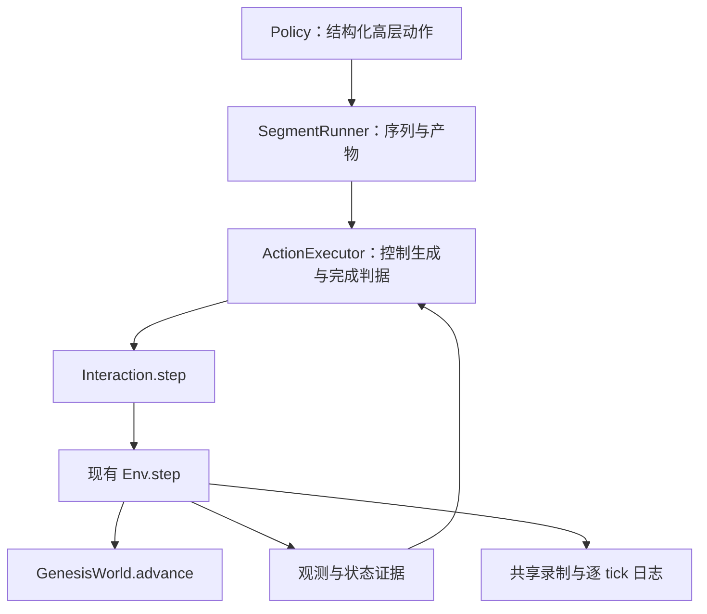

# Simulator 高层动作执行与方块搬运验收计划

日期：2026-09-25。状态：**高层接口方案已撤出当前开发范围；未实施，未运行仿真。**

## 当前决定：只接收低层控制动作

用户最新澄清：agent/scripted policy 按 simulator 的控制周期生成低层 action；动作细化、保持与操作阶段切换由 policy 决定。因此当前不开发 move_to/grasp/release 公共接口、ActionExecutor、CompletionEvaluator 或高层命令协议，也不引入 high_level/low_level 双模式。

当前执行链为 `policy → Interaction.step(action) → Env.step → Genesis`；需要批量提交时由 SegmentRunner 顺序转交同一低层 step。一个列表元素对应一个控制步，环境不逐个等待目标到达。policy 可用循环、插值与公开观测反馈生成动作，不必预先手写全部坐标。policy 自己的便利函数不是 simulator 必须提供的公共接口。

继续实施[segment 执行计划](simulator_segment_execution_plan_20260925_zh.md)：分段连续执行、终态截停、权限、逐 tick 日志和录像。原方块抓取搬运测试保留，改为低层 scripted policy 的端到端验收；具体范围迁入该计划第 10 节。无单段 action 数、token 或时间预算；Env 既有 episode 时限保留。

以下第 1–9 节仅为旧设计与外部源码核对存档，不是待实施清单。涉及“新增高层执行器”“共同实施”和“首版高层动作”的内容均由上述决定覆盖。

## 1. 要解决的问题与已有基础

当前 `Env.step(action)` 接受机器人控制目标，每次默认推进 10 个 physics ticks（每 tick 0.0025 s），共 0.025 s 仿真时间；terminal 或环境时限会逐 tick 提前截停。它不会等到目标到达再返回。`Interaction.step` 委托同一 Env，提供 episode 绑定的受限访问。

已有 `tests/integration/test_policy_action_receiver.py::short_policy` 是“首次提交目标，后续 step({}) 保持目标”的固定控制步数实验，不是完整动作执行器。重复提交 delta 会相对新的实测状态重新生成目标，不能用作保持最初目标的方法。当前 planning 目录仅提供参考运动，不负责执行。

缺口：如果 policy 提交“抬起 → 横移 → 下降 → 放开”，只逐项 step 一次会过早切换目标。需要高层执行器将每项动作运行到明确完成条件，并在失败时停止后续动作。

本轮不设置单 segment 的 action 数、token、仿真时间或墙钟时间预算，也不新增 runner 累计额度。保留 Env 已有 episode 时间上限和终态规则。动作的停稳窗口、无进展检测窗口是物理判据，不是 segment 额度；窗口到期不能计为成功。底层调用卡死的强制中断仍需未来进程监督，不能声称 Python 循环可强制终止引擎。

## 2. 外部参考与采用边界

2026-09-25 查阅官方文档／源码：

- [robosuite Controllers](https://robosuite.ai/docs/modules/controllers.html)：policy 按控制频率提交目标，控制器在多个仿真步内跟踪同一参考值。采用其控制频率与仿真频率分层；它不证明普通 step 会等待高层动作完成。
- [RLBench arm_action_modes.py](https://github.com/stepjam/RLBench/blob/master/rlbench/action_modes/arm_action_modes.py)：`EndEffectorPoseViaPlanning` 内部执行路径；`EndEffectorPoseViaIK` 内循环检查目标到达或停止运动。借鉴高层调用组织多次物理推进，但本项目将“停止运动且未到目标”明确判为失败，不当作动作完成。
- [RLBench gripper_action_modes.py](https://github.com/stepjam/RLBench/blob/master/rlbench/action_modes/gripper_action_modes.py)：存在夹爪执行循环及可选物体 attachment。仅参考执行结构；本项目方块验收必须依赖实际接触、摩擦和重力，不用 attachment／焊接制造抓取成功。

上述链接为滚动文档／分支，不是固定依赖。本轮不引入 robosuite、RLBench 或第二种物理引擎；实施时若复用代码，另核对版本与许可证。

### 2.1 RoboWits 指定源码核对

后续按用户指定链接核对 RoboWits，固定版本为 `9cc30aedbbebea86b975c0d66ea9ac227ca38535`（只读源码，无运行验证）：

- [mutation/01_01.py](https://github.com/UMass-Embodied-AGI/RoboWits/blob/9cc30aedbbebea86b975c0d66ea9ac227ca38535/gs_gym/envs/robowits/mutation/01_01.py) 继承 AlignBlocksEnv，定义物体和 placement_groups；没有动作执行状态机。
- [GenesisGymEnv.step](https://github.com/UMass-Embodied-AGI/RoboWits/blob/9cc30aedbbebea86b975c0d66ea9ac227ca38535/gs_gym/envs/base_gym_env.py#L216) 调用 apply_action 后返回观测／奖励／终态。[RoboWitsEnv.apply_action](https://github.com/UMass-Embodied-AGI/RoboWits/blob/9cc30aedbbebea86b975c0d66ea9ac227ca38535/gs_gym/envs/robowits/robowits.py#L818) 设置目标后调用一次 scene.step，没有等待到达的循环；[默认配置](https://github.com/UMass-Embodied-AGI/RoboWits/blob/9cc30aedbbebea86b975c0d66ea9ac227ca38535/gs_gym/configs/envs/robowits_default.yaml) dt=0.0333 s、内部 substeps=4。
- [BimanualMarvinRobot._apply_ee_abs](https://github.com/UMass-Embodied-AGI/RoboWits/blob/9cc30aedbbebea86b975c0d66ea9ac227ca38535/gs_gym/robots/bimanual_marvin.py#L449) 用 IK 转换目标并设置关节／夹爪控制。IK 求解不是物理到达检测。
- [LeRobot 评测循环](https://github.com/UMass-Embodied-AGI/RoboWits/blob/9cc30aedbbebea86b975c0d66ea9ac227ca38535/third_party/lerobot/src/lerobot/scripts/lerobot_eval.py#L619) 反复 select_action → env.step；[ACT.select_action](https://github.com/UMass-Embodied-AGI/RoboWits/blob/9cc30aedbbebea86b975c0d66ea9ac227ca38535/third_party/lerobot/src/lerobot/policies/act/modeling_act.py#L100) 在非 temporal ensemble 分支缓存预测的 action chunk，每次弹出一个控制 action，队列耗尽后再预测。

结论仅限上述公开执行链：具备低层动作序列和物理执行能力，但没有本文所需的“move/grasp 等待完成后切换”通用接口。低层轨迹各采样目标无需逐个停稳；policy 的连续输出决定下一控制目标，这种方式本身并没有缺陷。新的高层 executor 只用于有明确完成语义的命令，不能自动套在 ACT/VLA 原有 action chunk 上，否则会改变策略训练时的时间语义。`low_level` 与 `high_level` 必须显式区分，不能从数值数组猜测。

## 3. 分层与拟新增接口



- policy 负责决定做什么、目标在哪里；首版提交结构化数据，不让 simulator 理解任意自然语言或执行任意代码。
- executor 负责本次动作如何跟踪、何时完成、何时失败；不负责搜索完整任务解法。
- segment 是一段动作序列／闭环策略的记录边界，包含多个高层动作，每个动作包含多个控制步。
- Env 保持唯一物理编排入口。新模块不直接调用 scene.step、world.advance 或修改物体 pose。

拟新增用法（**尚不存在，不是可运行示例**）：

```python
runner = SegmentRunner(env, output_root=output_root)  # 管理方创建
interaction = runner.interaction(privileged=False)
result = interaction.run_segment(
    request_id="cube-transfer-001",
    actions=[
        {"type": "move_to", "arm": arm, "position_world_m": above_cube,
         "orientation_wxyz": grasp_orientation},
        {"type": "move_by", "arm": arm, "translation_world_m": [0, 0, -0.08]},
        {"type": "grasp", "arm": arm, "object_id": "cube", "profile": "cube_pinch_v1"},
        {"type": "move_by", "arm": arm, "translation_world_m": [0, 0, 0.08]},
        {"type": "move_by", "arm": arm, "translation_world_m": [0.20, 0, 0]},
        {"type": "move_to", "arm": arm, "position_world_m": placement_pose,
         "orientation_wxyz": grasp_orientation},
        {"type": "release", "arm": arm, "object_id": "cube", "profile": "cube_release_v1"},
        {"type": "move_by", "arm": arm, "translation_world_m": [0, 0, 0.08]},
    ],
)
```

姿态、接近高度与 placement_pose 由场景几何推导；示意数值不能直接当作已验证的机器人轨迹。arm 从 action_spec 获取，不能硬编码未经确认的组名。

同时提供 `interaction.execute(command)`：仅在活跃段内执行一个高层动作并返回 ActionResult，便于 policy 根据结果生成下一项。`begin_segment/end_segment` 保留为显式流式记录边界；begin/end 不推进物理。`run_segment` 内部使用同一 begin → execute → end 路径，默认调用方不必手写这些边界。已有低层 `step(action)` 仍可用于逐控制步 policy，不重定义成高层语义。

同一活动段明确选择 high_level 或 low_level 模式；执行期间拒绝交错 step/execute、并发动作和 rewind。已有裸 Interaction 不加 segment 要求；SegmentInteraction 只约束自己的调用。管理端对同一 Env 的并发写入需串行化。保持 episode 失效、请求幂等、分支及权限合同。

Python 调用不要求 policy 填 schema_version。未来持久化的 `HighLevelActionRequest`／`ActionResult` 格式若需要版本化，版本只标识这些具体数据格式，不能把高层动作混入现有机器人 action mapping。

## 4. 首版动作范围与完成定义

| 动作 | 输入／目标解析 | 完成条件 | 失败或不支持 |
|---|---|---|---|
| move_to | 世界系 TCP 位置和 wxyz 姿态 | 实测位置、角度误差及速度连续满足容差 | IK 无解、停滞、振荡无净进展、终态 |
| move_by | 世界系平移，首版保持姿态 | 入口实测 TCP 加位移，冻结为一次绝对目标后使用 move_to 判据 | 不重复累加 delta |
| gripper_open / gripper_close | 机器人 profile 映射到原生夹爪坐标 | 原生坐标与速度达到要求 | close 不代表抓住；被物体挡住不能无条件判为完全闭合 |
| grasp | 指定物体、已接近的抓取姿态和受支持 profile | 闭合后按 profile 小幅试提，物体离桌并随夹爪稳定保持 | 空夹、滑落、测量能力不足；不能以夹爪命令成功代替 |
| release | 指定当前持有物体、支持面 profile | 张开后物体由支持面承托并稳定，夹爪不再夹持 | 悬空释放、掉落、黏连或测量能力不足 |

`grasp` 包含明确的试提子阶段，返回实际末端位姿；policy 必须知道动作包含这一运动。它不自动搜索抓取点。`release` 要求事先移到支持面，不能把自由落体默认算作成功。接近／下降阶段使用明确几何目标，不能等待 TCP 到达桌面以下的不可达目标。

首版高层运动采用 EE_ABS 模式的单臂 Panda/Robotiq。创建 executor 时校验控制模式与测量能力，不在运行中修改 Env 配置；其他模式的低层 step 保持可用。双臂同步高层动作、全局避障规划和其他物体抓取 profile 是后续范围，不宣称方块测试证明全部 13 项任务可执行。

## 5. 控制生成、结束判据与失败顺序

1. 整段先验证静态结构、动作类型、数值、物体引用和 profile 能力；每项开始时才解析当前相对目标与动态可达性。
2. 使用有限速度／加速度的参考轨迹，平移插值与姿态球面插值，复用现有 compile_action／Genesis IK。每个控制步更新参考，最终目标到达后使用 step({}) 保持。不得一步跳到最终状态，不把采样点耗尽当作到达。
3. 无全局避障器时只支持已验证的开阔桌面路线；检查工作空间、关节限制、IK 解连续性及声明的接触条件。障碍路线明确不支持／失败，不声称 IK 自带避障保证。
4. 首版移动完成候选参数：TCP 误差 ≤3 mm、姿态误差 ≤0.03 rad、平移速度 ≤0.01 m/s、角速度 ≤0.1 rad/s，连续满足 0.15 s。全部为实施前需校准并冻结的参数，不是已有通过结果。速度若由相邻观测估计，必须除以实际仿真时间差。
5. 若误差未达标，且 0.5 s 窗口内净改善不足设定阈值，判 stalled；检测往复振荡而不只检测瞬时低速。记录初始误差、最优误差、窗口进展及阈值。自由空间移动和接触抓取分别配置判据，不能用同一停滞规则误杀正常接触。
6. grasp 完成后，后续移动持续检查已持物体的保持条件；掉落或滑移失效立即使当前动作失败。release 完成后解除持有状态，不能只在 grasp 返回时检查一次。先消费引擎故障、episode 终态／截断及动作失败，再决定是否可启动下一项。仅 completed 可自动切换；环境终态即使同时满足本动作条件，也不能执行下一项。Task 成功、单动作成功和整段全部完成分别报告。
7. 高层完成检查发生在返回的控制步边界；Env 终态仍逐 tick 截停。不承诺高层完成恰好在某个内部 tick 时立即停止；如需逐 tick 高层截停，另扩展 Env 合同。
8. 不新增固定动作执行时长作为正常结束条件。停滞检测无法证明所有异常都能有限时间识别，持续缓慢进展等情况仍由 Env 既有时间上限及管理方取消结束。

状态：pending → running → completed / failed / interrupted。ActionResult 至少含 action_id、type、status、reason、start/end state_ref、实际控制步/tick/仿真时长、完成判据版本、授权范围内的误差摘要。整段返回已执行前缀和首个未完成动作，其余标 not_started；不回滚已经发生的物理。

无活动动作时才允许 rewind；清空执行器的参考轨迹、速度估计、持有物体缓存和稳定窗口。新动作基于恢复后的测量重新初始化；Task 的稳定计数必须在 Task 快照中正确恢复。不能跨分支复用成功标记。

## 6. 测量与权限能力

移动判据使用公共机器人观测；支持 EE 观测的模式先实施。物体抓持／释放需要可信测量，新增管理端 CompletionEvaluator 能力接口：从现有 World/Task 只读状态产生 profile 判定，普通 policy 仅收到授权结果，不取得 privileged 句柄或真实引擎对象。

- 方块 profile 至少需要物体 pose/速度、TCP pose、夹爪坐标、桌面几何和双方相对运动；接触对／接触力若当前可用则记录真实覆盖情况。
- 如果接触力不可读，不能编造力阈值通过；以物体离桌、保持时间及相对位姿稳定作为首版可观测功能证据，并明示缺少力证据。
- 物体 ID 和 profile 必须由管理方按场景授权。无能力时在执行前返回 unsupported；不能允许输入任意 Python predicate 或内部字段名绕过权限。
- ActionExecutor 只消费执行所需测量，Task 仍独占完整任务成功判据，避免执行器把“动作列表用完”写成 task_success。

## 7. 方块搬运真实测试场景

新增专用测试 Task `cube_transfer`，复用 TaskDefinition/TaskSpec/EntitySpec、现有 Env、GenesisWorld、机器人与实验室构造；不更改正在并行开发的 13 项生产 Task 或其资产。测试注册在测试进程内使用现有 registry 接点完成，不新增平行 Env；先核对 registry 扩展方式，不通过复制生产 Task 或永久篡改目录实现。

场景基线：Panda/Robotiq、compact_lab 桌面、动态刚体方块边长 0.04 m、质量候选 0.05 kg、两个水平相距 0.20 m 的起终区域。实际位置从机器人工作空间和桌面尺寸推导；摩擦、质量、尺寸、机器人控制参数写入配置并在正式验收前冻结。无额外障碍；目标区域使用视觉标识而不是挡块或吸附机构。

从 robot_control.home.qpos 和张开夹爪开始完整录制；若默认 home 夹爪未张开，首先执行 gripper_open。policy 提供接近、下降、grasp、抬高、横移、下降、release、撤离。抓取只能依靠机器人控制和接触，不允许 set_pos、kinematic teleport、物体绑定、焊接或外力托举。

建议初始验收阈值（实施前校准冻结，不能看到失败后静默放宽）：

- 方块底面离桌 ≥0.05 m，并在空中横向搬运 ≥0.15 m；记录途中最低高度，不能靠推拖通过。
- 试提／搬运的保持阶段，方块相对 TCP 位姿无明显滑移，至少连续保持 0.20 s；具体平移／转角容差写入 profile。
- 放下后方块中心距目标中心 ≤0.02 m，底面与桌面高度差 ≤0.003 m，线速度 ≤0.01 m/s、角速度 ≤0.1 rad/s，连续稳定 0.50 s。
- 夹爪已经打开并撤离物体至少 0.05 m；目标上静置但仍被夹持不算完成。
- Task 只有在“曾经提起、搬运、释放、撤离、稳定”均满足时才成功，避免初态接近目标或 release 后过早终止而跳过撤离。判据状态保存进 Task snapshot。

测试 policy 可读取管理方提供的公开场景目标；用于验收的物体真值只供管理端记录／判定，不能把 oracle 位姿来源说成视觉识别。首次验收是接口与物理闭环测试，不要求调用模型 API。

## 8. 测试矩阵与证据

| 层级 | 用例与必须证明的行为 |
|---|---|
| 合同 | 前一动作未满足条件时绝不提交下一项；目标瞬时穿越但未停稳不算成功；delta 只解析一次；实际时间用于窗口 |
| 错误 | 不可达目标、受阻、振荡、空抓、搬运中掉落、悬空释放；保留执行前缀且后续 not_started |
| 生命周期 | terminal 落在控制步中间、episode 截断、取消、过期句柄、重复 request_id、执行中 rewind 拒绝、段间状态连续 |
| 权限 | 普通调用可执行授权 grasp profile，但不能读取物体私有日志；测量能力不足明确 unsupported |
| 真实基础 | 单目标移动、夹爪张合，再执行完整方块搬运；同一执行路径，不用测试专属物理循环 |
| 真实复现 | 基准 seed 0 及预先登记的 seeds 1–4（小范围位置变化）；另做 seed 0 初态重置复现，失败不剔除 |
| 扰动 | 正常末端速度倍率 0.5×/1×下，完成用时可不同但动作顺序和判据一致；受阻时不能到固定步数就自动换动作 |
| 多段 | 同一 policy 单段完成，与“抓取抬起／搬运放下”两段完成；段间不 reset、不推进物理 |

每个真实用例准备报告、源码与依赖版本、资产／配置哈希，再运行；失败也保留报告和录像。三路 Nyx 848×480、30 fps，使用 topogym.recording 公共录制；全程从 home 到释放撤离，验证完整解码和同步。日志关联 segment_id → action_id → control_step → physics_tick/state_ref → frame；动作起止及完成证据不能只靠视频目测。

产物建议：`runs/test_results/high_level_actions_<run_id>/`，逐 seed 保存 report.json、config.json、source_manifest.json、动作事件、逐 tick 证据、三视角 MP4 和末状态 PNG。沿用 segment 公共／私有产物分离。GPU／Nyx 不可用时报告 blocked 并给 CLI，不切换渲染器冒充正式通过。

## 9. 文件修改与实施顺序

以下新增路径均是拟定文件，不表示已经存在。

| 文件 | 计划职责 |
|---|---|
| 新增 `topogym/simulator/action_contract.py` | 高层命令、ActionResult、能力与完成 profile；与低层 action_spec 分开 |
| 新增 `topogym/simulator/action_executor.py` | 单动作状态机、参考轨迹推进、调用 Interaction.step、失败与切换 |
| 新增 `topogym/simulator/action_completion.py` | 误差／稳定／停滞判据、可信测量接口、方块可用的抓持与释放 profile |
| 计划中的 `topogym/simulator/segment.py` | run_segment/execute 与 low_level 模式、事件关联、收尾；移除段预算要求 |
| `topogym/robot/control.py`、现有 IK | 优先原样复用；若需要共享轨迹辅助，按函数增量增加，不另造控制转换链 |
| `topogym/simulator/env.py`、`interaction.py` | 保持 step 语义；仅整合既定逐 tick 证据／串行访问接点 |
| 新增 `tests/fixtures/cube_transfer.py` | 测试 Task、声明式场景、稳定判据及测试注册；不修改生产 Task |
| 新增 `tests/contracts/test_action_executor.py` | 有意义的顺序、失败、delta、稳定窗口与生命周期合同 |
| 新增 `tests/integration/test_high_level_cube_transfer.py` | 真实 Genesis 抓取搬运释放与多段验收 |
| 新增 `scripts/test_high_level_actions.py` | 配置与报告入口、固定 seed 集、源码身份和视频；调用公共执行器 |
| segment 日志／录制模块 | 增加高层动作身份，不复制录像编码或物理循环 |

实施里程碑：

1. 冻结首版命令、测量能力、状态机、控制模式和 profile；明确哪些现有观测需要补齐。
2. 实现 move_to/move_by、gripper_open/close 与合同测试；验证自动等到动作完成而非固定步数切换。
3. 建立测试 Task，接入 grasp/release 功能证据与 Task 完成判据；真实单动作调试并冻结参数。
4. 接入 SegmentRunner、动作事件及共享录制；执行完整方块 policy、失败用例和 seed 集。
5. 更新真实 API 文档、使用示例、报告和可点击录像。只有验收完成才把本计划接口标为已实现。

共享源码已有并行修改，实施前重新核对实际 diff；按函数集成，不覆盖整个文件。本次文档补充不创建测试场景或运行 GPU，也不启动延期的 agent/Harbor/API 实验。

完成标准：policy 无需指定每个动作的物理步数，能通过同一公共高层接口完成真实方块抓取、搬运、放下；失败明确停在对应动作；每次切换均有测量依据；segment 录像和日志可追溯。它不意味着任意自然语言动作、任意任务抓取或全局避障已实现。
