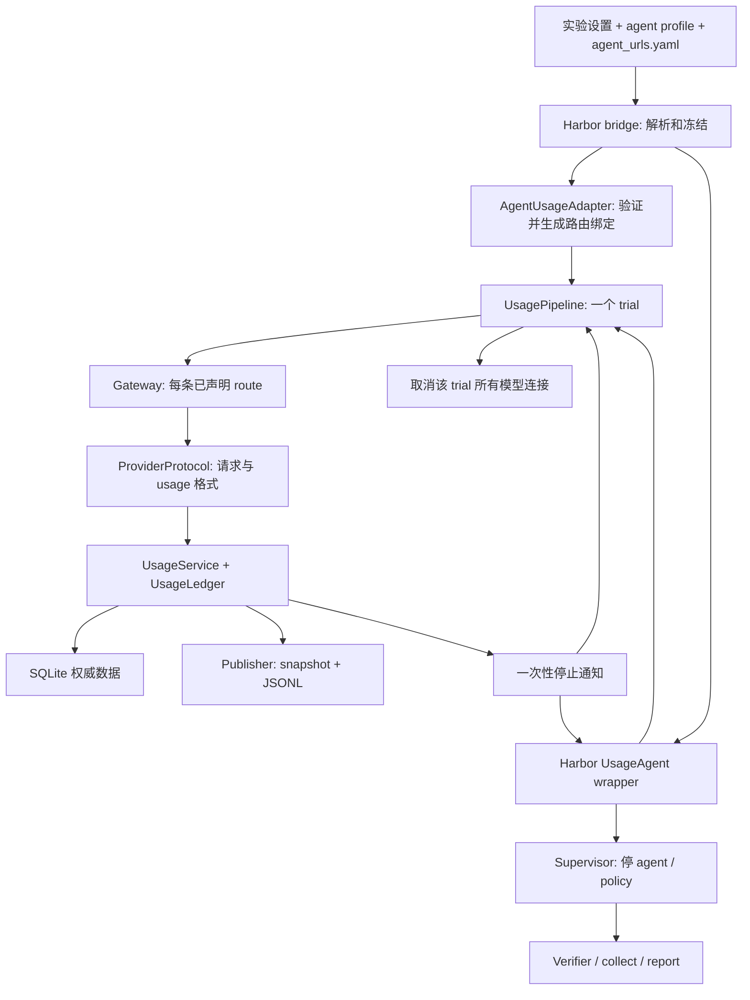

# 共享 token pipeline 与 agent 适配子模块重构计划

> 历史快照：本轮固定 OpenCode 改造已替代下文多 harness/profile 方案，agent_urls.yaml 已由 providers.yaml 替代，实验移入 experiments/。本文保留原设计和此前 GPU/API 结果，不表示新版本已经完成同样的真实集成验收。当前命令见 [runner 使用手册](../../../harbor_runners/README.md)，本轮实现与测试见[最新实施记录](opencode_model_key_implementation_20260928_zh.md)。

日期：2026-09-28。状态：**阶段 A–D 已实施并完成本地回归；阶段 E 的 OpenCode/OpenRouter/Muse Spark 抓方块正例已通过，真实强停、运行中调额及其他组合仍待验收**。实施与命令见第 10 节，首次实际结果见第 10.3 节。

本次实施：按用户确认，**使用现有 gateway 方式接入预算**，将公共 token pipeline、agent 适配子模块和 provider 协议分开。已新增手工维护的 `configs/harbor/agent_urls.yaml`、endpoint 引用解析与冻结、多路由共账和持续 JSONL。下文保留设计目标，并注明实际落地与迁移边界。

本计划基于现有 `topogym/agents/usage/` 和 `harbor_runners/`，明确下一阶段的目录、模块接口、配置、运行数据和验收步骤。现有行为与已执行测试见[实施与 GPU 验收手册](harbor_usage_implementation_and_gpu_tests_zh.md)，初版需求见[原预算计划](harbor_token_budget_design_20260927_zh.md)。本文只规划 token 数量与预算控制，不引入美元价格、账单结算或统一 tokenizer。

## 1. 目标、现状与本次边界

目标结构为：**一个公共 usage pipeline + 可替换的 agent 适配子模块 + 共享的 provider 协议适配 + Harbor 生命周期连接**。新 agent 使用既有协议时，新增 profile 或一个小适配模块即可，不修改累计、SQLite、预算判定和评分算法。

| 能力 | 重构前实际状态 | 本次处理 |
|---|---|---|
| input/output 独立额度 | 已有，默认 50M / 20M | 保留口径和默认值 |
| YAML 设置额度 | 已有 `usage.limits.input_tokens/output_tokens` | 将校验移到共享模块，明确配置优先级 |
| CLI 设置额度 | 已有 `--input-token-limit`、`--output-token-limit` | 保留原名称和单位，不创建重复入口 |
| 运行中调额 | 已有 `usage-status` / `usage-update`，带 revision | 保留审计、版本冲突和终态语义 |
| agent 接入 | wrapper 内按 Codex / Claude Code / OpenCode 名称分支 | 拆成 `adapters/`，增加配置式 HTTP agent 接入 |
| 上游地址 | 当前预算 wrapper 有内置默认地址和声明的环境变量覆盖 | 集中到手工维护的 `agent_urls.yaml`；自动加载，不自动发现 URL |
| provider 差异 | usage 解析已有三类，网关仍夹杂协议分支 | 请求准备、鉴权、输出 cap、响应解析归入协议合同 |
| 本地持久化 | SQLite 实时；snapshot 定期更新；JSONL 收尾导出 | SQLite 保持权威，JSONL 增加运行中连续导出 |
| 一 trial 多路模型调用 | 当前 gateway 固定一个协议和上游 | 同一 pipeline 可创建多条声明路由，共用一份 trial 账本 |
| 实际部署验证 | 初版有本地测试；预算 GPU/API 组合仍待验收 | 重构重新回归，分别执行各真实组合验收 |

“共用”表示合同与核心实现统一，不承诺无需接入验证就支持任意黑盒 agent。需要满足三个条件：模型调用可完整覆盖、usage 可可靠获取、执行可被停止。普通 policy 的物理 tick 不计模型 tokens；新 segment、rewind、改脚本不重置 trial 累计。所有经过该 trial 已声明路由的模型请求、重试、子 agent 共用 input/output 额度；不同 attempts 各有自己的预算。

本阶段的预算接入后端确定为 **gateway**，先完成它的模块化和实际部署验证；新配置中的 `source` 仅接受 `gateway`。harness/SDK 回调和日志来源只保留事件合同扩展点，本阶段不实现、不自动选择、不在网关失败时回退到它们。OAuth、WebSocket、Bedrock、远程 agent 或服务端后台任务也不能仅凭本次拆分就宣称支持。strict 继续拒绝尚无可信消费上界的组合，不自动降级成 observed。

### 1.1 既有 rollout 不依赖新增模型网关

**gateway 是上一轮 token 预算开发新增的取数与请求控制实现，不是 Harbor 原生 rollout 的必要组件。** 原有链路由 Harbor 启动 agent，agent 自己调用模型、生成脚本，再通过本地 `topogym-rollout submit` 把 policy 交给 worker，继续使用唯一 Env/SegmentRunner。

```text
既有模型调用：agent harness → 模型 provider → agent harness
既有策略执行：agent → topogym-rollout CLI → worker → policy / Env
预算网关接线：agent harness → usage gateway → 模型 provider
                                     └→ 共享账本与停止信号
```

代码依据：当前 [task_generator.py](../../../harbor_runners/task_generator.py) 仅在 `usage.mode != off` 时调用 `wrap_agent()`；[usage_adapter.py](../../../harbor_runners/agents/usage_adapter.py) 的预算包装层才创建 `Gateway`。基础 rollout 的 [client.py](../../../topogym/agents/rollout/client.py) 用本地 socket 提交策略源码，与模型网关无关。

两个本地通道不能混称：`/run/topogym/agent.sock` 是原有容器内的策略提交通道；预算扩展的 `/run/topogym-usage/` 挂载目录连接宿主模型代理。使用了 Unix socket 不代表已有模型代理，也不代表新增 HTTP 服务在主动向 agent 请求答案。

网关接收 agent 原本就要发出的模型请求，转发给 provider，并读取同一响应的 usage；不额外发一次模型推理，也不向 Harbor 查询 token API。选择它的理由是集中观察第三方 harness 的模型响应、控制新请求和在途连接，而不是让普通 rollout 得以成立。

架构上 gateway 是公共 pipeline 使用的取数与请求控制后端，agent 适配器负责把 harness 的模型调用接到它。计量核心通过归一化事件工作，保留以后接入可信回调/日志的可能；当前这些替代来源未实现，也不属于本阶段交付。启用预算时使用 gateway；`usage.mode: off` 不启动 gateway，也不因新 URL 配置文件缺失影响原生 rollout。

`agent_urls.yaml` 是手工 endpoint 配置表；程序读取选中的上游地址后为 gateway 配置路由。它不存用量、不计算预算，也不启动服务。gateway 的生命周期由启用预算的 `UsagePipeline` 管理。

## 2. 实施后的源码目录

保留稳定核心文件的位置和已有公共 import，增加 `pipeline.py` 作为生命周期入口；用 `adapters/` 明确放置 agent 差异。现有 `sources/` 保留名字，扩展为 provider 协议合同，避免纯移动产生大批兼容文件。源码中的“公共核心”是模块边界，不要求再套一层 `core/` 目录。

```text
/home/jianwen/topogym/
├── topogym/agents/
│   ├── usage/
│   │   ├── __init__.py                 [改] 保留原导出，增加 UsagePipeline
│   │   ├── README.md                   [改] 接入合同和配置说明
│   │   ├── config.py                   [新] BudgetSettings、公共校验与默认值
│   │   ├── pipeline.py                 [新] 一个 trial 的统一启动/关闭入口
│   │   ├── types.py                    [保留] 共用事件与结果合同，route 元数据放 ledger 请求中
│   │   ├── budget.py                   [保留] 双额度比较、首次失败锁定
│   │   ├── ledger.py                   [改] 同一账本增加 route 归属，保持计数语义
│   │   ├── store.py                    [改] 增量读取已提交 audit，保留 SQLite 事务
│   │   ├── service.py                  [改] 唯一计量服务、热更新监控、停止通知
│   │   ├── publisher.py                [新] snapshot 与实时 JSONL 导出
│   │   ├── gateway.py                  [改] 本阶段唯一部署的取数/控制后端
│   │   ├── relay.py                    [保留] 本地转发；wrapper 仅为一个 relay 开启管理发布
│   │   ├── adapters/                   [新] 仅放 agent/harness 差异
│   │   │   ├── __init__.py
│   │   │   ├── base.py                 AgentUsageAdapter、BindingPlan 等合同
│   │   │   ├── registry.py             按 adapter ID 解析，兼容旧 profile
│   │   │   ├── codex.py                Codex 环境/路由/参数约束
│   │   │   ├── claude_code.py          Claude Code 环境/路由/参数约束
│   │   │   ├── opencode.py             OpenCode provider 配置覆盖与路由
│   │   │   └── env_http.py             可通过环境变量设 API 地址的通用适配
│   │   └── sources/                    provider 协议，不按 agent 重复解析
│   │       ├── __init__.py             [改] 协议注册及兼容既有 SOURCES
│   │       ├── base.py                 [新] ProviderProtocol、PreparedRequest
│   │       ├── common.py               [保留] receipt 归一化、事件身份与序号
│   │       ├── openai_responses.py     [改] Responses 请求准备 + usage 解析
│   │       ├── anthropic_messages.py   [改] Messages 请求准备 + usage 解析
│   │       └── chat_completions.py     [改] Chat 请求准备 + usage 解析
│   └── rollout/                       保留唯一 worker/policy/verifier 接口
├── harbor_runners/
│   ├── agents/
│   │   ├── usage_adapter.py            [改] 薄 Harbor wrapper，调用 pipeline
│   │   ├── resolve.py                  [改] 接受并剥离 usage_adapter 配置
│   │   ├── credentials.py              [保留] 私有 dotenv 读取与日志脱敏
│   │   └── scripted.py                 复用，无模型基线仍为 off
│   ├── usage_bridge.py                [改] 身份、配置转换、能力预检
│   ├── endpoints.py                   [新] 中央表校验、endpoint 引用、URL 冻结与凭据名解析
│   ├── supervisor.py                  复用真实停止，必要时增强停止证据
│   ├── config.py / task_generator.py   [改] 读取中央 URL 表，冻结 endpoint/adapter 合同
│   ├── preflight.py / run.py           [改] 能力检查，保留现有 CLI
│   └── collect.py / rollout_output_report.py          [改] 收集 adapter 身份、按 route 明细
├── configs/harbor/
│   ├── agent_urls.yaml                [新] 手工维护真实 provider 地址、协议与凭据变量名
│   ├── pick_cube_budget.yaml           保留 3M / 1M 与真实抓放判据
│   ├── smoke_*.yaml / cast_coil_sweep.yaml
│   └── agents/
│       ├── README.md                  profile 合同与第三方接入说明
│       ├── profiles/
│       │   ├── codex.yaml             adapter + route → endpoint ID，不重复写 URL
│       │   ├── claude_code.yaml
│       │   └── opencode_openrouter.yaml
│       └── templates/
│           ├── template_custom.yaml    自定义 Harbor agent 占位模板
│           └── template_env_http.yaml  通用 env_http 接入占位模板
├── scripts/test_harbor_pipeline.py     [改] 冻结适配身份并复用真实验收入口
├── tests/usage/
│   ├── test_imports.py / test_ledger.py / test_sources.py
│   ├── test_gateway.py / test_relay.py
│   ├── test_config.py                 [新] 公共设置与优先级
│   ├── test_pipeline.py               [新] 多路由共账、跨路由停止和收尾
│   ├── test_publisher.py              [新] 实时 JSONL、崩溃尾行、重建
│   └── adapters/                      [新] 通用合同和四类适配测试
├── tests/harbor/                       更新 profile、冻结、生命周期回归
│   └── test_endpoint_config.py        [新] 中央表引用、解析、冻结及 off 独立性
├── tests/contracts/test_rollout_service.py  保留失败评分/真实子进程取消回归
└── docs/develop/modules/               本计划与实施/验收文档
```

项目的 `simulator/`、`tasks/`、`planning/`、`recording/`、资产目录和正式视频结构不因本重构改变。不增加第二套物理或录像循环，不修改 Harbor site-packages。

## 3. 模块怎么构造

### 3.1 四层职责与依赖方向

下图展开本阶段确定的 gateway 预算路径。Harbor 装配层选择 adapter，并把它产生的路由声明交给 pipeline；箭头表示配置/数据传递，不表示公共核心导入具体 agent 模块。`usage.mode: off` 继续使用原生 rollout 路径。



| 层 | 做什么 | 不应承担什么 |
|---|---|---|
| 核心与 pipeline | 准入、计数、预留、失败、生命周期、导出；本阶段统一管理 gateway | 不识别 Codex/Claude 的名称，不在计量算法中解析 HTTP 或 agent 配置，不导入 Harbor 或 Genesis |
| agent adapter | 解释 harness 配置，确认模型调用覆盖，生成临时 endpoint/env/config 覆盖 | 不写 token 累加、预算阈值、SQLite 或正式评分 |
| provider protocol | 请求路径、认证头、支持的操作、输出 cap、JSON/SSE usage 归一化 | 不决定任务成功，不启动或杀 agent |
| Harbor runtime | 原生 agent factory、安装/运行、网络阶段、root relay、进程停止、verifier 与归档 | 不再包含按 agent 名称分支的路由/usage 解析 |

`usage/` 保持标准库依赖。YAML 仍由现有 Harbor 配置层加载，公共配置模块接受普通 mapping；仅导入 usage 不加载模型 SDK、Harbor、NumPy 或 simulator。

### 3.2 `UsagePipeline`：共用的生命周期入口

已实现接口如下。本阶段宿主装配 `GatewaySource`，启动前校验 adapter 能否完整绑定所需路由；`source` 工厂用于隔离取数机制，其他真实后端尚未实现：

```python
gateway_source = GatewaySource(sockets=socket_directory)
pipeline = UsagePipeline(root=trial_usage_dir, scope_id=trial_id,
                         settings=budget_settings, source=gateway_source)
source_binding = pipeline.start(resolved_routes, credential_resolver)
# Unix socket 模式下，Harbor wrapper 启动容器 relay，生成含本地 HTTP URL 的 relay_bindings。
launch_overrides = agent_adapter.bind(profile, relay_bindings)

# Harbor wrapper 用 launch_overrides 启动原生 agent，并订阅停止通知。
pipeline.cancel_requests()        # 幂等，取消该 trial 所有 route
snapshot = pipeline.finalize(require_requests=True)
pipeline.close()                  # 有限等待，完成导出与资源关闭
```

pipeline 每 trial 创建一个 `UsageService`/ledger，gateway 后端向它报告请求/事件。所有 route 的 gateway 共享该账本；不为每个模型或子 agent 分配新的预算。一个 route 可以复用现有一个 gateway 实例，不急于另写多协议 HTTP server。每个实际上游尝试分配唯一 request ID，admit 时记录 route ID；收到 usage 后验证请求来源，不能把同一请求移到另一 route 重新计数。

取数后端合同包含启动并返回绑定信息、报告实际请求与 UsageEvent、关闭准入/取消、最终结算。gateway 绑定信息包含本地 endpoints；未来 harness 事件来源可以返回回调/采集配置，无需虚构代理地址。该扩展点先用本地测试事件源验证核心解耦，不在本阶段宣称部署了真实无网关适配。一个实际请求只选一个权威来源计数，日志对账不能重复累加。

停止顺序保留为：事务锁定失败并关闭准入 → 发布停止信号 → 取消所有 route 在途连接 → Harbor supervisor 停 agent/policy → 收尾与失败评分。receipt 到达后的停止通知采用线程安全事件/回调传递给宿主事件循环，不靠 agent stdout，也不增加查询 provider 用量的请求。数据库热更新与健康仍由独立 watchdog 检查。

`finalize()` 是终止新准入并尝试结算，不允许通过关闭对象把未结算用量清零。需要先关闭/排空请求再生成最终导出；迟到 receipt 可以补齐统计，不能撤销首次失败。普通结束、异常、中断、重复 close 都经过同一个收尾入口。

### 3.3 每个 agent 子模块的接口

`adapters/base.py` 定义以下纯数据和方法：

| 合同 | 内容 |
|---|---|
| `AgentUsageAdapter.validate(profile, runtime)` | 检查 harness 参数、路由覆盖要求、认证路径、原生版本与运行方式，返回 capability report 或明确错误 |
| `BindingPlan` | adapter ID/合同版本、取数后端、route → endpoint ID、必须覆盖的调用类型、运行方式要求；不包含真实 key |
| `AgentUsageAdapter.bind(profile, source_binding)` | 用所选后端的绑定信息产生 `LaunchOverrides`；gateway 情况下注入本地 route 地址/临时 token |
| `LaunchOverrides` | 白名单 env 与必要的结构化 native options；由 Harbor wrapper 交给原生 adapter |
| `CapabilityReport` | 已支持协议、运行方式、输入上界能力、覆盖要求、验证状态和不支持原因；配置声明不等于实测通过 |

Codex 模块生成 `OPENAI_BASE_URL` 等覆盖；Claude Code 模块生成 `ANTHROPIC_BASE_URL` 等覆盖；OpenCode 模块生成 provider 配置覆盖。共同的真实 key 读取、trial ID、SQLite、停止算法都留在外层。

新增 `env_http` 适配器：对允许用环境变量设置 base URL 和 API key 的 agent，根据 profile 中的变量名生成覆盖；不需要核心认识这个 agent 的名字。第一版仅接受结构化的环境变量映射，不接受任意 shell 模板。需要复杂配置文件/原生 options 的 harness 才新建专属适配模块。

registry 按显式 adapter ID 选模块。新增专属 adapter 可以扩展 registry；使用 `env_http` 的新 agent 不需增加名称分支。旧三个 profile 的默认映射只保留在独立兼容解析函数中，不再作为核心准入白名单。Harbor 原生 agent 是否存在、native options 是否合法，仍由 Harbor factory/schema 检查；纯 usage 子模块不导入这些对象。

### 3.4 provider 协议接口

`sources/base.py` 的 `ProviderProtocol` 将目前 gateway 中按协议分支的职责统一：

| 方法/结果 | 作用 |
|---|---|
| `validate_route(route)` | 校验上游 URL、支持的认证、协议版本与 route 能力 |
| `prepare_request(path, body, remaining)` | 校验操作，限制输出 cap，设置流式 usage 参数，返回 `PreparedRequest` |
| `build_headers(credential, allowed_headers)` | 为宿主上游请求构造认证和必要协议头 |
| `new_receipt_source(request_id)` | 返回现有累计/增量 `UsageEvent` 解析器 |
| `PreparedRequest` | 上游相对路径、修改后的 body、可验证预留值、操作种类；不把未知输入写成可信上界 |

Responses、Messages、Chat 三个文件各维护一份协议逻辑，多个 agent 共用。gateway 只管理鉴权、大小限制、连接、SSE 帧、事务准入和事件交付，不再通过 agent 名称猜协议。需要额外 token-count 请求才能取得 strict 输入上界的方案，本阶段不自动启用。

### 3.5 调用覆盖与多 route 的明确边界

一个 harness 可能使用主模型、辅助模型、上下文压缩或子 agent。profile 必须列出其需要的 route，并引用中央表中的 endpoint ID；能共用同一 endpoint 的调用不需要重复建 route。不同协议/上游则建立独立 route，但都绑定同一个 trial ledger。真实 URL、协议和凭据变量名在中央表中只定义一次，不在各 profile 重复。

多 route 功能同时要求：宿主只解析声明凭据；容器 endpoint 绑定完整；停止任一路由导致整个 trial 所有 route 停止；剩余 output 预留由同一事务决定；跨 route 重试仍是新的实际请求。额外 route 不能用于绕过上游白名单，也不能凭声明就认为 harness 的隐藏请求已被覆盖。

存在多个 relay 时，每个 relay 只负责转发，由一个指定的管理 relay 发布 budget/执行失联处理，避免重复写文件、重复触发紧急停止。流水线记录 route 健康；任一必需 route 无法正常接入时 fail closed，不悄悄忽略。

### 3.6 模块隔离规则与新增 agent 示例

“公共模块 + agent 子模块”落实为以下代码边界，而不只是目录分类：

1. `pipeline.py`、`service.py`、`budget.py`、`ledger.py`、`store.py`、`publisher.py` 只处理公共配置、请求身份、归一化事件和停止合同；不导入 `adapters/codex.py` 等具体模块，不按 agent 名称分支。Harbor 装配层通过 `adapters/registry.py` 选择适配器，向 pipeline 传入解析后的公共对象。
2. `adapters/<agent>.py` 只处理 harness 的环境变量、配置、路由覆盖及能力校验。适配器不自行解析 provider usage、不写 SQLite、不比较预算、不实现另一套强停或评分；这些由共享协议、核心和 Harbor runtime 分别负责。
3. `sources/` 按 **provider 协议**适配请求和 usage 格式；`adapters/` 按 **agent/harness**适配调用入口。两者独立组合，例如多个 agent 使用 Chat Completions 时只共用一份 `chat_completions.py`，不各写一份 token 解析器。
4. 真实上游 URL、协议与凭据变量名集中在 `configs/harbor/agent_urls.yaml`；具体适配器和新 profile 不再保存上游 URL 默认值。pipeline 运行时生成的本地 gateway/relay 地址属于临时绑定信息，不要求用户填进这张上游表。
5. `harbor_runners/agents/usage_adapter.py` 只连接 Harbor 生命周期与公共合同；新增 agent 不增加这里的名称分支。执行停止交给原有 supervisor，预算失败经原有 verifier/collector 强制体现为失败结果。

例如接入一个能用环境变量设置 API 地址、使用现有 Chat Completions 协议的 `MyAgent`：在中央 YAML 增加或复用 endpoint，在 profile 选择 `env_http` 并声明变量映射即可；不改 pipeline、ledger、gateway 或协议解析器。若它需要专用配置文件，则新增 `adapters/my_agent.py`、注册项及适配测试；若它使用新 provider 协议，再独立增加 `sources/` 协议实现。上述入口配置必须实际覆盖其全部模型请求，并通过接入验收，才能声明该 agent 的预算受控。

## 4. 配置放哪里，命令行怎样调整

### 4.1 预算属于实验配置，agent 差异属于 profile

`configs/harbor/<experiment>.yaml` 的 `usage` 只存预算策略：

```yaml
usage:
  mode: observed
  scope: trial
  limits:
    input_tokens: 50000000
    output_tokens: 20000000
  on_usage_unavailable: fail
  watchdog_interval_ms: 100
  stop_grace_ms: 1000
```

上面语法**当前已经支持**。`pick_cube_budget.yaml` 继续覆盖为 3000000 / 1000000。参数都是非负整数，单位 token；`50M` 字符串、负数、布尔值不作为额度接受。设为 0 表示没有可用额度，不表示无限。

启动时优先级固定为：**显式 CLI 参数 > 实验 YAML 对应维度 > 共享默认值**。只指定 input 时 output 保留 YAML 值；缺失才用 20M。agent profile 不保存或暗中覆盖预算上限。默认未启用的旧配置仍为 off；off 同时给 limits 报错，不能让用户误以为额度正在执行。

运行中以 SQLite 当前 policy revision 为准，管理更新覆盖初始有效额度，但不改写 frozen YAML。limits 的变化不会改变 scope、agent、protocol 或 mode；这些是 trial 身份的一部分，需新 trial 才能更换。

### 4.2 集中 URL 表与 agent profile 引用

以下中央表及 `usage_adapter` 均**已实现并通过本地配置/冻结测试**。用户手工维护 `configs/harbor/agent_urls.yaml`；程序自动做加载、校验、引用解析与冻结，不自动发现 provider URL。文件沿用用户指定名字，其中记录的是模型服务 endpoint，不是需要部署的 agent HTTP 服务地址。

```yaml
# configs/harbor/agent_urls.yaml
schema_version: 1
endpoints:
  openai:
    url: https://api.openai.com/v1
    protocol: responses
    credential_env: OPENAI_API_KEY
    url_env: OPENAI_BASE_URL
  anthropic:
    url: https://api.anthropic.com/v1
    protocol: messages
    credential_env: ANTHROPIC_API_KEY
    url_env: ANTHROPIC_BASE_URL
  openrouter:
    url: https://openrouter.ai/api/v1
    protocol: chat_completions
    credential_env: OPENROUTER_API_KEY
```

`credential_env` 是环境变量名，不是 key 值；真实 key 仍在私有 dotenv/宿主环境。`url_env` 是可选、显式声明的地址覆盖，用于兼容既有 OPENAI/ANTHROPIC_BASE_URL：prepare 时若该变量非空，经过 URL 校验后覆盖本条 `url`，并记录来源；省略 `url_env` 时固定使用手填 URL。不能从未声明的环境变量猜地址。

同一 URL 可有不同协议条目，例如同一 provider 的 Responses 与 Chat 路径使用两个 endpoint ID；这是协议选择，不是按每个 agent 复制地址规则。多 agent 可以引用同一个 endpoint ID。

agent profile 保留原生字段，只选择 adapter、取数方式和 endpoint 引用：

```yaml
name: codex
model: null
required_env: [OPENAI_API_KEY]
optional_env: [OPENAI_BASE_URL]
kwargs: {}

usage_adapter:
  id: codex
  source: gateway
  routes:
    primary:
      endpoint: openai
```

`source: gateway` 明确使用现有网关机制；重构 schema 本阶段只接受 `gateway`，其他值在启动前报错，不自动切换来源或关闭预算。profile 的 route 不再接受内联真实 URL、协议或上游凭据名，这些统一从中央表解析；profile 只保留 endpoint 引用和 harness 所需的绑定方式。

中央条目的 `credential_env/url_env` 只允许引用当前 profile 已声明的变量或 `env_mapping` 后的目标名；宿主仅解析本次选中条目的凭据，不要求其他 endpoint 的 key 都存在。现有 OpenRouter profile 的 `OPENROUTER_META_SPARK_API_KEY → OPENROUTER_API_KEY` 映射继续有效。

默认文件位置是 `<project-root>/configs/harbor/agent_urls.yaml`；可在实验 YAML 用新增 `agent_urls_file` 指定另一份手工表，相对路径以该实验 YAML 所在目录为基准，不扫描其他目录。比如位于 `configs/harbor/` 的实验可显式写：

```yaml
# 实验 YAML 的顶层可选字段；预算参数仍在独立 usage 块中。
agent_urls_file: agent_urls.yaml
```

prepare 只解析选中的 endpoint 为 `agent_urls.resolved.json`，同时记录原表路径/哈希和本次有效 URL 来源；`usage_binding.resolved.json` 记录 agent、source、route → endpoint 的关系。两份冻结文件均纳入 run manifest。launch 使用冻结副本，不重新读取工作区表或重新应用 URL 环境覆盖；修改中央表/URL 环境变量只影响重新 prepare 的 run，运行中的 trial 不热换上游。真实 key 值在运行时读取，不进入冻结副本。

中央文件缺失、引用不存在、重复 YAML key、未知协议或不合规 URL 在需要该接入的 prepare 阶段明确报错；不会回退到源码中的另一套默认 URL。`usage.mode: off` 的原生 rollout 不读取或依赖这份表，此阶段不顺带改变 off 的原生 provider 配置。

`resolve.py` 必须先拆出/验证 `usage_adapter`，再把原生字段交给 Harbor `AgentConfig`，不能把这个新子块直接塞给原生 schema。off 模式不启动 pipeline、不生成虚假零用量，但仍拒绝 profile 的未知或非法字段。

### 4.3 一个新 agent 的配置式接入

下面为模板，`your_package` 和环境变量名称须换为真实 harness 支持的接口。它不代表这个示例已经可运行或已验收。先在同一中央表的 `endpoints` 下增加 `custom_http`；下面只展示新增条目，合并时保留已有条目：

```yaml
endpoints:
  custom_http:
    url: https://provider.example/v1
    protocol: chat_completions
    credential_env: MY_PROVIDER_API_KEY
```

再在 `configs/harbor/agents/templates/template_env_http.yaml` 写 harness 配置：

```yaml
import_path: your_package.harbor_agent:YourAgent
model: null
required_env: [MY_PROVIDER_API_KEY]
optional_env: []
kwargs: {}

usage_adapter:
  id: env_http
  source: gateway
  bindings:
    primary:
      base_url_env: MY_AGENT_API_BASE
      api_key_env: MY_AGENT_API_KEY
      base_url_suffix: /v1
  routes:
    primary:
      endpoint: custom_http
```

`bindings.primary` 把本地 route 地址/临时 token 注入 harness；`routes.primary.endpoint` 引用中央表，决定宿主如何访问真正的 provider。这两个方向分别解析，不能把真实宿主 key 作为预算 agent 环境变量值。要通过验收，还需证明重试、子 agent 等都遵守该路由。

### 4.4 CLI：启动前设置与运行中修改

本节已按本次选择填好：**Meta: Muse Spark 1.3 Contributor / OpenRouter / OpenCode harness**。OpenRouter 官方模型 ID 为 [`meta/muse-spark-1.3-contributor`](https://openrouter.ai/meta/muse-spark-1.3-contributor)（2026-09-28 核对）；OpenCode 使用 `provider/model_id`，因此 CLI 填 `openrouter/meta/muse-spark-1.3-contributor`。这里使用现有 `opencode_openrouter.yaml`，调用该模型的 agent 是 OpenCode。

runner 读取 `/home/jianwen/topogym/.secrets/harbor.env` 中的 `OPENROUTER_META_SPARK_API_KEY`，profile 将它映射到中央 `openrouter` endpoint 所需的 `OPENROUTER_API_KEY`；无需手动 export 或复制 key。已填模型 ID 不等于已验证该账号的模型权限、余额或实际调用。

**第一步只准备任务，不运行模型或 GPU。** 以下变量与命令在同一 Bash 终端顺序执行；每次重跑第一步都会生成新 run-id。

```bash
cd /home/jianwen/topogym
export TOPOGYM_USAGE_MODEL='openrouter/meta/muse-spark-1.3-contributor'
export TOPOGYM_USAGE_PLAN_TAG="$(date -u +%Y%m%dT%H%M%S%NZ)"
export TOPOGYM_USAGE_RUN="/home/jianwen/topogym/runs/harbor/usage_muse_prepare_${TOPOGYM_USAGE_PLAN_TAG}"

.venv-harbor/bin/python scripts/test_harbor_pipeline.py \
  --case pick-cube --image topogym-rollout:usage-v1 \
  --agent-profile configs/harbor/agents/profiles/opencode_openrouter.yaml \
  --env-file /home/jianwen/topogym/.secrets/harbor.env \
  --model "${TOPOGYM_USAGE_MODEL}" \
  --usage-mode observed \
  --input-token-limit 3000000 --output-token-limit 1000000 \
  --gpu-devices 0 --attempts 1 --concurrency 1 --seed 0 \
  --run-id "usage_muse_prepare_${TOPOGYM_USAGE_PLAN_TAG}" --prepare-only
```

通用 `python -m harbor_runners.run prepare/run` 保留相同 token 参数。额度参数名继续用 `limit`，避免与结果里的实际 `input_tokens/output_tokens` 混淆。

**第二步仅在要做运行中调额实验时执行，会启动真实 GPU/API 调用。** 先按第 10.2 节构建当前共享镜像；然后在上一步的同一终端后台启动这个已准备的 run，以便继续执行下面的查询/调额命令。`launch` 使用冻结配置，不再指定 model 或 limits；通用 `launch` 没有测试脚本的 `--allow-api` 参数，执行它本身即启动实际任务。

```bash
cd /home/jianwen/topogym
.venv-harbor/bin/python -m harbor_runners.run \
  --env-file /home/jianwen/topogym/.secrets/harbor.env \
  launch --run-dir "${TOPOGYM_USAGE_RUN:?请先在同一终端执行第一步}" \
  > "${TOPOGYM_USAGE_RUN}/manual_launch.log" 2>&1 &
export TOPOGYM_USAGE_LAUNCH_PID=$!
```

进度在 `${TOPOGYM_USAGE_RUN}/manual_launch.log`。不要同时用另一个 launch 启动同一 run。下面的命令只在这个指定 run 内查找唯一的未关闭 trial，自动读取当前 revision，再把额度调到 input 50M / output 20M。无需填写随机 trial 名或假定 revision=1。刚启动尚无 ledger、任务已结束或存在多个未关闭 trial 时会明确停止，不挑选其他 run。可以在 ledger 创建后重新执行本段。

```bash
(
  set -euo pipefail
  cd /home/jianwen/topogym
  : "${TOPOGYM_USAGE_RUN:?请先在同一终端完成准备和后台启动}"
  TOPOGYM_USAGE_TRIAL="$(.venv-harbor/bin/python - "${TOPOGYM_USAGE_RUN}" <<'PY'
from pathlib import Path
import sys
from topogym.agents.usage import UsageLedger

run = Path(sys.argv[1]).resolve()
trials = []
for ledger in sorted((run / "jobs/job").glob("*/usage/ledger.sqlite")):
    if not UsageLedger(ledger).snapshot()["closed"]:
        trials.append(ledger.parent.parent)
if len(trials) != 1:
    raise SystemExit(f"指定 run 中找到 {len(trials)} 个未关闭 trial；需要恰好一个。尚未启动或已经结束时不能调额。")
print(trials[0])
PY
)"

  TOPOGYM_USAGE_STATUS="$(.venv-harbor/bin/python -m harbor_runners.run usage-status \
    --trial-dir "${TOPOGYM_USAGE_TRIAL}")"
  printf '%s\n' "${TOPOGYM_USAGE_STATUS}"
  TOPOGYM_USAGE_REVISION="$(printf '%s' "${TOPOGYM_USAGE_STATUS}" | \
    .venv-harbor/bin/python -c 'import json,sys; print(json.load(sys.stdin)["policy_revision"])')"

  .venv-harbor/bin/python -m harbor_runners.run usage-update \
    --trial-dir "${TOPOGYM_USAGE_TRIAL}" \
    --input-token-limit 50000000 --output-token-limit 20000000 \
    --revision "${TOPOGYM_USAGE_REVISION}" \
    --reason 'Muse Spark manual input/output budget adjustment'
)
```

查询与更新之间若有另一操作者改额，revision 检查会拒绝覆盖，需要重新查询。下调低于已用量即形成失败；失败后提高额度不复活；成功 finalize 后拒绝修改。调额改变试验条件，必须保留审计，不能把该 run 当作全程固定 3M/1M 的正例。固定额度的正例和强停负例使用第 10.2 节的独立 run；本节只用于额外的运行中调额试验。

## 5. 各类信息保存在哪里

### 5.1 数据所有权

| 信息 | 权威位置 | 谁写，何时写 |
|---|---|---|
| 初始预算、模式、监控参数 | 实验 YAML；启动解析后为 `experiment.resolved.json` 与冻结 `usage.json` | 宿主 prepare；CLI 覆盖在冻结前生效 |
| 上游 URL、协议、凭据变量名 | 手工 `configs/harbor/agent_urls.yaml`；选中条目冻结为 `agent_urls.resolved.json` | 用户维护表，宿主 prepare 应用声明的 URL 覆盖并冻结；不自动发现地址 |
| agent 适配、取数后端、route → endpoint 引用 | agent profile；冻结后 `usage_binding.resolved.json` | 宿主 prepare；只存声明和适配身份，不重复存一套可编辑 URL |
| 实际 agent 版本、实际上游/route 身份 | trial 的 `usage/binding.json` | 启动时写；上游来自冻结配置，运行中不可变 |
| 实际 API key | 宿主环境或 `.secrets/harbor.env` | 用户配置，宿主解析；不写入冻结文件、数据库或导出 |
| trial 临时认证信息 | gateway/relay 受信运行上下文 | pipeline 生成；不放公开 budget 和正式明文身份报告 |
| 累计用量、请求状态、当前 limits/revision、失败 | trial 的 `usage/ledger.sqlite` | 唯一 ledger API 事务写；外部管理 CLI 也调用同一 API |
| 每个事件、准入、调额、失败的审计 | SQLite 的 audit/events 表 | 相关事务内写入 |
| 当前可读快照 | 宿主 `usage/snapshot.json`、容器 `/rollout/budget.json` | publisher / 管理 relay 发布，不接受 agent 回写作为管理输入 |
| 持续追加的可读审计 | 宿主 `usage/events.jsonl` | 唯一 publisher 从已提交 audit 导出；不是独立权威数据库 |
| 实际停止时间与升级结果 | `usage/stop.json`、index 的 `stop_timings` | supervisor / wrapper 写入 |
| 物理成功、预算资格与最终 reward | 可信 `verification.json`，宿主 `rollout_index.json` | verifier 后由 collector 核对；预算失败不能被物理成功覆盖 |
| 源码、配置、镜像与验收身份 | manifest、binding、测试 `report.json` | 启动前与运行阶段分别记录，状态明确区分 prepared/local-tested/live-tested |

adapter 模块只包含规则，不保存历史用量。数据库不保存完整 prompt、响应正文或脚本来替代 token 计量；只保存归一化计数、请求/route/model 身份、必要 usage 明细和审计。各 provider 的原生 token 计数保持各自含义，不把跨模型 token 数解释成同等金额或文本长度。

### 5.2 计划后的运行目录

```text
runs/harbor/<run-id>/
├── experiment.resolved.json
├── agent_urls.resolved.json              [新] 本次选中的 endpoint 和有效 URL、源表哈希
├── usage_binding.resolved.json           [新] adapter/source/route → endpoint，不含凭据值
├── usage_sources.resolved.json           [新] usage 与 Harbor Python 源码哈希，preflight 核对宿主/镜像
├── job.json / manifest.json / image.resolved.json
├── harbor_tasks/<instance>/environment/
│   ├── instance.json
│   ├── usage.json                       初始预算，保持既有容器路径
│   └── docker-compose.yaml
├── jobs/job/<trial>/
│   ├── agent/ / verifier/ / result.json
│   └── usage/
│       ├── binding.json                 [新] 本 trial 的实际适配/协议/版本/route 身份
│       ├── pipeline.lock                [新] 单个 pipeline/publisher 的进程所有权锁
│       ├── ledger.sqlite                所有 route 共用的唯一权威账本
│       ├── snapshot.json                周期刷新和最终快照
│       ├── events.jsonl                 [改] 运行中追加，结束后核对并完成最终导出
│       └── stop.json                    触发停止路径时写入
└── rollout_index.json / summary.json / cleanup.json

/tmp/topogym-usage-<run-hash>/
└── <trial-route-random-id>.sock          临时通道，结束清理，不是用量历史

task_rollouts/<run-id>/<task>/rollout_0001/
├── usage_final.json
├── usage_events.jsonl
├── usage_binding.json                   [新] 从宿主交付给 root verifier，封存前写入
├── session_final.json / verification.json / archive_manifest.json
└── ...                                  原有策略、物理、RGB、视频及证据

runs/test_results/<run-id>/report.json    测试过程与预期结果
```

collector 不在封存后的 simulator archive 中追加新文件。`usage_binding.json` 必须在 verifier seal 前由管理侧上传，纳入同一 manifest；stop timings 继续留在宿主文件和 index，不声称已有完整容器证据时才可能存在的文件一定可得。容器丢失时保留宿主 ledger/失败结果，归档不完整必须明确标记。

### 5.3 连续 JSONL 的实现约束

本次不把 SQLite 换成纯 JSONL。并发准入、去重、调额、失败状态仍需要一个事务边界；JSONL 是可读投影，可从 SQLite 重建。

`publisher.py` 从 audit 表按已有单调 `id` 增量读取已提交行，每行导出 `audit_id`、kind、时间、请求身份和相应数据。它只导出数据库内容，不再调用 `record()`，避免双重计量。默认随 100ms 发布周期批量追加；停止信号不等待导出 fsync。

同一 trial 只能有一个 pipeline/publisher 持有 `pipeline.lock`；管理查询/调额可以通过 SQLite 并发进行，不持有这个长期所有权锁。重启后核对已导出 audit ID/内容，修复未完成尾行并从数据库补齐；文件损坏时重建投影，不能据此改账或清除失败。计量恢复仍按原规则处理在途未知请求，不把断点恢复误当作零消费。

最后 drain/close 后重新核对 JSONL 与完整 audit，必要时原子替换，再复制进容器封存。运行观察推荐 `tail -F`，可跟随最终原子替换；程序消费者按 `audit_id` 去重，不承诺文件重建时外部读取恰好一次。导出故障需反映为基础设施/计量健康错误，不能静默丢失证据后继续宣称完整通过。

```bash
# 运行中持续追加；文件损坏恢复和最终核对可能原子替换文件。
tail -F "${TOPOGYM_USAGE_TRIAL:?Set the actual trial directory}/usage/events.jsonl"
```

### 5.4 旧数据和格式兼容

保留现有 `UsageEvent` 身份字段与去重语义。`route_id` 优先作为 request/admit 元数据加入，不重写已有 events 的规范化 payload。旧请求没有 route ID 时归入 `legacy_unspecified`，不能猜测 provider，更不能因此再加一次 token。快照可增加 `by_route`、绑定身份等可选字段，现有总量和预算字段保持含义。

既有 SQLite 表不因目录整理被删除或重建；若实施时确需 schema 升级，增加显式版本检查与迁移测试，只在新 trial/受控迁移执行。历史冻结 manifest、结果和视频不批量改写。正在运行的 trial 保持原进程和镜像；本重构不自动接管它们。

## 6. 实际改动清单与迁移方法

| 位置 | 计划动作 | 可审查的结果 |
|---|---|---|
| `usage/config.py` | 从 Harbor bridge 移出通用预算校验，保留默认值 | 非 Harbor 调用者使用同一 config 合同 |
| `usage/adapters/*` | 提取 wrapper 的 `_routing`、环境覆盖、agent 特定配置约束 | 三个内置模块加通用 env_http；无重复 ledger |
| `usage/sources/base.py` 与三个协议文件 | 封装 gateway 的路径、header、cap、usage 参数分支 | 新 agent 复用协议，新协议不改 ledger |
| `usage/pipeline.py` | 聚合 service、gateway 后端、取消、最终结算、资源生命周期 | 后端与计量算法隔离；多 route 共账，任一路预算失败全 trial 停止 |
| `usage/service.py`、`publisher.py`、`store.py` | 提取唯一快照/事件导出器；增加提交后停止通知 | 实时可读文件与事务用量一致 |
| `usage/ledger.py`，保留 `types.py` 事件格式 | 路由身份、按 route 明细及恢复兼容 | input/output 原语义和失败锁定不变 |
| `usage/gateway.py`，复用 `relay.py` | 使用协议合同与声明 routes，复用现有 transport | 真实 key 在宿主，多 relay 不重复管理预算 |
| `harbor_runners/agents/usage_adapter.py` | 变成 Harbor 生命周期连接，移出三种名称路由分支 | setup/run/context/停止/上传仍走原生 Harbor |
| `harbor_runners/agents/resolve.py` | 接受并剥离 usage_adapter；支持 name 或 import_path | 自定义 Harbor agent 可用 env_http 接入 |
| `harbor_runners/endpoints.py`，复用 `agents/credentials.py` | 路由引用只解析声明变量及映射 | 未声明凭据、冲突变量映射在启动前拒绝 |
| `harbor_runners/usage_bridge.py` | 用显式适配能力替代名称白名单 | 新 adapter 不需修改核心准入条件 |
| `endpoints.py`、`config.py`、`task_generator.py`、`preflight.py` | 加载中央 URL 表、解析 endpoint 引用、冻结有效配置；核对宿主和镜像代码身份 | 地址手动维护，旧 run 不受表修改影响，配置检查与实际运行验证分开记录 |
| 保留 `run.py` CLI；更新 `scripts/test_harbor_pipeline.py` | 验收报告记录冻结适配/地址/源码，保留双 limit 与热更新 CLI | prepare/run/测试入口遵守同一优先级 |
| `collect.py`、`rollout_output_report.py` | 采集 binding、route 明细；保持失败分母 | 未完成/预算失败不从统计中消失 |
| `configs/harbor/agent_urls.yaml` | 新增手工维护的唯一上游配置表 | 真实 URL、协议和凭据变量名集中管理 |
| 三个 agent YAML 与新 env_http 示例 | 增加显式 adapter/source，routes 只引用 endpoint ID | 同一任务换 profile 即换接入，不复制预算和 URL 设置 |
| `rollout/worker.py`、`verify.py`、`protocol.py` | 原有停止和评分合同优先复用，确需新字段时只作兼容读取 | 不把物理成功当成预算失败后的成功 |
| `Dockerfile.topogym` / `.dockerignore` | 整包 COPY 原则继续适用；只在新文件未被纳入时调整 | 重建同一个共享镜像，不为各 agent 分镜像 |

兼容策略：保留 `UsageLedger`、`BudgetPolicy`、`UsageEvent` 的公开 import；保留 Harbor wrapper 的 import path 和既有 kwargs 入口；旧 profile 缺失 `usage_adapter` 时仅对原有三种接线做兼容转换，并将转换结果写入冻结身份。其他 profile 若启用预算且缺少适配声明，给出具体缺口，不自动切 off。旧模型限定/端点限制不得在提取文件时顺带放开；扩大范围须有对应测试。

新 prepare 的旧 profile 兼容转换生成中央 endpoint 引用，不能继续从各 adapter 复制上游 URL 常量；迁移时把现有默认值落到中央表。旧 ledger/结果仍可读取，不重写历史 manifest；缺少 endpoint 冻结文件的旧预算 run 在新版本 launch 前明确拒绝，需用新 run-id 重新 prepare，避免将今天的中央地址误用于过去的冻结身份。已经运行的旧进程/镜像不自动迁移。旧 wrapper kwargs 保留用于兼容直接调用，但新 prepare 总是传入冻结端点。

不另建重复的 `core ledger`，不同时保留两套 service 生命周期；每次迁移将旧调用方切到唯一实现，临时兼容函数只转发，不复制计算。

## 7. 开发阶段与完成条件

### 阶段 A：固定配置与合同

1. 记录当前实现和相关测试源码哈希，建立重构回归基线。
2. 新建公共 config、agent adapter 和 provider protocol 合同；保留原字段默认和错误行为。
3. 明确中央 `agent_urls.yaml`、endpoint 引用、显式 `source: gateway`、凭据变量映射、route 身份与旧 profile 迁移规则；落实第 3.6 节的模块依赖边界。

完成条件：新旧预算配置解析一致；CLI 覆盖按维度生效；off/0/非法额度/未知字段有确定结果；非 gateway 来源在启动前拒绝；中央表缺失或引用错误明确报错；off rollout 不因中央表缺失而失败；纯 usage 导入不加载 Harbor/simulator，计量核心不依赖具体 agent 模块。

### 阶段 B：提取三种适配，实现第四种配置式接入

1. 将 Codex/Claude Code/OpenCode 差异移到各自子模块，wrapper 不再按名称拼路由。
2. gateway 协议分支移入共享协议对象，保留现有 JSON/SSE、compact、缓存/推理与错误处理。
3. 实现 env_http；用名称不属于现有三个 agent 的本地测试 harness 运行真实 HTTP 请求，证明无需改 ledger 或 wrapper 分支即可接入。

完成条件：现有三个适配器合同回归；第四种测试 harness 共用同一事件与预算；新增模型名称不会新增计量算法。第四种本地 harness 的通过不冒充真实外部产品已经兼容。

### 阶段 C：统一 pipeline、共享多路由与连续导出

1. wrapper 改为使用单一 `UsagePipeline`，接入停止通知和统一收尾。
2. 多 gateway/route 共享同一 ledger；root relay 生命周期归属于同一 trial。
3. publisher 增量导出 JSONL、刷新 snapshot，并实现所有权锁、恢复和最终核对。
4. usage-status/update 继续直接操作受信 ledger；所有 route 观察相同 policy revision。

完成条件：并发跨 route 不重复预留；任一路超额会拒绝全 trial 后续模型请求并取消在途连接；导出不会重复计量；迟到事件不能复活失败；停止日志覆盖相应路径；用本地事件源替身验证核心可不启动 gateway 接收 usage，不把该替身测试当作真实 harness 接入完成。

### 阶段 D：Harbor 冻结、归档和集成回归

1. 冻结中央表选中条目、adapter/source/route 引用并记录实际版本、宿主/镜像模块身份；setup 后补记原生 agent 实际版本。
2. 在 verifier seal 前交付最终 usage、events 和 binding；collector 继续维护宿主停止证据。
3. 回归预算失败 reward=0、容器丢失、停止超时、未知 usage、失败分母、旧 off 配置。
4. 更新 README、实施文档、CLI 和来源身份报告，明确哪些只有本地验证。

完成条件：本地检查全部通过，CLI 示例与真实 parser 一致；无修改 Harbor 安装包；没有改方块成功判据或 simulator 行为来使预算测试通过。

### 阶段 E：用户实际 Docker/GPU/API 验收

按顺序验证：共享镜像隔离 → 无模型真实 GPU 抓放 → 每个选定 agent/provider 的 3M/1M 正例 → input 强停 → output 强停 → 独立调额用例。各组合单独记录版本、上游、模型、配置哈希和实际录像。

完成条件分两档：**重构实现完成**要求阶段 A–D；**某个部署组合可验收通过**还要求它自身完成阶段 E。历史 152 项本地测试结果只作为初版基线，不自动继承为重构或 GPU/API 通过。

## 8. 验收矩阵

| 类别 | 必须验证的行为 | 测试环境 |
|---|---|---|
| 配置 | YAML/CLI/default 优先级；仅改单维度；0；off+limits；旧 profile；未知 adapter/protocol；非 gateway source 拒绝；非法变量映射 | 无网络单元测试 |
| 模块边界 | 核心不导入具体 agent；适配器不直接记账/判预算；新增第四种 harness 不改核心和 wrapper 分支；真实上游地址只从中央表及其声明覆盖解析 | 导入检查、代码审查与本地接入合同测试 |
| 中央 URL 表 | 缺失/重复条目/未知 endpoint；路径基准；只读选中凭据；URL 覆盖来源；修改源表不改变 frozen run；off 不依赖表 | `tests/harbor/test_endpoint_config.py` |
| rollout 边界 | off 不创建 gateway/relay、不改原生模型地址；原策略提交通道正常；本地事件源替身能复用核心 | 既有 runner 回归 + 本地替身，不宣称真实无网关预算已实现 |
| 核心 | 累计/增量、重复/冲突、上下界、在途预留、调额 revision、未知结算、失败不可复活 | SQLite/线程，本地 |
| agent 适配 | 三种既有 route 注入；env_http 第四种 harness；setup 占位凭据；native options 冲突；禁止路由被原生配置覆盖 | 本地 fake harness/provider，必要时原生 Harbor 对象 |
| 协议 | JSON/SSE；缓存/推理不重复；最终 usage 缺失；输出 cap；compact；异常状态；取消阻塞连接 | 真实本地 TCP/Unix socket |
| 多路由 | 两个协议/上游并发共账；重试新请求 ID；route 来源冲突；跨路由预算失败与全局取消 | 多个本地 provider stub |
| 导出 | 即时追加后可读；只导出提交行；重复启动 publisher 被拒；断尾/崩溃重建；audit 与最终 JSONL 对账 | 临时目录/子进程 |
| 生命周期 | agent 退出但请求未结算；监控失败；宿主失联；停止后原生 cleanup 不得启动新工作；停止与媒体封存分开 | 本地 + 模拟环境；真实容器补验 |
| 评分/归档 | 物理成功后预算失败仍 0 分；缺失 trial 保留在分母；seal 前 binding 完整；旧归档兼容 | 既有合同与收集测试 |
| 正例 | 真实抓起/持稳/放回/松爪/撤离/稳定，3M/1M 内 usage 完整、reward=1 | Docker + Genesis/Nyx GPU + 真模型 |
| 负例 | input=1 或 output 初始 1024；对应维度停止、reward=0、完整归档、agent/worker 停止证据 | Docker + GPU + 真模型 |

observed 判断颗粒度保持为每个可信 usage receipt，而非每个物理 tick 或每段脚本文本。watchdog/文件发布默认 100ms 不构成端到端 SLA；需分别记录 provider usage 可见时间、数据库判定、取消发送、执行停止和封存结束。真实 provider 只在末尾报告 usage 时，重构不能凭空获得中间精确 token 数。

## 9. 实施后的命令交付与验证范围

阶段 A–D 已执行下列本地套件，结果见第 10 节；真实 GPU/API CLI 尚未执行。新增文件在既有目录下自动收集：

```bash
cd /home/jianwen/topogym
.venv-harbor/bin/python -m pytest --confcutdir=tests/usage tests/usage tests/harbor -q
.venv-gs121-nyx/bin/python -m pytest \
  tests/contracts/test_rollout_service.py \
  tests/contracts/test_cube_pick_place_policy.py \
  tests/contracts/test_cube_transfer_task.py -q
```

再重建共享镜像，并沿用已交付的[GPU 验收手册第 7 节](harbor_usage_implementation_and_gpu_tests_zh.md#7-用户在实际-gpu-环境运行的完整-cli)的 isolation、scripted、正例、双负例、调额和报告检查。重构不要求用户学习第二套 token CLI。下面给出实施后的主要抓方块命令；会调用真实模型，`--allow-api` 保留显式开关：

```bash
bash scripts/build_harbor_image.sh topogym-rollout:usage-v1

.venv-harbor/bin/python scripts/test_harbor_pipeline.py \
  --case pick-cube --image topogym-rollout:usage-v1 \
  --agent-profile configs/harbor/agents/profiles/opencode_openrouter.yaml \
  --model "${TOPOGYM_USAGE_MODEL:?Set an actual model ID}" \
  --usage-mode observed --input-token-limit 3000000 --output-token-limit 1000000 \
  --gpu-devices 0 --attempts 1 --concurrency 1 --seed 0 --timeout-sec 1800 \
  --run-id "usage_refactor_pick_${TOPOGYM_USAGE_PLAN_TAG:?Set a fresh tag}" --allow-api
```

同一套命令换为 `claude_code.yaml` 或 `codex.yaml`、配套实际模型和凭据，分别创建新 run-id 验收。未知来源失败、普通 API 错误、模型自然退出不能算预算强停负例通过。负例返回 0 只表示预期失败符合要求，trial 仍是 failed。

本计划的完成判据不是“把文件挪到 adapters 目录”，而是：**换一个可接入的 agent，不改公共预算算法；换一个已支持的 provider 协议，不复制计量逻辑；调整 input/output 限额，仅改配置或现有 CLI；所有运行信息有唯一权威来源和可核对的本地产物。**


## 10. 本轮实施结果与用户验收入口

### 10.1 已落地与验证证据

已完成公共 `UsagePipeline`、四类 `adapters/`、三类共享协议、中央 endpoint YAML/解析、冻结身份、多 route 共账、实时 JSONL、事件驱动停止和 Harbor 生命周期接线。`usage/` 核心不导入具体 agent；增加配置式 HTTP harness 不需要修改核心或 wrapper 分支。`BudgetPolicy`、`UsageLedger`、`UsageEvent` 原公开入口和 input/output CLI 保持兼容。

本地报告：`runs/test_results/usage_refactor_20260928/report.json`。重构前 126 项宿主测试通过；重构后 **170 项 usage/Harbor 测试 + 26 项 rollout/方块合同测试通过**。开发阶段未执行真实 provider 推理、Docker 镜像构建或 Genesis/Nyx GPU rollout；随后用户运行的首次实际正例结果见第 10.3 节。

额外执行了 `usage_refactor_20260928_prepare_local` 的 prepare-only 与不启动 Docker 的 preflight，使用真实私有 dotenv 加载机制和 OpenCode/OpenRouter profile，model 使用明确的本地测试占位 ID。只证明声明、冻结与凭据存在检查通过，不证明模型 ID、密钥有效性或 provider 网络可达。扫描代码/配置/文档及该冻结 run，未发现私有 key 值写入其中。

`.secrets/harbor.env` 当前只声明 `OPENROUTER_META_SPARK_API_KEY`，未声明服务 URL。中央表的 `openrouter` 使用项目原有 `https://openrouter.ai/api/v1`，profile 继续将私有变量映射到 `OPENROUTER_API_KEY`；未从 key 内容推导地址，未复制 key 值。其余 OpenAI/Anthropic 条目保留项目既有默认地址，不表示本机已有对应凭据。

实际代码位置补充：中央表加载放在独立 `harbor_runners/endpoints.py`；`types.py`、`relay.py`、`agents/credentials.py`、`run.py` 和 Dockerfile 复用原实现。relay 实例与管理发布的选择由 wrapper 完成，只有一个管理 relay 写公开 budget；宿主每秒检查 relay 进程存活。`usage_sources.resolved.json` 新增源码身份，preflight 核对宿主和共享镜像的相关 Python 文件，源码改变后需重新 prepare，镜像不匹配需重建。

停止路径为：receipt 事务提交并锁定失败 → 立即通知订阅者、取消全部 route → 事件循环唤醒并停止 agent/policy → 收尾导出/失败评分。热更新和 gateway 健康仍由默认 100ms watchdog 检查；JSONL 每周期最多追加 1000 条 audit，收尾完整导出。采集结果优先读取 SQLite，避免导出故障留下的旧成功快照遮蔽真实失败。

保留限制：当前正式取数后端只有 gateway；strict 的可信输入上界、真实无网关回调/日志、任意黑盒 agent 自动支持均未交付。observed 精度由 provider 何时返回 usage 决定，不保证服务端零超额。gateway 仍使用既有宿主 HTTP(S) 传输；本地测试不验证实际网络或代理配置。

### 10.2 结合当前 OpenRouter 凭据的 GPU/API 命令

下面由用户在实际 GPU/Docker 环境执行。已填入第 4.4 节核对的 Muse Spark 1.3 Contributor 模型 ID；runner 默认读取 `.secrets/harbor.env`，不把 API key 放到命令行。每次测试使用新 tag，不复用已冻结的 run-id。

```bash
cd /home/jianwen/topogym
export TOPOGYM_USAGE_MODEL='openrouter/meta/muse-spark-1.3-contributor'
export TOPOGYM_USAGE_TAG="$(date -u +%Y%m%dT%H%M%SZ)"
bash scripts/build_harbor_image.sh topogym-rollout:usage-v1

# 镜像隔离，以及不调用模型的真实抓放基线。
.venv-harbor/bin/python scripts/test_harbor_pipeline.py \
  --case isolation --image topogym-rollout:usage-v1 \
  --run-id "usage_isolation_${TOPOGYM_USAGE_TAG}"
.venv-harbor/bin/python scripts/test_harbor_pipeline.py \
  --case pick-cube-scripted --image topogym-rollout:usage-v1 \
  --gpu-devices 0 --attempts 1 --concurrency 1 --seed 0 \
  --run-id "usage_scripted_${TOPOGYM_USAGE_TAG}"

# 真实 agent 抓方块正例：input 3M / output 1M。
.venv-harbor/bin/python scripts/test_harbor_pipeline.py \
  --case pick-cube --image topogym-rollout:usage-v1 \
  --agent-profile configs/harbor/agents/profiles/opencode_openrouter.yaml \
  --model "${TOPOGYM_USAGE_MODEL:?Set an actual model ID}" \
  --usage-mode observed --input-token-limit 3000000 --output-token-limit 1000000 \
  --gpu-devices 0 --attempts 1 --concurrency 1 --seed 0 --timeout-sec 1800 \
  --run-id "usage_pick_${TOPOGYM_USAGE_TAG}" --allow-api

# 两个负例分别验证 input / output 达到预算后强停。
.venv-harbor/bin/python scripts/test_harbor_pipeline.py \
  --case budget-input --image topogym-rollout:usage-v1 \
  --agent-profile configs/harbor/agents/profiles/opencode_openrouter.yaml \
  --model "${TOPOGYM_USAGE_MODEL:?Set an actual model ID}" \
  --usage-mode observed --input-token-limit 1 --output-token-limit 1000000 \
  --gpu-devices 0 --attempts 1 --concurrency 1 --seed 0 --timeout-sec 1800 \
  --run-id "usage_input_stop_${TOPOGYM_USAGE_TAG}" --allow-api
.venv-harbor/bin/python scripts/test_harbor_pipeline.py \
  --case budget-output --image topogym-rollout:usage-v1 \
  --agent-profile configs/harbor/agents/profiles/opencode_openrouter.yaml \
  --model "${TOPOGYM_USAGE_MODEL:?Set an actual model ID}" \
  --usage-mode observed --input-token-limit 3000000 --output-token-limit 1024 \
  --gpu-devices 0 --attempts 1 --concurrency 1 --seed 0 --timeout-sec 1800 \
  --run-id "usage_output_stop_${TOPOGYM_USAGE_TAG}" --allow-api
```

正例需物理任务成功、budget 合格且 reward=1；两个负例需目标维度触发、trial failed/reward=0、真实 agent/worker 停止及归档证据齐全。负例测试程序返回 0 表示预期失败已验证，不表示 trial 成功。provider 报错、模型提前退出或缺少 usage 均不算预算负例通过；输出 1024 是待该模型实际验证的参数。报告位于 `runs/test_results/<run-id>/report.json`，其余产物位置见第 5 节。运行中调额沿用第 4.4 节的 status/update 命令。

### 10.3 首次实际抓方块正例：已通过

用户在构建共享镜像后，以 `harbor_runners.run launch` 执行 `usage_muse_prepare_20260928T173447980566784Z`。trial 为 `cube-pick-place-seed0__KR7xuUh`，OpenCode 版本 `1.18.33`，主模型 `meta/muse-spark-1.3-contributor`，通过 OpenRouter 的 Chat Completions gateway。模型调用、CUDA/Nyx 抓放、计量、评分与归档链路均产生完整证据；Harbor 无异常、reward=1，可信 verifier 的 `task_success`、`budget_qualified`、`evidence_complete` 均为 true。

复核结果在 [review.json](../../../runs/test_results/usage_muse_prepare_20260928T173447980566784Z/review.json)，任务汇总在 [summary.json](../../../runs/harbor/usage_muse_prepare_20260928T173447980566784Z/summary.json)。共 11 次模型请求，全部结算：

| 模型/用途 | 请求数 | input | output |
|---|---:|---:|---:|
| Muse Spark 主任务 | 10 | 130,339 | 1,833 |
| Gemini 3.8 Flash：OpenCode 会话标题 | 1 | 1,521 | 8 |
| 总量 | 11 | 131,860 | 1,841 |

辅助模型来源由原生日志的 `small=true agent=title` 确认；其用量同样进入 trial 账本。实际 input 占 3M 额度的 4.3953%，output 占 1M 的 0.1841%；无超额、无未知请求、无剩余预留。policy_revision=1，audit 中无调额事件，本次确实全程使用 3M/1M。input 包含 48,618 个已缓存 tokens，output 包含 509 个 reasoning tokens，未再重复加算。

仿真执行一个 segment、453 个控制步，仿真时间 11.325s；物理记录显示方块最高离桌约 8.34cm、悬空持稳最长 1.1s、放回位置误差约 0.104mm，夹爪已打开、机械臂已撤离，落桌稳定 0.5s 后成功。任务允许复用已有 policy；实际提交脚本调用 `CubePickPlacePolicy`，同时允许 world 状态观测，因此本次属于集成验收，不作为独立视觉推理或从零合成控制器的证据。

冻结输入与 47 个归档文件的哈希复核通过；SQLite audit 与宿主/归档 JSONL 完全一致，宿主和归档 usage 快照一致；当前 usage/Harbor 源码仍匹配该 run 的冻结源码身份。三个相机视频及拼接视频均完整解码通过，每路 341 帧、30 fps、约 11.37s。容器与网络清理完成。

[三视角拼接视频](../../../task_rollouts/usage_muse_prepare_20260928T173447980566784Z/cube_pick_place/rollout_0001/recording/segment_1/videos/combined.mp4)。

原 `runs/test_results/<run-id>/report.json` 仍标记 `prepared_only`，因为准备脚本与后续通用 launch 分开运行；本次另存 review，没有改写历史准备报告或封存归档。本正例未触发预算停止，实际 input/output 强停与运行中调额仍需独立验收；其他 agent、provider、版本和 seed 不继承本次结果。

### 10.4 Segment 历史输入的后续改造

按用户后续要求，新任务统一为每 segment 的视频、逐物理 tick 日志、动作事件和帧/状态映射；取消固定起止 PNG，segment_0 默认保持控制目标执行 5 个 control step。limited 和 unlimited 沿用同一观察权限投影，历史输入不会因换段丢失。新增 history/logs/video/frames CLI，抓方块 instruction 提供抽帧及读图步骤。结果 JSON 仍是摘要和文件索引，不内嵌逐步日志。

目录、逐文件分工、初始步数参数及新镜像的实际 GPU/API CLI 见 [实施手册第 10 节](harbor_usage_implementation_and_gpu_tests_zh.md#10-segment-视频与逐步历史2026-09-28-改造)。本改造不改变 usage pipeline / agent adapter / 统一 endpoint YAML 的模块边界。新 run 还冻结 rollout 源码哈希并核对镜像；10.3 的成功归档属于旧 segment 结构，保留原样，不作为新结构验收。

新结构现已有独立真实正例：`segment_history_v2_prepare_20260928` / `cube-pick-place-seed0__Xy3JVKh`，reward=1、0 exceptions，初始 5 步 + 正式 453 步；20 次模型请求共 input=444,149 / output=5,940，未超过 3M/1M。8 个视频完整解码，逐 tick 日志、跨段连续性、usage 跨模块对账通过；agent 工具日志含 4 次视频抽帧读图附件。完整证据与查询命令见 [运行复核](../../../runs/test_results/segment_history_v2_prepare_20260928/review_zh.md)。本次 provider 每请求仅有最终 usage，不能将 100 ms watchdog 解释为逐 token 计数。真实超额强停、动态调额、limited GPU/API 验收仍单列待完成。

### 10.5 第三方 profile 文件接口与目录整理

用户确定保留独立 YAML，具体配置集中到 `configs/harbor/agents/profiles/`。Codex、Claude Code、OpenCode 已迁移；按后续要求，两个自定义占位模板另放 `agents/templates/`。统一字段合同、扩展分类、参数化生成与 prepare 示例见 [profile 接入说明](../../../configs/harbor/agents/README.md)。中央 provider URL 仍放 agent_urls.yaml，profile 引用 endpoint ID。

文件入口已经支持 `--agent-profile /path/to/my_agent.yaml`，无文件名登记要求。Harbor 负责 name/import_path 对应的实现解析；公共 pipeline 继续只处理用量事件和预算。新增 agent 若符合 env_http 的绑定及现有协议合同，可通过 profile 接入；否则仍需实现相应 adapter/source 并完成实际验收。未来表单/提交 API 复用这一入口，尚未开发上传服务或安装服务。此次目录迁移不改 runtime Python 和既有冻结实验。

目录迁移在独立源码快照上完成 **83 项配置/凭据/endpoint/prepare 回归测试**；另用仓库外临时 profile 通过真实 prepare CLI，并核对冻结 agent、模型与预算。已有 segment history v2 的冻结输入及相关 runtime Python 哈希未变。证据见 [迁移验证报告](../../../runs/test_results/agent_profiles_layout_20260928/report.json)；未调用模型或运行 GPU。

后续新增 `scripts/create_harbor_agent_profile.py`：CLI 参数构造共同 profile 字段 → 原生 Harbor 类/预算能力/endpoint 校验 → 原子发布独立 YAML（同名拒绝覆盖）。支持已有 native 默认接线及显式 env_http 多路由；只加载已安装实现，不安装包或调用模型。输出结构明确 `runtime_verified=false`；模型权限、真实 rollout、usage 完整性与超额强停仍需实际验收。生成时的 usage mode 只用于校验，实验仍独立配置 mode 和双 token limit。

创建器及回归验证采用独立源码快照，**107 项通过**，覆盖生成后 prepare、多路由绑定、自定义 endpoint 表、无实现/缺声明拒绝、strict 拒绝、非法 JSON/路径和同名保护。另实际执行宿主 CLI 生成 Muse profile 并 prepare，核对冻结模型、映射和 3M/1M 预算。结果见 [创建器验证报告](../../../runs/test_results/agent_profile_creator_20260928/report.json)；旧 run 冻结输入及相关运行时代码哈希未变，未调用模型或 GPU。
