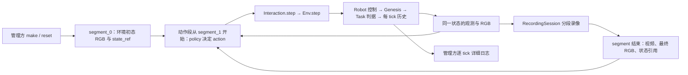

# 历史 planner 回收与标准 simulator 解题计划

**policy 接口方案更新（2026-09-26）：**后续统一采用[单输入 scripted policy 计划](../modules/scripted_policy_execution_plan_20260926_zh.md)的 `act(obs) → action`；有限脚本可返回 None 结束本段，不再要求下文历史方案的 `act(observation, feedback) → PolicyDecision`。limited 包含 RGB、基础关节／EE／夹爪和可选公开固定机位标定，继续限制环境真值。下文 PolicyDecision／双参数示例保留为历史方案，不作为最新合同；当前只修订文档，代码草稿暂停，39 个 planner 迁移仍未启动。

**公共执行层归属更新（2026-09-25）：**[Simulator segment 计划](../modules/simulator_segment_execution_plan_20260925_zh.md)已进入实施，本地 `simulator.SegmentRunner`、逐 tick 证据和 `recording.segment` 已加入；真实验收状态见[实施记录](../dev-logs/simulator_segment_implementation_20260925_zh.md)，调用见[本地 API](../modules/simulator_api_zh.md)。覆盖本文原拟由 planning runner／evidence 承担这些功能的归属，以及后文“尚未实现 segment runner”的旧状态。planning 后续仅做策略适配，不另建执行循环。本文 §7 产物目录继续沿用；39 个 planner 及其迁移仍未实施。policy 提供低层 actions，公共 runner 不设置单段预算。

日期：2026-09-25。本文是实施计划与编写约定，**尚未创建下述 planner 模块，也未重新执行完整解题仿真**。依据是 simulator / robot / solvers / utils / recording 实现，以及[历史 oracle 清单](planner_oracle_inventory_20260925_zh.md)中定位的执行源码。接收端短程测试已单独实跑，结果见下述调查文档；planner 与 assist 部分仍是方案。

本次补充：明确普通 scripted policy 与 oracle 共用的可选策略合同；按用户指定的 `task_rollouts/.../trail_x_difficulty/segment_N.mp4` 更新产物布局；补查历史辅助抓持，列出可回收实现、当前缺口及 Lock Picking 专项验收。

segment 编号修订：与 [Harbor 共享镜像计划](../modules/harbor_shared_image_pipeline_plan_20260925_zh.md)统一，`segment_0` 保留给管理方发布的环境初态 RGB／清单，agent 与 oracle 的第一动作段均为 `segment_1`。本次仅同步产物合同，不改变下述当前实施顺序。

**后续工程顺序更新（2026-09-25）：**先用短测试策略验收现有 action 接收端，再提交[辅助抓持回收与 agent 使用方式调查](assist_grasp_recovery_and_agent_contract_review_20260925_zh.md)。当前不部署 39 个 planner、不实现 PolicySpec / PolicyDecision 或完整 segment runner，也不预先恢复 assist。本文的抓持实现与 planner 迁移保留为后续候选方案；是否需要辅助、采用哪种模型，先看调查与对照依据。

**工期与 assist 接入细化：**见 [Assist 工程评估与分步计划](assist_integration_engineering_plan_20260925_zh.md)。建议先做 Buzz 无辅助样板和少量刚体抓取探针；需要辅助的历史路线在完整迁移前补最小共用能力，柔体另排。无需等所有 assist 或 39 个入口完成才推进首个解法；本次仍只提交计划。

本轮接收端检查：65 项合同测试通过；0.5 秒真实矩阵为 4 passed / 4 failed，Panda 四项的夹爪尚未达到响应阈值。延长保持诊断用于确认收敛时间，不抹去原失败；因此不将 A1 标成所有短时精度要求均通过。

## 1. 结论与执行模型

**可以把一次 oracle 解题看成一个大动作段 `segment_1`，在此之前由环境生成初态段 `segment_0`。** 动作段内仍是多次 `step(action)`，每次 action 都进入同一个 Env 的控制、物理、判据、历史和观测链。它可以根据实时特权状态调整后续动作；“一个动作段”不意味着一次巨大的 action，也不要求预先写死全程关节轨迹。

历史代码可回收的是**任务策略、参考路线、抓取相对关系、阶段切换与监测逻辑**。旧执行脚本不能原样作为新 oracle：多数自己建场景、直接控制 entity、推进 `scene.step()`、创建抓持约束或写录像，有的直接使用 MuJoCo。只把旧 `scene.step()` 改成 `env.step()` 也不够，因为旧代码经常已经在外部施加控制或改动状态。

建议统一为下面这条链；多轮 agent 使用有限长度 segment，oracle 通常使用直到任务结束的一个 segment，两者共用执行器：



管理方拥有 Env；策略只得到当前 episode 的 `Interaction`，oracle 可以得到特权版本。下一轮 segment 从上一轮终态继续，写脚本或读取视频期间模拟时间不前进。segment 边界不调用 reset，不重新生成资产，也不按视频最后一帧重建场景。

### 1.1 PolicySpec / PolicyDecision 是否只给 oracle 使用

**不是。它们是拟新增的通用 scripted policy 适配合同，普通 agent 生成的脚本与我们的 oracle 都可以使用；也不是调用 simulator 的必选前提。** 上一版将历史来源、验收资格一起写进 `PolicySpec`，容易让它看起来像 oracle 专用对象，这里拆开：

| 对象 | 用途 | 普通 agent 与 oracle 的区别 |
|---|---|---|
| `PolicySpec` | 描述策略输入、支持的 action / control mode、所需能力及可选的任务适用范围，供 runner 预检 | 两者可共用；声明需要特权不等于取得特权，授权仍由管理方决定 |
| `PolicyDecision` | 一次决策的 `action`、`phase`、`segment_done` 与可选诊断 | 两者可共用；结束 segment 只是交回控制，不代表任务成功，也不授予改写物理状态的能力 |
| oracle registry 的来源／资格记录 | 精确任务与变体、模型修订、参考路线、来源哈希、历史完成情况和当前验收情况 | 仅用于我们维护的 oracle，不要求普通 agent 写脚本时提供历史源码或参考解法信息 |

统一 runner 支持两种互斥的调用形式：

- **决策适配形式：**脚本实现 `act(...) → PolicyDecision`，由 runner 调用一次 `interaction.step(decision.action)`；policy 的 `act` 本身不推进环境。
- **直接脚本形式：**脚本接收受限 `Interaction`，自行循环 `interaction.step(action)`，在选定 segment 边界返回；不必导入上述类型。管理方仍挂接同一套状态、录像和生命周期回调，记录每次实际 action，并统一处理终止、异常与预算。

一个 segment 只选其中一种形式，防止脚本和 runner 对同一个动作各执行一次。两种形式都只沿标准 `step` 链推进。普通策略接收授权的 RGB／自身观测；oracle 可额外接收特权读取，但二者在相同配置下使用同一物理与辅助抓持模型。`PolicyDecision` 的内部诊断不能未经筛选地进入普通 agent 的公开 segment 清单。

## 2. 当前接口已经能做什么，缺什么

| 能力 | 已检查的实现 | 迁移时的含义 |
|---|---|---|
| 一条标准动作途径 | [Interaction.step](../../../topogym/simulator/interaction.py) 转发 [Env.step](../../../topogym/simulator/env.py) | 统一执行器调用它；任务 planner 不接触 World / entity 控制方法 |
| 四种控制模式 | [robot/control.py](../../../topogym/robot/control.py)：JOINT_ABS、JOINT_DELTA、EE_ABS、EE_DELTA | 一个 Env 的模式在创建时确定；不能在同一 episode 中混用两种 action schema |
| 标准观测与初始 RGB | [SensorSuite](../../../topogym/sensors/observation.py) | `reset` 返回初态观测；`observe / render / sensor_frame` 共享同一状态缓存，不应重复推进或独立渲染 |
| 特权只读状态 | [PrivilegedAccess.get](../../../topogym/simulator/privileged.py) | 白名单为 `state_info / world / robot / task / diagnostics / history`；没有任意字段查询或状态写入 |
| 每物理 tick 保存历史 | [EpisodeHistory / EpisodeState](../../../topogym/simulator/history.py) | 每 tick 有 checkpoint，但公开 `history` 只返回元数据，不能据此宣称已导出每 tick 的详细状态 |
| 控制步输出回调 | `Env.add_transition_sink`、`add_frame_sink` | 每次 action 完成后触发；不是每个内部物理 tick 都触发 |
| 统一录像 | [RecordingSession](../../../topogym/recording/session.py) | 消费 Env 生成的 SensorFrame；一段录像只属于一个 episode / branch；不创建场景或恢复旧状态渲染 |
| IK / FK | [GenesisIKSolver / GenesisFKSolver](../../../topogym/solvers/genesis_kinematics.py) | 底层已有；EE 控制已经调用 `solve_checked`。但 Interaction 没有供 planner 搜索整条路径的公开 IK/FK 查询服务 |
| 动态辅助抓持 | [registry 的 rigid_attachment_creation / soft_attachment 缺口](../../../topogym/config/registry.py) | 当前不能通过标准 action 添加／移除历史 weld 或柔体抓持带；privileged 模式不会补上这个能力 |
| 全任务成功判据 | 同一 registry 及各 Task `goal_complete` | Buzz、Lock、Fiber、Knot、Rope、Slotted、Orbits 共 7 项仍缺完整判据；不能仅靠 oracle 自报成功 |

`state_info` 只是状态 ID、时钟与终止标志。真正详细环境状态来自 `get("world")`，机器人测量和目标来自 `get("robot")`，任务指标来自 `get("task")`。目前 `world` 包含刚体、关节及 link 状态、PBD 粒子、FEM 顶点／材料坐标、刚体接触和 IPC 诊断；**不是所有引擎内部量的完整导出**。尤其 `diagnostics.contact_coverage` 明确只覆盖刚体接触，不能冒充完整 IPC 接触力记录。

普通策略目前还可得到配置所选的关节／末端自身观测与相机参数。若某项 agent 实验只允许 RGB，由管理方约束传入 policy 的普通观测内容；不把 oracle 的 `world`、接触信息、参考解法或详细报告混入下一轮普通 agent 输入。这里不新增网络接口，也不恢复 `agents/deferred` 的旧运行器。

### 2.1 必须区分的三个时间尺度

- **segment**：策略自行决定何时交回控制；长度可以是几步或整题。
- **control step**：一次 `Interaction.step(action)`；通常保持目标推进 `control_decimation` 个物理 tick，遇到终止会提前结束。
- **physics tick**：一次 World.advance，时长 `physics_dt_s`，是当前历史保存的单位。求解器内部 `solver_substeps` 不是独立的公开 state_id。

当前默认 `physics_dt_s=.0025`、`control_decimation=10`，即通常每次 action 推进 25 ms；应以实际返回的 `physics_steps / action_duration_s / sim_time_s` 为准。历史代码“循环一次就是 1 ms”或“取一个视频帧就是控制一步”的假设必须改掉。等待和持稳也要持续提交保持 action `{}`，不能使用墙钟 sleep 代替仿真。

默认 `max_physics_steps=10000` 只给出 25 秒物理预算，许多旧完整流程超过此长度。管理方要按预计抓取、解题、释放和静置时长设置预算并写入报告；策略不能自行改上限。

## 3. 目录与注册计划

按用户建议创建 **13 个任务目录、39 个难度入口**。同任务共享状态机与几何策略，难度文件只声明路线、参数和来源，不复制整份控制器。

```text
topogym/planning/
  README.md
  base.py                  # 拟新增：共用的可选 PolicySpec / PolicyDecision、占位错误
  registry.py              # 拟新增：规范 variation_id → planner 工厂
  runner.py                # 拟新增：普通脚本与 oracle 共用的管理方 segment 调度
  evidence.py              # 拟新增：详细状态、动作与总报告的持久化
  motions/cast_coil.py     # 已存在，保留参考运动工具
  cast_keyhole/
    __init__.py
    common.py
    cast_keyhole_easy_planning.py
    cast_keyhole_medium_planning.py
    cast_keyhole_hard_planning.py
  cast_coil/...
  horseshoe_ring/...
  hedgehog_in_cage/...
  lock_picking/...
  fiber_bundling/...
  buzz_wire_3d/...
  interlocked_claws/...
  knot_untying/...
  blanket_flatten/...
  rope_threading/...
  slotted_post_ring/...
  orbits/...
```

所有任务均采用 `planning/<task>/<task>_<easy|medium|hard>_planning.py`。其中 `runner` 是调用现有 step 的外层策略调度器，不实现第二套 reset、物理时钟、checkpoint、机器人控制或相机系统。几何仍由 Task / assets 提供，不从 planner 重新生成另一套环境。

`PolicySpec / PolicyDecision` 放在 `planning/base.py` 表示共享策略适配层，不是 simulator 的必需 action 包装，也不表示 oracle 独占。`PolicySpec` 只描述输入、控制模式、所需能力与适用条件。每个维护中的 oracle 则由 registry 另外记录：`task_id`、规范 `variation_id`、支持的 `model_revision`、机器人、历史来源／哈希、参数适用范围、代码状态、当前实跑资格。**历史来源状态与新 simulator 验收状态分开**：有历史完整解法，首次迁入也只能标 `ported_unverified`。普通临时脚本只记录其实际源码／哈希与运行身份，无须填写 oracle 来源记录。

策略工厂接受当前实例的只读上下文，不能把查到的 `base` 默认设置代替具名难度。Keyhole、Buzz、Horseshoe、Orbits 尤其要核对规范 variation_id；资产哈希、尺度、初态、机器人或控制条件不匹配时返回明确阻塞原因。能力预检按该策略实际所需的能力判断，例如不使用辅助抓持的 Buzz 不应只因 registry 存在 `assist_grasp` 缺口就被拦下。

占位模块可导入、可查询原因，`create_policy()` 抛出明确的 `PlannerUnavailableError`；不能返回空 action 一直等待、借用另一个档位假装完成，也不在 import 时启动 Genesis。候选控制器和局部控制器应保留实际内容，分别标明 `candidate` / `partial`，不全部压成空占位。

## 4. 逐任务回收清单

下表的三列逐一对应上述三个难度脚本。**“历史完整”表示可回收源，不是当前已可运行。** 精确快照路径、入口和成功报告沿用[历史源码清单](planner_oracle_inventory_20260925_zh.md)，不另找视频替代源码证据。

| task_name | easy 文件内容 | medium 文件内容 | hard 文件内容 | 主要迁移工作 |
|---|---|---|---|---|
| `cast_keyhole` | 历史 F1 路线 | 历史 F2 路线 | 历史 F3 路线 | 抽取相对位姿与双臂阶段；从当前 home 完成拾取；重做抓持与时间参数化 |
| `cast_coil` | baseline 装配策略 | 9 mm axial 螺旋策略 | 9 mm split-turn 策略 | 复用现有 Coil motion；保留装配方向；完成标准拾取、装配、放桌与释放 |
| `horseshoe_ring` | 占位：宽余量未定型 | 占位：标准余量未定型 | 占位：窄余量未定型 | 旧基础／三条接近路线抽入 common 作为参考；不充当新余量档位 |
| `hedgehog_in_cage` | CLASSIC 出笼策略 | oblique_gate 策略 | gen_keyhole 策略 | 回收完整取出与放置阶段；替换旧 IK / 碰撞 / 抓持入口；补 home 接近 |
| `lock_picking` | F1 对象路线／IK 候选 | 标准版完整历史指令与状态式 oracle | F3 对象路线／IK 候选 | 先迁标准两回退，再把重新分度过程推广到各自槽位与回退证书 |
| `fiber_bundling` | 4 芯完整序列 | 8 芯完整序列 | 16 芯完整序列 | 回收整束收束与穿环策略；补细线接触检查、持束和有序穿环判据 |
| `buzz_wire_3d` | F1 triple home_lab_v1 | F2 home_lab_v4 | F3 home_lab_v4 | 首批迁移；已含 home 拾放且无抓持辅助，但仍需标准 IK / 碰撞和完整走线判据 |
| `interlocked_claws` | B0 balanced 路线 | C0 balanced 路线 | A0 原始路线 | B0 / C0 移除 MuJoCo 执行；三档均重做从 home 抓取，按当前目标分离持稳 |
| `knot_untying` | trefoil 历史完整状态机 | figure-eight 候选状态机 | double-overhand 候选状态机 | 保留基于实测绳段的决策；重建材料坐标映射、换抓、柔体抓持及解结判据 |
| `blanket_flatten` | 旧单臂拉角／展开策略 | 占位：只有 fold_roll 初态 | 外力参考＋局部 robot 候选，阻塞完整执行 | easy 重定向当前机器人；hard 先补合格准备初态，再把虚拟手改为实际可达抓点 |
| `rope_threading` | 占位：两环设置未定型 | 三环完整参考 IK＋反馈候选 | 占位：小孔三环未定型 | 迁参考阶段与反馈换手；解决实测绳端偏离后的 IK / 碰撞失败 |
| `slotted_post_ring` | 占位：大环设置未定型 | 占位：中环设置未定型 | 原尺度局部机器人动作 | 只移植已存在的操作原语；完整解环仍需补后续路线 |
| `orbits` | 占位：两环设置未定型 | 占位：三环设置未定型 | 93 动作对象参考＋局部机器人候选 | 把外部材料点操作转成双手抓取／交接；不能直接把对象轨迹当机械臂 action |

按来源统计：21 个档位有历史完整机器人流程；5 个有未成功的参考／候选流程（Lock 两档、Knot 两档、Rope medium）；2 个有完整外力参考（Blanket hard、Orbits hard）；1 个仅局部机器人流程（Slotted hard）；10 个需 planner 占位（9 个设置未定型，加 Blanket medium）。Blanket hard 的环境本身仍是准备流程阻塞占位，路线参考不能解除它。

### 4.1 各控制链保留与改写的位置

1. **Keyhole：**保留 `family_variants / robot_motion` 中的几何路线与阶段含义；拆开 [robot_execution.run](../../../runs/demo_metadata/cast_keyhole/2026-09-19_seed_generator_v2/sources/robot_execution.py)，去掉建场景、预抓取 `set_qpos`、直接 position-velocity 控制及 weld 创建。当前只有位置目标 action，旧速度前馈和增益不能无声继承；需要重新限速、分段并检查跟踪误差。
2. **Coil：**保留 `source_assembly_task` 的反向装配阶段、抓点和终态要求；[source_robot_plan.Kinematics](../../../runs/demo_metadata/cast_coil/2026-09-21_variation_restore_v1/axial_screw_turn/physics/source_robot_plan.py) 中 MuJoCo＋least_squares 的通用 IK 替换为 Genesis 查询。`variant_route` 目前描述原型拆出参考，不能直接正向执行后声称装配；迁移 `ReverseMotion / motions` 的语义并以 Task 装配判据验收。
3. **Horseshoe：**保留 [physical_plan](../../../runs/demo_metadata/horseshoe_ring/2026-09-19_variant_generator_v2/source_snapshot/topogym/tasks/horseshoe_ring/physical_plan.py) 的合拢、接近和抓环选择，以及 extraction / place 的阶段。旧 tutorial 模板与当前照片模板链环数量不同；先核对具体实体版本，再决定是否可迁移。新三档未定型前仅回收公共策略，不注册成已可解的新三档。
4. **Hedgehog：**保留 [family_motion](../../../runs/demo_metadata/hedgehog_in_cage/2026-09-17_family_a_oblique_gate_v1/provenance/family_motion.py)、CLASSIC 与 gen_keyhole 的对象姿态路线、稳定放置位姿。把 [family_runtime.execute](../../../runs/variant_checks/hedgehog_in_cage/2026-09-19_replacements_v2/gen_keyhole_fixed/generator_source/family_runtime.py) 的执行循环替换为动作生成；原单臂预抓取路径需要接上真实 home 起步。
5. **Lock：**回收 [physical_controller＋57 条 commands](../../../runs/demo_metadata/lock_picking/2026-09-18_standard_150mm_purple_trace_v1/source_evidence) 的语义动作及 Git 中的 `next_entry_angle / insertion_window / execute_reindex`。旧 `minimum_required_decoupling_retreats != 2` 是实际分支限制；F1 / F3 要实现与各自证书一致的状态机，不是删除这条检查就算支持。
6. **Fiber：**回收 [RobotSequence](../../../runs/demo_metadata/fiber_bundling/2026-09-21_dense_16_r13p5mm_clean_v1/source/robot_sequence.py) 的 grasp、prepare、整束适配和 axial feed，以及 bilateral-contact / grasp-loss guards。它会直接创建、删除 weld；这些行为必须移到统一物理抓持能力，不能留在 planner。只抓护套、全部细线通过等约束仍由任务及独立监测检查。
7. **Buzz：**回收 [home_plan](../../../runs/demo_metadata/buzz_wire_3d/2026-09-22_F1_triple_home_lab_v1_full/evidence/source/evidence/nominal/implementation/home_plan.py)、supported_plan 和 family_plan，拆开 [robot_runtime.execute](../../../runs/demo_metadata/buzz_wire_3d/2026-09-22_F1_triple_home_lab_v1_full/evidence/source/evidence/nominal/implementation/robot_runtime.py)。保留碰撞审查后的 home 接近、拾取、沿线进度、支撑放回和被动静置；不要只移植中间走线数组。
8. **Claws：**回收 [family_robot.assembly_poses / build_plan](../../../runs/demo_metadata/interlocked_claws/2026-09-21_balanced_helical_separation_v2/implementation/family_robot.py) 和 A0 `ReferenceMotion`。丢弃 xml_scene、MjModel、mj_step 和预置 weld 执行层；保留目标相对位姿，重新计算当前双臂关节动作。C0 / A0 的旧放桌段不必成为新目标的额外要求，当前规则是分离并持稳。
9. **Knot：**回收 `RobotUntyingActions` 和 [FamilyUntyingActions](../../../runs/environment-stability/knot_untying/families_20260919/figure_eight/robot_v11_home_support_reanchor/implementation/topogym/tasks/knot_untying/family_actions.py) 的状态机及失败条件；live rope 索引改为当前 FEM 的材料坐标／顶点映射，不能复用旧网格粒子编号。medium / hard 保持 candidate 状态，保存失败阶段，不以 trefoil 的历史成功补缺。
10. **Blanket：**回收 [Execution.pull / flatten](../../../runs/demo_metadata/blanket_flatten/2026-09-18_single_arm_clear_home_v1/source_snapshot/execution.py) 的动作策略，不回收 monkey-patch `scene.step`；旧单臂 TCP 轨迹要按当前机器人重新求解。hard 的 `VirtualHands.unfold` 只作为目标形变／操作次序参考，不能把材料点速度写入伪装成 `step(action)`。
11. **Rope：**回收 [ReferenceThreadingActions](../../../runs/environment-solvability/rope_threading/full_feedback_ik_20260921_attempt_3/implementation/topogym/tasks/rope_threading/reference_actions.py)、FeedbackThreadingActions、反馈路径选择与换手阶段。保留三环材料穿越顺序；重新以当前状态求解，不能重复播放已在物理实跑中失败的参考关节表后报成功。
12. **Slotted：**回收 [Episode.move / grasp / release](../../../runs/demo_metadata/slotted_post_ring/2026-09-21_partial_robot_disc_handoff_v1/source_code/robot_sequence.py) 中有意义的阶段和相对抓取约束。36 mm 完整外力 schedule 留作表外解法参考，不能填进新 easy 或原尺度 hard。
13. **Orbits：**回收 [93 动作表](../../../configs/task_variants/orbits/rope_video_solution_v2.json) 中的回穿顺序、材料目标和终态条件。需要真正生成每次双臂可达抓取、交接与释放；多于两个同时外部控制点的动作必须重新设计。旧 MuJoCo rope-only 执行器不进入新 planning 运行依赖。

### 4.2 表外历史也保留，但不混入三档

Keyhole legacy_reference、Coil eccentric_turn、Hedgehog fixed_side_window / staggered_gates / helical_guide、Buzz 旧 double_arch、Claws 旧 helical_crown / orthogonal_gate 可建立具名实验 planner；精确对应当前 registry 的具名设置，再使用 `<task>_<variant>_planning.py`。同家族重复视频和源码修订不另造 planner。

Horseshoe 旧 tutorial 的基础／F1／F2／F3 先作为公共策略及来源数据保留；若当前没有完全对应的 Task 设置，注册状态标 `requires_matching_task`，不让 planner 私自重建旧环境。Slotted clearance36、Orbits rope-only、Buzz legacy_spatial_maze 属于外力参考，显式标注 `reference_only`。其他只有外形／初态的实验设置，不因共用控制类就获得成功标签。

## 5. 历史实现应由哪些共享能力替代

| 历史代码中的重复实现 | 优先复用的当前模块 | 替换范围与不能省略的工作 |
|---|---|---|
| 各任务 `Kinematics`，MuJoCo FK、SciPy least_squares IK | [solvers/genesis_kinematics.py](../../../topogym/solvers/genesis_kinematics.py) 的 `GenesisIKSolver.solve_checked / GenesisFKSolver.solve`；执行端直接使用 EE 模式 | IK 残差、限位检查可统一。当前 checked IK 不做整臂避碰、轨迹连续性或双臂联合搜索；历史多初值与避碰策略还需保留并改写 |
| `PAD_CENTER`、旧 TCP 偏置、关节切片、夹爪半间距转换 | [RobotDescription](../../../topogym/robot/description.py)、`Interaction.action_spec`、[compile_action](../../../topogym/robot/control.py) | 按关节名称与模型 TCP 取值；ALOHA 米制与 Robotiq 旋转关节不能混用。当前 Robotiq helper 只有驱动关节定义／限位，不是旧 half-gap→角度标定器的完整替代 |
| `control_dofs_position`、`position_velocity`、旧 arm.move | `Interaction.step` → [JointPositionRobot](../../../topogym/robot/joint_position.py) | 只输出配置模式的合法 action；现有动作不包含任意力矩、对象位姿写入或速度前馈，需要重新时间参数化 |
| 每任务 `scene.step`、计时器、snapshot、恢复 | [Env](../../../topogym/simulator/env.py)、[EpisodeHistory](../../../topogym/simulator/history.py) | 所有时钟和恢复归 simulator；删去物理循环，保留策略循环。privileged rewind 会使旧未来失效，不能当只读查询使用 |
| 历史双指接触门控、weld、布料／绳抓持带与释放验证 | 当前缺统一动态抓持；按 §6 回收到 utils / solvers / World 共享层 | 保留实际姿态、接触门槛和约束核验；后端约束进入物理与 checkpoint 生命周期，不把旧 helper 原样塞回 planner |
| Coil `CompoundCollision / box_corners` | [BoxCompoundCollision / box_corners](../../../topogym/solvers/collision/box_compounds.py) | 适用于已声明的 box union；使用同一碰撞几何、单位与相对坐标 |
| Keyhole `collision.CompoundCollision`、类似凸块 SAT | [ConvexCompoundCollision](../../../topogym/solvers/collision/convex_compounds.py) | 可直接统一为闭合凸块的保守间隙查询；不可用整件 convex hull 填掉钥匙孔、笼窗或互锁空隙 |
| Claw / Cage 的重复 triangle BVH 查询 | [TriangleMeshPair / surface_clearance](../../../topogym/solvers/collision/triangle_meshes.py) | 可复用两物体表面查询；`clearance=-1` 是碰撞标志，不是穿透 1 m。表面不相交也不能排除完全包容；不是通用机器人避碰器 |
| Keyhole / Coil 平移、绕轴旋转对象段 | [RigidMotionSegment](../../../topogym/utils/geometry/rigid_motion.py) | 可替换对应的纯几何段；任意 SE(3) 同时平移转动、关节轨迹平滑和时间最优规划不是此类现有能力 |
| Coil screw / split-turn 路线 | [planning/motions/cast_coil.py](../../../topogym/planning/motions/cast_coil.py) | 已有 `ScrewMotion / variant_route / sample_route / prototype_route`；迁移方向、装配逆序和抓取映射，不再复制一套同名运动 |
| 各任务自适应几何间隙证书 | [evaluation.certify_motion](../../../topogym/evaluation/motion_certificate.py) | 需实现当前 motion / collision 合同及可靠位移上界；它证明指定几何路径间隙，不证明机器人可达、摩擦抓持或动力学可解 |
| Ring 坐标和圆盘穿越的基础计算 | [world_ring / disk_linking_number](../../../topogym/utils/geometry/rigid_geometry.py) | 可复用几何测量；单个 linking 值不足以判定开放绳已解结、穿环顺序正确或 Orbits 完全脱离 |
| Rope 中心线采样、材料坐标、管体标架 | [utils/geometry/rope.py](../../../topogym/utils/geometry/rope.py) | 复用纯几何函数；已有 build / entity 相关 helper 不应由运行中的 policy 调用来改变环境；网格与材料点对应仍须当前实例校验 |
| Blanket 覆盖、拉伸、速度和静置统计 | [evaluation/cloth_metrics.py](../../../topogym/evaluation/cloth_metrics.py) | 复用 `measure / flatten_gates / AcceptanceWindow` 等测量；阈值由 Task 声明，带历史窗口的判据状态必须随 Task checkpoint 恢复 |
| `array / arr / tensor_to_numpy` | [utils.arrays.to_numpy](../../../topogym/utils/arrays.py) | 统一脱离 tensor 并复制；它不转换单位或四元数顺序 |
| 重复 JSON、哈希、文件写入、快照只读处理 | [utils.io](../../../topogym/utils/io.py)、[freeze / thaw](../../../topogym/utils/snapshots.py) | 复用 `to_jsonable / write_json_atomic / sha256_file / canonical_hash`，大数组分块保存；非有限值错误要明确报错，不能静默改成 0 |
| 固定随机种子、多处 `default_rng` | [VariantRng](../../../topogym/utils/variant_rng.py) | 为规划搜索使用具名独立流并记录 planner seed；不得重设 simulator seed 或调用全局 `seed_process` 来改变正在执行的 episode |
| 每任务相机、imageio、render/replay/archive | [RecordingSession](../../../topogym/recording/session.py)、Env 的 frame / lifecycle sinks | 使用真实运行 SensorFrame 和共享编码；在共享 recording 层补 §7 的 segment 路径与多视角合成，不另写任务级 writer |
| 旧成功报告中的判据 | [TaskDefinition.update / evaluate_state](../../../topogym/tasks/base.py) 与 evaluation | 迁移成 Task 的完整判据及只读评估；planner 的“阶段执行完”不能替代环境 solved |

### 5.1 两处不能假定已经完成的替换

**完整规划查询服务尚缺。** `GenesisIKSolver(entity)` 需要内部实体，而普通／特权 Interaction 都不暴露实体。第一批可用 `EE_ABS` 在执行端通过已有 checked IK；需要预先搜索 home 路径、多初值 IK、候选 FK 与整臂碰撞时，拟由 simulator 的管理方接口提供 episode 绑定、纯数组输入输出的只读查询服务，内部调用现有 solvers。只授权 oracle，先验明查询不改变物理、随机流、历史、控制目标或传感器状态；不通过 `env._robot.entity` 绕过边界，不让 planner 自建 MuJoCo 影子机器人。这个服务是待补项，不是当前已有 API。

**当前 source provenance 工具漏了新目录。** [utils.io.code_provenance](../../../topogym/utils/io.py) 仍按 `topogym/tasks/<task>.py` 收集任务代码，且未完整覆盖 simulator、planning、robot、solvers、嵌套 physics 等调用链。应修正这个共享工具，统一覆盖实际加载代码与安装包资源；不能只保留 Git commit 或另抄一份不完整 manifest。`tests/runtime_evidence.py` 的状态落盘／硬件版本记录可作为依据，但其现有生命周期报告固定“不宣称可解”，还读取内部测试对象，不能原样充当正式 oracle runner。

## 6. 辅助抓持、成功判据与“可解”的边界

**privileged 是信息与回溯权限，不是额外施力权限。** 历史中直接 weld、绑粒子、移动材料点、覆盖任务物体位姿的代码不能因为 oracle 开了特权就继续执行。

**本次静态核查确认：历史中有价值的动态辅助抓持确实尚未接回新框架，应列为调查与候选回收项；缺失本身不证明必须恢复。** 当前 [registry](../../../topogym/config/registry.py) 的 `rigid_attachment_creation` 明确注明通用抓取、可逆 weld 状态和释放未集成，`soft_attachment` 也注明 PBD/FEM 的可选抓持带、移动目标与可逆状态缺失。仅保留旧配置里的 `assist.enabled: true`，并不意味着当前任务会启用它。

辅助抓持作为**显式声明的仿真模型能力**恢复：由 World 统一管理接触条件、取得／丢失／释放、约束目标、受力与跟踪检查，并进入 capture / restore；通过夹爪动作和实际接触条件触发，不在 planner 里调用引擎约束 API。同一 setting 的普通 agent 与 oracle 使用同一套能力和参数；只有信息权限不同。不需要辅助的策略仍可使用普通摩擦抓持，不必等待此能力。

辅助模型须进入实例／运行配置身份与逐步日志，成功结论写清 `assistance_model`。这样得到的是“该声明模型下的可解轨迹”，不能标成纯摩擦机器人解法。若未实现该能力，就报告 `blocked: grasp_support_missing`，不退回外力或偷偷预抓持。

### 6.1 历史辅助抓持核查与回收项

下面引用的 Git 来源固定为 `cb60f01b32786cc9c26f754f91b7be4bef3f9ca6`，可用 `git show <commit>:<path>` 读取；工作树中被移除的旧文件不写成可点击的现存路径。已有运行快照则直接链接。以下结论是源码核查，尚未做新后端的动态回归。

| 来源与符号 | 旧逻辑中有价值的部分 | 新框架的回收方式与限制 |
|---|---|---|
| Git `topogym/tasks/lock_picking/grasp.py`：`actual_hand_pose`、`StagedLockGrasp.attach / detach` | 根据钥匙实测姿态含 pitch/yaw 求抓点；检查距离、夹爪闭合与**同一时刻双指接触**，再建立 EE–key weld；无钥匙位姿覆盖 | 纯抓点计算与门控抽为共享函数；weld 归 World。旧 `attach` 内的 IK 重对中和 `c.step(60)` 拆成 planner 可见的重试 action，不能隐藏推进 |
| Git `topogym/tasks/lock_picking/scene.py`：`support_state`、`install_contact_guard` | 托架接触、承重检查；钥匙轴线倾角、速度；钥匙—器具接触力、穿透与过载停止 | 测量进入 World 只读状态，阈值及停止判据进入 Task；不恢复对 `scene.step` 的 monkey-patch。旧承重算法累加竖直力绝对值，新实现需核实接触法向、符号与合力，不能只照搬阈值 |
| [Fiber RobotSequence](../../../runs/demo_metadata/fiber_bundling/2026-09-21_dense_16_r13p5mm_clean_v1/source/robot_sequence.py)：`grasp_health`、`touching_grasp_fingers` | 限定被抓护套段及相邻段；持续检查双指接触、张开与接触丢失时间；weld 存在本身不算抓住 | 优先回收接触集合过滤和按模拟秒计的持握健康检查；阈值按模型声明，不能将所有物体的接触合并成一次成功抓取 |
| [Coil source_robot_grasp](../../../runs/demo_metadata/cast_coil/2026-09-17_aloha_full/source_robot_grasp.py)：`active_grasps / release_grasps`；Git `topogym/robot/grasp_constraints.py` 有同一实现 | 读取 solver 中真实约束；释放前校对，逆注册顺序删除，释放后再次确认不存在 | 归统一刚体抓持管理器。逆序删除针对历史 Genesis 删除非尾约束的缺陷；必须核查当前版本，且覆盖双臂交错抓放，不能假定各任务局部逆序就安全 |
| [Blanket Execution.pull](../../../runs/demo_metadata/blanket_flatten/2026-09-18_single_arm_clear_home_v1/source_snapshot/execution.py) | 用材料邻域＋空间邻域选局部布片，排除埋藏角点，检查双指 pad 表面距离，然后 `fix_particles_to_link`；放下后释放粒子 | 回收材料抓片选择与 pad 几何测量，约束由 PBD 后端接入；旧准入证据是**几何双侧邻近**，不能写成已测得双侧接触力。避免把相邻折层一起抓起 |
| [Rope FEMRopeAttachment](../../../runs/environment-solvability/rope_threading/full_feedback_ik_20260921_attempt_3/implementation/topogym/primitives/fem_attachment.py) 与 [FollowHandle](../../../runs/environment-solvability/rope_threading/full_feedback_ik_20260921_attempt_3/implementation/topogym/world/genesis_ipc_vertex_constraints.py) | 建场前预留 FEM 抓持带，抓取时记录实测形状，运行时 engage / 更新目标 / release；通过 IPC soft-position constraint 求解 | 优先回收该约束思路，整合当前 IPC 模块；补接触准入、运行时选带、重叠与双手交接、checkpoint。旧 helper 仅平移，不能直接当成完整 SE(3) 抓持；不复制其旧引擎补丁框架 |
| Git `topogym/primitives/attachment.py`：`RigidAttachment / ParticleAttachment / AttachmentManager` | 抓取时保存实际父子相对位姿、局部材料偏移，以及避免瞬间吸附的思路 | 只提取纯几何与状态描述。旧 `sync` 会逐步 `set_pos / set_quat / set_particles_pos`，manager 包裹 `scene.step`；这些执行方式不回收成标准抓持，因为会绕过接触或制造速度 |

Keyhole、Coil、Hedgehog 等历史运行器中的直接 weld 也应接入上述同一管理器，不能每任务再留一个 `attach()` 后门。Claws B0/C0 旧 MuJoCo 预置 weld 只提供相对抓持姿态参考，必须重做从 home 接近和满足准入条件的抓取。Orbits 的外部材料点移动仍是对象解法参考，不因名字含 attachment 就变成合格的机器人辅助抓持。

### 6.2 Lock Picking：钥匙下垂应拆成两项检查

当前 [LockPickingTask](../../../topogym/tasks/lock_picking/common.py) 声明了自由刚体 `lock_key`、真实 `key_tray`、支柱和两处 V 形托架；没有接入旧 `StagedLockGrasp`，也没有读取旧 [lock_picking.yaml](../../../configs/task_configs/lock_picking.yaml) 的 assist 段来启用动态约束。因此“抓取后的辅助持稳尚缺”可以由源码确认。旧 weld 固定相对位置与朝向，是恢复钥匙抬起后抗下垂能力的重要候选。

但**不能仅凭这项缺失就认定观察到的下垂根因**：旧 weld 也只会在双指接触并闭合之后触发，不负责抓取前托住钥匙。尚未用用户所见那次运行的状态／视频定位下垂阶段。专项回归分开做：

1. **抓取前支撑：**机器人停在 home，执行正常保持 action，记录钥匙两端高度、轴线倾角、线／角速度、托架接触与承重。若这时下垂，检查托架位置、碰撞形状、初始姿态与质量分布；不以开局焊到手上替代初态支撑修复。
2. **接近与抓取：**按实测钥匙姿态对中，记录双指各自接触、手指开度与抓点距离；未满足准入时继续标准动作重试或明确失败。不能用历史某帧左指接触加另一帧右指接触拼出双指证据。
3. **抬起与转动：**分别保留 `assistance_model=none` 和声明的辅助模型探针，测量钥匙相对 TCP 的平移／转角漂移、约束是否实际存在、碰撞与跟踪误差。辅助版应在正常载荷下维持抓取时的相对姿态，不能靠每 tick 重设钥匙位姿消除误差。
4. **释放与回溯：**张爪后确认真实约束移除、钥匙恢复自由响应；验证抓取前／抓取中／释放后的 rewind 均恢复一致状态。最终释放位置仍按该任务要求及稳定性判据验收，不沿用静态托架检查代替完整解题。

### 6.3 共享实现放在哪里

以下是拟新增／扩展的职责划分，文件名是部署建议，不表示当前已有 API：

| 层与建议坐标 | 负责内容 |
|---|---|
| `utils/grasp.py`，复用现有几何与数组工具 | 实测相对姿态、材料／空间邻域选择、pad 距离、同帧双指证据与误差判定；纯数据输入输出，无引擎对象和副作用 |
| `world/physics/grasp_manager.py` | 从持续夹爪动作解释意图，管理逐手取得／保持／释放／失效、计时、owner、事件和完整 capture / restore；由唯一 World 生命周期驱动 |
| `world/physics/grasp_rigid.py / grasp_pbd.py / grasp_ipc.py`，并复用 [pbd.py](../../../topogym/world/physics/pbd.py) / [ipc.py](../../../topogym/world/physics/ipc.py) | 实际约束创建／核查／移除与恢复；必要时建场前预留容量；每 tick 按实测机器人状态更新，保留任务碰撞 |
| `tasks/<task>/common.py` 与 setting 配置 | 声明可抓实体／区域、材料范围、允许的辅助模型及参数；任务接触／过载／终态规则。永久器具连接与临时抓持分别标识 |
| `planning/<task>/common.py` | 根据实测状态决定接近、闭合、抬起、重试、换手和释放动作；oracle 读取管理方授权的抓持诊断，普通策略不因此得到隐藏状态 |

永久绳端 `AttachmentSpec` 已有用途，但不能直接当成运行时可切换的抓持带。抓持管理器需要保存双方实体／link、材料索引、捕获时的相对变换或局部偏移、实际约束身份、取得条件、丢失计时、目标和释放原因；这些逻辑状态与引擎约束一起 checkpoint。当前引擎 buffer 已有保存机制，不等于尚不存在的抓持管理器状态已经覆盖。

上述落位已按 2026-09-26 的命名确认同步：纯计算统一 `utils/grasp.py`，World 管理器用 `grasp_manager.py`。具体历史函数到新模块的映射、可保留内容与改造要求见[assist 工程计划 §9.4](assist_integration_engineering_plan_20260925_zh.md#94-历史代码怎样填入上述公共模块2026-09-26-源码复核)。

若调查评审后选择恢复辅助，首批候选是刚体双指门控与可靠释放，用 Lock 的下垂探针和双臂交错释放验证；再评估 PBD 局部布片、FEM 材料带。共同验收包括：未接触不能吸附、捕获瞬间不跳位、被阻挡时不穿透跟随、张爪释放后无残留约束、释放一只手不破坏另一只手或永久连接、rewind 后继续执行一致。接触检查使用每 tick 的当前数据；FEM/PBD 无完整接触读数时明确声明采用的几何邻近模型，不伪装成接触力门控。

共享管理器应明确一个 tick 内“采纳夹爪控制／释放、更新目标、物理推进、根据新接触判定取得或丢失、写入完整 checkpoint”的顺序。新取得的约束若从下一 tick 生效须记录其生效时刻；不能在保存状态后再偷偷改变约束。历史非尾删除问题需按实际引擎版本验证任意合法抓放顺序，不能依赖会误删其他约束的局部删除技巧。

### 6.4 成功判据与资格

判据方面先恢复与当前实体相符的完整 Task 逻辑：

| 当前 `goal_complete=False` 的任务 | 必须补齐的核心证据 |
|---|---|
| Buzz | 连续、有序走完整条导线；穿孔关系、触线检查；终点支撑、释放和静置 |
| Lock | 钥匙与转盘／终孔关系、限位与净距、超载及最终释放稳定；不能只检查插入深度 |
| Fiber | 每根细线完整且有序穿环、细线接触与固定端健康、护套抓持约束 |
| Knot | 当前开放绳的解结测量、材料完整、放回释放与静置 |
| Rope | 三环材料穿越次序、换手连续性、末态释放与物理健康 |
| Slotted | 环与柱／珠／端片／柔绳完全脱离及合法接触、终态释放 |
| Orbits | 绳与木柄整体脱离全部环、材料关系和终态；winding 单一数值不足 |

其余六项虽有当前成功判据，也要核对实际目标、抓持模型及新变体几何适用性；`goal_complete=True` 是代码状态，不是已完成本轮物理验收。

正式报告至少分开 `policy_finished`、`task_success`、`goal_evaluation_complete`、`physics_qualified`、`evidence_complete`。`terminated` 可能是失败，`truncated` 是预算结束，`RecordingSession.finish` 只表示媒体完成；它们都不能独自推出 solved。必须在 Task 的稳定终态触发前完成任务所需释放，不能等环境因过宽判据提前 terminated 后再尝试追加释放动作。

一次连续成功，只证明**该资产、初态、seed、机器人、控制／抓持模型下存在一条解法**。它不证明整个随机族可解，不证明 easy / medium / hard 排序，也不证明 Claws 必须旋转／翻转。若发现合法侧移捷径，应记录可解但难度／结构约束待复核，不把遵循预设 oracle 路线强行写成任务成功条件。

## 7. 每一步详细状态与固定产物位置

按用户指定，**普通 agent 与 oracle 的新 segment rollout 共用固定根目录 `/home/jianwen/topogym/task_rollouts/`**，相对仓库路径为 `task_rollouts/`。布局采用实验、任务、次数＋难度、segment 四层；保留用户指定的 `trail` 拼写：

```text
task_rollouts/
  <experiment_name>_<YYYYMMDD>/
    <task_name>/
      trail_<x>_<easy|medium|hard>/
        segment_0.mp4                 # 可选：环境初态静帧预览
        segment_1.mp4                 # 第一动作段录像
        segment_2.mp4                 # 若有第二动作段
        ...
```

例如 `task_rollouts/oracle_recovery_20260925/lock_picking/trail_0_medium/segment_1.mp4` 是第一动作段的录像。一个 oracle 大动作段通常只产生这一份动作合成视频；环境在执行前另行发布 `segment_0` 初态包。多轮 agent 的动作段从 1 递增。完整配套产物放在同一个 trail 目录，视频仍直接位于该目录下：

```text
task_rollouts/<experiment_name>_<YYYYMMDD>/<task_name>/trail_<x>_<difficulty>/
  segment_0.mp4                      # 可选：环境初态静帧预览，物理时长为 0
  segment_1.mp4                      # 第一动作段的同步多视角拼接 RGB 视频
  segment_2.mp4                      # 若有第二动作段
  ...
  report.json                        # 管理方总报告，索引所有详细证据与哈希
  config.json
  source_manifest.json
  asset_manifest.json
  segments/
    segment_0.json                   # 必需：kind=initial、初态 RGB、同一个起止 state_ref
    segment_1.json                   # 动作边界清单：起止身份、视频与初末 RGB 路径
  rgb/segment_0/
    <camera>.png                    # 必需：环境生成的初态，各相机一张
  rgb/segment_1/
    initial/<camera>.png
    final/<camera>.png
  views/<camera>/
    segment_1.mp4                    # 各相机同步独立动作录像，保留原始视角分辨率
    segment_2.mp4
  recording/segment_1/
    frame_map.jsonl
    recording_manifest.json
  private/
    control_steps.jsonl              # 每次请求与实际执行结果，含失败请求
    physics_states.jsonl             # 初态及每个完成 tick 的详细状态索引
    arrays/chunk_000000.npz           # 分块大数组；逐行记录 chunk/key/shape/dtype/hash
    static_model.json               # 不变网格拓扑、名称映射、材料／几何参数，只存一次
    planner_events.jsonl             # 阶段、抓持、guard、重规划与停止原因
    history_events.jsonl             # rewind/reset/close 与失效 state_id
```

命名与身份规则：

- `<x>` 从 0 开始，是该实验／任务／难度下的一次独立尝试编号；同次运行的多个 segment 共用同一个 trail。管理方重新 reset 开始另一题或重试时创建新 trail，不能接在旧 episode 的 `segment_N` 后冒充连续执行。
- `segment_0` 由管理方在 reset 后发布，不接收 policy，不占 `max_segments` 动作段额度。agent／oracle 的动作编号从 1 递增，由管理方分配，失败段也不回收编号；结束并完成媒体提交后才交给下一轮。目录已存在时分配新的 trail，不覆盖成功、失败或中断证据；日期取实验创建时的本地日期，并在报告另记带时区的时间戳。
- 难度只是可读目录名；report / config 仍记录精确 `task_id / variation_id / model_revision / seed / robot / control_mode / assistance_model`、源码与资产身份，不能仅靠 `medium` 推断具体场景。表外具名历史设置另用 `trail_<x>_<variant_slug>`，不冒充三档中的一档。
- 本节替代上一版 oracle 专用的 `runs/test_results/oracle_solve/` 方案。普通接口／单元测试产物仍可留在 `runs/test_results/`，已有历史演示与证据不在本次文档更新中搬迁。

这里“最终 report 返回每一步细节”采用**总报告＋逐步索引＋完整数组分块的一个证据包**：report 中给出相对路径、schema、数量、覆盖区间和 SHA-256，每条 step 能定位真实数值；不只给极值／最终一帧，也不把数万帧粒子数组全部塞进一个巨型 JSON。所有必需动态量均保存，不通过隔几步采样省略用户要求的 step。

`private` 是管理方产物约定；普通 agent 的返回值只选择 `segments/segment_N.json`、`segment_N.mp4`、公开的相机视频／RGB 和必要状态标识。根目录的详细 report、配置、来源和 private 状态不默认传给普通 agent。仅把文件夹命名为 private 不会自动隔离进程访问，管理方必须按既有访问机制控制实际可见路径，不把整个 trail 目录交给普通 agent。oracle 与管理方可以按授权读取完整证据包。

### 7.1 两层日志的具体字段

**每个 control step：**segment / episode / branch，输入 state_ref，原始 action、control_mode、实际编译的关节目标、输出 state_ref、实际 physics_steps / action_duration_s、reward、terminated / truncated、Task 成功状态、阶段名称、规划目标与测得跟踪误差、guard 结果、错误信息。非法 action 在执行前拒绝时仍记录请求，但不伪造 physics tick。

**每个 physics tick：**包含 t=0 初态、StateInfo、live branch 身份、机器人关节位置／速度／目标和 TCP／手指状态、所有刚体位姿与线／角速度、关节与 link 状态、PBD 粒子或 FEM 顶点位置／速度／材料索引、刚体接触、可用 IPC 诊断、Task 状态／指标，以及新抓持能力的约束状态和事件。抓持信息至少包括模型、双方实体、双指接触或明确标记的几何邻近证据、材料带、取得／释放时刻、实际约束身份、相对位姿误差、丢失计时与释放原因；Lock 专项增加钥匙轴线倾角及托架支撑测量。重复静态拓扑可引用 `static_model.json`。日志是可读测量，不冒充恢复引擎所需的完整 solver checkpoint。

**覆盖声明必须随报告给出：**`physics_tick_complete`、`control_step_complete`、`ipc_contact_coverage`、`actuator_force_coverage`、`checkpoint_exported`。当前公共读取没有完整 IPC 接触列表和完整实际执行器受力；若某 Task guard 必须使用它们，先扩展 World 的只读测量并验收，否则写 `unavailable` 并阻止依赖该数据的资格通过，不能填零或把 null 理解成无接触。求解器内部 substep 数据也不宣称已全部导出。

### 7.2 逐 tick 导出所需的最小框架补充

推荐拟新增 **管理方 `Env.add_state_sink(callback)`**：在每个成功 tick 完成 Task.update、checkpoint 和 state_id 分配后，以不可变记录发送上述测量；初态也写入。它是当前 `_save_state` 链的被动消费者，不包裹 `scene.step`，不允许 callback 再推进、reset 或 rewind 环境。应明确订阅／解除订阅、顺序和异常语义；持久化失败时保留最后成功状态、标记报告不完整并停止资格验收，不吞掉错误。

在这个接口补齐前，`add_transition_sink` 只能得到 control step 终态。开发探针可设置 `control_decimation=1` 并在每次返回后读取特权状态，使成功 action 与 tick 对齐，但会改变控制频率、增加渲染／计算成本；中途错误仍需明确记录。它不是保持现有 decimation 不变时的完整逐 tick 导出方案。

**不能用遍历 `rewind_to` 补导出历史状态**：第一次回溯就会丢弃旧未来，而且改变实际 episode 分支。应在执行当时流式落盘。

长柔体任务还要预估完整历史内存和日志磁盘占用。默认 tick 历史不会自动淘汰，详细日志落盘也不会自动减少 checkpoint 内存；资源不足就明确报告限制，不能为了跑完而静默少记历史或少记状态。

### 7.3 RGB 与 segment 的衔接

**初态段先于任何策略执行。** 管理方从 reset 后的 SensorFrame 保存 `rgb/segment_0/<camera>.png`，原子发布 `segments/segment_0.json` 后再启动 agent／oracle；清单标记 `kind=initial`、`policy=null`，起止 state_ref 相同。初态 PNG 与清单必需，`segment_0.mp4` 可选；启用时仅作 `media_kind=still_preview` 的静帧预览，物理时长为 0，编码展示时长另记。公共录制层记录重复帧与源状态，配套元数据放 `recording/segment_0/`；不把静帧重复编码解释成新增物理步。

当前 `reset_physics_steps` 默认是 0，不为了生成初态视频自动加入稳定步骤。显式启用初始化物理过程时，需冻结配置、记录范围；是否能录到 reset 内全过程须另外实现与验证，不能用 reset 后图像代替过程录像。默认初态包只描述 reset 已完成的状态。

每个**动作段（N ≥ 1）**使用独立 RecordingSession，初始帧来自当前 Env，后续帧经 `add_frame_sink` 接收；同一 state_id 不在同一 session 重复 append。结束时显式 finish 并关闭，确保 MP4 可读取，再作为下一轮输入。`segment_1` 的初始 state_ref 等于 `segment_0` 的状态引用；此后正常继续时，下一段初始 state_ref 必须等于上一段最终 state_ref。分段期间不发生额外物理步。当前每个相机默认 848×480、30 fps、Nyx＋compact_lab；保留 frame_map 的真实源时间及重复帧信息。

为了满足根目录单个 `segment_N.mp4` 的使用方式，同时保留单臂 3 路／双臂 4 路视角，**本计划默认该文件为同一 SensorFrame 的多视角拼接视频**；各原始视角另存于 `views/<camera>/segment_N.mp4`。拼接布局及相机顺序记录在公开清单中，每路图像保留原始分辨率，合成视频尺寸因此可大于 848×480。不叠加特权状态、oracle 路线或接触标记；拼接不触发新渲染，不引入第二条物理时间线。

**当前 RecordingSession 仍固定写 `output/videos/<camera>.mp4`，还不支持上述根目录文件名和拼接流。** 实施时在共享 recording 层补可配置的受限输出布局与同步合成，继续复用 VideoWriter / SimulationTimeline；runner 只分配 trail 身份与 segment 编号，不由 39 个 planner 各写 writer。manifest 中的相对路径、帧数、时间映射和哈希必须覆盖合成视频及各相机视频，按实际写入结果生成。路径身份字段采用安全的单层目录名，不能越出分配的 trail。

最终 RGB 单独保存为无损图像，因为视频按媒体时间抽样，最后一个实际状态未必恰好落在 30 fps 的编码帧上。渲染与读取 final RGB 使用同一终态缓存，不新跑物理。一个大 oracle 动作段对应一个根目录 `segment_1.mp4` 及各路相机录像，报告内部仍分 phase；初态段 `segment_0` 单独由环境提供。

若 oracle 在探索中使用 rewind，结束当前视频并建立新的 branch/session，segment 编号继续递增、不覆盖旧片；新的 segment 清单显式记录 rewind 来源及起始 state_ref，这是正常连续边界规则的例外。记录哪些历史数据已失效。离线日志可以保留失败路径作审计，但有效解法不能拼接不同分支。Env rewind 不会恢复 Python policy 的阶段、计数器、目标缓存和本地 RNG；需同步恢复对应的 policy 快照或从恢复后的观测明确重建。直接脚本未提供本地恢复能力时，应终止该次策略调用，从恢复状态重新进入新脚本，不能继续使用旧调用栈。正式可解性证据优先用搜索得到的方案从新 reset、新 trail 起连续重跑一次。

## 8. 新 planner 应该怎样写

### 8.1 建议的最小策略合同（拟新增）

对我们维护的 oracle，以及选择 §1.1 决策适配形式的普通策略，模块导出 `SPEC` 与 `create_policy(context)`；oracle 另登记来源与资格。policy 提供：

- `act(observation, feedback)`：返回 `PolicyDecision(action=..., phase=..., segment_done=False)`；交回控制时返回 `segment_done=True, action=None`，runner 不再 step。根据授权可见的实测状态推进阶段，使用累计模拟时间，不依赖墙钟时间或视频帧号。
- `snapshot / restore`：需序列化跨 segment 策略状态或支持回溯时，保存本地阶段、参考参数、计数器与 RNG。快照带 schema 与实例身份，不能用作物理状态覆盖；普通短脚本无这些需求时不强制实现。
- `result()`：说明策略是否完成、为何停止、已完成的阶段；不自行写 `task_success=true`。

`context` 只包含允许公开的实例身份、action / observation spec、配置明确授权的只读资料，以及 oracle 可用的受限 `get`／未来规划查询服务。普通 RGB 策略不接收隐藏模型参数、解法来源和 oracle 反馈中的 world / contacts。不要传整个 Env、World、Task、机器人 entity 或旧 renderer。策略可以一次返回多个未来目标作为内部参考，但统一 runner 仍逐个 action 执行并接收真实结果。

直接脚本形式不要求 `SPEC / create_policy / act / result`；它按管理方约定接收 Interaction 与授权输入、调用 `step`，返回本段结束原因即可。两种形式的每步证据、录像、Task 判据和预算仍由同一个执行合同约束。

将参考对象姿态转成 TCP 目标时，明确使用 `T_world_tcp = T_world_object × T_object_tcp`；局部材料／几何坐标、world、robot mount 和 authored link / COM 坐标不可混用。保持当前单位为米、弧度、world frame、四元数 wxyz；从 SciPy 的 xyzw 转换要显式完成。两臂同步动作放进同一个 action，不用先左后右两次 step 冒充同时执行。

建议一般末端策略先用 `EE_ABS`；需要固定关节分支／避碰的整段轨迹使用 `JOINT_ABS`。EE_DELTA 的转动是 world 旋转向量左乘，delta 相对于动作前测得状态；gripper 字段无论何种模式始终是绝对原生关节坐标。缺失组或 `{}` 会保持已有目标，不等于松爪。动作字段、关节限位与 TCP 偏置全部从 action_spec 读取，不在 39 个文件里重复硬编码。

### 8.2 管理方执行示意

下面是 **oracle 特权版、决策适配形式**的合同示意：`create_policy / policy.act` 尚待实现；`topogym.make / interaction / step / get` 是已存在接口。普通适配策略使用相同决策循环，但接收普通 Interaction 和管理方筛选的 observation / feedback，不执行下面的特权读取。为突出执行链，日志、RecordingSession、异常最终报告的持久化由拟新增 runner / evidence 统一包围此循环，产物位置遵循 §7；示意代码本身不是完整验收脚本。

```python
import topogym

with topogym.make(
    "buzz_wire_3d",
    variation_id="buzz_wire_3d_easy",
    control_mode="EE_ABS",
    enable_privileged=True,
    enable_rgb=True,
    max_physics_steps=120000,  # 示例预算；正式值由管理方按计划配置
) as env:
    observation, info = env.reset(seed=2)
    interaction = env.interaction(privileged=True)
    # 拟议的策略合同；工厂首先检查当前实例与所需能力。
    policy = create_policy({
        "action_spec": interaction.action_spec,
        "episode": env.episode_metadata,
        "read_state": interaction.get,
    })
    feedback = info
    while True:
        decision = policy.act(observation, feedback)
        if decision.segment_done:
            break
        observation, reward, terminated, truncated, info = interaction.step(
            decision.action
        )
        feedback = {
            "info": info,
            "reward": reward,
            "state_info": interaction.get("state_info"),
            "world": interaction.get("world"),
            "robot": interaction.get("robot"),
            "task": interaction.get("task"),
            "diagnostics": interaction.get("diagnostics"),
        }
        if terminated or truncated:
            break
    # 正式 runner 还核对 Task 判据、物理资格、状态覆盖及录像完整性。
    task_success = interaction.is_solved()
```

当前 Buzz 判据尚未完整，所以这段示意不表示它现在能报告 solved。实现时统一执行器必须在异常／预算耗尽／策略主动结束时也完成失败报告，并先关闭录像再关闭 Env。错误 action、物理中途失败和 recorder 失败分开记录；faulted 状态下只读取接口允许的诊断，不能继续 step 或伪造最后一次成功观测。

### 8.3 编写与审查约定

1. planner 保留“为什么做这个动作”的任务逻辑；IK、物理推进、状态恢复、相机和文件编码交给共享层。
2. 每个阶段有进入条件、目标、实测完成条件、最长模拟时长、失效条件和下一阶段。不能只靠等待固定秒数就认为抓住／穿过／释放。
3. 对象参考路径与机器人控制路径分开；两者都要绑定当前资产、robot 和抓持变换。旧 qpos 只作为候选参考，不能直接设置机器人状态。
4. 保持 Task 成功条件独立于 oracle 的预设路线；物理健康及时间步资格也单独报告。参考模型的几何通过不覆盖实际接触和形变。
5. 无法替换的历史能力明确列入 `required_capabilities`，由 runner 在开始前报告阻塞；不能退回旧引擎或绕过公共接口。
6. 每个实际使用的计划数据都移入安装包并记录来源与哈希，运行时不依赖 `runs/`、临时绝对路径、Git show 或动态导入旧源码。不要把历史执行证书原封不动当作新包的资格。

## 9. 分阶段实施与验收

本节按用户要求拆开原 A 阶段：接收端验收不依赖完整 planner；完成后先提交 assist 调查供评审，不自动开始辅助能力或 planner 部署。以下“后续”行保留技术方案；按后续 [Assist 工程计划](assist_integration_engineering_plan_20260925_zh.md)，依赖辅助的路线先明确模型，Buzz 无辅助样板可以独立推进，不要求全部抓持模型先实现。

| 阶段 | 实际交付 | 进入下一阶段的条件 |
|---|---|---|
| A1：现有 action 接收端验收 | 短测试策略；四种控制模式、双臂／单臂、实际目标与跟踪误差、保持、时钟、权限及失败记录；复用现有报告／录像 | 以固定源码的真实结果确认覆盖范围；不把目标格式正确等同于任何目标都可达，也不宣称全任务可解 |
| A2：assist 调查文档 | 历史可回收项、当前适配成本与必要性、外部项目对比、oracle 与正式 agent 使用模型的关系 | 用户先审阅调查，明确是否采用辅助及具体模型；当前阶段停在文档，不自动部署 |
| 后续：标准 segment 与证据合同 | 按需要补 runner / evidence、逐 tick state sink、§7 的 task_rollouts 与同步合成、完整 provenance 及必要只读查询；39 个入口和可选 PolicySpec / PolicyDecision 随 planner 工作安排 | 普通／特权边界、跨 segment 连续、失败落盘、tick 计数和录像映射检查通过；无需等待 39 个完整解法才能验收公共流程 |
| 后续（如选用）：历史抓持能力回收 | 先做所选辅助模型的局部对照，按需接入 §6 的刚体或柔体能力，不整包恢复 | 确认必要性、准入、受阻、保持、释放与回溯；普通与特权使用同一模型；保留无辅助比较结果 |
| B：第一套完整样板 | 优先 Buzz F1 三拱，再 F2 / F3；恢复相应 Task 判据 | 新标准 home 起步、真实拾取、完整走线、放回释放；实际 Genesis＋Nyx 全流程报告，无辅助抓持 |
| C：已有刚体全链 | Keyhole 三档、Coil 三档、Hedgehog 三档、Lock medium；之后推广 Lock F1 / F3 | 依赖所选辅助模型的路线先通过对应能力验收并标注；恢复各自判据；不借用预抓取片段充当 home 开始 |
| D：其他历史全链 | Claws 三档、Fiber 三档、Knot easy、Blanket easy；兼顾具名历史实验设置 | 替换旧后端、机器人差异及柔体抓持；逐个实例通过，不按任务批量继承 |
| E：候选与未定型设置 | Knot 两个新结、Rope medium、Slotted hard、Orbits hard、Blanket medium / hard、余下占位 | 单独解决初态、操作次序、换手、接触与终态问题；失败也保留可审计进展 |

B 是后续首个完整解题样板建议，不是成功承诺；本轮先停在 A1 结果与 A2 调查文档。将来进入 planner 阶段后，Buzz 不依赖辅助抓持，可以独立推进；仍依赖通用查询与完整判据。Lock 下垂专项先于 Lock 完整 oracle 验收完成，不必等待 13 项 planner 全部填齐。

验收分层：

- **接口／架构：**标准 runner 只经 Interaction.step 施加动作；planner 不创建引擎、不执行旧 scene.step、不写实体状态；占位和不匹配版本明确失败。复用现有控制、历史、录制测试，新增针对 segment 边界、完整状态落盘及新能力的必要合同检查。
- **共用合同与录制：**分别用普通直接脚本、普通决策适配脚本和 oracle 走一段标准动作，检查只推进一次、权限不扩大；验证 `task_rollouts/.../trail_x_difficulty/segment_N.mp4` 路径、编号、无覆盖、各视角同步、初末 RGB 身份及私有证据隔离。
- **辅助抓持：**执行 §6 的 Lock 支撑／抬起、双臂交错释放、PBD/FEM 局部抓取及回溯检查；资格按后端、准入证据和辅助参数分别记录，不能只因 Python `active=True` 就认为约束实际生效。
- **查询与几何：**替换 IK/FK、碰撞查询前后检查坐标与残差；测试薄窗／包容／碰撞标志的正确含义；同输入查询不改变已存状态、RNG、控制目标和 RGB。IK 连续性与双臂碰撞另检，不只检查单点可达。
- **新物理完整执行：**每个具体 setting 用固定、记录的 seed 与配置，从标准 home 连续执行到 Task 合格终态，所有控制 action、tick 日志、多视角视频可定位到同一执行。CPU 无 RGB 探针只能作开发证据；正式可解报告要求所声明 Genesis＋Nyx 流程完整。
- **资格与推广：**对关键接触／柔体路径做适用的半步长与必要稳定性复核；比较物理步长时保持相同的策略控制周期与参考速度，例如减半 dt 时相应调整 decimation，不能同时无说明地改变动作频率。随后记录明确的测试 seed 集和逐例结果。失败不删除，不改阈值掩盖；一次代表成功只授予该代表的资格。

完成本计划的标准是每个难度入口都能查询到“可执行且已验收／已迁入待验证／候选或局部／依赖阻塞／占位”中的准确状态，并为每个实际尝试返回完整证据包。最终有多少设置能够解出，以新标准途径的实际运行结果为准。
