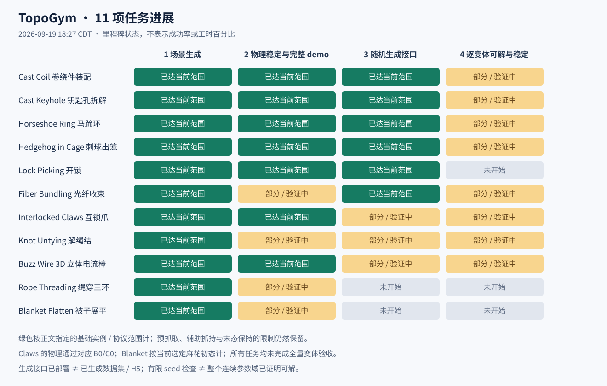

# TopoGym 周报｜2026-09-19

范围：以 **9 月 19 日（America/Chicago）其他工程 sessions 的更新**为主，汇总本周仍有效的成果。工程资料截至 **18:27 CDT**；agent 状态与用量冻结于 **18:24:55 CDT**。正在运行的任务只报告当时已有结果。Coil 两次求解实际发生于 9 月 18 日，今天补核用量，因此作为已有测试列入。

本周的主要变化是：多项任务已经从展示变体推进到可复现、可重载的实例生成器；Claws B0/C0 增加了完整物理证据；柔性体任务仍受完整执行和数值验收限制。**现有自主求解均未成功，且原生用量核对发现，7 次已启动运行均已超过 2M 目标，尚未形成严格 2M 硬预算下的正式结果。**

## 1. 十一个任务的当前进展与多视角 demo

进度按四项分别标记：**① 场景生成 → ② 物理稳定＋全过程 demo → ③ 变体随机生成接口部署 → ④ 逐变体可解性与稳定性验收**。`█` 表示在所注明实例/协议范围内达到，`▒` 表示部分完成或仍在验证，`░` 表示未开始该层验收；不折算为百分比。③不要求已经导出数据集/H5；④要求最终收录实例有对应证据，有限抽样或父实例成功不能直接覆盖新后代。

| 任务 | ①②③④ | 当前成果 | 当前主要缺口 / 下一步 |
|---|---|---|---|
| **Cast Coil** | `███▒` | 基础装配有五视角完整执行。今日完成固定 A/B/C 核心＋尺寸、厚度、轮廓、pose 的 seed 生成器：384 个不同配置可复现，48/48 几何、12/12 随机双臂规划通过。 | 固定代表两档步长共 6 次均完成装配释放，但严格归档仅 **4/6** 通过；A/C 各一次出现微米级负间隙。随机实例动力学尚未 sweep。[生成器与验证](../../../docs/develop/tasks/cast_coil_seed_generator_zh.md) |
| **Cast Keyhole** | `███▒` | F1 加长穿齿、F2 偏心绕行、F3 转向后回退，三个家族各三种固定外形；已接 EpisodeSpec/Runner。256 seed 复现、200 次实体/边界检查，以及三个参数实例各两档物理验证通过。 | 当前物理范围是**预抓取＋辅助抓持＋拆解后持稳**，不包含放桌松手；每个新实例仍须独立验收。当前 agent 仍测固定基础实例。[生成器](../../../docs/develop/tasks/cast_keyhole_variants_zh.md) |
| **Horseshoe Ring** | `███▒` | 重力基础版完整取环、松手落桌，2/1 ms 复验通过。新三族以高位/外侧/后撤接近区分，路线差约 20–22 cm；256 seed 参数、48 项初态/折合 IK 检查通过，已有逐实例验收入口。 | 最终条件域跨放置修订的 4 次请求、6 次候选放行 3 个实例；新三族仅 2 ms 完整验收，尚无 1 ms 复验。不能将跨代码版本结果当统一成功率。[生成器与账本](../../../docs/develop/tasks/horseshoe_ring_variant_generator_zh.md) |
| **Hedgehog in Cage** | `███▒` | 当前池为单斜窗、固定六刺侧孔、GEN 顶部钥匙孔；两个新原型完整取出/释放且两档子步通过。v2 完成 1000 seed 家族抽样、13 个固定/随机/边界预检、三族加载及跨进程恢复。 | 随机后代 `physical_execution=not_run`；侧孔与 CLASSIC 共享侧向策略，不宣称三种本质不同 IK。另一个窄侧孔 v3 只有几何预演，未加入生成器。[当前记录](../../../docs/develop/tasks/hedgehog_in_cage_zh.md) |
| **Lock Picking** | `███░` | 150 mm 两回退基础版有完整三视角成功记录。新 F1/F2/F3 必要回退 1/2/3 次；256 seed 均在最多 8 次尝试内通过几何/IK，99 个需要重试；九个 S/M/L 代表通过。 | 新三族尚未验证机器人场景碰撞、动力学及完整抓起/松手；目前视频是 IK 预演。回退次数体现序列长度，难度梯度尚未实测。[生成器](../../../docs/develop/tasks/lock_picking_seed_generator_zh.md) |
| **Fiber Bundling** | `█▒█▒` | 按已确认约定保留稀疏/标准/密集，**不要求 IK 本质不同**。N/R 生成、保存重载已接通；300 seed 初态几何、39 个边界组合通过，3 个随机实例各 0.2 s 静置通过。 | 8 芯基础版两步长均完成穿环，但严格全程线形收敛未通过，末态仍夹持；旧代表证据不覆盖新随机实例。还需逐例 IK、细线禁碰、全程及数值验收。[生成器](../../../docs/develop/tasks/fiber_bundling_variant_pipeline_zh.md) · [基础证据](../../../runs/demo_metadata/fiber_bundling/README.md) |
| **Interlocked Claws** | `██▒▒` | 新 **B0 螺旋冠、C0 正交双窗**完成实体、IK、连续动力学与半步长复验。C0 已按反馈缩为两窗全等的紧凑版（外框各 25 × 19 cm，整体最大 25.2 cm），新增 62.05 秒五视角全过程；使用 MuJoCo，预抓取＋理想焊接辅助。 | 旧 A0 的 Genesis 非凸接触限制仍在。旧 seed API 已做 128 seed 复现检查，但 B0/C0 冻结原型尚未接入该 API；不能宣称三族随机生成已经闭环。[新物理证据](../../../docs/develop/tasks/interlocked_claws_authored_physics_zh.md) · [旧生成器](../../../docs/develop/tasks/interlocked_claws_variant_pipeline_audit_zh.md) |
| **Knot Untying** | `█▒▒▒` | 三叶结 v9 有 75 s 连续解结、释放录像；新增八字结、双重单结实体与独立动作逻辑，两个新结型分别通过一次 10 s 自由静置。尺度/yaw/颜色 seed 候选已实现，18 个收窄边界组合通过首段 CPU 预检。 | v9 的 P3 网格收敛和通用双手交接未通过；八字结连续机器人试录中，双重单结尚无完整成功。三档难度仍是目标。agent adapter 尚无通过真实启动验收的 ready 包。[家族进展](../../../docs/develop/tasks/knot_untying_family_space_zh.md) |
| **Buzz Wire 3D** | `██▒▒` | 紧凑基础版完成真实摩擦抓持、通行、释放与半步长复验。新 F3 四关 v3：10001 点密集 IK 通过，主物理运行完成 **106.92 s**，三路成片 **106.96 s**。 | F3 独立 2 ms 复验重跑中；F2 后半程仍在搜索，尚无新完整执行。原型内随机范围仍需落实逐实例资格，不能用 F3 单例替代全族。[最新运行记录](../../../runs/environment-solvability/buzz_wire_3d/family_solvability_20260919/result.md) |
| **Rope Threading** | `█▒░░` | 三环场景和物理抓绳前段可运行；最新可播放五视角前段 **29.05 s**，包含抓取、抬升、释放、静置。快照中的全流程试跑推进至 **19.005 s / reference_07**，双手抓持有效，15204 个原生子步全部收敛、零警告。 | 尚无三环成功全过程；既有套件 5/6 项通过，加载半步长试验的迟发运动仍影响静置验收。全流程计算很慢；参数生成尚未进入验收。[任务记录](../../../docs/develop/tasks/rope_threading_zh.md) · [本次进度快照](snapshots/project_sources/runs/environment-solvability/rope_threading/full_exploratory_v13_attempt_1/progress.json) |
| **Blanket Flatten** | `█▒░░` | 当前选定麻花初态额外静置 10 s 通过，最大漂移 **0.143 mm**。最新 v10 三视角 **179.5 s** 已完成；v8 七次抓放末态覆盖 **75.7%**。 | **复杂初态尚未展平成功**：v10 八次保护释放，末态覆盖 **45.4%**，高度/拉伸亦不达标；旧简单初态成功不能替代它。下一步解决解扭、被覆盖布角和拉伸控制。[试验记录](../../../runs/environment_bootstrap/blanket_flatten/gathered_robot_study/result.md) |

**多视角 MP4 直链。** 单臂按 `agentview / front_oblique / wrist`；ALOHA 按 `cam_high / cam_low / cam_left_wrist / cam_right_wrist`，已有近景另外保留。每一行的视角来自同一次执行；不同家族、旧版与新版分行列出。视频重渲染不代表又完成一次动力学执行。

| 任务 / 版本 | 时长 | 同步多视角 MP4 | 验证范围 |
|---|---:|---|---|
| Cast Coil 卷绕件装配 · **基础装配** | 33.15 s | [高位](../../../demos/cast_coil/cam_high/2026-09-17_aloha_full_cam_high.mp4) · [低位](../../../demos/cast_coil/cam_low/2026-09-17_aloha_full_cam_low.mp4) · [左腕](../../../demos/cast_coil/cam_left_wrist/2026-09-17_aloha_full_cam_left_wrist.mp4) · [右腕](../../../demos/cast_coil/cam_right_wrist/2026-09-17_aloha_full_cam_right_wrist.mp4) · [斜前](../../../demos/cast_coil/front_oblique/2026-09-17_aloha_full_front_oblique.mp4) | 预抓取；双指接触后辅助抓持；装配、放置、松手与静置；基础版双步长证据。 |
| Cast Keyhole 钥匙孔拆解 · **基础拆解** | 23.92 s | [高位](../../../demos/cast_keyhole/cam_high/2026-09-17_current_instance_physical_cam_high.mp4) · [低位](../../../demos/cast_keyhole/cam_low/2026-09-17_current_instance_physical_cam_low.mp4) · [左腕](../../../demos/cast_keyhole/cam_left_wrist/2026-09-17_current_instance_physical_cam_left_wrist.mp4) · [右腕](../../../demos/cast_keyhole/cam_right_wrist/2026-09-17_current_instance_physical_cam_right_wrist.mp4) · [近景](../../../demos/cast_keyhole/detail/2026-09-17_current_instance_physical_detail.mp4) | 预抓取、接触辅助；完整拆解后保持抓持；不含放桌松手。 |
| Horseshoe Ring 马蹄环 · **重力修正基础版** | 113.70 s | [高位](../../../demos/horseshoe_ring/cam_high/2026-09-18_gravity_replanned_v1_cam_high.mp4) · [低位](../../../demos/horseshoe_ring/cam_low/2026-09-18_gravity_replanned_v1_cam_low.mp4) · [左腕](../../../demos/horseshoe_ring/cam_left_wrist/2026-09-18_gravity_replanned_v1_cam_left_wrist.mp4) · [右腕](../../../demos/horseshoe_ring/cam_right_wrist/2026-09-18_gravity_replanned_v1_cam_right_wrist.mp4) · [近景](../../../demos/horseshoe_ring/detail/2026-09-18_gravity_replanned_v1_detail.mp4) | 预抓持、辅助抓持；交接、取环、自由落桌；基础版 2/1 ms 复验通过。 |
| Hedgehog in Cage 刺球出笼 · **CLASSIC wood：agent 测试基础版** | 82.20 s | [全景](../../../demos/hedgehog_in_cage/agentview/2026-09-16_classic_wood_extraction_agentview.mp4) · [斜前](../../../demos/hedgehog_in_cage/front_oblique/2026-09-16_classic_wood_extraction_front_oblique.mp4) · [腕部](../../../demos/hedgehog_in_cage/wrist/2026-09-16_classic_wood_extraction_wrist.mp4) | 预抓取、接触辅助；取出、放桌、松手、撤离和静置。 |
| Hedgehog in Cage 刺球出笼 · **当前家族 A：单斜窗** | 82.58 s | [全景](../../../demos/hedgehog_in_cage/agentview/2026-09-17_family_a_oblique_gate_v1_agentview.mp4) · [斜前](../../../demos/hedgehog_in_cage/front_oblique/2026-09-17_family_a_oblique_gate_v1_front_oblique.mp4) · [腕部](../../../demos/hedgehog_in_cage/wrist/2026-09-17_family_a_oblique_gate_v1_wrist.mp4) | 预抓取、接触辅助；取出、放桌、松手、撤离和静置。 |
| Hedgehog in Cage 刺球出笼 · **当前家族 B：固定六刺侧孔** | 82.25 s | [全景](../../../demos/hedgehog_in_cage/agentview/2026-09-19_fixed_side_window_v2_agentview.mp4) · [斜前](../../../demos/hedgehog_in_cage/front_oblique/2026-09-19_fixed_side_window_v2_front_oblique.mp4) · [腕部](../../../demos/hedgehog_in_cage/wrist/2026-09-19_fixed_side_window_v2_wrist.mp4) | 预抓取、接触辅助；取出、放桌、松手、撤离和静置。 |
| Hedgehog in Cage 刺球出笼 · **当前家族 C：GEN 顶部钥匙孔** | 98.83 s | [全景](../../../demos/hedgehog_in_cage/agentview/2026-09-19_gen_keyhole_v2_agentview.mp4) · [斜前](../../../demos/hedgehog_in_cage/front_oblique/2026-09-19_gen_keyhole_v2_front_oblique.mp4) · [腕部](../../../demos/hedgehog_in_cage/wrist/2026-09-19_gen_keyhole_v2_wrist.mp4) | 预抓取、接触辅助；取出、放桌、松手、撤离和静置。 |
| Lock Picking 开锁 · **150 mm 两回退基础版** | 159.35 s | [全景](../../../demos/lock_picking/agentview/2026-09-18_standard_150mm_purple_trace_v1_agentview.mp4) · [斜前](../../../demos/lock_picking/front_oblique/2026-09-18_standard_150mm_purple_trace_v1_front_oblique.mp4) · [腕部](../../../demos/lock_picking/wrist/2026-09-18_standard_150mm_purple_trace_v1_wrist.mp4) | 成功物理状态重渲染；被动夹爪连杆按开合量重建；不是新的动力学执行。 |
| Fiber Bundling 光纤收束 · **8 芯 / R13.5 mm 基础版** | 177.00 s | [全景](../../../demos/fiber_bundling/agentview/2026-09-18_standard_08_r13p5mm_clean_v1_agentview.mp4) · [斜前](../../../demos/fiber_bundling/front_oblique/2026-09-18_standard_08_r13p5mm_clean_v1_front_oblique.mp4) · [腕部](../../../demos/fiber_bundling/wrist/2026-09-18_standard_08_r13p5mm_clean_v1_wrist.mp4) | 实际接触后辅助抓持，只抓粗护套；末态仍夹持；两步长均完成，严格线形收敛未通过。 |
| Interlocked Claws 互锁爪 · **A0 原版** | 158.60 s | [高位](../../../demos/interlocked_claws/cam_high/2026-09-17_reference_full_v1_cam_high.mp4) · [低位](../../../demos/interlocked_claws/cam_low/2026-09-17_reference_full_v1_cam_low.mp4) · [左腕](../../../demos/interlocked_claws/cam_left_wrist/2026-09-17_reference_full_v1_cam_left_wrist.mp4) · [右腕](../../../demos/interlocked_claws/cam_right_wrist/2026-09-17_reference_full_v1_cam_right_wrist.mp4) · [近景](../../../demos/interlocked_claws/detail/2026-09-17_reference_full_v1_detail.mp4) | 辅助抓持全过程；原非凸接触资格限制保留；与 B0/C0 的 MuJoCo 证据分开。 |
| Interlocked Claws 互锁爪 · **B0 螺旋冠** | 37.05 s | [高位](../../../demos/interlocked_claws/cam_high/2026-09-19_helical_crown_physical_v1_cam_high.mp4) · [低位](../../../demos/interlocked_claws/cam_low/2026-09-19_helical_crown_physical_v1_cam_low.mp4) · [左腕](../../../demos/interlocked_claws/cam_left_wrist/2026-09-19_helical_crown_physical_v1_cam_left_wrist.mp4) · [右腕](../../../demos/interlocked_claws/cam_right_wrist/2026-09-19_helical_crown_physical_v1_cam_right_wrist.mp4) · [近景](../../../demos/interlocked_claws/detail/2026-09-19_helical_crown_physical_v2_detail.mp4) | MuJoCo；预抓持和理想焊接辅助，完整分离、落桌、松手；双步长通过。 |
| Interlocked Claws 互锁爪 · **C0 紧凑全等双窗（当前）** | 62.05 s | [高位](../../../demos/interlocked_claws/cam_high/2026-09-19_orthogonal_gate_balanced_physical_v1_cam_high.mp4) · [低位](../../../demos/interlocked_claws/cam_low/2026-09-19_orthogonal_gate_balanced_physical_v1_cam_low.mp4) · [左腕](../../../demos/interlocked_claws/cam_left_wrist/2026-09-19_orthogonal_gate_balanced_physical_v1_cam_left_wrist.mp4) · [右腕](../../../demos/interlocked_claws/cam_right_wrist/2026-09-19_orthogonal_gate_balanced_physical_v1_cam_right_wrist.mp4) · [近景](../../../demos/interlocked_claws/detail/2026-09-19_orthogonal_gate_balanced_physical_v2_detail.mp4) | 两窗外框均为 25 × 19 cm，整体最大 25.2 cm；先放蓝件并退手，再放框架；预抓取理想焊接辅助，双步长通过。[修订与证据](../../../docs/develop/tasks/interlocked_claws_balanced_gate_zh.md) |
| Interlocked Claws 互锁爪 · **C0 正交双窗大框版（历史）** | 50.05 s | [高位](../../../demos/interlocked_claws/cam_high/2026-09-19_orthogonal_gate_physical_v2_cam_high.mp4) · [低位](../../../demos/interlocked_claws/cam_low/2026-09-19_orthogonal_gate_physical_v2_cam_low.mp4) · [左腕](../../../demos/interlocked_claws/cam_left_wrist/2026-09-19_orthogonal_gate_physical_v2_cam_left_wrist.mp4) · [右腕](../../../demos/interlocked_claws/cam_right_wrist/2026-09-19_orthogonal_gate_physical_v2_cam_right_wrist.mp4) · [近景](../../../demos/interlocked_claws/detail/2026-09-19_orthogonal_gate_physical_v2_detail.mp4) | MuJoCo；预抓持和理想焊接辅助，完整分离、落桌、松手；双步长通过。 |
| Knot Untying 解绳结 · **三叶结 v9** | 75.00 s | [高位](../../../demos/knot_untying/cam_high/2026-09-17_bounded_spread_trefoil_v9_cam_high.mp4) · [低位](../../../demos/knot_untying/cam_low/2026-09-17_bounded_spread_trefoil_v9_cam_low.mp4) · [左腕](../../../demos/knot_untying/cam_left_wrist/2026-09-17_bounded_spread_trefoil_v9_cam_left_wrist.mp4) · [右腕](../../../demos/knot_untying/cam_right_wrist/2026-09-17_bounded_spread_trefoil_v9_cam_right_wrist.mp4) · [近景](../../../demos/knot_untying/detail/2026-09-17_bounded_spread_trefoil_v9_detail.mp4) | 连续解结、释放、静置；接触辅助；本轨迹通过，P3 网格收敛和通用双手交接未通过。 |
| Buzz Wire 3D 立体电流棒 · **紧凑单臂基础版** | 91.84 s | [全景](../../../demos/buzz_wire_3d/agentview/2026-09-18_compact_single_arm_v1_agentview.mp4) · [斜前](../../../demos/buzz_wire_3d/front_oblique/2026-09-18_compact_single_arm_v1_front_oblique.mp4) · [腕部](../../../demos/buzz_wire_3d/wrist/2026-09-18_compact_single_arm_v1_wrist.mp4) | 预穿环/预抓取，实际摩擦夹持，完整通行、释放、滑落、静置；半步长复验通过。 |
| Buzz Wire 3D 立体电流棒 · **F3 四关 v3 最新主运行** | 106.96 s | [全景](../../../runs/environment-solvability/buzz_wire_3d/family_solvability_20260919/F3_render_03/agentview.mp4) · [斜前](../../../runs/environment-solvability/buzz_wire_3d/family_solvability_20260919/F3_render_03/front_oblique.mp4) · [腕部](../../../runs/environment-solvability/buzz_wire_3d/family_solvability_20260919/F3_render_03/wrist.mp4) | 同一次主物理运行成功；纯摩擦抓持；实测状态重渲染；小步长复验未完成，待归档。 |
| Rope Threading 绳穿三环 · **最新完成的前段录像** | 29.05 s | [高位](../../../runs/environment-solvability/rope_threading/physics_soft50_damped20_compressible_fine_v13/robot_prefix_attempt_2/cam_high.mp4) · [低位](../../../runs/environment-solvability/rope_threading/physics_soft50_damped20_compressible_fine_v13/robot_prefix_attempt_2/cam_low.mp4) · [左腕](../../../runs/environment-solvability/rope_threading/physics_soft50_damped20_compressible_fine_v13/robot_prefix_attempt_2/cam_left_wrist.mp4) · [右腕](../../../runs/environment-solvability/rope_threading/physics_soft50_damped20_compressible_fine_v13/robot_prefix_attempt_2/cam_right_wrist.mp4) · [近景](../../../runs/environment-solvability/rope_threading/physics_soft50_damped20_compressible_fine_v13/robot_prefix_attempt_2/detail.mp4) | 仅抓取、抬升、主动释放和静置；不含三环全过程；完整试跑仍在进行。 |
| Blanket Flatten 被子展平 · **选定麻花初态 v10：最新未完成** | 179.50 s | [全景](../../../runs/environment_bootstrap/blanket_flatten/gathered_robot_v10/render/agentview.mp4) · [斜前](../../../runs/environment_bootstrap/blanket_flatten/gathered_robot_v10/render/front_oblique.mp4) · [腕部](../../../runs/environment_bootstrap/blanket_flatten/gathered_robot_v10/render/wrist.mp4) | 八次保护释放，末态覆盖率 45.4%；2 fps 实测状态重渲染；不是成功展平。 |
| Blanket Flatten 被子展平 · **选定麻花初态 v8：补充进展** | 174.20 s | [全景](../../../runs/environment_bootstrap/blanket_flatten/gathered_robot_v8/render/agentview.mp4) · [斜前](../../../runs/environment_bootstrap/blanket_flatten/gathered_robot_v8/render/front_oblique.mp4) · [腕部](../../../runs/environment_bootstrap/blanket_flatten/gathered_robot_v8/render/wrist.mp4) | 七次抓放，末态覆盖率 75.7%；仍有折叠，未达到 90% 等终态标准。 |
| Blanket Flatten 被子展平 · **旧简单初态：已有完整成功** | 32.55 s | [全景](../../../demos/blanket_flatten/agentview/2026-09-18_single_arm_clear_home_v1_agentview.mp4) · [斜前](../../../demos/blanket_flatten/front_oblique/2026-09-18_single_arm_clear_home_v1_front_oblique.mp4) · [腕部](../../../demos/blanket_flatten/wrist/2026-09-18_single_arm_clear_home_v1_wrist.mp4) | 简单初态，辅助抓角、展开、松手、静置；不能替代选定复杂初态的成功证据。 |

本周报实际复核了以上 **19 组、73 个 MP4**：文件存在、完整解码、同组帧数/时长/fps 一致，并记录 SHA-256；全部通过。[视频核验记录](video_validation.json) · [视频与证据清单](demo_inventory.json)。这项检查确认交付文件可播放和视角同步，物理资格仍以上述具体实验报告为准。Blanket v10 为 2 fps，因此动作观感不如 v8 连贯；Rope 的进行中录像不作为可播放成片交付。

**三类动作的补充对照**（局部或分析视频，不替代上表完整 demo）：Coil [正面](../../../demos/cast_coil/motion_front/2026-09-19_seed_families_v1_kinematic_motion_front.mp4) / [侧面](../../../demos/cast_coil/motion_side/2026-09-19_seed_families_v1_kinematic_motion_side.mp4) / [斜视](../../../demos/cast_coil/motion_oblique/2026-09-19_seed_families_v1_kinematic_motion_oblique.mp4)，为无机器人运动学机制对照；Keyhole [实测轨迹对照](../../../demos/cast_keyhole/comparisons/2026-09-19_seed_v2_trajectory_comparison.mp4)，为状态分析；Horseshoe [高位](../../../demos/horseshoe_ring/cam_high/2026-09-19_families_v2_approach_comparison_cam_high.mp4) / [低位](../../../demos/horseshoe_ring/cam_low/2026-09-19_families_v2_approach_comparison_cam_low.mp4)，为 9.8 s 接近阶段；Lock [F1](../../../demos/lock_picking/front_oblique/2026-09-19_F1_M_kinematic_front_oblique.mp4) / [F2](../../../demos/lock_picking/front_oblique/2026-09-19_F2_M_kinematic_front_oblique.mp4) / [F3](../../../demos/lock_picking/front_oblique/2026-09-19_F3_M_kinematic_front_oblique.mp4)，为不含抓起/松手的零物理步 IK 预演。补充对照不计入上述 73 个多视角交付文件。

## 2. GPT‑6 Astra 求解测试：2M 目标预算与已有结果

已查到 **6 个任务、7 次运行**：6 次结束为 `failed`，Claws 1 次仍为 `ready`，其余 5 个任务未开始自主求解。模型记录为 `gpt-6-astra`。这只是现有 pilot 的结果汇总，**没有可报告的严格 2M 硬限额成功率**，也不能据此给出模型在合格任务上的失败率。

计量口径是整个 episode 每次调用的 **input + output**，包含重复上下文；cached input 已在 input 内，reasoning output 已在 output 内，均不再加一次。执行时 bridge 采用 `manual`，`used=0` 表示未接入计量，不能解释为零消耗或还有 2M 余额。本周报只读核对原生累计计数，以任务开始前后差值计算；结束轮次含最终答复、排除后续讨论，未结束轮次给出快照下界。所有区间计数无回退，累计增量与 last usage 一致。[逐轮计量及边界证据](token_audit.json)

| 任务 / run | 已有操作与终态 | 段数 / 控制时间 | 原生累计 tokens | 2M 结果归类 |
|---|---|---:|---:|---|
| **Cast Coil · 001** | 抓起、移动、放下并释放银件；未建立装配办法，主动 stop → failed。 [记录](../../../runs/agent_test_demos/agent_solutions/cast_coil_codex_001/result.md) | 11 / 8.3 s | **4,420,724**（2.21×） | 超预算；全轮结果不作为合规 2M 试验 |
| **Cast Coil · 002** | 尝试双臂抓取与装配；右夹爪持续不响应张开，无法继续 → failed；根因未确认。 [记录](../../../runs/agent_test_demos/agent_solutions/cast_coil_codex_002/result.md) | 64 / 74.34 s | **69,452,496**（34.73×） | 超预算；全轮结果不作为合规 2M 试验 |
| **Horseshoe Ring · 001** | 保持双手抓持并抬转左侧马蹄；环未取下，检测超预算后主动 stop → failed。 [记录](../../../runs/agent_test_demos/agent_solutions/horseshoe_codex_001/result.md) | 2 / 1.64 s | **2,819,223**（1.41×） | 超预算；全轮结果不作为合规 2M 试验 |
| **Cast Keyhole · 001** | 共同转动及局部相对推进；在内部槽齿附近受阻，未找到可靠完整路径，主动 stop → failed。 [记录](../../../runs/agent_test_demos/agent_solutions/cast_keyhole_codex_001/result.md) | 19 / 9.01 s | **12,487,795**（6.24×） | 超预算；全轮结果不作为合规 2M 试验 |
| **Hedgehog in Cage · 001** | 刺球部分移出，旋转后仍受笼柱约束；接近预算时主动 stop → failed，未取出/释放。 [记录](../../../runs/agent_test_demos/agent_solutions/hedgehog_codex_001/result.md) | 7 / 10.05 s | **2,109,472**（1.05×） | 超预算；全轮结果不作为合规 2M 试验 |
| **Lock Picking · 001** | 抓起钥匙并推进第一锁片；钥匙/机构接触力 **>10 N**，evaluator 自动 failed。 [记录](../../../runs/agent_test_demos/agent_solutions/lock_picking_codex_001/result.md) | 10 / 16.29 s | **3,821,375**（1.91×） | 超预算；全轮结果不作为合规 2M 试验 |
| **Interlocked Claws · 001** | 完成局部姿态/位移尝试，两件仍互锁；快照为 **ready / 进行中**，无最终结果。 [记录](../../../runs/agent_test_demos/agent_solutions/claws_codex_001/notes.md) | 14 / 9.86 s | **≥ 23,376,797**（≥ 11.69×） | 已超预算且未结束；不预判最终成败 |
| **Fiber Bundling** | **未开始**；工程参考控制器的穿环 demo 不算受测求解。 | — | — | 未开始 |
| **Knot Untying** | **未开始**；adapter 代码已接入，真实启动仍受 CUDA/IPC 等问题阻挡，尚无 ready 求解包。 | — | — | 未开始 |
| **Buzz Wire 3D** | **未开始**；adapter 已有 101 步短测，属于接口验证。 | — | — | 未开始 |
| **Rope Threading** | **未开始**；当前长运行是工程参考执行。 | — | — | 未开始 |
| **Blanket Flatten** | **未开始**；v1–v10 是工程控制器试验。 | — | — | 未开始 |

**本次补核修正了几份旧记录的范围。** Horseshoe 旧报告的 2,385,756 和 Hedgehog 的 1,934,167 都是结束前快照；含结束答复后分别为 **2,819,223** 和 **2,109,472**。Coil 001、Lock、Claws 原结果没有完整原生计量，本周报补查。Coil 002 的 69,452,496、Keyhole 的 12,487,795 与已有事后审计一致。原始任务结果及 bridge 账本未改写；冻结副本与计量来源保存在本周报目录。

这些失败需要分别解释：Coil 002 有夹爪执行异常；Lock 是明确接触力终止；Keyhole/Hedgehog 是受限感知与接触下未找到后续动作；Horseshoe 是预算终止。它们均不证明任务无解。现有受测 adapter 全部标记 `physics_qualified=false`；B0/C0 等工程新成果不能自动替正在测的 A0 或其他固定 adapter 完成物理资格认证。

## 3. 提请 reviewer 评估的问题

**问题一：paper 是否需要为数据集中每个收录变体提供可解性证据？当前阶段是否必须做全量 sweep？**

拟请 reviewer 判断：如果 paper 声称“数据集中的每个实例在指定机器人与交互协议下可解”，是否接受**逐实例、可复现的成功执行见证**作为证据，并将生成端参考解保持私有？还是需要更强的几何/形式化证明或稳定性重复实验？

我们的建议是把声明限定在**最终收录集合**，采用“已知解与场景共同构造 → 几何/IK 检查 → 使用同一评测协议完整执行 → 验收通过才收录”。几何通路、机器人 IK 可达、完整动力学成功是不同层级，不能用前两项直接替代最后一项。尤其要对齐预抓取还是从 home 抓起、是否辅助抓持、是否要求最终放下/释放；已有中间拆解轨迹不自动覆盖新增阶段。

若声明全部收录实例可解，则应给全部收录实例留下匹配的验收记录；**无需让 GPT‑6 对每个候选重新盲解，也无需证明整个连续参数域**。可执行生成器保留私有参考动作，再通过相同接口和 evaluator 验证。失败候选可拒绝或有限重采，拒绝率、原因和家族分布需保留；参考控制器失败本身不等于无解。

当前阶段可先冻结各家族的完整成功基准，完善逐实例“生成—验证—拒绝”闭环，再对首批计划收录的有限 seed 列表 sweep。完整数据规模确定后再验收全量；若只做抽查，paper 应写“抽查验证”，不能写全部实例都已保证可解。一次成功是指定条件下的存在性见证；**稳定可解**还需要按声明补时间步/网格对照、重复运行或初态扰动检查。每个实例保存 seed、生成器/资产/环境版本、初态、参考动作、成功判据、报告和哈希，视频可选。

已知参考解不会使评测失去意义：生成端拥有结构与轨迹信息，受测 agent 只能用允许的图像和交互独立寻找动作。为避免只测同一轨迹的微扰记忆，结构家族与父模板也应参与数据划分，难度标签另用统一条件下的实测结果确认。

**问题二：直接 GPT‑6 session 的当前测试方法是否合理，能支持多强的论文结论？**

目前实际流程如下，供 reviewer 审查：

1. **环境独立启动并持续持有。** 操作者启动固定 task adapter，导出包含目标、机器人动作接口、相机标定和规则的任务包。solver 通过本地文件队列或 HTTP bridge 交互；无需浏览器人工逐段点击。`manual` 指计量方式，动作闭环本身由 agent 自动执行。
2. **公开输入是当前 episode 的多视角 RGB 与机器人本体状态。** 首次动作前打开初始图片；后续按实际图像与状态反馈推断物体关系。不给物体 CAD、参考解、成功 demo、目标相对变换或私有 simulator state。solver 可使用终端、通用库、图像分析和自己编写的规划/IK 代码；联网由任务配置决定。现有非 Coil 试验关闭联网；Coil 允许通用资料，其结果记录称未使用联网研究。
3. **动作是代码段驱动连续物理环境。** agent 反复“observe → 看图 → 离线计算/写脚本 → submit → observe”，通过 `env.step` 发关节与夹爪目标。每段有步数上限，实际时间取各任务 `control_dt_s`；位置控制目标不能当作已经到达的位置。不能重置、回滚、复制 episode、改环境或 evaluator。超时用原 request ID 查询/重试，预检查拒绝不推进环境。
4. **结果由 evaluator 和明确停止记录决定。** `ready` 只表示还能执行，只有 `succeeded` 才是任务成功。违规/物理终止、solver 主动放弃、预算耗尽和基础设施错误应分别统计。保留每段脚本、请求、全部相机帧、manifest、状态和终态；solver 笔记作为解释，不取代环境证据。
5. **预算目标为累计 2M，但本批没有实时硬限制。** bridge 未接原生用量，部分 session 由 solver 临时检查宿主计数，其余在结束后核对。重复长上下文同样消耗预算，最终答复也可能把接近上限的运行推过线；本批实际超预算结果已在第二节逐项列明。

依据：[交互协议](../../../docs/develop/modules/agent_bridge_zh.md) · [当前 session 测试说明及限制](../../../docs/develop/modules/agent_test_demos_zh.md) · [solver 规则](../../../docs/develop/modules/agent_solver_prompt_zh.md)。通用测试说明中“目前仅 Coil 可测”的早期段落已落后于今日新增 adapter；任务覆盖按本周实际任务包与 session 状态核对。

**拟请 reviewer 重点评价以下四点：**

| 评价点 | 本批已知情况 | 建议用于正式实验的条件 |
|---|---|---|
| 信息边界与 session 独立性 | 当前共享文件系统主要靠提示词限制；Coil 002、Horseshoe、Keyhole、Hedgehog 使用有旧任务上下文的同一聊天，不能称严格独立盲测。 | 每次试验使用干净 session 与独立包/容器，仅暴露公开观测与动作接口，保存模型/工具访问审计。请确认保留哪些通用机器人参数、标定和工具，符合目标能力定义。 |
| 2M 预算是否真正可比较 | 本批所有运行均已有 >2M 记录；事后统计可揭示超限，无法追溯性地把整轮变为硬预算运行。长旧上下文还会改变有效预算。 | 由外部控制器采集原生 usage，在每次模型调用前预留输入/输出额度、在动作提交前核验；预先固定是否计入结束报告。严格 2M 实验另开新 run，旧数据保留为探索记录。 |
| 任务是否已在相同条件下被证明可完成 | 工程 demo 与 solver 初态不同：Coil demo 有预抓取/辅助，solver 从 home 自主抓自由物体且无辅助；其他任务也有抓起、释放要求差异，全部 pilot adapter 仍未获完整物理资格。 | 先让私有参考控制器通过**同一初态、控制接口、辅助规则、终态与失败判据**。基础设施/执行器异常与规划失败分开，避免把环境缺陷当成模型能力不足。 |
| 评测能力与统计有效性 | 测的是使用图像、代码、数值库和交互反馈的长程机器人求解；本批每任务仅少量试验，版本、抓持与物理后端也不完全一致。 | 明确这是 coding agent 机器人交互能力；冻结模型设置、工具、网络、观测、预算、实例/重复次数和 evaluator。按任务与条件分层报告成功、失败、超预算和运行错误，不混成一个无条件总分。 |

当前判断：**直接 session 很适合验证接口、观察求解行为和定位瓶颈；现有这批可作为探索性 pilot。若要写成“GPT‑6 Astra 在 2M tokens 下的正式 benchmark”，还需补齐外部硬计量、干净会话、同协议可解见证及重复实验。** 请 reviewer 评估上述输入/工具范围是否符合论文希望测量的能力，并确认逐实例可解证据与稳定性验收的最低要求。

资料索引：[来源文件快照与 17 个相关 sessions](sources.json) · [冻结的 agent 状态](token_audit.json) · [demo 清单](demo_inventory.json)。本次仅整理与核验，不重跑求解、不更新其他 session 的结果，也未生成数据集或 H5。
