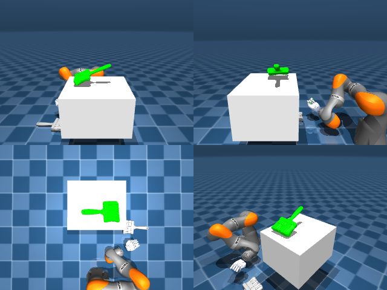

# Codex + GPT-6 Luna, reasoning effort xhigh, reasoning summaries on, 60 min, no per-goal time limit — dextoolbench_brush_blue_brush_sweep_forward-limited

Run: Harbor job `dtbl-nt-gpt6luna-xhigh`, trial `dextoolbench_brush_blue_brush_sw__WT9Yv3A`, 2026-09-29. Mode: **limited (robot as a service)**.

| | |
|---|---|
| result | **0** |
| agent time | 3207 s |
| actions / physics steps | — / — |
| tokens in / out | 25326721 / 135673 |
| verifier | `{"success": 0, "deterministic": 1, "finalized": 1, "control_steps": 36000, "calls": 192, "elapsed_s": 3347.1, "video_rendered": 1, "grader_error": 0, "progress": 0.0, "goals_reached": 0, "n_goals": 34, "failed_on_timeout": 0}` |
| verifier sandbox | separate |

## Replay (verifier's six-camera video)

[replay.mp4](replay.mp4) — top: world / observer / head; bottom: front / left wrist / right wrist.

## Agent's last messages

- The brush has not moved with the gripper, and the task remains at goal 0. I’m going to hold the measured joint positions through the remaining episode steps so the service can finalize and grade the recorded trajectory; the final score will reflect the goals actually reached.
- The service finalized at the 36,000-step limit with 0 of 34 goals reached. I’ve stopped sending robot commands and am preserving the controller file while removing the temporary camera dumps.
- The episode finalized at the 36,000-step limit with **0 of 34 goals reached**. The brush fell below the table during the grasp attempts, and I couldn’t recover it.  I saved the RGB-D perception and grasp-control helpers, with the outcome recorded, in [gen.py](/app/output/gen.py).
