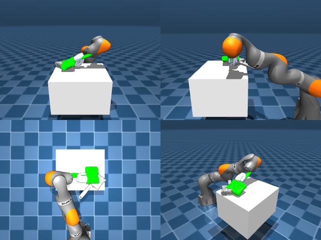

# Codex + GPT-6 Luna, reasoning effort xhigh, reasoning summaries on, 60 min — dextoolbench_brush_blue_brush_sweep_forward

Run: Harbor job `mj-gpt6luna-xhigh`, trial `dextoolbench_brush_blue_brush_sw__y2WhG8L`, 2026-09-29. Mode: **unlimited**.

| | |
|---|---|
| result | **0** |
| agent time | 3602 s |
| actions / physics steps | 600 / — |
| tokens in / out | 5607607 / 105872 |
| verifier | `{"success": 0, "progress": 0.0, "goals_reached": 0, "n_goals": 34, "failed_on_timeout": 1, "deterministic": 1, "n_actions": 600, "control_steps_used": 600, "video_rendered": 1, "grader_error": 0, "agent_resets": 114, "agent_control_steps": 66649, "agent_cost_self_reported": 1, "agent_traces": 78, "agent_trace_videos": 3, "agent_trace_videos_skipped_budget": 1}` |
| verifier sandbox | separate |

Debugging footprint (self-reported by the agent's tooling log): 51 sessions, 114 resets, None physics steps.

## Replay (verifier's six-camera video)

[replay.mp4](replay.mp4) — top: world / observer / head; bottom: front / left wrist / right wrist.

## Agent's last messages

- The first rollout reached the hand-to-brush approach, but the brush slipped during the lift, so I’m adjusting the finger closure and checking contact geometry before attempting the full sweep. The current artifact is only a diagnostic attempt; I’ll replace it after a stable grasp is confirmed.
- I found a more promising grasp: rotating the hand partway and closing the fingers harder lifts the brush several centimeters. The first goal is now close, but the brush shifts slightly within the hand. I’m tuning the closure and waypoint motion so it settles inside the benchmark’s 1.5 cm pose tolerance before generating all waypoints.
- The current trajectory reaches 7 goals. The next waypoint pushes the wrist beyond its reachable workspace with this grasp offset, so I’m trying a more forward-facing wrist angle that keeps the brush’s later poses closer to the arm’s workspace. I’ve saved the 7-goal artifact before trying that variant.
