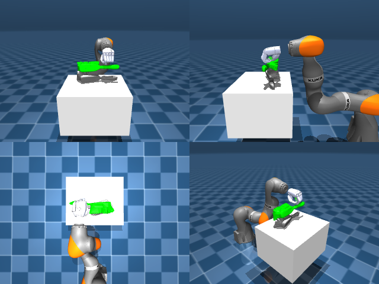

# Codex + GPT-6 Luna, reasoning effort xhigh, reasoning summaries on, 60 min — dextoolbench_brush_red_brush_sweep_forward-limited

Run: Harbor job `mjl-gpt6luna-xhigh`, trial `dextoolbench_brush_red_brush_swe__tAdcdRs`, 2026-09-29. Mode: **limited (robot as a service)**.

| | |
|---|---|
| result | **0** |
| agent time | 1003 s |
| actions / physics steps | — / — |
| tokens in / out | 2284725 / 50669 |
| verifier | `{"success": 0, "deterministic": 1, "finalized": 1, "control_steps": 600, "calls": 24, "elapsed_s": 817.2, "video_rendered": 1, "grader_error": 0, "progress": 0.0, "goals_reached": 0, "n_goals": 38, "failed_on_timeout": 1}` |
| verifier sandbox | separate |

## Replay (verifier's six-camera video)

[replay.mp4](replay.mp4) — top: world / observer / head; bottom: front / left wrist / right wrist.

## Agent's last messages

- The overhead view shows the hand is offset from the brush along the table, even though the side view made them look aligned. I’m correcting that lateral offset while lowering, then closing and lifting in the remaining time for the first goal.
- The episode timed out on goal 0 after the final correction, so the service has recorded a zero-goal attempt and will reject further actions. I’m saving the one-shot controller source in `/app/output/gen.py` as requested; I can’t replay or validate it against this consumed episode.
- The episode timed out on goal 0, so the recorded score is **0/38**. The service has ended the episode; it can’t be reset or replayed.  I saved the standalone controller record at [gen.py](/app/output/gen.py). It was written after the episode ended and wasn’t replayed against the service.
