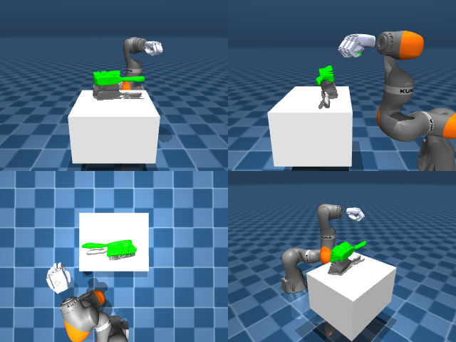

# Codex + GPT-6 Luna, reasoning effort xhigh, reasoning summaries on, 60 min, no per-goal time limit — dextoolbench_brush_red_brush_sweep_right-limited

Run: Harbor job `dtbl-nt-gpt6luna-xhigh-rerun`, trial `dextoolbench_brush_red_brush_swe__9LixxMi`, 2026-09-29. Mode: **limited (robot as a service)**.

| | |
|---|---|
| result | **0** |
| agent time | 3418 s |
| actions / physics steps | — / — |
| tokens in / out | 15491859 / 107206 |
| verifier | `{"success": 0, "deterministic": 1, "finalized": 1, "control_steps": 6168, "calls": 129, "elapsed_s": 3619.4, "video_rendered": 1, "grader_error": 0, "progress": 0.0, "goals_reached": 0, "n_goals": 38, "failed_on_timeout": 0}` |
| verifier sandbox | separate |

## Replay (verifier's six-camera video)

[replay.mp4](replay.mp4) — top: world / observer / head; bottom: front / left wrist / right wrist.

## Agent's last messages

- The front view shows the closed hand still offset from the brush in depth. I’m correcting the remaining fore/aft alignment through joint 2, then I’ll make one final close and lift while maintaining the grasp command.
- The service still reports goal 0 of 38 after the final lift and sweep attempt. I’ve saved the controller at `/app/output/gen.py`; I’m doing a quick syntax check and then I’ll report the recorded episode state plainly.
- The episode recorded 6,168 control steps, but the service still reported **0/38 goals reached**. I couldn’t complete the brush pickup and sweep.  I saved the controller at [gen.py](/app/output/gen.py) and confirmed it passes a Python syntax check.
