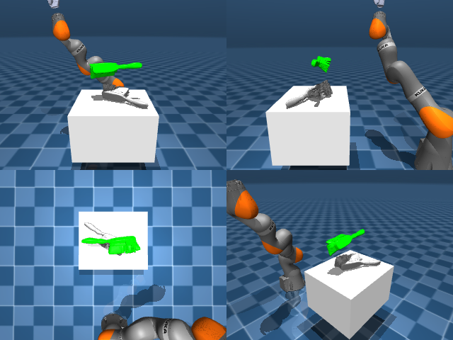

# Codex + GPT-6 Luna, reasoning effort xhigh, reasoning summaries on, 60 min — dextoolbench_brush_red_brush_sweep_right

Run: Harbor job `mj-gpt6luna-xhigh`, trial `dextoolbench_brush_red_brush_swe__TuU8Cvj`, 2026-09-29. Mode: **unlimited**.

| | |
|---|---|
| result | **0** |
| agent time | 3602 s |
| actions / physics steps | 1281 / — |
| tokens in / out | 17736138 / 139376 |
| verifier | `{"success": 0, "progress": 0.0526, "goals_reached": 2, "n_goals": 38, "failed_on_timeout": 1, "deterministic": 1, "n_actions": 1281, "control_steps_used": 1281, "video_rendered": 1, "grader_error": 0, "agent_resets": 137, "agent_control_steps": 78617, "agent_cost_self_reported": 1, "agent_traces": 68, "agent_trace_videos": 2, "agent_trace_videos_skipped_budget": 1}` |
| verifier sandbox | separate |

Debugging footprint (self-reported by the agent's tooling log): 97 sessions, 137 resets, None physics steps.

## Replay (verifier's six-camera video)

[replay.mp4](replay.mp4) — top: world / observer / head; bottom: front / left wrist / right wrist.

## Agent's last messages

- The brush body origin is offset from the visible brush, so I’m targeting a point on its handle for the initial grasp while keeping the benchmark’s body pose as the tracking reference. I’m testing a top down enveloping grasp, then I’ll measure whether the object stays attached as the wrist moves.
- The side grasp now gives sustained contact with the handle, and a feedback controller keeps the brush aligned while lifting. The lift is currently too slow to reach goal 1 within its 600 step window, so I’m tuning the controller speed while watching for slip and orientation drift.
- I found why the full run diverged: the numerical IK was choosing a distant elbow configuration for the hover pose, even though a nearby solution existed. The hand then swept the brush off the table. I’m constraining IK to stay close to the previous joint solution and rerunning the grasp and pose tracking.
